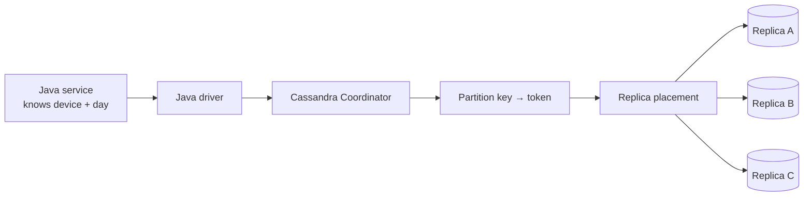
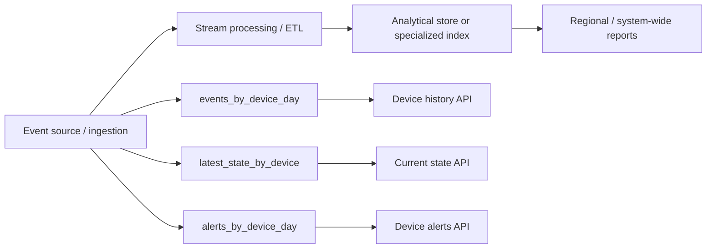

# Use Cases Suited to Event Data, Histories, or Key-Based Access

> **Chapter:** Cassandra Foundations  
> **Context:** Apache Cassandra is a distributed NoSQL database built on the *wide-column* model, often considered when systems ingest high volumes of records, need horizontal scaling, and serve queries with clear partition keys. This lesson helps identify **when to choose—and when not to choose—Cassandra** for events, histories, and key-based lookups, moving from business requirements to CQL, replication, consistency, operations, and Java applications.

## 1. Learning Objectives

After this lesson, you will be able to:

1. Identify query patterns Cassandra serves efficiently: **event writes**, **history reads by entity and time range**, **key-based point lookups**, and **recent-item lists**.
2. Distinguish **event logs**, **state histories**, and **current state**, and choose appropriate tables for each read pattern.
3. Explain the conditions that make a workload suitable: stable partition keys, distributed traffic, predictable query ordering, and clear replication/availability requirements.
4. Build query-driven CQL tables, selecting clustering columns and time buckets to prevent unbounded partition growth or hotspots.
5. Evaluate requirements for consistency, durability, TTL, compaction, repair, late-arriving events, and multi-read-model updates.
6. Recognize cases where Cassandra is **not** a good fit: arbitrary JOINs, wide-scan OLAP reports, full-text search, multi-entity ACID transactions, or very small workloads.
7. Write a Java driver query using a full partition key and apply a checklist to make evidence-backed technology recommendations.

## 2. "Big Data" Alone Is Not Enough to Choose Cassandra

Suppose a company manages 100,000 devices. Each device sends one measurement per minute, roughly:

\[
100.000 \times 1.440 = 144.000.000 \text{ events/day}
\]

The operations team wants to view a device's 100 most recent measurements; the analytics team wants average temperatures by city over 90 days; and the alerting team wants the latest status of any device.

All three use measurement data, yet they create **three very different query patterns**:

| Need | Query shape | Initial assessment |
| --- | --- | --- |
| Device history | Knows `tenant_id`, `device_id`, and date range; fetches a small slice sorted by time | **Well suited to Cassandra** if partitions and buckets are designed right |
| Latest state | Knows `tenant_id` and `device_id`; fetches a single record | **Well suited** to a key-based lookup table |
| Nationwide analytics | Groups by city, device type, and hour while scanning many devices | **Usually better suited** to an aggregation pipeline or columnar analytical store |

The decisive factor is not merely 144 million events/day, but: **how many partitions does each read touch, are keys known upfront, how must data be ordered, and what is the SLA?**

A system with billions of events can fit Cassandra well if read paths know their keys. Conversely, a much smaller dataset where users constantly issue flexible `JOIN`/`GROUP BY` queries may be a poor fit.

## 3. Three Typical Workload Categories Worth Considering Cassandra For

### 3.1. Immutable Events by Entity and Time

Examples: IoT telemetry, user-scoped clickstreams, sensor logs, application events, business activity logs.

- **Writes:** many small, continuous events; old records are typically not rewritten in place.
- **Reads:** "the 100 most recent events for `device-42` today" or "events over the last 15 minutes".
- **Data:** many independent entities; partitions can be keyed by `(tenant, object, day)` or an appropriate bucket.
- **Suitability conditions:** queries know the entity and bucket; per-partition size stays manageable; replicas do not suffer extreme load skew.

Not suitable if the main requirement is "find any event containing error string X across all devices and all time" without keys or an auxiliary indexing/search system.

### 3.2. Histories and Timelines for a Subject

Examples: customer order histories, account activities, processing session states, per-user feeds, vehicle GPS histories.

- **Writes:** each activity creates a row tied to the subject.
- **Reads:** "the 20 newest activities for account A in month B".
- **Model:** partition key by subject and time bucket; clustering columns sort activities newest to oldest.

**Note:** this list is a **per-subject history**. A "global real-time feed sorted across all users" is a different problem: partitioning solely by date creates hotspots, while many partitions require global merge queries.

### 3.3. Fast Point Lookups by Identifier Key

Examples: device configuration by ID, session profiles, task state by job ID, product profiles by `tenant + product_id`, latest vehicle location by ID.

- **Reads:** full key value is known; fetches one or a few rows.
- **Writes:** updates by that exact key, typically accompanied by a timestamp or version.
- **Model:** `PRIMARY KEY ((tenant_id, entity_id))`.

This is **key-based access**. You do not necessarily need billions of events to use Cassandra, though its standout value typically appears when load distribution and replication scale enough to justify cluster operational overhead.

## 4. Representative Scenarios and Required Access Paths

| Scenario | Common query | Suggested partition key | Considerations |
| --- | --- | --- | --- |
| IoT telemetry | 100 most recent readings of one device/day | `(tenant_id, device_id, event_day)` | Write rate of hot devices, TTL |
| GPS fleet tracking | One vehicle's route within an hour/day | `(fleet_id, vehicle_id, day)` or hourly bucket | Fan-out when reading many days, late-arriving data |
| Activity timeline | 30 most recent activities of an account | `(tenant_id, account_id, month)` | Ordering, unique activity key |
| Application audit trail | Activity history of a resource | `(tenant_id, resource_id, day)` | Retention, immutability/tamper requirements, auditing |
| Job status | Current status by job ID | `(tenant_id, job_id)` | Concurrent updates, versioning/CAS |
| Device state | Last-known state by device ID | `(tenant_id, device_id)` | Late events must not overwrite newer state |
| Per-user notifications | 50 newest notifications for a user | `(tenant_id, user_id, month)` | Heavy deletes/reads create tombstones |

**These are schema shape examples**, not templates to apply mechanically. Bucket size, clustering order, SLAs, retention, and load distribution characteristics must be measured on real data.

## 5. Why Does Cassandra Have an Advantage on These Read/Write Paths?

Cassandra uses the partition key to compute a token; from the token and replication strategy, the coordinator identifies which nodes hold copies of the partition. Clustering columns provide row ordering **within** the partition.



### 5.1. Distributed Writes and Horizontal Scaling

When data splits into **many partitions with relatively balanced load**, Cassandra spreads requests and data across nodes. A replica's write path typically passes through the **commit log** and **memtable**, then flushes into immutable **SSTables**; compaction merges SSTables later.

This suits event streams with many producers, yet **does not mean adding nodes yields linear throughput gains**. Hot partitions, replication overhead, compaction, disk I/O, networking, tombstones, and application load still constrain performance.

### 5.2. Replication and Availability Under Failure

Replication factor (**RF**) creates multiple copies of each partition. Consistency level (**CL**) lets clients select how many replicas must respond before an operation succeeds.

For example, in a single data center with RF = 3:

- `LOCAL_ONE`: requires a response from one local replica.
- `LOCAL_QUORUM`: normally requires two of three local replicas.
- `ALL`: requires all three replicas; one unresponsive replica can cause requests to fail.

This allows tuning trade-offs among latency, availability, and data freshness. It **does not replace** proper partition key design or guarantee multi-table business transactions.

### 5.3. Multi-Data-Center Does Not Mean Automatic "Zero Data Loss"

With `NetworkTopologyStrategy`, replicas can span multiple data centers. Clients can use `LOCAL_QUORUM` to minimize cross-region acknowledgment dependencies on the normal serving path.

However, a write acknowledged in data center A at `LOCAL_QUORUM` does not prove every replica in data center B has received it. During a full region outage, applications must test **RPO/RTO**, failover/failback procedures, replica health, and data freshness.

## 6. Query-Driven Design: An End-to-End IoT Example

To use Cassandra well, do not start from "one catch-all table for all IoT data." Lock down three requirements:

| ID | Query contract | Guaranteed known inputs |
| --- | --- | --- |
| Q1 | Fetch the 100 newest events for a device on one day | `tenant_id`, `device_id`, `event_day` |
| Q2 | Fetch a time window of events for a device on one day | The three keys above plus `event_time` range |
| Q3 | Fetch the latest state of a device | `tenant_id`, `device_id` |

Q1 and Q2 can share a history table. Q3 usually fits a **separate current-state table**, rather than repeatedly scanning multi-bucket history.

### 6.1. Keyspace and History Table

The example assumes the cluster actually has a data center named `dc1` and enough eligible nodes for RF = 3:

```sql
CREATE KEYSPACE IF NOT EXISTS telemetry
WITH replication = {
    'class': 'NetworkTopologyStrategy',
    'dc1': 3
};

CREATE TABLE IF NOT EXISTS telemetry.events_by_device_day (
    tenant_id text,
    device_id text,
    event_day date,
    event_time timestamp,
    event_id uuid,
    event_type text,
    temperature_c double,
    payload text,
    PRIMARY KEY ((tenant_id, device_id, event_day), event_time, event_id)
) WITH CLUSTERING ORDER BY (event_time DESC, event_id ASC);
```

| Component | Purpose |
| --- | --- |
| `(tenant_id, device_id, event_day)` | **Composite partition key**, determines partition and replica set |
| `event_time` | First clustering column, reads newest events first |
| `event_id` | Second clustering column, disambiguates events sharing identical timestamps |
| `event_type`, `temperature_c`, `payload` | Data to return; do not automatically create cluster-wide search indexes |

Here, `event_day` is a daily bucket computed **consistently in UTC** from `event_time`. If servers compute buckets in varying local timezones, events near midnight may land in a different partition from the one clients query.

### 6.2. Writing an Event

```sql
INSERT INTO telemetry.events_by_device_day (
    tenant_id, device_id, event_day, event_time,
    event_id, event_type, temperature_c, payload
) VALUES (
    'acme', 'sensor-42', '2026-11-21',
    '2026-11-21T08:05:00Z',
    11111111-1111-1111-1111-111111111111,
    'reading', 27.4, '{"battery_pct":86}'
);
```

The application needs a **stable event ID per logical event**. If a write request times out and the client generates a fresh UUID before retrying, Cassandra sees a different primary key and can store a logical duplicate. Do not rely on timestamp alone as a unique identifier if multiple events can occur at the same instant.

### 6.3. Reading Q1 and Q2

```sql
-- Q1: newest rows in one partition
SELECT event_time, event_id, event_type, temperature_c
FROM telemetry.events_by_device_day
WHERE tenant_id = 'acme'
  AND device_id = 'sensor-42'
  AND event_day = '2026-11-21'
LIMIT 100;

-- Q2: time window within the same partition
SELECT event_time, event_id, temperature_c
FROM telemetry.events_by_device_day
WHERE tenant_id = 'acme'
  AND device_id = 'sensor-42'
  AND event_day = '2026-11-21'
  AND event_time >= '2026-11-21T08:00:00Z'
  AND event_time < '2026-11-21T09:00:00Z';
```

Both queries supply the **full partition key**. Clustering predicates allow Cassandra to bound the row range inside the partition.

`LIMIT 100` only caps returned rows; it does not guarantee every query stays fast if the partition is oversized, dense with tombstones, or replicas are overloaded. Records lacking a `temperature_c` value must be handled by the application as missing data rather than assuming every event is a measurement.

### 6.4. Current-State Table for Q3

```sql
CREATE TABLE IF NOT EXISTS telemetry.latest_state_by_device (
    tenant_id text,
    device_id text,
    last_event_time timestamp,
    last_event_id uuid,
    last_temperature_c double,
    state text,
    version bigint,
    PRIMARY KEY ((tenant_id, device_id))
);

SELECT last_event_time, last_temperature_c, state, version
FROM telemetry.latest_state_by_device
WHERE tenant_id = 'acme'
  AND device_id = 'sensor-42';
```

This is **another read model**, optimized for point lookups. The application or a pipeline must update this table upon receiving qualifying events; Cassandra does not automatically derive a current-state table from a history table.

In particular, a late-arriving event carrying an older `event_time` must not arbitrarily overwrite a newer state. If multiple writers compete, use key-ordered processing, version checks, or **LWT with `IF version = ...`** where appropriate. Merely adding `last_event_time` to the table does not automatically enforce "keep the largest value" in all scenarios.

## 7. Event Log, History, and Current State: Choosing the Right Semantics

| Data type | Common question | Suggested Cassandra model | Decisions required |
| --- | --- | --- | --- |
| **Event log** | Which events occurred? | Many rows per entity and bucket | Event ID, event time, dedup, retention |
| **State history** | How did state evolve over time? | Rows per entity, timestamp, version/event | Full state vs. delta, late-event handling |
| **Current state** | What is the entity's state right now? | One row per `(tenant_id, object_id)` | Source of truth, concurrent writers, freshness |

"Event data" does not automatically mean full **event sourcing** architecture. Event sourcing requires rules for immutability, ordering, event versioning, replay, and state reconstruction. Cassandra can store keyed event logs, yet business guarantees and replay mechanisms still require explicit design.

### 7.1. Event Time Differs From Ingest Time

An event may be recorded by a device at 08:05 yet reach the server at 09:15 due to flaky connectivity. If `event_time` is the clustering key, the row lands at the 08:05 position **inside its corresponding partition**, not at the end by ingest time.

The application must decide consistently:

- Use **event time** or **ingest time** to determine the time bucket?
- How late is late-arriving data accepted?
- Does a "latest" screen mean latest by **event time** or by **ingest time**?
- Are updates/corrections to past events allowed, and what is the audit policy?

These business rules directly affect schema, correctness, and compaction behavior.

## 8. Time Buckets: Avoiding Unbounded Partition Growth

If you use only `device_id` as the history table's partition key, a device operating for years accumulates too many rows in the same partition. Increasing node count does **not** automatically split this partition across new nodes, because the partition key stays unchanged.

### 8.1. Estimating Load per Bucket

Suppose each device sends one event/minute:

- Daily: `24 × 60 = 1,440` events/device.
- 30-day month: roughly `43,200` events/device.
- If an anomalous device emits 30 events/second: `30 × 86,400 = 2,592,000` events/day.

A daily bucket may work nicely at 1,440 rows/day yet prove unsuitable at 2.59 million rows/day, especially if that device also receives heavy concurrent queries. Measure row sizes, tombstone counts, I/O, p95/p99 latency, and skew across the hottest partitions.

No single fixed row/MB threshold is guaranteed safe for every cluster.

### 8.2. Smaller Buckets or Logical Shards?

| Split strategy | When helpful | Cost |
| --- | --- | --- |
| By month | Low-rate entities, monthly history queries | Can produce large partitions if producer rates grow |
| By day | Many daily history workloads | Multi-day queries must merge multiple partitions |
| By hour | Very hot devices or users | More partitions; fan-out when reading multiple hours |
| Bucket + shard | One bucket is still too hot; distribute across shards | Application must know shards, run bounded parallel reads, and merge results |

For example, a shard can be deterministically computed from `event_id` or a suitable key to spread writes. However, fetching "the 100 newest events" across all shards requires reading multiple partitions and **merge-sorting** in the application. Choosing shard counts cannot rely solely on node count; it depends on load skew, retention, and read cost.

### 8.3. Ordering Exists Only Within a Partition

A table with `CLUSTERING ORDER BY (event_time DESC)` has no **cluster-wide chronological order**. If the UI needs the 100 newest events of a device over seven days, the application must determine the daily buckets, send multiple targeted `SELECT`s, and merge by `event_time`/`event_id`.

The driver's paging state for a single CQL query does not automatically become a unified cursor across multiple partitions. Design pagination, bound concurrency, handle new events arriving mid-pagination, and avoid unbounded history reads.

## 9. TTL and Retention Periods: Useful, Yet Not Free

Many event streams only need 30, 90, or 180 days of retention. Cassandra supports **TTL** per written cell/row or via table configuration. Example 30-day retention on a write:

```sql
INSERT INTO telemetry.events_by_device_day (
    tenant_id, device_id, event_day, event_time,
    event_id, event_type, temperature_c
) VALUES (
    'acme', 'sensor-42', '2026-11-21',
    '2026-11-21T08:05:00Z',
    11111111-1111-1111-1111-111111111111,
    'reading', 27.4
) USING TTL 2592000;
```

`2592000` seconds equals 30 days, measured from **write time** under Cassandra TTL semantics, not necessarily from `event_time`. For late-arriving events or backfills, keeping data 30 days from ingest time **differs from** keeping data until the final day of a historical range. The application must decide which policy is right.

### 9.1. TTL and Deletes Generate Tombstones

Expired/deleted data is represented by **tombstones** in storage structures so replicas can reconcile deleted state. Reading across many tombstones increases work; compaction only reclaims them once safety conditions are satisfied.

Consider:

- Is the data mostly **append-only**, or frequently updated/deleted?
- Do rows in the same SSTable have **similar expiration times**?
- Do late-arriving data or backfills write into old time windows?
- Is repair run appropriately to avoid deleted data resurrecting?

### 9.2. When Does TimeWindowCompactionStrategy Make Sense?

**TimeWindowCompactionStrategy (TWCS)** is commonly considered for time-series data with high write rates, relatively uniform TTLs, and row lifetimes aligned to time windows.

Do not pick TWCS merely because a table has an `event_time` column. Evaluate **write times**, late writes, updates to old rows, mixed TTLs, and the compaction behavior of your cluster version. Writing very old data or updating prior windows can erode the benefits of time-windowed design.

Tuning compaction and `gc_grace_seconds` must align with repair schedules, capacity, and safety checks; never arbitrarily shorten tombstone retention just to reclaim disk space.

## 10. When One Dataset Needs Multiple Read Paths

A user might need:

1. Device history reads.
2. Latest state reads per device.
3. Recent alert lists per device.
4. Finding all devices emitting temperature alerts in a region.

The first three queries can have **dedicated key-based Cassandra tables**. The fourth query may require a region/bucket projection, an index, or a suitable analytical/search system depending on selectivity and load.



This architecture is illustrative, **not a guarantee that all tables update atomically together**. If the event bus replays messages, pipelines can receive duplicates; ensure stable event IDs, deduplication, lag monitoring, out-of-order handling, and reconciliation.

### 10.1. Denormalization Requires a Synchronization Plan

Cassandra generally favors **one table per query contract (or compatible group)** rather than normalizing every entity and joining at read time. This makes keyed reads direct, yet increases mutations, storage costs, and partial-update risk.

A logged CQL `BATCH` is not equivalent to a general ACID transaction across all partitions, tables, and external services. During failures, one projection table may update while another does not. System design must specify the source of truth, projection rebuild capability, and retry/reconciliation rules.

## 11. Cases Where You Should Not Force Cassandra to Do Everything

| Primary need | Why consider another tool? | Suggested direction |
| --- | --- | --- |
| Multi-table `JOIN`s and flexible relational queries | CQL lacks general relational JOINs | RDBMS or dedicated read models |
| Multi-dimensional `GROUP BY`/`AVG` reports over billions of events | Cassandra is not optimized for columnar scans and ad-hoc full aggregations | Columnar analytical store, ETL, streaming aggregates |
| Full-text search, fuzzy matching, ranking | Partition-keyed Cassandra tables are not a search engine | Dedicated search index |
| Complex ACID transactions across multiple entities | CL and `BATCH` do not replace relational transactions/isolation | Suitable transactional DB; sagas when coordinating multiple systems |
| One ultra-hot key requiring every write to hit one row | That partition's replica set can still bottleneck | Change data model, shard keys, or stream-aggregate |
| Very small data, low load, simple query set | Operational, repair, monitoring, and backup overhead may outweigh benefits | Choose a simpler database aligned with infrastructure |
| Immutable legal audit logs with WORM requirements | Cassandra does not turn tables into tamper-proof WORM storage automatically | Immutable storage and proper audit/retention controls |
| Cheap long-term storage rarely read | Keeping everything on an online Cassandra cluster can be costly | Combine with object storage/lakehouse and archiving policies |

Not every indexing feature is useless. Secondary indexes or Storage-Attached Indexes (SAI) in supported Cassandra versions can help **certain** queries. Yet they must be validated by selectivity, result distribution, touched partition count, and real benchmarks—not treated as magic turning Cassandra into an arbitrary RDBMS/OLAP engine.

### 11.1. Distinguishing Wide-Column From Columnar Analytics

The term *wide-column* does not mean Cassandra stores every `temperature_c` value across all devices contiguously like a Parquet file for analytical scans. Cassandra primarily organizes access by **partition/clustering keys**. Columnar OLAP stores typically lay out and compress data by column to read select attributes across vast numbers of rows, with filtering/aggregation tuned to the engine.

One architecture can use **Cassandra for keyed serving** and **columnar analytics for reporting**; the two systems do not necessarily replace each other.

## 12. Connecting From Java: Using the Exact Partition Key

Java applications typically use Java driver 4.x to send CQL over the native protocol. The driver can route by token when given routing key metadata, yet **the driver cannot fix a schema missing its partition key**.

Java 11+ example reading history by device/day:

```java
import java.net.InetSocketAddress;
import java.time.LocalDate;

import com.datastax.oss.driver.api.core.CqlSession;
import com.datastax.oss.driver.api.core.DefaultConsistencyLevel;
import com.datastax.oss.driver.api.core.cql.PreparedStatement;
import com.datastax.oss.driver.api.core.cql.ResultSet;
import com.datastax.oss.driver.api.core.cql.Row;

public final class DeviceHistoryExample {
    public static void main(String[] args) {
        // Lab: the cluster must have a data center named "dc1" and matching RF/CL.
        try (CqlSession session = CqlSession.builder()
                .addContactPoint(new InetSocketAddress("127.0.0.1", 9042))
                .withLocalDatacenter("dc1")
                .build()) {

            PreparedStatement recent = session.prepare(
                "SELECT event_time, event_id, event_type, temperature_c " +
                "FROM telemetry.events_by_device_day " +
                "WHERE tenant_id = ? AND device_id = ? " +
                "AND event_day = ? LIMIT 100"
            );

            ResultSet result = session.execute(
                recent.bind(
                    "acme",
                    "sensor-42",
                    LocalDate.of(2026, 11, 21)
                ).setConsistencyLevel(DefaultConsistencyLevel.LOCAL_QUORUM)
                 .setIdempotent(true)
            );

            for (Row row : result) {
                Double temperature = row.isNull("temperature_c")
                    ? null
                    : row.getDouble("temperature_c");
                System.out.printf("%s | %s | %s | %s%n",
                    row.getInstant("event_time"),
                    row.getUuid("event_id"),
                    row.getString("event_type"),
                    temperature);
            }
        }
    }
}
```

**Prerequisites to run the example:** the keyspace/table already exist; the contact point and DC name match the cluster. With RF = 3 in `dc1`, `LOCAL_QUORUM` typically needs two local replicas. In a single-node lab, use appropriate RF/CL instead of blindly copying production settings.

### 12.1. What Belongs to Java, the Driver, and Cassandra?

| Layer | Responsibility |
| --- | --- |
| Java application | Authenticate access to the device, choose date/bucket, handle late events, decide retries and API responses |
| Java driver | Bind typed parameters, maintain session/connections, choose contact node, return rows or exceptions |
| CQL | Describe schema and `SELECT`/`INSERT` statements, partition/clustering predicates |
| Cassandra coordinator/replicas | Locate partition, read/write per CL and cluster distributed mechanics |

A timed-out write **does not prove no replica wrote the data**. Retrying with the same event ID can curb logical duplicates in certain cases, yet you must analyze timestamps, TTL, counters/LWTs, and external side effects. Do not mark every mutation idempotent just because the driver offers `setIdempotent`.

## 13. Operational Risks That Decide "Fit" or "Not Fit"

Cassandra brings load distribution and replication, while demanding disciplined operations:

- **Capacity planning:** events/day, average logical row size, RF, compression, compaction overhead, headroom, and growth.
- **Hot partitions:** overly popular keys or oversized partitions bottleneck replica groups; adding nodes does not split a partition.
- **Compaction:** strategy matching append-only/TTL workloads; monitor disk I/O and p95/p99 impact.
- **Repair:** converges replicas after failures; hinted handoff helps in some scenarios yet does not replace repair.
- **Tombstones:** deletes and TTLs create read/compaction work; do not arbitrarily tweak `gc_grace_seconds` without evaluating repair and resurrection risks.
- **Backup/restore:** replication does not protect against accidental deletes or application bugs propagating to all replicas.
- **Failure testing:** verify single-node loss, cross-DC network splits, partial timeouts, failover, and data freshness.
- **Security:** TLS, Cassandra authentication, tenant authorization in the application, and protection of sensitive data.

### 13.1. Capacity Estimates Must State Assumptions Clearly

With 144 million events/day and **300 bytes average logical payload per event**, logical data is roughly:

\[
144.000.000 \times 300 = 43,2 \text{ GB/day (decimal)}
\]

With RF = 3, simple logical multiplication gives roughly **129.6 GB/day** of replicated logical data before accounting for compression, metadata, internal indexes, tombstones, overhead, and compaction. Over 30 days, raw multiplication yields roughly **3.89 TB** under these assumptions.

This is **not the exact disk space Cassandra will consume**: compression, SSTable sizes, update/delete volume, retention, compaction, and headroom change the figure substantially. Run realistic benchmarks and allocate proper headroom.

### 13.2. Assessing Consistency Per API

A history-viewing API might tolerate brief sync lag, whereas a device configuration update API needs stronger read-after-write or CAS guarantees. Select CL based on **each request's business needs**:

| Need | Question to answer |
| --- | --- |
| Display recent telemetry | Can we tolerate one replica lagging slightly behind? |
| Read current state | Latest by event time, ingest time, or version? |
| Write events | How many copies must acknowledge before the API returns success? |
| Concurrent config edits | Do we need `IF version = ...` (LWT) to prevent lost updates? |
| Failover during outage | Which writes might the failover region miss? How are RPO/RTO measured? |

`LOCAL_QUORUM` with RF = 3 in a single DC usually requires two local replicas. The quorum condition helps read/write sets intersect under suitable conditions, yet **does not automatically create multi-partition ACID transactions or linearizability for every operation**.

## 14. Decision Matrix: Cassandra, RDBMS, OLAP, or Search Engine?

| Most important characteristic | Cassandra | Relational RDBMS | Columnar analytical store | Search engine |
| --- | --- | --- | --- | --- |
| High-volume writes distributed across many keys | Often worth considering | Can fit depending on scale/partitioning | Ingest capability varies by engine | Not typically primary event source of truth |
| Short history by entity + time | Very strong when partitioned well | Also works well with indexes | Usually not primary serving path | Can help if search-focused |
| Point lookup by ID | Very strong | Very strong | Not a primary strength | Possible, rarely first choice |
| Strict multi-table JOINs and transactions | Limited | Typically strong | Engine-dependent, not an OLTP replacement | Not the focus |
| Ad-hoc `GROUP BY` / broad scans | Not a strength | Works at moderate load | Usually the core strength | Not primary goal |
| Full-text and fuzzy search | Needs supplementary solution | May have built-in features | Not the focus | Typically well suited |
| Distributed operational complexity | Requires repair, compaction, topology discipline | Depends on technology and deployment model | Depends on engine/cluster | Requires index/shard management |

No row is an absolute verdict; benchmark and evaluate operations. A well-partitioned/sharded RDBMS can handle many event workloads at suitable scale. Choosing Cassandra makes sense when **its distributed traits, keyed query model, and overall operational efficiency** deliver genuine value.

## 15. Practice Scenario: Choosing the Right Write and Read Paths

A logistics platform manages 80,000 vehicles. Each vehicle sends GPS coordinates every 10 seconds. The UI requires:

1. View the last 30 minutes of a vehicle's route.
2. Display a vehicle's latest location by vehicle ID.
3. Render a vehicle density heatmap by district over 90 days.
4. Search all events whose log message contains "GPS signal lost" across all vehicles.
5. Keep accepting writes when one replica in a data center pauses temporarily.

### Question A: History

Which partition key and clustering columns serve requirement 1? If each vehicle operates for years, what goes wrong if only `vehicle_id` is used as the partition key?

**Hint:** `PRIMARY KEY ((fleet_id, vehicle_id, event_day), event_time, event_id)` is one option; cluster by `event_time DESC`. Compute buckets with a consistent time convention and measure load/partition. Partitioning solely by `vehicle_id` risks unbounded growth.

### Question B: Current State

Must we scan recent history events to find current coordinates? What if events arrive out of order?

**Hint:** A `latest_location_by_vehicle` table keyed by `(fleet_id, vehicle_id)` works well. Define update policies based on event time or version and resolve concurrency so stale events do not overwrite newer state.

### Question C: Reporting and Search

Should requirements 3 and 4 scan Cassandra's entire history table on every request?

**Hint:** Usually no. Multi-dimensional heatmaps suit aggregation pipelines / columnar analytical stores; fleet-wide full-text search suits a dedicated search engine. Cassandra can hold per-vehicle history for operational APIs.

### Question D: Replication

With RF = 3 in the same data center and one replica unresponsive, can `LOCAL_QUORUM` complete writes?

**Hint:** Yes, if the two remaining local replicas respond on time. However, network errors, compaction, or high load can still cause timeouts. If only one replica responds, `LOCAL_QUORUM` fails; do not automatically downgrade CL without evaluating business guarantees.

### Question E: Duplicate and Late Events

The system wrote an event, yet the client timed out and retried. What prevents creating two rows for the same event?

**Hint:** Keep `event_id` and primary key stable across retries; review upsert semantics, TTL/timestamps, and side effects. For current-state tables, handle event ordering explicitly; a successful history write does not automatically make current state right.

## 16. Checklist Before Choosing Cassandra

Check each box only with evidence, not because it "sounds right":

- [ ] Most queries are served directly **by known partition key**, not full-table scans.
- [ ] **Query contracts** exist for critical APIs: predicates, ordering, limits, QPS, and p95/p99 targets.
- [ ] Partition keys spread load relatively evenly; **hottest keys** were checked, not just key count.
- [ ] Partition sizes are estimated against retention and peak load; buckets/shards are manageable where needed.
- [ ] The application handles reading **multiple buckets** and merging results in order when needed.
- [ ] Events have **stable IDs**; rules for event time, ingest time, late data, and retries are defined.
- [ ] If multiple query-driven tables exist, **source of truth, synchronization, and reconciliation** are defined.
- [ ] RF and CL match per-operation consistency/fault-tolerance requirements; multi-DC limits are understood.
- [ ] Plans exist for TTL, tombstones, compaction, repair, capacity, backups, and restores.
- [ ] OLAP reporting, full-text search, and complex transactional workflows are routed to appropriate systems when needed.
- [ ] Benchmarks and failure tests ran on representative data/load, covering hot partitions, timeouts, and replica failures.

If several top boxes remain unchecked, the issue may be a **mismatched workload shape** rather than missing driver settings or insufficient nodes.

## 17. Misconceptions to Avoid

| Misconception | Accurate understanding |
| --- | --- |
| "Cassandra fits every kind of big data." | It requires matching read/write patterns, partition keys, latency, and distributed characteristics. |
| "Event data means you can SELECT with any predicate." | CQL favors partition/clustering key queries; arbitrary search needs supplementary structures. |
| "One event log table suffices for every API and dashboard." | Current state, timelines, search, and OLAP have distinct access paths. |
| "Time-based clustering creates cluster-wide ordering." | Ordering applies only within a partition; multi-bucket reads require application-side merging. |
| "Adding nodes fixes every hot partition." | The partition key determines which replica set takes load; use appropriate buckets/shards. |
| "TTL automatically deletes data at zero cost." | TTL creates tombstones; compaction and repair still need planning. |
| "RF = 3 guarantees data is never lost." | Account for CL, correlated failures, commit log config, backups/restores, and bad deletes. |
| "A write timeout means nothing was written." | Replicas may have persisted the mutation; retries must be safe and reconciled. |
| "Using the Java driver automatically gives you a good partition design." | The driver handles protocol and routing; schema and query contracts are design responsibilities. |
| "Wide-column Cassandra is the same as a columnar OLAP store." | Wide-column and columnar analytics optimize different access paths. |

## 18. Knowledge Self-Check

1. **What is the strongest sign of a Cassandra-friendly query?** Knowing the partition key and reading a bounded row set by clustering key.
2. **Why should time-series data use time buckets?** To prevent a single partition from growing unboundedly over an entity's lifetime, balancing size against multi-partition reads.
3. **Can you fetch "the 100 newest events system-wide" efficiently using only a device/day-partitioned table?** Not directly; it requires fan-out/merging or a dedicated read model/pipeline.
4. **What distinguishes event history from latest state?** History stores many events over time; latest state represents current status per key.
5. **Why does event time differing from ingest time matter?** Late events may belong in older buckets/positions; TTL and current state require clear rules.
6. **When might CQL `LIMIT 100` still fail to make a query cheap?** When missing the partition key, scanning/filtering broadly, or hitting oversized partitions/heavy tombstones.
7. **How many ACKs does `LOCAL_QUORUM` need with RF = 3 in one DC?** Usually two local replicas.
8. **Does Cassandra replace backups simply because it uses replication?** No. Accidental deletes and many logic bugs propagate to replicas.
9. **What should a requirement aggregating billions of events across many dimensions consider?** An aggregation pipeline or columnar analytical store instead of distributed scans per request.
10. **If telemetry retries after a timeout, should `event_id` be regenerated?** Not for the same logical event; stable keys curb duplicates.
11. **If a device emits millions of events/day, is a daily bucket always enough?** No. Measure hot partitions, size, I/O, and consider hourly buckets or sharding.
12. **The Java driver can pick the node receiving a request; who decides which replicas store a partition?** Cassandra, based on tokens and the replication strategy.

## 19. Core Takeaways

**Cassandra is typically well suited when workloads involve many small reads/writes distributed across many keys, the application knows entity keys upfront, history queries target bounded time ranges, and horizontal scalability, replication, or multi-region serving are needed.**

To apply it properly, follow the chain: **query patterns → partition key → clustering/time buckets → partition load and size → RF/CL → TTL/compaction/repair → read-model sync and error handling → Java driver → realistic benchmarking**.

When a system prioritizes ad-hoc reporting, flexible JOINs, full-text search, or strict multi-entity transactions, consider a complementary database or processing engine. Good technology selection is not forcing Cassandra everywhere—it is placing **Cassandra squarely on the event, history, and key-based serving paths** where it excels.

This mindset prepares you for the hands-on parts of **DATABASE_ENGINE_WIDE_COLUMN_CASSANDRA**: CQL, query-driven table design, read/write replication and consistency, compaction, repair, failure scenarios, and Java application connectivity.
