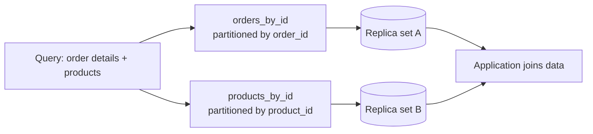
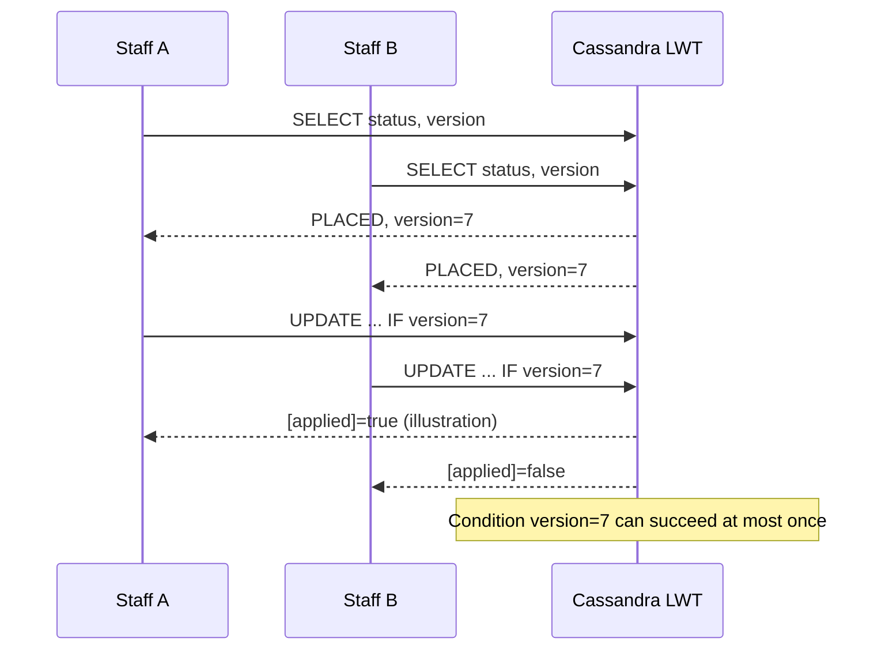

# Constraints to Consider With JOINs, Relational Integrity, and Versioned Transactions

> **Chapter:** Cassandra Foundations  
> **Scope:** Understanding key differences between relational databases and Apache Cassandra when an application needs JOINs, foreign keys, integrity constraints, or version-based updates/transactions. This lesson explains CQL limitations, query-driven table design, differences between quorums and transactions, CQL `BATCH`, lightweight transactions (LWT), optimistic concurrency, and error handling in Java applications.

## 1. Learning Objectives

After this lesson, you will be able to:

1. Explain clearly why **Cassandra does not provide general relational JOINs**, foreign key constraints, or arbitrary multi-table ACID transactions in the way RDBMSs typically support.
2. Explain the benefits and trade-offs of **denormalization**: creating multiple key-driven read tables, synchronizing projections, and handling temporary drift.
3. Distinguish **per-table unique primary keys**, **cross-table referential integrity**, and **business-level uniqueness**.
4. Distinguish a single **mutation**, **CQL `BATCH`**, **consistency level (CL)**, and **lightweight transaction (LWT)** in terms of guarantee scope.
5. Describe **version-based optimistic concurrency** using `UPDATE ... IF version = ?`, reading `[applied]`, and resolving conflicts.
6. Understand why an application version is not equivalent to Cassandra's **write timestamp / last-write-wins**, and why regular quorums do not prevent lost updates.
7. Recommend suitable solutions when a business rule must protect invariants across multiple partitions, tables, systems, or data centers.

## 2. Starting Scenario: Multi-Tenant Order Management

Suppose an e-commerce platform has buyers, orders, line items, products, and inventory. The application needs:

- **Q1:** Display the 20 most recent orders for a buyer in a month.
- **Q2:** View an order with its line items and product details.
- **Q3:** Allow creating an order only if the buyer exists, the product is active, and inventory is sufficient.
- **Q4:** Two staff members edit an order's status; only an edit based on the **latest version** may succeed.
- **Q5:** Place an order, deduct inventory, and issue a payment request as **one consistent business operation**.

A relational design typically has `customers`, `orders`, `order_items`, `products`, and `inventory` tables. Foreign key constraints and transactions help protect several rules when all data resides inside the same DBMS.

In Cassandra, separate those five questions:

| Need | Common RDBMS approach | What must be redesigned for Cassandra |
| --- | --- | --- |
| Q1: buyer order list | JOIN/index and `ORDER BY` | Table keyed by buyer + time bucket |
| Q2: order details | JOIN across orders, order_items, products | Order data merged, snapshot copied, or multiple point lookups |
| Q3: referential integrity | Foreign keys/unique/check and transactions | Application validation, data boundaries, CAS, and reconciliation |
| Q4: overwrite protection | Version column and conditional update inside a transaction | `IF version = ...` using LWT; inspect `[applied]` |
| Q5: multiple entities and services | Transaction within one RDBMS; distributed needs separate patterns | Cannot substitute CQL `BATCH` for cross-system transactions |

The key point is not that Cassandra "cannot store relational-looking data." Cassandra still has keyspaces, tables, and rows, yet **is not optimized for arbitrary relational queries and enforcing cross-entity invariants via a transactional engine**.

## 3. First Constraint: No General SQL-Style JOINs

### 3.1. What Do JOINs Do in the Relational Model?

In relational SQL, requirement Q2 might look roughly like this (**not valid CQL**):

```sql
-- Illustrative relational SQL, DOES NOT run in cqlsh:
SELECT o.order_id, o.status, i.product_id, p.name, i.quantity
FROM orders o
JOIN order_items i ON i.order_id = o.order_id
JOIN products p ON p.product_id = i.product_id
WHERE o.tenant_id = 'acme'
  AND o.order_id = 'ORD-42';
```

An RDBMS query optimizer can pick join order, indexes, and join algorithms. Cassandra CQL **does not provide cross-table JOINs like this example**, nor does it include a general distributed relational JOIN execution optimizer.

Do not assume simply switching connections from JDBC to the Cassandra Java driver makes the JOIN above run or become cheap.

### 3.2. Why Are Broad JOINs Hard When Data Is Partitioned by Key?

An `orders_by_id` row may live on replicas owning the token for `(tenant_id, order_id)`, while `products_by_id` uses partition key `(tenant_id, product_id)` and lives on a different replica group. Multi-way JOINs must read, coordinate, and move data across many partitions and nodes; costs spike sharply if lookup keys are not known upfront.



This diagram illustrates **application-side composition**: the application reads product IDs from the order and then fetches corresponding products. This can be reasonable when key counts are small and bounded; with thousands of products per page or cross-region latency, it easily turns into **N+1 queries**, fan-out, and timeouts.

### 3.3. Denormalization Is a Choice, Not Magic

When Q2 needs order details, one option is storing a **snapshot of product details at purchase time** directly inside the order's line items: display name, unit price, quantity, product ID. When a customer opens an old order, they usually need to see the price/name **when bought**, not necessarily current catalog values.

That is denormalization with sound business meaning:

- **Benefit:** eliminates JOINs; reads from a single known partition.
- **Limitation:** duplicated data; must distinguish snapshots from live catalog info.
- **Responsibility:** the application decides which fields are copied, when updates are needed, and when to read from the authoritative source.

Do not copy entire product records into every event just because "Cassandra has no JOINs." Each data copy must answer a query contract and carry a clear lifecycle policy.

## 4. Designing CQL Tables Around Access Paths Instead of JOINs

Assume the lab cluster has a data center named `dc1` and enough nodes for RF = 3. In a single-node lab, adjust RF/CL accordingly; multi-replica fault-tolerance scenarios remain illustrative without enough nodes.

### 4.1. Orders by ID Table: Q2

```sql
CREATE KEYSPACE IF NOT EXISTS commerce
WITH replication = {
    'class': 'NetworkTopologyStrategy',
    'dc1': 3
};

CREATE TABLE IF NOT EXISTS commerce.orders_by_id (
    tenant_id text,
    order_id uuid,
    customer_id text,
    created_at timestamp,
    status text,
    total_amount decimal,
    version int,
    PRIMARY KEY ((tenant_id, order_id))
);
```

With `PRIMARY KEY ((tenant_id, order_id))`, Cassandra determines the partition from tenant and order ID. There are no clustering columns; in this model each order has one row in the table.

```sql
SELECT customer_id, created_at, status, total_amount, version
FROM commerce.orders_by_id
WHERE tenant_id = 'acme'
  AND order_id = 11111111-1111-1111-1111-111111111111;
```

This is a **point lookup** by full partition key, avoiding scanning all orders.

### 4.2. Order Items by Order ID: Details Within One Partition

```sql
CREATE TABLE IF NOT EXISTS commerce.items_by_order (
    tenant_id text,
    order_id uuid,
    line_no int,
    product_id text,
    product_name_at_purchase text,
    unit_price_at_purchase decimal,
    quantity int,
    PRIMARY KEY ((tenant_id, order_id), line_no)
) WITH CLUSTERING ORDER BY (line_no ASC);

SELECT line_no, product_id, product_name_at_purchase,
       unit_price_at_purchase, quantity
FROM commerce.items_by_order
WHERE tenant_id = 'acme'
  AND order_id = 11111111-1111-1111-1111-111111111111;
```

The application can read `orders_by_id` and `items_by_order` with **two point queries** and assemble a DTO. Because they are two independent tables/logical partitions, **two reads do not automatically yield an atomic snapshot** of the entire order.

If the query contract requires the entire order header and line items inside **one partition/table**, you can model header and item rows under the same partition key using appropriate clustering columns and column/data types. Still, that model requires explicitly handling header vs. item rows and bounding partition size. No single design fits every business case.

### 4.3. Customer Order List: Q1

```sql
CREATE TABLE IF NOT EXISTS commerce.orders_by_customer_month (
    tenant_id text,
    customer_id text,
    order_month date,
    created_at timestamp,
    order_id uuid,
    status text,
    total_amount decimal,
    PRIMARY KEY ((tenant_id, customer_id, order_month), created_at, order_id)
) WITH CLUSTERING ORDER BY (created_at DESC, order_id ASC);

SELECT created_at, order_id, status, total_amount
FROM commerce.orders_by_customer_month
WHERE tenant_id = 'acme'
  AND customer_id = 'cust-42'
  AND order_month = '2026-11-01'
LIMIT 20;
```

This table duplicates `status` and `total_amount` from the ID lookup table so list reads are fast. The price is that the application must update **two read models** whenever status or total amount changes.

`ORDER BY`/clustering applies only inside a partition. To read across multiple months, the application identifies each bucket and merges results; never expect Cassandra to sort chronologically across the cluster.

## 5. Second Constraint: Relational Constraints Are Not Automatically Enforced

RDBMSs typically provide **PRIMARY KEY, UNIQUE, FOREIGN KEY, CHECK, NOT NULL**, and behaviors such as `ON DELETE CASCADE` per engine capabilities. Cassandra has primary keys, column data types, and its own schema/CQL rules, yet **does not offer an equivalent general relational constraint system**.

| Constraint / need | Familiar relational model | What Cassandra requires considering |
| --- | --- | --- |
| **Primary key** | Identifies rows and prevents key duplicates per table rules | CQL primary key identifies partition and clustering row; regular key writes are upserts |
| **Unique business key** | Unique constraint on email/invoice code | No arbitrary table-wide unique index; can use a key-reservation table + LWT, yet must handle business sync |
| **Foreign key** | An order must point to an existing customer | Cassandra does not automatically verify that a corresponding customer row exists |
| **ON DELETE CASCADE** | Deleting a customer automatically deletes dependent rows per DB rules | Application/pipeline must locate and clean up projections; no automatic FK cascade |
| **CHECK** | Quantity must be positive, status in allowed set | Application validation, appropriate CQL/schema rules, and testing; do not rely on general SQL checks |
| **Multi-table integrity transaction** | Updates multiple entities as a unit under defined isolation | Never assume CQL `BATCH` provides general multi-partition ACID |

### 5.1. A Primary Key Is Not a Foreign Key

If `items_by_order` inserts a row pointing to an `order_id` that never existed in `orders_by_id`, Cassandra **does not reject it** merely for lacking a "parent order." An application check like `SELECT orders_by_id` followed by `INSERT items_by_order` still has a **race window**: the order might be canceled or deleted after the check and before inserting the item.

If parent order existence is a hard invariant and deletes/inserts happen concurrently, design strong **ownership boundaries and synchronization mechanisms**; never treat a pre-write read as equivalent to an RDBMS foreign key.

### 5.2. Business Uniqueness Differs From Primary Key Uniqueness

For example, the requirement "each tenant has at most one user with normalized email `x@example.com`." A `users_by_id` table with primary key `(tenant_id, user_id)` does **not** prevent two users with different IDs from sharing the same email.

One approach is adding a mapping table:

```sql
CREATE TABLE IF NOT EXISTS commerce.email_reservations (
    tenant_id text,
    normalized_email text,
    user_id uuid,
    PRIMARY KEY ((tenant_id, normalized_email))
);

INSERT INTO commerce.email_reservations (
    tenant_id, normalized_email, user_id
) VALUES (
    'acme', 'x@example.com',
    22222222-2222-2222-2222-222222222222
) IF NOT EXISTS;
```

`IF NOT EXISTS` is a **lightweight transaction (LWT)** on the email key; only one request racing for the same key can reserve it within LWT's correctness scope.

However, reserving the email and creating the `users_by_id` row are **two separate data mutations**. If reservation succeeds and user creation fails, you are left with a "reserved email with no user." In the reverse order, an orphan user can exist before reservation. You need a `PENDING/ACTIVE` state workflow, retries/reconciliation/compensation, or an RDBMS when multi-table invariants must be atomic.

Declaring "we have unique emails" means nothing unless you specify **email normalization rules, conflict handling, and partial-failure recovery**.

### 5.3. Deleting Dependent Data Is a Workflow, Not a Hidden Cascade

If a user is deleted while having order history and read models, decide explicitly:

- Which historical data must be kept for auditing?
- Which data must be deleted or anonymized for privacy policies?
- How will you find **every partition** holding related data?
- If deleting a projection fails or retries, is there a reconciliation mechanism?
- How do TTL/tombstones, repair, and backup/restore interact with deletion policies?

Cassandra does not automatically walk application "relationships" to erase all copies. Adding query-driven tables makes deletion workflows more complex.

## 6. Third Constraint: CL Is Not Transaction Isolation

Cassandra distributes partitions across multiple replicas. Each request can specify a **consistency level**: how many replicas must respond suitably before the coordinator returns a result.

Suppose RF = 3 in `dc1`:

| CL | Local replicas required in example | Key implication |
| --- | --- | --- |
| `LOCAL_ONE` | 1 | Can keep serving when multiple replicas are slow, at risk of reading stale versions |
| `LOCAL_QUORUM` | 2 | Typically requires two local replicas; read/write sets overlap when both use quorum |
| `ALL` | 3 | Requires all replicas to participate; availability drops if any replica fails to respond |

Within the same replica scope, the read/write set intersection condition is:

\[
W + R > RF
\]

With RF = 3, `W = R = 2` gives `2 + 2 > 3`. This is a model for reasoning about **acknowledged replica sets**, not a promise that operations compose into serializable transactions.

### 6.1. Lost Updates Can Still Happen at QUORUM

Suppose two staff members both read `version = 7`. Without CAS, they send two statements:

```sql
-- Admin A: regular update
UPDATE commerce.orders_by_id
SET status = 'PACKING', version = 8
WHERE tenant_id = 'acme'
  AND order_id = 11111111-1111-1111-1111-111111111111;

-- Admin B: also a regular update
UPDATE commerce.orders_by_id
SET status = 'CANCELLED', version = 8
WHERE tenant_id = 'acme'
  AND order_id = 11111111-1111-1111-1111-111111111111;
```

Both requests can be acknowledged at `LOCAL_QUORUM` despite both starting from version 7. Value conflicts reconcile via Cassandra cell/timestamp semantics, not by a rule saying "only one person may edit version 7."

**Quorums do not check version preconditions for the application.** Nor do they automatically roll back multiple tables if one projection succeeds while another fails.

### 6.2. Application Version Is Not Cassandra's Write Timestamp

Distinguish carefully:

- **Application `version`:** an integer column or version token carrying business semantics. The application increments it on successful updates.
- **Cassandra cell timestamp:** metadata used to reconcile cell values; "last-write-wins" relies on timestamps, not necessarily when clients received ACKs.
- **`WRITETIME(column)`:** CQL function to inspect a column's write timestamp where supported; not equivalent to an optimistic-lock version and cannot substitute for a business version key.

Simply adding a `version` column and running a regular `SET version = 8` **does not** provide optimistic locking. You must enforce the condition alongside the write.

## 7. Versioned Transactions: Optimistic Concurrency Control

**Optimistic concurrency control** assumes conflicts are relatively infrequent. Clients read state and version, process logic, and update only if the version still matches.

Conceptual flow:

1. Read current row, e.g., `status = 'PLACED'`, `version = 7`.
2. Application checks whether target state `PACKING` is valid.
3. Send a **compare-and-set (CAS)** command: "change to PACKING and version 8 **if** version is still 7."
4. If applied, return success; otherwise, re-read state and resolve the conflict.



A winning in the diagram is merely an example, not a rule that "whichever request hits Java first always wins." Cassandra's consensus decides the outcome; on errors or timeouts, the client might not immediately know the final state.

### 7.1. CQL: Initial Row Creation and Conditional Update

```sql
-- Initialize only if the order ID does not yet exist in this table.
INSERT INTO commerce.orders_by_id (
    tenant_id, order_id, customer_id, created_at,
    status, total_amount, version
) VALUES (
    'acme', 11111111-1111-1111-1111-111111111111,
    'cust-42', '2026-11-21T08:00:00Z',
    'PLACED', 590000.00, 7
) IF NOT EXISTS;

-- Apply only if the version state still matches.
UPDATE commerce.orders_by_id
SET status = 'PACKING', version = 8
WHERE tenant_id = 'acme'
  AND order_id = 11111111-1111-1111-1111-111111111111
IF version = 7;
```

`IF NOT EXISTS` and `IF version = 7` trigger a **lightweight transaction (LWT)**. The result typically contains `[applied]`:

- `true`: the condition held and the operation was accepted.
- `false`: the condition failed; handle the case where the version changed or the row already existed.

When `[applied] = false`, some current values may be returned alongside; do not assume every column is always present in the result. If full state is required, query again by primary key.

### 7.2. How Does LWT Differ From a Regular UPDATE?

LWT uses Paxos-based consensus per Cassandra's implementation to coordinate conditional operations within **the supported partition and topology scope**. It incurs multiple replica round-trips, higher latency, and greater contention than regular writes.

Conditions that must be made explicit:

- All writers protecting the invariant must follow **the same CAS model**, without letting other flows inject regular writes arbitrarily.
- Choose the right serial consistency when spanning multiple data centers.
- A successful CAS on `orders_by_id` does **not** simultaneously ensure projection `orders_by_customer_month` changed status.
- Versions do not automatically increment "exactly once" if the application has external side effects or unguarded retries.

## 8. Serial Consistency and Regular Consistency in LWT

Two consistency level groups serve distinct roles:

| Group | Examples | What it controls |
| --- | --- | --- |
| **Serial consistency** | `SERIAL`, `LOCAL_SERIAL` | Consensus scope for conditional operations |
| **Regular consistency** | `ONE`, `QUORUM`, `LOCAL_QUORUM` | Confirmation level for the write phase and standard read/write operations |

For example, in a keyspace with RF = 3 in `dc1`: choosing `LOCAL_SERIAL` and `LOCAL_QUORUM` may suit workloads whose competing writers reside solely in this data center. If the application permits writers across multiple DCs to modify the same key concurrently, **`LOCAL_SERIAL` does not automatically deliver global uniqueness/serializability**; design consensus scope and writer coordination carefully.

### 8.1. Impact on Latency and Availability

A regular unconditional `UPDATE` runs on Cassandra's standard write path. LWT requires consensus round-trips and extra contention handling, so do not turn every event, log, or telemetry measurement into an LWT merely to feel "safer."

LWT fits when **uniqueness or version preconditions are genuine invariants**, such as reserving unique codes or guarding state transitions against overwrites. On a hot partition with thousands of writers competing via CAS, throughput becomes contention-bound even if you add nodes.

## 9. What Does CQL BATCH Solve and What Does It Not Solve?

`BEGIN BATCH`/`APPLY BATCH` groups mutations. Cassandra supports **logged batches**, **unlogged batches**, and **counter batches**, with distinct purposes and guarantees. The word "batch" does not mean "SQL-style ACID transaction."

### 9.1. One Batch Across Two Read Models

```sql
-- Illustration: two partitions across two tables.
BEGIN BATCH
  UPDATE commerce.orders_by_id
  SET status = 'PACKING'
  WHERE tenant_id = 'acme'
    AND order_id = 11111111-1111-1111-1111-111111111111;

  UPDATE commerce.orders_by_customer_month
  SET status = 'PACKING'
  WHERE tenant_id = 'acme'
    AND customer_id = 'cust-42'
    AND order_month = '2026-11-01'
    AND created_at = '2026-11-21T08:00:00Z'
    AND order_id = 11111111-1111-1111-1111-111111111111;
APPLY BATCH;
```

Logged batches use a **batchlog** mechanism to aid eventual completion of mutations if the coordinator fails mid-way. However, a reader querying two partitions/tables at slightly different instants can still **see one updated and the other still old**. Logged batches **do not provide multi-partition snapshot isolation**, nor do they roll back an already sent email or external payment request.

### 9.2. Frequently Overlooked Trade-Offs

- Multi-partition batches add coordination cost, batchlog overhead, and coordinator pressure.
- Batches are not general bulk-insert accelerators; writing across many independent partitions typically calls for concurrency management and backpressure.
- `UPDATE` statements inside a batch do not check versions unless using proper conditional/LWT syntax.
- A batch timeout does not prove none of the mutations executed; retries and reconciliation are still needed.
- When statements share a single partition, Cassandra provides partition-scoped atomicity/isolation suitable for mutations, yet this does not generalize across tables, partitions, or external systems.

### 9.3. Versioned Transactions Are Not Equivalent to BATCH

Two separate needs:

1. **Protecting a row's state transition** from lost updates: CAS via `IF version = ...`.
2. **Ensuring multi-entity business consistency** like placing an order, deducting inventory, and requesting payment: needs an appropriately scoped transaction or a distributed workflow managing partial steps.

Putting multiple `UPDATE`s into a `BATCH` does not turn need (2) into an RDBMS-grade transaction.

## 10. When Is Choosing Cassandra Risky for an Invariant?

Consider the workflow **deduct inventory on order placement**:

1. Verify the product is active and inventory has at least 3 units.
2. Deduct 3 units.
3. Create the order and line items.
4. Send a payment request.
5. If payment fails, restore inventory or cancel the reservation per rules.

If the core steps live in a single relational database, an RDBMS typically provides locking/transactions/isolation, constraints, and rollback across tables in that database. Once calling an external payment service, **even an RDBMS lacks a single system-wide ACID transaction**, so orchestration design is still required.

With Cassandra, partitions typically live on different replicas and CQL provides no arbitrary ACID transaction spanning all of them. Avoid designing with a sequence like:

```text
SELECT inventory;
if (inventory >= 3) {
    UPDATE inventory SET remaining = 0; // no protective condition
    INSERT order;
    call payment;
}
```

This is **flawed illustrative pseudocode**, not complete CQL or Java. Two concurrent requests both reading inventory of 3 can both deduct or oversell without proper concurrency control.

### 10.1. Keep Invariant Boundaries as Small as Possible

When the workload fits Cassandra, consider:

- A **partition owning state** for an entity requiring CAS—e.g., `inventory_by_sku` keyed by `(tenant_id, sku_id)`, with versioning and LWT if contention is acceptable.
- A **reservation** model: reserve stock with an explicit ID and status, supporting timeouts, release, and reconciliation.
- **Saga/workflow**: steps that complete or compensate, tracking progress to a terminal state.
- **Event-driven projections**: update query tables from reliable events, handling duplicate and out-of-order messages.
- Choosing an **RDBMS as the transactional source of truth** and Cassandra for keyed serving/history, if that is a simpler way to guard invariants.

None of these patterns appear automatically just by adopting Cassandra. The design team must define intermediate states, outcomes on client timeouts, cancellation/expiration, retries, edit permissions, and recovery paths.

### 10.2. A "Unique Reservation" Does Not Cover Subsequent Steps

Creating a reservation row with `IF NOT EXISTS` only protects **that reservation key**. It does not guarantee the order is created, stock is deducted, or payment succeeds. Treat the reservation as **one step** in a partially failable workflow.

## 11. Java Driver: Optimistic Versioning With Result Verification

Java driver 4.x provides `CqlSession`, `PreparedStatement`, `BoundStatement`, and `Row`. The example below uses the driver API to perform a single CAS on `commerce.orders_by_id`, without pretending to span multiple tables as one transaction.

Assume the schema is created and the cluster has a data center named `dc1` matching RF/CL settings:

```java
import java.net.InetSocketAddress;
import java.util.UUID;

import com.datastax.oss.driver.api.core.CqlSession;
import com.datastax.oss.driver.api.core.DefaultConsistencyLevel;
import com.datastax.oss.driver.api.core.cql.BoundStatement;
import com.datastax.oss.driver.api.core.cql.PreparedStatement;
import com.datastax.oss.driver.api.core.cql.ResultSet;
import com.datastax.oss.driver.api.core.cql.Row;

public final class OrderVersionCasExample {
    public static void main(String[] args) {
        UUID orderId = UUID.fromString(
            "11111111-1111-1111-1111-111111111111"
        );
        int expectedVersion = 7;

        try (CqlSession session = CqlSession.builder()
                .addContactPoint(new InetSocketAddress("127.0.0.1", 9042))
                .withLocalDatacenter("dc1")
                .build()) {

            PreparedStatement cas = session.prepare(
                "UPDATE commerce.orders_by_id " +
                "SET status = ?, version = ? " +
                "WHERE tenant_id = ? AND order_id = ? " +
                "IF version = ?"
            );

            BoundStatement statement = cas.bind(
                    "PACKING",
                    expectedVersion + 1,
                    "acme",
                    orderId,
                    expectedVersion
                )
                .setConsistencyLevel(DefaultConsistencyLevel.LOCAL_QUORUM)
                .setSerialConsistencyLevel(DefaultConsistencyLevel.LOCAL_SERIAL)
                .setIdempotent(false);

            // On timeout, cannot yet infer whether the mutation applied.
            ResultSet result = session.execute(statement);
            Row row = result.one();
            if (row == null) {
                throw new IllegalStateException("CAS did not return a row");
            }

            boolean applied = row.getBoolean("[applied]");
            if (applied) {
                System.out.println("Order transitioned to PACKING, version = 8");
            } else {
                // HTTP tier may return 409 Conflict with current data.
                System.out.println("Conflict: version changed; must re-read");
            }
        }
    }
}
```

**Points to note:**

- `IF version = ?` is the CAS precondition, not `setConsistencyLevel`.
- `setSerialConsistencyLevel(LOCAL_SERIAL)` governs LWT consensus scope; `LOCAL_QUORUM` sets regular consistency for the request.
- `setIdempotent(false)` expresses that the driver should not blindly retry CAS operations without well-defined retry semantics.
- `[applied] = false` is a **failed precondition result**, not an infrastructure error.
- An exception/timeout on `session.execute` does not prove the operation failed; reconciliation is required.
- `CqlSession` should be long-lived and reused in real apps; this example uses `try-with-resources` for simple lifecycle handling.

### 11.1. Classifying Results in the Application

| Outcome | Interpretation | Action to consider |
| --- | --- | --- |
| `[applied] = true` | Condition held, CAS confirmed per corresponding semantics | Return success; emit projection updates per business workflow |
| `[applied] = false` | State/version changed or row failed condition | Return conflict; fetch fresh state, prompt user confirmation |
| `Unavailable` | Insufficient replicas/CL condition at execution time | Investigate cluster and availability requirements |
| Network/read/write timeout | Client does not know final outcome for certain | Reconcile by key/operation ID; conditional retries only |
| CQL/schema error | Bad statement, types, or undeployed schema | Fix migration/code; never retry blindly |

## 12. Timeouts, Idempotency, and Versioned Operations

Suppose A sends a CAS from version 7 to 8; coordinator/replicas execute it, yet the response never reaches the application. A sees a timeout. Simultaneously, B may submit another CAS.

**Never** apply a rule like "timeout ⇒ not written ⇒ increment version and retry." That could overwrite B's update or trigger duplicate business side effects.

### 12.1. Operation IDs Aid Investigation, Yet Are Not Magic

One approach is adding `last_operation_id uuid` to the row and updating both version and logical operation ID inside the CAS:

```sql
-- Assume the schema already includes column last_operation_id uuid.
-- operation_id must remain stable across retries of the same task.
UPDATE commerce.orders_by_id
SET status = 'PACKING',
    version = 8,
    last_operation_id = 33333333-3333-3333-3333-333333333333
WHERE tenant_id = 'acme'
  AND order_id = 11111111-1111-1111-1111-111111111111
IF version = 7;
```

On timeout, re-reading state and `last_operation_id` can help determine which request wrote last. However, if another writer subsequently updates the row, **a single `last_operation_id` field can be overwritten**; reading current state does not necessarily prove the full prior history.

When the problem requires proving exact outcomes across arbitrary contention, design an **operation log/receipt or audit source with clear invariants** and a dedicated verification flow. A single UUID does not turn multiple independent writes into an atomic transaction.

### 12.2. If You Need to Add the Operation ID Column to the Table

The lab schema can be extended intentionally (this is an **optional** migration statement):

```sql
ALTER TABLE commerce.orders_by_id
ADD last_operation_id uuid;
```

Do not run the CAS example writing `last_operation_id` before applying this migration. Production schema migrations require rollout schedules compatible with application versions and monitoring of cluster schema agreement.

### 12.3. Be Careful With Versions and Timestamps

If A and B both update `version` with regular commands, both can write 8 and the application no longer knows who won under business rules. When using LWT, bumping the version and updating protected fields must happen **inside the same conditional mutation**, and all participating writers must obey the same protocol.

State may also be updated by late events or asynchronous logic; define what "higher version" means clearly (monotonic sequence, event timestamp, or processing order), avoiding conflation with Cassandra's internal write timestamps.

## 13. Trade-Offs in Multi-Data-Center Clusters

Example keyspace using `NetworkTopologyStrategy` with RF = 3 in `dc1` and RF = 3 in `dc2`:

```sql
-- Illustrative only; both data centers must actually exist with enough nodes.
CREATE KEYSPACE IF NOT EXISTS commerce_multi_dc
WITH replication = {
    'class': 'NetworkTopologyStrategy',
    'dc1': 3,
    'dc2': 3
};
```

A `LOCAL_QUORUM` operation in `dc1` requires a **local** quorum; it does not confirm that replicas in `dc2` have updated. `LOCAL_SERIAL` likewise has local consensus scope; never run independent CAS operations simultaneously in two regions assuming you automatically get a **global unique key** or **global serial order**.

If multiple DCs write to the same critical key concurrently, design an explicit **writer ownership policy**, appropriate serial consistency scope, network partition handling, and failover/failback procedures. No single CL value delivers low latency, maximum availability, and strong global invariants across every network failure.

### 13.1. RPO/RTO Do Not Solve Concurrency

Replication, backups, and RPO/RTO plans support incident recovery. They **do not automatically enforce** rules like "unique email" or "only one update succeeds per version." That is a concurrency/transaction problem distinct from durability and recovery.

## 14. Constraints From Schema Through Operations

Read-model and CAS design directly affect Cassandra's operational costs:

| Issue | Impact | What to evaluate |
| --- | --- | --- |
| Many denormalized tables | Increases write count, storage, and reconciliation paths | Which table is source of truth? Must every projection sync immediately? |
| Hot partition updating versions | CAS contention, rising latency | Can invariant boundaries be split or concurrent writers reduced? |
| Monthly/daily time buckets | Prevents unbounded partition growth | How do multi-bucket reads handle fan-out, merging, and paging? |
| Tombstones from deletes or TTL | Slower reads, extra compaction work | Repair, retention periods, `gc_grace_seconds`, and compaction strategy |
| Replica outage | Data across replicas may temporarily drift | Hinted handoff where supported, anti-entropy repair |
| Timeout mid-workflow | Main row may be written while projection is not | Idempotency, operation IDs, replay, and reconciliation |
| Data loss from accidental delete | Replicas can replicate the bad operation | Backups/snapshots and restore drills |
| Multiple DCs | New state may not yet converge across regions | CL, failover, RPO/RTO, and consensus policies |

**Compaction** merges SSTables and purges versions/tombstones when safe; **repair** reconciles replicas; **LWT** handles consensus conditions. These three mechanisms do three different jobs and cannot replace each other.

## 15. Decision Process: When to Use Cassandra, When Do You Need an RDBMS?

A set of architecture review questions:

1. **Do APIs know the full partition key?** If most queries are ad-hoc JOINs across entities without known keys, consider an RDBMS or analytical/search system.
2. **Does the invariant sit in one partition or many partitions?** If CAS is needed on one key, LWT can help; if multi-entity ACID is required, evaluate an appropriate transactional engine.
3. **Can data copies converge after a brief delay?** If yes, denormalized read models and pipelines can fit. If not, you need a different architecture or tight transaction boundaries.
4. **How many writers contend on the same key?** A hot partition under continuous CAS can erode scale-out benefits.
5. **Must uniqueness, foreign keys, and cascades be enforced by the DB?** If that is the dominant requirement, using Cassandra as sole source of truth can greatly complicate application logic.
6. **Is load large and distributed enough to justify cluster cost?** Measure throughput, p95/p99, replication, repair, backups, and operational effort.
7. **What happens if a failure strikes mid-workflow?** Document idempotency, intermediate states, reconciliation, and compensation.

### 15.1. Quick Selection Matrix

| Workload / invariant | Cassandra fits when | An RDBMS often has the edge when |
| --- | --- | --- |
| Event history per entity | High writes, clear key, bucketed time reads | Moderate data size and flexible relational querying matter more |
| State lookup by ID | Large, distributed key lookups needing replication | Many tightly coupled constraints/transactions surround the same state |
| Versioned update on one row | Single-key LWT with acceptable contention | Multi-row/foreign-key transactions are needed together |
| Orders + inventory + payment | Designed distributed workflow where eventual projections are acceptable | Strong invariants between orders and inventory must live in one database |
| Multi-dimensional reports | Data is pre-aggregated per query contract | Flexible SQL/BI queries; often also consider an OLAP engine |
| Tenant-wide unique email | LWT reservation plus strict reconciliation | Unique constraints inside transactions are simpler |

No row is an absolute rule. One system may use an **RDBMS for core transactions**, Cassandra for keyed history/serving, and an OLAP store for reporting. A sound split **places data in the tool whose guarantee boundaries match the problem**, rather than forcing one tool to do everything.

## 16. Practice Scenario: Spotting Overlooked Invariants

A ticketing platform has 1,000,000 tickets; users can search by event, seat type, price, and attendee name. The company wants to use Cassandra for the entire business.

### Scenario A: Unique Seat Booking

Two users simultaneously pick seat `A12` for `event-7`.

**Question:** Is running `INSERT` into two different rows with separate `booking_id` values enough to prevent double-booking a seat?  
**Hint:** No. If uniqueness depends on `(event_id, seat_id)`, you need a reservation boundary keyed by seat—potentially considering `IF NOT EXISTS`—followed by payment/cancellation workflow handling and reconciliation. Inserting separate rows keyed by booking ID does not enforce seat uniqueness.

### Scenario B: Versioned Booking Update

Two staff members both see booking `version = 3`; one wants `CANCELLED` and the other wants `PAID`.

**Question:** Does writing at `LOCAL_QUORUM` prevent both regular `UPDATE`s from being acknowledged?  
**Hint:** No. You need state-transition rules, CAS `IF version = 3`, or appropriate concurrency control. When CAS returns `[applied] = false`, do not blindly overwrite.

### Scenario C: Displaying Tickets With Event Names

A ticket stores `event_id`; the screen needs the event name and venue name.

**Question:** Can Cassandra automatically `JOIN events` and `venues` to serve every result?  
**Hint:** There are no general CQL JOINs. You can store a name snapshot at purchase time, fetch a small set of keys in the application, or design a query-driven read model; clarify which names are allowed to change over time.

### Scenario D: Event Cancellation and Refunds

The application must mark 20,000 tickets canceled, release seats, issue refund requests, and send notifications.

**Question:** Does one `BEGIN BATCH` across partitions make the entire business workflow atomic like a multi-system transaction?  
**Hint:** No. You need a stateful workflow, idempotent event/operation IDs, retries, reconciliation, and compensation—or an appropriate transactional source of truth. CQL batches do not roll back transactions with payment providers.

### Scenario E: Timeout Error After CAS

An admin sends `UPDATE ... IF version = 3` and receives a timeout. Afterward, a read shows version 4.

**Question:** Can you be sure the admin's request succeeded?  
**Hint:** Not necessarily. Another writer might also have updated the version. You need operation IDs/auditing and a reconciliation workflow with clear guarantee boundaries.

## 17. Misconceptions to Avoid

| Misconception | Accurate understanding |
| --- | --- |
| "CQL looks like SQL, so it can JOIN like PostgreSQL." | CQL has no general relational JOINs. |
| "Denormalization guarantees duplicated data always stays in sync." | The application must design updates, retries, and reconciliation for each projection. |
| "An orders table's primary key acts like a foreign key to the customers table." | Primary keys identify rows/partitions; they do not verify row existence in other tables. |
| "`INSERT` rejects duplicate primary keys like a standard relational insert." | Regular key-based CQL writes have upsert semantics; use LWT `IF NOT EXISTS` when needed. |
| "Adding a `version` column gives you optimistic locking." | You must write conditionally with `IF version = ...`. |
| "Writing at QUORUM means two users cannot overwrite each other." | Quorum governs replica counts, not business preconditions. |
| "`WRITETIME` is an application version." | Write timestamps are Cassandra reconciliation metadata, not replacements for versions/CAS. |
| "Multi-table BATCH creates an ACID transaction with rollback." | `BATCH` has its own semantics, without general multi-partition isolation or rollback. |
| "LWT can lock the entire cluster and every payment service." | LWT operates within supported partition/topology scopes, not across external systems. |
| "`LOCAL_SERIAL` guarantees global uniqueness across multiple DCs." | Local serial consensus scope does not automatically enforce a multi-region invariant. |
| "A timeout means the CAS definitely did not apply." | The client may not know the outcome; reconcile first. |
| "Using the Java driver automatically handles relations, invariants, and versions." | The driver sends CQL, binds parameters, and routes; business architecture belongs to the application. |

## 18. Knowledge Self-Check

1. **Why is Cassandra ill-suited for arbitrary multi-table JOINs?** Because CQL and its partitioning model do not provide a general relational JOIN planner/execution engine.
2. **Can an `orders_by_id` table keyed by `(tenant_id, order_id)` quickly read all orders of a customer using only `customer_id`?** No. You need a read model/index matching that query contract.
3. **What risk does copying `status` into a list table introduce?** Drift when one table's update succeeds while another fails or lags.
4. **Are foreign keys automatically checked by Cassandra CQL?** There are no general relational foreign keys; the application must pick invariant-protection mechanisms.
5. **To keep one email unique per tenant, is `users_by_id` enough?** No. You need an email-keyed table and CAS/reconciliation, or a system supporting unique constraints.
6. **How many local ACKs does `LOCAL_QUORUM` with RF = 3 need?** Two, assuming three eligible local replicas.
7. **Does W + R > RF guarantee two regular `UPDATE`s will not suffer lost updates?** No. It describes read/write replica overlap, not CAS.
8. **How do you advance version 7 to 8 while preventing another writer from also updating from 7?** `UPDATE ... SET version = 8 ... IF version = 7` via LWT with appropriate consensus scope.
9. **Is `[applied] = false` a timeout?** No, it is a failed condition result.
10. **Does a two-partition logged `BATCH` give readers snapshot isolation?** No.
11. **When a CAS times out, can you just bump the version and retry?** No. Reconcile the outcome first and preserve the logical operation identifier.
12. **Why isn't a single `last_operation_id` enough to prove long-term history?** A subsequent writer can overwrite the field; use an operation log/audit when full proof of every operation is needed.
13. **Why doesn't increasing RF create foreign keys?** RF manages partition replica counts, not relationships between entities.
14. **When should you lean toward an RDBMS as the source of truth?** When the business needs tightly coupled JOINs, constraints, and transactions whose implementation cost atop Cassandra would be excessive.

## 19. Summary and Connection to the Cassandra Path

**Cassandra excels at distributed reads and writes by known partition key—not at relational JOINs or arbitrary multi-table ACID transactions.** For performance, applications can build multiple query-driven tables, yet must actively manage referential integrity, uniqueness, projection updates, and partial failures.

For versioned updates, remember the chain:

**Read state/version → validate business rules → LWT `IF version = expected` → read `[applied]` → handle success/conflict/timeout → update projections and reconcile per workflow.**

Within this chain, **atomicity**, **regular consistency level**, **serial consistency**, and **business transactions** are complementary concepts rather than synonyms. Choosing the right boundaries and tools gives your system verifiable reliability, latency, and operational cost.

This forms the foundation for continuing in **DATABASE_ENGINE_WIDE_COLUMN_CASSANDRA**: CQL, partition keys and query-driven table design, replication/consistency, compaction, repair, error handling, and Java application connectivity.
