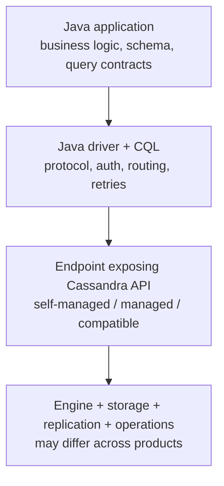
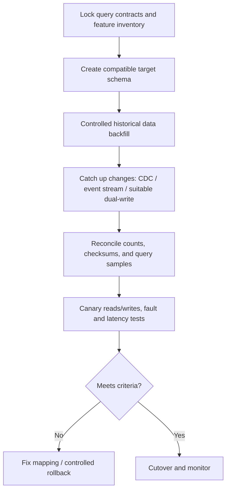

# Distinguishing Apache Cassandra From Compatible Services and Extended Products

> **Chapter:** Cassandra Foundations  
> **Scope:** Apache Cassandra is a distributed NoSQL database built on the *wide-column* model. Beyond the Apache project's open-source software, the market offers commercial distributions, managed Cassandra services, protocol/CQL-compatible systems, and products adding search, analytics, or AI features. This lesson helps identify **which product you are using, what real compatibility levels exist, who owns operations, and what must be tested before switching**, especially for Java applications.

## 1. Learning Objectives

After this lesson, you will be able to:

1. Distinguish **upstream Apache Cassandra**, **Cassandra-based distributions/extended solutions**, **managed Cassandra services**, and **services/storage engines offering Cassandra-compatible interfaces**.
2. Explain why **CQL or Java driver compatibility does not guarantee equivalence across all features, semantics, or operations**.
3. Classify common examples: Apache Cassandra, DataStax Enterprise (DSE), Astra DB, Amazon Keyspaces, ScyllaDB, and Azure Cosmos DB for Apache Cassandra.
4. Build a portability evaluation suite covering CQL, schema, partition keys, replication, consistency, conditional updates, TTL, indexes, latency, and service limits.
5. Connect a Java application to a self-managed Apache Cassandra cluster using `CqlSession` and identify configuration changes needed for managed environments.
6. Distinguish responsibilities for backups, repair, compaction, scaling, monitoring, and security between self-managed setups and managed services.
7. Plan testing and migration for a CQL workload without treating "a single SELECT ran" as proof of drop-in equivalence.

## 2. First Question: Are We Talking About an Engine, an API, or a Service?

In an engineering meeting, these three statements sound quite similar:

- "Our data is in **Apache Cassandra**."
- "The application uses the **Cassandra driver/CQL** to connect to the database."
- "The vendor says their service is **Cassandra-compatible**."

They do **not assert the same thing**.

**Apache Cassandra** is a specific open-source database project with its own codebase, releases, and operational components. **CQL** is the query language. The **native protocol/driver** is how clients communicate with an endpoint. Another product can parse part of CQL or support the driver while **not running actual Apache Cassandra servers**.

### 2.1. Four Layers to Separate



Two services can look identical at layer **B** while differing drastically at layer **D**: how replicas are placed, how capacity is provisioned, throughput limits, consistency, backup mechanisms, maintenance, indexing, or billing.

Therefore, when evaluating a product, ask in order: **What is the engine name? Does the service actually run a Cassandra distribution? Does it merely offer a compatible API or preserve identical semantics? Who operates the cluster and owns incident response?**

## 3. Upstream Apache Cassandra as the Reference Baseline

**Apache Cassandra** is a distributed DBMS without a single fixed master node for all requests. Applications send CQL statements to a node/coordinator; Cassandra locates partitions via **partition key → token → token ranges / replication strategy**, then reads or writes on replicas.

In traditional Cassandra deployments, key operational concepts include:

| Concept | Role in Apache Cassandra |
| --- | --- |
| **Keyspace** | Namespace and replication configuration matching topology |
| **Table / CQL** | Stores data by primary key, including partition key and optional clustering columns |
| **Partitioner / token** | Distributes partitions across token ranges |
| **Coordinator** | Receiving node that forwards requests to replicas and waits per consistency level |
| **Replication factor (RF)** | Replica count per distribution strategy and data center |
| **Consistency level (CL)** | Number of replica responses required per operation |
| **Commit log / memtable / SSTable** | Write path and local storage components |
| **Compaction / repair** | Local data merging and cross-replica synchronization |
| **nodetool / metrics / logs** | Common observability/admin interfaces when self-managing |

### 3.1. When Self-Managing Apache Cassandra

Operations teams must manage server versions, node/rack/data-center topology, deployment, CPU/RAM/disk provisioning, bootstrapping/replacing nodes, security, backup/restore, repair, compaction, monitoring, and upgrade plans. High control comes with heavy responsibility.

Example keyspace for a cluster with data center `dc1`:

```sql
CREATE KEYSPACE IF NOT EXISTS telemetry
WITH replication = {
    'class': 'NetworkTopologyStrategy',
    'dc1': 3
};
```

This example is only valid when the real topology has a matching data center and enough nodes for replica placement. It is **not** a statement you can copy verbatim to every compatible service: a managed service may control topology and replication via product settings, admin APIs, or proprietary rules.

### 3.2. Distinguishing Apache Cassandra Versions

Even within the Apache Cassandra project itself, CQL features, indexes, storage engines, protocols, tooling, and operational behaviors vary across release lines. Thus, "Cassandra supports feature X" must be qualified as:

> "**Which server version and configuration** support feature X, with what limits and behaviors?"

Especially with Storage-Attached Indexes, search/vector features, CDC tooling, materialized views, security, and new syntax, **never assume a feature exists in every version**. Nor should documentation or examples from a managed service be assumed to match the Apache Cassandra version running on your self-managed cluster.

## 4. Four Categories of Cassandra-Related Products

To avoid vague debates over "Cassandra-compatible," classify by **what is actually deployed**.

| Category | Identifying traits | Verification questions |
| --- | --- | --- |
| **Upstream Apache Cassandra (self-managed)** | Runs Apache Cassandra releases/source; team manages cluster | Which server version? Who handles upgrades, repair, backups, on-call? |
| **Cassandra-based distribution or extended product** | Uses Cassandra as a base and adds features, tooling, support, or packaging changes | Which components differ from upstream? Do proprietary features create vendor lock-in? |
| **Managed Cassandra** | Provider deploys/operates a Cassandra-based cluster and exposes endpoints to apps | Is `nodetool` accessible? Who manages RF, repair, compaction, backups? |
| **API/CQL-compatible engine or service** | Exposes CQL/native protocol/driver interfaces at a documented level; internal engine may differ | Which CQL features work? Do RF/CL, TTL, LWT, and metrics share the same semantics? |

The middle two categories can **overlap**: a commercial product can be both an extended distribution and delivered as a managed service. What matters is evaluating the concrete deployment rather than marketing labels.

## 5. Common Examples: Similarities and Differences

The examples below provide **classification guidance**, not a current feature commitment table. Features, compatibility versions, deployment modes, and service limits evolve; always verify against documentation for the exact version/service tier before selecting or migrating.

### 5.1. Apache Cassandra

- **Nature:** open-source distributed database from the Apache Software Foundation.
- **Interfaces:** CQL, native protocol, driver ecosystem, operational tooling.
- **Control:** when self-hosting, your team controls topology, RF, server configuration, compaction strategies, and repair schedules within version capabilities.
- **Keep in mind:** deployment/operational costs, capacity planning, security, incident response, and upgrades do not vanish just because software is open source.

### 5.2. DataStax Enterprise (DSE) and Extended Distributions

**DataStax Enterprise (DSE)** is an example of a commercial product in the Cassandra ecosystem. Across different releases and offerings, it may add integrations/tooling or alter operational mechanics relative to upstream Apache Cassandra.

When evaluating an extended distribution, do not merely ask "Does CQL run?"—check:

- Are there **vendor-proprietary features** in schema, security, indexes, search, analytics, or administration?
- How do drivers and operational tools for that distribution differ from upstream?
- If migrating back to Apache Cassandra, which schema elements and data require transformation or redesign?
- What are the support, upgrade, patching, and licensing policies of the version in use?

**Key distinction:** "Cassandra-based" does not mean every commercial product feature exists in upstream Apache Cassandra binaries.

### 5.3. Astra DB: Managed Database Service in the Cassandra Ecosystem

**Astra DB** is an example of a managed database service rooted in the Cassandra ecosystem, aimed at reducing server deployment and management work for development teams.

Distinguish the interfaces advertised by a specific service tier: CQL/driver connectivity, alternative data APIs, search/vector capabilities, or integrated services. **Having a newer data API does not mean CQL queries automatically equate to that API**, and features in one product mode need not exist in every mode.

When moving a Java app, verify cloud connection methods (e.g., appropriate endpoints/bundles), TLS, authentication, logical data center names, session settings, and throughput limits before reusing internal connection code.

### 5.4. Amazon Keyspaces (for Apache Cassandra): CQL-Compatible Service

**Amazon Keyspaces (for Apache Cassandra)** is an example of a managed database service providing an Apache Cassandra-compatible interface for supported operations. Administration, billing/capacity models, topology, and certain CQL capabilities can differ from a self-managed Apache Cassandra cluster.

Do not assume you can:

- SSH into Cassandra nodes to run arbitrary `nodetool` commands.
- Tune racks, token ranges, commit logs, repair, and compaction as on self-managed servers.
- Use every CQL feature and consistency level with identical semantics, limits, and performance.
- Reuse your on-premises cluster's driver/auth config verbatim.

Applications can use compatible drivers/protocols within the supported scope, yet must verify **TLS, authentication methods, endpoints, connection policies, request limits, and specific schema/CL rules**.

### 5.5. ScyllaDB: CQL-Compatible Yet Different Engine

**ScyllaDB** is a distinct distributed database from Apache Cassandra, designed with a level of CQL/protocol compatibility to help adopt Cassandra workloads. ScyllaDB's implementation architecture and engine optimizations are not upstream Apache Cassandra nodes running under a different brand name.

When evaluating, test:

- CQL versions and data types/features used by your application.
- Partitioning/routing, driver compatibility, and specific driver recommendations.
- Compaction, repair, streaming, observability, and topology change behaviors.
- Consistency levels, LWT, batches, TTL, indexes, and actual performance on your workload.

Accepting the same `CREATE TABLE` **does not** prove identical performance or failure-recovery characteristics to Apache Cassandra.

### 5.6. Azure Cosmos DB for Apache Cassandra: Cassandra Interface on Another Backend

**Azure Cosmos DB for Apache Cassandra** is an example of a Cassandra-compatible interface offered by a different underlying database platform. Applications can use supported drivers/CQL statements, while backend storage, resource models, consistency, and operations belong to the provider's platform service.

Verify especially:

- Which CQL syntax, keyspace/table options, secondary indexes, and queries are supported.
- How Cassandra partition keys map onto the service's underlying partitioning.
- Throughput/capacity models, request limits, and throttling errors.
- Consistency levels, cross-region latency, retries, and recovery guarantees defined by the service.
- Whether standard Cassandra admin tools work or dedicated console/APIs/metrics are required.

**Identical `SELECT` syntax does not prove identical storage engine, data placement, resource consumption, or server features.**

## 6. "Cassandra-Compatible" Is a Spectrum, Not an On/Off Switch

Any compatibility claim must specify **which layer is compatible**.

| Compatibility layer | Concrete check | Reasoning trap |
| --- | --- | --- |
| **Protocol (wire/native protocol)** | Can the driver connect, handshake, and negotiate protocol versions? | Driver connects ≠ every CQL feature is valid |
| **CQL syntax** | Do `CREATE TABLE`, `INSERT`, `SELECT`, `UPDATE`, `DELETE` parse and execute? | Valid syntax ≠ identical semantics or performance |
| **Data types** | `uuid`, `timeuuid`, `timestamp`, `date`, `decimal`, collections, UDTs, counters | Type parses ≠ all operations on that type are supported |
| **Schema / data modeling** | Partition key, clustering, `ORDER BY`, TTL, secondary indexes, materialized views | Identical names ≠ identical physical indexing/partitioning |
| **Consistency and concurrency** | RF, `LOCAL_QUORUM`, `SERIAL`, `IF`, batches, and retries | Same CL name ≠ identical guarantees across different backends |
| **Failure semantics** | Timeouts, unavailable, throttling, partial writes, retry policies | Same exception class does not guarantee identical server state |
| **Operations** | Repair, compaction, backups, restores, scaling, monitoring, CDC | A managed API may hide or replace the entire operations layer |
| **Performance / cost** | p95/p99 latency, throughput, quotas, I/O and read/write costs | Small-table benchmark ≠ production readiness |

### 6.1. Four Core Questions in an Evaluation Review

1. **Can it connect?** Protocol, auth, TLS, driver version.
2. **Does it run?** CQL, data types, schema, indexes, and features.
3. **Is it correct?** Partitioning, CL, LWT, TTL, data reconciliation, and failure behavior.
4. **Is it operable?** SLOs, observability, backup/restore, quotas, cost, and incident ownership.

Only when all four are proven on a representative workload is there a sound basis to say "product B is a viable alternative to system A within **this usage scope**."

## 7. CQL Example: Relatively Portable Parts vs. Easily Non-Portable Parts

Suppose an IoT system writes events per device/day and reads the 100 newest events. A query-driven table:

```sql
CREATE TABLE telemetry.events_by_device_day (
    tenant_id text,
    device_id text,
    event_day date,
    event_time timestamp,
    event_id uuid,
    event_type text,
    temperature_c double,
    PRIMARY KEY ((tenant_id, device_id, event_day), event_time, event_id)
) WITH CLUSTERING ORDER BY (event_time DESC, event_id ASC);
```

Common `PRIMARY KEY`, `INSERT`, `SELECT`, and standard data types make a reasonable **starting point** for portability testing. However, do not take this as a guarantee that every service mentioned in this lesson accepts this exact schema without edits.

```sql
INSERT INTO telemetry.events_by_device_day (
    tenant_id, device_id, event_day, event_time,
    event_id, event_type, temperature_c
) VALUES (
    'acme', 'sensor-42', '2026-11-21',
    '2026-11-21T08:05:00Z',
    11111111-1111-1111-1111-111111111111,
    'READING', 27.4
);

SELECT event_time, event_id, event_type, temperature_c
FROM telemetry.events_by_device_day
WHERE tenant_id = 'acme'
  AND device_id = 'sensor-42'
  AND event_day = '2026-11-21'
LIMIT 100;
```

Reads are efficient because the query supplies the **full partition key** and requests a slice ordered by clustering columns. Even across different compatible backends, query-first design remains valuable: missing partition keys still make wide scans an architectural hazard.

### 7.1. Testing Keyspace Creation Separately

On a self-managed Apache Cassandra cluster, users can create a keyspace with a replication strategy:

```sql
-- For Apache Cassandra when the topology actually has dc1.
-- A managed service may disallow configuring replication this way.
CREATE KEYSPACE IF NOT EXISTS telemetry
WITH replication = {
    'class': 'NetworkTopologyStrategy',
    'dc1': 3
};
```

This is an example that **must not be assumed universally portable**. A compatible service may reject the syntax, map options differently, restrict permissions, or manage replicas entirely through a service tier.

### 7.2. Features Requiring a Separate Test Matrix

Do not use a single checkbox "Cassandra-compatible: yes" instead of testing individual features:

| Group | Representative CQL / feature | Why it must be tested |
| --- | --- | --- |
| **TTL** | `INSERT ... USING TTL ...`; `TTL(column)` | Expiration policies, value limits, and tombstone/storage effects can differ |
| **Conditional writes** | `INSERT ... IF NOT EXISTS`; `UPDATE ... IF version = ...` | CAS/LWT, serial consistency, conflicts, and timeouts |
| **Batch** | `BEGIN BATCH ... APPLY BATCH` | Size limits, atomicity scope, batchlog, and restrictions |
| **Counters** | `counter` type and increment/decrement UPDATEs | Semantics and support may differ |
| **Collections / UDTs** | `list`, `set`, `map`, user-defined types | Size limits, update operations, encoding |
| **Indexes** | Secondary indexes, SAI, materialized views | May be unsupported or backed by different indexing engines |
| **Search / AI** | Vector/search extensions | Easily tied to vendor versions or proprietary features |
| **Security** | Authentication, authorization, TLS, auditing | Managed services have distinct IAM/permission models |
| **Data capture** | CDC, streams, exports | May rely on product-specific tooling/integrations |

**Rule:** mark `SUPPORTED` only after testing on the **exact target version/service tier**, never from product name alone.

## 8. Similar Data Models Still Require Checking Partitioning and Clustering

CQL in Cassandra locates rows using the partition key. Example:

```sql
PRIMARY KEY ((tenant_id, device_id, event_day), event_time, event_id)
```

In Apache Cassandra, `(tenant_id, device_id, event_day)` is the partition key; `event_time` and `event_id` are clustering columns ordering rows **within the partition**. When moving to a compatible service, verify how the backend accepts, distributes, bounds the size of, and serves that partition.

### 8.1. Hot Partition Risk Does Not Disappear by Switching Vendors

If `device_id = sensor-42` emits millions of events per hour, that device/day partition can still overload its responsible replicas/shards. Switching services does not eliminate the need to bound partitions over time or distribute further via logical sharding.

Choosing hourly/daily/monthly buckets must rely on load distribution, row sizes, concurrent query rates, and multi-bucket read fan-out. Backends may enforce different quotas or billing units, so **re-benchmark** writes, reads, and fan-out.

### 8.2. Denormalization Still Has Costs

An application may have:

- `events_by_device_day`: history keyed by device and day.
- `latest_state_by_device`: one row for latest state.
- `alerts_by_device_day`: recent alerts.

Three tables match three query contracts. **No service automatically synchronizes arbitrary application read models** merely because it supports CQL. When ingestion/streaming processes late events or retries, stable event IDs, versioning rules, and reconciliation remain necessary.

## 9. Consistency: Identical CL Names Are Not Enough for Comparison

In Apache Cassandra with RF = 3 in `dc1`, `LOCAL_QUORUM` typically requires responses from **two local replicas**. When reading and writing within the same replica set, the condition:

\[
W + R > RF
\]

gives intuition for read/write replica set overlap. It does **not** automatically guarantee linearizability for every operation, multi-partition transactions, or synchronization across application read models.

### 9.1. What Must Be Verified in a Compatible Service?

Do not copy the model above blindly before knowing how the backend manages replication:

1. Does the service honor and enforce the RF/replication strategy declared in CQL?
2. Are `ONE`, `LOCAL_ONE`, `QUORUM`, `LOCAL_QUORUM`, and `ALL` supported? If so, what are their **exact semantics** in that system?
3. How is read-after-write guaranteed when applications/clients span multiple regions?
4. Do `IF` conditionals and `SERIAL`/`LOCAL_SERIAL` serial consistency behave equivalently to expected business conditions?
5. At which layer do timeouts or throttling occur? Can a write still apply even when the client receives an exception?

In backends different from upstream Cassandra, consistency models may rely on proprietary mechanisms. Passing the driver parameter `LOCAL_QUORUM` is **not enough** to infer identical physical replica counts or identical behavior during network partitions.

### 9.2. LWT and Contention Must Be Tested Under Real Concurrency

Example:

```sql
CREATE TABLE telemetry.device_settings (
    tenant_id text,
    device_id text,
    threshold_c double,
    version int,
    PRIMARY KEY ((tenant_id, device_id))
);

UPDATE telemetry.device_settings
SET threshold_c = 30.0, version = 8
WHERE tenant_id = 'acme' AND device_id = 'sensor-42'
IF version = 7;
```

On a backend properly supporting LWT, the application must check `[applied]`. To confirm compatibility, run **two competing writers** on the same `version = 7`, ensure both cannot apply simultaneously, and test timeouts and retries.

If the backend lacks `IF` support or equivalent semantics, redesign the invariant, move concurrency control to an appropriate system, or do not migrate that workload there.

## 10. Java Connectivity: How Portable Is It?

The Java driver talks to Cassandra over the appropriate protocol; `CqlSession`, prepared statements, and result mapping feel familiar across environments. Yet actual connectivity depends on endpoint config and provider-supported capabilities.

### 10.1. Example on Self-Managed Apache Cassandra

Here is a Java driver 4.x example using a local contact point and data center `dc1`. Assume the keyspace/table already exist and sufficient replicas are available for `LOCAL_QUORUM`:

```java
import java.net.InetSocketAddress;
import java.time.LocalDate;

import com.datastax.oss.driver.api.core.CqlSession;
import com.datastax.oss.driver.api.core.DefaultConsistencyLevel;
import com.datastax.oss.driver.api.core.cql.PreparedStatement;
import com.datastax.oss.driver.api.core.cql.ResultSet;
import com.datastax.oss.driver.api.core.cql.Row;

public final class CassandraHistoryDemo {
    public static void main(String[] args) {
        try (CqlSession session = CqlSession.builder()
                .addContactPoint(new InetSocketAddress("127.0.0.1", 9042))
                .withLocalDatacenter("dc1")
                .build()) {

            PreparedStatement statement = session.prepare(
                "SELECT event_time, event_id, event_type, temperature_c " +
                "FROM telemetry.events_by_device_day " +
                "WHERE tenant_id = ? AND device_id = ? " +
                "AND event_day = ? LIMIT 100"
            );

            ResultSet rows = session.execute(
                statement.bind(
                    "acme", "sensor-42", LocalDate.of(2026, 11, 21)
                ).setConsistencyLevel(DefaultConsistencyLevel.LOCAL_QUORUM)
                 .setIdempotent(true)
            );

            for (Row row : rows) {
                System.out.printf("%s %s %s%n",
                    row.getInstant("event_time"),
                    row.getUuid("event_id"),
                    row.getString("event_type"));
            }
        }
    }
}
```

Layers of responsibility:

- **Java application:** determines `tenant_id`, authorization, day bucket, retries, and consistency requirements.
- **Driver:** binds CQL types, maintains sessions/connections, selects contact node, decodes results/exceptions.
- **Server/endpoint:** decides query execution, partition placement, CL verification, and mutation application.

This Java code **cannot be copied verbatim to every managed service** merely by changing `127.0.0.1`. A cloud endpoint may require mandatory TLS, specific auth providers, secure connect bundles, driver extensions, or dedicated DC configuration.

### 10.2. What Typically Changes When Switching Endpoints

| Configuration element | Self-managed cluster | Managed / compatible service to verify |
| --- | --- | --- |
| **Contact points** | Internal node IP/DNS, native port | Service endpoints, gateways/proxies, allowed TLS ports |
| **TLS** | Per cluster settings | Often mandatory, requiring matching CA/truststore |
| **Auth** | Cassandra credentials/roles or cluster settings | Tokens, IAM, credentials, or custom auth providers |
| **Local DC** | Actual DC name in topology | Logical DC name or service-specific driver option |
| **Protocol / driver** | Compatible with server version | Compatible with endpoint; may need driver profiles/extensions |
| **Routing** | Token-aware when driver knows topology/partitions | May go through proxies; topology/routing may be hidden or differ |
| **CL and timeouts** | Set on statement/profile | Only use supported levels; tune for latency/quotas |
| **Observability** | Driver + node metrics/logs/tracing | Client metrics combined with service console/API/telemetry |

### 10.3. Separate Business Code From Infrastructure Configuration

A clean approach is isolating `CqlSession` construction in a factory/configuration module. Repositories should receive an initialized `CqlSession` and run prepared statements per query contract instead of hard-coding endpoints, secrets, or DC names.

```java
// Application component sketch (not a complete connection factory):
public final class DeviceEventRepository {
    private final com.datastax.oss.driver.api.core.CqlSession session;

    public DeviceEventRepository(
            com.datastax.oss.driver.api.core.CqlSession session) {
        this.session = session;
    }

    // CQL methods here can be tested against each backend.
    // Session/TLS/auth/DC setup lives in runtime environment config.
}
```

**Never** embed real secrets or tokens in source code or docs. Certificates, credentials, and driver initialization must follow the official documentation of your chosen service version rather than guessing from local examples.

## 11. "Managed" Changes Who Does the Work, Not Eliminating All Risk

A managed service may operate clusters, upgrade software, patch bugs, scale resources, or provide backups; yet **it does not take responsibility for all of the customer's schema and business decisions**.

| Task | Self-managed Apache Cassandra | Managed Cassandra or compatible service |
| --- | --- | --- |
| Designing schemas and query contracts | Application team | Usually still the application team |
| Choosing partition keys, preventing hot partitions | Application / DBA team | Usually still the application's responsibility |
| OS/server upgrades, node replacement | Infrastructure / DBA team | Managed by provider within service scope |
| Replication / topology | Infrastructure team configures | May be managed by service or offer limited options |
| Compaction / repair | Operations team manages | Often operated/abstracted away depending on product |
| Backups, retention, restore tests | Team executes directly | Depends on service features; customer still must test restore capability |
| TLS, credentials, IAM, API permissions | Application + infra teams | Shared responsibility between provider and customer |
| QPS/throughput limits and cost | Driven by hardware/capacity | May involve quotas, billing units, throttling, service policies |
| Timeouts, event IDs, idempotency | Application | Still belongs to the application |

**Managed ≠ no DBA mindset needed.** You may not invoke compaction via `nodetool`, yet you still must understand how data is partitioned, why requests time out, why TTL incurs cost, and whether a partition runs hot.

### 11.1. Repair and Compaction May Be Hidden

In self-managed Apache Cassandra, admins schedule repairs, watch SSTables/compaction, and safeguard tombstone cleanup. In a compatible backend using a different storage engine, those specific tools or tasks may **not exist under the same names**.

When a service says "fully automated operations," ask **which guarantees are provided and by which numbers**: durability, restore points, throughput, latency, region outages, backups, and metric access. Never assume the service runs "Cassandra repair" on the exact schedule of a self-managed cluster.

## 12. Moving Data: API Compatibility Does Not Move Data Automatically

Even when both endpoints run the exact same `SELECT`, data **does not** move itself. Migration requires planning copying, catching up on new updates, reconciliation, and traffic cutover.



### 12.1. Schemas Do Not Always Map 1:1

Items to clarify before copying:

1. **Keyspace and replication:** does the target service let you create keyspaces/set RF like the source?
2. **Partition/clustering keys:** can the same keys and sort orders be preserved?
3. **Data types:** do `uuid`, `date`, `timestamp`, `decimal`, collections, and UDTs have compatible encodings and limits?
4. **TTL and write timestamps:** how much lifetime remains on source data? Does copying to the target accidentally "reset" TTLs?
5. **Tombstones/deletes:** are deletes occurring during copy/CDC reflected accurately?
6. **Counters/LWT/batches:** do data or mutations require special handling?
7. **Indexes and queries:** once copied, do target indexes and CLs satisfy queries?

Crucial note: **copying current cell values does not automatically preserve all internal metadata** such as remaining TTL, write timestamps, tombstones, or consensus state. If recovery or consistency depends on that metadata, choose migration tools with verified semantics or perform controlled data transformations.

### 12.2. Dual-Write Is Not Simply Two `INSERT`s

If the application writes the same event to both source and target:

- One side can succeed while the other times out.
- The two backends may use different CLs or TTLs.
- Retries can duplicate events if new IDs are generated.
- Conditional updates may succeed on one side yet conflict on the other.
- Reading from both sides during canary testing can return different results due to sync lag.

Therefore, define a **source of truth**, stable event/operation IDs, bounded retries, compensation queues/sync status, and reconciliation workflows. Never run ad-hoc dual-writes assuming two databases stay identical automatically.

### 12.3. Cutover and Rollback Must Have Clear Criteria

Before shifting traffic:

- Compare row/partition counts across sampled scopes and full verifiable ranges.
- Compare rows by primary key, especially fresh data, near-expiration data, and deleted records.
- Test p50/p95/p99 latency, throughput, and quotas under realistic load.
- Test a slow replica/endpoint, auth/TLS failures, timeouts, retries, and conditional writes.
- Validate costs under the new service's pricing model.
- Define **rollback criteria**, ensuring rolling back does not lose new writes landed on the target.

A successful migration plan must preserve **business correctness**, not just get the app connected.

## 13. Minimum Compatibility Test Suite

For a running Cassandra workload, build a concrete **feature matrix** instead of simply writing "CQL supported."

| ID | Test | What does PASS mean? |
| --- | --- | --- |
| **C1** | Open Java driver session over TLS/auth | Connectivity and metadata/protocol negotiated properly |
| **C2** | Create keyspace/table with composite partition key | Schema accepted or mapped via documented equivalent |
| **C3** | Prepared `INSERT` and `SELECT` by full partition key | Parameter binding, data types, and row mapping work accurately |
| **C4** | Clustering range reads, descending order, paging | Rows and ordering satisfy query contracts |
| **C5** | TTL, deletes, reads before and after expiration | Retention semantics verified against requirements |
| **C6** | Two writers racing `UPDATE ... IF version = 7` | Conflicting CAS operations cannot both succeed if required |
| **C7** | Test intended CL and network/endpoint failures | Guarantees, errors, and timeouts are well understood |
| **C8** | Replay same event ID after simulated timeout | No unintended logical duplicates created |
| **C9** | Test batches/indexes/collections/UDTs in use | All app-used features are supported or have workarounds |
| **C10** | Load test with partition skew and multi-bucket reads | Meets target p95/p99 and throughput without breaching quotas/cost |
| **C11** | Restore or recovery drill within product scope | Data recovers within RPO/RTO targets |

No single test proves absolute equivalence. An application using only basic CQL may migrate more easily than one relying heavily on specialized secondary indexes, conditional mutations, admin tools, or custom search/analytics integrations.

### 13.1. Measure Both Correctness and Performance

For example, a query returning an empty row instead of expected data post-cutover could stem from: wrong time bucket, differing `date` mapping, incomplete backfill, expired TTL, late-arriving writes, or changed consistency. Measuring only "`SELECT` response time" misses data errors completely.

Compare **query results**, error rates, retry behavior, scanned/touched row counts, latency, and cost across the exact same key/data set.

## 14. Choosing a Product by Use Case

| Need | Direction to consider | Risks to accept / verify |
| --- | --- | --- |
| Deep control over topology, repair, storage, and server settings | Self-managed Apache Cassandra or a distribution with full operational control | Ops staffing cost, upgrades, incident response, backups |
| Focus on CQL API development rather than managing nodes | Managed Cassandra or Cassandra-compatible service | Feature limits, quotas, SLOs, ports/auth/drivers, vendor dependency |
| Existing system with relatively straightforward CQL queries | Evaluate compatible endpoints via feature matrix | Do not assume support for all data types/CL/TTL |
| Reliance on commercial utilities or specialized extensions | Extended distribution/product | Lock-in to schemas, extensions, tooling, or licensing |
| Keyed data + search/AI/analytics | Hybrid architecture or product with specialized features | Read-model sync, latency, cost, and feature limits |
| Flexible JOINs and multi-table ACID | Consider RDBMS as source of truth, Cassandra for serving/history where fitting | Do not force relational transactions into Cassandra `BATCH` |

**No single choice fits every team.** Justify decisions using query contracts, consistency needs, acceptable failure modes, operational ownership, measured latency, and total cost of ownership.

## 15. Practice Scenario: Making a Grounded Migration Recommendation

A company runs a self-managed Apache Cassandra cluster with:

- `events_by_device_day`: heavy `INSERT`s, reading the 100 newest events per device.
- `latest_state_by_device`: one row per device, updated as new events arrive.
- `device_settings`: admins use `IF version = ...` for concurrent threshold updates.
- A 90-day analytical dashboard by province/city.
- Operations staff using `nodetool`, monitoring repair/compaction, and running backups.

A vendor pitches a "Cassandra-compatible" service promising the Java application can run without changing any CQL code.

### Question A — Should You Trust the Blanket Promise?

**Suggested answer:** No. Verify every CQL query, driver/auth/TLS config, RF/CL, `IF`/serial consistency, TTL, event IDs, paging, indexes, and quotas. "Cassandra-compatible" spans many levels and does not guarantee identical semantics or operational tools.

### Question B — History Table and Buckets

**Question:** If data is partitioned by `(tenant_id, device_id, event_day)` and ordered `event_time DESC`, can that design stay on the target product?

**Hint:** It is a sound starting point, yet you must test the schema, write throughput, hot partitions, range queries, partition limits, and cost on a real workload. In particular, verify late-arriving data and how `event_day` is computed in Java.

### Question C — Conditional Updates

**Question:** Before migrating `device_settings`, which scenario must be tested?

**Hint:** Two writers reading version 7 simultaneously and submitting CAS to move to 8; verify `[applied]`, conflict results, timeouts, retries, and supported serial consistency. If the backend lacks required guarantees, redesign or keep that invariant in a suitable system.

### Question D — Repair and Backups

**Question:** The service says "no more repair needed," so do backups/restores no longer need testing either?

**Hint:** No. Internal maintenance mechanisms may be abstracted away by the service, yet responsibilities for verifying retention, restores, RPO/RTO, protection against accidental deletes, and SLA limits remain.

### Question E — Analytical Dashboard

**Question:** Should the entire multi-dimensional `GROUP BY` dashboard move into CQL just because the target exposes a Cassandra API?

**Hint:** No. A compatible API does not turn Cassandra into an OLAP engine. Consider stream aggregation, a columnar analytical store, or analytics features verified on real data.

### Question F — Cutover Plan

**Question:** Once the application connects and reads one device successfully, should the old cluster be shut down immediately?

**Hint:** Not yet. Backfill and catch up deltas, reconcile data/TTL/deletes, run canary read-write/latency/failure/cost checks, prepare rollback criteria, and monitor post-cutover.

## 16. Common Misconceptions

| Misconception | Accurate understanding |
| --- | --- |
| "Supporting the Cassandra Java driver means running an Apache Cassandra server." | Compatible APIs/protocols can be implemented atop different engines. |
| "If CQL runs, every data type and index is portable." | Verify version, features, and semantics per product. |
| "With managed Cassandra, partition keys don't matter." | Hot partitions and query-first schemas remain an application design responsibility. |
| "RF/CL having the same names in two services guarantees identical replica semantics." | Backends may implement replication/consistency differently; verify explicitly. |
| "Changing the IP address lets the Java driver talk to any cloud service." | Cloud services may require TLS, auth providers, bundles, DC names, and custom routing. |
| "Astra DB, Keyspaces, ScyllaDB, and Cosmos DB API are all the same product." | They represent distinct product/engine categories and compatibility levels. |
| "Any feature in a commercial distribution also exists in upstream Apache Cassandra." | Extensions and vendor features may not belong to upstream. |
| "If a service hides `nodetool`, tombstone/retention risks don't exist." | Operational mechanics differ; data correctness and workload behavior still require verification. |
| "CQL migration automatically preserves TTLs, write timestamps, and deletes." | Copying values does not preserve all internal metadata or behaviors. |
| "Using QUORUM prevents all lost updates." | Quorums do not replace LWT/CAS for version conditions. |
| "One fast SELECT test proves production will be fast." | Test realistic key distributions, writes, faults, p95/p99, quotas, and costs. |
| "Replication or managed backups prevent data loss even on accidental deletes." | Proper backup/restore policies, retention, and drills are still required. |

## 17. Checklist for Choosing Cassandra, Extended Products, or Compatible Services

- [ ] Recorded exact **product name, engine, version, deployment model, and region**.
- [ ] Identified whether the product is upstream Apache Cassandra, a Cassandra distribution, managed Cassandra, or an API-compatible backend.
- [ ] Listed **query contracts** and CQL features in use: schema, TTL, collections, batches, LWT, indexes, counters, CDC.
- [ ] Tested Java driver connectivity with production TLS/auth/DC/protocol and session configuration.
- [ ] Verified partition keys/clustering, time buckets, late-arriving data, and hot partitions.
- [ ] Verified CL, read/write semantics, multi-DC consistency, and CAS if used.
- [ ] Confirmed workarounds or rewrites for any incompatible features.
- [ ] Understood throughput limits, request size limits, connections, paging, quotas, and billing model.
- [ ] Clarified ownership for repair/compaction, backup/restore, security, metrics, and incident response.
- [ ] Collected benchmark results for p95/p99, errors, cost, and chaos tests on representative data/load.
- [ ] Prepared backfill, delta catch-up, TTL/delete reconciliation, cutover, and rollback plans.
- [ ] Tested business invariants, retries, operation IDs, and sensitive data post-migration.

Checking only "driver connected" and "CQL SELECT ran" is **insufficient grounds** to conclude a compatible service safely replaces an existing Cassandra deployment.

## 18. Knowledge Self-Check

1. **What is upstream Apache Cassandra?** A specific open-source distributed DBMS project, not merely a protocol name.
2. **Does driver compatibility imply the same engine?** No. The driver speaks an API/protocol; the backend can differ.
3. **Where should DSE be evaluated differently from upstream Apache Cassandra?** Extended features, operations, support, and product/version dependencies.
4. **What distinguishes managed Cassandra from self-managed Cassandra?** Operational responsibilities are shifted or shared; query/data modeling still require verification.
5. **Is ScyllaDB simply renamed Apache Cassandra nodes?** No. It is a distinct engine providing CQL compatibility at a documented level.
6. **Do Amazon Keyspaces or Cosmos DB Cassandra API necessarily support `nodetool repair`?** Never assume so; use service admin mechanisms and check supported scope.
7. **Why is `CREATE KEYSPACE WITH replication ...` a migration risk point?** Managed services may impose or map replication differently.
8. **Why does the same `LOCAL_QUORUM` name not guarantee identical behavior?** Backends and replica/consistency scopes may differ; test per version docs.
9. **What must two writers using `IF version = 7` verify?** Conflicts, `[applied]`, serial CL, and timeout handling.
10. **Does query-first design still hold when switching backends?** Yes, while benchmarking and checking target partitioning/limits.
11. **Does copying rows automatically preserve remaining TTL and tombstones?** Never assume that; metadata and deletes need explicit strategies.
12. **What does the `CqlSession` driver help with, and what does it not?** Manages connections/CQL dispatch/binding; does not enforce business invariants or migrate data for the app.
13. **Why do managed services still require restore testing?** The provider manages infrastructure, whereas recovery targets and business data remain shared/customer responsibilities.
14. **Does a Cassandra-compatible API automatically optimize OLAP reports?** No. Evaluate a dedicated analytical engine/approach.
15. **What is a minimum acceptance criteria set for migration?** Correct schema and queries, concurrency/CL semantics, reconciled data, SLO-compliant performance/cost, and planned incident/rollback procedures.

## 19. Summary

**Apache Cassandra is a specific engine. CQL and the native protocol are interfaces. Extended distributions, managed Cassandra services, and CQL-compatible systems may share part of the interface while differing in storage engine, replication, consistency, operations, and limits.**

When evaluating products, follow the sequence:

**Identify engine/service type → inventory CQL and query contracts → verify protocol/driver → verify schema and semantics → test RF/CL/LWT/TTL → evaluate operations and security → benchmark → reconcile data, cutover/rollback.**

No safe swap exists based solely on a "Cassandra-compatible" label. What decides is whether **your application's specific workload, invariants, data requirements, and SLOs** are preserved.

This knowledge bridges the mindset section of **DATABASE_ENGINE_WIDE_COLUMN_CASSANDRA** to hands-on CQL, partition keys, the wide-column model, read/write replication and consistency, compaction, repair, error handling, and Java driver connectivity—while helping you spot when a compatible service requires different configuration or design from Apache Cassandra.
