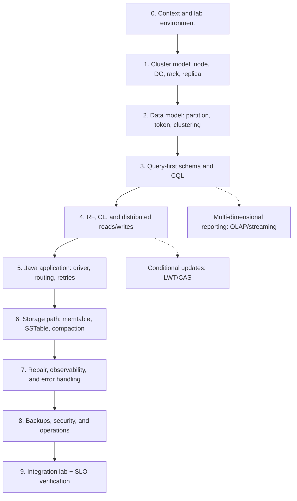
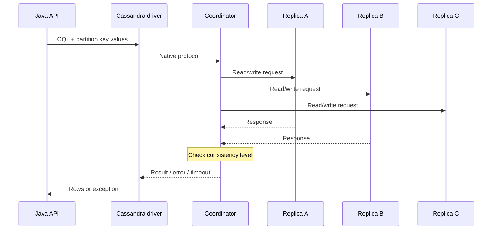
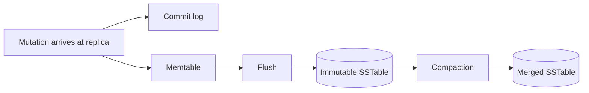

# Learning Sequence From Cluster and Data Model to CQL, Applications, and Operations

> **Chapter:** Cassandra Foundations  
> **Orientation:** This is a dependency-ordered learning map, not merely a list of topics. We start with how Apache Cassandra organizes clusters and places replicas, move to query-driven partition key selection, CQL practice, Java application connectivity, and then failure verification and operations. Each stage has a practical deliverable and self-assessment criteria.

## 1. Expected Outcomes After This Path

Upon completing this lesson, you will be able to:

1. Diagram the flow from **application → Java driver → coordinator → replicas** and explain the roles of nodes, tokens, data centers, racks, and partition keys.
2. Turn a query requirement into a Cassandra table design using **partition keys**, **clustering columns**, and time buckets instead of relying on JOINs or arbitrary scans.
3. Create keyspaces/tables, write and read with CQL; identify `LOCAL_ONE` and `LOCAL_QUORUM` consistency levels and the prerequisites to practice them.
4. Connect Java driver 4.x, use `CqlSession`, prepared statements, CQL data types, driver metrics, and safe retry strategies.
5. Describe the **commit log → memtable → SSTable** write path, compaction, tombstones, repair, and how they relate to recoverability.
6. Distinguish **write timeouts**, **unavailable** errors, node failures, stale data, and schema/query errors; propose checks at the right layer.
7. Build an end-to-end lab with **measurable criteria**, readback evidence, an architecture diagram, a risk checklist, and a backup/restore plan.

**Most important goal:** not merely "being able to type CQL," but knowing **why a query reaches the right replicas, why it might run slowly or behave unexpectedly, and how to operate the system when part of the cluster fails**.

## 2. One End-to-End Scenario to Avoid Fragmented Learning

Suppose you are building an IoT system for a multi-tenant company. Each device emits temperature events, which a Java application ingests and stores. Operators need:

| ID | Need | Primary access pattern |
| --- | --- | --- |
| **Q1** | Read the 100 newest events of one device on one day | `tenant_id + device_id + event_day` |
| **Q2** | Read events of a device over a 30-minute window | The three keys above plus an `event_time` range |
| **Q3** | Read a device's current state by ID | `tenant_id + device_id` |
| **Q4** | View 90-day statistics across all devices by province | Full-dataset aggregation, many partitions |

The first three patterns can be served well by keyed tables if designed properly. Q4 raises the question of an **analytical store / stream aggregation** rather than forcing every query into a Cassandra `SELECT`.

The learning path uses Q1 and Q2 as the core lab, then extends to Q3 and evaluates why Q4 needs a complementary architecture. Whenever you learn a new concept, pause and ask: **what does this concept change along the path of Q1 or Q2?**

### 2.1. Sample Non-Functional Requirements

For practice, we can set **hypothetical** targets—not Cassandra guarantees:

- 10,000 devices, each sending one event/minute at baseline load; a few devices send more.
- Query Q1 returns up to 100 events ordered newest first.
- When one replica temporarily fails in an RF = 3 test cluster, Q1/Q2 at `LOCAL_QUORUM` must be **verified** to see whether they keep working.
- A timed-out event write must not cause the application to create a new row for the same logical event by regenerating its ID on retry.
- Data has a hypothetical 30-day retention policy; analyze TTL/tombstones and how retention start time is determined.

These numbers are **practice exercise inputs**. In production, replace them with real metrics, SLOs, and benchmark results.

## 3. Dependency Map: Learn the "Why" Before the "How"



Why does this sequence make sense?

- **If you learn the driver before partition keys**, you can connect successfully yet write queries lacking good routing paths.
- **If you learn CL before RF and topology**, you easily misread `LOCAL_QUORUM` as always meaning "two nodes," regardless of configuration.
- **If you learn compaction before SSTables**, you will confuse compaction with replication or repair.
- **If you learn repair commands before replica concepts**, you may run I/O-heavy commands without knowing what kind of drift you are fixing.

The path has **checkpoints (gates)**: advance to the next stage only once you can explain the mechanics and present minimal hands-on evidence.

## 4. Stage 0 — Preparing the Lab and Distinguishing Lab From Production

### 4.1. Different Learning Setups Serve Different Goals

| Environment | Good for learning | Should not claim |
| --- | --- | --- |
| **One node, one data center** | Basic CQL, schemas, partition keys, Java driver, data types | Proven RF = 3 replication, quorum fault tolerance, or serving after node loss |
| **Three nodes in one data center** | RF = 3, consistency levels, coordinator/replicas, single-node loss, basic replica drift repair | Proven full-DC outage survival or multi-region latency behavior |
| **Two data centers (advanced)** | Local vs. global CL, cross-DC latency, failover/failback | All `LOCAL_QUORUM` writes synced to remote region or RPO = 0 |

Failure-injection exercises **must only run on isolated lab clusters**, never simulated by shutting down nodes serving live users.

### 4.2. Record in Your Lab Log Before Running

Note down:

- Apache Cassandra, Java runtime, and driver versions in use.
- Actual data center and rack names; `dc1` in examples is merely an illustration.
- Node count, actual keyspace RF, client contact points, and native protocol port.
- If using containers/VMs/cloud: CPU, RAM, and I/O limits, and whether nodes sit on independent physical hosts.
- Data-modifying statements executed and how the lab can be cleanly reset.

**Product note:** if using a CQL-compatible service instead of upstream Apache Cassandra, topology, `nodetool` access, replication, compaction, and CL levels may differ. Before each step, verify supported capabilities for your **exact product and version**.

### 4.3. Stage 0 Pass Criteria

You only need to demonstrate: "How many nodes are in this cluster, which DCs/racks are they in, where do clients connect, which RF values are feasible, and what can the current lab not test?" No real data creation is needed at this stage.

## 5. Stage 1 — Understand the Distributed Cluster Before Diving Into CQL

### 5.1. Four Objects You Cannot Confuse

| Term | Meaning | Question to answer |
| --- | --- | --- |
| **Node** | A process/machine participating in the Cassandra cluster | Is the node up and accepting requests? |
| **Data center (DC)** | Group of nodes used in topology/replication strategy | Which DC holds the application's local replicas? |
| **Rack** | Fault domain inside a DC supporting replica spread when topology permits | Are replicas separated across proper fault domains? |
| **Coordinator** | Node receiving and coordinating an individual request | Must the coordinator be a replica of the partition? **No.** |

A node is not a permanent master simply because it acts as coordinator. The driver can send requests to other nodes; data placement is governed by tokens and the replication strategy.

### 5.2. Trace a Request Path



This is a **conceptual** diagram; it does not depict every read optimization or internal message sequence in every version. It clarifies responsibilities:

1. **Application** supplies key values, CL, and timeouts.
2. **Driver** manages connections, metadata, and chooses a coordinator per policy.
3. **Coordinator** locates replicas and gathers sufficient responses.
4. **Replicas** execute storage/read work on the partition's data.

### 5.3. Inspecting the Cluster With Admin Tools

In a self-managed Apache Cassandra lab, common status commands include:

```bash
nodetool status
nodetool info
nodetool netstats
```

These commands are **examples to run in the lab** once an environment is up, not mandatory operations on managed services. In `nodetool status`, inspect DC names, node states, and data load. Never assume a node showing `UN` means all requests succeed: it shows only part of cluster health.

### 5.4. Gate 1 — Completion Evidence

Draw a three-node `A/B/C` diagram in `dc1`, mark the coordinator for one request, and list the replicas of a hypothetical partition. Explain why **the replica set depends on the partition key** and why the coordinator need not belong to that set.

## 6. Stage 2 — Partition Keys, Clustering, and the Wide-Column Model

### 6.1. From Query Contract to Key

Consider Q1:

> "For tenant `acme` and device `sensor-42` on `2026-11-21`, fetch the 100 newest events."

Three values are always known: `tenant_id`, `device_id`, and `event_day`. A sensible starting partition key to evaluate is:

```sql
PRIMARY KEY ((tenant_id, device_id, event_day), event_time, event_id)
```

Where:

- `(tenant_id, device_id, event_day)` is the **composite partition key**. The entire tuple is hashed to a token to locate one partition.
- `event_time` is the first **clustering column**; determines ordering within the partition.
- `event_id` is the second **clustering column**; disambiguates events sharing a timestamp.
- `temperature_c` or `event_type` are regular data columns; they do not automatically create cluster-wide indexes.

A partition holds multiple rows ordered by clustering keys, yet all stay on **the same replica set** for that partition key. Clustering order does not mean whole-table ordering.

### 6.2. Why Not Use a Single Key for All History?

If only `device_id` is used, a device running for 10 years accumulates far too many events in one partition. Adding `event_day` bounds data per day. That is a **time bucket**.

For instance, a device sending one event per minute generates:

\[
24 \times 60 = 1.440\ \text{events/day}
\]

Yet a device sending 1,000 events per second generates 86.4 million events/day: a daily bucket would still be far too large/hot. No single "standard" partition size fits every workload; measure row sizes, reads/writes per second, tombstones, and replica load.

### 6.3. Three Design Check Questions

1. **Does the read supply the full partition key?** If Q1 does not know `event_day`, you must determine multiple buckets to read.
2. **Can partitions grow unboundedly?** If yes, consider hourly/daily/monthly buckets or logical sharding, accounting for result-merging costs.
3. **Does load concentrate on a few keys?** High device counts do not mean equal request rates across devices; inspect the hottest keys.

### 6.4. Gate 2 — Completion Evidence

For at least three query contracts, specify what `WHERE` contains, which partition key is used, how rows are ordered, and when a **separate read table** is needed. Merely naming entities ("device, event, user") without answering queries does not pass this gate.

## 7. Stage 3 — Writing CQL for a Concrete Access Path

CQL looks familiar enough to SQL for syntax comfort, yet differs in **how queries are routed**. Practice from `CREATE KEYSPACE` through `CREATE TABLE`, `INSERT`, and keyed `SELECT` before moving to TTL/indexes/conditional updates.

### 7.1. Creating a Keyspace Matching Lab Configuration

On a three-node cluster in `dc1`:

```sql
CREATE KEYSPACE IF NOT EXISTS telemetry_learning
WITH replication = {
    'class': 'NetworkTopologyStrategy',
    'dc1': 3
};
```

In a **single-node** lab, create the keyspace with `'dc1': 1` and use `LOCAL_ONE`; **never pretend RF = 3 gives three real replicas merely by typing the number 3**.

### 7.2. Creating the Table for Q1 and Q2

```sql
CREATE TABLE IF NOT EXISTS telemetry_learning.events_by_device_day (
    tenant_id text,
    device_id text,
    event_day date,
    event_time timestamp,
    event_id uuid,
    event_type text,
    temperature_c double,
    PRIMARY KEY ((tenant_id, device_id, event_day), event_time, event_id)
) WITH CLUSTERING ORDER BY (event_time DESC, event_id ASC);
```

One table can answer both Q1 (newest) and Q2 (time window) because both share the same partition key and clustering order.

### 7.3. Inserting Data With Stable IDs

```sql
INSERT INTO telemetry_learning.events_by_device_day (
    tenant_id, device_id, event_day, event_time,
    event_id, event_type, temperature_c
) VALUES (
    'acme', 'sensor-42', '2026-11-21',
    '2026-11-21T08:05:00Z',
    11111111-1111-1111-1111-111111111111,
    'READING', 27.4
);

INSERT INTO telemetry_learning.events_by_device_day (
    tenant_id, device_id, event_day, event_time,
    event_id, event_type, temperature_c
) VALUES (
    'acme', 'sensor-42', '2026-11-21',
    '2026-11-21T08:06:00Z',
    22222222-2222-2222-2222-222222222222,
    'READING', 27.8
);
```

`event_id` must remain stable if the same logical event is resent after a timeout. Cassandra writes by primary key with upsert semantics; changing IDs across retries can create logical duplicate rows.

### 7.4. Reading by Full Partition Key

```sql
-- Q1: newest rows in one day
SELECT event_time, event_id, temperature_c
FROM telemetry_learning.events_by_device_day
WHERE tenant_id = 'acme'
  AND device_id = 'sensor-42'
  AND event_day = '2026-11-21'
LIMIT 100;

-- Q2: a time window within the same partition
SELECT event_time, event_id, temperature_c
FROM telemetry_learning.events_by_device_day
WHERE tenant_id = 'acme'
  AND device_id = 'sensor-42'
  AND event_day = '2026-11-21'
  AND event_time >= '2026-11-21T08:00:00Z'
  AND event_time < '2026-11-21T09:00:00Z';
```

Never "quick-fix" a query missing its key by using `ALLOW FILTERING` on a production read path. It can trigger expensive scans/filtering, and `LIMIT 100` does not guarantee a cheap query.

### 7.5. Gate 3 — Completion Evidence

Demonstrate that both events return in descending `event_time` order; explain which partition the rows belong to and why **no JOIN is needed**. Then propose schema changes if Q3 requires current state by `(tenant_id, device_id)` without knowing the date.

## 8. Stage 4 — Replication and Read/Write Consistency

Study CL after understanding partition keys and RF: **RF is the configured replica count**, while **CL is the response criterion for a single request**.

For a partition in `dc1` with RF = 3:

| CL | Minimum requirement in example | Common misconception |
| --- | --- | --- |
| `LOCAL_ONE` | One local replica responds | Does not mean other replicas have converged |
| `LOCAL_QUORUM` | Two local replicas respond | Does not guarantee all writers are serialized or conflict-free |
| `ALL` | Three replicas respond | Does not guarantee requests succeed when one node is slow |

### 8.1. Quorum Formula

\[
Q=\left\lfloor\frac{RF}{2}\right\rfloor+1
\]

With RF = 3, `Q = 2`. Read/write replica set overlap within the same scope is:

\[
W+R>RF
\]

For example, `W=2` and `R=2` give `2+2>3`. This helps analyze visibility of successful writes, yet does not turn Cassandra into an SQL database with serializable transactions across all operations.

### 8.2. Practicing From cqlsh

```sql
-- These are cqlsh tool commands, not CQL syntax
-- embedded inside individual INSERT/SELECT statements.
CONSISTENCY LOCAL_QUORUM;
TRACING ON;

SELECT event_time, event_id, temperature_c
FROM telemetry_learning.events_by_device_day
WHERE tenant_id = 'acme'
  AND device_id = 'sensor-42'
  AND event_day = '2026-11-21'
LIMIT 100;

TRACING OFF;
```

In a single-node lab with RF = 1, use `CONSISTENCY LOCAL_ONE`. Tracing availability, detail level, and overhead depend on environment and version; enable only when investigating, never continuously under high load.

### 8.3. Two Especially Important Errors

- **Unavailable:** the coordinator determines insufficient replicas are available to satisfy CL in the current situation.
- **Timeout:** the client/coordinator did not receive enough timely responses; this **does not prove** zero replicas applied the work.

A **write timeout** can happen after some replicas already persisted the mutation. Therefore, retries must not generate a fresh `event_id` for the same event. With updates having side effects or LWTs, retry rules must be even stricter.

### 8.4. Gate 4 — Completion Evidence

In an RF = 3 diagram, if A fails while B and C respond, determine which CLs can succeed and which fail. Explain why a `LOCAL_ONE` read can return stale data and why `LOCAL_QUORUM` is not equivalent to a transaction lock.

## 9. Stage 5 — Connecting the Java Application and Assigning Layer Responsibilities

Only now does writing client code make sense: you already know **access paths, keys, RF, and CL**. The application does more than send CQL text; it must ensure consistent tenant scoping, bucketing, event IDs, and retry policies.

### 9.1. A Complete Java Driver 4.x Example

This example uses a lab cluster with data center `dc1`, the keyspace/table from Stage 3, Java 11+, and DataStax/Apache-compatible Java driver 4.x. It reuses one `CqlSession` for all operations. Driver dependencies must be declared according to your actual Java project.

```java
import java.net.InetSocketAddress;
import java.time.Instant;
import java.time.LocalDate;
import java.util.UUID;

import com.datastax.oss.driver.api.core.CqlSession;
import com.datastax.oss.driver.api.core.DefaultConsistencyLevel;
import com.datastax.oss.driver.api.core.cql.PreparedStatement;
import com.datastax.oss.driver.api.core.cql.ResultSet;
import com.datastax.oss.driver.api.core.cql.Row;

public final class CassandraLearningPath {
    public static void main(String[] args) {
        // This ID represents the SAME event across retry attempts.
        UUID eventId = UUID.fromString(
            "33333333-3333-3333-3333-333333333333"
        );
        LocalDate eventDay = LocalDate.of(2026, 11, 21);
        Instant eventTime = Instant.parse("2026-11-21T08:07:00Z");

        try (CqlSession session = CqlSession.builder()
                .addContactPoint(new InetSocketAddress("127.0.0.1", 9042))
                .withLocalDatacenter("dc1")
                .build()) {

            PreparedStatement insert = session.prepare(
                "INSERT INTO telemetry_learning.events_by_device_day " +
                "(tenant_id, device_id, event_day, event_time, event_id, " +
                "event_type, temperature_c) VALUES (?, ?, ?, ?, ?, ?, ?)"
            );

            // Pick CL matching real RF: use LOCAL_ONE in a single-node lab.
            session.execute(
                insert.bind(
                    "acme", "sensor-42", eventDay, eventTime, eventId,
                    "READING", 28.1
                ).setConsistencyLevel(DefaultConsistencyLevel.LOCAL_QUORUM)
            );

            PreparedStatement recent = session.prepare(
                "SELECT event_time, event_id, event_type, temperature_c " +
                "FROM telemetry_learning.events_by_device_day " +
                "WHERE tenant_id = ? AND device_id = ? " +
                "AND event_day = ? LIMIT 100"
            );

            ResultSet results = session.execute(
                recent.bind("acme", "sensor-42", eventDay)
                    .setConsistencyLevel(
                        DefaultConsistencyLevel.LOCAL_QUORUM)
                    .setIdempotent(true)
            );

            for (Row row : results) {
                Double temp = row.isNull("temperature_c")
                    ? null
                    : row.getDouble("temperature_c");
                System.out.printf("%s | %s | %s | %s%n",
                    row.getInstant("event_time"),
                    row.getUuid("event_id"),
                    row.getString("event_type"),
                    temp
                );
            }
        }
    }
}
```

The write example uses a fixed ID and timestamp for easy lab replay; it does **not** mean every write can be safely retried automatically by the driver. Writes using TTL, client-supplied timestamps, counters, conditional updates, or external side effects may require separate idempotency rules.

### 9.2. Who Is Responsible?

| Layer | Responsibilities |
| --- | --- |
| **Java application** | Authenticate tenant, compute consistent buckets, generate stable IDs, define retries and API error responses |
| **Driver** | Native protocol connections, parameter binding, prepared statement caching, coordinator selection, returning errors/rows |
| **CQL / schema** | Defines partition keys, clustering, stored columns, and query predicates |
| **Coordinator / replicas** | Token routing, reads/writes per CL, storage engine interaction |
| **Operations** | Proper RF/topology, monitoring, repair, compaction, backups, recovery testing |

### 9.3. Java Habits to Form Early

- Reuse `CqlSession` across the application lifecycle; never open a new session per HTTP request.
- Use prepared statements and typed parameter binding; never concatenate user input into CQL strings.
- Set CL and timeouts per business operation rather than "one setting for everything."
- Use driver metrics to watch in-flight requests, timeouts, retries, and latency; correlate with server metrics when possible.
- Enforce concurrency limits/backpressure to avoid flooding the cluster with unbounded queues.
- When reading multiple buckets, bound fan-out and merge in the application; a single CQL query's paging state is not a multi-partition cursor.
- On managed/compatible services, verify TLS, authentication, endpoints, local DC, and actually supported CLs.

### 9.4. Gate 5 — Completion Evidence

The Java application must read/write the same table as `cqlsh` without `ALLOW FILTERING`, and you must explain where `event_day`/`event_id` are computed. Record results when intentionally misconfiguring DC/CL in the lab, while **never putting real passwords or tokens in logs**.

## 10. Stage 6 — Understand the Storage Path Before Diagnosing Latency

A mutation arriving at a replica does not mean "it instantly becomes one static row file that never changes." Cassandra uses a staged storage architecture with background work.



### 10.1. Core Concepts

- **Commit log:** aids recovery of mutations not yet flushed to SSTables after certain crashes; durability against power loss depends on sync mode and hardware.
- **Memtable:** in-memory structure used prior to flush; not the sole durable persistence layer.
- **SSTable:** flushed on-disk data, fundamentally immutable.
- **Compaction:** merges SSTables, reconciling value versions and purging tombstones once safety conditions allow.
- **Tombstone:** deletion marker from `DELETE` or expired TTL; not an instantaneous wipe across every copy.

Distinguish clearly: **compaction operates on a node's local data**, whereas **repair compares and synchronizes data across replicas**. They are neither the same command nor the same goal.

### 10.2. Time Series and TTL

When the lab requires data to expire after 30 days:

```sql
INSERT INTO telemetry_learning.events_by_device_day (
    tenant_id, device_id, event_day, event_time,
    event_id, event_type, temperature_c
) VALUES (
    'acme', 'sensor-42', '2026-11-21',
    '2026-11-21T08:08:00Z',
    44444444-4444-4444-4444-444444444444,
    'READING', 28.3
) USING TTL 2592000;
```

`2592000` seconds equals 30 days. TTL applies relative to Cassandra's write time semantics, **not automatically from the event timestamp**. When backfilling old events, effective retention may differ from "keep until 30 days after event time."

### 10.3. Choosing Compaction Is a Workload Decision

Strategies like **SizeTieredCompactionStrategy (STCS)**, **LeveledCompactionStrategy (LCS)**, or **TimeWindowCompactionStrategy (TWCS)** carry distinct goals and trade-offs depending on version. For time-ordered event writes with relatively uniform TTLs, TWCS is worth evaluating; however, **late-arriving old event times, updates to old rows, and mixed TTLs** can erode its benefits.

Never choose TWCS just because a table has an `event_time` column. Nor should you arbitrarily lower `gc_grace_seconds` to purge tombstones faster without understanding repair cycles and resurrection risks.

### 10.4. Gate 6 — Completion Evidence

Explain why fast writes still generate background I/O, why heavy updates/deletes or TTLs raise read latency, and why compaction does not replace repair. Name **one metric** for observing background storage work, such as pending compactions.

## 11. Stage 7 — Repair, Replication Lag, and Layered Troubleshooting

In clusters with RF > 1, a replica may be down or disconnected when mutations occur. Mechanisms like **hinted handoff**, **read reconciliation**, and **anti-entropy repair** help replicas converge, yet none completely replaces the others.

### 11.1. What Does Repair Do?

Repair compares data across replicas within a selected scope to detect and synchronize discrepancies. Repair **does not**:

- Automatically recover data from a valid delete that propagated to all replicas.
- Replace snapshots/backups and restore testing.
- Turn regular writes into lightweight transactions or prevent lost updates from two concurrent writers.
- Automatically fix a partition key model causing hot partitions.

Repair can consume substantial network, CPU, I/O, and time. Schedule and scope it according to version, topology, workload type, and operational policies.

### 11.2. Observation Tools in a Self-Managed Lab

```bash
nodetool status
nodetool tablestats telemetry_learning.events_by_device_day
nodetool compactionstats
nodetool tpstats
```

Tool names, outputs, and flags should be verified against your Cassandra version. **Never run `nodetool repair`, alter compaction, delete data, stop nodes, or replace nodes in production just to test knowledge.** When learning repair, start with scope diagrams and reading metrics/logs, then drill in an isolated lab with backups if needed.

### 11.3. Symptom → Hypothesis Matrix

| Symptom | First areas to inspect | Conclusion not to jump to |
| --- | --- | --- |
| Java `Unavailable` using `LOCAL_QUORUM` | Are enough local replicas up for CL, node/DC health, RF? | "Cassandra lost data" |
| Java write timeout | Network, coordinator, replica I/O, queues, timeouts/CL | "The mutation was not written anywhere" |
| `LOCAL_ONE` read shows stale data | Unconverged replicas, write CL, topology, event time/version | "All replicas are corrupted" |
| Q1 slow despite `LIMIT 100` | Oversized partition, tombstones, disk/compaction, hot partition | "Switching CL to ONE will always fix it" |
| CPU/disk spikes with low request traffic | Compaction, streaming, repair, background flushes | "We can just disable compaction right now" |
| Two read models return different results | Partial writes/updates, late events, projection lag | "Raising RF is enough to keep two tables synced" |

### 11.4. Gate 7 — Completion Evidence

Given a hypothetical incident, write down: **client symptom → driver factor → coordinator → replicas → storage → expected evidence → safe action**. Reacting with "retry every exception" fails this gate.

## 12. Stage 8 — Operations: SLOs, Observability, Backups, and Security

A successful Cassandra application does not stop at `SELECT` returning right answers. It must meet SLOs and recover from failures.

### 12.1. Essential Metrics Suite

| Layer | Signals to monitor | Purpose |
| --- | --- | --- |
| **API / Java** | Error rate, throughput, p95/p99 latency, timeouts, retries | Measure user and request impact |
| **Driver** | In-flight requests, pool/connection state, client-side throttling, chosen coordinators | Spot client-side or routing bottlenecks |
| **Coordinator / replicas** | Read/write latency, request errors, queues, dropped messages | Separate coordination vs. serving issues |
| **Storage** | SSTables, tombstones, compaction backlog, disk I/O and usage | Explain latency growth over data lifecycle |
| **Topology** | Nodes up/down, streaming, DC/rack distribution, RF/CL | Assess remaining fault tolerance |
| **Data correctness** | Projection lag, duplicate event IDs, data reconciliation | Catch business-data bugs even when HTTP returns 200 |

When comparing performance, examine **p95/p99 alongside throughput and partition sizes**, not merely average latency of one query in a tiny lab.

### 12.2. Backups and Restores

Replication is not backup: accidental deletes replicate; application bugs write bad data to every replica. Distinguish clearly:

- **Online replicas:** serve reads/writes and tolerate certain node failures.
- **Snapshots/backups:** provide recoverable data sources per policy.
- **Repair:** synchronizes data across replicas.
- **Restore:** brings data back to a servable state; test against concrete schemas and procedures.

Define **RPO** (maximum acceptable data loss) and **RTO** (maximum acceptable recovery time), then drill to **measure** them. RF = 3 does not automatically yield a guaranteed RPO/RTO.

### 12.3. Security and Configuration

In both labs and production, never put credentials inside source code or Markdown. Understand TLS, authentication/authorization, application-level tenant isolation, and protecting sensitive data. Managed Cassandra or CQL-compatible endpoints may require different auth, TLS, local DC, topology, and quota settings from self-managed clusters.

### 12.4. Gate 8 — Completion Evidence

Write a one-page runbook for "Q1 p99 spike and timeouts": who gets alerted, which metrics to check first, how to identify hot nodes/partitions, how to roll back config changes, and safe load-shedding options. Describe how to verify backup/restore **without claiming a restore succeeded if you haven't actually executed it**.

## 13. Advanced Track A — Conditional Updates and Read Models

Only after mastering CQL and consistency should you add **concurrent business rules**, such as Q3 "update alert threshold only if version is still 7."

### 13.1. A Current-State Read Model

```sql
CREATE TABLE IF NOT EXISTS telemetry_learning.current_config_by_device (
    tenant_id text,
    device_id text,
    threshold_c double,
    version int,
    PRIMARY KEY ((tenant_id, device_id))
);
```

Reading history and reading current configuration use **two different query contracts**. Cassandra does not automatically derive a current-state table from an event table; the application or a pipeline must handle updates and reconciliation.

### 13.2. Using LWT When Preconditions Truly Matter

```sql
INSERT INTO telemetry_learning.current_config_by_device (
    tenant_id, device_id, threshold_c, version
) VALUES ('acme', 'sensor-42', 28.0, 7)
IF NOT EXISTS;

UPDATE telemetry_learning.current_config_by_device
SET threshold_c = 29.0, version = 8
WHERE tenant_id = 'acme' AND device_id = 'sensor-42'
IF version = 7;
```

Conditional update results include `[applied]`. `true` means the condition held and the mutation was accepted per LWT semantics; `false` means the data failed the condition and conflict handling is needed.

**LWT differs from regular quorums:** `LOCAL_QUORUM` defines how many replicas respond; `IF version = 7` uses lightweight transaction/consensus mechanics to prevent two writers from both updating based on the same stale version. LWT adds latency/contention cost; avoid using it on every telemetry event when no invariant requires CAS.

### 13.3. Advanced Gate A

Run two concurrent requests updating version 7 to 8 in the lab and inspect `[applied]`. Explain why an unguarded `UPDATE` without `IF` touching the same row breaks the concurrency invariant the application intended to protect.

## 14. Advanced Track B — Multi-Data-Center and Technology Selection

Do not learn multi-DC simply by raising RF in a single-DC keyspace. With a two-DC topology:

```sql
-- Example only for environments actually having dc1 and dc2.
CREATE KEYSPACE IF NOT EXISTS telemetry_multi_dc
WITH replication = {
    'class': 'NetworkTopologyStrategy',
    'dc1': 3,
    'dc2': 3
};
```

An application writing `LOCAL_QUORUM` in `dc1` typically only needs a replica quorum in that DC for acknowledgment. Never conclude `dc2` has already received every new write. For full-region outage requirements, define and test **RPO/RTO, failover, failback, and replication lag**.

### 14.1. When Is Another Data Store Needed?

For instance, Q4's 90-day statistics by province/device type require scanning many partitions and multi-dimensional aggregation. Cassandra can act as the **keyed serving store**, while streaming/ETL pipelines and a columnar analytical store power dashboards. Likewise, arbitrary JOINs or multi-entity ACID transactions may fit better with an RDBMS as source of truth.

Never pick tools based solely on the name "wide-column": Cassandra wide-column optimizes partition/clustering access, unlike columnar analytical engines scanning columns across billions of rows.

### 14.2. Advanced Gate B

Diagram a two-DC model, state the exact scope of `LOCAL_QUORUM` and how to measure lag/RPO, and explain why Q4 should not be solved with `ALLOW FILTERING` or scanning every partition per request.

## 15. Integration Lab: From Requirements to an Explainable Path

This is the **final deliverable** of the learning path. Every step uses tools already covered and requires no Gradle or external tooling outside module scope to understand.

### 15.1. Part A — Design

1. Document query contracts Q1/Q2/Q3, events/day, and retention policies.
2. Diagram topology and pick RF/CL matching the **actual lab environment**.
3. Design `events_by_device_day` with partition key and clustering columns as in Stage 3.
4. Explain why reading 7 full days requires querying multiple buckets and merging by `event_time/event_id` in the application.
5. Assess hot partitions if one anomalous device emits 10,000 events/second.

**Deliverables:** a cluster diagram, a query contract table, and a brief justification for partition keys/time buckets.

### 15.2. Part B — CQL and Java

1. Create keyspace/table using real RF—never set RF = 3 on a single-node lab and claim you tested quorum.
2. Insert at least two events in the same device/day and one event in a different bucket/tenant.
3. Run Q1 and Q2, verifying ordering and filter predicates.
4. Invoke the same queries using prepared statements in the Java driver.
5. Replay the same `event_id` when the client is uncertain of write outcome, then check logical row counts.
6. Record CL, timeouts, event-time/bucket-time, and actual responses/exceptions.

**Deliverables:** minimal CQL and runnable Java code in the lab; query logs/outputs containing zero secrets.

### 15.3. Part C — Failures and Observability

On an **isolated three-node lab cluster**:

1. Confirm RF = 3 and healthy nodes before testing.
2. Form predictions for `LOCAL_ONE`/`LOCAL_QUORUM`/`ALL` when one replica becomes unresponsive.
3. Execute safe failure scenarios per lab procedure and note discrepancies between predictions and observed outcomes.
4. Inspect node/driver metrics, timeouts, and background activity—not just HTTP status codes.
5. Restore the cluster to steady state per lab procedure, verifying data and replicas.

**Deliverables:** a "prediction → observation → explanation" table noting lab/version conditions; never claim to have tested failures if you only reasoned on paper.

### 15.4. Part D — Operations

1. Estimate logical size/day, multiply by RF, and explicitly note uncounted overhead and compression.
2. Identify which compaction strategy to evaluate and why time-series TTLs can generate tombstones.
3. Draft a repair/backup/restore test plan for the target environment.
4. Select alert metrics for timeouts, p99, disk usage, and pending compactions.
5. Document how to handle a replica outage and temporary replica drift.

**Deliverables:** a minimal runbook and evidence checklist required to decide deployment readiness.

## 16. Competency Assessment Matrix

No need to memorize every CLI flag. Self-assess using verifiable questions:

| Competency | Not yet met | Basic pass | Applied pass |
| --- | --- | --- | --- |
| **Cluster / topology** | Confuses coordinator with master, RF with node count | Correctly diagrams nodes/DCs/replicas | Analyzes replica loss and CL boundaries |
| **Partition key** | Keys only by entity name | Picks keys matching Q1/Q2 | Predicts hot partitions and cross-bucket cost |
| **CQL** | Queries missing keys, relies on filtering | Keyed CRUD/SELECT | Clustering ranges, paging/TTL matching query contracts |
| **Consistency** | Assumes QUORUM is a transaction | Computes Q from RF properly | Distinguishes timeouts, unavailable, stale reads, and CAS |
| **Java driver** | Opens session per request, concatenates CQL strings | Prepared statements, typed binding | Designed retries/idempotency/metrics and backpressure |
| **Storage** | Confuses compaction with repair | Explains log, memtable, SSTable | Interprets compaction/tombstone symptoms |
| **Reliability** | Treats replication as backup | States exact scopes of repair/backups | Has runbook, restore tests, and RPO/RTO targets |
| **Tool selection** | Uses Cassandra for all JOINs/OLAP | Knows which queries fit | Proposes hybrid architectures suited to needs |

**Pass rule:** reach at least "Basic pass" across all rows; reach "Applied pass" in areas your real work directly depends on. These tiers are a self-study rubric, not an official certification.

## 17. Common Learning-Order Mistakes

| Misguided sequence | Why it causes trouble | Corrected sequence |
| --- | --- | --- |
| Starting with Spring/Java driver before understanding partitions | Sends valid CQL that hits terrible access paths | Query contracts → partitions → CQL → driver |
| Learning `LOCAL_QUORUM` before DC/RF | Cannot tell how many replicas are required | Topology/RF → CL → failure scenarios |
| Learning indexes then expecting to search everything | Can trigger broad scans across many partitions | Primary queries first; indexes only after benchmarking |
| Assuming compaction = repair | Does not know why replicas diverge | Commit log/memtable/SSTable → compaction → repair |
| Learning `nodetool repair` by running it directly in production | Can trigger heavy operational load and risk | Replica diagrams → repair scope → lab drills |
| Treating retries on every timeout as safe | Mutation may have applied, causing duplicates/side effects | Timeout semantics → stable IDs → retry policy |
| Using single-node benchmarks to prove HA | Lacks multiple replicas for fault tests | Single-node lab for CQL; multi-node for replication |
| Using one schema for every query | JOINs/aggregations and keyed access have different goals | Query-first read models; add OLAP/RDBMS when needed |
| Raising RF to fix hot partitions | RF does not split one partition key into multiple keys | Key distribution, buckets, shards, real load |
| Thinking managed Cassandra handles app schema/ops automatically | Service limits, TLS/auth, quotas, backups still need verification | Separate provider vs. application responsibilities |

## 18. Self-Practice Scenarios and Answers

### Scenario 1 — Insufficient Replicas to Practice Quorum

You run single-node Cassandra, create a keyspace with RF = 3, set `LOCAL_QUORUM`, and requests fail.

**Question:** Is the bug in the Java driver or the lab setup?  
**Hint:** Do not rush to blame the driver. A single node cannot provide three distinct replicas of a partition in the same DC. Adjust RF/CL for the lab or use a multi-node cluster to practice quorums.

### Scenario 2 — Query Slow Despite `LIMIT 100`

Q1 uses `LIMIT 100` yet omits `event_day`; a developer wants to add `ALLOW FILTERING`.

**Hint:** First inspect the query contract and composite partition key. Omitting `event_day` means failing to pinpoint a single partition. The application must determine day buckets and run bounded queries, or create an appropriate read model.

### Scenario 3 — Timeout After Write

Java sends an event with `event_id = E1`; the client times out, and the developer considers generating UUID E2 to retry.

**Hint:** A timeout does not prove zero replicas wrote. Generating E2 risks creating a logical duplicate. Keep keys/IDs stable and apply reconciliation/retry policies aligned with mutation semantics.

### Scenario 4 — One Replica Down While Two Remain Healthy

RF = 3 in `dc1`; one replica stops responding while the remaining two answer on time.

**Hint:** `LOCAL_QUORUM` can usually succeed since two local replicas are needed; `ALL` fails whenever a required replica is unresponsive. Having enough replicas does not strictly guarantee zero timeouts from load or network issues.

### Scenario 5 — LWT and Versioned Updates

Two clients both read `version = 7` and concurrently update an alert threshold.

**Hint:** Regular writes at quorum do not prevent both commands from being ACKed. If CAS is needed, use `IF version = 7` with LWT, handle `[applied]`, and analyze serial consistency plus contention cost.

### Scenario 6 — TTL Expired Yet Disk Usage Did Not Drop

A batch of events expires after 30 days, yet disk usage does not fall immediately.

**Hint:** TTL creates expired state/tombstones; reclamation does not mean instant byte freeing. Understand compaction, SSTable contents, repair, and safe tombstone purge boundaries.

### Scenario 7 — Adding Nodes Without Improving p99

Operations adds two nodes because one device carries thousands of times more traffic than others.

**Hint:** Likely a hot partition. The same partition key still lands on the same replica set. Revisit buckets/shards, key distribution, concurrency, and workload instead of merely adding nodes.

### Scenario 8 — System-Wide Reports

Management wants `GROUP BY province` across all 90 days of events.

**Hint:** Do not force wide-scan queries onto the per-device serving path. Evaluate an aggregation pipeline, dedicated read model, or columnar OLAP store, while Cassandra keeps serving keyed Q1/Q2 lookups.

## 19. End-of-Path Checklist

Before saying you "understand Cassandra from architecture to operations," confirm yourself:

- [ ] Can diagram coordinator/replicas and the Java → CQL → replica path.
- [ ] Can distinguish partition keys, clustering keys, tokens, data centers, racks, and RF.
- [ ] Can write query contracts before creating tables; understand why Q1/Q2 share a partition.
- [ ] Have schemas and CQL practiced with full keys, without relying on `ALLOW FILTERING` as a primary solution.
- [ ] Know why time buckets bound partitions and introduce fan-out when reading long histories.
- [ ] Can calculate quorum for RF = 3 and explain `ONE`, `LOCAL_QUORUM`, `ALL`, and stale-read risks.
- [ ] Can use the Java driver to bind `date`, `timestamp`, and `uuid` types; reuse sessions and handle timeouts cautiously.
- [ ] Can distinguish commit log, memtable, SSTables, compaction, tombstones, and anti-entropy repair.
- [ ] Have an observability plan for p95/p99, client/replica errors, hot partitions, and compaction backlog.
- [ ] Understand that backup/restore and RPO/RTO must be tested, not assumed from RF.
- [ ] Know when to use LWT/conditional updates and when Cassandra is ill-suited for JOINs/transactions/OLAP.
- [ ] Separate what was **actually executed in a lab** from what was only studied theoretically; never claim failure testing is complete without executing it.

## 20. Conclusion: Learning From Cause to Symptom

**An effective learning order for Apache Cassandra is: cluster model → partition keys and wide-column → query-driven table design → CQL → replication/consistency → Java driver → storage/compaction → repair/observability → failure handling → backup/restore and operations.**

This sequence clarifies the reason behind each decision. The **partition key** answers where data goes; **clustering keys** answer in what order rows are read within a partition; **RF/CL** answer how many replicas store data and must respond; the **Java driver** connects the application to coordinators; **compaction/repair** keep storage healthy and replicas converged; and **monitoring/backups/recovery** turn a demo into an operationally accountable service.

When finished, you will possess not just a set of CQL commands, but **a verifiable engineering narrative from a user request down to data replicas, from normal operation to failure scenarios**. That is the foundation for continuing deeply into **DATABASE_ENGINE_WIDE_COLUMN_CASSANDRA**: partition key design, replication, read/write consistency, compaction, repair, error handling, and Java integration.
