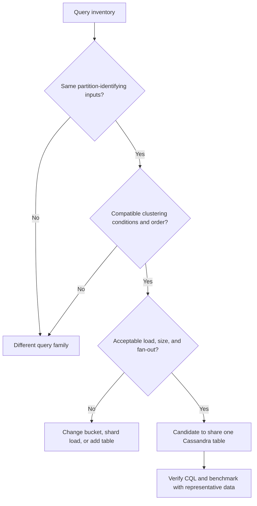

# A Query Family and Matching Table Design

## Lesson Objectives

In Apache Cassandra, a table is typically designed to serve **a known data access pattern**, but that does not mean every `SELECT` statement requires creating a separate table. Multiple queries can share a **partition key**, **clustering column** filtering rules, read order, and result limits. The job of query-driven design is to identify **compatible query families** and choose a schema tailored to each family.

This lesson belongs to the **Query-Driven Design** chapter of the `DATABASE_ENGINE_WIDE_COLUMN_CASSANDRA` module. Concepts of distributed architecture, the wide-column model, CQL, read/write consistency levels, replication, and Java connectivity are used where needed to explain why a table can or cannot serve multiple read requirements.

After this lesson, you will be able to:

- Identify a **query family** from business requirements and distinguish it from grouping by entity name.
- Determine which queries can share a partition key and clustering order, and spot queries that require a separate table.
- Design and validate a Cassandra table for a query family using concrete CQL statements.
- Evaluate the impact of time buckets, pagination, partition size, duplicated data, and how a Java application invokes the queries.
- Explain why a new query sometimes requires changing the data model rather than merely adding a `WHERE` condition.

## 1. What Is a Query Family?

A **query family** is a set of read operations that can be served by the same mechanism for **routing to a partition** and **reading ordered data within that partition**. Queries in the same family may differ in returned columns, `LIMIT`, time range, or Cassandra-supported read direction, provided they do not break the table's primary access path.

For example, with device logs for a single day:

1. Fetch the 30 newest events for device A.
2. Fetch events for device A from 09:00 to before 10:00, newest first.
3. Fetch the oldest events for device A on that day.
4. Paginate through all events for device A on that day.

These four operations can belong to **the same family**, because all of them know the tenant, device, and day; the differences are mainly time bounds, direction, or fetching slices of the result set.

Conversely, "look up one event by ID alone" and "list `CRITICAL` events across all devices in a tenant" **do not automatically belong to that family**, even though they also read event data. Those two requirements lack the partition-identifying conditions of the per-device/day log table.

### 1.1. Group by Read Path, Not by Entity Name

| Shared Characteristic | Sufficient Basis to Share a Table? | Reason |
| --- | --- | --- |
| Same `event` entity | Not yet | Queries may search by ID, time, status, or across a whole tenant |
| Same UI screen | Not yet | One screen may combine multiple distinct query patterns |
| Same `SELECT` column list | Not yet | Returned columns are identical, but lookup conditions differ |
| Same full partition key provided | Essential prerequisite | Allows Cassandra to route to the exact partition |
| Same clustering order and valid range conditions | Very likely | Can read the target rows directly within the partition |
| Same filter pattern but extreme differences in partition size/load | Needs further checks | A valid schema can still become hot or slow in production |

A query family is a **design candidate**, not proof of performance. You still need to evaluate traffic, data distribution, tombstones, latency, and partition bounds.

## 2. How to Group Queries into a Family

Assume you already have a **query inventory**: each query specifies mandatory inputs, optional inputs, comparison predicates, sort order, row counts, frequency, and data scope. You can proceed through the following steps.

### Step 1. Normalize Inputs and Query Scope

For each query, distinguish:

- **Always-present access keys:** e.g., `tenant_id`, `device_id`, `day_bucket`.
- **Narrowing conditions within that scope:** an `event_time` range or a clustering prefix.
- **Other optional conditions:** `severity`, `event_type`, keywords, etc., which must be evaluated separately.
- **Scope:** one partition, a known set of partitions, or scanning an unbounded set of partitions.

When product only says "filter events by day," verify whether that means **a day for one device**, **a day across all devices in a tenant**, or **a day across the entire system**. Those are three different access patterns.

### Step 2. Match Candidate Partition Keys

Queries in the same family ideally supply all components of **the same partition key**. With a composite partition key `((tenant_id, device_id, day_bucket))`, the application must know all three values before reading a single partition.

If a query only knows `event_id`, it cannot identify that partition and should be placed in another family. If a query may span multiple days, explicitly define the fan-out (how many partitions will be read) and how results are merged; do not assume a date condition automatically yields a global sort.

### Step 3. Match Clustering and Read Order

Within a partition, Cassandra organizes rows by clustering columns. A query reads efficiently when its conditions and ordering align with that key structure. A design with clustering `(event_time, event_id)` typically supports time-ordered reads, range predicates on `event_time`, and a secondary key to break ties when timestamps match.

Clarify the following:

- Does any query want to sort by a **regular column** such as `severity` or `reading_value`?
- Does any query need to filter on a column after skipping an earlier clustering column?
- Does the desired order match the clustering order or a **full reversal** of the supported order?
- Does any query require a **global order across multiple partitions**?

Even a single requirement relying on an incompatible condition or sort order is reason enough to evaluate splitting that query into another family.

### Step 4. Check Size and Read Cost

Queries can share a table syntactically while still causing oversized partitions, hot partitions, heavy tombstone scans, or excessive fan-out. Record peak traffic, rows/bytes per partition, skew between quiet and noisy devices, p95/p99 SLAs, TTLs, and update/delete rates.

### Step 5. Finalize the Family and Document Exceptions



The output should include both the **list of queries supported by the table** and the **list of unsupported queries**, along with the rationale. Never save only the schema diagram while discarding the query contracts that led to it.

## 3. Practical Scenario: Multi-Tenant Telemetry System

Suppose a Java application ingests events from IoT devices and stores them in Cassandra. Each event contains tenant, device, occurrence time, event ID, type, severity, and display metrics. Page size values in this example are illustrative requirements, not universal recommendations for every system.

### 3.1. List of Queries to Support

| ID | Read Requirement | Always-Present Inputs | Conditions/Sort | Proposed Family |
| --- | --- | --- | --- | --- |
| Q01 | View 30 newest events for a device on a day | Tenant, device, UTC day | Newest time first, `LIMIT 30` | A |
| Q02 | View device events within a specific hour range on that day | Tenant, device, UTC day | `from <= event_time < to`, newest first | A |
| Q03 | View 30 oldest events of the day for reconciliation | Tenant, device, UTC day | Oldest time first | A, if reverse clustering order is supported |
| Q04 | Paginate through the rest of the day's events | Tenant, device, UTC day | Same order as Q01, page size 30 | A |
| Q05 | Look up a single event by ID | Tenant, event ID | No sorting needed | B |
| Q06 | View 30 `CRITICAL` events for a device/day | Tenant, device, UTC day, severity | Newest first after filtering severity | C |
| Q07 | List `CRITICAL` events across **all devices** of a tenant/day | Tenant, UTC day, severity | Newest first across all devices | D: requires separate analysis |

All of these mention "events," yet only Q01–Q04 share the same direct read path. Q05, Q06, and Q07 are marked for separation from family A before any table is written.

### 3.2. Shared Contract for Family A

```text
Family name: DEVICE_EVENTS_IN_DAY
Partition scope: exact tenant + device + UTC day
Required inputs: tenantId, deviceId, dayBucket
Optional range: eventTime >= fromInclusive, eventTime < toExclusive
Default sort: eventTime DESC, eventId DESC
Reconciliation sort: eventTime ASC, eventId ASC
Primary projection: eventId, eventTime, eventType, severity, readingValue
Limit: max 30 rows for preview screens Q01/Q03
Paging: multiple pages of 30 for Q04; separate API bounds apply
Not supported by this table: lookup by eventId alone; filtering severity
  as a primary query condition; tenant-wide search without deviceId
```

**Assumptions to verify:** `event_id` is a unique UUID within the tenant; `event_time` is a UTC timestamp normalized by the application; a device can emit multiple events with the same timestamp. In that case, `(event_time, event_id)` creates a distinct row key and a deterministic order based on key values. UUID ordering for identical timestamps only breaks ties and does not represent causal ordering between events.

## 4. Designing a Matching Table for Family A

```sql
CREATE TABLE telemetry_events_by_device_day (
    tenant_id text,
    device_id uuid,
    day_bucket date,
    event_time timestamp,
    event_id uuid,
    event_type text,
    severity text,
    reading_value double,
    PRIMARY KEY ((tenant_id, device_id, day_bucket), event_time, event_id)
) WITH CLUSTERING ORDER BY (event_time DESC, event_id DESC);
```

Component breakdown:

| CQL Component | Role | Link to Queries |
| --- | --- | --- |
| `(tenant_id, device_id, day_bucket)` | **Composite partition key** | Q01–Q04 all identify the exact same logical partition |
| `event_time` | First clustering column | Supports time ordering and range predicates |
| `event_id` | Second clustering column | Distinguishes events sharing the same `event_time` |
| `CLUSTERING ORDER BY (... DESC)` | Logical storage order within each partition | Reads newest first by default |
| `event_type`, `severity`, `reading_value` | Regular columns | Returned for display; do not automatically form efficient filter paths |

```text
Partition: (tenant-A, device-42, 2026-11-21)
  [10:32:16, event-X]  severity=INFO
  [10:31:52, event-Y]  severity=CRITICAL
  [10:31:52, event-Z]  severity=WARN
  [10:29:01, event-W]  severity=INFO
  ...

Partition: (tenant-A, device-42, 2026-11-22)
  [00:02:05, event-K]  severity=INFO
  ...
```

The diagram above illustrates two **separate** partitions. IDs with the same timestamp are ordered according to Cassandra's `uuid` comparator; letters X/Y/Z are purely illustrative and not intended to reflect actual lexical UUID ordering.

### 4.1. Q01: Fetching the Newest Events of the Day

```sql
SELECT event_time, event_id, event_type, severity, reading_value
FROM telemetry_events_by_device_day
WHERE tenant_id = ?
  AND device_id = ?
  AND day_bucket = ?
LIMIT 30;
```

The `WHERE` clause supplies all parts of the partition key. Because the table already uses descending clustering order, no `ORDER BY` is needed to retrieve the newest events first within this partition. `LIMIT 30` caps the total rows returned by **the query**, fitting a preview screen that shows only 30 rows.

### 4.2. Q02: Narrowing Further by a Time Range

```sql
SELECT event_time, event_id, event_type, severity, reading_value
FROM telemetry_events_by_device_day
WHERE tenant_id = ?
  AND device_id = ?
  AND day_bucket = ?
  AND event_time >= ?
  AND event_time < ?
LIMIT 100;
```

Q02 hits the same partition as Q01, then narrows the slice using the `event_time` clustering column. The `[fromInclusive, toExclusive)` convention prevents duplicate records at the boundary of adjacent intervals.

The application must ensure both bounds fall within the day matching `day_bucket`. If an interval crosses UTC midnight, split it into per-day sub-ranges and read the corresponding partitions. **Never** pass one `day_bucket` and implicitly expect to receive the next day's events.

### 4.3. Q03: Viewing the Oldest Events First

```sql
SELECT event_time, event_id, event_type, severity, reading_value
FROM telemetry_events_by_device_day
WHERE tenant_id = ?
  AND device_id = ?
  AND day_bucket = ?
ORDER BY event_time ASC, event_id ASC
LIMIT 30;
```

This is a **full reversal** of the `(event_time DESC, event_id DESC)` clustering order. Cassandra supports reading in the reverse direction of clustering order within an eligible partition scope. However, do not infer from this that you can sort by **any column**, such as `severity DESC`, or reverse only one key column in a way CQL does not permit.

If the application runs Q03 under heavy traffic, benchmark it under realistic conditions rather than assuming reverse reads perform identically across all configurations and data volumes.

### 4.4. Q04: Reading Multiple Pages in the Same Order

For a "load more" workflow, distinguish **page size** from `LIMIT`:

```sql
SELECT event_time, event_id, event_type, severity, reading_value
FROM telemetry_events_by_device_day
WHERE tenant_id = ?
  AND device_id = ?
  AND day_bucket = ?;
```

The application can configure **page size = 30** when executing this query via the Java driver and use the **paging state** returned by the driver to fetch the next page. In this query, rows per page are controlled by the driver; the UI/API must enforce its own business caps on page count, row count, and read duration. `LIMIT 30` does not replace multi-page pagination when users need to browse across all pages.

Treat paging state as **opaque** data bound to the query text and bound parameter values; never reuse an old state with different filters or partition keys. If the API sends the token to the client, encrypt/integrity-protect it per service standards and re-verify tenant and access scope before resuming. When data is written or deleted during pagination, pages do not necessarily represent an immutable snapshot of the entire result set.

## 5. Invoking the Query Family from a Java Application

With DataStax Java Driver 4.x (API package `com.datastax.oss.driver.api.core`), the application should use **prepared statements** and bind concrete values, for example for Q01:

```java
import com.datastax.oss.driver.api.core.CqlSession;
import com.datastax.oss.driver.api.core.cql.BoundStatement;
import com.datastax.oss.driver.api.core.cql.PreparedStatement;
import com.datastax.oss.driver.api.core.cql.ResultSet;

import java.time.LocalDate;
import java.util.UUID;

public final class EventReader {
    private final CqlSession session;
    private final PreparedStatement latestInDay;

    public EventReader(CqlSession session) {
        this.session = session;
        this.latestInDay = session.prepare(
            "SELECT event_time, event_id, event_type, severity, reading_value " +
            "FROM telemetry_events_by_device_day " +
            "WHERE tenant_id = ? AND device_id = ? AND day_bucket = ? LIMIT ?"
        );
    }

    public ResultSet latest(String tenantId, UUID deviceId, LocalDate utcDay) {
        BoundStatement statement = latestInDay.bind(tenantId, deviceId, utcDay, 30);
        return session.execute(statement);
    }
}
```

`LocalDate` maps to the CQL `date` type; `UUID` maps to `uuid`. The `utcDay` input must be derived from the **UTC date**, consistent with the rule used to compute `day_bucket` on writes. In production applications, configure timeouts, consistency levels, error handling, result bounds, and `CqlSession` lifecycle/closing according to service policy. Never create a new `CqlSession` per request.

For Q02, prepare an additional CQL statement with two bind markers for the `event_time` range. Having two prepared statements for different query shapes does **not** mean needing two tables: they still use the same partition key and clustering of family A.

For Q04, use a prepared statement without `LIMIT 30`, configure `setPageSize(30)` on the statement, and extract the paging state using the driver version's corresponding API. Avoid synchronously iterating over the Java result set in a way that accidentally causes the driver to fetch additional pages when the API is meant to return just one page.

## 6. Why Other Queries Cannot Be Merged into Family A

### 6.1. Q05: Lookup by Event ID

Q05 receives only `tenant_id` and `event_id`, without `device_id` or `day_bucket`, so it cannot identify a partition in `telemetry_events_by_device_day`. The straightforward solution is to maintain an ID-lookup table:

```sql
CREATE TABLE telemetry_events_by_id (
    tenant_id text,
    event_id uuid,
    device_id uuid,
    day_bucket date,
    event_time timestamp,
    event_type text,
    severity text,
    reading_value double,
    PRIMARY KEY ((tenant_id, event_id))
);

SELECT device_id, day_bucket, event_time, event_type, severity, reading_value
FROM telemetry_events_by_id
WHERE tenant_id = ? AND event_id = ?;
```

Q05 belongs to family B, using **one partition per ID** and not relying on time ordering. If the application only needs the ID table as a pointer/index table, it can store fewer columns and then use `device_id` and `day_bucket` to read from the family A table. That option adds a second read; weigh latency, payload needs, and replication/duplication cost.

### 6.2. Q06: Severity Filtering as a Primary Read Path

Trying to tack the condition below onto Q01 represents a **different** access structure requirement:

```sql
-- Do not assume this is an efficient default query on the family A table.
-- severity is a regular column, not part of the primary key.
SELECT event_time, event_id, severity
FROM telemetry_events_by_device_day
WHERE tenant_id = ?
  AND device_id = ?
  AND day_bucket = ?
  AND severity = 'CRITICAL';
```

In the current schema, `severity` has no designed primary filter path. Enabling `ALLOW FILTERING` to force execution does not guarantee low read cost, especially when `CRITICAL` is rare and the day's data is large. For a primary query with critical frequency or latency requirements, consider a dedicated table:

```sql
CREATE TABLE telemetry_events_by_device_severity_day (
    tenant_id text,
    device_id uuid,
    severity text,
    day_bucket date,
    event_time timestamp,
    event_id uuid,
    event_type text,
    reading_value double,
    PRIMARY KEY ((tenant_id, device_id, severity, day_bucket), event_time, event_id)
) WITH CLUSTERING ORDER BY (event_time DESC, event_id DESC);

SELECT event_time, event_id, event_type, reading_value
FROM telemetry_events_by_device_severity_day
WHERE tenant_id = ?
  AND device_id = ?
  AND severity = 'CRITICAL'
  AND day_bucket = ?
LIMIT 30;
```

This new table for family C solves a well-defined read path: **one severity level for one device/day**. While `severity` has low cardinality, combining it with `device_id` and `day_bucket` still scopes the dataset to the use case. Check partition sizes for high-volume devices; `CRITICAL` is not guaranteed to be rare on every device.

On Cassandra versions and deployments that support them, index mechanisms (such as SAI) can be evaluated as an alternative. They must be validated against selectivity, workload, and `ORDER BY` constraints—they do not mean every filter/sort combination is efficient or valid.

### 6.3. Q07: Across All Devices of a Tenant

Q07 drops `device_id` and requires **tenant-wide** ordering within a day. It is not simply Q06 with fewer parameters. Building an overly broad partition key of only `(tenant_id, day_bucket, severity)` lets a large tenant bloat the partition and create a hotspot.

Directions to investigate when Q07 is truly a core requirement include: building a tenant feed projection with **controlled bucketing or sharding**, consuming from a dedicated event stream, or using a suitable search/analytics engine. All of these require defining multi-shard reading, merge ordering, pagination, and synchronization. Never claim Q07 is supported just because a similarly named table exists.

## 7. Cost of a Query Family and Multiple Tables

### 7.1. Denormalization Is a Write-Path Responsibility

In the example, the same event may live in:

- `telemetry_events_by_device_day` for reading by device and time.
- `telemetry_events_by_id` for lookup by ID.
- `telemetry_events_by_device_severity_day` for reading by severity.

Upon ingesting an event, the application or pipeline must write all required representations. If an event's `severity` is modified, you must update the ID and time-series tables, and **delete the row from the old severity partition while inserting a row into the new severity partition**. This can generate tombstones and cause temporary divergence across projections.

**Do not** assume multiple writes to different partitions behave like an ACID SQL transaction. Define behavior when one write succeeds and another fails: idempotent retries, event queues, reconciliation, and recovery procedures. Even when a table's replicas use an appropriate read/write consistency level, that does not automatically synchronize all denormalized tables atomically.

### 7.2. Buckets and Partition Limits

`day_bucket` is a design choice to bound per-partition growth. However, a day is not always the right bucket.

Suppose a device continuously produces 100 events/second:

\[
100 \times 60 \times 60 \times 24 = 8{,}640{,}000\;\text{events/day}
\]

Even if each row takes only about 200 bytes of raw data, a single day can hold **roughly 1.73 GB of raw data** in the logical partition, excluding overhead, indexes, tombstones, and actual storage layout. That is a signal to re-evaluate the bucket granularity (hour/minute) or shard the load—not a universal partition-size threshold.

Smaller buckets yield smaller partitions but increase the number of partitions read for multi-day queries. Larger buckets simplify queries but risk increasing partition size and hotness. Test against realistic device distributions, especially the highest-volume devices.

### 7.3. `LIMIT`, Pagination, and Tombstones

`LIMIT 30` bounds the number of **returned** rows; it does not promise the system physically reads only 30 rows. TTL expirations, updates, or deletes can leave tombstones; the query must scan past non-visible data before returning enough rows. Therefore, measure p95/p99 latency, tombstones read, partition size, and per-node load when evaluating a query family.

When using TTLs, retention periods must match business requirements, compaction strategy, and repair operations; never choose TTLs or compaction merely to paper over an overly broad partition key.

### 7.4. Replication, Consistency, and Multi-DC

Replication determines the number of data copies via keyspace configuration; consistency level determines replica acknowledgment for each read/write operation. These are critical operational decisions for latency and fault tolerance, but they do not replace proper partition key and clustering access paths.

For example, choosing `LOCAL_QUORUM` in a datacenter with an appropriate replication factor can satisfy certain intra-datacenter consistency needs. However, it does **not** make Q07 sort efficiently across an entire tenant, nor does it guarantee denormalized tables are updated synchronously as a single transaction. Consistency choices must be based on topology, SLAs, and application read-after-write requirements.

## 8. Decision Matrix: Which Table Serves Which Query?

After designing, maintain a shared **mapping table** for development, QA, and operations:

| Query | Serving Table | Target Partition Count | Filter/Sort Mechanism | Verdict |
| --- | --- | --- | --- | --- |
| Q01 | `telemetry_events_by_device_day` | 1 | Full partition key, clustering DESC, `LIMIT` | `SUPPORTED` |
| Q02 | `telemetry_events_by_device_day` | 1 | Clustering range on `event_time` | `SUPPORTED` when range stays within a day |
| Q03 | `telemetry_events_by_device_day` | 1 | Full reversal of clustering order | `SUPPORTED`, benchmark load |
| Q04 | `telemetry_events_by_device_day` | 1 | Driver paging state, same read path as Q01 | `SUPPORTED` with API limits |
| Q05 | `telemetry_events_by_id` | 1 | Partition key by event ID | `SUPPORTED` if projection is maintained |
| Q06 | `telemetry_events_by_device_severity_day` | 1 | Partition key includes severity, clustering DESC | `SUPPORTED` if projection is maintained |
| Q07 | Undecided | Many or undetermined shards | Requires tenant-wide shared ordering | `NEEDS_DESIGN` |

`SUPPORTED` in this table indicates only **read-path compatibility with the proposed schema**; it is not an SLA guarantee or proof of passing load tests.

A complete design handoff document should also capture:

1. Query ID catalog and input/output contracts, `LIMIT`, sort, and paging.
2. CQL schemas and actual `SELECT` statements mapped to each query ID.
3. Unsupported cases, especially optional filters and multi-partition queries.
4. Estimated rows/bytes per partition, peak QPS, bucket limits, and latency targets.
5. Procedures for maintaining duplicated data, writes/deletes, TTLs, errors, reconciliation, and consistency.
6. Test plan with realistic datasets and acceptance criteria.

## 9. Common Mistakes

| Mistake | Consequence | Fix |
| --- | --- | --- |
| Creating a new table for every `SELECT` | Unnecessary storage and data synchronization overhead | Group by genuinely compatible read paths |
| Forcing every query for an entity into one table | Some queries lack partition keys or require invalid filter/sort paths | Split families by partition key and clustering |
| Picking a partition key solely from the most common field | Can create massive or hot partitions | Combine query scope, data distribution, and bucketing |
| Assuming `WHERE severity = ?` is valid/fast because column `severity` exists | Regular columns do not automatically create efficient read paths | Design a validated projection/index for that query shape |
| Using `ALLOW FILTERING` as a schema fix | Unpredictable scan volume and latency spikes | Choose keys or tables aligned with read requirements |
| Treating `LIMIT` as page size and a lightweight guarantee | Pagination bugs or high tombstone scan cost | Separate query limit, page size, and API bounds |
| Duplicating data without designing updates/deletes | Divergent views across tables on retries or state changes | Use idempotent operations, error handling, and reconciliation |
| Treating a query family as finished once CQL compiles | Schema may fail under real load or large tenants | Test extreme partitions, p95/p99, and fan-out |

## 10. Practice Exercise

A parcel delivery tracking system has the following requirements:

```text
R1. View the 20 most recent status updates for a parcel on a given day.
R2. View status updates for a parcel between 08:00 and 12:00
    on the same day, newest first.
R3. Paginate through all updates for a parcel on a given day.
R4. Look up a single update using updateId alone.
R5. View all updates with status = FAILED across all parcels of a tenant.
```

Assume each update has `tenant_id`, `parcel_id`, `day_bucket`, `occurred_at`, `update_id`, `status`, and `note`.

Complete the following tasks:

1. Group R1–R5 by **read path**, indicating which group can share a table and which lacks enough information to design yet.
2. Write the `CREATE TABLE` for the R1–R3 group, defining the partition key and clustering order; explain the role of `update_id`.
3. Write the CQL for R1 and R2, including the `[from, to)` range condition.
4. Explain what R4 is missing if it queries the R1–R3 table directly, and propose a key for an ID-lookup table.
5. List two risks of implementing R5 by reading the R1–R3 table and filtering results in the application.

**Reference guidance:** R1–R3 form one family if tenant, parcel, and day are always known. A candidate schema is `PRIMARY KEY ((tenant_id, parcel_id, day_bucket), occurred_at, update_id)` with `DESC` clustering. R4 should have a read path via `(tenant_id, update_id)` if the ID is guaranteed unique within a tenant. R5 reads across all parcels of a tenant and requires investigating projections/buckets/shards, frequency, and desired ordering; you cannot conclude that a per-parcel/day table directly satisfies it.

## Conclusion

A query family fits a single Cassandra table when its queries **share how they identify a partition** and have filter conditions and read orders compatible with the **clustering key**. Differences in time windows, valid sort direction reversal, row caps, or pagination typically change only the CQL statement and parameters; differences in lookup keys, primary filters, or global ordering may require a separate table. Good design explicitly documents which queries use which table, the bounds of each read path, the cost of duplicated data, and how to validate with realistic data and load.
