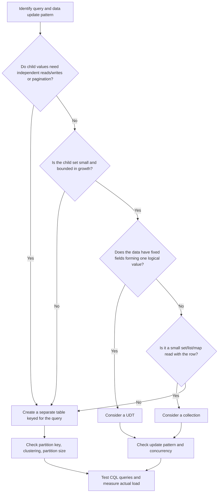

# Embedding via UDTs/Collections vs. Query-Driven Separate Tables in Apache Cassandra

## Learning Objectives

When modeling data in **Apache Cassandra**, a relationship can be represented either as values stored directly inside a row or as rows in another table. By the end of this lesson, you will be able to:

- Explain the difference between a **User-Defined Type (UDT)**, a **collection** (`set`, `list`, `map`), and a **separate table**.
- Choose a representation based on read/write paths, data size, update frequency, and **partition key**, rather than purely on 1:1 or 1:N cardinality.
- Practice CQL to create data types, write and update collections, and query tables designed around requirements.
- Identify risks related to large partitions, tombstones, concurrent updates, and duplicated data across multiple tables.
- Read UDTs and collections from a Java application using the Cassandra Java Driver.

## 1. From Business Relationships to Data Shapes

In relational databases, we commonly place addresses in one table, orders in another, and line items in a third; `JOIN` is used to assemble aggregated data. Cassandra is a distributed database in the **wide-column** family that distributes rows by **partition key** and organizes row ordering within a partition via **clustering columns**. Cassandra does not provide `JOIN` or foreign-key constraints like an RDBMS.

For an order, we have three distinct needs:

1. Read order details by `order_id`, along with the shipping address and a few short labels.
2. Read the order's line items and update the quantity or status of individual lines.
3. List the 20 most recent orders of a customer within a month.

A reasonable design choice would be:

| Requirement | Representation | Rationale |
| --- | --- | --- |
| Shipping address belonging to an order | `frozen<shipping_address>` column using a UDT | Fields form a single logical value, usually read together with the order |
| A few labels and small order attributes | `set<text>`, `map<text,text>` | Small, bounded data read together with the row |
| Many independent line items in an order | `order_items_by_order` | Each line is a row, easy to query/update by key |
| List of orders by customer and month | `orders_by_customer_month` | Requires a different partition key and ordering than `order_id` lookup |

This is **query-driven modeling**: first identify the questions the application will ask, then choose the partition key and CQL structure for each question. "Embedding" does not mean Cassandra supports arbitrary querying into every sub-field of an embedded value.

## 2. When to Use a UDT?

A **User-Defined Type** is a user-defined data type consisting of a set of named fields with defined types. A UDT fits **a composite value with a relatively stable structure**, such as an address, coordinates, contact information, or a snapshot of shipping details at order placement time.

In the examples below, assume the `shop` keyspace already exists and the practitioner is connected to it:

```sql
USE shop;

CREATE TYPE shipping_address (
    recipient text,
    street text,
    city text,
    country_code text
);

CREATE TABLE orders_by_id (
    order_id uuid PRIMARY KEY,
    customer_id uuid,
    created_at timestamp,
    status text,
    total_amount decimal,
    shipping_address frozen<shipping_address>,
    labels set<text>,
    metadata map<text, text>
);
```

Here:

- `order_id` is the **partition key** and the entire primary key. Reading an order by ID only queries a single partition.
- `shipping_address` is a **`frozen` UDT**: the address is written and replaced as an atomic blob. You cannot update `city` individually on a `frozen<shipping_address>` column.
- `labels` and `metadata` are **non-frozen collections**. Individual elements can be updated using CQL syntax.

Insert an order with a UDT and collections:

```sql
INSERT INTO orders_by_id (
    order_id, customer_id, created_at, status, total_amount,
    shipping_address, labels, metadata
) VALUES (
    22222222-2222-4222-8222-222222222222,
    11111111-1111-4111-8111-111111111111,
    '2026-11-21T01:00:00Z',
    'CREATED',
    250000.00,
    {
        recipient: 'Lan',
        street: '12 Nguyen Hue',
        city: 'Ho Chi Minh City',
        country_code: 'VN'
    },
    {'priority', 'gift'},
    {'channel': 'mobile', 'campaign': 'NOVEMBER'}
);

SELECT order_id, shipping_address, labels, metadata
FROM orders_by_id
WHERE order_id = 22222222-2222-4222-8222-222222222222;
```

### `frozen` and Updating UDTs

To change the shipping city in the `frozen` column in the example above, you must provide the **entire new address**:

```sql
UPDATE orders_by_id
SET shipping_address = {
    recipient: 'Lan',
    street: '12 Nguyen Hue',
    city: 'Da Nang',
    country_code: 'VN'
}
WHERE order_id = 22222222-2222-4222-8222-222222222222;
```

With non-`frozen` UDTs on Cassandra versions that support them, fields can be stored and updated independently. However, **`frozen`** is suitable when the entire value is managed as a snapshot and individual fields are rarely modified. If multiple actors concurrently modify different fields on a frozen UDT, writing the whole value risks overwriting each other's changes; the application must resolve conflicts according to business rules.

**Do not embed via UDT** when each child object has its own lifecycle, requires pagination, can grow without bound, or is frequently queried directly by its own key. A UDT describes the structure of **a single value**, not a substitute for a table used to query a large set of child entities.

## 3. When to Use Collections?

Cassandra provides three common collections:

| Type | Meaning | Suitable Scenario | Caveats |
| --- | --- | --- | --- |
| `set<T>` | Set of unique values, no business-order guarantee | A few tags, permissions, or option codes | Do not use as a list of millions of IDs |
| `list<T>` | Ordered sequence, may contain duplicate values | A small fixed number of display steps, ordered waypoints | Positional operations and concurrent updates get complex |
| `map<K,V>` | Key–value pairs with unique keys | A bounded set of extra attributes | Do not turn a map into an unbounded attribute store |

**Foundational rule:** collections are suited for small sets with **bounded growth**, primarily read together with the containing row. Collections are not a replacement for join tables when the dataset keeps growing.

### Adding, Updating, and Removing Collection Elements

Using the two declared columns `labels` and `metadata`:

```sql
-- Add a label to the set (does not create duplicate labels).
UPDATE orders_by_id
SET labels = labels + {'fragile'}
WHERE order_id = 22222222-2222-4222-8222-222222222222;

-- Remove a label.
UPDATE orders_by_id
SET labels = labels - {'gift'}
WHERE order_id = 22222222-2222-4222-8222-222222222222;

-- Update a key in the map.
UPDATE orders_by_id
SET metadata['channel'] = 'web'
WHERE order_id = 22222222-2222-4222-8222-222222222222;

-- Delete an entry from the map.
DELETE metadata['campaign']
FROM orders_by_id
WHERE order_id = 22222222-2222-4222-8222-222222222222;
```

Cassandra stores elements of **non-frozen** collections in a way that allows partial updates. With `frozen` collections, the value is treated as a single blob: changing one element means rewriting the entire collection value. Note:

- Deleting elements or overwriting certain structures can generate **tombstones**. Large collections with frequent modifications/deletes increase read and compaction overhead.
- `list` represents order, but positional inserts/deletes/updates are unsuitable for large lists or lists modified concurrently by multiple threads. For potentially long lists, use a table with a clustering column representing order.
- `map` is an attribute of **a single row**; it does not automatically create an efficient lookup path for all rows sharing a given map value. For instance, "find all orders with `channel = 'web'`" is a separate query that usually requires modeling with its own key.
- Do not choose a collection simply because it means fewer tables: measure the maximum element count, on-disk size, read/write frequency, and deletion handling.

### Why Not Use `set<uuid>` for Every 1:N or N:M Relationship?

Suppose a `course_ids set<uuid>` column lives on a student row. This may suffice if the application only needs to read a **very small, bounded set of courses** when looking up a student. However, if a course has hundreds of thousands of learners, and the system must list learners by course, paginate, or update each enrollment's status, then `set` is no longer an appropriate model.

When a relationship must be read from multiple directions or the element count lacks a reasonable upper bound, create separate query-driven tables such as `enrollments_by_student` and `enrollments_by_course`. Each relationship record becomes **a row with a primary key**, not an element in a large collection.

## 4. When to Use a Separate Query-Driven Table?

Suppose an order has many line items. Each line has `product_id`, `quantity`, and `unit_price`; we need to read all lines of an order and edit individual lines independently. Cramming all of them into `list<frozen<order_item>>` may force the application to read/write a large structure, making per-line updates and pagination difficult.

Model each line as **a row**:

```sql
CREATE TABLE order_items_by_order (
    order_id uuid,
    line_no int,
    product_id uuid,
    sku text,
    quantity int,
    unit_price decimal,
    PRIMARY KEY ((order_id), line_no)
);

INSERT INTO order_items_by_order
    (order_id, line_no, product_id, sku, quantity, unit_price)
VALUES (
    22222222-2222-4222-8222-222222222222,
    1,
    33333333-3333-4333-8333-333333333333,
    'SKU-KEYBOARD',
    2,
    125000.00
);

SELECT line_no, product_id, sku, quantity, unit_price
FROM order_items_by_order
WHERE order_id = 22222222-2222-4222-8222-222222222222;

UPDATE order_items_by_order
SET quantity = 3
WHERE order_id = 22222222-2222-4222-8222-222222222222
  AND line_no = 1;
```

**Key explanation:** `order_id` is the partition key; `line_no` is the clustering column. Lines belonging to the same order reside in the same partition and are sorted by `line_no`, making queries by `order_id` efficient. This structure still needs to ensure **a single order does not have an abnormally huge number of lines**; if a relationship can grow unboundedly, design an additional time bucket or controlled bucket.

### One Entity, Multiple Read Paths

Now add a requirement: "List the 20 most recent orders of a customer in a month." `orders_by_id` is optimized for `order_id`, so it does not directly serve queries by `customer_id`. Create another table:

```sql
CREATE TABLE orders_by_customer_month (
    customer_id uuid,
    order_month date,
    created_at timestamp,
    order_id uuid,
    status text,
    total_amount decimal,
    PRIMARY KEY ((customer_id, order_month), created_at, order_id)
) WITH CLUSTERING ORDER BY (created_at DESC, order_id ASC);

-- Duplicated write when creating an order; use the same order_id and created_at.
INSERT INTO orders_by_customer_month (
    customer_id, order_month, created_at,
    order_id, status, total_amount
) VALUES (
    11111111-1111-4111-8111-111111111111,
    '2026-11-01',
    '2026-11-21T01:00:00Z',
    22222222-2222-4222-8222-222222222222,
    'CREATED',
    250000.00
);

SELECT order_id, created_at, status, total_amount
FROM orders_by_customer_month
WHERE customer_id = 11111111-1111-4111-8111-111111111111
  AND order_month = '2026-11-01'
LIMIT 20;
```

The partition key in the new table is **`(customer_id, order_month)`**, which bounds the number of orders in a partition. `created_at` is the first clustering column, sorted descending chronologically; `order_id` distinguishes orders created at the exact same timestamp.

Thus, an order may appear in **two tables** with duplicated `status` and `total_amount` columns. This is **query-driven denormalization**, not a normalization mistake. If the order status changes, the application must update both tables and have a recovery mechanism when one write succeeds and the other fails.

## 5. Decision Diagram: Embed or Split Tables?



This is a starting point, not a rigid formula. Some practical criteria:

| Criterion | UDT | Collection | Separate Table |
| --- | --- | --- | --- |
| Data unit | One composite value with multiple fields | A set of elements inside a row | Rows with independent primary keys |
| Suitable size | Small, clear structure | Small, bounded growth | Can have many rows; must control per-partition size |
| Updates | Frozen: replace entire value | Non-frozen: per-element operations available | Update by row key |
| Querying by child entity | Not the primary choice | Unsuitable for large-scale independent queries | Design table around lookup key |
| Paginating child set | No | Inconvenient | Yes, via multi-row queries and driver paging |
| Typical use cases | Address, coordinates, snapshot | Small labels, small attributes | Order line items, event history, many-to-many relationships |

### Two Validation Questions Before Finalizing the Model

**First: does the query specify the full partition key?** With `orders_by_customer_month`, both `customer_id` and `order_month` must be supplied to query a partition. If you need to find all orders by `metadata['channel']` system-wide, a map column on `orders_by_id` does not automatically provide an appropriate read path. You may need to create an `orders_by_channel_month` table with the corresponding partition key, while also evaluating load and partition size.

**Second: how large will the data grow?** Both huge `collection` columns and partitions containing millions of rows cause problems. A separate table enables pagination and clustering choices, but **does not automatically** prevent large partitions. Choose bucketing by time, tenant, or a controlled sharding scheme when record counts risk exceeding acceptable operational scale.

## 6. Updates, Consistency, and Error Handling

When using a UDT or collection in **a single row**, pay close attention to multiple actors updating the value concurrently. For example, rewriting an entire frozen UDT with stale data can lose recent changes to other fields. Non-frozen collections allow per-element operations, yet still require conflict handling according to business logic.

When data is duplicated across **multiple tables**, a different challenge arises. For example:

1. Writing to `orders_by_id` succeeds.
2. Writing to `orders_by_customer_month` times out.
3. The detail page sees the order, while the list page does not show it yet.

A consistency level like `LOCAL_QUORUM` (when replication and topology are appropriate) applies to **each individual operation**; it does not guarantee denormalized tables are updated atomically together. A `LOGGED BATCH` can help ensure mutations complete after certain failures, but it does not replace ACID transactions with isolation and rollback like an RDBMS; multi-partition batches also carry operational overhead. Do not default to `BATCH` for every duplicated-data scenario.

The application should follow a clear workflow: use stable IDs and key values on retries, log failures per write path, perform bounded retries, and **reconcile** tables after incidents. For conditional updates scoped to a single row or single partition, you can evaluate lightweight transactions (LWT) and their cost; do not treat LWT as a cross-table transaction mechanism.

Deleting many collection elements or many rows generates **tombstones**. Tombstones are purged during compaction/garbage collection once safety conditions are met; therefore, continuous deletes over large datasets can increase read overhead. For multi-row tables, account for TTL, delete frequency, compaction, and repair in line with the system's data retention strategy.

## 7. Reading UDTs and Collections in Java

With **Apache Cassandra Java Driver 4.x**, we can use `CqlSession`, prepared statements, and typed accessor APIs:

```java
import com.datastax.oss.driver.api.core.CqlSession;
import com.datastax.oss.driver.api.core.cql.PreparedStatement;
import com.datastax.oss.driver.api.core.cql.Row;
import com.datastax.oss.driver.api.core.data.UdtValue;

import java.util.Set;
import java.util.UUID;

// Assume session is connected to the shop keyspace.
UUID orderId = UUID.fromString(
    "22222222-2222-4222-8222-222222222222");

PreparedStatement findOrder = session.prepare(
    "SELECT shipping_address, labels FROM orders_by_id WHERE order_id = ?");

Row row = session.execute(findOrder.bind(orderId)).one();
if (row != null) {
    UdtValue address = row.getUdtValue("shipping_address");
    String city = address == null ? null : address.getString("city");
    Set<String> labels = row.getSet("labels", String.class);

    System.out.println("City: " + city);
    System.out.println("Labels: " + labels);
}
```

Here, `session` is a `CqlSession` variable initialized in the application's connection layer. The Java Driver maps `set<text>` to `Set<String>`; `frozen<shipping_address>` is read via `UdtValue`. For custom UDTs, the application should verify schema compatibility, handle `null` values, and use prepared statements for safe parameter binding.

Do not load an entire large collection and filter in Java as a substitute for designing a table with the proper partition key. For multi-row results from a separate table, use the driver's **paging** capability to reduce memory footprint and the number of rows processed per batch.

## 8. Common Design Mistakes

| Tempting Choice | Practical Problem | Fix |
| --- | --- | --- |
| Putting thousands of line items into `list<frozen<order_item>>` | Hard to paginate, expensive per-line updates, ever-growing list | Use `order_items_by_order` with one row per line |
| Using `set<uuid>` to store all students of a large course | Bloated collection, hard to query and paginate individual learners | Use a link table keyed by `course_id`, consider bucketing |
| Storing `metadata map<text,text>` then querying all orders by `channel` | Map does not automatically make `channel` a partition key | Create a table for the `channel` read path if that query is needed |
| Using a frozen UDT while modifying individual fields across processes | Whole-value writes can overwrite concurrent changes | Consider conditional updates, model changes, or data ownership rules |
| Designing `orders_by_customer` without time bucketing | One heavy customer can generate a massive partition | Add bounded time buckets and define how to read across buckets |
| Updating only one of two tables holding order copies | Two screens show inconsistent results | Write to and reconcile all affected tables |
| Using `ALLOW FILTERING` to patch a query missing the partition key | Scans and filters large amounts of data with unpredictable cost | Redesign a table serving the primary query |

## 9. Practice Exercise

Design a schema for a course platform:

- A course has `course_info` containing display name and default language; these two fields are always read with the course.
- A course has at most five `labels` for display.
- A course can have hundreds of thousands of enrollees; the enrollment list by course needs pagination.
- A student needs to view their list of enrolled courses.

Answer on your own: (1) which data should use a UDT, (2) which data should use a collection, (3) which separate tables and partition keys are needed to read in both directions?

**Hints:** `course_info` can be a frozen UDT if managed as a small composite value; `labels set<text>` makes sense because it is bounded to five elements. The enrollment relationship is high-volume many-to-many, so use `enrollments_by_course` and `enrollments_by_student`. For `enrollments_by_course`, a partition key with only `course_id` may grow too large; consider bucketing and an appropriate pagination strategy. When enrolling or unenrolling, the application must update both representations and handle synchronization failures.

## Conclusion

In Cassandra, a **UDT** models a single structured value; a **collection** holds a small, bounded set read alongside its row; a **separate query-driven table** is for multi-row child entities requiring independent updates, pagination, or lookups by a different key. Every choice must be checked against the **partition key**, clustering, write pattern, and data volume. Good design efficiently answers the questions the application actually asks, while providing mechanisms to keep duplicated data consistent when failures occur in a distributed system.
