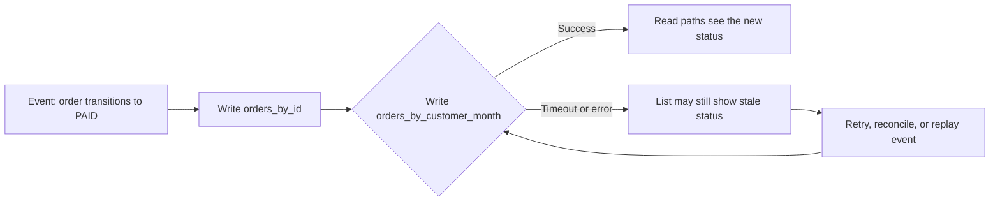

# Choosing Columns to Duplicate into Lookup Tables in Apache Cassandra

## Learning Objectives

In the **Relationships and Denormalization** chapter, this lesson focuses on a common design decision in Apache Cassandra: **which columns from the source data should a query-driven lookup table contain?** After this lesson, you will be able to:

- Distinguish **application-level data duplication** (denormalization) from Cassandra's **inter-node replication**.
- Start from queries and display requirements to choose the **primary key**, which columns to duplicate, and which columns to read from the detail table.
- Weigh storage capacity, write count, change frequency, read latency, security requirements, and temporary divergence across tables.
- Write CQL for a detail table and a query-driven list table; handle inserts, updates, deletes, and key changes.
- Propose ways to synchronize and verify duplicated data from a Java application in a distributed system.

## 1. Why Must We Carefully Weigh What Data to Duplicate?

Cassandra is a distributed database following the **wide-column** model. Rows are routed by **partition key**, while **clustering columns** determine position and ordering within each partition. Cassandra does not have `JOIN` or foreign keys in the RDBMS sense. Therefore, instead of placing all data into a normalized structure and joining at query time, we typically build multiple tables serving **different lookup patterns**.

Consider two queries:

1. `GET /orders/{orderId}`: view a complete order by ID.
2. `GET /customers/{customerId}/orders?month=2026-11`: view a customer's 20 most recent orders in a month, with each order showing creation date, total amount, currency, and status.

If the original table only has partition key `order_id`, the second query cannot quickly find all orders by `customer_id` using that table's access path. One option is to add an `orders_by_customer_month` table. But should we duplicate the entire shipping address, internal notes, line-item list, status, and total amount into the new table?

**Do not duplicate everything by default.** A list table should carry enough data to serve its primary query without reading hundreds of extra detail records, while avoiding duplicating large, sensitive, or frequently changing fields that are not used on that screen.

> **Two meanings of "replication/duplication" to distinguish:** `replication factor` determines how many replicas of a partition Cassandra stores across nodes. By contrast, `orders_by_id` and `orders_by_customer_month` are **two separate logical tables**, designed and maintained by the application to serve two queries. Choosing `LOCAL_QUORUM` does not automatically synchronize contents between those two logical tables.

## 2. Starting from the Query Contract

Before creating tables, explicitly write down **the data the UI or API actually needs**.

| Read Path | Query Predicate | Returned Data | Frequency and Characteristics |
| --- | --- | --- | --- |
| Order details | `order_id` | All order fields; may read line items from a separate table | Fewer reads than lists; a few supplementary queries are acceptable |
| Order list | `customer_id`, month | `order_id`, `created_at`, `total_amount`, `currency`, `status` | Read frequently, paginated, requires fast response |
| Lookup by external reference | `external_reference` | Returns `order_id` to open details | Direct lookup by another key; no need to duplicate the whole order |

These three read paths **do not require three full copies**. We can design:

- `orders_by_id` as the detail table, holding the business data stored at the order level.
- `orders_by_customer_month` containing only the keys and columns needed to display the list.
- `order_id_by_external_reference` (if the third query truly exists) mapping only the external reference to the ID, after which the application reads details from `orders_by_id`.

Make a clear choice between two strategies for each read path:

**Single-read completeness:** duplicate the small display columns directly into the list table. Suits multi-row list pages with low-latency requirements.

**Follow-up read by ID:** the lookup table stores only the ID and minimal metadata; the application uses the ID to look up the detail table. Suits single- or few-record lookups or read paths needing few fields. If a list page would require 20–100 follow-up reads per page, measure **fan-out** and latency before adopting it.

## 3. Criteria for Selecting Each Column to Duplicate

A lookup table must usually retain **enough keys to route, identify, and manage record lifecycles**. Display columns beyond keys should only be added when read benefits outweigh duplication costs.

### 3.1. Columns Required for Querying Correctly

In the order list example:

- `customer_id` and `order_month` form the **partition key** of the list table.
- `created_at` and `order_id` are **clustering columns** to sort, disambiguate concurrent orders, and uniquely identify a row.
- `order_id` is also the key to open the detail page.

These key columns cannot be omitted simply because the UI does not display them. The application needs the exact key values that were written in order to **update or delete rows** in the lookup table later.

### 3.2. Columns Worth Duplicating for Common Read Paths

`status`, `total_amount`, and `currency` are short fields the list needs to display. They can be duplicated so the list query returns complete data in a single read:

```sql
SELECT order_id, created_at, total_amount, currency, status
FROM orders_by_customer_month
WHERE customer_id = 11111111-1111-4111-8111-111111111111
  AND order_month = '2026-11-01'
LIMIT 20;
```

However, `status` can change several times after order creation, so duplicating it means planning for **update propagation**. `currency` and `created_at` are typically stable after creation; they incur less synchronization overhead. The total amount may change due to order edits or refunds, depending on business definitions.

### 3.3. Columns Typically Not Worth Duplicating

`delivery_address`, `internal_note`, long product descriptions, large JSON payloads, or fields shown only on the detail page generally do not belong in the list table. Duplicating them would:

- Increase storage across multiple replicas of each table, write traffic, and compaction overhead.
- Increase the number of places to update/delete when data changes.
- Replicate sensitive data more widely, complicating access control and retention policies.

If the list table only returns 20 orders, long unrendered fields still bloat rows with no practical benefit.

### 3.4. Concrete Evaluation Table

| Column | Include in `orders_by_customer_month`? | Reason | When Changed |
| --- | --- | --- | --- |
| `customer_id` | **Yes** | Partition key component | If order ownership transfers: move row to new key |
| `order_month` | **Yes** | Bounds partition size by time | Usually immutable from original `created_at` |
| `created_at` | **Yes** | Sorts the list | Part of primary key; cannot be edited in place |
| `order_id` | **Yes** | Identifies row and opens details | Immutable over order lifecycle |
| `status` | **Yes** | List displays status | Update both tables |
| `total_amount` | **Yes** | List displays total amount | Update both tables if total amount changes |
| `currency` | **Yes** | Needed to display amount properly | Treated as immutable after creation if appropriate |
| `delivery_address` | **No** | Only needed on detail page | Update detail table |
| `internal_note` | **No** | Private info, not displayed | Do not duplicate to list |
| `line_items` | **No** | Potentially large child set, updated independently | Store in separate `order_items_by_order` table if needed |

This is a purposeful example, not a universal rule. If the list screen strictly requires displaying another field, you may need to duplicate that field or change the read pattern. **The read path dictates the table shape.**

## 4. Designing Detail and Lookup Tables in CQL

Assume the `shop` keyspace has been created with environment-appropriate replication, and the CQL session is using that keyspace:

```sql
USE shop;

CREATE TABLE orders_by_id (
    order_id uuid PRIMARY KEY,
    customer_id uuid,
    order_month date,
    created_at timestamp,
    status text,
    total_amount decimal,
    currency text,
    delivery_address text,
    internal_note text
);

CREATE TABLE orders_by_customer_month (
    customer_id uuid,
    order_month date,
    created_at timestamp,
    order_id uuid,
    total_amount decimal,
    currency text,
    status text,
    PRIMARY KEY ((customer_id, order_month), created_at, order_id)
) WITH CLUSTERING ORDER BY (created_at DESC, order_id ASC);
```

**Detail table:** `order_id` is the entire primary key as well as the partition key.

**List table:** partition key is `(customer_id, order_month)`; clustering is `(created_at, order_id)`. Each partition holds orders for **one customer in one month**. `order_month` can follow the convention of the first day of the UTC month of `created_at`, e.g., `2026-11-01`. The application must standardize month and time zone calculation.

```sql
-- Detail record: stores two extra fields not needed in the list.
INSERT INTO orders_by_id (
    order_id, customer_id, order_month, created_at,
    status, total_amount, currency,
    delivery_address, internal_note
) VALUES (
    22222222-2222-4222-8222-222222222222,
    11111111-1111-4111-8111-111111111111,
    '2026-11-01',
    '2026-11-21T01:00:00Z',
    'CREATED', 250000.00, 'VND',
    '12 Nguyen Hue, Ho Chi Minh City',
    'Gift wrapping requested'
);

-- List-serving record: duplicates only the needed fields.
INSERT INTO orders_by_customer_month (
    customer_id, order_month, created_at, order_id,
    total_amount, currency, status
) VALUES (
    11111111-1111-4111-8111-111111111111,
    '2026-11-01',
    '2026-11-21T01:00:00Z',
    22222222-2222-4222-8222-222222222222,
    250000.00, 'VND', 'CREATED'
);
```

Reading the list page requires only one query against `orders_by_customer_month`; when the user selects an order, read details by `order_id`:

```sql
SELECT order_id, created_at, total_amount, currency, status
FROM orders_by_customer_month
WHERE customer_id = 11111111-1111-4111-8111-111111111111
  AND order_month = '2026-11-01'
LIMIT 20;

SELECT *
FROM orders_by_id
WHERE order_id = 22222222-2222-4222-8222-222222222222;
```

The two tables may share several columns, yet **each table has its own read purpose and key**. There is no need to copy `delivery_address` or `internal_note` just for the application to render the list.

### Splitting a Mapping Table When Only an ID Is Needed

A payment service sends an `external_reference` and the application needs to identify the corresponding order. If this lookup is genuinely common, you can create a small table:

```sql
CREATE TABLE order_id_by_external_reference (
    external_reference text PRIMARY KEY,
    order_id uuid
);

INSERT INTO order_id_by_external_reference
    (external_reference, order_id)
VALUES (
    'PAY-2026-000123',
    22222222-2222-4222-8222-222222222222
);

SELECT order_id
FROM order_id_by_external_reference
WHERE external_reference = 'PAY-2026-000123';
```

After this query, the application opens `orders_by_id`. The mapping table only duplicates **the needed identifier**, without creating a full order copy. If business rules require `external_reference` to be unique, the application needs an appropriate uniqueness mechanism (such as `INSERT ... IF NOT EXISTS` after evaluating LWT cost); Cassandra does not enforce foreign-key checks against `orders_by_id`.

## 5. Lifecycle of Duplicated Data: What Needs Updating?

Duplicating `status` and `total_amount` helps fast reads, but the application must manage them throughout the order lifecycle. We can build an **event-to-affected-tables matrix**:

| Business Event | `orders_by_id` | `orders_by_customer_month` |
| --- | --- | --- |
| Create order | INSERT full details | INSERT display columns and keys |
| Change status | UPDATE `status` | UPDATE `status` |
| Change total amount | UPDATE `total_amount` | UPDATE `total_amount` |
| Edit internal note | UPDATE `internal_note` | No write needed |
| Edit delivery address | UPDATE `delivery_address` | No write needed |
| Cancel/delete order per data policy | Handle detail row | Handle list row, plus other related tables if any |
| Transfer order to another customer | UPDATE `customer_id` value in detail per business rules | DELETE row in old partition, INSERT row in new partition |

Status update example:

```sql
UPDATE orders_by_id
SET status = 'PAID'
WHERE order_id = 22222222-2222-4222-8222-222222222222;

UPDATE orders_by_customer_month
SET status = 'PAID'
WHERE customer_id = 11111111-1111-4111-8111-111111111111
  AND order_month = '2026-11-01'
  AND created_at = '2026-11-21T01:00:00Z'
  AND order_id = 22222222-2222-4222-8222-222222222222;
```

Note: to update the list record, the application must have **the full original primary key** of the row. If only `order_id` is known, you can read `customer_id`, `order_month`, and `created_at` from `orders_by_id` before updating, or carry those immutable key values in the business event context.

### Changing Primary Key Columns

Cassandra does not support modifying a row's primary key in place. If an order is transferred to another customer, you cannot `UPDATE customer_id` on a row in `orders_by_customer_month`. You must delete the old key and insert the new row:

```sql
-- Illustration after confirming a valid order owner transfer.
DELETE FROM orders_by_customer_month
WHERE customer_id = 11111111-1111-4111-8111-111111111111
  AND order_month = '2026-11-01'
  AND created_at = '2026-11-21T01:00:00Z'
  AND order_id = 22222222-2222-4222-8222-222222222222;

INSERT INTO orders_by_customer_month (
    customer_id, order_month, created_at, order_id,
    total_amount, currency, status
) VALUES (
    55555555-5555-4555-8555-555555555555,
    '2026-11-01',
    '2026-11-21T01:00:00Z',
    22222222-2222-4222-8222-222222222222,
    250000.00, 'VND', 'PAID'
);
```

This snippet illustrates moving the key in the **list table** only; a real workflow must also synchronize `customer_id` in the detail table and handle failures between steps. For an entity where `customer_id` never changes, document that explicitly as a **business invariant** to reduce key-migration cases.

## 6. Consistency Across Lookup Tables

Each table is a separate logical dataset. Even though rows are replicated across multiple nodes, two tables can still diverge when failures occur:



Several principles to apply:

1. **Write the same IDs and stable keys:** retry with the exact same `order_id`, `customer_id`, `order_month`, and `created_at` so you do not create a second logical record.
2. **Track success per write path:** one acknowledged statement does not mean every table has received the update.
3. **Expect errors and timeouts:** a timeout does not always mean the write failed; retries must be safe, bounded, and backed by reconciliation.
4. **Control event ordering:** if `SHIPPED` arrives before a delayed `PAID`, naively applying updates in arrival order can regress status. Cassandra uses cell-level timestamps and last-write-wins conflict resolution; the application must define valid versions/event rules and prevent stale events from overwriting newer state.
5. **Define each screen's consistency requirement:** can the list lag by a few seconds, or must it reflect updates immediately before the API responds? These two requirements lead to different write and verification strategies.

A read/write consistency level such as `LOCAL_QUORUM` can increase the probability of observing recently acknowledged data within **the same partition** when replica/topology settings are suitable; it **does not turn two tables into a multi-table transaction**. A `LOGGED BATCH` helps ensure mutations in the batch are eventually applied after certain failures, but it does not provide isolation or rollback like an RDBMS and carries overhead for multi-partition batches. Do not use batches as a default solution for all duplication.

When synchronizing via a message broker, consumers usually need to tolerate **duplicate event delivery**, mid-flight failures, and **out-of-order events**. If the model requires strict version-checked state, evaluate conditional updates (LWT) at an appropriate scope, their cost, and cross-table reconciliation. Do not assume LWT provides atomic transactions across all lookup tables.

## 7. Writing and Reading Lookup Tables from Java

In a Java application using **Apache Cassandra Java Driver 4.x**, prepare statements ahead of time, bundle precomputed key values once, and reuse them on retries:

```java
import com.datastax.oss.driver.api.core.CqlSession;
import com.datastax.oss.driver.api.core.cql.PreparedStatement;
import com.datastax.oss.driver.api.core.cql.BoundStatement;

import java.math.BigDecimal;
import java.time.Instant;
import java.time.LocalDate;
import java.util.UUID;

// Example in a repository class; session is a CqlSession connected
// to the shop keyspace. INSERT statements should be prepared once.
PreparedStatement insertDetail = session.prepare(
    "INSERT INTO orders_by_id (" +
    "order_id, customer_id, order_month, created_at, " +
    "status, total_amount, currency, delivery_address, internal_note" +
    ") VALUES (?, ?, ?, ?, ?, ?, ?, ?, ?)");

PreparedStatement insertList = session.prepare(
    "INSERT INTO orders_by_customer_month (" +
    "customer_id, order_month, created_at, order_id, " +
    "total_amount, currency, status" +
    ") VALUES (?, ?, ?, ?, ?, ?, ?)");

UUID orderId = UUID.fromString(
    "22222222-2222-4222-8222-222222222222");
UUID customerId = UUID.fromString(
    "11111111-1111-4111-8111-111111111111");
Instant createdAt = Instant.parse("2026-11-21T01:00:00Z");
LocalDate month = LocalDate.of(2026, 11, 1);
BigDecimal amount = new BigDecimal("250000.00");

BoundStatement detail = insertDetail.bind(
    orderId, customerId, month, createdAt,
    "CREATED", amount, "VND",
    "12 Nguyen Hue, Ho Chi Minh City", "Gift wrapping requested");
BoundStatement list = insertList.bind(
    customerId, month, createdAt, orderId,
    amount, "VND", "CREATED");

session.execute(detail);
session.execute(list);

// If the second statement fails/times out: log it and handle with retry,
// event replay, or reconciliation. This is an illustrative example only.
```

Running the two operations sequentially clearly shows **two tables receiving two different sets of columns**, though it is not yet a complete production workflow. In a real application, error handling and retries must be designed upfront. Prepared statements can be reused across requests. The driver supports `uuid`, `date`, `timestamp`, and `decimal` corresponding to `UUID`, `LocalDate`, `Instant`, and `BigDecimal`.

## 8. Cost of Duplication and How to Evaluate It

A duplicated column does not merely cost storage equal to its raw size. Duplication also brings:

- **Write amplification:** one event must write to multiple tables; each table is further replicated according to its configuration.
- **Edit/delete cost:** updating duplicated columns across multiple tables, and potentially generating tombstones on deletes.
- **Compaction and repair:** more records/SSTables increase the data volume requiring maintenance, depending on TTL, compaction strategy, deletion pattern, and scale.
- **Schema evolution cost:** adding a column to a list page requires updating write paths, rolling out schema changes, and potentially backfilling historical data.
- **Operational cost:** monitoring divergence between source and lookup tables, handling write failures, and verifying completeness.

Conversely, duplicating displayed columns **avoids multiple detail-table reads**, which can significantly reduce latency and network load. To compare, measure metrics tied to real queries:

| Metric | Minimal Duplication + Follow-Up Reads by ID | Duplicate Full Display Columns |
| --- | --- | --- |
| Reads for a 20-order page | One list query + potentially up to 20 detail lookups | Typically one list query |
| Lookup table storage | Smaller | Larger depending on duplicated column count and size |
| Tables updated when display field changes | Usually only detail table, depending on model | Includes lookup tables as well |
| Risk of stale data on list | Depends on what data is kept in list table | Present if replica-table updates lag or fail |
| Best suited when | Only ID is needed, few follow-ups, or infrequent reads | List is read heavily with low-latency targets |

There is no single threshold across all systems. Weigh **p95/p99 read latency**, write throughput, partition size, SSTable size, retry rate, and freshness requirements for newly updated data.

### One Lookup Table Can Serve Multiple Queries

Query-driven design does not mean "one SQL/CQL statement per table." Queries sharing the same partition key and compatible ordering/filtering bounds can share a table. For example, a 10-order list page and a 20-order list page for the same customer in a month can share `orders_by_customer_month` with different `LIMIT` values. Create another table only when **the access key, ordering, or required dataset** genuinely differs.

Conversely, do not rely on `ALLOW FILTERING` to routinely query without a partition key. Indexes such as SAI can help for suitable filter patterns depending on Cassandra version, data distribution, and workload, but they must be benchmarked and verified independently; they do not replace all query-driven table designs.

## 9. Evolving a Lookup Table Without Losing Data

Suppose version one of the list page only displays `order_id`, `created_at`, and `status`. Later, product requirements ask to display `total_amount`:

1. Check whether `total_amount` is already in the list table. If missing, add the column with `ALTER TABLE` after reviewing the current schema and rollout strategy.
2. Update write paths so all new orders and total-amount edit events populate the new column.
3. **Backfill** historical rows from `orders_by_id` into the list table using the exact original keys; throttle read/write rates according to system load.
4. Track incomplete or skewed data, and coordinate concurrent updates during backfill so stale values do not overwrite newer data.
5. Switch the UI to read the new column only after defining clear criteria for legacy rows lacking data and confirming the system meets those criteria.

In Cassandra, large-scale backfills should not be executed by scanning an entire table in a single online request. Use an appropriate partition/source-driven tool or job with checkpointing and rate limiting. When using TTL, decide whether the duplicated copy shares the source TTL and note that TTL expiration can create tombstones; values should persist strictly in line with the desired business retention policy.

## 10. Scenario Exercise

An e-commerce system has:

- `products_by_id` with `product_id`, `category_id`, `name`, `price`, `currency`, `description`, `stock_quantity`, `supplier_email`, `created_at`.
- A category screen reads **24 products** by `category_id`, showing name, price, and availability status.
- Buyers click a product to view its full description.
- Price may update weekly; inventory changes continuously; `supplier_email` may only be viewed by staff.

Answer:

1. Which columns should be duplicated to `products_by_category`? Which should stay in `products_by_id`?
2. What should the partition key and clustering key of `products_by_category` be if you only need a list by `category_id`? What must be added if a category becomes huge?
3. When price changes, which tables must be updated? When `category_id` changes, what must happen to the row in the lookup table?
4. If you want to show real-time `stock_quantity` when it changes hundreds of times per second, should it be duplicated directly into every category table? Explain how to evaluate this.

**Suggested solution:**

- The category table minimally keeps `category_id`, `product_id`, plus `name`, `price`, and `currency` if displayed; add `is_active` or selling status if used as an actual display condition. Keep `description` and `supplier_email` in details/appropriate scope only. Replacing `stock_quantity` with `is_in_stock` also requires accurate update rules.
- `PRIMARY KEY ((category_id), product_id)` is only a starting point when each category is not overly large and no other sort order is needed. To sort by newest product, `created_at` can be chosen as a clustering column before `product_id`. When partitions grow too large, bucketing with an appropriate pagination design is required.
- Price is a duplicated column: update both the detail table and the category table. Changing category **changes the partition key**, so delete the row in the old category and insert into the new category, alongside updating the detail table.
- An extremely volatile inventory field can cause heavy **write amplification** if duplicated everywhere. Evaluate read/write load, acceptable staleness, accuracy requirements, and consider either displaying a threshold-updated availability flag or reading from a dedicated inventory source.

## Summary

To choose data to duplicate into a Cassandra lookup table, follow this sequence: **write actual queries → choose partition/clustering keys → list displayed columns → evaluate mutability, size, access control, and sync cost → validate with CQL under realistic workload**. Duplicating sufficient columns keeps critical read paths fast and predictable; keeping unnecessary fields in the detail table reduces write amplification, divergence risk, and operational overhead. With duplicated data, treat **multi-table updates, error handling, reconciliation, and primary-key changes** as part of the design from day one.
