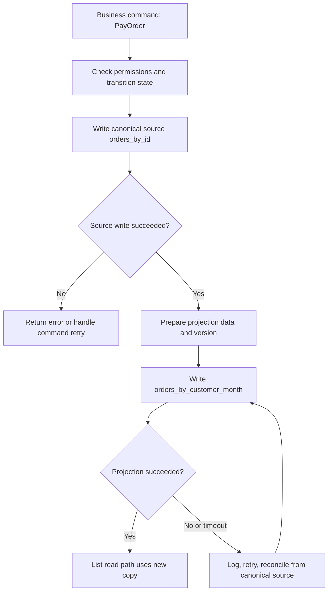

# Identifying Canonical Source Tables and Derived Projections in Apache Cassandra

## Learning Objectives

In the **Relationships and Denormalization** chapter, we saw that an entity can appear across multiple tables to serve different read patterns. This lesson addresses the next question: **when data has multiple representations, which one holds the authority to decide the true value, and how are the remaining copies created, updated, and repaired?**

After this lesson, you will be able to:

- Distinguish a **canonical source table** (*canonical/authoritative table*) from a **derived representation table** (*derived table*, *projection*, *read model*).
- Identify ownership of each business fact, the queries driving each derived table, and the transformation rules from the source.
- Design partition keys, clustering keys, and duplicated columns for multi-read-path models in CQL.
- Build create, update, delete, replay, reconciliation, and backfill flows that tolerate distributed failures.
- Explain the guarantee boundaries of consistency levels, replication, LWT, and batches when an entity is represented across multiple tables.

## 1. Why Identify a Canonical Source?

Apache Cassandra is a distributed database following the **wide-column** model. Cassandra routes queries via the **partition key**, orders rows within a partition via **clustering columns**, and does not support `JOIN` or foreign-key constraints like a relational database management system. Therefore, an application commonly stores the same slice of data across multiple tables with different keys to read quickly along real access paths.

For example, an order management system needs to:

1. Look up details by `order_id`.
2. List orders by `customer_id` and month, newest first.
3. Return the order's status and total amount directly in the list without fetching dozens of detail records.

We can build `orders_by_id` and `orders_by_customer_month`. Both contain `status` and `total_amount`. When a customer pays, `status` must transition from `CREATED` to `PAID`. If the two tables return different values, the application needs to know **which one is right in order to repair the other**.

The solution is to define a **canonical source** and **derived tables**:

| Concept | Role | Example |
| --- | --- | --- |
| **Canonical source** | The designated authority deciding current state; accepts changes only through controlled write flows | `orders_by_id` holds the authoritative order status |
| **Derived table** | Reorganizes or duplicates part of the data to optimize a specific query; can be rebuilt from a trusted source | `orders_by_customer_month` for displaying customer order history |
| **Projection rule** | Specifies which row and values to materialize in a derived table from a canonical entity | Extract `customer_id`, month, timestamp, ID, status, and total amount from the order |
| **Reconciliation** | Compares or reconstructs derived representations from the source after an incident | Find orders present in `orders_by_id` but missing/stale in the list |

**Important:** Cassandra **does not automatically mark any table as the canonical source**. This is a decision made by application architecture and business processes. Naming a table `orders_by_id` does not by itself make it authoritative. In another system, the canonical source could be an **immutable event log**, an order management service, or an external transactional system. In that case, Cassandra only holds derived read tables; do not arbitrarily declare a Cassandra table canonical if data ownership lives in another system.

### Do Not Confuse with Cassandra Replication

**Replication** copies data of **the same table/partition** onto multiple replicas per keyspace configuration. **Denormalization/projection** creates **separate logical tables** to read by different keys. Replication and `QUORUM` or `LOCAL_QUORUM` do not automatically keep derived logical tables in sync with the source table.

## 2. Choosing the Canonical Source from Business Ownership

Before writing CQL, answer four questions:

1. **Who creates and mutates this fact?** For example, the Order service decides `status`, the Payment service confirms payment, and the Inventory service manages stock.
2. **Which fact is the original?** For instance, order status may be decided by Order after processing a payment event; do not assume every value comes from Payment.
3. **Can the read table be rebuilt from canonical data?** If not, an important piece of information may exist only in the derived table and the design needs adjustment.
4. **When two copies disagree, what does the system rely on to determine the true value?** Also specify rules for deleted or retention-expired fields.

An **authoritative fact table** does not have to contain every business detail. For example, `orders_by_id` may be the canonical source for order status and total amount, yet not the canonical source for stock quantity or payment card details. Those facts have their own owners.

| Fact | Authoritative Source in Example | Can Copy to Read Table? | Update Rule |
| --- | --- | --- | --- |
| `order_id`, `customer_id`, `ordered_at` | Order service/`orders_by_id` | Yes, used as keys | Created once; key changes require row migration |
| `status` | Order service/`orders_by_id` | Yes | Changed only via valid state transitions/events |
| `total_amount`, `currency` | Order service/`orders_by_id` | Yes | Copied on creation and valid total-amount updates |
| `shipping_address` | Order service/`orders_by_id` in example | Only if the query needs it | Keep at source if not displayed in list |
| `stock_quantity` | Inventory service | Do not arbitrarily treat copy as canonical | May need its own read path or cache with explicit staleness policy |
| `payment_reference` | Payment or Order service, per service contract | Identifier only for lookup if needed | Must define uniqueness and change/delete rules |

Thus, "each entity has exactly one canonical source" is a helpful rule of thumb, yet in practice **ownership may sit at the field level or domain boundary**. Do not let multiple writers arbitrarily overwrite the same field without conflict-resolution rules.

## 3. From Query to Derived Table Contract

A derived table needs a **clear contract**, not just a table name.

Example for `orders_by_customer_month`:

| Contract Item | Decision |
| --- | --- |
| Purpose | Show a customer's 20 most recent orders in a given month |
| Query predicate | `customer_id = ? AND order_month = ?` |
| Partition key | `(customer_id, order_month)` |
| Clustering columns | `ordered_at DESC`, then `order_id ASC` to break ties at the same timestamp |
| Displayed fields | `order_id`, `ordered_at`, `status`, `total_amount`, `currency` |
| Source of construction | Corresponding fields from canonical order state |
| When updated | Order creation; status/total-amount edits; customer or month change; rule-based delete/cancel |
| Acceptable sync lag | Determined by product requirements and must be measurable |
| Failure recovery | Replay events, repair from canonical snapshot, or run reconciliation jobs |

**Before adding a table**, verify that the query cannot already be served efficiently by an existing table. Two lists with `LIMIT 10` and `LIMIT 20` sharing the same partition key and ordering usually need only one table. Conversely, a table keyed by `order_id` cannot serve a per-customer list using the same access key.

**Before duplicating another column**, ask whether it actually appears on that read path. Long data, rapidly changing values, fields needing separate access control, or detail-only fields can stay solely in the canonical source.

## 4. CQL Design: One Canonical Source and One Derived Representation

Assume the `shop` keyspace already exists with an appropriate replication policy. The following statements illustrate how to organize the data:

```sql
USE shop;

-- Canonical source owned by the Order service in this example.
CREATE TABLE orders_by_id (
    order_id uuid PRIMARY KEY,
    customer_id uuid,
    order_month date,
    ordered_at timestamp,
    status text,
    total_amount decimal,
    currency text,
    shipping_address text,
    version bigint,
    deleted boolean
);

-- Derived read table: orders list by customer/month.
CREATE TABLE orders_by_customer_month (
    customer_id uuid,
    order_month date,
    ordered_at timestamp,
    order_id uuid,
    status text,
    total_amount decimal,
    currency text,
    source_version bigint,
    PRIMARY KEY ((customer_id, order_month), ordered_at, order_id)
) WITH CLUSTERING ORDER BY (ordered_at DESC, order_id ASC);
```

Design explanation:

- In `orders_by_id`, `order_id` is the partition key. This is the read path for retrieving canonical state and full details of an order.
- In `orders_by_customer_month`, the partition key consists of `customer_id` and `order_month`. It prevents a customer's history from growing into an unbounded partition while enabling monthly lookups.
- `ordered_at` is the clustering column for descending sort order; `order_id` disambiguates orders created at the exact same timestamp.
- `source_version` stores the source state version used to build the derived row. It is **metadata for checking and reconciliation**, and does not automatically block stale writes if normal unconditional writes are used.
- `deleted` illustrates **soft delete** at the source, useful when emitting delete/reconciliation events prior to physical deletion. Retention and physical deletion rules must be defined by business policy.

Define `order_month` by convention as the **first day of the UTC month** of `ordered_at`. All event producers and backfill jobs must follow the same convention; using a month in another time zone can route data into a different partition.

### Initializing an Order Across Both Tables

```sql
-- Write canonical source state.
INSERT INTO orders_by_id (
    order_id, customer_id, order_month, ordered_at,
    status, total_amount, currency, shipping_address,
    version, deleted
) VALUES (
    22222222-2222-4222-8222-222222222222,
    11111111-1111-4111-8111-111111111111,
    '2026-11-01',
    '2026-11-21T01:00:00Z',
    'CREATED', 250000.00, 'VND',
    '12 Nguyen Hue, Ho Chi Minh City',
    1, false
);

-- Project data into the list-serving table.
INSERT INTO orders_by_customer_month (
    customer_id, order_month, ordered_at, order_id,
    status, total_amount, currency, source_version
) VALUES (
    11111111-1111-4111-8111-111111111111,
    '2026-11-01',
    '2026-11-21T01:00:00Z',
    22222222-2222-4222-8222-222222222222,
    'CREATED', 250000.00, 'VND', 1
);
```

These `INSERT` statements are **two separate logical operations**. If the source write is acknowledged while the derived write fails, the source remains valid while the list does not show the order yet. The application must have a replay or reconciliation strategy; do not treat sequential execution of two CQL statements as a transactional rollback unit.

### Reading Each Access Path

```sql
-- Read canonical data when a user opens an order.
SELECT order_id, status, total_amount, currency, shipping_address, version
FROM orders_by_id
WHERE order_id = 22222222-2222-4222-8222-222222222222;

-- Read derived data when viewing the list page.
SELECT order_id, ordered_at, status, total_amount, currency, source_version
FROM orders_by_customer_month
WHERE customer_id = 11111111-1111-4111-8111-111111111111
  AND order_month = '2026-11-01'
LIMIT 20;
```

The list query needs no `JOIN` and does not need to read 20 canonical rows. The application accepts extra synchronization work on the write path in exchange for a direct key-based read path.

## 5. Write Rule: Canonical Source First, Derived Tables Follow

When the **canonical source is stored in Cassandra**, a sample workflow is:

1. The owning service validates the business command, e.g., `PayOrder`, and determines the next state version.
2. Write the valid change to the canonical source, checking the result when conditional.
3. Build the payload required for the projection: `order_id`, complete derived-table keys, displayed columns, and source version.
4. Write or enqueue the projection update into a durable processing mechanism with retries and monitoring.
5. Once the projection succeeds, mark the event processed; otherwise, the system reconciles to recover.

If the canonical source resides **outside Cassandra**, the first step is confirming the change in the authoritative system; Cassandra only updates derived tables from events or snapshots published by that source. Avoid letting clients write directly to derived tables with content conflicting with the source.



The diagram depicts **logical responsibilities**, without implying that event emission or multi-system writes are always atomic. If the application uses a message broker or event table for replay, design **durable** event recording and handle the gap between writing the source and publishing the event. "Source written but event not yet published" is a scenario that must be addressed via reliable mechanisms or reconciliation.

## 6. Updating the Source and Refreshing the Projection

Suppose an order transitions from `CREATED` to `PAID`. If the application has multiple concurrent writers, enforce **state transition checks** and versioning. One approach on the canonical source is a lightweight transaction (LWT) to accept the update only when the current version matches:

```sql
-- Assume the application has read current version = 1.
UPDATE orders_by_id
SET status = 'PAID', version = 2
WHERE order_id = 22222222-2222-4222-8222-222222222222
IF version = 1;
```

The statement result includes an `[applied]` column. Only when the condition succeeds does the service consider the version 2 transition accepted and request a projection refresh. If `[applied] = false`, it must re-read canonical state or handle the conflict rather than emitting a projection update as if the command succeeded.

Illustration of the corresponding projection update:

```sql
UPDATE orders_by_customer_month
SET status = 'PAID', source_version = 2
WHERE customer_id = 11111111-1111-4111-8111-111111111111
  AND order_month = '2026-11-01'
  AND ordered_at = '2026-11-21T01:00:00Z'
  AND order_id = 22222222-2222-4222-8222-222222222222;
```

**Warning:** writing `source_version = 2` alongside the data does not automatically guarantee the newer write beats an older one. Cassandra applies *last-write-wins* based on cell timestamps, not on the `source_version` column. If version 3 of the projection was already written and a delayed version 2 event arrives and writes unconditionally, the derived table can revert to stale data.

Options to handle out-of-order events:

- **Serialize per `order_id`** in the consumer stream, handling retries before accepting newer events for the same entity.
- **Check and conditionally update** at a single-row/partition scope with LWT when needed, based on expected version; handle the case where the projection row does not yet exist and weigh LWT cost.
- **Resynchronize from a canonical snapshot** when an older event, status mismatch, or missing record is detected, with safeguards to prevent an older snapshot from overwriting a newer one.

Do not treat "read current version then regular `UPDATE`" as sufficient protection against race conditions; another writer can intervene between the two steps. Nor does LWT turn multiple tables into a unified ACID transaction.

### Idempotency During Event Replay

An *at-least-once* event delivery system can process the same message multiple times. To avoid creating duplicate records for the same order:

- Preserve the exact `order_id`, `customer_id`, `order_month`, and `ordered_at` across all retries of the same entity.
- Distinguish `event_id` from `order_id`: one order can have many events, and each event must be identifiable to prevent duplicate processing when business rules require it.
- Design projection operations to be safely repeatable. Overwriting an exact value at the same key is usually far easier to control than incrementing counters like `count = count + 1`.
- If using TTL, `USING TIMESTAMP`, or versioning, define rules explicitly; two "writes of the same value" do not necessarily have identical effects on expiration time or conflict resolution.

## 7. Deletes, Key Changes, and Canonical Source Responsibility

Data duplication introduces a critical problem: **deleting at the source does not automatically delete from every derived table**. A `DELETE` on `orders_by_id` has no `ON DELETE CASCADE` to `orders_by_customer_month`.

### Logical Deletes and Physical Deletes

A workflow may choose to:

1. Mark `deleted = true` at the canonical source or record a durable deletion event.
2. Use the deletion event containing **full keys** to delete the derived row.
3. Verify projections have processed the event; execute physical deletion of source data according to retention policy.

Example:

```sql
UPDATE orders_by_id
SET deleted = true, version = 3
WHERE order_id = 22222222-2222-4222-8222-222222222222
IF version = 2;

DELETE FROM orders_by_customer_month
WHERE customer_id = 11111111-1111-4111-8111-111111111111
  AND order_month = '2026-11-01'
  AND ordered_at = '2026-11-21T01:00:00Z'
  AND order_id = 22222222-2222-4222-8222-222222222222;
```

These remain **two distinct operations**. If the second fails, retry and reconciliation are required. In systems with sensitive-data deletion policies, ensure all tables, backups, and retention windows comply with policy, not only the source table. Cassandra uses tombstones to mark deletions; compaction and repair affect physical data cleanup.

### When Key Attributes Change

If `customer_id` changes, the old row in `orders_by_customer_month` cannot change its partition key via `UPDATE`. You must **delete under the old key and insert a new row under the new key**, in sync with the canonical source change:

```sql
-- Delete the row from the old customer partition.
DELETE FROM orders_by_customer_month
WHERE customer_id = 11111111-1111-4111-8111-111111111111
  AND order_month = '2026-11-01'
  AND ordered_at = '2026-11-21T01:00:00Z'
  AND order_id = 22222222-2222-4222-8222-222222222222;

-- Write the new representation with the new customer key.
INSERT INTO orders_by_customer_month (
    customer_id, order_month, ordered_at, order_id,
    status, total_amount, currency, source_version
) VALUES (
    55555555-5555-4555-8555-555555555555,
    '2026-11-01',
    '2026-11-21T01:00:00Z',
    22222222-2222-4222-8222-222222222222,
    'PAID', 250000.00, 'VND', 4
);
```

This example assumes the source version advanced to 4 and the new customer is permitted to own the order. **The old key values** must be present in the event or transition record to delete the right row; you cannot locate the old row using only the new key. In practice, restricting changes to keys defined as immutable makes the system simpler and safer.

## 8. When the Distributed System Fails: What Does the Canonical Source Help Repair?

| Scenario | User-Visible Symptom | Resolution |
| --- | --- | --- |
| Canonical source write succeeds, projection times out | Detail view shows order, list is missing it | Retry using keys and canonical snapshot; reconcile missing rows |
| Projection writes older status after newer status | List shows wrong status | Enforce ordering/versioning; rebuild from canonical source |
| Message consumed twice | Risk of double-counting, duplicate notifications, or duplicate charges | Idempotency by event ID; write projection using fixed keys |
| Key moved without deleting old row | Order appears in two customers' lists | Record before/after keys; retry deleting old row |
| Source deleted without deletion event | Orphaned row remains in read table | Persist durable deletion events and reconcile per retention process |
| Projection has record but source is missing | Bad data or incomplete delete | Check soft-delete/TTL policy before purging or rebuilding |
| Two services concurrently write canonical state | Lost updates or illegal state transitions | Lock down owning service, conditional updates, or conflict resolution |

Important operational points:

- **Consistency levels** like `LOCAL_QUORUM` govern how many replicas must acknowledge each read/write (depending on topology and replication factor). They do not make updating the canonical source and projection a single transaction.
- **`LOGGED BATCH`** can help ensure mutations within the batch are eventually applied under certain failures, but it does not provide isolation or rollback like relational transactions; multi-partition batches also incur overhead. Do not treat batches as a blanket solution for all derived tables.
- **Repair and replica synchronization** fix divergence among replicas of the same table; they do not infer or fix discrepancies between `orders_by_id` and `orders_by_customer_month`.
- **TTLs and tombstones** require a unified retention policy. If the source expires before the projection is repaired, rebuilding the accurate copy may become impossible without an event history or another source copy.

## 9. Reconciliation, Rebuilding, and Backfilling Derived Tables

A hallmark of good design is being able to answer: **"If we wiped an entire derived table, do we retain enough authorized information to rebuild it?"** You do not have to actually delete it; this is a litmus test for ownership and source completeness.

### Safe Rebuild Workflow

1. **Finalize the projection definition**: which columns the table needs, partition key/clustering columns, month-derivation rules, and schema version.
2. **Identify the source scope**: canonical table, event log, snapshot, or external source system. Verify retention windows and deleted data.
3. **Choose an approach for ongoing writes**: pause updates within an appropriate scope or combine snapshot processing with change replay. If backfilling alongside live updates, prevent stale backfill data from overwriting newer updates.
4. **Backfill across partitions/streams in a controlled manner**: rate-limit and checkpoint progress; never scan everything in a single online request. Use distributed processing tools at large scale.
5. **Reconcile post-backfill**: check for missing rows, extra rows, wrong statuses, mismatched versions, and migrated/deleted keys.
6. **Switch read traffic** to the new projection only after meeting accuracy criteria, then continue monitoring drift.

### Per-Order Reconciliation Pattern

Suppose a job receives an `order_id`. It reads `orders_by_id` and decides:

- If the source shows an active order: compute `(customer_id, order_month, ordered_at, order_id)`, then check the corresponding row in `orders_by_customer_month`. If missing or if display fields/version mismatch, schedule repair from canonical state.
- If the source records `deleted = true`: verify the derived row is deleted, including under any old key if ownership changed.
- If the source record is not found: **do not jump to conclusions** that the projection is wrong—distinguish valid deletion, TTL expiration, missing source info, in-flight state, or read errors. Apply retention policy and event history before repairing/deleting.

Reconciliation must guard against race conditions: source state can change after the job reads it and before it writes a repair. You can gate by version and use conditional writes or resync from the source at the final step. Do not rely solely on matching total row counts: two tables can have equal row counts while holding different IDs or values.

### Observability Metrics

| Metric | Meaning |
| --- | --- |
| Age of events not yet projected to read table | Lag from source change to projection |
| Count of retried, failed, or dead-lettered events | Synchronization completion health |
| Missing/extra/version-mismatched rows during reconciliation | Application-level inconsistency rate |
| P95/P99 read-table query latency | Whether the projection meets performance targets |
| Size and row count of hot partitions | Risk of oversized partitions or hotspots |
| Tombstone, compaction, and repair rates | Cost of maintaining duplicated data |

## 10. Java Driver: Implementing Dual Writes and Detecting Failures

With **Apache Cassandra Java Driver 4.x**, `CqlSession` and prepared statements ensure accurate parameter binding. The example below shows an order-creation command writing to both tables; it is **not yet a production workflow with durable queues, retries, conditional writes, and reconciliation**.

```java
import com.datastax.oss.driver.api.core.CqlSession;
import com.datastax.oss.driver.api.core.cql.PreparedStatement;

import java.math.BigDecimal;
import java.time.Instant;
import java.time.LocalDate;
import java.util.UUID;

// Assume session is connected to the shop keyspace.
PreparedStatement writeSource = session.prepare(
    "INSERT INTO orders_by_id (" +
    "order_id, customer_id, order_month, ordered_at, " +
    "status, total_amount, currency, shipping_address, version, deleted" +
    ") VALUES (?, ?, ?, ?, ?, ?, ?, ?, ?, ?)");

PreparedStatement writeProjection = session.prepare(
    "INSERT INTO orders_by_customer_month (" +
    "customer_id, order_month, ordered_at, order_id, " +
    "status, total_amount, currency, source_version" +
    ") VALUES (?, ?, ?, ?, ?, ?, ?, ?)");

UUID orderId = UUID.fromString(
    "22222222-2222-4222-8222-222222222222");
UUID customerId = UUID.fromString(
    "11111111-1111-4111-8111-111111111111");
LocalDate month = LocalDate.of(2026, 11, 1);
Instant orderedAt = Instant.parse("2026-11-21T01:00:00Z");
BigDecimal amount = new BigDecimal("250000.00");

session.execute(writeSource.bind(
    orderId, customerId, month, orderedAt, "CREATED",
    amount, "VND", "12 Nguyen Hue, Ho Chi Minh City",
    1L, false));

session.execute(writeProjection.bind(
    customerId, month, orderedAt, orderId,
    "CREATED", amount, "VND", 1L));

// If the second statement fails or times out:
// the source may already be written; record a marker for repair and reconciliation.
```

For conditional updates like `UPDATE ... IF version = ?`, the Java Driver returns a `ResultSet` whose `wasApplied()` can be checked before emitting derived data:

```java
var result = session.execute(
    session.prepare(
        "UPDATE orders_by_id SET status = ?, version = ? " +
        "WHERE order_id = ? IF version = ?")
    .bind("PAID", 2L, orderId, 1L)
);

if (!result.wasApplied()) {
    throw new IllegalStateException(
        "Source version has changed; re-read and resolve conflict");
}

// Emit the projection refresh request only after the conditional update succeeds.
// Emitting the request must include event-loss prevention and retry handling.
```

Prepared statements can be reused. The CQL types `uuid`, `date`, `timestamp`, and `decimal` map to `UUID`, `LocalDate`, `Instant`, and `BigDecimal`. If a project uses an older Java version without `var`, declare `ResultSet result` explicitly instead.

## 11. Case Study Exercise: Course Platform

An online learning platform needs to:

- View a course profile by `course_id`: title, full description, author, price, and publication status.
- View the 24 newest courses by `category_id`: thumbnail, title, price, and publication status.
- View the courses in which a student is enrolled.
- Content editors can update title/price; students can unenroll.

Answer:

1. Which facts are owned by the Catalog service, and which by the Enrollment service?
2. Which table should act as the canonical source for course information? Which tables are derived representations?
3. What primary key and duplicated columns does the category list table need? Why avoid duplicating the long description if the list page does not use it?
4. When an author changes the course title or price, which projections must be updated? If update events are processed out of order, how do you detect and fix it?
5. If a course is moved to another category or deleted, how do you remove the derived row from the old category?
6. If a derived table is lost, from which data and via what workflow can the system rebuild it?

**Hints:**

- Catalog can own `courses_by_id` and publish validated state; `courses_by_category` is a derived read table. Enrollment owns the enrollment relationship, likely needing `enrollments_by_student` and `enrollments_by_course` as two read paths.
- The category key can start from `PRIMARY KEY ((category_id), published_at, course_id)` with `CLUSTERING ORDER BY (published_at DESC, course_id ASC)`. Bucketing is needed if a category holds a large volume of courses; a category query must not scan unboundedly by default.
- `title`, `price`, `thumbnail_url`, and `publication_status` are candidates for duplication because the list uses them; long descriptions belong in details if omitted from the list.
- Price-change and title-change events should carry `course_id`, source version, and full projection keys. Reconcile against the canonical source to repair projections that missed events or processed them out of order.
- Moving categories **changes the partition key** of the list table; delete the old row and insert the new row. The event must carry `old_category_id` or a reliable way to look up the old key.
- To rebuild, retain the canonical source or event history with sufficient data, throttle backfill, and coordinate live updates during the rebuild.

## Summary

In Cassandra, a **canonical source table** is where the business designates authority for the true value; **derived representation tables** are tables built from the source to serve different query keys and data shapes. Choosing the canonical source must follow **fact ownership**, whereas projection design relies on **partition keys, clustering columns, displayed columns, and data volume**. A system operates reliably only when it completely defines **write flows, failure handling, deduplication, event ordering, deletes/key migrations, and reconciliation or rebuild capability**. Consistency of derived representation tables is an application-layer design responsibility alongside Cassandra's read/write consistency levels and replication, compaction, and repair mechanisms.
