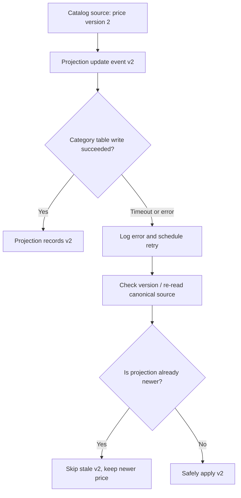

# Attribute Change Frequency and Multi-Copy Update Cost in Apache Cassandra

## Learning Objectives

In the **Relationships and Denormalization** chapter, this lesson focuses on a core design decision in **Apache Cassandra**: **should a frequently changing attribute be duplicated across multiple query-serving tables?** After this lesson, you will be able to:

- Explain the relationship between **update frequency**, **number of tables holding copies**, **write amplification**, and synchronization cost.
- Classify relatively stable, periodically changing, and continuously changing attributes; weigh read needs before duplicating.
- Estimate write operations as the number of derived tables grows, and identify hidden costs not captured by simple operation counts.
- Design query-driven lookup tables with **partition keys** and **clustering columns**, giving each attribute group an appropriate update strategy.
- Practice CQL, handle out-of-order updates, retries, and reconciliation, and connect from a Java application when the system maintains multiple data representations.

## 1. Context: Fast Reads Often Trade Off Against More Writes

Cassandra is a distributed database following the **wide-column** model: rows are routed by **partition key** and ordered within a partition by **clustering columns**. Cassandra does not provide `JOIN` or foreign keys like an RDBMS. To serve multiple read paths, an application may store the same entity across multiple tables:

- `products_by_id`: full product lookup by `product_id`.
- `products_by_category`: display products in a category ordered by publication time.
- `products_by_brand`: display products by brand.
- `stock_by_product`: look up inventory count by product.

Suppose both the category and brand pages need to display `name` and `price`. **Duplicating** these two fields into the list tables enables fast reads without looking up each product by ID. However, when the price changes, every copy of `price` must be updated according to the application's rules.

If `stock_quantity` were also duplicated into every list table, every sale or restock event could trigger many writes. An attribute's change frequency therefore directly affects design efficiency.

> **Distinguish two kinds of duplication:** *denormalization* creates **separate logical tables** to serve queries. Cassandra *replication* stores **multiple replicas of the same data** per the keyspace's replication factor. One event can trigger writes to multiple logical tables, and each write is further replicated to its respective replicas.

## 2. Three Attribute Categories by Change Frequency

There is no universal threshold for "low churn" or "high churn" across all systems. Measure frequency under a **realistic workload**, especially during peak hours, and combine it with read volume and freshness requirements.

| Category | Examples | Characteristics | Typically Suitable Design Direction |
| --- | --- | --- | --- |
| Relatively stable | `product_id`, `created_at`, `brand_id`, category name | Rarely changes or immutable by business rule | Can be duplicated more broadly if multiple read paths genuinely need it |
| Periodically changing | Product name, price, thumbnail, publication status | Edited, yet much slower than list read volume | Duplicate selectively; all changes must be propagated |
| Continuously changing | Stock quantity, view count, device location, real-time state | Frequent writes, potentially updated concurrently by many actors | Consider splitting to a dedicated source, supplemental reads, bounded-staleness cache, or specialized model |

For example, even for `price`, a small shop changes prices a few times a week, whereas a dynamic pricing engine may change them multiple times per minute. An attribute's category is determined by **actual frequency and usage**, not just the column name.

### Questions Before Duplicating an Attribute

1. **Who owns the true value?** The Catalog service may own name and price; the Inventory service owns stock quantity. A category lookup table is only a derived representation.
2. **How many read paths truly need this value?** If the list page does not display long descriptions, do not duplicate descriptions.
3. **How many times per second/minute/day does the value change?** Consider both average and peak rates.
4. **How many derived tables contain a copy?** Adding a table means adding another update target.
5. **How much staleness is acceptable on reads?** Product names may tolerate slight lag in some systems; stock counts used for order placement decisions may need re-checking at the authoritative source.
6. **What happens if one copy succeeds and another fails?** Retries, out-of-order handling, and reconciliation are needed.

## 3. Estimating Write Amplification

Suppose an attribute is written to **one canonical source table** and **k derived tables**. If one change must update all tables, the approximate number of logical CQL writes is:

\[
W_{\text{per change}} = 1 + k
\]

If the attribute changes on average **f times/second**, the logical write rate caused by that attribute is:

\[
W_{\text{sec}} \approx f(1+k)
\]

Across multiple attribute groups with different frequencies and copy counts, you can estimate:

\[
W_{\text{total}} \approx \sum_{i=1}^{n} f_i(1+k_i)
\]

Where `f_i` is the number of events mutating an attribute or **a group of columns written together** per unit time, and `k_i` is the number of derived tables that must be updated by that event. If one event modifies multiple fields on the same row of one table, the application can combine them into a single `UPDATE` for that table; **do not double-count writes to the same table**. The formula is a rough estimation model excluding retries, batches, compaction, repair, and auxiliary operations.

### Numerical Example

Suppose a product's stock quantity changes **10 times/second** during peak hours:

| Design | Source Table | Derived Tables Containing Stock | Total Logical CQL Writes Caused by Stock |
| --- | --- | --- | --- |
| Keep stock at source, read separately when needed | 1 | 0 | 10 writes/sec |
| Duplicate to category table | 1 | 1 | 20 writes/sec |
| Duplicate to category, brand, promo lists | 1 | 3 | 40 writes/sec |

In the last option, **30 of 40 writes per second** exist solely to maintain derived copies. If all four tables have a replication factor of 3, replica write targets in a simple model can reach roughly **120 replica writes/sec** before accounting for retries and internal mechanics. This is an order-of-magnitude illustration: actual network requests, replicas receiving writes, and resource usage also depend on consistency level, topology, coordinator, and cluster health.

**Accompanying costs** that must not be overlooked:

- Storing extra data across multiple tables and replicas increases SSTables needing compaction, backup, and repair.
- Writing to multiple partitions per event increases coordinator load and potential failure handling.
- Continuously updating certain "hot" partition keys causes load imbalance.
- Deletes, TTL expirations, or key changes can generate **tombstones**, impacting read and compaction costs.
- Repeatedly overwriting values can still create additional data versions at the storage layer before compaction cleans them up.

Therefore, evaluating write amplification requires measuring **logical operations, per-partition write rates, storage, latency, and operational cost**, not merely counting tables.

## 4. Table Design: Stable Data in Read Tables, High-Churn Data in the Right Source

Consider an e-commerce system needing three query patterns:

1. View product details by `product_id`.
2. View recent products in a category, showing name, price, and currency.
3. View **current stock** when a buyer is about to place an order.

Assume the `shop` keyspace already exists and the CQL session has selected it.

```sql
USE shop;

-- Canonical source for Catalog data in this example.
CREATE TABLE products_by_id (
    product_id uuid PRIMARY KEY,
    category_id uuid,
    brand_id uuid,
    published_at timestamp,
    name text,
    price decimal,
    currency text,
    description text,
    catalog_version bigint
);

-- Derived representation table for the category page.
CREATE TABLE products_by_category (
    category_id uuid,
    published_at timestamp,
    product_id uuid,
    name text,
    price decimal,
    currency text,
    projection_version bigint,
    PRIMARY KEY ((category_id), published_at, product_id)
) WITH CLUSTERING ORDER BY (published_at DESC, product_id ASC);

-- Authoritative inventory data source, owned by the Inventory service.
CREATE TABLE stock_by_product (
    product_id uuid PRIMARY KEY,
    available_quantity bigint,
    stock_version bigint,
    updated_at timestamp
);
```

In `products_by_category`, `category_id` is the **partition key**; `published_at` and `product_id` are **clustering columns**, enabling listing the newest products per category. `name`, `price`, and `currency` are duplicated because the category page renders them. `description` stays only in the detail table. `available_quantity` lives separately because it changes very frequently and is owned by Inventory.

**Partition limit:** a category with millions of products can make a `category_id` partition too large. In that case, design buckets—such as by publication month `(category_id, publication_month)` or another load-based sharding scheme—and have the application read across multiple buckets when needed. Isolating high-churn data **does not automatically solve** oversized partitions.

### Initial Data Inserts

```sql
INSERT INTO products_by_id (
    product_id, category_id, brand_id, published_at,
    name, price, currency, description, catalog_version
) VALUES (
    11111111-1111-4111-8111-111111111111,
    22222222-2222-4222-8222-222222222222,
    33333333-3333-4333-8333-333333333333,
    '2026-11-21T01:00:00Z',
    'Mechanical keyboard', 750000.00, 'VND',
    'Mechanical keyboard for developers',
    1
);

INSERT INTO products_by_category (
    category_id, published_at, product_id,
    name, price, currency, projection_version
) VALUES (
    22222222-2222-4222-8222-222222222222,
    '2026-11-21T01:00:00Z',
    11111111-1111-4111-8111-111111111111,
    'Mechanical keyboard', 750000.00, 'VND', 1
);

INSERT INTO stock_by_product (
    product_id, available_quantity, stock_version, updated_at
) VALUES (
    11111111-1111-4111-8111-111111111111,
    42, 1, '2026-11-21T01:00:00Z'
);
```

### Reading the List and Reading Stock Separately When Needed

```sql
-- One query returns the columns needed by the category page.
SELECT product_id, published_at, name, price, currency
FROM products_by_category
WHERE category_id = 22222222-2222-4222-8222-222222222222
LIMIT 24;

-- When current stock quantity is needed, query the Inventory source.
SELECT available_quantity, stock_version, updated_at
FROM stock_by_product
WHERE product_id = 11111111-1111-4111-8111-111111111111;
```

For a 24-product page, separate stock lookups **can generate multiple reads**, so weigh latency and limit concurrent queries. Options include: loading stock only when opening details, performing bounded supplemental reads for visible items, short-lived caching when staleness is acceptable, or creating a dedicated stock projection if read volume is huge and there is a clear sync budget. Displaying "in stock" is purely UI information; **order placement decisions** still need verification/reservation in the authoritative Inventory system rather than relying completely on potentially stale display values.

## 5. Updating Moderate-Churn Attributes: Product Price

Because the category page needs `price`, price is duplicated into `products_by_category`. When price changes, update both the **Catalog canonical source** and **every derived table containing price**.

Illustration using a lightweight transaction (LWT) on the source row to check version:

```sql
-- Update price only if the current Catalog version equals 1.
UPDATE products_by_id
SET price = 790000.00, catalog_version = 2
WHERE product_id = 11111111-1111-4111-8111-111111111111
IF catalog_version = 1;
```

The application must inspect the `[applied]` result. If the condition fails, do not assume the price changed or emit a new projection version. Once the source accepts the update, update the category table:

```sql
UPDATE products_by_category
SET price = 790000.00, projection_version = 2
WHERE category_id = 22222222-2222-4222-8222-222222222222
  AND published_at = '2026-11-21T01:00:00Z'
  AND product_id = 11111111-1111-4111-8111-111111111111
IF projection_version = 1;
```

In this example, LWT on the derived table prevents certain out-of-order updates **when the expected version matches**. If the row does not exist yet, the version has already exceeded 1, or a network error occurs, the application must re-read/reconcile and decide how to proceed. An LWT on the source and an LWT on the projection **do not form a cross-table ACID transaction**. LWT also costs more than normal writes and must be measured under realistic load.

If the system guarantees **serialized event processing per `product_id`** and has drift repair, the projection can use normal writes; however, note that Cassandra resolves cell conflicts using the **write timestamp**, rather than automatically preferring a larger `projection_version` column. Storing `projection_version` without conditional checks or ordering control **does not prevent** an older event from overwriting a newer event.

## 6. High-Churn Attributes: Inventory, Views, and Counters

### 6.1. Isolating High-Churn Data When Read Paths Allow

If `available_quantity` changes 10 times/second while name and price change only a few times a week, keeping stock in `stock_by_product` ensures most Inventory updates **never touch** category tables. It establishes a clean boundary: Catalog serves product information reads; Inventory computes and decides stock quantities.

Illustration of a controlled update on an inventory row:

```sql
UPDATE stock_by_product
SET available_quantity = 41,
    stock_version = 2,
    updated_at = '2026-11-21T01:00:01Z'
WHERE product_id = 11111111-1111-4111-8111-111111111111
IF stock_version = 1;
```

This snippet **illustrates version comparison**, not a complete inventory reservation system. To prevent overselling or handle concurrent inbound/outbound stock movements, the application must design appropriate invariants, conditional updates, and business transaction workflows. For extremely hot products, a single partition key for all inventory events can become a bottleneck; measure load and adjust the model rather than merely increasing replication factor.

### 6.2. Do Not Default to Collections or Counters for Every Copy

- A `map<uuid,int>` holding stock for every product in one row or a `list` of all sales events will bloat, resist pagination, and create hot partitions. Unbounded entities typically require **a separate table** and proper keys.
- CQL offers a `counter` type for certain counting scenarios, yet counters carry distinct semantics and limitations; increments can miscount under uncontrolled retries. Counters do not enforce complex business invariants such as "never sell below zero stock" or multi-entity transactions.
- For view or like counts changing extremely often, it is sometimes better to **record events/bucketed counts and aggregate periodically** rather than synchronously updating multiple tables per event. Display counts on lists can tolerate lag, whereas billing/inventory systems generally require stricter rules.

## 7. Ways to Reduce Writes While Meeting Read Requirements

| Strategy | When Appropriate | Benefit | Trade-off |
| --- | --- | --- | --- |
| Duplicate stable columns into list table | Heavily read list, rarely changing data | Fewer follow-up queries, low read latency | Must update when fields change |
| Omit high-churn columns from duplication | Attribute not required on every list | Reduces write fan-out, fewer copies to sync | Requires extra read if UI needs it |
| Follow-up read by ID | Accurate data needed for a small number of items | Keeps lookup tables lean | Can cause N+1 reads if applied to large pages |
| Short-TTL cache | Bounded staleness acceptable for display values | Reduces source load under repeated reads | Must define acceptable staleness window |
| Asynchronous projection updates | Read path tolerates lag and supports replay | Decouples business writes from fan-out load | Must handle failures, out-of-order events, and lag monitoring |
| Time-based aggregation/bucketing | Very high-rate count or event data | Avoids hammering the same row continuously | Aggregated results lag; reads must merge buckets |
| Split projections strictly by needed read paths | Small set of stable, measurable queries | Avoids pointless field duplication | Must track evolving product requirements |

**Do not optimize solely for minimum table count.** A list table containing needed display fields can save dozens of reads per request. A list table carrying high-churn fields that are rarely viewed can cause wasteful writes. The decision rests on total read cost, write cost, and required freshness.

### Simple Read–Write Load Model

Suppose the category page is viewed `R` times per second, with `m` products per page. Not duplicating price could force up to `R × m` price lookups per second without batching, caching, or other optimizations. Duplicating price into the category table eliminates those extra lookups, yet every price edit must write to multiple targets.

One way to evaluate:

\[
\text{Relative cost}
\approx
\underbrace{\text{reads} \times \text{cost per read}}_{\text{read path}}
+
\underbrace{\text{writes} \times \text{cost per write}}_{\text{write path}}
+
\underbrace{\text{sync and operational cost}}_{\text{failures, storage, maintenance}}
\]

Do not assign a single fixed multiplier to every query: clear partition-key reads/writes, hot-partition access, row size, consistency level, and data distribution all affect cost. Measure on representative data and load before finalizing.

## 8. Divergence Between Copies and Out-of-Order Updates

**Synchronizing multiple tables is the application's responsibility.** Suppose a new price is written to `products_by_id`, but writing to `products_by_category` times out. The detail page shows 790,000 VND while the category page still shows 750,000 VND. If the price simultaneously changes again to 810,000 VND, the 790,000 VND event can arrive later and regress the derived copy unless guarded.



Core safeguards:

1. **Define canonical ownership per field:** Catalog owns price; Inventory owns stock. A copy on the category page must not arbitrarily write back to the source.
2. **Carry full keys and version in events:** e.g., `product_id`, `category_id`, `published_at`, `catalog_version`, and new price. If category changes, the event needs both old and new keys.
3. **Design safe retries:** a timeout does not prove the write failed. Use stable keys and idempotent operations whenever possible; avoid incrementing counters or replaying business actions simply because one derived table timed out.
4. **Handle out-of-order delivery:** serialize per entity, use conditional updates when needed, or re-read the canonical source; do not rely solely on message arrival order.
5. **Reconcile periodically or on incidents:** detect missing rows, version mismatches, wrong prices, and leftover rows after deletes/key moves; repair from the authoritative source.

### Do Consistency Levels Solve This?

With replication factor 3 in the same datacenter, `LOCAL_QUORUM` typically requires 2 replicas to acknowledge a read/write in that datacenter. This helps consistency of **a single record in a single table**, given suitable topology and versioning conditions. It **does not turn writing Catalog and updating three derived tables into an atomic transaction**.

`LOGGED BATCH` provides mechanisms to help ensure mutations in a batch are eventually applied in certain failure scenarios, yet it offers neither *isolation* nor rollback like relational transactions. Multi-partition batches incur overhead and are not a performance solution for bundling every related `UPDATE`. Cassandra `repair` fixes divergence across replicas of the same table; it does not infer that price in the category table must match the Catalog source.

### When TTLs and Deletes Complicate Matters

If the list table uses a short TTL while the source retains data long-term, a derived record can vanish while the source still exists. When deleting a product, handle **every table containing the product**, including tables that copied attributes solely for lookup. Deletes and TTL expirations create tombstones; compaction, repair, and retention policies govern physical cleanup. Do not use TTL to mask the absence of proper deletion and reconciliation mechanisms.

## 9. Java Example: Propagate Price Only When Source Version Is Valid

In an application using **Apache Cassandra Java Driver 4.x**, statements can be prepared once and reused. The example below illustrates confirming an update on the source table and performing a conditional update check on the derived table.

```java
import com.datastax.oss.driver.api.core.CqlSession;
import com.datastax.oss.driver.api.core.cql.PreparedStatement;
import com.datastax.oss.driver.api.core.cql.ResultSet;

import java.math.BigDecimal;
import java.time.Instant;
import java.util.UUID;

// Assume session is a CqlSession connected to the shop keyspace.
PreparedStatement updateSource = session.prepare(
    "UPDATE products_by_id " +
    "SET price = ?, catalog_version = ? " +
    "WHERE product_id = ? IF catalog_version = ?");

PreparedStatement updateCategory = session.prepare(
    "UPDATE products_by_category " +
    "SET price = ?, projection_version = ? " +
    "WHERE category_id = ? AND published_at = ? AND product_id = ? " +
    "IF projection_version = ?");

UUID productId = UUID.fromString(
    "11111111-1111-4111-8111-111111111111");
UUID categoryId = UUID.fromString(
    "22222222-2222-4222-8222-222222222222");
Instant publishedAt = Instant.parse("2026-11-21T01:00:00Z");
BigDecimal newPrice = new BigDecimal("790000.00");

long oldVersion = 1L;
long newVersion = 2L;

ResultSet sourceResult = session.execute(updateSource.bind(
    newPrice, newVersion, productId, oldVersion));
if (!sourceResult.wasApplied()) {
    throw new IllegalStateException(
        "Price/version has changed; re-read canonical source");
}

ResultSet projectionResult = session.execute(updateCategory.bind(
    newPrice, newVersion, categoryId, publishedAt, productId, oldVersion));
if (!projectionResult.wasApplied()) {
    // The projection row may not exist yet or may already be at a different version.
    // Re-read source and projection, then reconcile per business rules.
    throw new IllegalStateException(
        "Projection needs to be inspected and resynchronized");
}
```

This code shows only the **successful version-checked write path**, not complete production code for errors/timeouts, event emission, and recovery. In practice, succeeding on the source and failing on the projection must be **durably recorded** or caught by reconciliation. Do not blindly retry the whole function: the first attempt may already have updated the source from version 1 to 2, so retrying with `IF catalog_version = 1` will fail even though the source change was already applied. Verify state before deciding which write path to retry.

LWT on a projection validates one specific row, yet when multiple derived tables must be updated, each table's result still needs individual handling. If write frequency is very high, LWT overhead can become significant; in that case evaluate key-based serialization, event-driven models, or designs with fewer copies.

## 10. Observing and Validating Design Effectiveness

Before deciding to duplicate `price`, `stock_quantity`, or `view_count` into a read table, collect metrics over a **representative period**, including peak hours:

| Metric Group | Question to Answer |
| --- | --- |
| Changes/second per attribute | Which fields actually drive heavy write volume? |
| Derived tables receiving each event | What is the current write fan-out and the impact of adding another read path? |
| P95/P99 latency of read paths | Does duplicating the column genuinely remove a read bottleneck? |
| P95/P99 latency of write paths and timeout count | Does multi-table writing slow down business processing? |
| Missing/version-mismatched rows in projections | Do read tables go stale beyond acceptable thresholds? |
| Age of unprojected events and retry count | How far is synchronization lagging behind the source? |
| Large/hot partitions, SSTable size | Are partition keys and duplicated data balanced? |
| Tombstones, compaction, repair, storage | What is the operational cost of the duplicated-data lifecycle? |

A useful experiment is comparing **two versions of the category page** under representative load: (A) read high-churn attributes from the source on demand; (B) duplicate attributes into the projection and update on change. Measure read latency, Cassandra request count, write throughput, data drift, and operational load side by side. Pick the option that meets **both read targets and write budget**, rather than optimizing read time on a single screen in isolation.

### Common Mistakes

| Choice | Consequence | Adjustment |
| --- | --- | --- |
| Duplicating all columns into all tables | Higher storage and write amplification, more divergence points | Duplicate only columns genuinely needed by each query |
| Updating price at source while forgetting category table | Detail and list pages display different prices | Maintain an event → affected-projections mapping |
| Storing `version` while using unchecked `UPDATE` | Older events can overwrite newer copies | Enforce ordering or use conditional/version checks properly |
| Treating `LOCAL_QUORUM` as a multi-table transaction | One table may be written while another is missing | Implement retries, event replay, and application-level reconciliation |
| Packing millions of records into one partition | Oversized partition, heavy queries/deletes and compaction | Choose bucketing based on workload and query pattern |
| Writing views/stock to multiple tables on every event | Write load spikes, read tables frequently stale | Isolate high-churn attributes or aggregate by target |
| Retrying increment operations without protection | Events doubled or miscounted | Define idempotency and clear counter/event semantics |

## 11. Practice Exercise

An online learning platform has `courses_by_id`, `courses_by_category`, and `courses_by_author`. The list page needs `course_id`, `title`, `price`, and `thumbnail_url`; the detail page has `description`, `lesson_count`, and `enrollment_count`. Assumed change frequencies:

- `title`: roughly 1 time/month/course.
- `price`: roughly 1 time/week/course.
- `thumbnail_url`: roughly 1 time/quarter/course.
- `enrollment_count`: increments on every enrollment; for popular courses, potentially dozens of times/second.
- `description`: rarely edited, shown only on the detail page.

**Requirements:**

1. Choose which columns to duplicate into the two list tables and justify using both **change frequency** and **display requirements**.
2. If `enrollment_count` changes 8 times/second and is duplicated into both list tables, estimate logical writes/second including one source and two projections.
3. If you stop duplicating `enrollment_count` yet users still want to see enrollment count on the detail page, how should the read path and freshness rules be designed?
4. If price changes from 299,000 to 349,000 VND and only one of the two projections succeeds, how should the system recover?
5. If a course changes `category_id`, why is a normal single-column update in the category table insufficient?

**Self-check hints:**

- `title`, `price`, and `thumbnail_url` are good candidates for list tables because they are frequently displayed and have manageable change rates. `description` need not be duplicated if only the detail page uses it. `enrollment_count` can be separated into its own counting/aggregation model depending on frequency and allowed lag.
- At 8 changes/second and two derived tables: `8 × (1 + 2) = 24` logical writes/second, assuming each change writes once to each table without event coalescing.
- The detail read path can fetch the counter from the authoritative system or use an aggregated value stamped with its update time if lag is allowed. Enrollment creation operations must be decided by the Enrollment model; never rely on a duplicated count to enforce business constraints.
- Price-change events need versioning, safe retries, and reconciliation for tables that missed updates. Changing `category_id` alters the partition key of the category table: you must **delete the row in the old partition and insert into the new partition**, while also updating the canonical source and handling mid-step failures.

## Summary

In Cassandra, **attribute change frequency** is a critical parameter of query-driven table design. Low-churn, frequently read attributes may justify duplication; high-churn attributes demand careful evaluation because each derived copy adds writes, divergence risk, and operational overhead. Measure change rate, number of tables to update, read latency targets, acceptable staleness, and partition size. Only then decide among **direct duplication, supplemental reads, caching, aggregation, or domain-based source separation**. Regardless of the choice, failure handling, idempotency, event ordering, and reconciliation must always be part of distributed data design.
