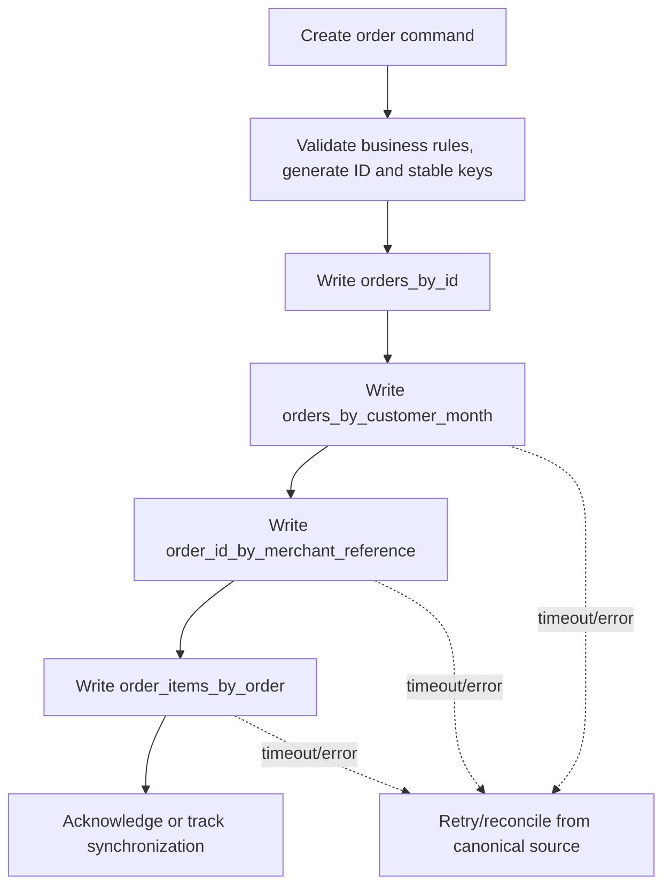
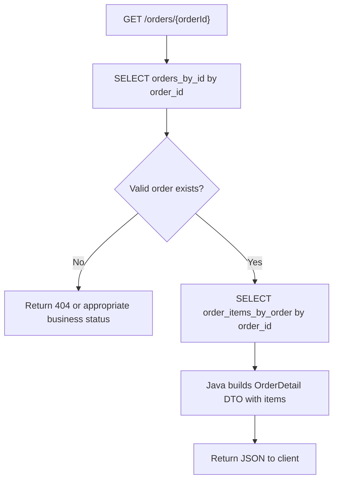

# Write Fan-Out and Application-Side Read Assembly in Apache Cassandra

## Learning Objectives

In the **Relationships and Denormalization** chapter of Apache Cassandra, query-driven design commonly creates two kinds of application-layer work:

- **Write fan-out**: one business change produces multiple write operations to different tables to maintain lookup paths.
- **Application-side read assembly**: the application reads multiple tables by known keys and combines the results into the payload returned to an API or UI.

By completing this lesson, you will be able to:

1. Distinguish write fan-out, read fan-out, and replication across Cassandra nodes.
2. Design tables with partition keys suited for lists, details, external-reference lookups, and line items of an order.
3. Write CQL to insert, update, and read across multiple tables; choose columns to duplicate to avoid unnecessary supplemental reads.
4. Recognize partial write successes, timeouts, version-skewed reads, duplicate events, out-of-order events, and recovery strategies.
5. Use the Java Driver to assemble data without issuing excessive queries, loading huge datasets into memory, or mistaking multiple queries for an atomic snapshot.

## 1. From One Business Entity to Multiple Cassandra Tables

In an RDBMS, we typically use orders, line items, and customers tables, combining them with `JOIN`. Cassandra is a distributed database following the **wide-column** model, where efficient queries start with a **partition key**; **clustering columns** control row ordering within a partition. Cassandra does not provide `JOIN` or foreign keys like an RDBMS.

Therefore, the same order can appear in multiple tables with different keys:

| Table | Read Path Served | Nature of Data |
| --- | --- | --- |
| `orders_by_id` | Open details by `order_id` | Order state owned by the Order service |
| `orders_by_customer_month` | List a customer's newest orders in a month | Derived copy with a subset of duplicated columns |
| `order_id_by_merchant_reference` | Find `order_id` via merchant's reference code | Key mapping serving lookup |
| `order_items_by_order` | Read line items belonging to an order | Child data, one independent row per line |

A "create order" command may write to the **first three tables**; line items with their own lifecycle and keys are written to the fourth table. When opening the detail page, the application can read `orders_by_id` and `order_items_by_order` and combine them in Java.

### Three Commonly Confused Concepts

- **Write fan-out**: one business event leads to multiple `INSERT`, `UPDATE`, or `DELETE` statements across **multiple logical tables**.
- **Read fan-out / application-side assembly**: one API request leads to multiple CQL queries using known keys; the application merges results, applies missing-data rules, and returns a DTO.
- **Replication**: each table/partition is stored across multiple replicas according to the keyspace's replication factor; replication **does not automatically synchronize** different logical tables.

Adding tables makes more read paths fast, yet simultaneously increases write work, failure modes, and the chance of screens temporarily showing mismatched data.

## 2. Starting with the Query Contract

Suppose the API requires:

1. `GET /customers/{customerId}/orders?month=2026-11`: show the 20 newest orders, including ID, timestamp, status, and total amount.
2. `GET /orders/{orderId}`: show the order and all line items.
3. `GET /merchants/{merchantId}/orders/by-reference/{reference}`: look up an order by an external reference provided by the merchant.

We do not need to duplicate every order column across three tables. Identify **lookup keys** and **returned columns**:

| Read Path | Key Used to Read | Columns Retrieved Directly | Follow-Up Query Needed? |
| --- | --- | --- | --- |
| List by customer/month | `customer_id` + `order_month` | `order_id`, `ordered_at`, `status`, `total_amount`, `currency` | No, if displayed columns are already in the list table |
| Order details | `order_id` | Order details, address, version | Yes: read line items using the same `order_id` |
| Lookup by merchant ref | `merchant_id` + `external_reference` | `order_id` | Yes: use the ID to query the detail table |

**Query-driven design** does not mean one table per endpoint. Endpoints sharing the same partition key and compatible ordering can share a table. Create a new table only when the lookup key, sort order, or data shape genuinely differs.

## 3. CQL Example: Explicit Keys for Each Read Path

Assume the `shop` keyspace has been created with an environment-appropriate replication policy, and you are connected to it:

```sql
USE shop;

-- Detail table managed by the Order service in this example.
CREATE TABLE orders_by_id (
    order_id uuid PRIMARY KEY,
    merchant_id uuid,
    external_reference text,
    customer_id uuid,
    order_month date,
    ordered_at timestamp,
    status text,
    total_amount decimal,
    currency text,
    shipping_address text,
    source_version bigint,
    deleted boolean
);

-- Derived representation serving the customer list page.
CREATE TABLE orders_by_customer_month (
    customer_id uuid,
    order_month date,
    ordered_at timestamp,
    order_id uuid,
    status text,
    total_amount decimal,
    currency text,
    source_version bigint,
    PRIMARY KEY ((customer_id, order_month), ordered_at, order_id)
) WITH CLUSTERING ORDER BY (ordered_at DESC, order_id ASC);

-- Maps each merchant's external reference to an order.
CREATE TABLE order_id_by_merchant_reference (
    merchant_id uuid,
    external_reference text,
    order_id uuid,
    PRIMARY KEY ((merchant_id, external_reference))
);

-- Order line items: one row per line_no.
CREATE TABLE order_items_by_order (
    order_id uuid,
    line_no int,
    sku text,
    quantity int,
    unit_price decimal,
    PRIMARY KEY ((order_id), line_no)
);
```

**Key explanation:**

- `orders_by_id`: partition key is `order_id`, suited for single-order lookup.
- `orders_by_customer_month`: composite partition key `(customer_id, order_month)`, descending `ordered_at` clustering, and `order_id` to break ties at identical timestamps.
- `order_id_by_merchant_reference`: two-column composite partition key, optimizing **exact lookup of a pair** `(merchant_id, external_reference)`. It does not automatically support listing all references for a `merchant_id`; if a per-merchant reference list is needed, another model is required.
- `order_items_by_order`: partition key `order_id`, clustering `line_no`, allowing retrieval of line items in line-number order.

In this example, `order_month` is the first day of the **UTC** month derived from `ordered_at`, such as `2026-11-01`. The application must compute and store this value consistently. For customers with huge order volume in a month or orders with massive line counts, evaluate partition size and consider smaller buckets; never assume "one partition per parent" will always stay small enough.

### Why Not Duplicate Everything?

The list table only needs the short columns rendered on the screen. `shipping_address` is not duplicated because it is only needed when opening details and may be sensitive. Line items are likewise not embedded into the list table if line counts can grow large or require independent updates.

A few duplicated columns like `status` and `total_amount` represent **intentional denormalization** for fast reads, in exchange for the application updating all copies whenever those values change.

## 4. Write Fan-Out on Creation: One Event, Multiple Writes

When creating an order, the Order service can execute:



The arrows describe **the required business workflow**, without claiming writes across multiple partitions are atomic like an RDBMS transaction. Execution order may vary by design, yet you must clearly define **when the order is considered accepted** and how to recover if a step remains incomplete.

The same order uses immutable keys:

- `order_id = 11111111-1111-4111-8111-111111111111`;
- `merchant_id = 22222222-2222-4222-8222-222222222222`;
- `customer_id = 33333333-3333-4333-8333-333333333333`;
- `external_reference = 'SHOP-2026-001'`;
- `ordered_at = '2026-11-21T01:00:00Z'`, `order_month = '2026-11-01'`.

### Writing Three Order Representations

```sql
-- 1. Write order details to the canonical source table in this example.
INSERT INTO orders_by_id (
    order_id, merchant_id, external_reference, customer_id,
    order_month, ordered_at, status, total_amount, currency,
    shipping_address, source_version, deleted
) VALUES (
    11111111-1111-4111-8111-111111111111,
    22222222-2222-4222-8222-222222222222,
    'SHOP-2026-001',
    33333333-3333-4333-8333-333333333333,
    '2026-11-01', '2026-11-21T01:00:00Z',
    'CREATED', 420000.00, 'VND',
    '12 Nguyen Hue, Ho Chi Minh City', 1, false
);

-- 2. Write the derived copy for the order list.
INSERT INTO orders_by_customer_month (
    customer_id, order_month, ordered_at, order_id,
    status, total_amount, currency, source_version
) VALUES (
    33333333-3333-4333-8333-333333333333,
    '2026-11-01', '2026-11-21T01:00:00Z',
    11111111-1111-4111-8111-111111111111,
    'CREATED', 420000.00, 'VND', 1
);

-- 3. Write the external-reference mapping table.
INSERT INTO order_id_by_merchant_reference (
    merchant_id, external_reference, order_id
) VALUES (
    22222222-2222-4222-8222-222222222222,
    'SHOP-2026-001',
    11111111-1111-4111-8111-111111111111
);
```

### Writing Line Items Keyed by the Order

```sql
INSERT INTO order_items_by_order (
    order_id, line_no, sku, quantity, unit_price
) VALUES (
    11111111-1111-4111-8111-111111111111,
    1, 'KEYBOARD-001', 1, 300000.00
);

INSERT INTO order_items_by_order (
    order_id, line_no, sku, quantity, unit_price
) VALUES (
    11111111-1111-4111-8111-111111111111,
    2, 'MOUSE-002', 1, 120000.00
);
```

`order_items_by_order` stores independent child data; writing these two rows is part of order creation but **not strictly "duplicating" from `orders_by_id`**. Distinguish writing multiple child entities from duplicating the same attribute into derived tables.

### Ensuring a Reference Code Is Not Claimed by Another Order

A plain `INSERT` into `order_id_by_merchant_reference` can overwrite `order_id` at the same key. If the system requires at most one order per `(merchant_id, external_reference)` pair, you can use:

```sql
INSERT INTO order_id_by_merchant_reference (
    merchant_id, external_reference, order_id
) VALUES (
    22222222-2222-4222-8222-222222222222,
    'SHOP-2026-001',
    11111111-1111-4111-8111-111111111111
) IF NOT EXISTS;
```

The conditional statement uses a **lightweight transaction (LWT)**; the application must check the `[applied]` column or `ResultSet.wasApplied()`. LWT only guards the condition on the relevant row/partition. It **does not automatically guarantee** that `orders_by_id` and all remaining tables succeeded. If you reserve the reference code first and writing the order fails, you must handle the dangling mapping record; if you write the order first and reserving the code fails, you must resolve the conflict. Define business rules and reconciliation for both failure directions.

## 5. Fan-Out on Updates and Deletes

Suppose the status transitions from `CREATED` to `PAID`. Both the detail table and list table store `status`, so two writes are needed:

```sql
UPDATE orders_by_id
SET status = 'PAID', source_version = 2
WHERE order_id = 11111111-1111-4111-8111-111111111111;

UPDATE orders_by_customer_month
SET status = 'PAID', source_version = 2
WHERE customer_id = 33333333-3333-4333-8333-333333333333
  AND order_month = '2026-11-01'
  AND ordered_at = '2026-11-21T01:00:00Z'
  AND order_id = 11111111-1111-4111-8111-111111111111;
```

This is a basic example without concurrent writers. In a multi-writer environment, enforce **valid state transitions and versioning** at the source—for example, using `UPDATE ... IF source_version = ?` where appropriate and only projecting accepted versions. Merely adding a version column while running unconditional updates **does not protect** against out-of-order events, because Cassandra resolves cell conflicts based on write timestamps.

The `order_id_by_merchant_reference` table does not contain `status`, so **no write is needed when status changes**. That is the benefit of duplicating only just enough data.

If `customer_id` or `ordered_at` changes, primary key components of `orders_by_customer_month` change. Cassandra does not permit updating a row's primary key in place: the application must **delete the record under the old key and insert under the new key**. When deleting an order, handle every table holding related records—including the list table, reference mapping, and line items—according to data policy. Cassandra has no `ON DELETE CASCADE` across these tables.

### Event → Required Writes Mapping Table

| Event | `orders_by_id` | `orders_by_customer_month` | `order_id_by_merchant_reference` | `order_items_by_order` |
| --- | --- | --- | --- | --- |
| Create order | INSERT | INSERT | INSERT/LWT if uniqueness required | INSERT line items |
| Change status | UPDATE | UPDATE | Not needed | Not needed if lines do not store status |
| Edit address | UPDATE | Not needed | Not needed | Not needed |
| Add line item | May update total amount | Update total amount if changed | Not needed | INSERT line |
| Transfer customer | UPDATE relevant field | DELETE old key + INSERT new key | Usually unchanged | Usually unchanged |
| Delete per business rule | Controlled logical/physical delete | DELETE | DELETE | DELETE/TTL per policy |

The matrix above is a **change-propagation contract**. When adding a new column to a derived table or adding another lookup table, update this matrix, write paths, business tests, and backfill/repair procedures.

## 6. Partial Successes and Recovery

Fan-out creates scenarios where one operation succeeds while another fails. For example:

1. `orders_by_id` write succeeds.
2. Writing `orders_by_customer_month` times out.
3. Writing `order_id_by_merchant_reference` has not run yet.
4. A user opening details by ID sees the order, while the list and external-reference lookup do not see it yet.

**A timeout does not guarantee the write failed.** The coordinator may have sent the mutation to replicas before returning the timeout. Therefore, do not retry the entire business action by generating a new ID, re-charging money, or sending another email just because one derived table did not respond.

A failure-handling workflow can include:

1. **Establish the authoritative source**: in this example, the Order service decides the state of `orders_by_id`; lookup tables are reconstructed from accepted source state.
2. **Keep keys stable**: generate `order_id`, `ordered_at`, and `order_month` once; retries must not generate new IDs or buckets.
3. **Track write targets**: which tables succeeded, which are uncertain, and at what source version.
4. **Have a durable recovery mechanism**: replayable events, reconciliation jobs, or integration with a reliable event source. Address the gap between a successful source write and event publication.
5. **Reconcile against current facts**: if a newer event exists, do not apply an older event to overwrite newer state.
6. **Clean up leftover copies**: also handle cases where a lookup table holds a record that the source deleted, migrated keys for, or invalidated.

Projection events should carry enough data to reconstruct state: `order_id`, old/new keys (if applicable), columns to duplicate, `source_version` or event ID, plus create/update/delete semantics. With *at-least-once* replay streams, consumers must tolerate receiving the same event multiple times.

### Should You Use `BATCH`?

Cassandra supports `BEGIN BATCH ... APPLY BATCH`, where a **logged batch** has a mechanism to ensure mutations in the batch are eventually applied after certain failures. However:

- It **does not provide transaction isolation** or rollback like a relational database.
- A batch spanning multiple partitions incurs batchlog overhead and can add load; it is not a default way to speed up all writes.
- It does not resolve side effects outside Cassandra (message brokers, payments, emails).
- Do not assume reading multiple tables while a batch is being applied yields a point-in-time consistent snapshot.

You may consider a batch when its semantics fit and load has been evaluated, yet idempotency, timeout handling, reconciliation, and business state checks still require explicit design.

### Consistency Levels and Replication

`LOCAL_QUORUM`, given suitable replication factor and topology, generally ensures reads and writes of **the same data** intersect on enough replicas within a datacenter. However, two writes to **two logical tables** remain two independent mutations. `LOCAL_QUORUM` does not create a transaction across `orders_by_id` and `orders_by_customer_month`. Likewise, Cassandra **repair** fixes divergence among replicas of the same table; it does not know how to recompute a projection from the canonical source.

When deleting or using TTL, expired data can create **tombstones**; compaction and repair govern how tombstones are maintained/purged across replicas. Deleting a source row does not automatically delete rows in derived tables.

## 7. Application-Side Read Assembly

Write fan-out optimizes certain read queries; however, not every screen can or should pre-store all data in a single row. An order detail page needs line items and possibly customer details, so the application combines results from several queries.



This case typically involves only **two queries with explicit partition keys**, each returning a single entity or a bounded set of order lines. Java knows `order_id` from the request and uses it to read each table, rather than sending a CQL query attempting a `JOIN`.

### CQL Queries Used on Reads

```sql
-- A. List of the customer's 20 most recent orders in the month.
SELECT order_id, ordered_at, status, total_amount, currency
FROM orders_by_customer_month
WHERE customer_id = 33333333-3333-4333-8333-333333333333
  AND order_month = '2026-11-01'
LIMIT 20;

-- B. Order details by ID.
SELECT order_id, customer_id, status, total_amount,
       currency, shipping_address, source_version, deleted
FROM orders_by_id
WHERE order_id = 11111111-1111-4111-8111-111111111111;

-- C. Order line items.
SELECT line_no, sku, quantity, unit_price
FROM order_items_by_order
WHERE order_id = 11111111-1111-4111-8111-111111111111;

-- D. Look up ID from external reference before opening details.
SELECT order_id
FROM order_id_by_merchant_reference
WHERE merchant_id = 22222222-2222-4222-8222-222222222222
  AND external_reference = 'SHOP-2026-001';
```

In the D → B → C flow, looking up by external reference leads to **sequential reads across two access keys**. This is an intentional application-side join, well suited when each step returns a small number of records and uses a partition key.

### One List Read Must Not Trigger Dozens of Uncontrolled Reads

Suppose the list displays 20 orders and the screen also wants to show the name of every product in each order. The naive approach—"read 20 list rows, then read each order, each line item, each product"—can create **N+1 queries** or multi-level fan-out. Every query may be valid, yet total request count and latency can become a bottleneck.

Improvements in priority order:

1. **Load only the data the page truly needs.** Order lists usually do not need to show all line items.
2. **Duplicate a few small needed fields** (e.g., `item_count` or `first_item_name`) into the list table if read gains exceed sync costs; document update rules when lines change.
3. **Lazy-load details on demand**, such as when the user opens an order or expands a line.
4. If supplemental lookups for many IDs are unavoidable, **bound concurrent requests**, batch at the UI/API layer as needed, and track p95/p99 latency. Never launch thousands of unbounded parallel queries.
5. **Paginate** using the driver's paging state and bucket design; do not use `ALLOW FILTERING` to patch a read path missing a partition key.
6. Measure actual round-trips; if a frequent read path requires too many cross-lookups, consider designing a dedicated projection.

Cassandra does not support `OFFSET` for pagination like an RDBMS. Subsequent page reads should use the paging state provided by the driver; if querying across multiple partitions/buckets, the application must also sort and merge results according to clear rules.

## 8. Java Example: Combining Orders and Line Items

This snippet uses **Apache Cassandra Java Driver 4.x** and Java 17 `record` syntax. It illustrates a repository with two prepared statements; in a real application, manage session and statement lifecycles appropriately.

```java
import com.datastax.oss.driver.api.core.CqlSession;
import com.datastax.oss.driver.api.core.cql.PreparedStatement;
import com.datastax.oss.driver.api.core.cql.Row;

import java.math.BigDecimal;
import java.util.ArrayList;
import java.util.List;
import java.util.UUID;

public final class OrderReadRepository {
    public record LineItemView(
        int lineNo, String sku, int quantity, BigDecimal unitPrice) {}

    public record OrderDetailView(
        UUID orderId,
        String status,
        BigDecimal totalAmount,
        String currency,
        String shippingAddress,
        List<LineItemView> items) {}

    private final CqlSession session;
    private final PreparedStatement loadOrder;
    private final PreparedStatement loadItems;

    public OrderReadRepository(CqlSession session) {
        this.session = session;
        this.loadOrder = session.prepare(
            "SELECT order_id, status, total_amount, currency, " +
            "shipping_address, deleted " +
            "FROM orders_by_id WHERE order_id = ?");
        this.loadItems = session.prepare(
            "SELECT line_no, sku, quantity, unit_price " +
            "FROM order_items_by_order WHERE order_id = ?");
    }

    // Return null in repository if order does not exist or is logically deleted;
    // the API layer maps this to HTTP 404 as appropriate.
    public OrderDetailView findById(UUID orderId) {
        Row order = session.execute(loadOrder.bind(orderId)).one();
        if (order == null ||
                (!order.isNull("deleted") && order.getBoolean("deleted"))) {
            return null;
        }

        List<LineItemView> items = new ArrayList<>();
        for (Row row : session.execute(loadItems.bind(orderId))) {
            items.add(new LineItemView(
                row.getInt("line_no"),
                row.getString("sku"),
                row.getInt("quantity"),
                row.getBigDecimal("unit_price")
            ));
        }

        return new OrderDetailView(
            order.getUuid("order_id"),
            order.getString("status"),
            order.getBigDecimal("total_amount"),
            order.getString("currency"),
            order.getString("shipping_address"),
            List.copyOf(items)
        );
    }
}
```

**Explanation:**

- Both `orders_by_id` and `order_items_by_order` are queried by partition key `order_id`, avoiding full-table scans.
- The application **assembles a DTO** from the two results. If the source row is missing or logically deleted, return "not found" per the API contract.
- The `for` loop iterates over an order's line items. For orders with millions of lines, never materialize an unbounded `List`: provide a paginated line-items endpoint, bound collection sizes, and leverage driver paging.
- Simple synchronous execution works well for learning. Under high load, you can use the Java Driver's asynchronous API such as `executeAsync`, with bounded concurrency, deadlines, cancellation, and backpressure. Asynchrony neither reduces query count nor turns queries into a transaction.
- The code checks `isNull("deleted")` before reading the boolean flag, treating a null flag as not marked deleted. In production, standardize schema invariants and deletion semantics.

### Beware of Time-Skewed Reads

Even when both queries use `LOCAL_QUORUM`, two `SELECT` statements **are not an atomic snapshot**. Between Java reading the total amount in `orders_by_id` and reading `order_items_by_order`, a concurrent business change may have added a line item before updating the total, or vice versa. The assembled result can reflect **two different points in time**.

Options when stricter guarantees are needed:

- Display only data that tolerates temporary skew, and explain data freshness to users if necessary.
- Maintain an "incomplete/processing" state and display orders only after a controlled business step finishes.
- Use source versions and related metadata to **detect** mid-assembly changes, then re-read within limits or return a retryable state. A single version column does not create a cross-table snapshot.
- If the business demands strong cross-component atomicity/serializability, re-evaluate data aggregation boundaries, storage models, or a dedicated transactional service.

## 9. Balancing Write Fan-Out and Read Fan-Out Costs

Logical writes per event can be approximated by:

\[
W_{\mathrm{event}} = 1 + k
\]

Where `1` is the canonical source operation and `k` is the number of derived tables to update (assuming the event writes each table once). This is a rough model only: child line items, retries, coalesced writes, replication, and compaction can alter actual cost.

When reading an `N`-row list, if each row forces an extra detail read, logical queries can approach:

\[
R_{\mathrm{page}} \approx 1 + N
\]

If each detail also requires a line-items query, cost can approach `1 + 2N` or higher. Counts **do not translate linearly into latency** when queries run in parallel; nevertheless, total cluster and application load still rises.

Suppose a list page gets 100 views per second, with 20 orders per page:

- **Without duplicating** `status` and `total_amount`: up to `100 × 20 = 2,000` extra detail lookups/sec may be needed, depending on caching and read patterns.
- **Duplicating sufficient list columns**: each view can use a single list query, in exchange for updating the derived table whenever status/total amount changes.

Decision table:

| Workload Characteristic | Usually Prefer |
| --- | --- |
| Heavily read list; each row needs a few small, low-churn columns | Duplicate needed display columns to avoid heavy read fan-out |
| External-reference lookup returns a single ID, then opens details | Mapping table holding only the ID, accepting a two-step read |
| Many line items, independently updated, pagination needed | `order_items_by_order` table with one row per line |
| Very high-churn attribute needed on few screens | Keep separate source, read on demand or use aggregation/cache with freshness policy |
| Huge child dataset or high number of IDs to enrich | Redesign read path, bucket, and cap fan-out instead of loading all in one request |
| Strict cross-table consistent view required | Design explicit consistency contracts and workflows; do not assume Cassandra provides cross-table transactions |

### Impact of Parallelization

If a request executes three queries with latencies `t1`, `t2`, and `t3`:

- Sequential execution has latency roughly `t1 + t2 + t3`, excluding application and network overhead.
- Running **independent** queries concurrently can bring wait time closer to `max(t1, t2, t3)` under ideal conditions, while still consuming resources for all three queries.

You cannot run `SELECT` by `order_id` before obtaining `order_id` from the mapping table; that is a **data dependency** requiring sequential order. Independent follow-up queries with already-known keys can be parallelized with bounded concurrency and deadlines. Excessive parallelism easily triggers timeouts and pressure on connection pools/coordinators.

## 10. Design and Operations Checklist

Before extending fan-out to a new table, answer the following questions:

| Check Area | Practical Question |
| --- | --- |
| Canonical source | Who decides the true value of each field? From where can derived tables be rebuilt? |
| Partition key | Does every `SELECT` include the full partition key? Are any partitions oversized or hot? |
| Duplicated data | Which columns truly must be displayed? What is each column's change frequency? |
| Inserts | Which tables must receive a row on creation? How are partial outcomes handled? |
| Updates/deletes | Which tables store only IDs and need no update? Are there key-change/delete events that must clean up old copies? |
| Idempotency | Do retries reuse the same IDs/keys? Is there a risk of duplicate payments, emails, or counters? |
| Ordering | Can older-version events overwrite newer versions? When are conditional checks/LWT needed? |
| Read assembly | How many queries per request? Any `N+1`? Are result sizes and concurrency bounded? |
| Consistency | Can users tolerate values from slightly different points in time? |
| Observability | Do you measure write/read fan-out, per-projection errors, sync lag, and version drift? |
| Maintenance | How are TTLs, tombstones, compaction, repair, backfills, and sensitive data handled? |

### Metrics to Measure Under Realistic Load

- **Writes:** tables written per event, mutations/second, p95/p99 write latency, timeouts, and retries.
- **Reads:** CQL queries/API request, partitions accessed, p95/p99 end-to-end latency, returned row counts, concurrent requests.
- **Sync:** age of unprojected events, missing/extra rows, version drift, backfill/reconciliation success rate.
- **Cluster:** partition sizes, tombstone rates, compaction backlog, repair, storage, and load distribution.

Decisions should be validated by workload tests matching production read/write ratios, page sizes, key distributions, and consistency levels; there is no single universally "optimal" number of derived tables.

## 11. Practice Exercise: Course Enrollment

Design an online learning system supporting these queries:

1. Check whether a student is enrolled in a course.
2. List the courses a student is currently taking.
3. List the students enrolled in a course.
4. Display the course title when viewing the enrollment list.

Assume the Enrollment service is authoritative for enrollment status; the Catalog service owns course titles. Propose:

- Tables keyed by `student_id`, `course_id`, or both IDs to serve each read path.
- On enrollment, which tables receive an association record? Should `course_title` be duplicated into every enrollment record if course titles can change?
- On unenrollment, how many read paths must be updated/deleted? If one operation times out, how do you retry without triggering a second payment?
- When fetching a student's list of 20 courses, should you duplicate the course title or query Catalog 20 times? Argue based on title-change frequency, read volume, and supplemental query limits.

**Suggested direction:**

- Use `enrollments_by_student` with partition key `student_id` and clustering `course_id`; and `enrollments_by_course` with partition key `course_id` and clustering `student_id`. Looking up a single relationship by both IDs is already supported by either table when both keys are supplied; the canonical source can be decided by the Enrollment service or authoritative events.
- Creating/canceling an enrollment must update **both directional representations**. Neither table enforces foreign keys or cascades automatically.
- If `course_title` is read with every enrollment very frequently yet rarely changes, consider selective duplication. If duplicated, title-change events from Catalog must update the affected read paths, which can cause heavy write fan-out for a course with huge enrollment.
- If titles change frequently or duplication scale is too high, perform supplemental Catalog reads with bounded parallel requests or design a cache/projection model. Do not blindly trigger 20+ queries per page without measuring actual latency.
- When a course has millions of students, a partition key of only `course_id` can grow oversized; consider bucketing and appropriate pagination.

## Summary

In Cassandra, **write fan-out** maintains multiple tables serving distinct query keys; **application-side read assembly** combines child entities or related data using known keys. Both are essential wide-column design tools, each carrying its own cost and consistency boundaries. Start from queries, identify authoritative sources, choose partition/clustering keys, duplicate only needed columns, measure write and read operation counts, and build retries, reconciliation, pagination, and fan-out limits. **Replication, consistency levels, logged batches, compaction, and repair** solve specific Cassandra concerns; they do not replace the responsibility of synchronizing multiple logical tables or controlling data assembly at the Java layer.
