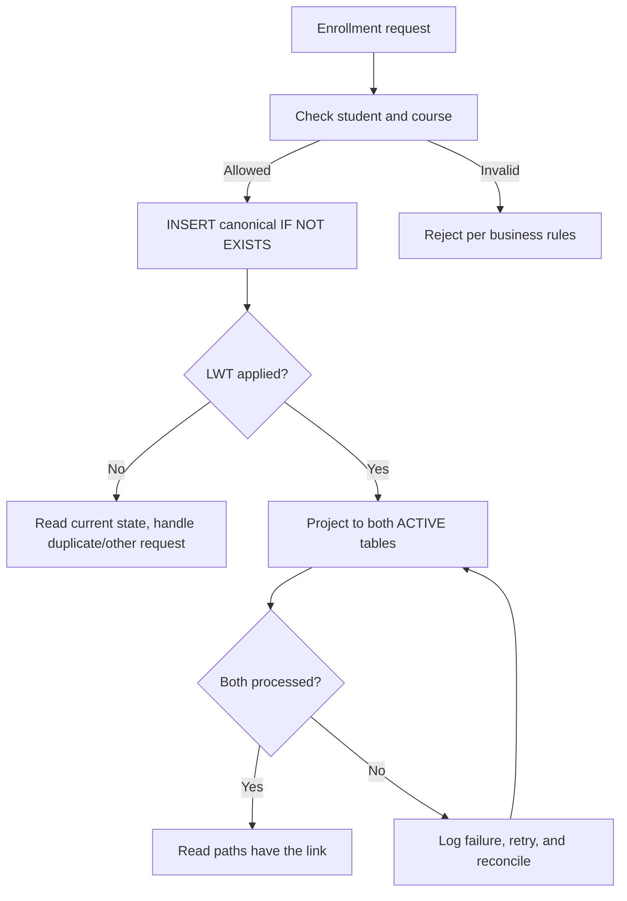

# Limitations of JOINs, Foreign Keys, and Integrity Responsibilities in Apache Cassandra

## Learning Objectives

In the **Relationships and Denormalization** chapter of Apache Cassandra, this lesson explains why integrity rules traditionally supported by `JOIN`, foreign keys, and transactions in an RDBMS must be redesigned when using a **distributed wide-column** database. After this lesson, you will be able to:

- Explain CQL's limitations regarding `JOIN`, foreign keys, cascading deletes, and cross-table constraints.
- Distinguish **referential integrity**, **business integrity**, **uniqueness**, and **consistency across derived tables**.
- Design read paths for 1:1, 1:N, and N:M relationships via partition keys, clustering columns, lookup tables, and duplicated data.
- Use **LWT** conditional writes within appropriate boundaries, while recognizing invariants LWT cannot automatically enforce across multiple tables or partitions.
- Build workflows to create links, transition states, delete, retry, and reconcile from a Java application; evaluate consequences when an operation partially succeeds.

## 1. How Does Cassandra Differ from a Relational Database?

In an RDBMS, schemas typically contain entity tables and join tables with foreign keys enforcing relationships. `JOIN` queries combine tables at read time; transactions can group changes to uphold invariants within the database engine's capabilities.

**Apache Cassandra** prioritizes horizontal scaling, distributing data by **partition key** and serving predefined queries. CQL resembles SQL in certain statements (`SELECT`, `INSERT`, `UPDATE`, `DELETE`) yet **lacks a general `JOIN` operation** and **does not provide foreign keys or `ON DELETE CASCADE` in the RDBMS sense**.

| Requirement | In a Typical RDBMS | In Cassandra |
| --- | --- | --- |
| Fetch parent–child data | `JOIN` across tables on predicates | Design a suitable read table or query multiple tables by key and assemble in the application |
| Ensure child entity references an existing parent | `FOREIGN KEY` | Owning application/service validates and manages lifecycles |
| Restrict deleting parent with children | `ON DELETE RESTRICT` or logic inside a transaction | Business rules, soft deletes, deletion states, and reconciliation workflows |
| Delete parent cascading to children | `ON DELETE CASCADE` | Application identifies and processes each affected table/record |
| Guarantee uniqueness within an access key | `UNIQUE` or primary key | Primary key identifies row; when guarding concurrent overwrites, consider `IF NOT EXISTS`/LWT |
| Atomicity when modifying multiple tables | Transactions, depending on isolation level | No built-in RDBMS-style multi-table transactions with isolation and rollback |
| Read by non-key fields | Indexes or joins, depending on workload | Design tables around queries; indexes suit only specific filter patterns and workloads |

**Core point:** Cassandra does not automatically understand a business relationship merely because two tables hold the same UUID value. The `course_id` column in an enrollment table is a **logical reference**, not a foreign key verified by Cassandra.

### Example: A Join Table in an RDBMS

A relational database management system might declare:

```sql
-- Illustrative RDBMS SQL, NOT Cassandra CQL.
CREATE TABLE enrollments (
    student_id UUID REFERENCES students(student_id),
    course_id UUID REFERENCES courses(course_id),
    enrolled_at TIMESTAMP NOT NULL,
    PRIMARY KEY (student_id, course_id)
);

SELECT c.course_id, c.title
FROM enrollments e
JOIN courses c ON c.course_id = e.course_id
WHERE e.student_id = :student_id;
```

Two essential elements in this example are `REFERENCES` and `JOIN`. They **cannot be ported verbatim** to Cassandra expecting Cassandra to enforce equivalent constraints. Instead, write down the questions the application must answer, then create tables for those read paths.

## 2. Clearly Defining Which Types of Integrity Must Be Maintained

Do not lump every requirement into a vague statement like "data is always consistent." Each class of invariant needs its own owner and handling mechanism:

| Type | Example | Applicable Mechanisms |
| --- | --- | --- |
| **Valid reference** | Enrollment must link an existing, eligible student and course | Validate at authoritative service, control delete/close operations, handle races, and reconcile |
| **Logical uniqueness** | A student has at most one active enrollment state per course | Share the same primary-key pair, use `IF NOT EXISTS` or conditional updates under contention |
| **Valid state transition** | `ACTIVE -> CANCELLED` per permissions and business rules | Single state owner, command validation, LWT if protecting concurrent updates |
| **Derived-table consistency** | Student list per course matches enrollment source | Emit events, controlled updates, safe retries, and reconciliation |
| **Quantitative integrity** | No double refunds, no over-allocation of stock | Dedicated business transaction model; key/conditional checks and deduplication at ownership boundary |
| **Deletion and retention** | Closing or deleting a student stops their links from appearing | Soft-delete policy, delete events, purging projections and expired data |

Running a `SELECT` to check "does the course exist?" followed by an `INSERT` of the link **is not an atomic foreign-key constraint**. Between the two operations, another process can close or delete the course. Pre-write checks are useful, but you must define **ownership** and how to behave under check-then-write gaps (*time-of-check to time-of-use*, TOCTOU).

## 3. Running Example: Students and Courses

Consider requirements for a learning platform:

1. Enroll a student in a course when the account is active and the course is open.
2. Check whether a student is enrolled in a course.
3. Display the student's active courses, newest first.
4. Display a course's student list, newest first.
5. Unenrollment, closing course registration, or disabling an account must be reflected per policy.

This is a **many-to-many** relationship. One viable Cassandra model consists of entity tables, a **canonical link-state table**, and two **derived read-path tables**.

### CQL Table Definitions

Assume the `academy` keyspace already exists with an appropriate replication policy, and CQL is using that keyspace:

```sql
USE academy;

CREATE TABLE students_by_id (
    student_id uuid PRIMARY KEY,
    display_name text,
    account_status text
);

CREATE TABLE courses_by_id (
    course_id uuid PRIMARY KEY,
    title text,
    enrollment_status text
);

-- Canonical source for enrollment state in this example.
-- Each (student_id, course_id) pair has at most one row.
CREATE TABLE enrollment_state_by_student (
    student_id uuid,
    course_id uuid,
    status text,
    enrolled_at timestamp,
    version bigint,
    PRIMARY KEY ((student_id), course_id)
);

-- Index table for reading ACTIVE relationships by student and time.
CREATE TABLE active_enrollments_by_student (
    student_id uuid,
    enrolled_at timestamp,
    course_id uuid,
    source_version bigint,
    PRIMARY KEY ((student_id), enrolled_at, course_id)
) WITH CLUSTERING ORDER BY (enrolled_at DESC, course_id ASC);

-- Index table for reading ACTIVE relationships by course and time.
CREATE TABLE active_enrollments_by_course (
    course_id uuid,
    enrolled_at timestamp,
    student_id uuid,
    source_version bigint,
    PRIMARY KEY ((course_id), enrolled_at, student_id)
) WITH CLUSTERING ORDER BY (enrolled_at DESC, student_id ASC);
```

**Understanding the primary keys:**

- `students_by_id` and `courses_by_id` have the respective entity ID as their partition key.
- `enrollment_state_by_student` has partition key `student_id` and clustering column `course_id`; each student–course pair has **one row by key**. Re-writing the same key is normally an *upsert*; the primary key **does not by itself guarantee** an enrollment request executes only once at the business layer.
- `active_enrollments_by_student` and `active_enrollments_by_course` use partition keys serving the two read directions. Clustering by `enrolled_at DESC` retrieves the newest links first.
- `source_version` in derived tables aids observability and reconciliation, yet **does not automatically protect** against late-arriving events if the application writes unconditionally.

To update or delete derived copies accurately, the application must retain the **original `enrolled_at` timestamp**; if a retry accidentally generates a new timestamp, tables keyed by `(student_id, enrolled_at, course_id)` will insert a different row instead of updating the original one.

**Partition note:** a course with millions of students can give `active_enrollments_by_course` a gigantic partition; a student enrolling in an unusually large number of courses can also pose issues. When needed, add disciplined buckets—such as enrollment month—and design multi-bucket reads. Merely splitting tables does not automatically prevent oversized partitions.

## 4. Creating Links and Validating Business Rules

Insert two entities:

```sql
INSERT INTO students_by_id
    (student_id, display_name, account_status)
VALUES (
    11111111-1111-4111-8111-111111111111,
    'Lan', 'ACTIVE'
);

INSERT INTO courses_by_id
    (course_id, title, enrollment_status)
VALUES (
    22222222-2222-4222-8222-222222222222,
    'Apache Cassandra Fundamentals', 'OPEN'
);
```

Before accepting an enrollment, the Enrollment service can read both tables and check preconditions:

```sql
SELECT account_status
FROM students_by_id
WHERE student_id = 11111111-1111-4111-8111-111111111111;

SELECT enrollment_status
FROM courses_by_id
WHERE course_id = 22222222-2222-4222-8222-222222222222;
```

The application decides to **reject** if the student is missing or locked, or if the course is missing or closed. Cassandra will not reject an enrollment `INSERT` merely because a parent entity row is missing.

### Guarding Concurrent First-Time Link Creation

If business policy dictates one canonical state record per student–course pair, attempt a conditional insert:

```sql
INSERT INTO enrollment_state_by_student
    (student_id, course_id, status, enrolled_at, version)
VALUES (
    11111111-1111-4111-8111-111111111111,
    22222222-2222-4222-8222-222222222222,
    'ACTIVE', '2026-11-21T02:00:00Z', 1
) IF NOT EXISTS;
```

The result includes the `[applied]` flag:

- If `[applied] = true`, the canonical row was just created.
- If `[applied] = false`, the row already exists. The application re-reads to distinguish already-enrolled, previously canceled, or an in-progress workflow; do not generate a new key to bypass the check.

`IF NOT EXISTS` uses a **lightweight transaction (LWT)**. It resolves write contention on the **conditioned row/partition**, yet does not create a foreign key to `students_by_id` and `courses_by_id`. Another process can still change account or course status between the check and the write. If the system strictly prohibits any enrollment after a course closes, you need a **dedicated coordination workflow** between the course owner and enrollment, accepting the corresponding synchronization cost; you cannot obtain that guarantee solely from two `SELECT` statements followed by an `INSERT` across partitions.

### Projecting the Link to Both Read Tables

Once the canonical source is accepted in `ACTIVE` status, the application creates two derived rows:

```sql
INSERT INTO active_enrollments_by_student
    (student_id, enrolled_at, course_id, source_version)
VALUES (
    11111111-1111-4111-8111-111111111111,
    '2026-11-21T02:00:00Z',
    22222222-2222-4222-8222-222222222222,
    1
);

INSERT INTO active_enrollments_by_course
    (course_id, enrolled_at, student_id, source_version)
VALUES (
    22222222-2222-4222-8222-222222222222,
    '2026-11-21T02:00:00Z',
    11111111-1111-4111-8111-111111111111,
    1
);
```

This is **write fan-out**: one logical link has a canonical source state and two copies organized for two read directions. If the second operation fails, the link may appear in the student's list while temporarily missing from the course's list. The application layer must take responsibility for recovery.

### Flow Diagram Showing Failure Points



The diagram depicts **logical sequence**, not that writing the source, emitting events, and writing projections form an atomic transaction. In a real system, durable replay or reconciliation mechanisms are needed to close the gap between "source written" and "derived tables not yet projected."

## 5. Reading Relationships Without JOINs

After writing for both read paths, the primary queries all specify their partition key:

```sql
-- What is the current state of a student–course pair?
SELECT status, enrolled_at, version
FROM enrollment_state_by_student
WHERE student_id = 11111111-1111-4111-8111-111111111111
  AND course_id = 22222222-2222-4222-8222-222222222222;

-- Currently active courses, newest first.
SELECT course_id, enrolled_at
FROM active_enrollments_by_student
WHERE student_id = 11111111-1111-4111-8111-111111111111
LIMIT 20;

-- Students of a course, newest first.
SELECT student_id, enrolled_at
FROM active_enrollments_by_course
WHERE course_id = 22222222-2222-4222-8222-222222222222
LIMIT 20;

-- Fetch course details by ID.
SELECT course_id, title
FROM courses_by_id
WHERE course_id = 22222222-2222-4222-8222-222222222222;
```

Here, the "list of active courses" is a derived view maintained from canonical state. Cassandra **does not automatically filter out** a recently canceled link across all tables: the application must delete/update projections promptly or return results within acceptable staleness bounds. Canonical state remains the basis for fixing stale derived copies.

### Assembling Information in the Application

`active_enrollments_by_student` contains IDs and timestamps, not `title`. If the API needs titles, there are two options:

1. **Fetch supplemental details by ID** from `courses_by_id` for a bounded number of courses; control concurrent queries, timeouts, and hidden/deleted course cases.
2. **Duplicate `title` into the list table** if this read path is very hot and the cost of propagating title updates is acceptable. When a course title changes, many enrollment rows may require updates; that is a significant *write fan-out* to weigh.

Do not blindly perform 20 or 100 supplemental reads for every list page: that easily creates **N+1 queries**. Conversely, do not automatically duplicate rapidly changing data across millions of links just to avoid a small lookup. Measure p95/p99 latency, read counts, change frequency, and affected write counts.

## 6. Unenrollment, Parent Deletion, and Orphaned Links

Because there are no foreign keys or cascades, **all link lifecycle changes must be specified at the application layer**.

### Unenrolling via Canonical State

Suppose the source has `status = 'ACTIVE'` and `version = 1`. A conditional statement prevents two actors from arbitrarily transitioning state simultaneously:

```sql
UPDATE enrollment_state_by_student
SET status = 'CANCELLED', version = 2
WHERE student_id = 11111111-1111-4111-8111-111111111111
  AND course_id = 22222222-2222-4222-8222-222222222222
IF status = 'ACTIVE' AND version = 1;
```

If `[applied]` is false, re-read the canonical row; the link may already be canceled, updated by another process, or never existed. If the condition succeeds, the `ACTIVE` projections no longer reflect the new state and must be deleted:

```sql
DELETE FROM active_enrollments_by_student
WHERE student_id = 11111111-1111-4111-8111-111111111111
  AND enrolled_at = '2026-11-21T02:00:00Z'
  AND course_id = 22222222-2222-4222-8222-222222222222;

DELETE FROM active_enrollments_by_course
WHERE course_id = 22222222-2222-4222-8222-222222222222
  AND enrolled_at = '2026-11-21T02:00:00Z'
  AND student_id = 11111111-1111-4111-8111-111111111111;
```

Here `enrolled_at` is kept unchanged from link creation. If the application accidentally used the cancellation timestamp as the clustering key, the `DELETE` would fail to remove the original row.

**Re-enrolling after cancellation:** `INSERT ... IF NOT EXISTS` on the canonical table will fail because the `CANCELLED` row still exists. You must define an explicit **re-enrollment** operation with status/version conditions, a new timestamp, and cleanup of any stale copies. Never treat replaying an enrollment request as a way to automatically reopen a canceled link.

### When a Student or Course Is Deleted

Without `ON DELETE RESTRICT` or `CASCADE`, deleting a `courses_by_id` row does not make Cassandra delete links in `enrollment_state_by_student` or projections. Business policy may choose:

- **Block immediate deletion** if the course still has enrollments; a "closing/pending deletion" status blocks new registrations in application workflows.
- **Soft delete** the course, hide it from public read paths, and emit events to clean up links per policy. Source data can be retained as long as needed for audit/reconciliation.
- **Coordinated deletion**: lock further changes per business workflow, process links and derived tables in batches, verify completion, then physically delete per retention policy.

If a parent row is deleted while another enrollment request is in flight, the prior "parent exists" check does not guarantee integrity. For stronger invariants, designate the command-accepting service and coordination with deletion/closing, or bring the compare-and-write invariant into the same appropriate transaction boundary.

### Distinguishing Orphaned Data from Pending Sync

A link present in `active_enrollments_by_course` yet missing from the canonical source could be:

- A deletion event not yet projected to the read table.
- An incomplete write or out-of-order processing.
- A source row purged by TTL/retention policy.
- A projection bug or genuinely corrupt data.

Do not arbitrarily delete a row after a single failed source lookup: cross-check state, events, and retention policy. A **reconciliation** job must distinguish transient states from genuine errors.

## 7. Limits of LWT, Consistency Levels, and Batches

### What Can LWT Do?

`IF NOT EXISTS` and `UPDATE ... IF ...` are **conditional statements** using lightweight transactions (Paxos) for conditional check-and-write within an appropriate data scope. They are useful when multiple actors contend over the same row/partition, such as single-use link creation or version-checked state transitions.

However, LWT has clear limits:

- Does not create a **foreign key** between two tables.
- Does not atomically lock and check existence across `students_by_id`, `courses_by_id`, and a join-table row in three separate partitions.
- Does not turn write fan-out across two derived tables into a multi-table ACID transaction.
- Carries network/consensus overhead and can increase contention on hot partitions; measure under realistic workloads.

**Rule of thumb:** use LWT to guard an invariant suited to **one conditional boundary**, not as a promise that all tables remain synchronized.

### Consistency Levels Do Not Replace Cross-Table Integrity

With replication factor 3 in one datacenter, `LOCAL_QUORUM` typically requires two replicas to acknowledge an operation. This supports read/write semantics of **the same data**, subject to topology, failure modes, and write patterns.

However, `LOCAL_QUORUM` on two tables **does not combine two tables into one transaction**. `enrollment_state_by_student` may succeed while `active_enrollments_by_course` fails or has not been written yet. Observed ordering across read paths may also differ.

### Is a Logged Batch a Substitute Transaction?

`BEGIN BATCH ... APPLY BATCH` in Cassandra offers several batch types; a **logged batch** helps ensure mutations in the batch are eventually applied under certain failure scenarios, yet **provides neither isolation nor rollback like an RDBMS**. Batches spanning multiple partitions incur batchlog/coordinator overhead and are not a throughput trick for independent operations.

Even when using a batch, you must still handle timeouts, duplicate business events, change ordering, and steps outside Cassandra (payments, message brokers). Never use batches as a substitute for defining a canonical source and synchronization workflow.

### Repair Does Not Automatically Fix Orphaned References

Cassandra **repair** and anti-entropy mechanisms synchronize data across **replicas of the same table/partition**. They do not infer that a `course_id` in an enrollment table was deleted from `courses_by_id`, or that two enrollment listing tables must hold identical ID sets. That is **application-layer reconciliation**.

TTLs and deletes create **tombstones**, affecting compaction, repair, and data retention policies. Physical deletion does not mean derived copies or backups vanish immediately; manage them separately according to retention and access policies.

## 8. Java Driver: Conditional Checks, Writing Source, and Building Projections

The example below uses **Apache Cassandra Java Driver 4.x**. It shows how to chain CQL steps and highlights where recovery is needed if a step fails.

```java
import com.datastax.oss.driver.api.core.CqlSession;
import com.datastax.oss.driver.api.core.cql.PreparedStatement;
import com.datastax.oss.driver.api.core.cql.ResultSet;
import com.datastax.oss.driver.api.core.cql.Row;

import java.time.Instant;
import java.util.UUID;

public final class EnrollmentRepository {
    private final CqlSession session;
    private final PreparedStatement findStudent;
    private final PreparedStatement findCourse;
    private final PreparedStatement createCanonical;
    private final PreparedStatement findCanonical;
    private final PreparedStatement addByStudent;
    private final PreparedStatement addByCourse;

    public EnrollmentRepository(CqlSession session) {
        this.session = session;
        findStudent = session.prepare(
            "SELECT account_status FROM students_by_id WHERE student_id = ?");
        findCourse = session.prepare(
            "SELECT enrollment_status FROM courses_by_id WHERE course_id = ?");
        createCanonical = session.prepare(
            "INSERT INTO enrollment_state_by_student " +
            "(student_id, course_id, status, enrolled_at, version) " +
            "VALUES (?, ?, ?, ?, ?) IF NOT EXISTS");
        findCanonical = session.prepare(
            "SELECT status, enrolled_at, version " +
            "FROM enrollment_state_by_student " +
            "WHERE student_id = ? AND course_id = ?");
        addByStudent = session.prepare(
            "INSERT INTO active_enrollments_by_student " +
            "(student_id, enrolled_at, course_id, source_version) " +
            "VALUES (?, ?, ?, ?)");
        addByCourse = session.prepare(
            "INSERT INTO active_enrollments_by_course " +
            "(course_id, enrolled_at, student_id, source_version) " +
            "VALUES (?, ?, ?, ?)");
    }

    // Illustrative example; does not replace durable orchestration and retry workflows.
    public void enroll(UUID studentId, UUID courseId, Instant requestedAt) {
        Row student = session.execute(findStudent.bind(studentId)).one();
        Row course = session.execute(findCourse.bind(courseId)).one();

        if (student == null
                || !"ACTIVE".equals(student.getString("account_status"))
                || course == null
                || !"OPEN".equals(course.getString("enrollment_status"))) {
            throw new IllegalStateException("Enrollment not allowed");
        }

        ResultSet attempted = session.execute(createCanonical.bind(
            studentId, courseId, "ACTIVE", requestedAt, 1L));

        // Even if the INSERT is rejected due to duplicate key, a repeated request
        // may need to recover projections missing from the first attempt.
        Row canonical = session.execute(
            findCanonical.bind(studentId, courseId)).one();
        if (canonical == null
                || !"ACTIVE".equals(canonical.getString("status"))) {
            throw new IllegalStateException(
                "Link is not in ACTIVE state; verify business rules");
        }

        Instant stableEnrolledAt = canonical.getInstant("enrolled_at");
        long version = canonical.getLong("version");

        // Re-write with the same keys and values from source; if an operation
        // times out, the application layer must perform bounded retries and reconciliation.
        session.execute(addByStudent.bind(
            studentId, stableEnrolledAt, courseId, version));
        session.execute(addByCourse.bind(
            courseId, stableEnrolledAt, studentId, version));

        // attempted.wasApplied() indicates whether this attempt created a new row
        // or the row already existed; it does not indicate both projections finished.
    }
}
```

**Significance of this example:**

- Pre-write reads execute by partition key. Java code must recognize that **check-then-write still races** with operations locking/deleting the student or course.
- `IF NOT EXISTS` prevents two concurrent requests from creating multiple canonical rows for the same ID pair; the condition's outcome is reflected in `attempted.wasApplied()`.
- If a prior request succeeded on the source yet failed to project both tables, a repeated request can read the **original** `enrolled_at` from source to backfill missing copies.
- Without repeated requests, the system still needs an independent **error detection and repair mechanism**. Do not treat the snippet above as an outbox or durable queue.
- Reading source then writing projections also races with **unenrollment** occurring immediately after the read; to guarantee a deleted projection is not resurrected, enforce per-pair ordering, appropriate conditions/versions, and reconciliation. Writing with stable keys alone does not solve all concurrency races.
- In production applications, manage `CqlSession` and prepared statement lifecycles, configure timeouts/consistency levels per requirements, and handle failures at every step.

The Java code can be improved with asynchronous APIs, yet increasing concurrency does not make cross-table checks atomic. Timeouts require distinguishing "unknown whether written" from "definitely rejected," backed by an explicit retry policy.

## 9. Application-Layer Integrity Reconciliation Workflow

A proper design must answer: **"If one of the two read tables is missing or has extra links, what data do we use to repair it?"**

Assume `enrollment_state_by_student` is the canonical source managed by the Enrollment service. A reconciliation workflow can:

1. Scope work by ID or partition/bucket rather than scanning the entire dataset in a single online request.
2. Read status, `enrolled_at`, and `version` from the canonical source.
3. If source status is `ACTIVE`, compute the exact two projection keys required; read/verify and backfill missing or mismatched rows.
4. If `CANCELLED`, locate stale `ACTIVE` entries and delete them using the original `enrolled_at` key.
5. If the source row is not found, **do not jump to conclusions**: check soft-delete rules, TTLs, cancellation events, and history retention windows before purging orphaned rows.
6. Record metrics on errors, retry counts, age of unsynchronized events, and drift between canonical and projection tables.
7. Guard against races with new writes: before repairing, verify the current version or serialize events per link.

Practical monitoring metrics:

| Metric | Question |
| --- | --- |
| Missing/extra projections per reconciliation run | Are many copies out of sync with the source? |
| Age of unprocessed events | Is the UI staler than the acceptable threshold? |
| LWT non-applied rate | Is there heavy contention or many duplicate requests? |
| Fan-out timeout/retry rate | Are multi-table writes overloading the system? |
| P95/P99 enrollment and list read latency | How do integrity rules impact user experience? |
| Hot partition size and row count | Is a popular course causing data skew? |
| Tombstones/compaction/repair | What is the cost of the deletion and retention lifecycle? |

Alongside reconciliation, maintain a **business contract document** stating the state owner, semantics of `ACTIVE/CANCELLED`, when enrollment is accepted, behavior when a course closes, re-enrollment policy, and acceptable lag per read path. This clarifies what is a **hard invariant** and what can be **eventually consistent**.

## 10. Common Design Mistakes

| Mistake | Consequence | Fix |
| --- | --- | --- |
| Porting `JOIN` and `FOREIGN KEY` verbatim from RDBMS to CQL | Invalid schema or queries in Cassandra | Design tables around read paths; assemble in app where appropriate |
| Assuming matching UUIDs across two tables act as a referential constraint | Links can be created pointing to missing parents | Enforce business checks, lifecycle rules, and reconciliation |
| Checking parent existence and assuming no race exists | Parent can be deleted/closed before link write | Define orchestration, transitional states, or appropriate sync boundaries |
| Using plain `INSERT` to enforce uniqueness under concurrent writes | Can overwrite existing data at the same key | Use LWT `IF NOT EXISTS` at source when needed and check `[applied]` |
| Believing LWT on one table guarantees both derived tables are written | One side may succeed while the other fails | Use durable events, retries, and reconciliation |
| Deleting parent and expecting cascade | Orphaned link records may remain | Clean up per policy, handle each table, and use soft deletes |
| Retrying enrollment with a new timestamp | Creates multiple logical projection rows for one link | Reuse original keys and `enrolled_at` from canonical source |
| Delayed old projection write arriving after cancellation | `ACTIVE` link can reappear | Enforce ordering/versioning and reconciliation |
| Treating `LOCAL_QUORUM` or logged batch as a cross-table transaction | Skewed reads and partial writes can still occur | Separate per-mutation guarantees from business invariants |
| Leaving `course_id` partition size unbounded | Popular courses create huge partitions | Bucket by workload and design pagination |

## 11. Practice Exercise: Deleting a Product Already Referenced by Orders

Suppose an e-commerce system uses:

- `products_by_id`: products by ID.
- `order_items_by_order`: line items by `order_id` and `line_no`, each containing `product_id`.
- `orders_by_id`: order status.
- `product_orders_by_product`: derived table for "which orders contain this product?", built if that requirement genuinely exists.

**Scenario:** an administrator wants to delete a product that has appeared in many orders. In an RDBMS, foreign keys and restrict/cascade rules protect order lines; in Cassandra, answer:

1. Why does running only `DELETE FROM products_by_id WHERE product_id = ?` neither make order lines vanish nor get rejected?
2. If business rules require preserving order history, should purchased product details be deleted or preserved via snapshots like `product_name_at_purchase` and `unit_price_at_purchase` on order lines?
3. When a product is discontinued yet still has historical orders, should you use an `INACTIVE/RETIRED` status or delete physically right away? Who owns that decision?
4. If `product_orders_by_product` missed updates, how do you locate and restore links? From what source can you reconcile when order lines are partitioned by `order_id`?
5. If the Order service is adding line items while a product is being discontinued, does checking `products_by_id` before writing guarantee no new order uses the discontinued product? What workflow tightens this?

**Solution hints:**

- Cassandra has no foreign key between `product_id` in the line-items table and the product row, so deleting a product neither checks nor cascades to order lines.
- Orders usually require a **purchase-time snapshot** so history remains intelligible even if Catalog info changes. Never use cascading deletes to accidentally erase transaction history.
- Transitioning a product to `RETIRED` blocks new sales while keeping history; physical deletion must obey retention and access policies.
- A product–order mapping table serving `product_id` lookups may be necessary. If source data was lost without an event log or proper backfill path, you cannot cheaply rebuild the derived table by default.
- Pre-write checks still race with discontinuation. The order-accepting service must define when validity is locked and coordinate with Catalog; if strict invariants are required, redesign operation boundaries rather than merely adding a `SELECT`.

## Summary

Cassandra's lack of `JOIN` and foreign keys places a clear responsibility on the application: **design tables around queries** and **manage integrity around business ownership**. Partition keys and clustering columns enable efficient read paths; LWT guards specific contested conditions within appropriate scope; replication, consistency levels, batches, compaction, and repair each serve distinct roles yet **do not automatically enforce referential integrity or consistency across logical tables**. For 1:1, 1:N, or N:M relationships, define the canonical source, link creation/deletion rules, derived views, potential races, retries, and reconciliation. Data is trustworthy only when those boundaries translate into **clear business contracts, sound CQL, and verifiable operational processes**.
