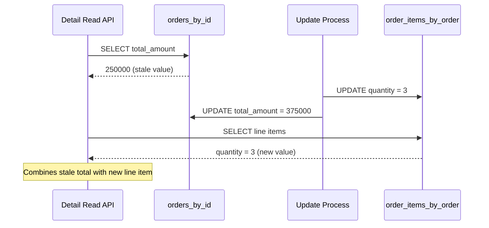
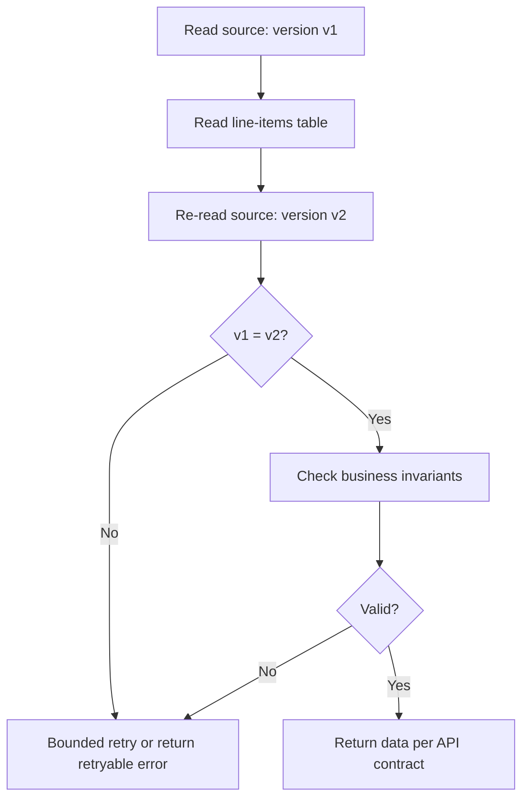
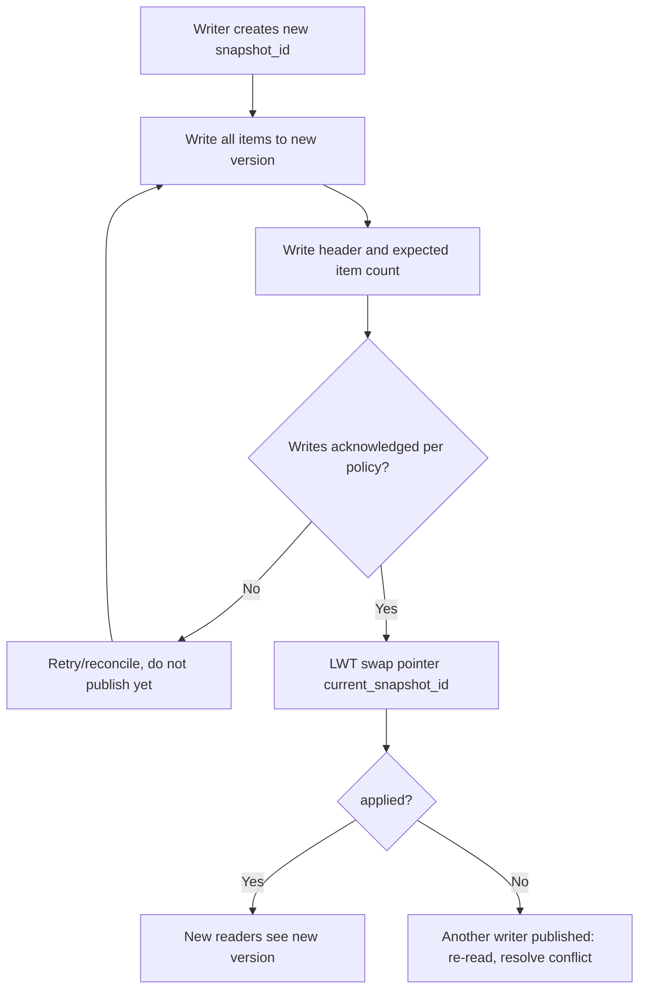

# Reading Data from Multiple Tables During Concurrent Updates in Apache Cassandra

## Learning Objectives

In the **Relationships and Denormalization** chapter, we often create multiple tables for the same entity to serve different queries. This lesson addresses the problem that arises when those tables are actively being updated while the application needs to **read and assemble data at that exact moment**.

After this lesson, you will be able to:

- Identify **read skew**, query results mixing old and new versions, and derived data not yet caught up.
- Explain why `LOCAL_QUORUM`, `LOGGED BATCH`, LWT, or repair do not automatically provide an **atomic cross-table snapshot**.
- Choose among bounded-lag reads, key-based supplemental reads, version-checked reads, and **immutable snapshots with a published pointer**.
- Write CQL and Java Driver code to read multiple tables, detect missing data, and handle concurrency per the API contract.
- Build test cases, pagination, retries, and drift monitoring across derived tables.

## 1. Where Does the Problem Come From?

Apache Cassandra is a distributed database following the **wide-column** model, routing data by **partition key** and ordering rows within a partition via **clustering columns**. Cassandra does not provide general `JOIN` operations or foreign keys like an RDBMS. Applications commonly design query-driven tables and **assemble data at read time**.

Consider an order application needing three read paths:

1. `orders_by_id`: read status, total amount, and version of an order by `order_id`.
2. `order_items_by_order`: read the order's line items by the same `order_id`.
3. `orders_by_customer_month`: list orders by customer/month, including a few duplicated columns to avoid reading individual order details.

When the detail page executes two `SELECT` queries, an intervening command may update quantity, add a line item, cancel the order, or process payment between the two reads. The final result can pair **the old total amount with the new line-item list**.

### Reproducible Example

Initially, order `O1` has one line: 2 keyboards × 125,000 VND = **250,000 VND**. Process A reads the total amount while process B increases quantity to 3 and updates total amount to **375,000 VND**.

| Time | Process A (Reader) | Process B (Writer) |
| --- | --- | --- |
| t1 | Reads `orders_by_id.total_amount = 250000` | |
| t2 | | Updates quantity in `order_items_by_order` from 2 to 3 |
| t3 | | Updates `orders_by_id` total amount to 375000 |
| t4 | Reads line items and sees quantity 3 | |
| t5 | Assembles response with total 250000 and quantity 3 | |

At t5, the API can return an object that **does not correspond to any single business version**. This phenomenon is commonly called **read skew** or a **fractured read** at the application layer. It can still happen even when every `SELECT` and `UPDATE` is acknowledged as successful.



The crucial point is that **a multi-table read session is not a snapshot transaction**. Two queries separated by just a few milliseconds can observe different points in time.

## 2. Distinguishing Types of Inconsistent Data

| Phenomenon | Example | Common Cause | Impact |
| --- | --- | --- | --- |
| **Read skew** between source and child table | Old total amount, new line items | Interleaved multi-table writes and reads | Self-contradictory response |
| **Projection lag** | List still shows `CREATED`, detail shows `PAID` | Derived table updated after source table | Two screens disagree |
| **Partial failure** | Detail table written, list table times out | Incomplete write fan-out | Missing or stale derived copy |
| **Out-of-order event** | Version 3 price overwritten by version 2 message | Out-of-order event/retry processing | Data regresses |
| **Stale replica read** | Weak-consistency row read returns old value | Replica missed update or network glitch | Single query is stale |
| **Delete/read race** | List returns an ID just deleted from detail table | Uncascaded multi-table deletes, interleaved reads | Orphaned ID or incomplete result |

Not every case requires the same treatment. An analytics screen may tolerate a few seconds of staleness, whereas an API deciding refunds or payments must enforce stronger **business invariants**.

### "Newest" Does Not Mean "Synchronized"

A list page reading a derived table by `customer_id` may return data **not yet synchronized** from the source table. Moments later when opening details by `order_id`, the user may see a newer version. Even though every operation uses a partition key and runs fast, there is no built-in mechanism forcing two tables to return the same version.

To design properly, specify explicitly what the API wants:

- **Accept near-current approximate results**: data may lag in a controlled manner.
- **Self-consistent single entity**: total amount and line items must belong to the same version.
- **Immediately reflect newly accepted changes**: read-your-writes within a defined scope.
- **System-wide point-in-time snapshot**: a much stronger requirement that cannot be achieved merely with a few Cassandra `SELECT` queries.

## 3. Initial Table Model and Update Operations

Assume the `shop` keyspace exists with a replication configuration suited to the Cassandra cluster being used.

```sql
USE shop;

-- Detail table. Simplified example: application owns canonical state.
CREATE TABLE orders_by_id (
    order_id uuid PRIMARY KEY,
    customer_id uuid,
    order_month date,
    ordered_at timestamp,
    status text,
    total_amount decimal,
    source_version bigint,
    deleted boolean
);

-- One partition holds the line items of an order.
CREATE TABLE order_items_by_order (
    order_id uuid,
    line_no int,
    sku text,
    quantity int,
    unit_price decimal,
    PRIMARY KEY ((order_id), line_no)
);

-- Derived copy serving order list by customer and month.
CREATE TABLE orders_by_customer_month (
    customer_id uuid,
    order_month date,
    ordered_at timestamp,
    order_id uuid,
    status text,
    total_amount decimal,
    source_version bigint,
    PRIMARY KEY ((customer_id, order_month), ordered_at, order_id)
) WITH CLUSTERING ORDER BY (ordered_at DESC, order_id ASC);
```

- In `orders_by_id`, `order_id` is the entire primary key and partition key.
- In `order_items_by_order`, `order_id` is the partition key and `line_no` is the clustering column. Reading all line items of an order does not scan other partitions.
- In `orders_by_customer_month`, the composite partition key `(customer_id, order_month)` bounds data by customer and time period; `ordered_at DESC` and `order_id` sort/disambiguate records.

An order with very many line items or a customer creating huge numbers of orders in a month can still produce oversized partitions. In that case, evaluate bucketing and pagination based on real load rather than assuming the current partition key always fits.

### Initial Data Inserts

```sql
INSERT INTO orders_by_id (
    order_id, customer_id, order_month, ordered_at,
    status, total_amount, source_version, deleted
) VALUES (
    11111111-1111-4111-8111-111111111111,
    22222222-2222-4222-8222-222222222222,
    '2026-11-01', '2026-11-21T01:00:00Z',
    'CREATED', 250000.00, 1, false
);

INSERT INTO order_items_by_order
    (order_id, line_no, sku, quantity, unit_price)
VALUES (
    11111111-1111-4111-8111-111111111111,
    1, 'KEYBOARD-001', 2, 125000.00
);

INSERT INTO orders_by_customer_month (
    customer_id, order_month, ordered_at, order_id,
    status, total_amount, source_version
) VALUES (
    22222222-2222-4222-8222-222222222222,
    '2026-11-01', '2026-11-21T01:00:00Z',
    11111111-1111-4111-8111-111111111111,
    'CREATED', 250000.00, 1
);
```

### Two Common Read Paths

```sql
-- Read details by order key.
SELECT order_id, total_amount, status, source_version, deleted
FROM orders_by_id
WHERE order_id = 11111111-1111-4111-8111-111111111111;

-- Read line items to assemble into details.
SELECT line_no, sku, quantity, unit_price
FROM order_items_by_order
WHERE order_id = 11111111-1111-4111-8111-111111111111;

-- Read list by customer and month.
SELECT order_id, ordered_at, status, total_amount, source_version
FROM orders_by_customer_month
WHERE customer_id = 22222222-2222-4222-8222-222222222222
  AND order_month = '2026-11-01'
LIMIT 20;
```

All three queries use proper keys yet **do not form an atomic snapshot** when updates happen concurrently.

### Update Example Causing Two Read Paths to Diverge

```sql
-- Writer: update quantity in line-items table.
UPDATE order_items_by_order
SET quantity = 3
WHERE order_id = 11111111-1111-4111-8111-111111111111
  AND line_no = 1;

-- Then update order source.
UPDATE orders_by_id
SET total_amount = 375000.00, source_version = 2
WHERE order_id = 11111111-1111-4111-8111-111111111111;

-- Finally project new total amount to list.
UPDATE orders_by_customer_month
SET total_amount = 375000.00, source_version = 2
WHERE customer_id = 22222222-2222-4222-8222-222222222222
  AND order_month = '2026-11-01'
  AND ordered_at = '2026-11-21T01:00:00Z'
  AND order_id = 11111111-1111-4111-8111-111111111111;
```

In a real system, increasing quantity must also obey business validation, pricing rules, idempotency, and edit authorization. This CQL illustrates **how read–write ordering can interleave**, not a complete transaction.

## 4. How Much Do Consistency Levels, Batches, LWT, and Repair Guarantee?

### 4.1. LOCAL_QUORUM: Guarantees Scoped to One Operation

With a replication factor of `3` in one datacenter, writing and reading at `LOCAL_QUORUM` generally requires a majority of replicas (e.g., 2 of 3) to participate in acknowledgment. Under suitable conditions, this allows a read following an acknowledged write of **the same key/data** to observe the new value.

However:

- `LOCAL_QUORUM` on `orders_by_id` does not wait for `order_items_by_order` or `orders_by_customer_month` to update.
- Two `SELECT` queries run sequentially or in parallel can still observe **two different points in time**.
- If a derived table has not yet received a mutation, raising the consistency level when querying that table cannot synthesize missing updates from the source table.
- With multiple datacenters, `LOCAL_QUORUM` relies only on replicas in the local datacenter; align topology and read/write paths when designing visibility requirements.

Consistency level is part of the single-operation read/write contract, **not a cross-table snapshot mechanism**.

### 4.2. LOGGED BATCH Does Not Provide Isolation

A logged batch helps ensure mutations in the batch are eventually applied after certain failures, yet **provides neither isolation nor rollback like an RDBMS transaction**. A reader can still observe some mutations in the batch before others become visible. Multi-partition batches also carry coordinator/batchlog overhead; do not use batches as a throughput trick or blanket solution for all projections.

If the goal is returning a **self-consistent** order object, design how state is read and published rather than merely wrapping `UPDATE` statements in a batch.

### 4.3. LWT Controls Contention Within Conditional Boundaries

`UPDATE ... IF ...` and `INSERT ... IF NOT EXISTS` (lightweight transactions, LWT) are useful to:

- Publish a new version only when the current pointer still equals the expected version.
- Prevent two writers from concurrently deciding source state from the same stale version.
- Guard invariants on a single row/partition when the application uses properly scoped conditional statements.

LWT **does not automatically check or atomically lock rows across different tables and partitions**. It costs more than normal operations and can suffer contention when concentrated on a hot partition.

### 4.4. Repair Differs from Derived-Table Reconciliation

Cassandra repair resolves divergence between **replicas of the same data/table**; it does not know that `orders_by_customer_month.status` must match the status in `orders_by_id`. To fix a missing or lagging derived table, the application needs **event retries, re-projection from the canonical source, or reconciliation**. Compaction and tombstones likewise do not replace integrity checks across logical tables.

## 5. Simplest Approach: Explicitly Define Acceptable Skew

Not every API requires a consistent snapshot.

| API or Feature | Acceptable Skew | Usually Suitable Implementation |
| --- | --- | --- |
| Order history page | May accept stale status within a defined window | Read `orders_by_customer_month`, show refresh timestamp if needed |
| Standard detail page | Short-term skew possible, but minimize self-contradiction | Read source and child tables, check version/invariants, bounded retry |
| Finalized invoice export | Total, line items, and tax must belong to the same published version | Store immutable snapshot or finalized invoice document by version ID |
| Refund decision | Must not rely on stale aggregated data | Authoritative service checks conditions and performs protected operation |
| Analytics reports | Can accept periodic lag | Read projection/aggregation with watermark or update timestamp |

Set **concrete thresholds** in the business contract: for instance, the list page allows synchronization lag up to a measurable bound; the invoice page returns only published versions; when mandatory data is missing, the API returns a retryable error instead of silently computing wrong numbers.

### Consider Single-Row Duplication for Small Datasets

If details only have a **very small, bounded** child set always read together with the entity, you can sometimes store the child snapshot via a UDT/collection in the same row instead of querying multiple tables. Never embed thousands of line items into an unbounded collection merely to reduce `SELECT` count: updates, tombstones, row size, and pagination quickly become unmanageable.

Another approach is to **materialize the complete read view** and publish it once ready. The price is write/sync cost, so evaluate change frequency and data size.

## 6. Version-Checked Reads: Detecting Changes Without Creating a Snapshot

With the initial model, one application-layer improvement is **reading the source version metadata twice**:

1. Read `orders_by_id` to get `source_version = v1` and order details.
2. Read `order_items_by_order` to assemble the line-item list.
3. Re-read `orders_by_id.source_version = v2`.
4. If `v1 != v2`, do not return the assembled result; perform a bounded retry or report that data is changing.
5. If `v1 == v2`, run any additional line-count/total checks and return the result under the system's guarantee level.



**Critical limitation:** observing `v1 == v2` does not prove the multi-table result is an atomic snapshot. For example:

- The writer modified line items, yet **had not incremented the version** in `orders_by_id` when the reader re-read it.
- A child write arrived late or a replica read returned a different state.
- Version incremented, yet a buggy update reverted it to an old value (*ABA*) or overwrote it.
- A mutation failed to increment the canonical version by convention.
- Total amount and line counts could coincidentally match even when child data came from a different update.

For this technique to hold value, every mutation affecting read data must obey versioning and write-ordering rules; even then, **ordinary version rules do not replace cross-table transactions**. Use this approach only when requirements accept the residual risk and the system has drift-handling mechanisms.

### Sample Java for Double-Check Reading

This example illustrates the application algorithm without full retry/backoff logic:

```java
// Assume loadOrder and loadItems are already PreparedStatements.
Row before = session.execute(loadOrder.bind(orderId)).one();
if (before == null) {
    return null; // API layer can return 404.
}

List<Row> items = new ArrayList<>();
for (Row item : session.execute(loadItems.bind(orderId))) {
    items.add(item);
}

Row after = session.execute(loadOrder.bind(orderId)).one();
if (after == null
        || before.getLong("source_version")
            != after.getLong("source_version")) {
    throw new IllegalStateException(
        "Order is changing; bounded re-read required");
}

// Matching versions are only a signal, NOT proof of atomicity.
// Do not treat these Rows as a snapshot for payment decisions.
```

This is a **condensed snippet**: `session` is a `CqlSession`; `loadOrder` returns the `source_version` column; production code must bound memory, row count, and retry attempts. For rows where `source_version = null` is valid, define null handling instead of calling `getLong` directly.

## 7. More Self-Consistent Reads: Immutable Snapshots and a Published Pointer

If you need to combine an order header and line items **belonging to the same version**, you can design an **immutable logical snapshot**, then use a **current pointer** to publish the snapshot once all parts are written.

This is an application design pattern built atop Cassandra's capabilities; Cassandra **does not natively create cross-table snapshots**. It works best when a single service owns updates, each snapshot has its own ID, data is written once, and old versions are retained long enough for active readers.

### 7.1. CQL Schema by Snapshot ID

```sql
USE shop;

-- Current pointer per order_id.
CREATE TABLE orders_current_by_id (
    order_id uuid PRIMARY KEY,
    current_snapshot_id uuid
);

-- Snapshot headers: allows accessing a specific version.
CREATE TABLE order_headers_by_snapshot (
    order_id uuid,
    snapshot_id uuid,
    status text,
    total_amount decimal,
    currency text,
    item_count int,
    PRIMARY KEY ((order_id), snapshot_id)
);

-- Each snapshot has an independent set of line items.
CREATE TABLE order_items_by_snapshot (
    order_id uuid,
    snapshot_id uuid,
    line_no int,
    sku text,
    quantity int,
    unit_price decimal,
    PRIMARY KEY ((order_id, snapshot_id), line_no)
);
```

- `orders_current_by_id` selects the snapshot **published** by the application. It is queried by `order_id`.
- `order_headers_by_snapshot` looks up by `order_id` and `snapshot_id`. One order can hold multiple snapshot headers (requiring a cleanup policy later).
- `order_items_by_snapshot` uses composite partition key `(order_id, snapshot_id)` and clustering `line_no`; all line items of **one version** live in one partition. Large datasets still need pagination and potentially bucketing; there is no automatic guarantee that every snapshot stays small.

The `snapshot_id` key serves as an **immutable identifier**, not a timestamp key used to pick "the latest copy." The application treats a snapshot as current only when the pointer points to it.

### 7.2. Workflow for Publishing a New Snapshot

Suppose the pointer currently holds `aaaaaaaa-aaaa-4aaa-8aaa-aaaaaaaaaaaa`. The writer wants to create a new version `bbbbbbbb-bbbb-4bbb-8bbb-bbbbbbbbbbbb`:

1. Generate a new `snapshot_id`, and determine the complete line items, total amount, and status from business logic.
2. Write **all line items** under the new snapshot key; check acknowledgments and retry/reconcile on failure.
3. Write the **snapshot header** with `item_count` and `total_amount` matching that exact set of line items.
4. Only after the snapshot's data has been written and verified at the required guarantee level, use **LWT to swap the pointer** from the old snapshot to the new snapshot.
5. Once the LWT publish succeeds, new readers fetch the new ID and read all components under that ID. Readers that already fetched the old ID continue reading the old version.
6. Do not delete the old snapshot immediately: retain it long enough for maximum read duration, pagination, and operational policy; clean up unpublished or superseded snapshots via a separate cleanup job.



Illustrative CQL statements:

```sql
-- New version line item.
INSERT INTO order_items_by_snapshot (
    order_id, snapshot_id, line_no, sku, quantity, unit_price
) VALUES (
    11111111-1111-4111-8111-111111111111,
    bbbbbbbb-bbbb-4bbb-8bbb-bbbbbbbbbbbb,
    1, 'KEYBOARD-001', 3, 125000.00
);

-- Header written after all line items of the snapshot are complete.
INSERT INTO order_headers_by_snapshot (
    order_id, snapshot_id, status, total_amount, currency, item_count
) VALUES (
    11111111-1111-4111-8111-111111111111,
    bbbbbbbb-bbbb-4bbb-8bbb-bbbbbbbbbbbb,
    'CREATED', 375000.00, 'VND', 1
);

-- Publish new version only if pointer still points to old version.
UPDATE orders_current_by_id
SET current_snapshot_id = bbbbbbbb-bbbb-4bbb-8bbb-bbbbbbbbbbbb
WHERE order_id = 11111111-1111-4111-8111-111111111111
IF current_snapshot_id = aaaaaaaa-aaaa-4aaa-8aaa-aaaaaaaaaaaa;
```

`UPDATE ... IF ...` uses LWT; the application must check `[applied]`. If false, **do not overwrite the pointer with a plain UPDATE**. Read the new state, resolve the conflict, and create/complete another valid snapshot. On initial order creation, the pointer can be initialized with `INSERT ... IF NOT EXISTS` after the initial snapshot is ready.

**Critical condition:** the pointer does not replace data verification. If the application publishes before finishing line items, or mutates the same `snapshot_id` with different values later, readers can still see missing/wrong results. Use a fresh snapshot ID for every version, avoid key reuse, and ensure data is retained long enough. With appropriate replication and consistency levels, acknowledged writes can be read back per policy; handle errors/timeouts before publishing.

### 7.3. Reader Assembles the Selected Snapshot

```sql
-- Step A: fetch current snapshot ID of the order.
SELECT current_snapshot_id
FROM orders_current_by_id
WHERE order_id = 11111111-1111-4111-8111-111111111111;

-- Assume result is bbbbbbbb-bbbb-4bbb-8bbb-bbbbbbbbbbbb.

-- Step B: fetch header of that exact snapshot.
SELECT status, total_amount, currency, item_count
FROM order_headers_by_snapshot
WHERE order_id = 11111111-1111-4111-8111-111111111111
  AND snapshot_id = bbbbbbbb-bbbb-4bbb-8bbb-bbbbbbbbbbbb;

-- Step C: fetch line items belonging to the SAME snapshot.
SELECT line_no, sku, quantity, unit_price
FROM order_items_by_snapshot
WHERE order_id = 11111111-1111-4111-8111-111111111111
  AND snapshot_id = bbbbbbbb-bbbb-4bbb-8bbb-bbbbbbbbbbbb;
```

If a writer publishes the next snapshot between steps B and C, the reader still uses **the pinned snapshot ID**, so it never mixes an old-version header with new-version items. Nonetheless, the application must handle cases where the snapshot header or items cannot be read, the snapshot was cleaned up too early, or an initial write was incomplete.

**This is a logical snapshot of a single entity**, not an atomic snapshot of all of Cassandra. To operate across multiple orders/customers simultaneously with strict invariants, re-evaluate business boundaries and appropriate transactional mechanisms.

### 7.4. Trade-Offs of the Immutable Snapshot Pattern

| Aspect | In-Place Row Updates | Immutable Snapshot + Pointer |
| --- | --- | --- |
| Write cost | Usually writes only changed fields/rows | May need to rewrite all or most of a snapshot |
| Multi-table reads | Can mix new and old states | Can pin the same `snapshot_id` if publish workflow is sound |
| Concurrent writes | Must manage versions across tables | Pointer LWT resolves contention at publish time |
| Storage | Fewer coexisting versions | Stores multiple snapshots; needs retention and cleanup |
| Deletes/TTL | Per table/row | Do not delete old version until active readers finish |
| Very large child sets | Can paginate by order | Huge snapshots raise creation and retention costs |
| List queries by customer | Needs separate projection | Still needs a separate projection and lag contract |

For orders with few line items, finalized snapshots can be practical. For data mutating every second with millions of elements, copying everything per version can be prohibitively expensive; consider partial snapshots, event sourcing, or specialized transactional solutions as needed.

## 8. Java Driver: Reading Published Snapshots and Detecting Missing Data

The example below uses **Apache Cassandra Java Driver 4.x** and Java 17 `record` types. Every query supplies the full partition key. Here, an order has a **small, bounded line count**; for large lists, switch to a paginated endpoint instead of loading all rows into a `List`.

```java
import com.datastax.oss.driver.api.core.CqlSession;
import com.datastax.oss.driver.api.core.DefaultConsistencyLevel;
import com.datastax.oss.driver.api.core.cql.PreparedStatement;
import com.datastax.oss.driver.api.core.cql.Row;

import java.math.BigDecimal;
import java.util.ArrayList;
import java.util.List;
import java.util.UUID;

public final class OrderSnapshotRepository {
    public record Item(int lineNo, String sku, int quantity,
                       BigDecimal unitPrice) {}

    public record Detail(UUID orderId, UUID snapshotId, String status,
                         BigDecimal total, String currency,
                         List<Item> items) {}

    private final CqlSession session;
    private final PreparedStatement selectCurrent;
    private final PreparedStatement selectHeader;
    private final PreparedStatement selectItems;

    public OrderSnapshotRepository(CqlSession session) {
        this.session = session;
        selectCurrent = session.prepare(
            "SELECT current_snapshot_id FROM orders_current_by_id " +
            "WHERE order_id = ?");
        selectHeader = session.prepare(
            "SELECT status, total_amount, currency, item_count " +
            "FROM order_headers_by_snapshot " +
            "WHERE order_id = ? AND snapshot_id = ?");
        selectItems = session.prepare(
            "SELECT line_no, sku, quantity, unit_price " +
            "FROM order_items_by_snapshot " +
            "WHERE order_id = ? AND snapshot_id = ?");
    }

    // RF/topology must support LOCAL_QUORUM in the runtime environment.
    // null only means no pointer exists; missing snapshot must error.
    public Detail getDetail(UUID orderId) {
        Row pointer = session.execute(
            selectCurrent.bind(orderId)
                .setConsistencyLevel(DefaultConsistencyLevel.LOCAL_QUORUM)
        ).one();

        if (pointer == null || pointer.isNull("current_snapshot_id")) {
            return null;
        }
        UUID snapshotId = pointer.getUuid("current_snapshot_id");

        Row header = session.execute(
            selectHeader.bind(orderId, snapshotId)
                .setConsistencyLevel(DefaultConsistencyLevel.LOCAL_QUORUM)
        ).one();

        if (header == null || header.isNull("item_count")) {
            throw new IllegalStateException(
                "Snapshot published but header is missing");
        }

        List<Item> items = new ArrayList<>();
        for (Row row : session.execute(
                selectItems.bind(orderId, snapshotId)
                    .setConsistencyLevel(DefaultConsistencyLevel.LOCAL_QUORUM))) {
            items.add(new Item(
                row.getInt("line_no"),
                row.getString("sku"),
                row.getInt("quantity"),
                row.getBigDecimal("unit_price")
            ));
        }

        int expected = header.getInt("item_count");
        if (items.size() != expected) {
            throw new IllegalStateException(
                "Snapshot incomplete line items: expected=" + expected +
                ", actual=" + items.size());
        }

        return new Detail(
            orderId,
            snapshotId,
            header.getString("status"),
            header.getBigDecimal("total_amount"),
            header.getString("currency"),
            List.copyOf(items)
        );
    }
}
```

**Limitations and practical meaning:**

- `getDetail` reads the pointer once and **never changes the snapshot ID** across subsequent queries. That distinguishes it from reading live mutable source state twice.
- The method throws if the header is missing or line count mismatches. It **does not prove data correctness solely via item count**: two different item sets can have the same row count. Systems can verify checksums/digests or business invariants when required.
- `LOCAL_QUORUM` illustrates read configuration when RF/topology match; the write path must likewise use an appropriately designed consistency level. Without a matching datacenter/replica setup, the statement will fail or lack the intended semantics.
- Synchronous code keeps the example easy to follow. Under heavy load, use `executeAsync`, yet bound concurrency, deadlines, and request counts to avoid uncontrolled fan-out.
- The `for` loop can trigger driver paging and collect all rows. For orders with many lines, cap output sizes and use paging state per snapshot while keeping the snapshot ID fixed across pages.
- If a published snapshot was purged prematurely, return an appropriate error and alert on the incident; never silently read a header from another snapshot to "patch" missing data.

## 9. Reading Derived Lists While Source State Changes

Even when the detail page uses a snapshot ID, the application may still maintain `orders_by_customer_month` for fast list responses. Suppose a user opens order history while payment runs:

- The list reader sees `status = 'CREATED'` in `orders_by_customer_month`.
- The Order service has already published detail version `status = 'PAID'`.
- When the user opens the order, the detail page shows `PAID`.

This can be **acceptable projection lag** if the UI contract states list status may be slightly stale. If the list must reflect updates immediately, weigh these trade-offs:

1. **Do not acknowledge the business command until mandatory projections are synced** per chosen workflow and consistency level. Handle timeouts and partial writes; do not assume rollback.
2. **Re-read from the canonical source** when the API needs verified status for an order, instead of trusting the duplicated status column in the list. For a 20-order page, this can add many extra reads, requiring measurement and caps.
3. **Attach snapshot/version metadata to the projection** so clients distinguish published version/freshness. This helps detect skew yet does not force projections to update faster.
4. **Separate display read paths from decision paths**: history pages accept eventual consistency, whereas refund/charge actions query the authoritative service.

Another issue is **deletes or key moves**. Changing `customer_id` or `order_month` requires deleting the list row under the old key and inserting under the new key; readers may briefly see both or neither. Deleting an order without emitting a projection delete leaves an orphaned ID in the list. Transitional states require monitoring and reconciliation workflows.

## 10. Retries, Failure Handling, and Practical Consistency

### 10.1. A Timeout Does Not Guarantee the Write Failed

When a writer gets a timeout updating a table, the mutation **may already have reached some replicas**. If a retry arbitrarily creates a new ID/timestamp/snapshot, data can be logically duplicated. You must:

- Reuse the exact `order_id` and `snapshot_id` for a retried snapshot creation.
- Publish the pointer only after snapshot components are confirmed/verified per contract.
- If the pointer-swap LWT times out, **re-read the pointer** to determine whether your snapshot was published or another writer won before deciding next steps.
- With two competing writers, a conditional LWT on `current_snapshot_id` prevents a stale writer from blindly overwriting the pointer.
- Design bounded retries, track indeterminate write outcomes, and run a cleanup job for snapshots that were never published.

### 10.2. Read Retries Must Not Become an Infinite Loop

If a reader detects mismatched `source_version` or missing snapshot parts, it may retry a few times within the API **deadline**. Never retry infinitely or multiply parallel queries uncontrollably while the system is degraded. After allowed attempts, return a retryable error, a data-not-ready indicator, or an approximate response **only if the contract permits it**.

### 10.3. Do Not Delete Old Snapshots While Readers Remain

A reader may have read `current_snapshot_id = A` while a writer swaps the pointer to `B`. If a cleanup job immediately deletes `A`, the reader cannot finish assembling data. Maintain a **retention grace period** exceeding allowed read/paging durations, or an explicit lifecycle mechanism. TTL expiration creates tombstones, so evaluate compaction and repair to avoid high read costs when creating many snapshots.

When deletions involve privacy requests or retention policies, cleanup must also obey those policies; old snapshots cannot be retained indefinitely solely to support readers.

### 10.4. Reconciling Derived Tables Is Not Replica Repair

If the source published snapshot `B` while the list table has not reflected the new status, a reconciliation job must use the authoritative source to update the projection. Cassandra repair does not perform that logical transformation automatically. Likewise, if an incomplete snapshot was accidentally published due to a workflow bug, detect it via metadata/validation and rebuild from source rather than expecting compaction to fix cross-table relationships.

## 11. Testing and Monitoring Under Concurrent Updates

A test that only runs "write then read" sequentially will not expose read skew. Create test cases that **intentionally interleave writers and readers** in a test environment:

| Scenario | Expected Observation |
| --- | --- |
| Reader reads old total; writer updates item and total; reader reads new item | Exposes read skew risk in in-place update models |
| Source write succeeds but list update times out | List reader may see stale data; sync job detects and repairs |
| Two writers try to publish different snapshots from pointer A | Only one conditional LWT wins for the expected value; loser handles conflict |
| Reader pins snapshot A; writer publishes B | Reader keeps reading A cleanly if A is retained and complete |
| Writer crashes after writing partial items for B | Pointer stays off B; incomplete snapshot is never published |
| Retrying a timed-out pointer-swap LWT | Re-reads pointer before retrying or creating another snapshot |
| Cleanup deletes A while reader still pins A | Exposes retention bug; adjust cleanup policy and paging window |
| Projection receives older version event after newer version | Stale event does not silently overwrite, or reconciliation repairs |
| Reading multiple buckets/partitions in one list page | Merges/sorts properly; does not assume one paging state spans multiple queries |

Metrics to monitor:

- **p95/p99** detail and list latency, average `SELECT` count per API call.
- Retries due to version mismatch, incomplete snapshots, LWT `[applied] = false` counts.
- Age of events not yet projected to derived tables, missing/extra/version-mismatched rows in reconciliation jobs.
- Retained old snapshot count, storage usage, tombstones, compaction pressure, and repair status.
- Hot/large partitions, rows per snapshot, and memory used during result assembly.
- Error rates from deadlines, consistency level failures, and timeouts during node outages or network partitions.

Model changes should be evaluated alongside **realistic read/write load**, data sizes, and replication policy. No single general approach provides system-wide snapshots, minimizes writes to zero, and guarantees low latency across all workloads simultaneously.

## 12. Practice Exercise: Course Detail Page and Student Progress

An online learning platform on Cassandra has:

- `courses_by_id`: title, publication status, curriculum version.
- `lessons_by_course`: lesson list by `course_id` and display order.
- `student_progress_by_course`: a student's progress by `(student_id, course_id)`.
- `courses_by_category`: derived table serving course listings by category.

While a student opens a course, an author may add lessons, reorder lessons, or publish a new version; meanwhile, other students complete lessons and the progress service updates statistics.

**Requirements:**

1. Identify at least two situations where reading `courses_by_id` then `lessons_by_course` can mix data from different curriculum versions.
2. If a navigation bar can tolerate data a few seconds stale, how should its read path be designed to reduce cost?
3. If certificate grading must rely on an exact curriculum version, how should **version IDs** and a published pointer be used?
4. When an author adds a lesson without publishing a new version yet, should learners see the new lesson on their certificate checklist? Why?
5. When updating `student_progress_by_course`, should the curriculum version be stored in progress? What happens when the course advances versions?
6. If a cleanup job deletes lessons of an old version while a student is still taking an exam, how should retention policy change?

**Suggested answers:**

- The header may reflect version 3 while the lesson list has started transitioning to version 4. Reading two tables by live key provides no shared snapshot.
- For low-constraint UI elements, accept eventual consistency and use a projection stamped with refresh time; immutable snapshots are unnecessary for every widget.
- For certificate evaluation, attach `curriculum_version_id` to both metadata and lessons of that version, publishing the pointer only once version data is ready. Readers pin the same version ID.
- Unpublished draft lessons must not enter the official lesson set of a finalized version; if a draft preview is desired, use a draft-state read path.
- Storing the curriculum version a student's progress tracks clarifies which lesson set they must complete. Upgrading versions requires progress-migration rules rather than merely counting completed lessons.
- Retain old versions for a window covering active sessions, pagination, and retention rules; never TTL immediately upon pointer swap without accounting for active readers.

## Summary

When Cassandra stores related data across multiple tables or splits an entity's components across partitions, **independent `SELECT` statements do not create an atomic snapshot** during concurrent writes. `LOCAL_QUORUM` helps within the scope of the read/written data, LWT guards specific row/partition conditions, and logged batches and repair serve other purposes; none replace a cross-table consistency contract across logical tables.

For read paths that tolerate lag, specify staleness bounds and build retries/reconciliation. For read paths needing stronger self-consistency, apply **immutable versions + conditional publish pointer**, retain old snapshots long enough for pinned readers, and handle failed publishes and incomplete snapshots. When requirements demand strong atomic transactions across multiple entities, redesign domain boundaries or use an appropriate transactional mechanism. Final decisions must align with **partition keys, read/write cost, latency, partition size, and real operational conditions**.
