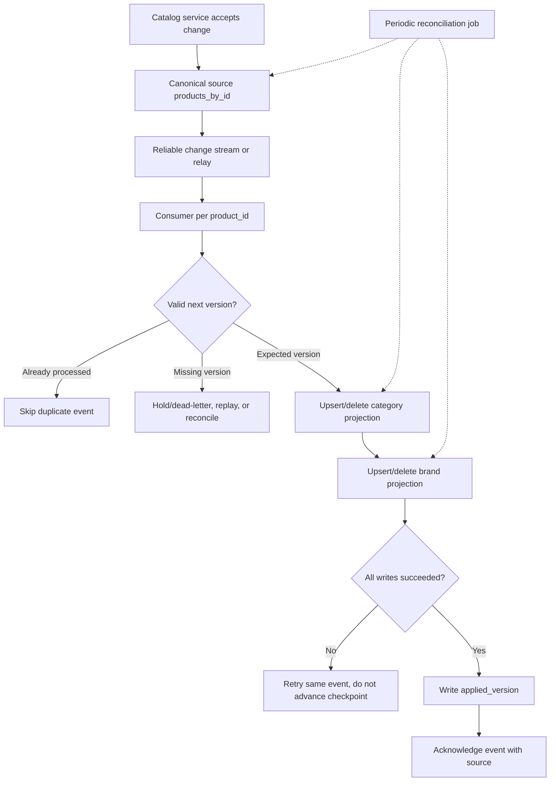

# Using Events or Background Jobs to Synchronize Duplicated Data in Apache Cassandra

## Learning Objectives

In the **Relationships and Denormalization** chapter, a business entity can appear across multiple Apache Cassandra tables to serve different queries. The hard problem is not just creating those tables, but **maintaining duplicated data when a record is edited, deleted, migrated across keys, or when an operation fails**.

After this lesson, you will be able to:

- Distinguish **synchronous multi-table writes**, **event-driven projections**, and **background reconciliation jobs**.
- Design an event contract containing IDs, source version, old/new keys, and sufficient fields to rebuild derived tables.
- Explain why an event can be duplicated, delivered out of order, lost, or partially applied; use **idempotency**, per-key coordination, and checkpointing to limit fallout.
- Write CQL for a canonical source table, two query-driven lookup tables, and a projection progress-tracking table.
- Organize a worker in the Java Driver to perform controlled write fan-out, retries, and error reporting.
- Build a background **application-layer backfill/repair** job, measure synchronization lag, and distinguish it from Cassandra replica repair.

## 1. Why Does Duplicated Data Need a Dedicated Sync Mechanism?

Apache Cassandra is a distributed **wide-column** database organizing rows by **partition key** and **clustering columns**. Cassandra does not support `JOIN` or foreign keys like an RDBMS, so applications often create separate tables for common queries.

For example, a Catalog service manages products and needs to:

1. Look up a product by `product_id`.
2. List the newest products by **category** and publication month.
3. List the newest products by **brand** and publication month.

To avoid fetching an ID list and then reading each product individually, the application can duplicate `name`, `price`, and `currency` into both list tables. When price increases from 750,000 to 790,000 VND, the true state must appear across all read paths, even if they do not change at the exact same instant.

| Table | Role | Primary Query |
| --- | --- | --- |
| `products_by_id` | Canonical source for Catalog attributes in this example | `WHERE product_id = ?` |
| `products_by_category_month` | Derived copy by category/month | `WHERE category_id = ? AND publish_month = ?` |
| `products_by_brand_month` | Derived copy by brand/month | `WHERE brand_id = ? AND publish_month = ?` |
| `product_projection_progress_by_id` | Tracks processed version of a product in the worker | `WHERE product_id = ?` |

**Canonical source** is a business and application-architecture decision, not a feature Cassandra automatically attaches to a table. In another system, the canonical source might live in an external service or event log, with Cassandra tables serving purely as read representations.

**Do not confuse two types of copying:** *replication* creates multiple replicas of **the same data** per replication factor, whereas *denormalization* creates **multiple logical tables** with distinct keys and read purposes. Consistency levels and inter-replica repair do not automatically compare or reconcile two derived tables against a source.

## 2. Three Ways to Maintain Derived Tables

| Approach | Basic Flow | Advantages | Risks or Trade-Offs |
| --- | --- | --- | --- |
| **Synchronous multi-table writes** | Request updates source, then writes all projections before responding | Write path directly controls targets; fewer moving parts | Timeouts/partial success; latency grows with more tables |
| **Event-driven sync** | Source accepts change → publishes event → consumer updates projections | Decouples read/write load, supports buffering/retries and independent processing | Projection lag; duplicate/out-of-order events; requires reliable event publishing |
| **Background reconciliation/backfill job** | Job scans source in controlled scope → compares/rebuilds derived tables | Fixes missed records; useful for schema changes or recovery | Higher latency; needs rate limiting and protection against races with live writes |

In practice, **events + periodic reconciliation jobs** complement each other: events handle most updates quickly, while reconciliation catches edge cases the pipeline missed. No single mechanism automatically guarantees "exactly once" across Cassandra, message brokers, and external services.

### Consistency Targets Must Be Driven by Business Requirements

- A product list page may tolerate displaying a slightly stale price or title for a measurable window.
- A checkout page may need to read **the order's finalized price** from the authoritative service rather than trusting a Catalog list table.
- When deleting a product or revoking sensitive data, retention and deletion requirements may be stricter than UI display sync requirements.

If users require new state to appear **immediately** across every table before an operation is considered complete, design an appropriate synchronous workflow and failure handling; do not merely label it "eventual consistency" and ignore business requirements.

## 3. CQL: One Source and Two Query-Driven Read Tables

Assume the `shop` keyspace already exists with replication suited for a learning environment. The tables below illustrate a versioned model:

```sql
USE shop;

CREATE TABLE products_by_id (
    product_id uuid PRIMARY KEY,
    category_id uuid,
    brand_id uuid,
    published_at timestamp,
    publish_month date,
    name text,
    price decimal,
    currency text,
    source_version bigint,
    deleted boolean
);

CREATE TABLE products_by_category_month (
    category_id uuid,
    publish_month date,
    published_at timestamp,
    product_id uuid,
    name text,
    price decimal,
    currency text,
    source_version bigint,
    PRIMARY KEY ((category_id, publish_month), published_at, product_id)
) WITH CLUSTERING ORDER BY (published_at DESC, product_id ASC);

CREATE TABLE products_by_brand_month (
    brand_id uuid,
    publish_month date,
    published_at timestamp,
    product_id uuid,
    name text,
    price decimal,
    currency text,
    source_version bigint,
    PRIMARY KEY ((brand_id, publish_month), published_at, product_id)
) WITH CLUSTERING ORDER BY (published_at DESC, product_id ASC);

-- Write progress only after all mandatory projections have been processed.
CREATE TABLE product_projection_progress_by_id (
    product_id uuid PRIMARY KEY,
    applied_version bigint,
    updated_at timestamp
);
```

**How to read the keys:**

- `products_by_id` has partition key `product_id`.
- `products_by_category_month` uses composite partition key `(category_id, publish_month)`, clustering `published_at DESC` then `product_id` to retrieve the newest products per category/month.
- `products_by_brand_month` is structured similarly, partitioned by brand.
- `product_projection_progress_by_id` holds one row per `product_id`; the worker uses the applied version to detect duplicate or missing events.

In this lesson, `published_at` and `publish_month` are treated as **immutable** after publication. `publish_month` is the first day of the UTC month computed from `published_at`. If business rules allow changing the publication timestamp or month, events must carry **both old and new keys**, and the worker must delete the row under the old key before or after creating the new row according to consistency policy.

Monthly bucketing helps bound partition size, yet is insufficient if a category receives huge product volume in a single month. In that case, design finer buckets and multi-bucket read/merge logic based on real load.

### Writing the Canonical Source Product

```sql
INSERT INTO products_by_id (
    product_id, category_id, brand_id,
    published_at, publish_month, name,
    price, currency, source_version, deleted
) VALUES (
    aaaaaaaa-aaaa-4aaa-8aaa-aaaaaaaaaaaa,
    cccccccc-cccc-4ccc-8ccc-cccccccccccc,
    bbbbbbbb-bbbb-4bbb-8bbb-bbbbbbbbbbbb,
    '2026-11-21T01:00:00Z', '2026-11-01',
    'Mechanical keyboard', 750000.00, 'VND', 1, false
);
```

### Creating Derived Rows for Version 1

```sql
INSERT INTO products_by_category_month (
    category_id, publish_month, published_at,
    product_id, name, price, currency, source_version
) VALUES (
    cccccccc-cccc-4ccc-8ccc-cccccccccccc,
    '2026-11-01', '2026-11-21T01:00:00Z',
    aaaaaaaa-aaaa-4aaa-8aaa-aaaaaaaaaaaa,
    'Mechanical keyboard', 750000.00, 'VND', 1
);

INSERT INTO products_by_brand_month (
    brand_id, publish_month, published_at,
    product_id, name, price, currency, source_version
) VALUES (
    bbbbbbbb-bbbb-4bbb-8bbb-bbbbbbbbbbbb,
    '2026-11-01', '2026-11-21T01:00:00Z',
    aaaaaaaa-aaaa-4aaa-8aaa-aaaaaaaaaaaa,
    'Mechanical keyboard', 750000.00, 'VND', 1
);

UPDATE product_projection_progress_by_id
SET applied_version = 1, updated_at = '2026-11-21T01:00:01Z'
WHERE product_id = aaaaaaaa-aaaa-4aaa-8aaa-aaaaaaaaaaaa;
```

These statements **illustrate the result** of a worker successfully applying version 1; they do not imply that running sequential `INSERT` and `UPDATE` statements is an ACID transaction. In a real pipeline, record the checkpoint only after every mandatory target has been acknowledged per policy.

### Querying Derived Tables Along Their Intended Access Paths

```sql
SELECT product_id, name, price, currency
FROM products_by_category_month
WHERE category_id = cccccccc-cccc-4ccc-8ccc-cccccccccccc
  AND publish_month = '2026-11-01'
LIMIT 20;

SELECT product_id, name, price, currency
FROM products_by_brand_month
WHERE brand_id = bbbbbbbb-bbbb-4bbb-8bbb-bbbbbbbbbbbb
  AND publish_month = '2026-11-01'
LIMIT 20;
```

To browse across multiple months, the application must query the relevant buckets and perform bounded merging/sorting/paging; do not assume a single category `SELECT` returns products across all months.

## 4. Event Contract: What Information Must It Carry?

A "price changed" event carrying only `product_id` and `new_price` may be insufficient to build a derived row, especially when **lookup keys** such as `category_id` or `brand_id` change. One approach is publishing the **accepted state snapshot** together with before/after metadata.

Example of a version 2 price-update event (illustrative JSON):

```json
{
  "event_id": "eeeeeeee-eeee-4eee-8eee-eeeeeeeeeeee",
  "event_type": "ProductChanged",
  "product_id": "aaaaaaaa-aaaa-4aaa-8aaa-aaaaaaaaaaaa",
  "source_version": 2,
  "occurred_at": "2026-11-21T01:10:00Z",
  "old_keys": {
    "category_id": "cccccccc-cccc-4ccc-8ccc-cccccccccccc",
    "brand_id": "bbbbbbbb-bbbb-4bbb-8bbb-bbbbbbbbbbbb"
  },
  "new_state": {
    "category_id": "cccccccc-cccc-4ccc-8ccc-cccccccccccc",
    "brand_id": "bbbbbbbb-bbbb-4bbb-8bbb-bbbbbbbbbbbb",
    "published_at": "2026-11-21T01:00:00Z",
    "publish_month": "2026-11-01",
    "name": "Mechanical keyboard",
    "price": "790000.00",
    "currency": "VND",
    "deleted": false
  },
  "schema_version": 1
}
```

Each field has a distinct role:

| Field | Purpose |
| --- | --- |
| `event_id` | Identifies a single logical change; aids observability and business-level deduplication |
| `product_id` | Entity identifier used to route events to the same processing stream and read source |
| `source_version` | Change sequence accepted by the source service for **one `product_id`**, not a wall-clock timestamp |
| `old_keys` | Precisely deletes rows under old keys when moving category/brand or deleting |
| `new_state` | Sufficient columns to **upsert** read tables under the new keys |
| `schema_version` | Allows consumers to check event format compatibility and evolve safely |
| `occurred_at` | Measures processing lag; **do not** rely on it alone for change ordering when actor clocks can skew |

Monetary amounts are encoded as strings in JSON to avoid floating-point precision loss; Java converts them to `BigDecimal`.

With events describing only the diff (*delta event*), consumers may need to re-read the canonical source to gather all columns. With *state snapshot events*, consumers can upsert projections directly at the cost of a larger payload. Choose based on workload and source-lookup feasibility when events arrive late.

### Version-Controlled Source Writes

In this example, Catalog can use LWT to prevent two actors from both basing a different version 2 on version 1:

```sql
UPDATE products_by_id
SET price = 790000.00, source_version = 2
WHERE product_id = aaaaaaaa-aaaa-4aaa-8aaa-aaaaaaaaaaaa
IF source_version = 1;
```

The application considers the change accepted only when `[applied] = true`, then triggers publishing an event matching the accepted state. If the condition fails, re-read source state or resolve conflict; never emit a v2 event.

**LWT on the source does not make publishing to a broker atomic.** If the source write succeeds and the process crashes before emitting the event, projections may miss the update unless a recovery mechanism exists.

## 5. Reliable Event Publishing: Dual Write, Outbox, and CDC

One of the most common bugs occurs in this flow:

```text
Write to products_by_id succeeds
    -> send ProductChanged to broker
    -> consumer writes both derived tables
```

If the process crashes **between writing the source and sending the event**, the source is updated yet no message reaches consumers. Sending the message first and failing the source write risks projecting an unaccepted change.

### Strategies to Evaluate

**1. Synchronous multi-table writes.** The Catalog service directly executes source `UPDATE` followed by projection `UPDATE/INSERT` statements. No broker is needed, yet partial failures, retries, and reconciliation must still be handled. This can be simple enough when write targets are few and latency budgets allow.

**2. Transactional outbox when the source supports an appropriate transaction boundary.** In a database with suitable transactions, update source state and insert an outbox row in the same transaction, then let a relay publish events from the outbox to the broker. However, **do not port RDBMS ACID transaction assumptions verbatim to Cassandra**. Cassandra's logged batch has its own semantics, does not provide RDBMS-style isolation/rollback, and does not participate atomically with an external broker.

**3. CDC or a reliable event log.** A change stream extracted from the authoritative source or service can feed events to consumers. CDC capabilities, event format, configuration, and replay guarantees **depend on Cassandra version, tooling, and deployment architecture**. Never assume Cassandra automatically provides a domain event containing full `old_keys` and `new_state`: mutation-level CDC may lack old values needed to delete old projection rows. You must build, verify, or enrich them.

**4. Periodic or incident-driven reconciliation scans.** A job compares canonical source against read tables and repairs missing/stale rows. This reduces dependence on every single event yet cannot guarantee ultra-low lag if run infrequently; throttle rate and read source by partition.

In a real distributed system, a reliable approach usually combines **a controlled event-publishing path**, **idempotent consumers**, and **reconciliation jobs**. Never claim "exactly once" merely because a broker or driver has a retry setting.

## 6. Event-Processing Architecture and Safety Rules



The diagram outlines **order of responsibilities**; the concrete transport can be a message queue, CDC pipeline, or internal mechanism.

### Rule 1: Serialize by Entity Identifier

To maintain ordering, consumers can route events by `product_id` to the same partition of the messaging system, with **one worker owning processing order per ID** at any time. Broker ordering alone is insufficient if multiple workers still write the same ID in parallel without ownership, retry, or failover controls.

Global total ordering across all products is unnecessary: ordering **per `product_id`** suffices so v2 is never written after v3 has been applied.

### Rule 2: The Checkpoint Represents **Completed** Progress

When the source produces contiguous `source_version = 1, 2, 3, ...` per product, the worker can process as follows:

1. Read `product_projection_progress_by_id.applied_version`, treating a missing row as `0` when initializing from event v1.
2. If `event.version <= applied_version`: stale/duplicate event; skip.
3. If `event.version > applied_version + 1`: **version gap** detected; do not silently jump to the higher version.
4. If `event.version = applied_version + 1`: write all required projections, including deleting old keys when category/brand changes.
5. **Only after required writes succeed**, advance `applied_version` and acknowledge the event.
6. If any step errors or times out, retry **the exact same event, keys, and values**, or route to controlled error-handling/reconciliation.

Critical assumption: versions are **contiguous per product**. If the source skips version numbers, or a consumer starts after the source is already at version 100, define different bootstrap/checkpoint logic; never force an invalid `last + 1` assumption onto real data.

### Rule 3: Checkpoints Alone Do Not Prevent Overwrites Across Multiple Workers

An `applied_version` column with read-then-write comparison **is not a distributed lock**. If two consumers process the same product concurrently, both can read the stale checkpoint and write conflicting outcomes. Ensure **single-writer ownership per ID**, or design fencing/conditional writes capable of handling races. LWT can help guard state on a single suitable row, yet does not turn a multi-table fan-out into an atomic transaction.

### Rule 4: Retries Must Be Idempotent

- A CQL `INSERT` using the same primary key and values acts as a projection upsert.
- A `DELETE` on the same key can be safely retried per processing contract.
- Never increment counters, send emails, or charge payments again simply because a consumer retries a projection upsert.
- When using TTL, custom timestamps, counters, or additive operations, carefully check **retry semantics**: two writes with "the same data" are not always identical in effect.
- Once an event has been superseded by a newer version, prevent stale replay from **re-creating a row at an old key** after a category move.

## 7. CQL for Updates, Key Moves, and Deletes

### 7.1. When Price Changes Without Key Changes

The projection can be upserted with all selected fields using the same keys and `source_version = 2`:

```sql
INSERT INTO products_by_category_month (
    category_id, publish_month, published_at,
    product_id, name, price, currency, source_version
) VALUES (
    cccccccc-cccc-4ccc-8ccc-cccccccccccc,
    '2026-11-01', '2026-11-21T01:00:00Z',
    aaaaaaaa-aaaa-4aaa-8aaa-aaaaaaaaaaaa,
    'Mechanical keyboard', 790000.00, 'VND', 2
);

INSERT INTO products_by_brand_month (
    brand_id, publish_month, published_at,
    product_id, name, price, currency, source_version
) VALUES (
    bbbbbbbb-bbbb-4bbb-8bbb-bbbbbbbbbbbb,
    '2026-11-01', '2026-11-21T01:00:00Z',
    aaaaaaaa-aaaa-4aaa-8aaa-aaaaaaaaaaaa,
    'Mechanical keyboard', 790000.00, 'VND', 2
);
```

**Note:** the `source_version` column aids observability, yet a plain `INSERT` by itself does not stop a late-arriving v1 event from overwriting v2. Protection here relies on **per-ID sequential processing and disciplined checkpointing**. If conditional checks on specific rows are required, evaluate LWT and its overhead; deletes/key moves across multiple tables still require explicit handling.

### 7.2. When a Product Moves Categories

Suppose the product moves from category `cccc...` to `dddd...`, keeping the same `publish_month` and `published_at`. The category table's partition key changes, so it cannot be modified in place via `UPDATE category_id`. You must **delete the old row and insert the new row**:

```sql
DELETE FROM products_by_category_month
WHERE category_id = cccccccc-cccc-4ccc-8ccc-cccccccccccc
  AND publish_month = '2026-11-01'
  AND published_at = '2026-11-21T01:00:00Z'
  AND product_id = aaaaaaaa-aaaa-4aaa-8aaa-aaaaaaaaaaaa;

INSERT INTO products_by_category_month (
    category_id, publish_month, published_at,
    product_id, name, price, currency, source_version
) VALUES (
    dddddddd-dddd-4ddd-8ddd-dddddddddddd,
    '2026-11-01', '2026-11-21T01:00:00Z',
    aaaaaaaa-aaaa-4aaa-8aaa-aaaaaaaaaaaa,
    'Mechanical keyboard', 790000.00, 'VND', 3
);
```

The brand table may also need its derived version bumped even when `brand_id` is unchanged if the worker applies a **full product snapshot**. Deleting from the old category is only possible if the event includes `old_keys.category_id` or the application has a reliable way to discover the old key. Trying to query by `product_id` on a category-partitioned table without knowing the category violates the design.

Between deleting the old row and inserting the new row, readers may briefly **not see** the product in either category; if inserting before deleting, they may briefly see it in both. Choose the order and lag contract per business rules, backed by reconciliation for leftover/missing rows.

### 7.3. When Deleting a Product

To propagate deletes, the source can use a **soft delete** or a business tombstone event carrying full old keys. The worker deletes the corresponding rows from both projections:

```sql
DELETE FROM products_by_category_month
WHERE category_id = dddddddd-dddd-4ddd-8ddd-dddddddddddd
  AND publish_month = '2026-11-01'
  AND published_at = '2026-11-21T01:00:00Z'
  AND product_id = aaaaaaaa-aaaa-4aaa-8aaa-aaaaaaaaaaaa;

DELETE FROM products_by_brand_month
WHERE brand_id = bbbbbbbb-bbbb-4bbb-8bbb-bbbbbbbbbbbb
  AND publish_month = '2026-11-01'
  AND published_at = '2026-11-21T01:00:00Z'
  AND product_id = aaaaaaaa-aaaa-4aaa-8aaa-aaaaaaaaaaaa;
```

Do not discard old key information before the deletion event or reconciliation mechanism can process it. CQL `DELETE` creates tombstones; physical cleanup follows compaction, repair, and retention policies. Deleting from one table **does not cascade** to other tables.

## 8. Java Driver 4.x: Fan-Out Worker with Simple Checkpointing

The example below illustrates a worker processing events **delivered in version order per `product_id` by a reliable source/consumer**. The worker only updates Cassandra; broker integration, JSON deserialization, retry queues, and `CqlSession` lifecycle are outside this snippet.

**Preconditions for this example:** each `product_id` has a single active processing stream; `source_version` increments contiguously starting at 1; `published_at` and `publish_month` are immutable; events carry full before/after keys. If these conditions do not hold, modify the checkpoint algorithm rather than copying it verbatim.

```java
import com.datastax.oss.driver.api.core.CqlSession;
import com.datastax.oss.driver.api.core.cql.PreparedStatement;
import com.datastax.oss.driver.api.core.cql.Row;

import java.math.BigDecimal;
import java.time.Instant;
import java.time.LocalDate;
import java.util.UUID;

public final class ProductProjectionWorker {
    public record ProductChanged(
        UUID eventId,
        UUID productId,
        long version,
        UUID oldCategoryId,
        UUID categoryId,
        UUID oldBrandId,
        UUID brandId,
        LocalDate publishMonth,
        Instant publishedAt,
        String name,
        BigDecimal price,
        String currency,
        boolean deleted
    ) {}

    private final CqlSession session;
    private final PreparedStatement loadProgress;
    private final PreparedStatement saveProgress;
    private final PreparedStatement upsertCategory;
    private final PreparedStatement deleteCategory;
    private final PreparedStatement upsertBrand;
    private final PreparedStatement deleteBrand;

    public ProductProjectionWorker(CqlSession session) {
        this.session = session;

        loadProgress = session.prepare(
            "SELECT applied_version FROM product_projection_progress_by_id " +
            "WHERE product_id = ?");
        saveProgress = session.prepare(
            "UPDATE product_projection_progress_by_id " +
            "SET applied_version = ?, updated_at = ? WHERE product_id = ?");

        upsertCategory = session.prepare(
            "INSERT INTO products_by_category_month (" +
            "category_id, publish_month, published_at, product_id, " +
            "name, price, currency, source_version" +
            ") VALUES (?, ?, ?, ?, ?, ?, ?, ?)");
        deleteCategory = session.prepare(
            "DELETE FROM products_by_category_month WHERE " +
            "category_id = ? AND publish_month = ? " +
            "AND published_at = ? AND product_id = ?");

        upsertBrand = session.prepare(
            "INSERT INTO products_by_brand_month (" +
            "brand_id, publish_month, published_at, product_id, " +
            "name, price, currency, source_version" +
            ") VALUES (?, ?, ?, ?, ?, ?, ?, ?)");
        deleteBrand = session.prepare(
            "DELETE FROM products_by_brand_month WHERE " +
            "brand_id = ? AND publish_month = ? " +
            "AND published_at = ? AND product_id = ?");
    }

    public void handle(ProductChanged event) {
        Row row = session.execute(
            loadProgress.bind(event.productId())).one();
        long lastApplied = row == null || row.isNull("applied_version")
            ? 0L : row.getLong("applied_version");

        if (event.version() <= lastApplied) {
            return; // Already processed: stale or redelivered event.
        }
        if (event.version() != lastApplied + 1) {
            throw new IllegalStateException(
                "Missing version: last=" + lastApplied +
                ", received=" + event.version());
        }

        // Delete record at old key if moved to another group or deleted.
        if (event.oldCategoryId() != null
                && (event.deleted()
                    || !event.oldCategoryId().equals(event.categoryId()))) {
            session.execute(deleteCategory.bind(
                event.oldCategoryId(), event.publishMonth(),
                event.publishedAt(), event.productId()));
        }
        if (event.oldBrandId() != null
                && (event.deleted()
                    || !event.oldBrandId().equals(event.brandId()))) {
            session.execute(deleteBrand.bind(
                event.oldBrandId(), event.publishMonth(),
                event.publishedAt(), event.productId()));
        }

        if (!event.deleted()) {
            if (event.categoryId() != null) {
                session.execute(upsertCategory.bind(
                    event.categoryId(), event.publishMonth(),
                    event.publishedAt(), event.productId(),
                    event.name(), event.price(), event.currency(),
                    event.version()));
            }
            if (event.brandId() != null) {
                session.execute(upsertBrand.bind(
                    event.brandId(), event.publishMonth(),
                    event.publishedAt(), event.productId(),
                    event.name(), event.price(), event.currency(),
                    event.version()));
            }
        }

        // Save checkpoint ONLY AFTER all mandatory tables complete.
        session.execute(saveProgress.bind(
            event.version(), Instant.now(), event.productId()));

        // Only after handle succeeds may the broker layer ACK.
        // If any step times out or fails, retry the same event.
    }
}
```

### Failure-Mode Analysis of the Worker

**Failure after deleting old key but before inserting new key:** the checkpoint has not advanced. When replaying the same event, `DELETE` is retried, followed by `INSERT` at the new key. Readers may temporarily miss the product.

**Failure after updating category but before updating brand:** the checkpoint has not advanced. Retry re-writes category, then proceeds to brand. Writing the same keys and values gives the worker near-idempotent behavior within this example's scope, though timestamp/TTL and Cassandra conflict semantics still apply.

**Timeout when writing checkpoint:** the worker does not know whether the checkpoint was saved. On replay, it re-reads `applied_version`: if already equal to the event version, it skips; if still older, it re-processes.

**Event v3 arrives before v2:** the worker detects the gap and refuses to advance the checkpoint to 3. Wait for/recover v2 or bootstrap from a trusted canonical snapshot. Never skip v2 if it carried an old key that needed deletion.

**Two workers process the same ID concurrently:** this example lacks fencing/LWT on the checkpoint, so it is **not safe** to run concurrently for the same `product_id`. The messaging layer must guarantee per-key ownership, or an appropriate consensus/conditional mechanism must be designed.

**Write acknowledged, followed by replica failure:** the checkpoint is not an absolute guarantee that every replica retains all derived copies forever. Configure consistency levels per topology, handle timeouts, and run reconciliation jobs to detect mismatches.

The example places all steps in one synchronous method to clearly show order. When implementing asynchronously with `executeAsync`, still preserve **per-product ordering**, bound concurrent operations, and ACK the event only after required operations finish. Firing thousands of unbounded concurrent CQL requests can increase timeouts and create hard-to-repair gaps.

## 9. Background Reconciliation and Backfill Jobs

Events provide fast updates, yet must not be the **sole mechanism** for maintaining duplicated data. A reconciliation job needs a trusted canonical source and the ability to determine which rows must or must-not exist.

### 9.1. Per-Product Reconciliation

Given a known `product_id`, the job can:

1. Read `products_by_id` for canonical values, `source_version`, `deleted`, and current category/brand keys.
2. Read progress from `product_projection_progress_by_id` to see whether the pipeline is lagging.
3. If the product is active, read both projection rows using **exact keys** and compare displayed fields, version, price, and currency.
4. If a projection is missing or stale, schedule **re-projection from the current snapshot**, while guarding against overwriting a newer state with an older snapshot.
5. If the product is deleted, verify read copies have also been purged per policy.
6. Reconcile **leftover rows at old keys** after category/brand moves; reading only current source state may not reveal old keys, so you need key-transition history, an event log, an inventory of projected keys, or a controlled projection scan.
7. Record checkpoints and repaired metrics, while alerting on errors that cannot self-heal.

Never compare only total row counts across two tables: row counts can match while IDs, prices, and keys differ.

### 9.2. Backfilling a New Table or Adding a New Column

When creating `products_by_brand_month` for the first time, or adding a `currency` column to an existing projection, handle records created before the new worker was deployed:

1. Finalize the schema definition, keys, bucketing rules, and canonical source.
2. Deploy the new write path so ongoing changes are not missed.
3. Choose a **watermark** or snapshot + replay strategy so events occurring during backfill are reconciled cleanly.
4. Scan the source via a **rate-limited** tool/job by token range, partition, or explicit ID source; never run an online `SELECT *` across the whole table.
5. Write to the new projection with source keys and version. Prevent an older backfill job from overwriting data updated by the live consumer.
6. Verify drift and switch read traffic to the new table only after meeting accuracy/lag criteria.
7. Enable continuous monitoring, save progress checkpoints, and prepare a rollback/cutover plan if needed.

If the consumer strictly expects contiguous versions starting from 1, a source record already at v100 **cannot simply be fed through the worker as event v100 as if it were the first event**. Bootstrapping needs dedicated rules to safely initialize the projection/checkpoint at v100, then resume consuming v101 onward. When backfilling concurrently with live events, prevent an older job from applying a v90 snapshot after the pipeline has projected v100.

### 9.3. Reconciliation Is Not Replica Repair

**Cassandra repair** resolves differences among replicas of **the same table/partition**. It does not know that `products_by_category_month` must be a projection of `products_by_id`. **Compaction** and TTL manage on-disk data per policy, yet neither recomputes projections nor recovers missed events.

Deletes and TTLs create **tombstones**; systems with many derived tables and frequent deletes/key moves generate more mutations and maintenance overhead. Reconciliation jobs must respect data retention policies and never accidentally resurrect a validly deleted product.

## 10. Observing and Alerting on Sync Lag

An event-driven sync system can operate reliably only if you know **where it is lagging and what has drifted**.

| Metric | Question It Answers | Alerting Hint |
| --- | --- | --- |
| `event_lag_seconds` | How long from source acceptance until projections apply the change? | Exceeds the freshness SLA agreed for the API |
| `unprocessed_events` | How many events remain incomplete? | Queue grows steadily despite stable input traffic |
| `projection_write_failures` | How many category/brand writes are failing? | Sudden spike by table or partition |
| `version_gap_count` | Are events arriving out of order or missing? | Gap persists beyond recovery window |
| `retries_per_event` | Are specific events retrying repeatedly? | Abnormal spike, risk of poison event |
| `reconciliation_mismatch_count` | How many rows are missing/extra/wrong-price/wrong-version? | Exceeds data-error budget |
| `old_key_orphan_count` | Are rows left behind at old category/brand after key moves? | Spikes after schema/worker rollout |
| `large_or_hot_partitions` | Does one bucket receive excessive rows or writes? | P95/P99 latency or load rises on specific partitions |
| `tombstone_compaction_metrics` | Are deletes/TTLs and compaction hurting read/write cost? | Exceeds cluster operational limits |

Track **transient errors** separately from **unprocessable events** (*poison events*) caused by bad schemas, missing old keys, or invalid business payloads. Isolate poison events in a dead-letter mechanism with tracing metadata—do not ACK and drop them, and do not hot-retry infinitely and block the entire event partition.

### Sample Test Scenarios

| Intentionally Injected Fault | Expected Outcome |
| --- | --- |
| Consumer receives the same event v2 twice | Second delivery is skipped after checkpoint; no extra logical rows |
| Consumer crashes after updating category, before brand | Retry finishes brand; checkpoint advances only after both finish |
| Event v3 arrives before v2 | Gap detected; v3 is not projected blindly |
| Price v3 projected, then replayed price v2 arrives later | Stale event does not overwrite newer price |
| Category move happens amid errors | Reconciliation catches leftover old-category row and missing new row |
| Product deleted but notification lost | Source- or deletion-history-driven reconciliation purges copies |
| Broker times out after worker writes checkpoint | Event may redeliver; checkpoint lets consumer skip safely |
| Backfill snapshot v90 runs concurrently with live event v100 | Old backfill does not overwrite newer projection |
| RF/topology changes or a replica fails | Consistency level and retries evaluated; projections reconciled independently of repair |

## 11. Typical Incident Troubleshooting Playbook

Suppose the Catalog service confirmed a new price of 790,000 VND at `source_version = 2`, yet the category page still displays 750,000 VND.

**Step 1 — Distinguish a replica read issue from a projection issue.** Read the source table and category table by valid keys at an appropriate consistency level; determine which version each table holds. If the derived table still holds v1 while the source holds v2, investigate the sync pipeline rather than merely raising read consistency level.

**Step 2 — Inspect the event stream.** Was event v2 emitted successfully? Did the consumer receive it? Is there a gap, schema error, timeout, dead-lettered message, or pending retry? Never synthesize a fake v3 event to "wake up" the consumer if the source has no new version.

**Step 3 — Inspect each target table.** The brand table might already hold v2 while the category table still holds v1. The checkpoint must not advance until the worker completes all mandatory targets per contract.

**Step 4 — Recover idempotently.** Replay event v2 if still current, or re-project the latest source snapshot per version rules. If the source is already at v3, avoid writing stale v2 back.

**Step 5 — Check key-change/delete edge cases.** If category or brand changed, verify rows at old keys were cleaned up. If the source product was deleted, never resurrect it from an old message.

**Step 6 — Reconcile and prevent recurrence.** Run controlled reconciliation over the affected scope; document root cause (lost event, concurrent worker race, missing schema field, backfill overwrite), and add metrics and tests to prevent recurrence.

## 12. Practice Exercise: Syncing Multiple Course Enrollment Tables

An online learning platform has canonical enrollment source `enrollment_state_by_student` keyed by `(student_id, course_id)`. Two derived tables are:

- `active_enrollments_by_student`: list of courses a student is currently taking.
- `active_enrollments_by_course`: list of students enrolled in a course.

An `EnrollmentChanged` event carries `student_id`, `course_id`, `version`, `status`, `enrolled_at`, and `event_id`. Events are delivered with possible duplicates; a student may unenroll and later re-enroll in the same course.

**Practice requirements:**

1. Design CQL primary keys for both derived tables so querying by `student_id` or `course_id` is efficient. If a course has millions of students, what must be done to prevent oversized partitions?
2. Upon receiving an `ACTIVE` event, which tables does the worker write? Upon receiving `CANCELLED`, which rows must be deleted and which old keys are needed?
3. After version 1 was projected to the student table, the worker crashes before projecting to the course table. Describe the retry mechanism and when the checkpoint may advance.
4. If version 3 (`ACTIVE` from re-enrollment) arrives before version 2 (`CANCELLED`), why must you not apply v3 and then unconditionally replay v2?
5. If an unenrollment event is lost, which source must the background job rely on to clean up the lingering `ACTIVE` record?
6. When adding `course_title` to enrollment tables, should it be maintained via Catalog title-change events or supplemental reads by ID? Analyze **title-change frequency, student count, read count, and write fan-out**.
7. Propose at least three metrics to detect missing events and projections out of sync with the source.

**Hints:**

- The student table uses partition key `student_id` and clustering by timestamp/`course_id`; the course table uses partition key `course_id` and clustering by timestamp/`student_id`. Bucketing is required when relationships in one partition exceed acceptable scale, paired with multi-bucket query design.
- Cancellation events need the **original `enrolled_at`** if timestamp is part of the primary key. For re-enrollment, you may need an enrollment-cycle ID or history key to avoid accidentally deleting the new link.
- The checkpoint advances only after **both** derived tables receive the required mutations; retrying with identical IDs and values avoids creating new logical records.
- You must preserve version ordering or use conditional handling; otherwise a stale cancellation event can delete a newer re-enrollment.
- The reconciliation job reads authoritative state; if current source state no longer retains old keys, supplement with event history or move/delete metadata.
- Duplicating course title into every enrollment row can trigger massive write fan-out when renaming a popular course; no single choice fits every workload.

## Summary

**Events and background jobs** are two complementary tools for maintaining **duplicated data** in Cassandra. Events propagate changes from the canonical source to query tables with lower latency; reconciliation jobs detect and repair missing, wrong-version, or leftover rows after deletes or key moves, while also supporting backfills. To stay correct under failure, define **fact ownership, event contracts, old/new keys, per-entity versioning, processing order, idempotency, post-completion checkpoints, and replay/reconciliation strategies**.

Read/write consistency levels, replication, logged batches, compaction, and repair each play specific roles in operating Cassandra yet **do not replace** transactions and synchronization rules across distinct logical tables. Good design not only makes read paths fast via partition keys and clustering columns, but also ensures data can be **rebuilt, monitored, and recovered** when part of the pipeline slows down or fails.
