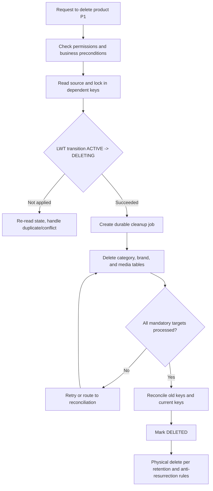
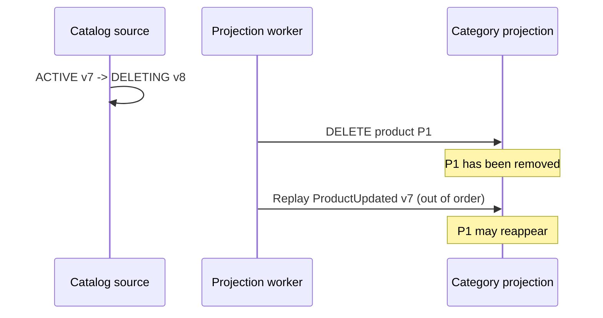

# Deleting Canonical Data and Handling Dependent Records in Apache Cassandra

## Learning Objectives

In the **Relationships and Denormalization** chapter, an entity can be stored across multiple Apache Cassandra tables to serve different queries. When the canonical entity is deleted, related records **do not automatically vanish**: lookup tables, child data, historical rows, pending events, and even stale late-arriving writes may remain.

After this lesson, you will be able to:

- Classify data that **must be deleted**, **only needs to be hidden/deactivated**, **must be retained for history**, or **requires separate retention handling**.
- Explain why Cassandra lacks `FOREIGN KEY`, `ON DELETE CASCADE`, and multi-table transactions with rollback/isolation like an RDBMS.
- Design a workflow of **soft delete → halt new writes → delete derived tables and child data → reconcile → physically delete when eligible**.
- Practice CQL with a canonical source table, category/brand tables, and a child table partitioned by parent ID.
- Understand the roles of **tombstones**, TTL, compaction, repair, replication, and consistency levels during deletion.
- Use the Java Driver to implement a retryable cleanup worker while preventing stale events from resurrecting deleted records.

## 1. Problem: Deleting a Product Leaves Data in Multiple Places

Suppose an e-commerce system has four access paths:

| Table or Store | Purpose | Relationship to Canonical Product |
| --- | --- | --- |
| `products_by_id` | Read details by `product_id` | Catalog canonical source table in this example |
| `products_by_category_month` | Product list by category and month | Derived copy duplicating name, price, status |
| `products_by_brand_month` | Product list by brand and month | Second derived copy |
| `product_media_by_product` | Product images/media metadata | Child data with lifecycle dependent on product |
| `order_items_by_order` | Purchased products in historical orders | Transactional data with separate retention obligations |

An administrator requests to "delete product P1 from Catalog." Running only:

```sql
DELETE FROM products_by_id
WHERE product_id = 11111111-1111-4111-8111-111111111111;
```

means Cassandra **does not automatically delete** P1 from category/brand tables, does not delete product images, and does not check whether any order lines reference P1. This stems directly from Cassandra's model: independent logical tables optimized by **partition key** and **clustering columns**, with no foreign keys or general `JOIN` like a relational database management system.

When a user opens a category page, P1 may still appear even though looking up `products_by_id` returns nothing. Conversely, if the application deletes the category copy first and fails before deleting the source, the list page hides P1 while the detail page still shows it. Such transitional states must be designed for and monitored rather than treated as unexpected surprises.

### Replication Differs from Dependent Records

Cassandra **replication** stores replicas of **the same data in a table/partition** according to the keyspace's replication factor. **Query-driven duplicated data** lives in separate logical tables created by the application. Deleting a row in `products_by_id` is propagated by Cassandra to replicas of that data on the write path, yet **never emits** a matching `DELETE` to `products_by_category_month`.

## 2. Define "Delete" in Business Contracts Before Writing CQL

The word "delete" carries several distinct meanings:

| Requirement | Example | Common Approach |
| --- | --- | --- |
| Stop appearing in Catalog | Discontinued product | Transition to `RETIRED` or `DELETING`; exclude from public read paths |
| Remove search/browse copies | Product removed | Delete rows in category, brand, lookup index tables, and caches if any |
| Delete lifecycle-dependent child data | Thumbnails, media metadata owned solely by product | Delete by `product_id`; also trigger object storage file deletion if applicable |
| Preserve valid transaction history | An order purchased the product before removal | Keep historical price/name snapshot at purchase time per policy; do not cascade blindly |
| Erase sensitive data per user/legal request | Personal data in a product, file, or copy | Inventory all storage locations; control derived data, caches, backups, and retention windows |
| Physical deletion after retention period | Source info no longer permitted/needed | Delete source row once retention conditions and cleanup evidence are satisfied |

**Never assume every child relationship must cascade-delete.** Product images may depend completely on the product, whereas a paid order is a distinct business entity. An order line can store `product_id` for reference alongside `product_name_at_purchase` and `unit_price_at_purchase` so history does not depend on Catalog later.

### Three Questions Defining Deletion Scope

1. **Who owns each fact?** Catalog decides Catalog status; Order owns order history; a Media service may own physical files.
2. **Which data can be rebuilt from the canonical source?** Category/brand tables are projections; they need cleanup workflows and anti-resurrection guards against stale events.
3. **After deletion, which queries are allowed to return results?** Search pages must hide the product; invoice pages may retain valid purchase info; admin APIs may inspect `DELETING` status until cleanup finishes.

## 3. Designing Tables and Keys for Cleanup

Assume the `shop` keyspace is created with appropriate replication; the statements below use CQL:

```sql
USE shop;

CREATE TABLE products_by_id (
    product_id uuid PRIMARY KEY,
    category_id uuid,
    brand_id uuid,
    published_at timestamp,
    publish_month date,
    name text,
    price decimal,
    currency text,
    lifecycle_status text,
    lifecycle_version bigint,
    deleted_at timestamp
);

CREATE TABLE products_by_category_month (
    category_id uuid,
    publish_month date,
    published_at timestamp,
    product_id uuid,
    name text,
    price decimal,
    currency text,
    PRIMARY KEY ((category_id, publish_month), published_at, product_id)
) WITH CLUSTERING ORDER BY (published_at DESC, product_id ASC);

CREATE TABLE products_by_brand_month (
    brand_id uuid,
    publish_month date,
    published_at timestamp,
    product_id uuid,
    name text,
    price decimal,
    currency text,
    PRIMARY KEY ((brand_id, publish_month), published_at, product_id)
) WITH CLUSTERING ORDER BY (published_at DESC, product_id ASC);

-- Assume media is a reasonably bounded subset per product.
CREATE TABLE product_media_by_product (
    product_id uuid,
    media_id uuid,
    object_key text,
    content_type text,
    PRIMARY KEY ((product_id), media_id)
);
```

**How keys affect deletion:**

- `products_by_id`: knowing `product_id` suffices to delete a source row.
- `products_by_category_month`: to delete the exact row, you need **all** of `category_id`, `publish_month`, `published_at`, and `product_id`.
- `products_by_brand_month`: similarly requires `brand_id` instead of `category_id`.
- `product_media_by_product`: because its partition key is `product_id`, you can delete all media rows for a product with a partition delete, or delete individual `media_id` rows when granular tracking is required.

You cannot pass only `product_id` to `DELETE` on `products_by_category_month` and expect Cassandra to locate every category automatically. A query lacking its partition key violates efficient access-path design. If a product can appear in **multiple categories simultaneously**, the system also needs the complete list of created derived keys to clean up thoroughly.

**Partition limits:** monthly buckets shrink category/brand lists, yet a category with millions of products in one month can still create a large partition. A product's media set must also stay bounded; deleting a massive partition can trigger heavy tombstones and compaction/read overhead. Design buckets, partition sizes, and pagination policies based on real workloads.

## 4. Preparing Data and Inspecting Dependency Scope

Suppose P1 belongs to category `2222...`, brand `3333...`, published in November 2026:

```sql
INSERT INTO products_by_id (
    product_id, category_id, brand_id, published_at,
    publish_month, name, price, currency,
    lifecycle_status, lifecycle_version
) VALUES (
    11111111-1111-4111-8111-111111111111,
    22222222-2222-4222-8222-222222222222,
    33333333-3333-4333-8333-333333333333,
    '2026-11-21T01:00:00Z',
    '2026-11-01', 'Mechanical keyboard', 750000.00, 'VND',
    'ACTIVE', 7
);

INSERT INTO products_by_category_month (
    category_id, publish_month, published_at,
    product_id, name, price, currency
) VALUES (
    22222222-2222-4222-8222-222222222222,
    '2026-11-01', '2026-11-21T01:00:00Z',
    11111111-1111-4111-8111-111111111111,
    'Mechanical keyboard', 750000.00, 'VND'
);

INSERT INTO products_by_brand_month (
    brand_id, publish_month, published_at,
    product_id, name, price, currency
) VALUES (
    33333333-3333-4333-8333-333333333333,
    '2026-11-01', '2026-11-21T01:00:00Z',
    11111111-1111-4111-8111-111111111111,
    'Mechanical keyboard', 750000.00, 'VND'
);

INSERT INTO product_media_by_product
    (product_id, media_id, object_key, content_type)
VALUES (
    11111111-1111-4111-8111-111111111111,
    44444444-4444-4444-8444-444444444444,
    'catalog/p1/front.webp', 'image/webp'
);
```

Read the source table before deleting to capture the **keys requiring cleanup**:

```sql
SELECT category_id, brand_id, publish_month, published_at,
       lifecycle_status, lifecycle_version
FROM products_by_id
WHERE product_id = 11111111-1111-4111-8111-111111111111;

SELECT media_id, object_key
FROM product_media_by_product
WHERE product_id = 11111111-1111-4111-8111-111111111111;
```

This information must be **preserved safely in the deletion job context** or a durably persisted deletion event, because once the source row is physically deleted, no source row remains to look up `category_id`/`brand_id`. If the product ever moved categories, its current snapshot alone may be **insufficient** to locate orphaned rows in old categories; you then need key history, a ledger of created projections, or a controlled scan/reconciliation pass.

## 5. Recoverable Multi-Step Deletion Workflow

One organization pattern is a **state machine** owned by the Catalog service:

```text
ACTIVE -> DELETING -> DELETED -> PURGED (if policy permits)
             |
             +--> FAILED_RETRYABLE / requires operational intervention
```

State names are purely application conventions; Cassandra does not provide this workflow natively.

**Phase A — Mark and block new writes.**

1. Authenticate the requester and deletion reason; verify no business precondition is violated.
2. Read the source and capture complete keys of projections needing cleanup.
3. Use status/version checks as needed to transition `ACTIVE -> DELETING`.
4. Ensure other writers and workers **stop creating public records** from a record marked for deletion. This is an application rule; merely storing `DELETING` does not automatically halt an in-flight worker.

**Phase B — Clean up dependent data.**

1. Delete derived rows by category, brand, and any other designed lookup tables.
2. Delete lifecycle-dependent child data such as media metadata, while requesting the object storage service to remove corresponding files if in scope.
3. Retain or hide historical data per business rules and retention windows; never delete valid orders accidentally.
4. Track per-target outcomes and perform bounded retries on errors/timeouts.

**Phase C — Verify and finalize.**

1. Reconcile mandatory targets; clean up leftover copies under old keys.
2. Transition `DELETING -> DELETED` only once agreed completion criteria are satisfied.
3. After the retention period or when permitted, physically delete the source and metadata needed only for the deletion workflow.
4. Ensure a mechanism still **prevents stale events from recreating data** after the source is deleted—such as a minimal deletion ledger retained long enough or non-reusable ID lifecycle rules.



The diagram represents a **business workflow**, without claiming that writing the source and enqueuing work in a broker or external system is atomic. If a process crashes after transitioning to `DELETING` but before publishing the event, a scanner over a trusted ID source or durable event-publishing mechanism must recover stuck `DELETING` records.

## 6. Practical CQL: From Soft Delete to Projection Cleanup

### 6.1. Transitioning State with Conditional Writes

```sql
UPDATE products_by_id
SET lifecycle_status = 'DELETING',
    lifecycle_version = 8,
    deleted_at = '2026-11-21T03:00:00Z'
WHERE product_id = 11111111-1111-4111-8111-111111111111
IF lifecycle_status = 'ACTIVE' AND lifecycle_version = 7;
```

This is a **lightweight transaction (LWT)**. The application must inspect `[applied]`:

- `true`: the request transitioned state at version 8.
- `false`: status/version changed or data did not meet the condition. Re-read the source rather than proceeding with stale keys.
- On timeout: **do not assume the command definitely failed**; re-read state and resolve using the deletion request ID.

Convention: any change to `category_id`, `brand_id`, `publish_month`, `published_at`, or lifecycle status must increment `lifecycle_version` per Catalog rules. If a writer mutates keys without incrementing the version, reading keys then transitioning state cannot guard the race window.

### 6.2. Deleting Category and Brand Rows

```sql
DELETE FROM products_by_category_month
WHERE category_id = 22222222-2222-4222-8222-222222222222
  AND publish_month = '2026-11-01'
  AND published_at = '2026-11-21T01:00:00Z'
  AND product_id = 11111111-1111-4111-8111-111111111111;

DELETE FROM products_by_brand_month
WHERE brand_id = 33333333-3333-4333-8333-333333333333
  AND publish_month = '2026-11-01'
  AND published_at = '2026-11-21T01:00:00Z'
  AND product_id = 11111111-1111-4111-8111-111111111111;
```

These statements clean up only **the two known tables**. In a system with `products_by_seller`, `product_id_by_slug`, or other search tables, **every read path is a target to consider**. Maintain a deletion-event → affected-tables mapping in operational documentation so new features do not get missed.

### 6.3. Deleting Child Data

For `product_media_by_product`, which holds only product-dependent media metadata, a partition delete can be used:

```sql
DELETE FROM product_media_by_product
WHERE product_id = 11111111-1111-4111-8111-111111111111;
```

This statement does not delete `catalog/p1/front.webp` in object storage. The application must coordinate with the file-storage service and track file-cleanup status. If failure recovery is needed, do not discard the `object_key` list before object cleanup completes or is durably recorded.

Deleting by partition key is not a free way to erase unbounded data. When child row counts are very large, evaluate partition size, tombstone cost, compaction, response times, and splitting work into checkpointed batches.

### 6.4. Marking Completion After Cleanup

```sql
UPDATE products_by_id
SET lifecycle_status = 'DELETED',
    lifecycle_version = 9
WHERE product_id = 11111111-1111-4111-8111-111111111111
IF lifecycle_status = 'DELETING' AND lifecycle_version = 8;
```

Execute this only once mandatory steps have completed per contract. It is not proof that every replica has compacted and physically purged the data; `DELETED` is a business status meaning **no longer displayed / no longer accepts new writes**. When and how to permanently erase data must be handled separately.

### 6.5. Physically Deleting the Source When Eligible

```sql
-- Illustrates deletion after completing workflow and retention.
-- Do not run immediately after DELETING if source data is still needed
-- for reconciliation or recovering deletion events.
DELETE FROM products_by_id
WHERE product_id = 11111111-1111-4111-8111-111111111111;
```

Never use `TRUNCATE` to delete a single product: that is a whole-table administrative operation, not a per-ID cascade. Do not purge anti-resurrection metadata too early if event replays or backfill jobs might recreate P1.

## 7. How Soft Delete, TTL, Tombstones, and Physical Delete Differ

### 7.1. Soft Delete Is an API Contract, Not a CQL DELETE

When `lifecycle_status = 'DELETING'` or `'DELETED'`, the source row can still exist. Public APIs must explicitly check that status; CQL does not hide rows automatically based on such a status column. For example:

```sql
SELECT lifecycle_status, name, price
FROM products_by_id
WHERE product_id = 11111111-1111-4111-8111-111111111111;
```

If the application still returns name/price simply because `SELECT` returned a row, soft delete fails its business purpose. In list tables lacking a lifecycle column or awaiting projection cleanup, the product may also remain visible briefly. Weigh the consistency contract: hiding immediately via read-layer source checks can raise read cost, whereas asynchronous projection deletion carries measurable lag.

### 7.2. Tombstones Are Deletion Markers at the Storage Layer

Cassandra uses **tombstones** to represent deletions. Deleting a row, cell, partition, or letting TTL expire leaves tombstones; data is not necessarily removed immediately from SSTables on disk. Compaction can purge old data and tombstones once safety conditions are met, involving configuration, SSTables, repair, and grace periods.

Do not blindly lower `gc_grace_seconds` to `0` to "delete faster": doing so raises the risk of **zombie data** if a replica missed the delete and later returns with stale data after the tombstone has been purged. Full repair schedules, topology, downtime, and Cassandra version guide safe operational settings.

### 7.3. TTL Is Time-Based Expiration, Not a Cascade

TTLs can be used for short-lived data, but:

- A TTL on `products_by_id` does not automatically apply to `products_by_category_month` or media tables.
- Mismatched TTLs between source and derived tables can create orphaned rows or lose source data needed for reconciliation.
- If source data expires before the cleanup job captures old keys, the system may lose the ability to determine which rows to delete.
- Never use TTL as a substitute for sensitive-data erasure policies across caches, object storage, backups, or other systems.

**Repair** among replicas of the same table maintains storage-replica consistency; it **does not automatically infer** that a product deleted at the source must be deleted from category/brand tables. That belongs to **application-layer logical reconciliation**.

### 7.4. Replication and Consistency Levels Do Not Replace Workflows

Assume replication factor 3 in one datacenter. `LOCAL_QUORUM` generally requires two replicas to acknowledge an operation in that datacenter (given matching topology). It improves write visibility for **the same data**, yet does not turn three `DELETE` statements across three tables into an atomic transaction.

A `LOGGED BATCH` helps ensure mutations inside the batch are eventually applied after certain errors, yet offers no isolation or rollback like an RDBMS; multi-partition batches also increase overhead. It does not handle object-storage file deletes, cache invalidation, event queues, or distinguishing retained order history. Never use batches to mask an unclear business workflow.

## 8. Preventing Data "Resurrection" from Stale Writes or Late Events

A serious bug is **resurrection**: a product was removed from the category table, yet a consumer processes an old `ProductUpdated` event and `INSERT`s P1 back into the category table. This can happen due to a late-arriving event, an uncontrolled retry, or a backfill job using an old snapshot.



**A CQL tombstone does not automatically block resurrection by future writes.** If a worker issues a new mutation with a timestamp beating the tombstone, the data can be recreated. Raising read/write consistency levels does not solve stale-event logic.

### Layers of Defense

1. **Per-entity monotonically increasing version:** events carry `product_id`, `lifecycle_version`, source status, and old/new keys. Process in order, refusing events with versions older than the accepted deletion version.
2. **Lifecycle status blocks new creation:** once source is in `DELETING/DELETED`, application write paths must refuse creating public projections; workers must obey the same contract.
3. **Single processing owner per `product_id`:** control parallel consumers, retries, and failover. Reading a checkpoint then doing an unconditional write is not a distributed lock.
4. **Deletion ledger or appropriately scoped marker:** keep a record of "P1 deleted at v8" in a trusted source long enough to block stale replays/backfills, even after the Catalog row is physically deleted. Do not retain personal data indefinitely just to block replays; consider non-reusable IDs, scope, and minimal-metadata retention rules.
5. **Post-error reconciliation:** detect leftover rows in old categories/brands, wrong new keys, lingering media, or resurrected states.

**Limitation:** checking version in a separate progress table and then writing projections unconditionally still races if multiple workers or a backfill job bypass that mechanism. You need serialization/fencing, or suitable conditional writes and a reconciliation plan. LWT on a single row does not create a cross-table/cross-partition transaction.

## 9. Java Driver: A Retryable Deletion Worker

The example below uses **Apache Cassandra Java Driver 4.x**. The Catalog service has accepted the deletion request, transitioned the source to `DELETING`, and created a durable job carrying **full old keys**. This worker processes one product sequentially, with no other writer permitted to restore the product to `ACTIVE` until completion.

The snippet focuses on **deleting three Cassandra targets** and confirming `DELETED` status. Object-storage deletion, pagination for huge child sets, and broker/retry-queue plumbing must be implemented separately.

```java
import com.datastax.oss.driver.api.core.CqlSession;
import com.datastax.oss.driver.api.core.cql.PreparedStatement;
import com.datastax.oss.driver.api.core.cql.ResultSet;
import com.datastax.oss.driver.api.core.cql.Row;

import java.time.Instant;
import java.time.LocalDate;
import java.util.UUID;

public final class ProductDeletionWorker {
    public record DeleteJob(
        UUID productId,
        UUID categoryId,
        UUID brandId,
        LocalDate publishMonth,
        Instant publishedAt,
        long deletingVersion
    ) {}

    private final CqlSession session;
    private final PreparedStatement loadSource;
    private final PreparedStatement deleteCategory;
    private final PreparedStatement deleteBrand;
    private final PreparedStatement deleteMedia;
    private final PreparedStatement markDeleted;

    public ProductDeletionWorker(CqlSession session) {
        this.session = session;
        loadSource = session.prepare(
            "SELECT lifecycle_status, lifecycle_version " +
            "FROM products_by_id WHERE product_id = ?");
        deleteCategory = session.prepare(
            "DELETE FROM products_by_category_month WHERE " +
            "category_id = ? AND publish_month = ? AND " +
            "published_at = ? AND product_id = ?");
        deleteBrand = session.prepare(
            "DELETE FROM products_by_brand_month WHERE " +
            "brand_id = ? AND publish_month = ? AND " +
            "published_at = ? AND product_id = ?");
        deleteMedia = session.prepare(
            "DELETE FROM product_media_by_product " +
            "WHERE product_id = ?");
        markDeleted = session.prepare(
            "UPDATE products_by_id " +
            "SET lifecycle_status = ?, lifecycle_version = ? " +
            "WHERE product_id = ? " +
            "IF lifecycle_status = ? AND lifecycle_version = ?");
    }

    public void handle(DeleteJob job) {
        Row source = session.execute(loadSource.bind(
            job.productId())).one();

        if (source == null) {
            throw new IllegalStateException(
                "Source not found; check deletion history");
        }
        if ("DELETED".equals(source.getString("lifecycle_status"))) {
            return; // Job already completed within this workflow scope.
        }

        String status = source.getString("lifecycle_status");
        long version = source.getLong("lifecycle_version");
        if (!"DELETING".equals(status)
                || version != job.deletingVersion()) {
            throw new IllegalStateException(
                "Source has changed; must not delete under old keys");
        }

        // Same key set from DeleteJob on every replay.
        session.execute(deleteCategory.bind(
            job.categoryId(), job.publishMonth(),
            job.publishedAt(), job.productId()));
        session.execute(deleteBrand.bind(
            job.brandId(), job.publishMonth(),
            job.publishedAt(), job.productId()));
        session.execute(deleteMedia.bind(job.productId()));

        // Mark complete only after mandatory CQL targets have been written.
        ResultSet result = session.execute(markDeleted.bind(
            "DELETED", job.deletingVersion() + 1,
            job.productId(), "DELETING", job.deletingVersion()));
        if (!result.wasApplied()) {
            throw new IllegalStateException(
                "Could not confirm DELETING -> DELETED transition");
        }

        // Orchestration layer ACKs only after all targets, including object storage
        // if mandatory, have been processed per contract and verified.
    }
}
```

### Interpreting the Java Example Correctly

- `DeleteJob` retains the original `category_id`, `brand_id`, `publish_month`, and `published_at` to delete by exact keys; no `ALLOW FILTERING` query is needed.
- `handle` checks status/version before executing work. Because that is **read-then-write**, the check itself does not lock the source against concurrent mutation; the example **assumes single-stream ownership and that `DELETING` cannot be reverted**. If those assumptions fail, add tighter fencing and orchestration.
- `DELETE` statements with the same keys can be retried on timeout; yet a timeout does not prove the prior attempt failed. Keep IDs and keys stable, bound retries, and track incomplete targets.
- If one target fails, `markDeleted` has not run yet. If a timeout occurs after `markDeleted` applied, the next invocation reads `DELETED` and treats the CQL portion as handled—**provided** the system forbids marking `DELETED` before all mandatory targets finish.
- This snippet **does not protect against** another worker using a stale event to re-insert the product after deletion. Blocking resurrection belongs at the system-wide boundary described earlier.
- In production, maintain a job/ledger tracking per-target status when object storage, caches, search indexes, or multiple projections are involved, rather than ACKing based solely on Cassandra deletes.

## 10. Historical Tables: Do Not Accidentally Delete Independent Records

A paid order may need to keep an item snapshot at **purchase time**. For example:

```sql
CREATE TABLE order_items_by_order (
    order_id uuid,
    line_no int,
    product_id uuid,
    product_name_at_purchase text,
    quantity int,
    unit_price_at_purchase decimal,
    currency text,
    PRIMARY KEY ((order_id), line_no)
);
```

To open an invoice after the product has been removed from Catalog:

```sql
SELECT product_name_at_purchase, quantity,
       unit_price_at_purchase, currency
FROM order_items_by_order
WHERE order_id = 55555555-5555-4555-8555-555555555555;
```

This table **does not use `product_id` as its partition key**, because the primary read path is order details by `order_id`. Deleting product P1 is **not a default reason** to delete order lines containing P1. If legal/privacy contracts require handling certain data copied into history, that is a separate policy problem defining what is retained, anonymized, or erased by authority. Without foreign keys, Cassandra also does not know `order_items_by_order.product_id` points to a deleted product.

**Design note:** if a requirement asks to find all orders by `product_id` for a product recall or data erasure, you cannot assume scanning `order_items_by_order` by `product_id` is efficient. You need a product-keyed lookup table or an appropriate offline processing system, paired with consistency and access policies.

## 11. Testing Deletion Under Failures and Concurrent Updates

Testing only the happy-path deletion is insufficient. Simulate the following scenarios in a test environment:

| Scenario | Expected Outcome |
| --- | --- |
| Delete source first, forget projections | Orphaned rows detected; never assume source delete cascades |
| Transition `ACTIVE -> DELETING`, worker crashes | Durable mechanism detects incomplete job and retries |
| Category delete succeeds, brand delete times out | Retry with same keys; do not mark `DELETED` prematurely |
| Media metadata deleted while object storage file remains | Overall deletion not marked complete if file cleanup is mandatory |
| `ProductUpdated v7` event arrives after delete event v8 | P1 is not recreated in category table |
| Product moved from category C to D before deletion | Checks and cleans up any leftover orphaned row in C |
| Reader opens list while cleanup is running | Matches transitional/lag contract; disallows purchasing removed item |
| Delete large media partition | Evaluates tombstones, timeouts, and compaction impact |
| Replica absent during deletion | Verifies repair policy and avoids premature tombstone purge |
| Deletion job delivered twice | Safe retry without corrupting data or repeating external side effects |
| Source purged while backfill job still runs old snapshot | Job does not resurrect deleted record |
| `TRUNCATE` confused with single-ID delete | Tests/procedures block whole-table destructive commands |

### Metrics and Alerts to Monitor

| Metric | Meaning |
| --- | --- |
| `deletion_jobs_pending` | Number of products awaiting cleanup; is it growing steadily? |
| `deletion_age_seconds` | Age of the oldest incomplete deletion job |
| `projection_orphan_count` | Rows remaining in derived tables despite deleted/retired source |
| `cleanup_failures_by_target` | Which target fails most: category, brand, media, cache, object storage? |
| `late_event_rejection_count` | How many stale events were blocked after deletion? |
| `reconciliation_repaired_rows` | How many missing/extra rows did reconciliation fix? |
| `tombstone_read_warnings` | Are queries impacted by tombstones? |
| `compaction_backlog`, `repair_status` | Is the cluster keeping up with deletion load and replica sync policy? |
| `privacy_retention_overdue` | Is any policy-mandated deletion past its deadline? |

Depending on workload, also track p95/p99 `DELETE` latency, affected partition counts, end-to-end completion time, retry rates, and old snapshots remaining after purge.

## 12. Practice Exercise: Deleting a Course and Enrollment Relationships

An online learning system has:

- `courses_by_id`: canonical course information.
- `courses_by_category`: derived lookup table by category.
- `lessons_by_course`: course-dependent lessons keyed by `course_id`.
- `enrollment_state_by_student`: canonical enrollment business state.
- `active_enrollments_by_course`: list of learners in a course.
- `certificates_by_student`: certificates issued to learners under a separate retention policy.

Requirement: course C1 is unpublished and, after a grace period, may be physically deleted.

**Questions:**

1. Which tables must be removed immediately from public read paths, which should only be hidden/stop accepting updates, and which must not be deleted by default?
2. When deleting a row from `courses_by_id`, does Cassandra automatically delete `lessons_by_course` or `active_enrollments_by_course`? Why?
3. If a course is very large, what operational issues can deleting an entire `lessons_by_course` partition cause?
4. Which keys and metadata must a `CourseDeleted` event carry so a worker can delete old categories and dependent relationships?
5. A consumer is still processing an old `CoursePublished` event after deletion. Propose safeguards to prevent the course from reappearing.
6. If regulations require retaining certificates and enrollment history, how should historical data be stored without querying back to a deleted course?
7. Design a background job to reconcile orphaned records across the course source, category table, and enrollment tables.

**Suggested direction:**

- Transition the course to `RETIRED/DELETING` to block new registrations; remove public category copies and handle lessons per lifecycle. Certificates/enrollment history may need retention with finalized metadata, depending on policy.
- There is no `ON DELETE CASCADE` across Cassandra tables. All derived copies and child sets are cleaned up via application-issued operations.
- Large partitions, tombstones, and compaction can degrade deletes/reads; design bucketing and rate-limited cleanup.
- The deletion event needs `course_id`, before/after categories if applicable, required clustering keys, source version, and deletion status. If enrollment links have distinct keys, the job also needs a query path or ID source to identify affected links.
- Block stale events by version and business tombstone status; consumers must preserve ordering or use fencing/reconciliation.
- Store snapshots of course title, completion timestamp, certificate ID, or required fields in historical tables; never rely solely on a Catalog row that may be purged.
- Reconcile across trusted ID sets with checkpointing and throttling; distinguish data needing cleanup from valid data requiring retention.

## Summary

In Cassandra, **deleting canonical data does not mean deleting all dependent data**. Without `JOIN`, foreign keys, or automatic cross-table cascades, systems need explicit models for **canonical source, derived representation tables, child datasets, independent history, and external stores**. A reliable workflow typically marks deletion status to block new writes, captures full old keys, deletes target copies via retryable jobs, reconciles outcomes, and only then physically deletes per policy.

At the same time, understand that **soft delete, CQL DELETE, tombstones, TTL, compaction, and repair** each serve distinct roles. Consistency levels and logged batches do not turn multiple tables into an ACID transaction with rollback/isolation. When stale events or delayed backfills run, use **versioning, ownership boundaries, deletion markers, per-key processing, and reconciliation** to prevent records from reappearing. A complete deletion design protects **business correctness, recoverability, distributed performance, and privacy**.
