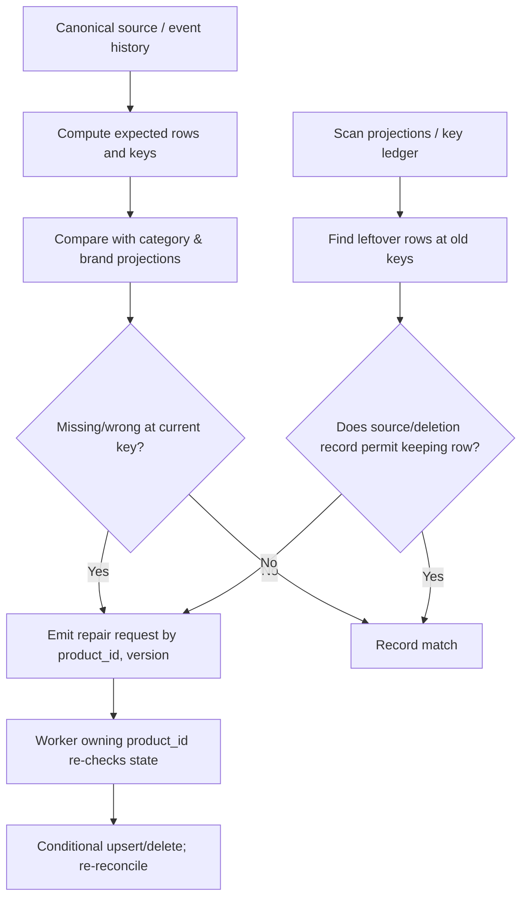

# Reconciling, Rebuilding Read Tables, and Repairing Divergence in Apache Cassandra

## Learning Objectives

In the **Relationships and Denormalization** chapter, Cassandra commonly stores an entity in multiple shapes to serve distinct queries. When derived tables are missing rows, hold stale values, retain leftover rows after key moves, or suffer corruption after a deployment, the system must know **what serves as truth, how to detect divergence, and how to repair without introducing new divergence**.

After this lesson, you will be able to:

1. Distinguish **reconciliation** (logical comparison across tables), **Cassandra repair** (replica synchronization), and **rebuild/backfill** (reconstructing a read table from source).
2. Identify **missing, extra, wrong-value, wrong-version, wrong-key, and wrong-deletion-state** rows and classify them by business impact.
3. Design a canonical source table, query-driven read tables by partition key, and progress-tracking metadata to support inspection and recovery.
4. Implement bidirectional reconciliation and key-based repairs in CQL and the Java Driver with concurrent-write controls.
5. Plan rebuilding a large read table via **new table + backfill + change replay + verification + cutover**; state the conditions required to avoid losing live updates.
6. Measure lag, drift rate, repair status, and compaction/repair overhead during data recovery.

## 1. Why Reconcile Even When Writes Use Retries?

Apache Cassandra distributes rows by **partition key** and orders them using **clustering columns**. Because there is no `JOIN` or foreign key like in a relational database, applications typically create multiple tables for distinct read paths.

For example, a Catalog service needs:

- `products_by_id` to open details by `product_id`.
- `products_by_category_month` to fetch the 20 newest products in a category by month.
- `products_by_brand_month` to fetch the 20 newest products of a brand by month.

The application duplicates `name`, `price`, and `currency` into the list tables. When Catalog raises a price, both derived tables must reflect the new price within the agreed lag contract. However:

- The source write succeeded, while fan-out to the category table timed out.
- A version 8 event arrived after version 9 and was applied out of order.
- A product moved categories; the row in the old category partition was never deleted.
- A consumer wrote one table and crashed before writing the second.
- A backfill job used an old snapshot and overwrote newer state.
- After physically deleting the source, a derived row lingered or was resurrected by an old event.

**Retries help recover from transient failures, yet are insufficient to prove all projections are correct.** After a timeout, the application may not know whether replicas received the mutation. After software bugs, events missing fields, or skipped batches, there is no guarantee a pending retry always exists.

Therefore, two complementary mechanisms are required:

- **Reconciliation:** determine expected state from the authoritative source, compare against read copies, and repair missing/wrong rows.
- **Rebuild:** reconstruct a derived table or data slice from a trusted source, typically for major incidents or schema/key changes.

### Distinguishing Cassandra Repair from Logical Repair

| Mechanism | What Does It Compare? | Helps Fix | Does Not Solve Automatically |
| --- | --- | --- | --- |
| **Replication** | Multiple replicas of the same data | Availability when a node fails | Whether two logical tables hold the same business content |
| **Cassandra repair** | Data across replicas of the same table/partition | Replica divergence and storage-level sync issues | Recomputing `products_by_category_month` from `products_by_id` |
| **Application reconciliation** | Canonical source vs. derived tables; logical keys and versions | Missing/extra rows, stale fields, uncleaned key moves, unpurged deletes | Providing atomic cross-table transactions |
| **Rebuild/backfill** | New table needing population from source data/event history | Widespread corruption, building v2 table, adding query paths | Handling updates occurring **during** the backfill |

**Clear boundary:** running `nodetool repair` or setting `LOCAL_QUORUM` does not make Cassandra understand that a category table is a query-driven copy of a source table. Projection and reconciliation rules belong at the application layer.

## 2. Canonical Source Convention and Individual Read-Table Contracts

Start by specifying **who has authority to decide true values**. In this example, Catalog owns `category_id`, `brand_id`, `name`, `price`, `currency`, `published_at`, and `lifecycle_status`. A product can be viewed via two read paths, yet both are strictly **projections**.

| Item | Canonical Source `products_by_id` | Category Table | Brand Table |
| --- | --- | --- | --- |
| Lookup key | `product_id` | `(category_id, publish_month)` | `(brand_id, publish_month)` |
| Ordering | Not required | `published_at DESC`, `product_id` | `published_at DESC`, `product_id` |
| Displayed fields | All Catalog fields | `name`, `price`, `currency` | `name`, `price`, `currency` |
| Metadata fields | `source_version`, `lifecycle_status` | `source_version` | `source_version` |
| On change | Source business workflow updates | Re-project from source | Re-project from source |
| On delete/key move | Retain valid status/record per policy | Delete old key row; add new key if active | Same |
| On discrepancy | Basis for deciding valid values in example | Repaired from source | Repaired from source |

Cassandra **never automatically designates** a table as canonical. The authoritative source may live in another service or an event log. If true ownership sits outside Cassandra, reconciliation must pull facts from that source rather than treating any arbitrary Cassandra table as truth.

A derived table is **rebuildable** when enough data and rules remain to reconstruct every valid row, including **deletion rules**. If the source was wiped without business tombstone metadata or history, determining that a projection row is orphaned can be non-trivial.

## 3. Designing a CQL Schema for a Reconciliation Scenario

Assume the `shop` keyspace is configured with appropriate replication. The tables below serve primarily to illustrate the workflow, not as a single universal schema for every application.

```sql
USE shop;

-- Canonical product state in the Catalog service.
CREATE TABLE products_by_id (
    product_id uuid PRIMARY KEY,
    category_id uuid,
    brand_id uuid,
    publish_month date,
    published_at timestamp,
    name text,
    price decimal,
    currency text,
    source_version bigint,
    lifecycle_status text
);

-- Projection by category and month.
CREATE TABLE products_by_category_month (
    category_id uuid,
    publish_month date,
    published_at timestamp,
    product_id uuid,
    name text,
    price decimal,
    currency text,
    source_version bigint,
    PRIMARY KEY ((category_id, publish_month), published_at, product_id)
) WITH CLUSTERING ORDER BY (published_at DESC, product_id ASC);

-- Projection by brand and month.
CREATE TABLE products_by_brand_month (
    brand_id uuid,
    publish_month date,
    published_at timestamp,
    product_id uuid,
    name text,
    price decimal,
    currency text,
    source_version bigint,
    PRIMARY KEY ((brand_id, publish_month), published_at, product_id)
) WITH CLUSTERING ORDER BY (published_at DESC, product_id ASC);

-- Progress of the projection update stream; does not replace canonical source.
CREATE TABLE projection_progress_by_product (
    product_id uuid PRIMARY KEY,
    applied_version bigint,
    updated_at timestamp
);
```

In this lesson, `publish_month` is the first day of the UTC month derived from `published_at`. Unless a dedicated key-migration workflow exists, assume `published_at` is immutable after publication.

**Why are these keys critical for repair?**

- Reading the source by `product_id` is a partition-key query.
- Reading or repairing the category projection requires all of `category_id`, `publish_month`, `published_at`, and `product_id`.
- Reading or repairing the brand projection requires `brand_id` instead of `category_id`.
- You cannot take `product_id` and ask Cassandra to find every matching row in a category-partitioned table without an appropriate access path.
- A product that moved categories multiple times may have **leftover rows under old keys** no longer present in the current source record.

Reconciliation therefore involves two distinct problems: **fixing rows at current keys** and **finding/removing old keys created previously**.

### Model for Tracking Previously Projected Keys (Optional)

When key changes can occur, a system can maintain a *ledger* recording every projection key **intended to be written**, before sending the write to the target table:

```sql
CREATE TABLE projection_keys_by_product (
    product_id uuid,
    view_name text,
    target_partition_id uuid,
    publish_month date,
    published_at timestamp,
    last_attempted_version bigint,
    PRIMARY KEY (
        (product_id),
        view_name, target_partition_id, publish_month, published_at
    )
);
```

For example, `view_name = 'category'` or `'brand'`; `target_partition_id` is `category_id` or `brand_id`. When updating a projection, the worker records the target key in the ledger **before** upserting the target table. A ledger entry whose target row was never written simply causes a harmless check/delete; conversely, writing a projection without recording the key to delete later is a much harder gap to detect.

**Limitation to remember:** this ledger works only if **every writer obeys** the key-recording rule, and retry/recovery flows also clean up partially started entries. The ledger does not turn multi-table writes into a transaction. For data with millions of key moves, the ledger can grow large and need retention/partition splitting or replacement by event history. Scanning projections by key to spot anomalies remains valuable as an independent verification layer.

## 4. Classifying Divergence Before Repairing

Never reduce reconciliation to "whenever different, run UPDATE," because different divergences require different actions.

| Divergence Type | Example | Authoritative Basis | Handling Direction |
| --- | --- | --- | --- |
| **Missing projection** | Source has P1 ACTIVE, brand table has no row | Current source snapshot, expected keys | Insert row with proper keys/version |
| **Stale value** | Source has price 790,000 VND at v7, category table still 750,000 VND at v6 | Source price, status, and version | Apply new snapshot with concurrency guards |
| **Unexpected projection** | Category table has P1 while source is DELETED | Source deletion marker retained per policy | Delete read row per policy |
| **Wrong partition key** | P1 moved C1 → C2 yet still appears in C1 | Key/event history, ledger, reverse scan | Clean up C1; ensure C2 is accurate |
| **Version ahead of source** | Projection at v9 while read source is v8 | Race, stale source read, write bug, or wrong source | Do not overwrite v9 with v8; inspect source, pipeline, and consistency |
| **Partial projection** | Brand table wrote v7, category table still at v6 | Target-table and version tracking | Retry or reconcile missing target |
| **Schema mismatch** | v2 read table missing newly added field | Projection/schema contract | Backfill/re-run projection under matching schema version |
| **Unknown source** | Projection exists while source is not found | Could be purge, TTL, valid delete, or bug | Check deletion records; never conclude from one `SELECT` alone |

In a system with an acceptable sync-lag window, observing a v6 projection right after the source reached v7 **is not necessarily an error**. Distinguish:

- **Within normal sync lag:** event v7 is still within SLA; no immediate hotfix needed.
- **Overdue lag:** v7 failed to reach the projection past threshold; schedule repair.
- **Hard divergence:** deleted source resurrected in projection, forgotten old key lingering long-term, or projection version anomalously ahead.

### Severity Levels

A category page showing an old price may be a UX flaw; a payment decision based on an old price can be a financial bug. Reconciliation can restore display consistency, yet **you must never rely on a repaired projection to validate a prior payment transaction**. Decision paths must use the authoritative service or transactional snapshot.

## 5. Illustrative CQL for Detecting and Repairing Divergence

Insert canonical source P1 with price 790,000 VND at version 7; intentionally leave stale v6 data in the category table and nothing in the brand table:

```sql
INSERT INTO products_by_id (
    product_id, category_id, brand_id, publish_month, published_at,
    name, price, currency, source_version, lifecycle_status
) VALUES (
    11111111-1111-4111-8111-111111111111,
    22222222-2222-4222-8222-222222222222,
    33333333-3333-4333-8333-333333333333,
    '2026-11-01', '2026-11-21T01:00:00Z',
    'Mechanical keyboard', 790000.00, 'VND', 7, 'ACTIVE'
);

INSERT INTO products_by_category_month (
    category_id, publish_month, published_at, product_id,
    name, price, currency, source_version
) VALUES (
    22222222-2222-4222-8222-222222222222,
    '2026-11-01', '2026-11-21T01:00:00Z',
    11111111-1111-4111-8111-111111111111,
    'Mechanical keyboard', 750000.00, 'VND', 6
);
```

Read canonical state:

```sql
SELECT category_id, brand_id, publish_month, published_at,
       name, price, currency, source_version, lifecycle_status
FROM products_by_id
WHERE product_id = 11111111-1111-4111-8111-111111111111;
```

Using the source's current keys, read each derived row:

```sql
SELECT name, price, currency, source_version
FROM products_by_category_month
WHERE category_id = 22222222-2222-4222-8222-222222222222
  AND publish_month = '2026-11-01'
  AND published_at = '2026-11-21T01:00:00Z'
  AND product_id = 11111111-1111-4111-8111-111111111111;

SELECT name, price, currency, source_version
FROM products_by_brand_month
WHERE brand_id = 33333333-3333-4333-8333-333333333333
  AND publish_month = '2026-11-01'
  AND published_at = '2026-11-21T01:00:00Z'
  AND product_id = 11111111-1111-4111-8111-111111111111;
```

Expected observation in this scenario: category is at v6 with the old price; brand has no row.

### 5.1. Repairing a Row with an Observed Version

If the worker controls processing order for P1 and just verified the category row is still at v6, it can use LWT to avoid overwriting a change **to that exact row** applied right after the check:

```sql
UPDATE products_by_category_month
SET name = 'Mechanical keyboard',
    price = 790000.00,
    currency = 'VND',
    source_version = 7
WHERE category_id = 22222222-2222-4222-8222-222222222222
  AND publish_month = '2026-11-01'
  AND published_at = '2026-11-21T01:00:00Z'
  AND product_id = 11111111-1111-4111-8111-111111111111
IF source_version = 6;
```

Consider the repair applied only when `[applied] = true`. If false, re-read both projection and source before deciding, rather than blindly retrying the same values.

**Important:** a condition on **the projection table** does not lock the source table. If P1 already moved to v8 at the source while the projection stayed at v6, updating the projection to v7 may succeed as an LWT yet remain **stale in business terms**. To prevent repairs from overwriting live consumers, **route repair requests through the same per-`product_id` ownership/serialization stream**, re-check the source at execution time, and enforce ordering constraints. Using LWT on both tables does not create an atomic cross-table transaction.

### 5.2. Inserting a Missing Row

If the brand projection has no row yet, a safer operation than a plain insert under creation races is:

```sql
INSERT INTO products_by_brand_month (
    brand_id, publish_month, published_at, product_id,
    name, price, currency, source_version
) VALUES (
    33333333-3333-4333-8333-333333333333,
    '2026-11-01', '2026-11-21T01:00:00Z',
    11111111-1111-4111-8111-111111111111,
    'Mechanical keyboard', 790000.00, 'VND', 7
) IF NOT EXISTS;
```

If `[applied] = false`, another writer may have created the row; re-read rather than treating it as an error to overwrite blindly. `IF NOT EXISTS` guards the target row being written, not the canonical source state. Still address source-check timing as noted above.

### 5.3. Cleaning Up Leftover Rows at Old Keys

Suppose P1 previously lived in category C0 and is now in C1; the ledger or event history identifies old key C0:

```sql
DELETE FROM products_by_category_month
WHERE category_id = 44444444-4444-4444-8444-444444444444
  AND publish_month = '2026-11-01'
  AND published_at = '2026-11-21T01:00:00Z'
  AND product_id = 11111111-1111-4111-8111-111111111111;
```

**Deleting old keys cannot be inferred from the current `category_id` alone.** Without a ledger, event history, or suitable target scan, source → projection reconciliation misses orphaned rows in C0.

## 6. Bidirectional Reconciliation, Not Just Source-Side Checks

A reconciliation job that only scans the source catches rows **missing or wrong at current keys** yet misses **leftover rows at old keys**. Both verification directions are therefore needed.

### 6.1. Direction A: Source → Projections That Must Exist

For each `product_id` in job scope:

1. Read authoritative source status and `source_version` at an appropriate consistency level.
2. If source is `ACTIVE`, compute all expected keys and fields for category/brand.
3. Read exact rows in derived tables; compare **existence, keys, displayed fields, and version**.
4. If missing or past lag threshold, emit a **repair request**; re-verify version when applying.
5. If source is `DELETING` or `DELETED`, follow lifecycle rules to check deletion rather than recreating projections.
6. Classify errors and record metrics; never silently fix ambiguous cases.

### 6.2. Direction B: Projection → Source or Deletion Record

For a batch of rows from a derived table or key ledger:

1. Extract `product_id` and the existing target keys.
2. Look up source by `product_id`, or the retained deletion record if source was purged.
3. Determine whether the row still has **valid keys, valid status, and valid version**.
4. For leftover rows at old keys, delete using full keys; for rows with missing source, check TTL, transitional states, and history before deciding to delete.
5. For products allowed in multiple categories/brands, validate many-to-one links per contract rather than assuming a single target.
6. Use checkpointing/paging and rate limiting; never scan a large table in a single online request.



Both directions do not need to run at the same cadence. Source → projection can run frequently over recently changed IDs, while projection → source can be sharded by bucket, token range, or a less frequent schedule.

### 6.3. Why "SELECT * Whole Table" Is Not the Answer

Cassandra tables are distributed by token/partition key. Scanning an entire large table inside an API request causes heavy load and unpredictable outcomes; indexes do not make auditing every partition cheap either. At scale, prefer **offline jobs**, distributed processing engines, throttled token-range scans, or ID lists collected from event streams/ledgers. Save checkpoints so interrupted jobs can resume.

## 7. Repairing Data While Writes Are Live: Preventing Races and Stale Overwrites

This is the most error-prone part. A repair process acts on a snapshot read at t1, yet by t2 the source or projection may have changed.

### Race Scenario

| Time | Reconciler | Live Update Consumer |
| --- | --- | --- |
| t1 | Reads source v7, price 790,000 | |
| t2 | Reads projection v6 | |
| t3 | | Source advances to v8, price 810,000 |
| t4 | | Projection writes v8, price 810,000 |
| t5 | Reconciler writes v7 unconditionally | |
| t6 | List risks reverting to 790,000 | |

Cassandra resolves conflicts using **cell-level write timestamps**, not by automatically picking a larger `source_version` column. Storing version purely for display **does not stop** v7 from overwriting v8.

### Priority Order of Safety Measures

1. **Route all writes for the same product through one coordination boundary.** The reconciler does not write directly while consumers may be active; it enqueues `Reproject(product_id)` into the same ordered/owned stream, where the worker reads source state **when its turn arrives**.
2. **Guard with target-row conditions.** LWT on the observed `source_version`, or `IF NOT EXISTS` when missing, blocks some races on the same row. Yet target-side LWT does not guarantee the source stayed unchanged during repair.
3. **Use monotonically increasing version numbers from the source.** Each event carries `product_id` and `source_version`. A per-ID sequential consumer rejects stale versions after newer ones and detects gaps when source versions are contiguous.
4. **Retain old/new key history.** Especially when category or brand changes, a failure between deleting old and writing new requires enough info to retry both targets.
5. **After repairing, re-verify against the latest version.** Do not measure only "UPDATE succeeded"; verify final values and keys match valid state.

**There is no atomic check-and-write across the source and multiple derived tables using just a few SELECT/LWT calls.** If strict guarantees are needed for monetary transactions or access control, design a dedicated business boundary and never use eventually consistent read tables as the decision source.

### Handling Deletes and Preventing Resurrection

Once the source is `DELETED` or purged, an old event or backfill job may try to recreate the row. Keep a **business tombstone/deletion marker** or event history long enough to block stale replays by ID and version. A CQL tombstone reflects storage mechanics, **not** a contract guaranteeing future writes are rejected.

If retention rules require deleting metadata as well, balance minimal deletion markers, replay/backfill windows, non-reusable IDs, and privacy policy. Never recreate a record simply because an old source snapshot appeared in a job.

## 8. Java Driver: Detecting Price Mismatches and Emitting Safe Repair Requests

This example uses **Apache Cassandra Java Driver 4.x** and Java 17. The Java code below performs an **intentional read-only check for one `product_id`**, rather than writing directly to projections while another consumer might be running. It returns a divergence plan capable of feeding a `Reproject` request into the coordinated stream.

```java
import com.datastax.oss.driver.api.core.CqlSession;
import com.datastax.oss.driver.api.core.cql.PreparedStatement;
import com.datastax.oss.driver.api.core.cql.Row;

import java.math.BigDecimal;
import java.time.Instant;
import java.time.LocalDate;
import java.util.ArrayList;
import java.util.List;
import java.util.Objects;
import java.util.UUID;

public final class ProductReconciliationScanner {
    public record RepairRequest(UUID productId,
                                long observedVersion,
                                String target,
                                String reason) {}

    private final CqlSession session;
    private final PreparedStatement readSource;
    private final PreparedStatement readCategory;
    private final PreparedStatement readBrand;

    public ProductReconciliationScanner(CqlSession session) {
        this.session = session;
        readSource = session.prepare(
            "SELECT category_id, brand_id, publish_month, published_at, " +
            "name, price, currency, source_version, lifecycle_status " +
            "FROM products_by_id WHERE product_id = ?");
        readCategory = session.prepare(
            "SELECT name, price, currency, source_version " +
            "FROM products_by_category_month " +
            "WHERE category_id = ? AND publish_month = ? " +
            "AND published_at = ? AND product_id = ?");
        readBrand = session.prepare(
            "SELECT name, price, currency, source_version " +
            "FROM products_by_brand_month " +
            "WHERE brand_id = ? AND publish_month = ? " +
            "AND published_at = ? AND product_id = ?");
    }

    // Read/audit only. Worker owning product_id will re-read
    // canonical source before deciding to upsert/delete.
    public List<RepairRequest> scan(UUID productId) {
        Row source = session.execute(readSource.bind(productId)).one();
        if (source == null) {
            // Requires deletion history/ledger before concluding projection is wrong.
            return List.of(new RepairRequest(
                productId, -1L, "source", "SOURCE_NOT_FOUND_REVIEW"));
        }

        long version = source.getLong("source_version");
        String lifecycle = source.getString("lifecycle_status");
        if (!"ACTIVE".equals(lifecycle)) {
            return List.of(new RepairRequest(
                productId, version, "all", "CHECK_DELETION_WORKFLOW"));
        }

        UUID categoryId = source.getUuid("category_id");
        UUID brandId = source.getUuid("brand_id");
        LocalDate month = source.getLocalDate("publish_month");
        Instant publishedAt = source.getInstant("published_at");
        String name = source.getString("name");
        BigDecimal price = source.getBigDecimal("price");
        String currency = source.getString("currency");

        List<RepairRequest> issues = new ArrayList<>();

        Row category = session.execute(readCategory.bind(
            categoryId, month, publishedAt, productId)).one();
        if (doesNotMatch(category, name, price, currency, version)) {
            issues.add(new RepairRequest(
                productId, version, "category", "MISSING_OR_STALE"));
        }

        Row brand = session.execute(readBrand.bind(
            brandId, month, publishedAt, productId)).one();
        if (doesNotMatch(brand, name, price, currency, version)) {
            issues.add(new RepairRequest(
                productId, version, "brand", "MISSING_OR_STALE"));
        }
        return List.copyOf(issues);
    }

    private static boolean doesNotMatch(
            Row row, String name, BigDecimal price,
            String currency, long sourceVersion) {
        return row == null
            || row.isNull("source_version")
            || row.getLong("source_version") != sourceVersion
            || !Objects.equals(row.getString("name"), name)
            || !Objects.equals(row.getBigDecimal("price"), price)
            || !Objects.equals(row.getString("currency"), currency);
    }
}
```

### How to Act on Audit Results

Suppose `scan(productId)` returns `RepairRequest(productId, 7, "brand", "MISSING_OR_STALE")`. The orchestration layer should:

1. Enqueue the request into the same **per-`product_id` processing stream** as Catalog events, or an equivalent ownership/fencing mechanism.
2. When the worker picks up the command, **re-read the source**. If the source is already at v8 or `DELETED`, discard the v7 snapshot and process the newer state rather than writing v7.
3. For current-key rows, use appropriate upserts/conditions; if keys moved, pull full old keys from history or the ledger to clean up.
4. Advance progress/ACK only once mandatory projections are processed; if a target times out, retry with the same keys without re-triggering other business side effects.
5. Monitor errors and re-reconcile after applying fixes.

This example compares only rows at **current keys**. It **cannot** automatically locate leftover rows in old categories without reverse scanning or reading a ledger/history record.

**Additional production notes:** nullable source fields must be checked against schema invariants. `BigDecimal.equals` distinguishes scale, such as `790000.0` vs. `790000.00`, even when numeric values match; if currency values are normalized by minor unit or scale rule, compare canonical representations or use `compareTo` where appropriate. `scan` illustrates the workflow and omits logging, batch paging, timeouts, backpressure, authentication, and authorization.

## 9. Rebuilding a Large Read Table: More Than Just Re-INSERTing Every Row

A category table may need rebuilding when:

- Changing the primary key—for example, from `category_id` to `(category_id, publish_month)` to bound partition size.
- Adding a duplicated column to the read model requiring backfill of existing records.
- The old table suffered widespread logic corruption after a deployment.
- An auxiliary storage layer or projection needs reconstruction after an outage.

For key changes, **you cannot use `ALTER TABLE` to transform an existing primary key into a new one**. A safe path is creating a new **shadow table**, backfilling, catching up with live updates, and switching read traffic to the new table.

### 9.1. Rebuild Phases

| Phase | Action | Gate to Advance |
| --- | --- | --- |
| 0. Lock contract | Define projection, keys, columns, schema version, and deletion handling | No two consumers interpret keys differently |
| 1. Prepare target | Create `products_by_category_month_v2`, deploy v2-aware writer | Target can record live changes |
| 2. Capture live changes | Start watermarked replay/delta stream or monitored dual-write | No gap between source snapshot and live changes |
| 3. Backfill | Read source in checkpointed slices, compute keys, write new target | Safe to re-run without duplicating logical rows |
| 4. Catch-up | Apply all changes since watermark, including key moves and deletes | Lag/drift drops below threshold |
| 5. Verify | Bidirectional reconciliation, compare versions/keys/columns, test real queries | Meets accuracy and performance criteria |
| 6. Cutover | Switch API/feature flag/config to new table per rollout strategy | All new readers use new schema; rollback path ready |
| 7. Monitor & cleanup | Observe new table, retain old table for rollback window, purge per policy | No remaining readers/jobs depend on old table |

**Vital condition:** between reading the source snapshot for backfill and cutting over to the new table, **every accepted change must have a path into v2**, while older backfill writes **must never overwrite** newer state.

### 9.2. Illustrative CQL for Creating the v2 Table

```sql
CREATE TABLE products_by_category_month_v2 (
    category_id uuid,
    publish_month date,
    published_at timestamp,
    product_id uuid,
    name text,
    price decimal,
    currency text,
    source_version bigint,
    PRIMARY KEY ((category_id, publish_month), published_at, product_id)
) WITH CLUSTERING ORDER BY (published_at DESC, product_id ASC);
```

The `_v2` suffix is purely application-level schema versioning. Cassandra does not automatically redirect `SELECT` queries from the old table to the new one when `CREATE TABLE` finishes. Switching read paths must be rolled out in code/configuration with testing and rollback support.

### 9.3. Watermarks, Backfill, and Replay

Sample workflow when a reliable change event log exists:

1. Record the log **watermark/offset**, then establish a source read representing a baseline snapshot. Without a globally consistent snapshot, ensure the replay strategy covers all changes occurring throughout the scan window.
2. Have the v2 pipeline consume events starting from the chosen watermark (or safely earlier per replay semantics).
3. The backfill job reads the source in predefined slices and upserts data with attached versions.
4. The v2 consumer applies post-watermark changes in order/version, including key moves and deletes.
5. Once backfill finishes, wait for the consumer to catch up past the cutover point, reconcile, and switch readers.
6. Never ACK events before projections are complete, and do not delete the event log while recovery still depends on it.

**Warning:** executing steps chronologically on paper **is not enough**. If backfill and live consumers write concurrently **without coordination**, the backfill job can read source v7 and write it after consumer v8 already landed, causing v7 to overwrite v8. Safer options include:

- Route both backfill snapshots and live events into **the same per-`product_id` sequential stream**, carrying version numbers and checking versions before writing.
- Pause writes/live projections within a controllable scope, snapshot the target, then resume replay from a guaranteed offset.
- Use appropriate per-row fencing/conditional writes, paired with old-key cleanup and final verification.

Merely storing a `source_version` column with unconditional upserts **does not solve** that race. If the application lacks an event log or strong snapshot source, redesign capture and change-tracking; never claim "zero lost updates" without proving it.

### 9.4. Never Scan All of Production in One Request

Running `SELECT * FROM products_by_id` across a massive table is not a production backfill strategy. Use distributed processing tools, token-range scans, or partitioned ID lists with checkpointing, rate limiting, and monitoring of cluster read latency impact. Scanning a source without proper access keys creates heavy load; exact implementation depends on Cassandra version, driver, and data-processing stack.

If the projection sees heavy deletes/key moves, watch tombstones, SSTables/compaction, and TTL/repair policies. Rebuilding does not eliminate stale-data issues in auxiliary tables unless cleanup scope is explicitly defined.

## 10. Verification Criteria and Cutover

Counting rows **is insufficient** to declare a new table accurate: two tables can both have 100,000 rows while holding different IDs or wrong prices/keys.

### Checks to Perform

1. **Coverage:** across active canonical product IDs, each ID has all projections required by contract.
2. **Correct keys:** category/brand/month and clustering keys match source state.
3. **Correct data:** `name`, `price`, `currency`, and publication status match projection rules.
4. **Correct version:** no rows stale beyond SLA and no rows inexplicably "ahead of" the source.
5. **Correct deletes:** deleted products no longer appear on public read paths; no forgotten rows at old keys.
6. **Correct queries:** APIs provide full partition keys, proper paging/bucketing, and meet latency targets.
7. **Rollback readiness:** old table still retains complete data and live writes to fall back within the decision window.

An audit output record should capture **ID, keys, expected version, observed version, divergence type, and detection timestamp** for tracing and reprocessing. Avoid dumping sensitive content broadly into logs.

### Read-Path Cutover Strategy

- Start with **shadow reads**: query v2 in tests or sampled traffic, comparing results against the source/old read path without serving v2 to all users yet.
- Gradually shift traffic via feature flags or request cohorts if rollback is supported.
- Once v2 serves live traffic, keep monitoring lag, mismatches, and slow queries.
- Do not drop v1 until all readers, background jobs, and rollback paths no longer depend on v1, and retention policy permits it.

## 11. Operations: Keep Reconciliation Light Enough Not to Cause New Incidents

| Metric | Question to Answer |
| --- | --- |
| `projection_missing_count` | How many ACTIVE source IDs are missing one or more targets? |
| `projection_orphan_count` | How many leftover rows remain after deletes/key moves? |
| `projection_stale_version_count` | How many rows exceed the sync lag threshold? |
| `reconciliation_scanned_per_second` | How fast/slow is the audit job scanning? |
| `reconciliation_repairs_applied` | How many cases were actually repaired and verified? |
| `reconciliation_retries/errors` | Which targets time out or conflict most often? |
| `event_lag_seconds` | How far behind the source is the live projection stream? |
| `rebuild_backfill_progress` | How many token ranges/partitions processed; are checkpoints saved? |
| `rebuild_catchup_lag` | After backfill, how far is the consumer from the cutover mark? |
| `partition_size/hot_keys` | Are any buckets oversized or hot? |
| `tombstones/compaction_backlog` | Are cleanup/rebuilds inflating SSTable and read costs? |
| `repair_status/replica_health` | Is replica synchronization keeping pace with cluster policy? |

**Throttle load:** limit concurrent partitions read, repairs per second, bandwidth, and distributed task concurrency. Prioritize repairing high-impact divergences with strict SLAs instead of trying to fix every discrepancy during cluster overload.

**Least-privilege access:** reconciliation jobs often read multiple sources and write multiple projections. Grant only necessary permissions; keep sensitive contents out of error logs, progress tables, and unprotected events.

**Handle unrecoverable discrepancies:** if the source was lost without events, tombstones, or old keys, route the case to investigation rather than guessing and writing arbitrary data. "Rebuildability" must be verified before an incident happens.

## 12. Test Scenarios You Should Create Yourself

| Scenario | Expected Observation |
| --- | --- |
| Category projection loses a row | Source → projection direction detects and schedules upsert |
| Brand projection holds v6 price while source is v7 | Stale value detected, handled per version and SLA |
| Projection is already v8 while job holds snapshot v7 | v7 never overwrites v8 |
| P1 moved category C0 → C1, C0 row still exists | History/projection → source direction locates and deletes C0 |
| Source is `DELETED` yet projection still has P1 | Follows deletion workflow, does not recreate row |
| Stale event arrives after deletion | Deletion ledger/version prevents resurrection |
| Backfill job crashes mid-token-range | Resumes from checkpoint without creating duplicate logical rows |
| Live consumer writes v8 while backfill holds v7 | Final state reflects v8; no uncontrolled stale write |
| Scanning only current source | Exposes limitation: cannot discover leftover rows at old keys automatically |
| Mismatch rate spikes after deployment | Alerts fire; cutover can pause or roll back |
| Multiple workers repair the same ID | Ownership/fencing or conditional writes prevent uncontrolled conflicts |
| TTL expires data before backfill | Never assume an unretained source can be rebuilt |
| Cluster accumulates heavy tombstones/compaction backlog | Job self-throttles without pushing production load past limits |

## 13. Practice Exercise: Rebuilding a Course Enrollment Table

An online learning platform on Cassandra has:

- `enrollment_state_by_student`: enrollment state source keyed by `(student_id, course_id)`, with `status`, `enrolled_at`, and `version`.
- `active_enrollments_by_student`: list of courses a student is taking.
- `active_enrollments_by_course`: list of students in a course.
- `EnrollmentChanged` events may be replayed and occasionally arrive late.
- The system wants to change the per-course table's key to prevent oversized partitions when a course has millions of students.

**Requirements:**

1. Identify which table is the authoritative source and which two are projections; state rules for `ACTIVE`, `CANCELLED`, and re-enrollment.
2. Design `active_enrollments_by_course_v2` with an appropriate bucket; explain how to query/paginate across buckets.
3. If the old table missed student S1 upon enrollment, which source and which keys must the reconciliation job query to detect it?
4. If a student cancels and re-enrolls while backfill runs, how do you prevent a `CANCELLED v2` or `ACTIVE v1` snapshot from overwriting `ACTIVE v3`?
5. After deleting the row in the old bucket, the job crashes before writing the new bucket—what metadata is needed to retry?
6. If the source is partitioned only by `student_id`, can you easily scan all students of one course with a single `SELECT`? Describe how to organize large-scale backfill.
7. Propose verification criteria before switching the API from the old per-course table to v2, plus metrics to monitor post-cutover.

**Hints:**

- The enrollment write path must have an owner; bidirectional projections are read-only copies.
- Bucketing can be monthly `(course_id, enrollment_month)` if monthly enrollments stay within limits; if one month is too large, add a sub-bucket and perform controlled multi-partition merging.
- Detect missing rows using canonical `enrollment_state_by_student` or a reliable event log. When the source lacks an efficient per-course query, use distributed token-range jobs or recorded key lists.
- Backfill and live consumers must share version/serialization rules so old snapshots never overwrite newer state; cancel/re-enroll needs an enrollment-cycle ID or matching timestamp keys to purge old copies cleanly.
- Verify missing rows, leftover rows in old buckets, event lag, field accuracy, and query performance—not merely row counts.

## Summary

**Reconciliation** answers "where does a read table differ from the canonical source, why, and how must it be repaired?", while **rebuild** answers "if a read table must be reconstructed at scale, how do we move from source and change history to a new table without losing live writes?" In Cassandra, both are application-architecture responsibilities alongside replication, consistency levels, compaction, and inter-replica repair.

A reliable pipeline requires **an authoritative source, explicit projections, full old/new keys, properly retained deletion states, per-entity versioning, race controls, bidirectional reconciliation, checkpointed jobs, replay/catch-up, and pre-cutover verification**. Merely re-inserting missing rows is not enough; for sustainable operations, the system must prove that **divergence can be detected, repaired without overwriting newer data, and prevented from recurring when failures repeat**.
