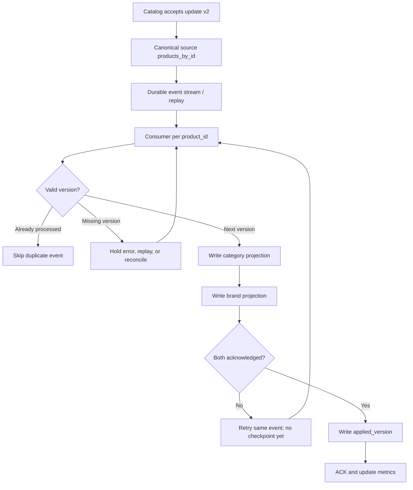

# Balancing Data Freshness Against the Cost of Maintaining Multiple Tables in Apache Cassandra

## Learning Objectives

In the **Relationships and Denormalization** chapter, Cassandra lets applications optimize read paths by storing slices of the same data in tables with different partition keys. In exchange, every business change may have to propagate to multiple representations. This lesson focuses on **choosing an appropriate data freshness level relative to read, write, and operational costs**, rather than assuming every table must update instantaneously or every query can accept stale data.

After this lesson, you will be able to:

1. Distinguish **data freshness**, **replica consistency**, **cross-logical-table consistency**, and **business integrity**.
2. Define update-lag thresholds per read path and distinguish averages from p95/p99 percentiles.
3. Estimate write fan-out cost, read fan-out cost, and storage footprint of derived tables in Cassandra.
4. Choose among **synchronous multi-table writes**, **event-driven sync**, **supplemental source reads**, **caching/aggregation**, or a hybrid approach.
5. Write CQL and Java Driver code illustrating a source table, category/brand read tables, versioning, and sync timestamps.
6. Design retries, out-of-order event controls, reconciliation, and load tests when adjusting freshness thresholds.

## 1. Introductory Example: Product Name, Price, and Inventory

A store has three interfaces:

- **Product detail page**: looks up by `product_id`, displays full info.
- **Category page**: fetches the 20 newest products of a category/month, displaying name and price.
- **Brand page**: fetches the 20 newest products of a brand/month, also displaying name and price.

Additionally, when a customer prepares to place an order, the system must verify **orderable stock** via the authoritative Inventory service.

In Cassandra, `products_by_id` can serve as the canonical source for Catalog data; `products_by_category_month` and `products_by_brand_month` duplicate `name`, `price`, and `currency` to avoid issuing an extra detail read for every product in the list.

However, attribute change frequencies differ dramatically:

| Attribute | Read Paths Needing It | Assumed Change Frequency | Required Freshness |
| --- | --- | --- | --- |
| `product_id`, `published_at` | Keys across all tables | Nearly immutable | Keys must stay consistent over record lifecycle |
| `name` | Details, category, brand | A few times/month/product | List can accept delayed updates within a defined window |
| `price` | Details, lists, reference display | Several times/day or higher with dynamic pricing | Feature-dependent; checkout price must use valid business source |
| `currency` | Everywhere price is shown | Rarely changes | Should update alongside price with formatting rules |
| `available_quantity` | Orderability decision | Can change every second | Requires Inventory check/reservation, not just reading a projection number |
| `description` | Detail page only | Rarely changes | No need to duplicate into list tables if UI omits it |

Suppose the source price changes from **750,000 VND** to **790,000 VND**. During the window before both derived tables update, the detail page may display 790,000 while the category page still displays 750,000.

This is not necessarily a bug if **the product contract allows slight lag on the list page**, while the price used to create orders is locked at the authoritative service. It becomes a bug if the application promises "every table is always fresh" or uses stale list prices as the basis for financial decisions.

> **Principle:** A read table is a data shape optimized for queries, not automatically the authority deciding true business values.

## 2. "Fresh Data" Has Multiple Meanings

Saying "eventually consistent" is insufficient for designing or operating a system. Specify precisely what the application guarantees.

### 2.1. Projection Lag

Suppose a source change is accepted at `t_source`, and all mandatory projections finish at `t_applied`:

\[
L_{\text{projection}} = t_{\text{applied}} - t_{\text{source}}
\]

If two derived tables are required, measure **per-table lag** as well as lag until **all** mandatory tables complete. For example, category finishes in 0.3 seconds while brand takes 4 seconds; claiming "sync takes 0.3 seconds" misleads anyone reading the brand table.

When measuring across machines, account for **clock synchronization**, timestamp sources, and measurement error. You can use timestamps recorded by a trusted system upon event acceptance, pipeline offsets/checkpoints, and apply times. Never rely on arbitrary client-supplied timestamps as accurate timing proof.

### 2.2. Read Staleness

Suppose the canonical source is at `catalog_version = 9` while the category table is still at `source_version = 7`. The read table is **two versions behind**.

Versions help detect stale state without comparing every column, **provided** versions increment per entity and every relevant change increments the version. However, "two versions behind" does not equal "two seconds behind": two changes may be milliseconds or days apart.

To report time-based staleness, correlate versions with when the source accepted each version or consult the event log. `projected_at` records only when the derived row was written; it is **insufficient to determine staleness relative to the source** without knowing when the source changed.

### 2.3. Read-Your-Writes and Multi-Table Reads

An administrator just edited a price at the source, then reloads the category page. If the category page reads an asynchronous projection, they may **not see their own edit yet**. That is an application-layer *read-your-writes* requirement; it can be addressed by reading the source directly on the confirmation path or waiting for the projection to reach the corresponding version within a deadline.

Raising the consistency level on the derived table **cannot** make a mutation appear that the application has not sent to that table yet.

A detail page reading a header from table A and line items from table B can also combine two different versions if a writer updates concurrently (**read skew**). Using `LOCAL_QUORUM` on both `SELECT` queries does not create an atomic cross-table snapshot.

### 2.4. Business Correctness Is Stronger Than "Freshness"

Freshness is not the whole consistency problem. A product list may be one second stale and remain acceptable; conversely, a balance-deduction or inventory-reservation decision can be **critically wrong** even when reading data just milliseconds stale.

Explicitly separate **display read paths** from **decision paths**. Critical invariants must be enforced at the authoritative service/table with proper conditional writes and business workflows, never relying on a UI-serving projection.

## 3. Per-Query Freshness Requirements Table

Example service contract (illustrative numbers for learning, not Cassandra benchmarks):

| Access Path | Freshness Target | Behavior When Missed | Accepts Cross-Table Skew? |
| --- | --- | --- | --- |
| List by category | 99% of changes projected within 5s | May show last-updated timestamp or refresh prompt | Yes, within threshold |
| List by brand | 99% of changes projected within 10s | Tolerate slightly stale data, log metric | Yes, within threshold |
| Details after price edit | Reflects confirmed source change | Read source directly or wait for version | Must not assume derived table updated yet |
| Order creation & price lock | Value accepted by Order service at transaction time | Reject or ask to recalculate if preconditions fail | Never use projection price to enforce invariants |
| View-count display | Allows batched/delayed aggregation | Show estimated count | Yes |
| Finalized invoice export | Uses finalized record of exact transaction | Never return assembly from arbitrary mixed states | Must be consistent per invoice version |

**Note on writing SLOs:** "99% within 5 seconds" is a **percentile target and measurement scope**. Define the measurement sample by change count, target table, time window, how completely failed changes are counted, and how source-acceptance time is stamped. Never use p50 or mean latency to claim every user sees updates within 5 seconds.

Targets can differ by tenant, region, product type, or peak hours. When a read path permits zero stale data, solve it with a fundamentally different pattern than a UX-oriented list.

## 4. Why Can One Second Fresher Cost Much More?

### 4.1. Cost of Writing to Multiple Tables

Suppose an attribute-change event must write **one canonical source table** and **k derived tables**. Approximate logical CQL mutations:

\[
W_{\text{event}} \approx 1 + k
\]

If change frequency is `f` events/second:

\[
W_{\text{second}} \approx f(1+k)
\]

This is a simplified model. If one event modifies multiple columns in the same row, they can be combined into one write for that table. Conversely, a **key-move** event may need a `DELETE` at the old key **and** an `INSERT` at the new key in the same derived table, exceeding `1+k` operations.

Cassandra also performs **replication**: every mutation is distributed to replicas per keyspace configuration. Do not confuse writes to **logical tables** with physical work across replicas, coordinators, commit logs, memtables, SSTables, and compaction. Consistency levels change required acknowledgments, yet do not eliminate the cost of maintaining multiple logical tables.

### 4.2. Read Cost Without Duplication

Suppose there are `R` category-page views/second, each showing `N` products. If the category table stores only IDs and the application must fetch each product's price separately, logical CQL reads approximate:

\[
Q_{\text{page}} \approx 1 + N
\]

\[
Q_{\text{extra, second}} \approx R \times N
\]

This is the **N+1 reads** pattern. Parallel reads can reduce tail wait time yet **do not eliminate** total load; caching can lower actual reads depending on hit rate.

### 4.3. Quantitative Example

Suppose during peak hours:

- Price changes **10 times/second** system-wide.
- Price is duplicated into **3 derived tables**.
- Category page receives **200 views/second**.
- Each page returns **20 products**.

| Approach | Logical Writes from Price Changes | Extra Price Reads on Category Page |
| --- | ---: | ---: |
| Write source only; category holds IDs only | ~10 writes/sec | Up to 200 × 20 = 4,000 reads/sec |
| Write source and 3 projections per change | ~10 × 4 = 40 writes/sec | Near 0 for price already in list table |
| Only 1 projection needs price; others hold IDs | ~10 × 2 = 20 writes/sec | Depends on read paths of the other two tables |
| Cache price reads without direct duplication | ~10 source writes/sec | Depends on cache hit rate and invalidation |

Spending 30 extra logical writes/sec may be cheaper than thousands of detail lookups, **yet you cannot conclude from operation counts alone**. A write using LWT on a hot partition, a cached read, a query returning large rows, or an operation over high network latency each carry very different costs.

Beyond throughput, account for **replica storage, tombstones, repair, compaction, retry operations, sync lag, and operational effort**.

### 4.4. Weighted Decision Model

You can use a relative cost function to compare options:

\[
C = aW + bQ + cS + dO + eE
\]

Where:

- `W`: writes/sec or mutations caused by fan-out;
- `Q`: supplemental read queries/sec;
- `S`: storage, tombstones, and compaction cost;
- `O`: pipeline, retry, backfill, and reconciliation operational cost;
- `E`: cost of data drift exceeding SLO or business risk;
- `a, b, c, d, e`: weights determined by workload, infrastructure pricing, and data criticality.

There is no universal weight set for Cassandra. Payment systems assign a huge `e` on decision paths; view-counter widgets can tolerate significant aggregation lag. The goal is to **measure and choose trade-offs**, not optimize a single metric in isolation.

## 5. Four Strategies for Maintaining Freshness

| Strategy | Write Path | Achievable Freshness | Primary Costs/Risks |
| --- | --- | --- | --- |
| **Synchronous fan-out** | Write source then write projections before returning | Can minimize observed lag upon completion | Slower requests; partial writes and timeouts still occur |
| **Event-driven projection** | Source accepts → event → worker updates tables | Lag depends on backlog and workers; measurable SLOs | Retries, out-of-order handling, lost events, reconciliation, queue ops |
| **Supplemental source read on demand** | Write source only for high-churn attributes | Read path checks source directly; zero projection lag for that attribute | N+1 reads, round-trips, source load, concurrency caps |
| **Cache / periodic aggregation** | Write source, refresh cache or aggregate periodically | Typically bounded lag per TTL/aggregation interval | Invalidation, cache stampedes, stale figures, lifecycle management |

Many systems use a **hybrid model**:

- Duplicate `name` and `price` into category tables to cut reads; sync via events with a defined SLO.
- Keep `available_quantity` in Inventory; at order placement, use the authoritative reservation path rather than trusting a duplicated stock count.
- Right after an admin updates a price, the API returns the source state and accepted `catalog_version`; the admin UI can temporarily display that new value for the edited item while public lists follow projections.
- View counts and counters can be aggregated in time buckets rather than writing to multiple tables on every hit.

### 5.1. Synchronous Writes Do Not Mean Multi-Table Transactions

If a request waits for both projections before reporting success, it may achieve **completing fan-out before responding**, yet these cases still occur:

1. Source write succeeds.
2. Category write succeeds.
3. Brand write times out.
4. Request returns an error or timeout even though some tables already hold new data.

**There is no automatic rollback across Cassandra tables** like in an RDBMS transaction. Retries must reuse the same keys and accepted state; mechanisms are needed to detect/repair indeterminate outcomes. When a request loses connection, never assume none of the tables were written.

### 5.2. Asynchronous Does Not Mean Guaranteed Self-Correcting

A projection updated asynchronously via a message broker is only **eventually consistent** if the system ensures changes reliably reach consumers or are caught by reconciliation.

Events can arrive duplicated, out of order, sit in a dead-letter queue, or never be emitted if the process crashes between writing the source and sending the event. When using an outbox or CDC, evaluate the exact guarantees of **your real source and tooling**. A Cassandra logged batch is not an atomic transaction with a message broker.

Therefore, you need **a reliable event-publishing path + idempotency + checkpointing + reconciliation**, rather than a vague promise that "using a queue keeps data in sync."

## 6. CQL Design: Source and Two Read Tables with Freshness Metadata

Assume the `shop` keyspace exists with appropriate replication and the CQL session has selected it.

```sql
USE shop;

-- Canonical source for Catalog info in this example.
CREATE TABLE products_by_id (
    product_id uuid PRIMARY KEY,
    category_id uuid,
    brand_id uuid,
    publish_month date,
    published_at timestamp,
    name text,
    price decimal,
    currency text,
    catalog_version bigint,
    changed_at timestamp,
    lifecycle_status text
);

-- List table serving SELECT by category and month.
CREATE TABLE products_by_category_month (
    category_id uuid,
    publish_month date,
    published_at timestamp,
    product_id uuid,
    name text,
    price decimal,
    currency text,
    source_version bigint,
    source_changed_at timestamp,
    projected_at timestamp,
    PRIMARY KEY ((category_id, publish_month), published_at, product_id)
) WITH CLUSTERING ORDER BY (published_at DESC, product_id ASC);

-- List table by brand and month.
CREATE TABLE products_by_brand_month (
    brand_id uuid,
    publish_month date,
    published_at timestamp,
    product_id uuid,
    name text,
    price decimal,
    currency text,
    source_version bigint,
    source_changed_at timestamp,
    projected_at timestamp,
    PRIMARY KEY ((brand_id, publish_month), published_at, product_id)
) WITH CLUSTERING ORDER BY (published_at DESC, product_id ASC);

-- Tracks the version the worker finished processing across all mandatory projections.
CREATE TABLE catalog_projection_progress_by_id (
    product_id uuid PRIMARY KEY,
    applied_version bigint,
    applied_at timestamp
);
```

**Model explanation:**

- `products_by_id` has partition key `product_id`, suited for detail lookups.
- Category/brand tables have composite partition keys `(category_id, publish_month)` or `(brand_id, publish_month)`, clustering `published_at DESC` and `product_id` to sort and disambiguate products.
- `source_version` in a projection is the source version used to create the copy. `source_changed_at` reflects when the source changed (per event contract); `projected_at` is when the worker finished writing the projection per measurement policy.
- `catalog_projection_progress_by_id` records the version completed across **both projections** within a per-ID sequential worker stream; it is **not a transaction** and does not by itself block another worker from writing concurrently.
- `lifecycle_status` distinguishes active products from retired/deleted ones; a `RETIRED/DELETED` record must follow read-path rules rather than being silently recreated from stale events.

In this example, `publish_month` is the first day of the UTC month derived from `published_at`. When a category/brand has too many products in a single month, evaluate finer buckets; never assume every partition stays reasonably sized automatically.

### 6.1. Initial Source Write

```sql
INSERT INTO products_by_id (
    product_id, category_id, brand_id, publish_month, published_at,
    name, price, currency, catalog_version, changed_at, lifecycle_status
) VALUES (
    11111111-1111-4111-8111-111111111111,
    22222222-2222-4222-8222-222222222222,
    33333333-3333-4333-8333-333333333333,
    '2026-11-01', '2026-11-21T01:00:00Z',
    'Mechanical keyboard', 750000.00, 'VND', 1,
    '2026-11-21T01:00:00Z', 'ACTIVE'
);
```

The worker can create both projections from source version 1:

```sql
INSERT INTO products_by_category_month (
    category_id, publish_month, published_at, product_id,
    name, price, currency, source_version,
    source_changed_at, projected_at
) VALUES (
    22222222-2222-4222-8222-222222222222,
    '2026-11-01', '2026-11-21T01:00:00Z',
    11111111-1111-4111-8111-111111111111,
    'Mechanical keyboard', 750000.00, 'VND', 1,
    '2026-11-21T01:00:00Z', '2026-11-21T01:00:01Z'
);

INSERT INTO products_by_brand_month (
    brand_id, publish_month, published_at, product_id,
    name, price, currency, source_version,
    source_changed_at, projected_at
) VALUES (
    33333333-3333-4333-8333-333333333333,
    '2026-11-01', '2026-11-21T01:00:00Z',
    11111111-1111-4111-8111-111111111111,
    'Mechanical keyboard', 750000.00, 'VND', 1,
    '2026-11-21T01:00:00Z', '2026-11-21T01:00:01Z'
);
```

These are independent mutations. Only once the worker confirms both per policy does it record checkpoint `applied_version = 1` and ACK the event in the messaging layer.

### 6.2. Version-Checked Price Change

Suppose Catalog accepts a price increase from 750,000 to 790,000 VND, advancing from version 1 to 2:

```sql
UPDATE products_by_id
SET price = 790000.00,
    catalog_version = 2,
    changed_at = '2026-11-21T01:05:00Z'
WHERE product_id = 11111111-1111-4111-8111-111111111111
IF catalog_version = 1;
```

The application must check `[applied]`. Only when the source accepts version 2 may it publish the corresponding event via a reliable mechanism. If `[applied] = false`, never emit a new-price event as if the operation succeeded.

Example of the worker projecting the new price to both tables:

```sql
UPDATE products_by_category_month
SET price = 790000.00,
    source_version = 2,
    source_changed_at = '2026-11-21T01:05:00Z',
    projected_at = '2026-11-21T01:05:01Z'
WHERE category_id = 22222222-2222-4222-8222-222222222222
  AND publish_month = '2026-11-01'
  AND published_at = '2026-11-21T01:00:00Z'
  AND product_id = 11111111-1111-4111-8111-111111111111;

UPDATE products_by_brand_month
SET price = 790000.00,
    source_version = 2,
    source_changed_at = '2026-11-21T01:05:00Z',
    projected_at = '2026-11-21T01:05:02Z'
WHERE brand_id = 33333333-3333-4333-8333-333333333333
  AND publish_month = '2026-11-01'
  AND published_at = '2026-11-21T01:00:00Z'
  AND product_id = 11111111-1111-4111-8111-111111111111;
```

Both writes apply after the source advances its version, so the two read paths may observe the change at slightly different times. `source_version` is stored to detect divergence; it **does not automatically protect** against stale events if the worker runs unconditional writes without ordering control.

### 6.3. Reading Lists and Observing Freshness

```sql
SELECT product_id, name, price, currency, source_version,
       source_changed_at, projected_at
FROM products_by_category_month
WHERE category_id = 22222222-2222-4222-8222-222222222222
  AND publish_month = '2026-11-01'
LIMIT 20;

SELECT product_id, name, price, currency, source_version,
       source_changed_at, projected_at
FROM products_by_brand_month
WHERE brand_id = 33333333-3333-4333-8333-333333333333
  AND publish_month = '2026-11-01'
LIMIT 20;
```

Each row may carry its own version because products change at different times. **Never use the largest `projected_at` on the page to assert the whole page is fresh**: other products may be missing events or awaiting projection. To measure a product's freshness against the source, sample the source by `product_id` or compare against accepted-version logs.

## 7. Event Flow: Paying for Controllable Freshness



Design points:

1. **Events carry complete data:** `product_id`, `source_version`, source acceptance timestamp, duplicated display columns, current keys plus **old keys** if category/brand changed, deletion status, and schema version.
2. **Per-ID ordering:** events for the same `product_id` must be processed under controlled order. System-wide ordering across all products is unnecessary.
3. **Safe retries:** the same event reuses accepted source keys and values. Never re-trigger payments, emails, or business side effects because a projection timed out.
4. **Checkpoint after fan-out:** `applied_version` advances only after all mandatory projections succeed. If one table fails, retrying may rewrite the earlier table; define idempotency clearly.
5. **Never handle missing-version events arbitrarily:** if the source numbers versions contiguously and a consumer receives v4 while at checkpoint v2, resolve v3 or run a trusted recovery workflow.
6. **Enforce ownership:** reading a checkpoint and comparing in the app is insufficient if two workers concurrently write `product_id`. Use stream ownership, fencing, or suitable conditional writes; never treat checkpoints as multi-table transactions.
7. **Periodic reconciliation:** events keep updates fast, yet cannot prove every copy stays accurate forever. Background jobs catch missing/extra rows, wrong prices, wrong versions, and uncleaned old keys.

To cut lag, adding more workers helps only when there are enough independent `product_id` values and cluster capacity remains. Adding workers that all contend on one hot partition may **fail to improve** throughput and even raise timeouts.

### Fan-Out When Lookup Keys Change

When a product moves categories, `category_id` is a **partition key component** of the list table. Cassandra does not permit changing a row's primary key in place. The worker must delete the row under the old key and insert a new row under the new key, while monitoring for failures in either step.

```sql
DELETE FROM products_by_category_month
WHERE category_id = 22222222-2222-4222-8222-222222222222
  AND publish_month = '2026-11-01'
  AND published_at = '2026-11-21T01:00:00Z'
  AND product_id = 11111111-1111-4111-8111-111111111111;

INSERT INTO products_by_category_month (
    category_id, publish_month, published_at, product_id,
    name, price, currency, source_version,
    source_changed_at, projected_at
) VALUES (
    44444444-4444-4444-8444-444444444444,
    '2026-11-01', '2026-11-21T01:00:00Z',
    11111111-1111-4111-8111-111111111111,
    'Mechanical keyboard', 790000.00, 'VND', 3,
    '2026-11-21T01:06:00Z', '2026-11-21T01:06:01Z'
);
```

Between deleting then inserting, the product may temporarily vanish from both categories; if inserting then deleting, it may briefly appear in both. **Freshness and read continuity** are both agreed design choices that cannot be eliminated merely by raising consistency levels.

## 8. Java Driver 4.x: Consumer Tracking Progress and Update Timestamps

The snippet below illustrates **a worker handling price/name updates only when category, brand, and publication timestamp remain unchanged**. Key moves and deletes require separate branches with full old/new keys; do not apply this snippet verbatim to those events.

Example preconditions:

- Events are accepted by Catalog with **contiguous versions per `product_id`** starting at 1 or initialized via a checkpoint bootstrap.
- A single consumer owns applying events for each `product_id` at a time; no uncoordinated backfill overwrites it.
- On duplicate events, the worker reads the checkpoint and skips; on gaps, it requests replay/reconciliation.
- Both projections already hold valid-key rows or snapshot events can use `INSERT` to create them; the example uses **full upserts**.
- Runtime consistency levels, timeouts, and message ACKing are configured outside this snippet.

```java
import com.datastax.oss.driver.api.core.CqlSession;
import com.datastax.oss.driver.api.core.cql.PreparedStatement;
import com.datastax.oss.driver.api.core.cql.Row;

import java.math.BigDecimal;
import java.time.Instant;
import java.time.LocalDate;
import java.util.UUID;

public final class CatalogProjectionWorker {
    public record ProductChanged(
        UUID productId,
        UUID categoryId,
        UUID brandId,
        LocalDate publishMonth,
        Instant publishedAt,
        String name,
        BigDecimal price,
        String currency,
        long version,
        Instant sourceChangedAt
    ) {}

    private final CqlSession session;
    private final PreparedStatement readProgress;
    private final PreparedStatement writeCategory;
    private final PreparedStatement writeBrand;
    private final PreparedStatement saveProgress;

    public CatalogProjectionWorker(CqlSession session) {
        this.session = session;

        readProgress = session.prepare(
            "SELECT applied_version FROM catalog_projection_progress_by_id " +
            "WHERE product_id = ?");

        writeCategory = session.prepare(
            "INSERT INTO products_by_category_month (" +
            "category_id, publish_month, published_at, product_id, " +
            "name, price, currency, source_version, " +
            "source_changed_at, projected_at) " +
            "VALUES (?, ?, ?, ?, ?, ?, ?, ?, ?, ?)");

        writeBrand = session.prepare(
            "INSERT INTO products_by_brand_month (" +
            "brand_id, publish_month, published_at, product_id, " +
            "name, price, currency, source_version, " +
            "source_changed_at, projected_at) " +
            "VALUES (?, ?, ?, ?, ?, ?, ?, ?, ?, ?)");

        saveProgress = session.prepare(
            "UPDATE catalog_projection_progress_by_id " +
            "SET applied_version = ?, applied_at = ? " +
            "WHERE product_id = ?");
    }

    public void handle(ProductChanged event) {
        Row row = session.execute(
            readProgress.bind(event.productId())).one();
        long last = (row == null || row.isNull("applied_version"))
            ? 0L : row.getLong("applied_version");

        if (event.version() <= last) {
            return; // Duplicate or stale event: must not overwrite.
        }
        if (event.version() != last + 1L) {
            throw new IllegalStateException(
                "Missing version requiring replay: last=" + last +
                ", received=" + event.version());
        }

        // Use the exact state snapshot/keys accepted by Catalog.
        Instant projectedAt = Instant.now();
        session.execute(writeCategory.bind(
            event.categoryId(), event.publishMonth(),
            event.publishedAt(), event.productId(),
            event.name(), event.price(), event.currency(),
            event.version(), event.sourceChangedAt(), projectedAt));

        session.execute(writeBrand.bind(
            event.brandId(), event.publishMonth(),
            event.publishedAt(), event.productId(),
            event.name(), event.price(), event.currency(),
            event.version(), event.sourceChangedAt(), Instant.now()));

        // Advance checkpoint only after both writes complete.
        session.execute(saveProgress.bind(
            event.version(), Instant.now(), event.productId()));

        // Orchestration layer ACKs the event AFTER handle() succeeds.
    }
}
```

### 8.1. Meaning of the Checkpoint

If writing category succeeds while brand times out, `saveProgress` has not run yet. The worker retries the same event: the category `INSERT` runs again with the exact same keys and business fields, and brand is retried next.

However, **`projected_at` may change on retry**, and Cassandra will record a new mutation. Retrying does not mean "zero cost" or guarantee *exactly once*. Here, idempotency aims to **avoid creating extra logical rows or repeating business actions**. If you must measure latency of the first apply, define the timestamp semantics explicitly so retries do not overwrite it arbitrarily.

If saving the checkpoint succeeds yet the broker misses the ACK, the event is redelivered and the worker skips it using `applied_version`. If multiple consumers handle one ID simultaneously, reading `last` then writing unconditionally **is insufficient to prevent races**: ensure proper serialization/ownership or fencing.

If the source is already at version 100 when a new worker starts with no checkpoint yet, do not expect event v100 to be processed like the start of `1, 2, 3`. You need a separate bootstrap/backfill process to populate projections and initialize the checkpoint before accepting newer versions.

### 8.2. Pipeline Guarantees and Explicit Limits

This example neither builds a reliable event stream by itself nor stops another repair job from writing a v1 snapshot over a v2 row. Correctness holds only when every write path to the projections obeys the same versioning and ownership rules; otherwise, you may need target-row LWTs, fencing, or reconciliation jobs.

Even when workers process sequentially, a failure between writing the source and **publishing the event** can leave read tables un-updated. Evaluate whether CDC, outbox, or an event log provides sufficient guarantees in your real architecture, and keep reconciliation as an extra line of defense.

## 9. Choosing Hybrid Solutions to Avoid Overpaying for Freshness

Instead of forcing one identical SLA across every field, partition by **usage and change cost**.

### 9.1. Stable Fields: Duplicate into Lists

Product name, currency, and thumbnail can be worth duplicating because they are read heavily yet change infrequently. A target of a few seconds may suit public read paths when accepted by product teams and monitored for drift.

### 9.2. High-Churn Fields: Avoid Indiscriminate Duplication

Actively selling inventory can change hundreds of times per second on hot products. Duplicating stock across multiple tables on every change easily causes write amplification, hot partitions, and rising projection lag right during peak load.

Keep a separate stock read path by `product_id` so UIs query it only when needed; at checkout, the Inventory service must enforce business conditions and reservation policies. Some display counters can be aggregated by bucket/time interval instead of duplicating every single increment.

### 9.3. Immediate Read-Your-Writes Paths: Smart Routing

After an administrator edits a price, the API can return `product_id` and the `catalog_version` accepted at the source. If the admin UI needs to re-read immediately:

- Read directly from the canonical source table for a short window or for recently edited items.
- Or wait for the derived table to reach at least the accepted version, **with a deadline and fallback behavior if not ready**.
- Never assume `LOCAL_QUORUM` on the category table suffices if the worker has not even sent the category mutation yet.

This avoids forcing every public catalog reader to pay synchronous-update costs just because a few admin pages need *read-your-writes*.

### 9.4. Per-Version Consistency for a Multi-Table Entity

If a screen must assemble a header and child lines belonging to the exact same version, an option is **immutable snapshot + published pointer**: write all components of the new version, confirm per policy, then conditionally swap the current pointer; readers pin the same version ID.

This raises storage and write counts and requires retaining old versions long enough for active readers; do not default to it for continuously mutating data. **Row-level versions without a publish rule** do not automatically create atomic cross-table snapshots.

## 10. Monitoring: Verify Freshness Promises with Real Metrics

Never validate an SLO merely by checking "the queue has few messages" or "average latency is low." Measure **end-to-end**, per target, and verify divergence.

| Metric | Meaning | When to Investigate |
| --- | --- | --- |
| `source_to_category_lag_seconds` | From source acceptance until category projection applies | p99 exceeds the published 5-second limit |
| `source_to_brand_lag_seconds` | Same for brand | Brand consistently lags behind category |
| `projection_all_targets_lag` | Lag until all mandatory target tables complete | One fast target hides failures in another |
| `unprocessed_event_age` | Age of incomplete events | A partition/message is stuck long-term |
| `version_gap_count` | Missing versions or out-of-order events | Spikes after failovers/rebalances |
| `projection_mismatch_count` | Missing/extra rows, wrong price, version, or keys | High even when queue is empty |
| `retry_and_dead_letter_count` | Timed-out or unprocessable events | Retry loops, schema errors |
| `write_fanout_per_event` | Logical mutations generated per change | Grows as new query tables are added |
| `read_queries_per_page` | CQL queries executed to render one page | Rises due to N+1 or low cache hit rate |
| `read_write_p95_p99` | Latency across write and read paths | Imbalance between UX and cost |
| `hot_partitions` | Partitions receiving disproportionate reads/writes | Load spikes on hot products/buckets |
| `compaction_tombstone_repair` | Cost of maintaining replicas and duplicated data | Rises after deletes/key moves or TTLs |

### Do Not Measure Freshness from One Timestamp Alone

- `projected_at - source_changed_at` estimates lag of **the version already applied**, without directly revealing whether **a newer version has not arrived yet**.
- Queue lag can look low even when the application **dropped events** before enqueueing them.
- A checkpoint metric for one table can advance while other tables lag if the worker records checkpoints in the wrong order.
- Sampling **source → projection** and **projection → source/deletion record** reconciliation exposes missing rows, extra rows, and lingering old-key rows.

Therefore, combine timestamps, versions, event logs, checkpoints, and reconciliation to accurately reflect "how fresh the data really is."

### Under Heavy Cluster Load

Lowering projection lag by adding more consumers can boost throughput yet also increases cluster mutations, compaction, network traffic, and hot-partition pressure. Once a cluster nears saturation, adding workers can trigger more timeouts, ironically increasing lag.

Limit concurrency, manage backpressure, pick appropriate partitions/buckets, and provide load-shedding paths for low-freshness features. In particular, note that key moves or deletes create **tombstones**, bringing compaction/repair overhead and potential slow reads on tombstone-heavy partitions.

## 11. Design Decision Process

Evaluate each feature step by step:

1. **List queries and returned fields:** which pages read how many times/sec, by which partition key, and how many rows?
2. **Measure per-field churn:** changes/sec, bursts or hot keys; which attributes truly need duplication?
3. **Classify semantics:** reference info tolerable when slightly stale, info needing read-your-writes, or facts driving transaction decisions?
4. **Set explicit freshness SLOs:** p95/p99, start/end timestamps, per-target scope, and breach behavior.
5. **Estimate read and write fan-out:** tables and rows updated per event; extra queries if not duplicated.
6. **Test multiple options:** synchronous projection, async events, bounded source reads, cache/aggregation, or hybrid.
7. **Design for failures before rollout:** per-target timeouts, duplicate/out-of-order events, lost events after source change, key moves, deletes, and backfills.
8. **Run load tests and controlled fault injection:** use production-like data distribution, read/write ratios, replication/consistency levels, and partition sizes.
9. **Monitor and tune:** measure end-to-end freshness, cluster cost, drift rate, and user-visible outcomes—not merely message-broker throughput.

### Quick Decision Matrix

| Read Path / Attribute | Heavy Reads? | High Churn? | Tolerates Lag? | Recommended Direction to Test |
| --- | --- | --- | --- | --- |
| Product name and price on lists | Yes | Usually moderate | Few-second SLO often fine | Query-driven projection with events + reconciliation |
| Finalized price on orders | Per order creation | May change | Invariant errors unacceptable | Business service locks price/snapshot at order placement |
| Stock for purchase decisions | Yes | Very high on hot items | Never rely on stale display values | Authoritative Inventory, check/reserve |
| Public view counts | Yes | Extremely high | Usually accepted | Bucketed aggregation and periodic cache |
| Details right after admin edit | Lower than lists | Action-driven | Needs read-your-writes | Read source directly or wait for projection version with deadline |
| Rarely accessed list | Low | Potentially high | Business-dependent | Consider avoiding an extra derived table for rare reads |

## 12. Practice Exercise: Finding the Balance for a Course Platform

An online learning platform has:

- `courses_by_id`: canonical source for `title`, `price`, and `publication_status`.
- `courses_by_category` and `courses_by_teacher`: two list tables duplicating displayed fields.
- `enrollment_count_by_course`: student count or aggregated value owned by the Enrollment service.
- Hundreds of thousands of list views per day; course titles change a few times a month, prices can change daily, and enrollment counts change continuously during launches.

**Requirements:**

1. Propose different freshness SLOs for `title`, `price`, `publication_status`, and `enrollment_count` on **the list page**, explaining why those thresholds differ.
2. If price changes 8 times/sec system-wide and updates one source plus two projections, estimate logical writes/sec. Compared to updating only the source, what is the difference?
3. At 150 list views/sec with 20 courses per page, estimate supplemental queries if `title` is not duplicated and `courses_by_id` must be read for every course.
4. An admin page just changed the price and reloads the list: how do you support *read-your-writes* without forcing every client to wait for instant global sync?
5. A consumer sees `CourseChanged v5` after already projecting `v6`. How should this be handled so the list does not revert to the old price?
6. When a course changes categories, why is lag not merely "a few seconds of old price" but also involves **rows in the old and new partitions**?
7. If a backfill job uses snapshot v3 after the live consumer already applied v6, what must be controlled?
8. Choose at least five metrics proving SLOs are met during peak hours, including detecting lost events.

**Self-check hints:**

- With 8 changes/sec and two projections, `8 × (1+2) = 24` logical CQL mutations/sec—`16` more than writing only the source, excluding replication, retries, and compaction.
- Reading details for 20 courses at 150 views/sec means up to roughly `150 × 20 = 3,000` supplemental queries/sec in a simple uncached model.
- The admin page can use the source-confirmed price/version or read the source directly after editing, while public list tables keep their own SLO.
- Never apply a plain v5 write after v6; enforce per-key ordering, checkpointing, or appropriate conditional checks. On category moves, delete the exact row under the old key and insert under the new key.
- Backfill and live consumers must share versioning/serialization or fencing so old snapshots never overwrite newer ones.
- Measure per-target lag, end-to-end p95/p99, pending/gap event counts, reconciliation version mismatches, hot partitions, and cluster read/write impact.

## Summary

Cassandra enables **fast reads by partition key and clustering columns** by duplicating slices of data across query-aligned tables. However, the more read paths demand **seeing new values quickly**, the more the application pays in write fan-out, failure handling, retries, event ordering, reconciliation, storage, and operations.

The right decision is neither "always instant" nor "always eventual consistency," but **setting freshness targets per feature and business semantics**: stable, heavily read fields may justify duplication; high-churn fields are often better read from an authoritative source or aggregated; transaction decision paths must enforce their own invariants. Replication, consistency levels, LWT, logged batches, compaction, and repair each have specific roles in Cassandra yet **do not replace** a synchronization contract across logical tables.

Measure **generated writes and reads, p95/p99 update lag, data drift rates, failure costs, and recoverability**. A good design proves **freshness is sufficient for users, maintenance cost is acceptable, and data remains repairable when part of the system fails**.
