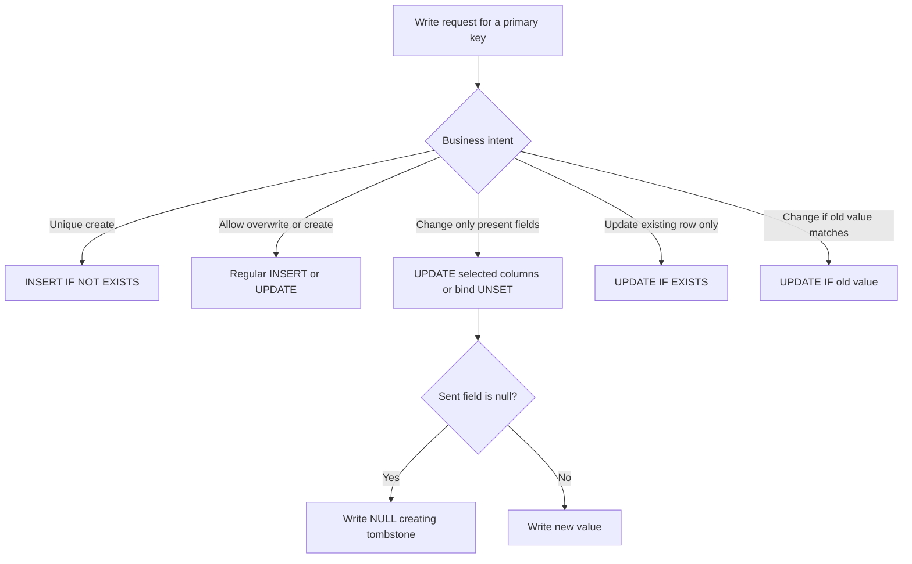

# Upserts and Distinguishing New Writes from Partial Updates in Cassandra

In the **CQL Writes and Deletes** chapter of Apache Cassandra, the question "does this record already exist?" is not answered automatically simply by choosing between `INSERT` and `UPDATE`. Without an `IF` condition, both statements can write data to a key that has never existed or modify data at an existing key. This is **upsert** (*update or insert*) behavior.

What matters for a Java application is distinguishing **business intent** from **write syntax**:

- **Constrained creation:** create only if the key does not exist; report a conflict if the key already exists.
- **Unconditional upsert:** write the supplied columns at the specified key, regardless of whether the row already exists.
- **Partial update (patch):** change only the requested fields; preserve the remaining fields.
- **Full replacement (replace):** the post-operation row state must fully match the new representation, including rules for fields not sent.

Cassandra is a **distributed wide-column** database that organizes data by **partition key**, models tables around queries, replicates across nodes, and offers tunable **consistency levels**. Because of these characteristics, the semantics of writes, retries, and value deletions must be explicitly designed at the application layer. This lesson focuses on CQL and how it connects to the Java Driver.

## 1. A data model for tracking changes

Suppose an account service looks up customer profiles by `customer_id`. We will use the following illustrative table; the `demo` keyspace is assumed to exist:

```sql
CREATE TABLE demo.customer_profile_by_id (
    customer_id uuid PRIMARY KEY,
    display_name text,
    email text,
    phone text,
    city text,
    sms_opt_in boolean,
    updated_at timestamp
);
```

In this table, `customer_id` is both the **full primary key** and the **partition key**. Writing with the same UUID targets the same logical partition/row; a different UUID targets a different row. If a table uses a composite primary key, every key component identifying the row must be considered.

Create initial data:

```sql
INSERT INTO demo.customer_profile_by_id (
    customer_id, display_name, email, phone, city, sms_opt_in
)
VALUES (
    11111111-1111-4111-8111-111111111111,
    'Lan',
    'lan@example.test',
    '0900000001',
    'Hanoi',
    false
);

SELECT customer_id, display_name, email, phone, city, sms_opt_in
FROM demo.customer_profile_by_id
WHERE customer_id = 11111111-1111-4111-8111-111111111111;
```

This example is used throughout. Assuming no competing writes, clock anomalies, or TTLs, the data after the first write is:

| customer_id (short) | display_name | email | phone | city | sms_opt_in |
| --- | --- | --- | --- | --- | --- |
| `1111...1111` | Lan | lan@example.test | 0900000001 | Hanoi | false |

## 2. What is an upsert?

**Upsert** means sending a mutation to a target key without requiring Cassandra to verify that the row already exists. Consider these two statements:

```sql
INSERT INTO demo.customer_profile_by_id (
    customer_id, display_name
)
VALUES (
    11111111-1111-4111-8111-111111111111,
    'Lan Nguyen'
);

UPDATE demo.customer_profile_by_id
SET city = 'Da Nang'
WHERE customer_id = 11111111-1111-4111-8111-111111111111;
```

Both write to the **exact same key**:

- The second `INSERT` overwrites `display_name` to `Lan Nguyen`.
- The `UPDATE` overwrites `city` to `Da Nang`.
- `email`, `phone`, and `sms_opt_in` **remain unchanged** because neither statement writes to them.
- No extra row is created just by running `INSERT` again with the same key.

After these two statements, assuming the mutations are applied with no timestamp conflicts, the row becomes:

| display_name | email | phone | city | sms_opt_in |
| --- | --- | --- | --- | --- |
| Lan Nguyen | lan@example.test | 0900000001 | Da Nang | false |

**Common pitfall:** `INSERT` does not mean "replace the entire row with the columns listed in VALUES." With a standard column-write statement, columns **not mentioned** are not deleted merely because they are omitted.

### UPDATE when no row exists yet

Run an `UPDATE` on a new UUID:

```sql
UPDATE demo.customer_profile_by_id
SET city = 'Hue'
WHERE customer_id = 22222222-2222-4222-8222-222222222222;

SELECT customer_id, display_name, email, city
FROM demo.customer_profile_by_id
WHERE customer_id = 22222222-2222-4222-8222-222222222222;
```

The result is **a new row** with `city = 'Hue'`; `display_name` and `email` read back as `null`. CQL does not require `UPDATE` to touch an existing row. Such a "sparse" row is completely valid in the wide-column model.

| Aspect | `INSERT` without `IF` | `UPDATE` without `IF` |
| --- | --- | --- |
| Key already exists | Writes specified columns into that row | Writes `SET` columns into that row |
| Key does not exist | Can create a new row | Can create a new row |
| Unspecified columns | Keep their current values | Keep their current values |
| Duplicate key check | No | No |
| How columns are specified | Column list and `VALUES` | `SET` and `WHERE` on the key |

The difference lies mainly in **how the mutation is expressed**, not in a guarantee of creating new rows versus updating existing ones.

## 3. Partial update: changing only the requested fields

Consider the case where a user updates their city without touching their phone number or email. A clear, intentional statement:

```sql
UPDATE demo.customer_profile_by_id
SET city = 'Ho Chi Minh City'
WHERE customer_id = 11111111-1111-4111-8111-111111111111;
```

In terms of outcome, this statement is equivalent to an `INSERT` containing only `customer_id` and `city`. However, `UPDATE ... SET` usually expresses the intent to "modify specific fields" more readably, especially when implementing a `PATCH` API.

### Three states to distinguish: omitted, valued, NULL

For each regular column, an application request carries at least three distinct meanings:

| Request state | Intent | Desired outcome in Cassandra |
| --- | --- | --- |
| Field **not sent** | Do not modify this field | Omit the column from the mutation or bind **UNSET** |
| Field sent with a value, e.g., `city = 'Hue'` | Set a new value | Write the new value to the column's cell |
| Field explicitly sent as `null` | Clear the field's value | Bind/assign **NULL**, creating a deletion marker (tombstone) |

Example deleting only the phone number:

```sql
UPDATE demo.customer_profile_by_id
SET phone = NULL
WHERE customer_id = 11111111-1111-4111-8111-111111111111;
```

After this operation, `phone` reads back as `null` once the replicas serving the read observe the deletion. Other columns remain unchanged.

**NULL is not UNSET.** In CQL, `NULL` on a regular column means deleting the value via a **tombstone**. `UNSET` is a parameter state in a prepared statement telling Cassandra **not to apply a write for that column**. Never swap these two states in a partial-update API.

Tombstones are essential metadata in a distributed system: a replica that temporarily missed the delete must know that the stale value is no longer valid. Too many tombstones can degrade read, compaction, and repair performance; avoiding unnecessary tombstones also keeps performance predictable.

### Trap example: a Java DTO defaulting to null

Suppose a client sends:

```json
{
  "city": "Hue"
}
```

If the application deserializes this JSON into a Java object where `displayName == null`, `email == null`, and `phone == null`, and then binds every field as CQL `NULL`, a request to update the city will accidentally wipe out the customer's name, email, and phone number. You must track **field presence in the payload**; an absent field must be skipped or bound as UNSET, while a field present with `null` signifies deletion if the API permits it.

API contract example:

```json
{
  "city": "Hue",
  "phone": null
}
```

Meaning: update `city`, delete `phone`, leave absent fields intact. In Java you need a presence-tracking mechanism (such as `JsonNode`, a field mask, or wrapper types designed for PATCH), rather than relying solely on nullable fields in a plain DTO.

## 4. INSERT JSON has a default worth watching closely

Cassandra supports `INSERT ... JSON`, but its handling of **missing fields in the JSON object** differs from column-list `INSERT` unless configured explicitly.

```sql
-- Suppose Lan's row already has email and phone.
INSERT INTO demo.customer_profile_by_id JSON
'{"customer_id":"11111111-1111-4111-8111-111111111111","city":"Can Tho"}'
DEFAULT UNSET;
```

With `DEFAULT UNSET`, columns omitted from the JSON are not rewritten; this is usually the appropriate choice when importing partial data. If `DEFAULT NULL` is used (the default when unspecified in a CQL JSON insert), missing fields are treated as null, which can delete existing values via tombstones.

| Write form | Missing columns in input | Suitable for partial updates? |
| --- | --- | --- |
| `INSERT ... (customer_id, city) VALUES (...)` | Not mentioned, not rewritten | Yes, if upsert semantics are acceptable |
| `UPDATE ... SET city = ... WHERE ...` | Not in `SET`, not rewritten | Yes, if upsert semantics are acceptable |
| `INSERT ... JSON '...' DEFAULT UNSET` | Missing columns are not written | Yes, if JSON insert behavior is understood |
| `INSERT ... JSON '...' DEFAULT NULL` | Missing columns are treated as null | **Caution:** can delete existing data |

Do not assume "a JSON object with only two fields" automatically means "the mutation only modifies two fields" when using CQL JSON. Always specify the missing-field policy explicitly.

## 5. When do you genuinely need to distinguish new writes from updates?

If business rules state "an account can only be registered once with this ID," a regular upsert is insufficient. Two concurrent creation requests for the same key could overwrite each other's data. Cassandra provides **lightweight transactions (LWT)** when conditions are required.

### Create only if absent: INSERT IF NOT EXISTS

```sql
INSERT INTO demo.customer_profile_by_id (
    customer_id, display_name, city
)
VALUES (
    33333333-3333-4333-8333-333333333333,
    'Minh',
    'Da Nang'
)
IF NOT EXISTS;
```

The result includes an `[applied]` column: `true` if the write was applied, `false` if the condition was not met. The application can map `false` to a business error such as HTTP `409 Conflict`. On condition failure, the response may also include the existing row data depending on the statement and version.

### Modify only if the row exists: UPDATE IF EXISTS

```sql
UPDATE demo.customer_profile_by_id
SET city = 'Nha Trang'
WHERE customer_id = 33333333-3333-4333-8333-333333333333
IF EXISTS;
```

With `IF EXISTS`, if no row exists at that key, Cassandra will not create a sparse row from this update. That is the difference between "PATCH an existing resource" and "upsert by key."

### Change only when the old value matches expectations: compare-and-set

```sql
UPDATE demo.customer_profile_by_id
SET sms_opt_in = true
WHERE customer_id = 11111111-1111-4111-8111-111111111111
IF sms_opt_in = false;
```

If two clients concurrently attempt to flip the same state, LWT ensures the condition is checked and applied via consensus across replicas. Performing a `SELECT` followed by an unconditional `UPDATE` **does not protect** the window between reading and writing.

| Need | Appropriate CQL | Characteristics |
| --- | --- | --- |
| Write regardless of whether the row exists | `INSERT` or `UPDATE` without `IF` | Upsert, standard write cost |
| Create for the first time, disallow duplicates | `INSERT ... IF NOT EXISTS` | LWT, returns `[applied]` |
| Modify only an existing row | `UPDATE ... IF EXISTS` | LWT, returns `[applied]` |
| Modify only if the old value satisfies a condition | `UPDATE ... IF column = old_value` | LWT, compare-and-set |

LWT requires extra coordination/consensus rounds between replicas and typically incurs higher latency than regular writes. Use it only when business rules require conditional checks or contention safety. When upsert semantics are acceptable, unconditional writes are Cassandra's natural choice.

## 6. Partial update is not the same as full replacement

In HTTP APIs, developers commonly use `PUT` to replace a resource representation and `PATCH` for partial modifications. Cassandra **does not automatically enforce** that HTTP semantics.

Suppose the current resource is:

```json
{
  "display_name": "Lan Nguyen",
  "email": "lan@example.test",
  "phone": "0900000001",
  "city": "Da Nang"
}
```

If the API receives a "full replacement" payload containing only:

```json
{
  "display_name": "Lan Nguyen",
  "city": "Hue"
}
```

then the backend must **explicitly define** how to handle `email` and `phone`: delete them per replacement contract, keep them per patch contract, or reject the request for missing required fields. Running `INSERT` with two columns does not automatically perform a "full replace."

If a full replace is truly needed, you can list the table's columns and intentionally assign new values or `NULL`, while accounting for concurrent writes, TTLs, and tombstone overhead. Alternatively, you can design a data representation better suited to whole-object replacement. Do not delete and re-insert a row simply out of a belief that Cassandra requires it: deleting creates tombstones, and concurrent mutations are still resolved by timestamp.

Decision diagram:



## 7. Timestamps: columns are reconciled independently

Cassandra records a write timestamp per cell (for regular columns); competing values for the same cell are reconciled in favor of the higher timestamp, commonly called *last-write-wins*. Two requests can write different columns and both coexist:

```text
At customer_id = A:
  Client 1 writes city  = 'Hue'          timestamp = T1
  Client 2 writes email = 'new@test.dev' timestamp = T2

After replicas converge:
  city  = 'Hue'
  email = 'new@test.dev'
```

However, if both clients write `city`, the outcome depends on the timestamps of the two versions of `city`, not merely on HTTP call order or arrival time at the coordinator:

```text
Client 1: city = 'Hue'    @ timestamp 2000000
Client 2: city = 'Hanoi'  @ timestamp 1000000
=> city = 'Hue', even if Client 2 sent later.
```

These timestamp numbers are illustrative; actual Cassandra timestamps are in **microseconds** since the Unix epoch. Clock skew or application-supplied timestamps can cause a later update not to win as expected. Equal timestamps follow deterministic tie-breaking rules; never rely on identical timestamps to decide business outcomes.

**Implication for partial updates:** updating only a single column avoids needlessly overwriting other columns, yet it does not turn multiple related operations into a conditional business transaction. If you must guarantee "email changes only when the resource version is still N," design an explicit condition (such as LWT) rather than merely passing `updated_at` as a regular column. Cassandra does not auto-update an `updated_at` column; the application must write it when needed.

## 8. TTL, retries, and consistency in upsert operations

CQL supports attaching a time to live (*TTL*) to written values:

```sql
UPDATE demo.customer_profile_by_id USING TTL 3600
SET phone = '0900000099'
WHERE customer_id = 11111111-1111-4111-8111-111111111111;
```

In this example, the TTL applies to `phone` written by the mutation; it does not automatically apply a one-hour TTL to `display_name`, `email`, or `city`, which are absent from `SET`. A value with a TTL disappears from read results after expiring; Cassandra handles expired values using the tombstone mechanism. Rewriting the same column can alter the new value's expiration time according to the new TTL and the table's `default_time_to_live` (if configured).

When a write request times out, the client **cannot conclude with certainty** that the write failed: some replicas may already have persisted the mutation. Therefore:

- Use a stable primary key for the same business entity so retries do not create unintended new rows.
- Write deterministic values; avoid turning a retry into a duplicate increment or an unchecked second state transition.
- Account for timestamps and TTLs: retrying the same value with a new timestamp or TTL can affect conflict winners or expiration times.
- With LWT, read and handle `[applied]`; if the network outcome is ambiguous, re-check business state before deciding to retry.

**Consistency levels** such as `ONE` or `QUORUM` specify how many replicas must acknowledge the request; they do not turn `INSERT` into "insert-only," nor do they replace LWT when concurrent condition checks are needed. For example, with a replication factor of 3, `QUORUM` typically requires at least two replicas to acknowledge within the applicable scope. Design decisions must weigh both reads and writes, latency, availability, and timeout scenarios.

In a system with multiple denormalized tables serving different queries, writing a profile into one table does not automatically update logical copies in other tables. The application must coordinate writes to related tables and handle errors/retries consistently with the business contract.

## 9. Java Driver: bind UNSET for fields not being updated

With the Apache Cassandra Java Driver 4.x, prepared statements let you fix the CQL template and bind parameters by name. The following example assumes a valid `CqlSession session` and `UUID customerId`:

```java
PreparedStatement statement = session.prepare(
    "UPDATE demo.customer_profile_by_id " +
    "SET display_name = :display_name, " +
    "    email = :email, city = :city " +
    "WHERE customer_id = :customer_id");

BoundStatementBuilder builder = statement.boundStatementBuilder()
    .setUuid("customer_id", customerId)
    .unset("display_name")
    .unset("email")
    .setString("city", "Hue");

session.execute(builder.build());
```

In this request:

| Marker | Binding state | Effect |
| --- | --- | --- |
| `customer_id` | Valid UUID | Locates the row |
| `display_name` | `unset(...)` | Leaves name unchanged |
| `email` | `unset(...)` | Leaves email unchanged |
| `city` | `setString(..., "Hue")` | Writes new value |

To intentionally **delete the email**, replace `unset("email")` with `setToNull("email")`. This example illustrates the Java Driver 4.x API; use the exact driver version in your project when implementing.

Another approach is constructing an `UPDATE` statement containing only the columns present in the request and binding their values. Either way, derive **column names** from an application allowlist of properties; never concatenate arbitrary user-supplied column names or CQL fragments. **Values** should always be bound rather than string-concatenated.

### Do not equate a nullable DTO with a patch

In Java, using only the following model is **not enough** to properly support partial updates:

```java
record ProfilePatch(String displayName, String email, String city) {}
```

With standard deserialization, `email == null` can occur both when "the customer omitted email" and when "the customer wants to delete email." Represent presence explicitly—for example, by reading a JSON tree and checking `has("email")` alongside `isNull()`, or by using a field mask:

```text
request missing "email"              -> keep unchanged (UNSET)
request has "email": null            -> delete value (NULL/tombstone)
request has "email": "a@example.test" -> write new value
```

If the API does not allow deleting email, return a validation error upon receiving `null` instead of silently converting it to UNSET or deleting data.

## 10. Hands-on lab: observing before and after state

Run these steps in a test environment against the `demo.customer_profile_by_id` table created in section 1. You should re-initialize the row with the initial `INSERT` before practicing so results are easy to compare, since earlier examples may have modified the same row.

**Step 1 — Read before modifying**

```sql
SELECT customer_id, display_name, email, phone, city, sms_opt_in
FROM demo.customer_profile_by_id
WHERE customer_id = 11111111-1111-4111-8111-111111111111;
```

**Step 2 — Upsert changing exactly one column**

```sql
UPDATE demo.customer_profile_by_id
SET city = 'Hai Phong'
WHERE customer_id = 11111111-1111-4111-8111-111111111111;
```

Read again as in step 1: only `city` changes to `Hai Phong` compared to the state immediately before the statement (assuming no competing mutations).

**Step 3 — Intentionally assign NULL**

```sql
UPDATE demo.customer_profile_by_id
SET phone = NULL
WHERE customer_id = 11111111-1111-4111-8111-111111111111;
```

Read again: `phone` is `null`; `email` keeps its prior value.

**Step 4 — Test conditional creation**

```sql
INSERT INTO demo.customer_profile_by_id (
    customer_id, display_name
)
VALUES (
    11111111-1111-4111-8111-111111111111,
    'Name must not change'
)
IF NOT EXISTS;
```

Because Lan's row already exists, `[applied] = false` is expected and the name does not change. This differs from a regular `INSERT`.

**Step 5 — Verify UPDATE creating a new row**

```sql
UPDATE demo.customer_profile_by_id
SET city = 'Quy Nhon'
WHERE customer_id = 44444444-4444-4444-8444-444444444444;

SELECT customer_id, display_name, email, city
FROM demo.customer_profile_by_id
WHERE customer_id = 44444444-4444-4444-8444-444444444444;
```

The new row has `city = 'Quy Nhon'`; other unwritten columns read back as `null`. This demonstrates in practice that `UPDATE` is also an upsert.

### Self-check questions

1. An `INSERT` writes only `customer_id` and `city` to a key that already has an email. Is email deleted? **No**, with column-list syntax and no other mutation affecting email.
2. A backend binds `NULL` for `email` because the JSON omitted email. Where is the semantic bug? **Turning "no change" into "delete value,"** while also creating a tombstone.
3. What should be used to fail when creating a duplicate UUID? **`INSERT ... IF NOT EXISTS`**, checking `[applied]`.
4. What happens when an unconditional `UPDATE` targets a non-existent UUID? **It can create a new row** with the written columns.
5. When two clients edit the same column, what determines the winning version? **Cell timestamp**; if a business condition is required, use an appropriate LWT.

## 11. Checklist for designing data-write APIs

Before implementing Cassandra writes/updates from Java, determine:

1. **Which query does the table serve?** Do the primary key and partition key allow locating target rows without scanning the table?
2. **Is the operation create, upsert, patch, or replace?** Does the API define when creating a new row is allowed versus when a duplicate-key error must be returned?
3. **What does a missing field mean?** Skip, default value, or delete? Does the code distinguish missing JSON keys from JSON `null`?
4. **Is there business contention?** If existence or old-value checks are required, use `IF`/LWT; do not rely on `SELECT` followed by an unconditional update.
5. **Are TTLs, retries, and network errors handled?** Rewriting can alter timestamps or expiration times; uncertain network outcomes must be handled safely.
6. **Will many tombstones be generated?** Avoid binding `NULL` across fields when only updating a few; account for compaction, repair, and read cost.
7. **Is the consistency level appropriate?** Define read-after-write expectations and required replica acknowledgments; do not confuse consistency with uniqueness or LWT.

**Takeaway:** in Cassandra, both `INSERT` and `UPDATE` default to **upsert** behavior, whereas "create only," "update existing only," "partial update," and "full replace" are **business contracts** that must be expressed through column lists, `UNSET`/`NULL`, and `IF` when needed. Understanding these distinctions helps Java applications prevent data loss, unintended row creation, and concurrency bugs across replicas and clients.
