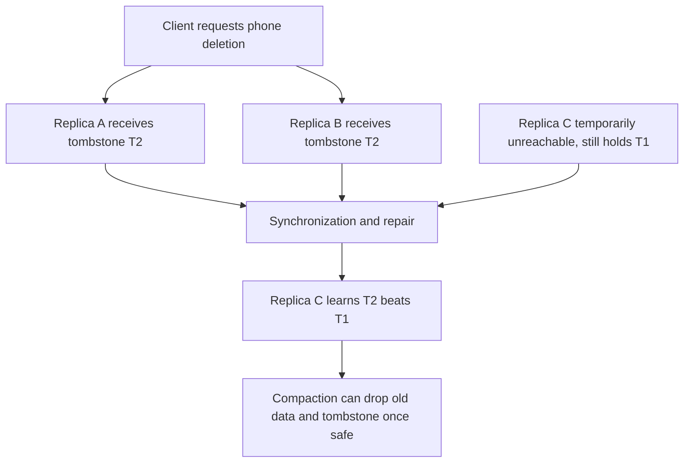

# NULL, UNSET, and Their Impact on Data and Tombstones in Cassandra

In the **CQL Writes and Deletes** chapter, a field having no value can carry very different meanings: the user **did not send the field**, the user **requested deleting the value**, or the value **expired**. If a Java application confuses these situations, a request to update a phone number can accidentally delete an email, generate excessive *tombstones*, and complicate data reconciliation across replicas.

Apache Cassandra is a **distributed wide-column** database. Data is located by **primary key**, distributed by **partition key**, replicated according to replication settings, and read/written with a chosen consistency level. Consequently, the semantics of `NULL` and `UNSET` affect not only `SELECT` output: they also affect reconciled cell versions, deletion markers, compaction, and repair.

After this lesson, you will be able to:

- Distinguish **omitting a column**, **assigning NULL**, **binding UNSET**, and **writing a value**.
- Explain why `NULL` creates a tombstone while `UNSET` generates no mutation for that column.
- Understand why `SELECT` returning `null` does not prove a NULL value is stored on disk.
- Handle `INSERT`, `UPDATE`, `DELETE`, `INSERT JSON`, and Java Driver parameters intentionally.
- Recognize the impact of timestamps, TTL, replication, compaction, and repair on tombstones.
- Design partial-update APIs without losing fields the user did not send.

## 1. Data model for observing individual cells

Suppose a system looks up contact details by customer ID. The `demo` keyspace is assumed to exist:

```sql
CREATE TABLE demo.customer_contact_by_id (
    customer_id uuid PRIMARY KEY,
    full_name text,
    email text,
    phone text,
    locale text,
    temporary_note text
);
```

In this table, `customer_id` is both the **partition key** and the **full primary key**. Every write with the same UUID targets the same logical row. `full_name`, `email`, `phone`, `locale`, and `temporary_note` are **regular columns**, written and reconciled independently at the cell level.

Create initial data:

```sql
INSERT INTO demo.customer_contact_by_id (
    customer_id, full_name, email, phone, locale
)
VALUES (
    11111111-1111-4111-8111-111111111111,
    'Nguyen Mai',
    'mai@example.test',
    '0900000001',
    'vi-VN'
);

SELECT full_name, email, phone, locale, temporary_note
FROM demo.customer_contact_by_id
WHERE customer_id = 11111111-1111-4111-8111-111111111111;
```

Assuming no competing writes and no default table TTL, the observed values are:

| Column | Value |
| --- | --- |
| `full_name` | `'Nguyen Mai'` |
| `email` | `'mai@example.test'` |
| `phone` | `'0900000001'` |
| `locale` | `'vi-VN'` |
| `temporary_note` | `null` (never written) |

Note: reading `temporary_note` as `null` **does not mean Cassandra stores a cell containing a NULL value**. In CQL, `null` in a read result typically represents the absence of a live value.

## 2. Four write behaviors to distinguish

This is the most important table in the lesson:

| Case | Expression | Effect on a regular column |
| --- | --- | --- |
| **Omit column** | Column omitted from `INSERT`/`UPDATE` | Column is not written; existing value is untouched by this mutation |
| **Write value** | `SET phone = '090...'` | Writes a new version to the column's cell |
| **Write NULL** | `SET phone = NULL` or bind null | Writes a deletion marker (*tombstone*) for the column |
| **Bind UNSET** | Marker in prepared statement set to `UNSET` | Performs no write operation for that column |

**NULL and UNSET are not two ways of writing the same behavior.** `NULL` carries deletion intent; `UNSET` carries do-not-update intent.

A quick mental model:

```text
Row has phone = '0900000001'

UPDATE ... SET locale = 'en-US'
    -> phone not mentioned -> kept unchanged.

UPDATE ... SET phone = '0900000099'
    -> phone has a new value -> new version written.

UPDATE ... SET phone = NULL
    -> phone logically deleted -> tombstone created.

Prepared UPDATE ... SET phone = :phone; bind :phone = UNSET
    -> phone not written -> kept unchanged.
```

"Kept unchanged" here applies **strictly to the mutation being executed**. Another client can still write that column; an old TTL can expire; or reading from a different replica can observe unconverged state depending on the consistency level.

### Why is UNSET not a regular CQL value?

`UNSET` is a **protocol parameter state when binding a prepared statement**, supported in modern Cassandra protocol versions and drivers. It is not the string `'UNSET'`, nor a value keyword usable everywhere `NULL` can appear in a CQL statement.

Therefore:

- In direct CQL statements in `cqlsh`, to avoid modifying a column, **omit that column from the statement**.
- In prepared statements, markers for columns that do not need updating can be set to `UNSET`.
- For **required primary key** components, neither `NULL` nor `UNSET` is a valid key value. Always supply the full required key.

## 3. Practice: omitting columns, assigning NULL, and DELETE

### A. Omitting a column: preserves existing data

Example updating only the language:

```sql
UPDATE demo.customer_contact_by_id
SET locale = 'en-US'
WHERE customer_id = 11111111-1111-4111-8111-111111111111;
```

In this mutation, `locale` is rewritten, whereas `email` and `phone` are not written. After a successful write, they retain their previous values unless modified by another operation.

A regular `INSERT` also has **per-column upsert** semantics:

```sql
INSERT INTO demo.customer_contact_by_id (customer_id, locale)
VALUES (
    11111111-1111-4111-8111-111111111111,
    'ja-JP'
);
```

An `INSERT` at the same primary key writes only `locale`; omitting `email` and `phone` from the column list does not turn them into null. Nor does an `INSERT` without `IF` raise an existing-key error as in a relational database.

### B. Assigning NULL: logically deletes the value

```sql
UPDATE demo.customer_contact_by_id
SET phone = NULL
WHERE customer_id = 11111111-1111-4111-8111-111111111111;

SELECT email, phone, locale
FROM demo.customer_contact_by_id
WHERE customer_id = 11111111-1111-4111-8111-111111111111;
```

Assuming no competing writes and a read that observes the delete, `phone` returns `null` while `email` and `locale` remain. Cassandra has now recorded a **tombstone** marking the previous phone version as invalid.

### C. DELETE column: the same deletion intent

```sql
DELETE phone
FROM demo.customer_contact_by_id
WHERE customer_id = 11111111-1111-4111-8111-111111111111;
```

For a regular scalar column such as `phone`, `DELETE phone` and `UPDATE ... SET phone = NULL` both express **deleting the column's value**. You only need to run **one of the two** when practicing; there is no need to delete twice. Both can create a deletion marker rather than simply "erasing the cell immediately from every SSTable."

### D. Re-writing after deletion

```sql
UPDATE demo.customer_contact_by_id
SET phone = '0900000077'
WHERE customer_id = 11111111-1111-4111-8111-111111111111;
```

If the new write has a higher timestamp than the tombstone and is read at an appropriate consistency level, `phone` can reappear with the value `'0900000077'`. A tombstone is not a permanent ban on future writes: it invalidates **older versions** during reconciliation.

## 4. What is a tombstone and why isn't data erased immediately?

Cassandra writes data to the **commit log** and **memtable**, which is later flushed into immutable **SSTable** files. An older record may sit in an SSTable on one node while a new delete mutation arrives in another memtable/SSTable. The database cannot mutate every on-disk version and every replica in place the instant a client runs `SET NULL`.

A **tombstone** is a timestamped deletion marker that tells Cassandra that data older than the marker must not surface as live data.

```text
phone cell of customer A:

Old SSTable:   phone = '0900000001'   timestamp = T1
New mutation:  DELETE phone           timestamp = T2

With T2 > T1, version T1 is shadowed by the deletion marker.
SELECT phone -> null (when the read sees tombstone T2).
```

Because Cassandra maintains multiple replicas, a temporarily disconnected node can miss a delete. Tombstones are retained long enough for synchronization/repair mechanisms to propagate the deletion:



This diagram is illustrative, not a timing guarantee for replica delivery.

### Misconceptions to avoid

- **Tombstones do not always vanish immediately after a threshold.** `gc_grace_seconds` governs the grace period before a tombstone becomes eligible for collection; actual removal also depends on compaction and whether older versions can be safely dropped.
- **Lowering `gc_grace_seconds` recklessly is dangerous.** If a tombstone is purged before an absent replica learns about the delete, stale data can "resurrect" (*zombie data*) upon synchronization.
- **Repair and compaction have distinct roles.** Repair helps replicas converge, whereas compaction merges SSTables and can purge deleted data when eligible.
- **`SELECT col` returning `null` does not reveal tombstones.** The output looks identical whether the column was never written, was deleted, or its previous value expired.

### NULL is not the same as a "deleted row"

Assigning `phone = NULL` deletes **one column**, not the entire row or partition. CQL also supports deleting a row or an entire partition by key; those operations can create broader tombstones, such as row tombstones or partition tombstones.

When a row has only its primary key remaining or has many deleted columns, whether the row still appears in a `SELECT` depends on row existence state, row liveness markers, and live cells. Therefore, **do not rely on all regular columns reading as null to conclude the entire row was deleted**.

## 5. Concurrent writes: tombstones also carry timestamps

Competing updates to the same cell are reconciled by Cassandra using **timestamps**. Among normal versions, the value with the higher timestamp wins; a tombstone can shadow older live versions.

| Version | Operation | Illustrative timestamp | Reconciliation outcome |
| --- | --- | --- | --- |
| A | `phone = '0901'` | 100 | Older value |
| B | `phone = NULL` | 200 | B shadows A |
| C | `phone = '0902'` | 150 | C is still shadowed by B |
| D | `phone = '0903'` | 300 | D is newer than B and can become visible |

The numbers 100, 200, 300 are solely for comparison. Cassandra represents write timestamps in **microseconds since the Unix epoch**. Timestamp order determines reconciliation outcomes, not merely the order requests entered the application. Equal timestamps follow deterministic tie-breaking rules; never intentionally produce equal timestamps to rely on that tie-breaker in business logic.

### Implications for retries

A retried delete with a newer timestamp can still beat a write that restored a value from another client. Conversely, a delete arriving late with an older timestamp cannot shadow a newer version.

If a request times out, the application **cannot assume the delete failed**: a subset of replicas may already have recorded the tombstone. Retry design must consider timestamps, competing operations, and read/write consistency levels. If business rules require "delete only if email is still X," use LWT with an appropriate condition rather than `SELECT` followed by an unconditional `SET NULL`.

Example deleting email only if it has not changed:

```sql
UPDATE demo.customer_contact_by_id
SET email = NULL
WHERE customer_id = 11111111-1111-4111-8111-111111111111
IF email = 'mai@example.test';
```

This is a **lightweight transaction (LWT)**. The application must inspect the `[applied]` column in the result to know whether the condition succeeded or failed. LWT requires consensus and is typically more expensive than regular writes, so use it only when concurrent conditions are a business requirement.

## 6. INSERT JSON: missing fields can become NULL if you are not careful

With standard column-list `INSERT`, omitted columns are skipped. However, **CQL JSON insert** has its own default policy for properties absent from the JSON.

### DEFAULT NULL and DEFAULT UNSET

Suppose Mai's row still has `full_name` and `email`, and we only want to update `locale`:

```sql
INSERT INTO demo.customer_contact_by_id JSON
'{"customer_id":"11111111-1111-4111-8111-111111111111","locale":"fr-FR"}'
DEFAULT UNSET;
```

With `DEFAULT UNSET`, columns **absent from the JSON** are not rewritten. In this case, `locale` is updated while the other columns are untouched by this mutation.

If no default policy is specified, `INSERT ... JSON` uses **DEFAULT NULL**; absent properties may be treated as null:

```sql
-- Illustrates the hazard only; do not run on data you need to keep!
INSERT INTO demo.customer_contact_by_id JSON
'{"customer_id":"11111111-1111-4111-8111-111111111111","locale":"fr-FR"}'
DEFAULT NULL;
```

In that case, `full_name`, `email`, `phone`, or `temporary_note` absent from the JSON can receive NULL writes and generate tombstones. This is a frequent trap when an application passes a JSON object containing only the fields to modify.

| Syntax | Column **missing** in JSON | Column **explicitly sent as null** |
| --- | --- | --- |
| `INSERT ... JSON '...' DEFAULT NULL` | Handled under the NULL policy | Writes NULL |
| `INSERT ... JSON '...' DEFAULT UNSET` | Ignored, cell not written | Remains NULL, expressing deletion intent |

`DEFAULT UNSET` changes only how **missing properties** are handled; it does not turn an explicitly sent `"phone": null` into a no-op.

Comparison example:

```json
{"customer_id":"11111111-1111-4111-8111-111111111111","locale":"en-US"}
```

With `DEFAULT UNSET`, `phone` is not sent so it stays intact. However:

```json
{"customer_id":"11111111-1111-4111-8111-111111111111","locale":"en-US","phone":null}
```

explicitly requests deleting `phone`. Define the meaning of JSON null clearly in your API contract, then choose the matching CQL binding.

### Comparison with NULL in column-list INSERT

```sql
INSERT INTO demo.customer_contact_by_id (
    customer_id, email
)
VALUES (
    11111111-1111-4111-8111-111111111111,
    NULL
);
```

In this statement, `email` is **explicitly listed with NULL**, so it means deletion. Omitting `email` from the column/`VALUES` lists means the mutation does not write email.

## 7. TTL: auto-expiring values are not UNSET

Cassandra supports **time to live (TTL)** for written columns. A value with a TTL ceases to be considered live once it expires; at the storage layer, Cassandra's expiration mechanism involves tombstones. TTL is not a "skip" operation like UNSET.

```sql
UPDATE demo.customer_contact_by_id USING TTL 60
SET temporary_note = 'Temporary verification code'
WHERE customer_id = 11111111-1111-4111-8111-111111111111;

SELECT temporary_note, TTL(temporary_note),
       WRITETIME(temporary_note)
FROM demo.customer_contact_by_id
WHERE customer_id = 11111111-1111-4111-8111-111111111111;
```

Reading immediately after the write can show:

- `temporary_note` holds the value just written.
- `TTL(temporary_note)` shows remaining seconds, counting down toward 0.
- `WRITETIME(temporary_note)` shows the cell's write timestamp in microseconds since the Unix epoch.

After the TTL expires, `temporary_note` typically reads as `null`. The **cause** differs from a column that was never written or was explicitly set to NULL, even though all three can appear as `null` in `SELECT` results.

A statement modifying only `locale` does not refresh the TTL of `temporary_note`:

```sql
UPDATE demo.customer_contact_by_id
SET locale = 'de-DE'
WHERE customer_id = 11111111-1111-4111-8111-111111111111;
```

The existing TTL of `temporary_note` keeps counting down if that column is not rewritten. Conversely, rewriting `temporary_note` gives the new value TTL properties from the new write or the table's `default_time_to_live` setting. Do not interpret a mutation with TTL as altering the TTL of every column in the row.

**Observing tombstones:** `WRITETIME` and `TTL` are useful for live cells, but normal `SELECT` queries do not display tombstone records or tombstone timestamps as standalone data rows. To investigate abnormal tombstone counts in operations, use the metrics and tools for your Cassandra version alongside monitoring read latency, compaction, and repair.

## 8. Java Driver: pass UNSET instead of accidentally passing NULL

In partial-update APIs, callers usually send only the fields they want to change. Example HTTP PATCH:

```json
{
  "locale": "en-US"
}
```

Intent: change `locale`, **preserve** `email` and `phone`. If the backend deserializes the payload into a Java DTO with `email == null` and `phone == null`, and binds both to Cassandra using `setToNull`, data will be unintentionally deleted.

The API must distinguish **field absent** from **field present with JSON null**. With Jackson, `JsonNode.has(...)` and `JsonNode.isNull()` can separate the two cases.

### Prepared statement with markers for every optional column

Example using Apache Cassandra Java Driver 4.x. Assume the application already has a `CqlSession session`, `UUID customerId`, and a valid JSON object `JsonNode patch`:

```java
PreparedStatement prepared = session.prepare(
    "UPDATE demo.customer_contact_by_id " +
    "SET email = :email, phone = :phone, locale = :locale " +
    "WHERE customer_id = :customer_id"
);

BoundStatementBuilder builder = prepared.boundStatementBuilder()
    .setUuid("customer_id", customerId)
    .unset("email")
    .unset("phone")
    .unset("locale");

boolean hasChange = false;

if (patch.has("email")) {
    JsonNode value = patch.get("email");
    if (value.isNull()) {
        builder.setToNull("email");        // Intentionally delete email
    } else if (value.isTextual()) {
        builder.setString("email", value.textValue());
    } else {
        throw new IllegalArgumentException("email must be a string or null");
    }
    hasChange = true;
}

if (patch.has("phone")) {
    JsonNode value = patch.get("phone");
    if (value.isNull()) {
        builder.setToNull("phone");        // Intentionally delete phone
    } else if (value.isTextual()) {
        builder.setString("phone", value.textValue());
    } else {
        throw new IllegalArgumentException("phone must be a string or null");
    }
    hasChange = true;
}

if (patch.has("locale")) {
    JsonNode value = patch.get("locale");
    if (value.isNull()) {
        builder.setToNull("locale");       // Only if API allows deletion
    } else if (value.isTextual()) {
        builder.setString("locale", value.textValue());
    } else {
        throw new IllegalArgumentException("locale must be a string or null");
    }
    hasChange = true;
}

if (hasChange) {
    session.execute(builder.build());
}
```

Java Driver and Jackson imports are omitted to focus on binding semantics. In a production application, add payload validation, field-level edit permissions, length limits, email format checks, and driver exception handling.

| JSON input | Corresponding bind | Effect |
| --- | --- | --- |
| No `"email"` | `unset("email")` | Does not write email |
| `"email": null` | `setToNull("email")` | Writes a tombstone for email |
| `"email": "new@example.test"` | `setString("email", ...)` | Writes the new email value |
| `"locale": "en-US"` and other two absent | Bind locale, email/phone UNSET | Writes only locale |

**Do not use `patch.hasNonNull("email")` as the sole check** if JSON null means "delete email": that check skips an email field explicitly sent as null and loses user intent.

If the API does not permit deleting a field, **return a validation error** when JSON contains null for that field; do not silently convert it to UNSET or delete it without an explicit contract.

### Avoiding an UPDATE with no changes

When a payload has no updatable fields, every marker except the key is UNSET. In that case, proactively treat the request as a **no-op** or return a validation error; there is no need to issue an empty mutation. Likewise, never use `NULL` or `UNSET` for `customer_id`, because Cassandra needs a valid key value to locate the row.

### When modifying only a single column

The application can also prepare a leaner CQL statement:

```sql
UPDATE demo.customer_contact_by_id
SET locale = ?
WHERE customer_id = ?;
```

This avoids markers for email/phone altogether and eliminates the risk of misbinding them. For APIs with many field combinations, use either a fixed prepared statement with UNSET or construct CQL using an **allowlist of allowed columns** controlled by the application, always binding values instead of concatenating request strings.

## 9. Exceptions and limits to know

### Primary keys cannot be cleared by binding NULL or UNSET

All components of the full primary key must identify the target row. Neither `customer_id = NULL` nor `customer_id = UNSET` is a way to "omit the key" to update multiple rows. For tables with composite keys, satisfy the write's key requirements. To change a primary key, the application must treat it as creating data under the new key and handling the old key, not `UPDATE SET primary_key = NULL`.

### NULL on a collection can delete the entire collection

If a table has `attributes map<text, text>`, assigning `attributes = NULL` deletes the entire collection. That differs from **omitting** `attributes` and from deleting **a single element** of the map. For non-frozen collections, whole-collection writes and element-level writes/deletes have distinct tombstone behaviors; pick the right scope to avoid touching unrelated data.

### Counters have dedicated syntax and semantics

Counters are updated via addition/subtraction under special rules and do not behave like scalar columns where you can freely `SET counter = NULL`. Do not blindly apply regular-column NULL/UNSET guidelines to counters. Additive operations also require dedicated retry policies because re-executing them can increment/decrement a second time.

### "No value" does not necessarily mean "never written"

When executing:

```sql
SELECT email
FROM demo.customer_contact_by_id
WHERE customer_id = 11111111-1111-4111-8111-111111111111;
```

A `null` result can come from several causes:

1. Email was never written to the row.
2. Email was deleted via `SET NULL` or `DELETE`.
3. Email's TTL expired.
4. A timestamp-winning version/tombstone or a read observing different replicas.

If business logic needs to distinguish "never provided email" from "explicitly requested deleting email," **model that business state as a separate column or event**; do not expect `SELECT email` alone to distinguish the causes.

## 10. Hands-on lab: predicting mutations before running

Run in a test environment using a separate UUID so results do not depend on earlier examples.

**Step 1 — Initialize the row**

```sql
INSERT INTO demo.customer_contact_by_id (
    customer_id, full_name, email, phone, locale
)
VALUES (
    55555555-5555-4555-8555-555555555555,
    'Linh',
    'linh@example.test',
    '0911111111',
    'vi-VN'
);
```

**Step 2 — Omit email and phone**

```sql
UPDATE demo.customer_contact_by_id
SET locale = 'en-US'
WHERE customer_id = 55555555-5555-4555-8555-555555555555;

SELECT email, phone, locale
FROM demo.customer_contact_by_id
WHERE customer_id = 55555555-5555-4555-8555-555555555555;
```

Expected: `email = 'linh@example.test'`, `phone = '0911111111'`, `locale = 'en-US'`.

**Step 3 — Assign NULL to phone**

```sql
UPDATE demo.customer_contact_by_id
SET phone = NULL
WHERE customer_id = 55555555-5555-4555-8555-555555555555;

SELECT email, phone, locale
FROM demo.customer_contact_by_id
WHERE customer_id = 55555555-5555-4555-8555-555555555555;
```

Expected: `phone` reads as `null`; email and locale remain. The mutation creates a deletion marker for phone.

**Step 4 — Change name via JSON, skipping other columns**

```sql
INSERT INTO demo.customer_contact_by_id JSON
'{"customer_id":"55555555-5555-4555-8555-555555555555","full_name":"Linh Tran"}'
DEFAULT UNSET;
```

Expected: name changes to `'Linh Tran'`; email remains `'linh@example.test'` and locale remains `'en-US'`. Phone stays absent because it was deleted in step 3.

**Step 5 — Write a value with TTL**

```sql
UPDATE demo.customer_contact_by_id USING TTL 120
SET temporary_note = 'Respond within 2 minutes'
WHERE customer_id = 55555555-5555-4555-8555-555555555555;

SELECT temporary_note, TTL(temporary_note), email, locale
FROM demo.customer_contact_by_id
WHERE customer_id = 55555555-5555-4555-8555-555555555555;
```

Expected: `temporary_note` has a TTL near 120 seconds right after writing; email and locale are unaffected by this statement. Once the TTL expires, the note can read as `null` even while email and locale remain.

### Expected state table

| Point in time | `full_name` | `email` | `phone` | `locale` |
| --- | --- | --- | --- | --- |
| After step 1 | Linh | linh@example.test | 0911111111 | vi-VN |
| After step 2 | Linh | linh@example.test | 0911111111 | en-US |
| After step 3 | Linh | linh@example.test | null | en-US |
| After step 4 | Linh Tran | linh@example.test | null | en-US |
| After step 5 | Linh Tran | linh@example.test | null | en-US |

The illustrative results assume no concurrent writes, custom timestamps, or other TTLs. You can also check `WRITETIME(email)` before and after step 2: a statement updating only `locale` does not refresh email's write timestamp.

### Self-check questions

1. A backend receives JSON containing only `locale` and binds `email = NULL`. What is wrong? **It turned an "unsent field" into an "email deletion request," causing an unintended tombstone.**
2. When `phone` reads as `null`, does that prove phone was deleted? **No.** Phone could have never been written, been deleted, or had its TTL expire.
3. How do you preserve a column when binding a prepared statement? **Use `UNSET` or omit that column from the CQL statement.**
4. Does `DEFAULT UNSET` ignore a JSON property explicitly sent as `null`? **No.** It only applies to **missing** properties in the JSON.
5. Why do tombstones remain after `DELETE` succeeds? **To shadow older versions and propagate deletion state to replicas that have not yet synchronized.**
6. What is the risk of lowering `gc_grace_seconds` too far without ensuring repair runs? **Stale data on a replica that missed the delete can resurrect.**

## 11. Implementation checklist for Cassandra and Java

Before shipping an update endpoint to production, answer:

1. **Do missing fields and null fields mean different things?** If so, the input representation must preserve field presence.
2. **Are any columns bound to NULL unintentionally?** Call `setToNull` or `DELETE` only when deletion is truly intended.
3. **Are unsent columns omitted or bound as UNSET?** Be especially careful with `INSERT JSON` because its default is `DEFAULT NULL`.
4. **Is the primary key complete and valid?** Never use NULL/UNSET to locate rows.
5. **Do concurrent writes need protection?** When old-value conditions matter, use `IF`/LWT and inspect `[applied]`.
6. **Are TTL, compaction, and repair operated appropriately?** Avoid generating bulk tombstones and do not shorten tombstone grace periods without justification.
7. **Does the consistency level match read/write goals?** Consistency levels affect replica acknowledgment and visibility, not business-condition enforcement.
8. **Can retries change timestamps or impact newer versions?** On timeouts, define a state-verification and retry strategy.

**Takeaway:** In Cassandra, **NULL is a request to delete a value**, whereas **UNSET is a request not to write the corresponding column**. Both can leave certain fields looking like `null` on reads, yet their storage effects are fundamentally different. Understanding this distinction keeps Java partial-update APIs safe, curbs tombstone growth, prevents data resurrection on unrepaired replicas, and gives you control over write/delete semantics in a distributed system.
