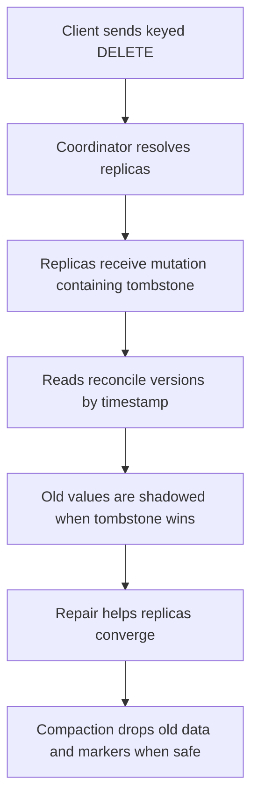

# DELETE by Column, Row, Clustering Range, or Partition in Cassandra

In Apache Cassandra, a `DELETE` statement does not necessarily mean "delete one record." Depending on the columns listed after `DELETE` and the `WHERE` predicate, the operation can **delete a single column's value**, **delete a row**, **delete a range of rows by clustering key**, or **delete an entire partition**. Each scope writes a different deletion marker and carries different consequences for queries, performance, replication, and repair.

This lesson belongs to the **CQL Writes and Deletes** chapter of module **DATABASE_ENGINE_WIDE_COLUMN_CASSANDRA**, where learners study Cassandra's distributed wide-column architecture, query-driven table design, and consistency levels. This material helps you predict the exact blast radius of a delete statement while implementing controlled deletions from Java applications.

After this lesson, you will be able to:

- Read a primary key to determine whether a delete targets a column, a row, a clustering range, or a partition.
- Write syntactically valid CQL `DELETE` statements with composite partition keys and multiple clustering columns.
- Understand tombstones at the cell, row, range, and partition levels, and distinguish logical deletion from physical garbage collection.
- Explain the effects of timestamps, TTL, replication, compaction, repair, and consistency levels.
- Write Java prepared statements to delete at the proper scope, handle timeouts, and issue conditional deletes.

## 1. The key determines DELETE scope

Suppose a device telemetry system needs to read events for **one device on one day**, ordered by event time. The `demo` keyspace is assumed to exist.

```sql
CREATE TABLE demo.events_by_device_day (
    device_id       uuid,
    event_day       date,
    event_time      timestamp,
    event_id        uuid,
    event_type      text,
    severity        int,
    payload         text,
    location_name   text static,
    PRIMARY KEY ((device_id, event_day), event_time, event_id)
);
```

Key breakdown:

| Component | Column(s) | Meaning on DELETE |
| --- | --- | --- |
| **Composite partition key** | `(device_id, event_day)` | Identifies the logical partition and responsible replicas |
| **First clustering column** | `event_time` | Orders rows chronologically within the partition; supports range bounds |
| **Second clustering column** | `event_id` | Distinguishes events sharing the same timestamp |
| **Regular columns** | `event_type`, `severity`, `payload` | Individual column values can be deleted for a specific row |
| **Static column** | `location_name` | Partition-wide shared value; can be deleted using only the partition key |

The **full primary key** is `(device_id, event_day, event_time, event_id)`. To delete one specific row, you must identify the row with the full key. To delete an entire partition, supply only the full partition key. To delete a range of rows, supply the full partition key and valid bounds on clustering columns.

Mental model:

```text
Partition (device_id=A, event_day=2026-11-21)
|
+-- Static: location_name = 'Warehouse A'
|
+-- Row (09:00, event_id=X)
|    event_type = 'BOOT', payload = '...'
|
+-- Row (09:15, event_id=Y)
|    event_type = 'WARN', payload = '...'
|
+-- Row (10:30, event_id=Z)
     event_type = 'INFO', payload = '...'
```

Corresponding to the diagram above:

- **DELETE a column:** deletes only `payload` on row Y.
- **DELETE a row:** deletes row Y, keeping X and Z.
- **DELETE a clustering range:** deletes rows whose `event_time` falls within the selected bounds.
- **DELETE a partition:** deletes all of X, Y, Z along with the partition's static value.

### Create initial data

The following examples use device `11111111-1111-4111-8111-111111111111` on `2026-11-21`. Fixed `event_id` UUIDs enable deterministic reads and deletes.

```sql
UPDATE demo.events_by_device_day
SET location_name = 'Warehouse A'
WHERE device_id = 11111111-1111-4111-8111-111111111111
  AND event_day = '2026-11-21';

INSERT INTO demo.events_by_device_day (
    device_id, event_day, event_time, event_id,
    event_type, severity, payload
)
VALUES (
    11111111-1111-4111-8111-111111111111,
    '2026-11-21', '2026-11-21 09:00:00+0700',
    aaaaaaaa-aaaa-4aaa-8aaa-aaaaaaaaaaaa,
    'BOOT', 1, 'Startup completed'
);

INSERT INTO demo.events_by_device_day (
    device_id, event_day, event_time, event_id,
    event_type, severity, payload
)
VALUES (
    11111111-1111-4111-8111-111111111111,
    '2026-11-21', '2026-11-21 09:15:00+0700',
    bbbbbbbb-bbbb-4bbb-8bbb-bbbbbbbbbbbb,
    'WARN', 3, 'High temperature'
);

INSERT INTO demo.events_by_device_day (
    device_id, event_day, event_time, event_id,
    event_type, severity, payload
)
VALUES (
    11111111-1111-4111-8111-111111111111,
    '2026-11-21', '2026-11-21 10:30:00+0700',
    cccccccc-cccc-4ccc-8ccc-cccccccccccc,
    'INFO', 1, 'Cooling enabled'
);
```

Expected state assuming no competing writes:

| Event time | event_id (short) | event_type | severity | payload |
| --- | --- | --- | ---: | --- |
| 09:00 | `aaaa...` | BOOT | 1 | Startup completed |
| 09:15 | `bbbb...` | WARN | 3 | High temperature |
| 10:30 | `cccc...` | INFO | 1 | Cooling enabled |

All rows in the partition see `location_name = 'Warehouse A'`. Sections 2–5 demonstrate each delete type; when comparing them independently, re-initialize the test data in your sandbox. Section 10 provides a self-contained lab sequence to avoid state coupling.

## 2. DELETE by column: clears the value, keeps the row

To strip the detailed `payload` from the 09:15 warning event while preserving its event type and severity:

```sql
DELETE payload
FROM demo.events_by_device_day
WHERE device_id = 11111111-1111-4111-8111-111111111111
  AND event_day = '2026-11-21'
  AND event_time = '2026-11-21 09:15:00+0700'
  AND event_id = bbbbbbbb-bbbb-4bbb-8bbb-bbbbbbbbbbbb;
```

For a **regular column**, the `WHERE` clause of a column delete must locate the target row by full primary key. Reading it back:

```sql
SELECT event_time, event_id, event_type, severity, payload
FROM demo.events_by_device_day
WHERE device_id = 11111111-1111-4111-8111-111111111111
  AND event_day = '2026-11-21'
  AND event_time = '2026-11-21 09:15:00+0700'
  AND event_id = bbbbbbbb-bbbb-4bbb-8bbb-bbbbbbbbbbbb;
```

Once the delete is visible to the replicas serving the read, `payload` returns `null`, while `event_type = 'WARN'` and `severity = 3` remain. **The row still exists**, because deleting a regular column does not delete the whole row.

### Deleting multiple columns of the same row

```sql
DELETE payload, severity
FROM demo.events_by_device_day
WHERE device_id = 11111111-1111-4111-8111-111111111111
  AND event_day = '2026-11-21'
  AND event_time = '2026-11-21 09:15:00+0700'
  AND event_id = bbbbbbbb-bbbb-4bbb-8bbb-bbbbbbbbbbbb;
```

This statement requests deleting the two specified column values on the selected row. It does not alter `event_type` and does not delete other events in the same partition.

### Static columns are a partition-key exception

`location_name` is declared `static`, so it belongs to the **partition**, not a single event row. Deleting the static value:

```sql
DELETE location_name
FROM demo.events_by_device_day
WHERE device_id = 11111111-1111-4111-8111-111111111111
  AND event_day = '2026-11-21';
```

Here **only the full partition key is required**, without `event_time` or `event_id`. Every event row in the partition will observe `location_name` as deleted when read. Regular columns retain their values.

You cannot apply partition-key-only static deletion syntax to a regular column like `payload`:

```sql
-- INVALID: payload is a regular column; no clustering row is specified.
DELETE payload
FROM demo.events_by_device_day
WHERE device_id = 11111111-1111-4111-8111-111111111111
  AND event_day = '2026-11-21';
```

### Column DELETE vs. assigning NULL

For a scalar regular column:

```sql
UPDATE demo.events_by_device_day
SET payload = NULL
WHERE device_id = 11111111-1111-4111-8111-111111111111
  AND event_day = '2026-11-21'
  AND event_time = '2026-11-21 09:15:00+0700'
  AND event_id = bbbbbbbb-bbbb-4bbb-8bbb-bbbbbbbbbbbb;
```

`SET payload = NULL` also expresses **deleting the column's value**, typically creating a tombstone. By contrast, **omitting the column** or binding **UNSET** in a prepared statement means leaving that column untouched. Never confuse "field omitted in a JSON PATCH" with "user wants to delete the value."

## 3. DELETE by row: requires the full primary key

To delete only the 09:15 WARN event, omit any column list after `DELETE` and supply the **full primary key**:

```sql
DELETE FROM demo.events_by_device_day
WHERE device_id = 11111111-1111-4111-8111-111111111111
  AND event_day = '2026-11-21'
  AND event_time = '2026-11-21 09:15:00+0700'
  AND event_id = bbbbbbbb-bbbb-4bbb-8bbb-bbbbbbbbbbbb;
```

Cassandra writes a tombstone for **that row**, causing regular values belonging to it to disappear from reads once the marker is observed. The BOOT and INFO events in the same partition are unaffected.

Notably, `location_name` is a static column and **is not deleted** when only one clustering row is deleted. After deleting the WARN row, the two remaining events still see the static value unless a separate static delete was run.

### Two events at the same timestamp

Because the full primary key includes both `event_time` and `event_id`, two events with the same timestamp but different UUIDs are **two distinct rows**. To delete one specific event accurately, you must supply `event_id`.

Omitting `event_id` can make the predicate no longer identify "a single row." In schemas with multiple clustering columns, Cassandra may permit deletes by **clustering prefix**, affecting multiple rows sharing that prefix. Thus, when an API means "delete one event by ID," require the full primary key and validate every component before building CQL.

### You cannot change keys with column DELETE

`event_time` and `event_id` are primary key components. They are not regular columns on which you can run `DELETE event_id` or set `event_time = NULL`. To change an event's identity, the application must write data under the new key and handle deleting the old key according to business rules; these are two operations targeting different storage locations.

## 4. DELETE by clustering range: range tombstones

Suppose you need to delete all events in the `2026-11-21` partition from **09:00 (inclusive)** to **10:00 (exclusive)**. Because the first clustering column is `event_time`, you can use range bounds:

```sql
DELETE FROM demo.events_by_device_day
WHERE device_id = 11111111-1111-4111-8111-111111111111
  AND event_day = '2026-11-21'
  AND event_time >= '2026-11-21 09:00:00+0700'
  AND event_time <  '2026-11-21 10:00:00+0700';
```

This is a **range delete** within **one specific partition**, not a table-wide event filter. In the sample data, the 09:00 and 09:15 rows fall inside the range; the 10:30 row falls outside.

| event_time | In `[09:00, 10:00)`? | Effect |
| --- | --- | --- |
| 09:00:00 | Yes, lower bound uses `>=` | Deleted |
| 09:15:00 | Yes | Deleted |
| 10:00:00 | No, upper bound uses `<` | Kept |
| 10:30:00 | No | Kept |

Half-open intervals `[start, end)` are ideal for partitioning time into contiguous segments without double-deleting or missing boundary events. Changing `<` to `<=` at the upper bound would include an event at exactly 10:00 in the deletion scope.

### Why is it called a range tombstone?

When deleting a clustering range, Cassandra can write a **range tombstone** describing the bounds of the removed clustering rows. The engine does not have to read every matching row and generate thousands of individual `DELETE` statements at the application layer. A single range tombstone shadows older data versions falling inside those bounds.

```text
In partition (device A, day 2026-11-21):

Ascending event_time:
09:00  09:15  09:45  10:00  10:30
  |      |      |      |      |
  +------[ range delete )---+      [illustrates range 09:00 .. <10:00]
  X      X      X      OK     OK
```

This illustration assumes rows exist at those timestamps. Even a row that did not exist before the delete can fall under the range tombstone if a mutation with a **timestamp older than the tombstone** is synchronized later.

**A range tombstone is not a rule that "bans future inserts in this range forever."** If the application writes a new row in that range with a timestamp **newer** than the deletion marker, the new row can appear. Distinguish deleting already-written data from a business rule rejecting late-arriving data; the latter must be enforced separately in the application.

### Rules for using clustering ranges

In the schema `PRIMARY KEY ((device_id, event_day), event_time, event_id)`:

1. You must provide **both** partition key components: `device_id` and `event_day`.
2. You can specify a range on `event_time` because it is the **first clustering column**.
3. Once an inequality is used (e.g., `event_time >= ...`), you cannot arbitrarily add filter predicates on subsequent clustering columns as if CQL were general-purpose SQL.
4. You cannot skip `event_time` and write a range predicate solely on `event_id` to scan all rows for a UUID; clustering prefix order must be respected.
5. Range deletes must use `DELETE FROM ...`; never use `DELETE payload FROM ... WHERE event_time >= ...` hoping to simulate "deleting one regular column across many rows."

Examples of invalid range scopes:

```sql
-- INVALID: missing full partition key.
DELETE FROM demo.events_by_device_day
WHERE device_id = 11111111-1111-4111-8111-111111111111
  AND event_time < '2026-11-21 10:00:00+0700';

-- INVALID: cannot delete by event_type because it is a regular column.
DELETE FROM demo.events_by_device_day
WHERE event_type = 'WARN';

-- INVALID: skipping first clustering column and restricting only event_id.
DELETE FROM demo.events_by_device_day
WHERE device_id = 11111111-1111-4111-8111-111111111111
  AND event_day = '2026-11-21'
  AND event_id = bbbbbbbb-bbbb-4bbb-8bbb-bbbbbbbbbbbb;
```

If you need to delete `WARN` events based on a business condition, the application must know the target row keys or design an appropriate table/processing pipeline. Never expect `ALLOW FILTERING` to turn a regular-column `DELETE` into a full-table scan-and-delete.

### Cost and limits of range deletes

Range deletes are useful for time-series data, yet old data and tombstones still incur overhead during reads and compaction. Very wide, repeated, or overlapping range deletes can strain the system. A daily/monthly **bucketing** strategy, appropriate TTLs, or partitioning data by retention period may be cleaner depending on read and delete requirements.

## 5. DELETE an entire partition: only the full partition key needed

If you need to delete **all events for one device on one exact day**, including that day's static metadata:

```sql
DELETE FROM demo.events_by_device_day
WHERE device_id = 11111111-1111-4111-8111-111111111111
  AND event_day = '2026-11-21';
```

This statement omits `event_time` and `event_id` and lists no columns after `DELETE`. Under this schema, it is a **partition delete**:

- All event rows with the matching full partition key `(device_id, event_day)` are logically deleted.
- The partition's static column `location_name` is also included in the deletion scope.
- Partitions for other days or other devices are untouched.

This is completely different from `UPDATE ... SET location_name = ... WHERE <partition key>`, because a partition-key static update writes only the static cell rather than deleting all clustering rows.

### Composite partition keys must be supplied in full

The following **does not mean delete all days for a device**:

```sql
-- INVALID: event_day is omitted, so a single partition is not identified.
DELETE FROM demo.events_by_device_day
WHERE device_id = 11111111-1111-4111-8111-111111111111;
```

To remove multiple days, the application must identify the corresponding partition keys and perform controlled per-partition/per-bucket deletions. If retention by time is the goal, design the partition key and TTL/retention policy upfront.

### Comparing the four deletion scopes

| Scope | Clause after `DELETE` | `WHERE` predicate | Typical logical marker |
| --- | --- | --- | --- |
| Regular column | `payload` or `payload, severity` | Full primary key of the row | Cell tombstone |
| Row | No columns listed | Full primary key | Row tombstone |
| Clustering range | No columns listed | Full partition key + valid clustering bounds | Range tombstone |
| Partition | No columns listed | Full partition key, no clustering bounds | Partition tombstone |

For a **static column**, `DELETE location_name ... WHERE <full partition key>` deletes the static value at the partition level; this is an intentional exception compared to regular-column deletes, which must identify a specific row.

### Clearing an entire table is a different operation

CQL `DELETE` targets specific keys or clustering ranges within a partition. There is no `DELETE FROM table` without a `WHERE` clause to scan and empty a whole table as in some relational SQL engines. `TRUNCATE` is an administrative command that empties a table with sweeping scope and impact—not a substitute for a single-device/day delete API; use it only under approved operational procedures.

## 6. What gets written when DELETE succeeds?

Cassandra uses an **LSM-tree** storage engine: mutations go through the commit log and memtable before being flushed to immutable SSTables. An old value already on disk in an SSTable is not necessarily erased physically the moment a `DELETE` returns success.

Instead, Cassandra writes a **tombstone** carrying version/timestamp metadata to mark which data should no longer be treated as live.



Nodes in the diagram represent logical roles; repair and compaction are separate background processes, not executed synchronously inside every `DELETE`.

### Tombstone types to distinguish

| Type | Trigger example | Old data shadowed |
| --- | --- | --- |
| Cell tombstone | `DELETE payload` | One specified column value |
| Row tombstone | `DELETE FROM ... WHERE <full primary key>` | Data belonging to one clustering row |
| Range tombstone | `DELETE FROM ... WHERE <partition key> AND event_time >= ... AND event_time < ...` | Rows whose clustering key falls in the range |
| Partition tombstone | `DELETE FROM ... WHERE <partition key>` | All data in the partition, including static |

When Cassandra reads from memtables/SSTables or exchanges versions across replicas, a deletion marker with a sufficiently new timestamp invalidates older data within its scope. Thus, a deleted record may still occupy physical bytes in an SSTable without being returned as live data.

### DELETE does not imply an existence check

A regular `DELETE` sends a keyed mutation **without reading first to confirm the item exists**. Deleting a key with no existing data can still write deletion metadata. By default, CQL does not return an affected-row count like `rowsAffected` in some relational databases; the application cannot infer from completion alone that "exactly one existing record was deleted."

If business logic requires "delete only if the row currently exists," see section 8 on `IF EXISTS`; that carries LWT/conditional overhead and applies only to supported scopes.

### DELETE, TTL, and NULL yield identical read output for different reasons

- `DELETE payload`: explicitly writes a deletion marker for the column.
- `UPDATE ... SET payload = NULL`: also deletes a scalar column value.
- Writing `payload` with a TTL: after the TTL expires, the value ceases to be live and is handled via expiration/tombstone mechanics.
- Never writing `payload`: reads as `null` without any deletion history.

`SELECT` returning `null` does not reveal which cause occurred. If you must distinguish "never existed," "user requested deletion," and "expired," model explicit business states or a separate audit log.

## 7. Timestamps, replication, repair, and data resurrection risks

Mutations in Cassandra are reconciled by **write timestamp**. Given an old value at timestamp `T1` and a corresponding tombstone at `T2` where `T2 > T1`, the deletion marker shadows the old value. If a new value with timestamp `T3 > T2` is later written to the exact same key and scope, the new value can appear.

```text
Row (device A, day D, time 09:15, event Y):

T1: payload = 'High temperature'
T2: DELETE payload               (T2 > T1)
T3: payload = 'New payload'      (T3 > T2)

At T2: payload reads as null once the tombstone is visible.
At T3: the new payload can be read back.
```

Actual Cassandra timestamps are in **microseconds since the Unix epoch**. Never assume "whichever request reached the coordinator later always wins": under clock skew or client-supplied timestamps, a later-arriving statement can carry an older timestamp.

### Why must tombstones be retained long enough?

Suppose replication factor is 3, and one replica misses a delete because of a temporary outage:

```text
Replica A: received DELETE, holds tombstone T2
Replica B: received DELETE, holds tombstone T2
Replica C: temporarily offline, still holds old data T1
```

Deletion metadata must persist long enough for repair/synchronization to inform Replica C that version T2 is newer than T1. If the tombstone is garbage-collected too early before C is repaired and synchronized, the stale version can resurface in certain scenarios—commonly known as **zombie data**.

`gc_grace_seconds` is a key parameter controlling when a tombstone becomes eligible for collection, yet **it is not a timer guaranteeing the tombstone vanishes at that exact second**. Compaction removes old data and markers only when safety conditions are satisfied. Never lower `gc_grace_seconds` arbitrarily to "speed up deletes" without an active repair strategy and a thorough understanding of your Cassandra version.

### Consistency level does not replace repair

With a replication factor of 3, writing at `QUORUM` typically requires at least 2 replicas to acknowledge within the applicable quorum scope; `ONE` requires fewer acknowledgments and can favor availability or latency. Read/write consistency choices govern visibility and acknowledgment guarantees, whereas **repair ensures replicas converge**. Never assume a successful `QUORUM` delete means every replica has already received the marker instantaneously.

### Timeouts and retries

If a client receives a timeout, it cannot know for sure whether a subset of replicas accepted the delete mutation. For keyed deletes, retrying is generally easier to reason about than additive operations, yet **a newer retry timestamp** can shadow a value written concurrently by another client. State-sensitive operations require business preconditions or concurrency controls.

When troubleshooting incidents, examine read/write consistency levels, timeout errors, replica health, repair/compaction lag, and key design. Never rely solely on a single low-consistency `SELECT` to conclude a delete succeeded across every replica.

## 8. Conditional DELETE: IF EXISTS and IF old value

A regular `DELETE` does not answer "did the row exist before deletion?" When you need a precondition to avoid deleting an object that changed concurrently, Cassandra provides **lightweight transactions (LWT)** for supported cases.

### Delete only if the row currently exists

```sql
DELETE FROM demo.events_by_device_day
WHERE device_id = 11111111-1111-4111-8111-111111111111
  AND event_day = '2026-11-21'
  AND event_time = '2026-11-21 09:15:00+0700'
  AND event_id = bbbbbbbb-bbbb-4bbb-8bbb-bbbbbbbbbbbb
IF EXISTS;
```

The CQL result contains `[applied]`:

| Result | Interpretation |
| --- | --- |
| `true` | Existence condition held; mutation was applied |
| `false` | Condition failed; the application can report resource not found or conflict per API contract |

Here `IF EXISTS` is illustrated for **a single row identified by full primary key**. Do not use this syntax expecting Cassandra to evaluate per-row conditions across a range delete or partition delete.

### Delete when existing data still matches expectations

For example, delete the WARN event only if `severity` is still `3`:

```sql
DELETE FROM demo.events_by_device_day
WHERE device_id = 11111111-1111-4111-8111-111111111111
  AND event_day = '2026-11-21'
  AND event_time = '2026-11-21 09:15:00+0700'
  AND event_id = bbbbbbbb-bbbb-4bbb-8bbb-bbbbbbbbbbbb
IF severity = 3;
```

This evaluates the old condition at LWT execution time, preventing the scenario where:

1. Client A reads an event and intends to delete it.
2. Client B changes `severity` or business state.
3. Client A sends an unconditional DELETE, accidentally wiping out the updated version.

Reading with `SELECT` followed by an unconditional DELETE does not lock the window between the two steps. LWT uses consensus, increasing cost and latency; use it only when concurrent conditions are genuinely necessary.

### Conditions do not bypass key design

`IF` does not enable arbitrary deletion by regular columns while omitting the partition key or clustering keys. Scope predicates must still follow primary key design; `IF` predicates verify current state rather than replacing data access paths.

**Range/partition** deletes serve a different purpose from **single-row conditional** LWT deletes. If you need to delete many objects based on business state, the application must resolve their keys, manage concurrency, and consider multi-step workflows; do not assume a range DELETE acts as a logical transaction over every object in the range.

## 9. Executing DELETE from a Java application

Java Driver 4.x lets you use prepared statements and bind key components with typed setters. The examples below assume an active `CqlSession session` and appropriate imports from the Java Driver plus `java.time`/`java.util`.

### 9.1. Deleting one regular column on a row

```java
UUID deviceId = UUID.fromString(
    "11111111-1111-4111-8111-111111111111");
UUID eventId = UUID.fromString(
    "bbbbbbbb-bbbb-4bbb-8bbb-bbbbbbbbbbbb");

PreparedStatement deletePayload = session.prepare(
    "DELETE payload FROM demo.events_by_device_day " +
    "WHERE device_id = :device_id " +
    "AND event_day = :event_day " +
    "AND event_time = :event_time " +
    "AND event_id = :event_id"
);

BoundStatement bound = deletePayload.boundStatementBuilder()
    .setUuid("device_id", deviceId)
    .setLocalDate("event_day", LocalDate.of(2026, 11, 21))
    .setInstant("event_time", Instant.parse("2026-11-21T02:15:00Z"))
    .setUuid("event_id", eventId)
    .build();

session.execute(bound);
```

`2026-11-21T02:15:00Z` corresponds to `09:15:00+07:00`. Using `Instant` separates absolute timestamps from user display time zones. `event_day` must be computed consistently with the system's bucketing rule; if daily buckets follow Vietnam time, never silently switch to UTC dates when constructing the key.

### 9.2. Deleting a clustering range with a prepared statement

```java
PreparedStatement deleteRange = session.prepare(
    "DELETE FROM demo.events_by_device_day " +
    "WHERE device_id = :device_id " +
    "AND event_day = :event_day " +
    "AND event_time >= :start_time " +
    "AND event_time < :end_time"
);

BoundStatement range = deleteRange.boundStatementBuilder()
    .setUuid("device_id", deviceId)
    .setLocalDate("event_day", LocalDate.of(2026, 11, 21))
    .setInstant("start_time", Instant.parse("2026-11-21T02:00:00Z"))
    .setInstant("end_time", Instant.parse("2026-11-21T03:00:00Z"))
    .build();

session.execute(range);
```

`start_time` and `end_time` represent 09:00 up to (excluding) 10:00 in `+07:00`. When a client requests deleting a time range, validate `start < end`, cap the maximum allowed range width, verify device authorization, and assess partition impact beforehand.

### 9.3. Deleting a row conditionally

```java
PreparedStatement conditional = session.prepare(
    "DELETE FROM demo.events_by_device_day " +
    "WHERE device_id = ? AND event_day = ? " +
    "AND event_time = ? AND event_id = ? IF EXISTS"
);

ResultSet result = session.execute(conditional.bind(
    deviceId,
    LocalDate.of(2026, 11, 21),
    Instant.parse("2026-11-21T02:15:00Z"),
    eventId
));

if (result.wasApplied()) {
    // Row satisfied condition and mutation was applied.
} else {
    // Row did not satisfy condition; handle per API contract.
}
```

`wasApplied()` is meaningful only for conditional statements. For a regular `DELETE`, success **does not** return how many rows existed and were deleted like `rowsAffected` in some other databases.

### 9.4. Deleting an entire partition must be a separate operation

```java
PreparedStatement deleteDay = session.prepare(
    "DELETE FROM demo.events_by_device_day " +
    "WHERE device_id = ? AND event_day = ?"
);

// Call only after confirming this is a request to delete the entire day.
session.execute(deleteDay.bind(
    deviceId, LocalDate.of(2026, 11, 21)
));
```

This mutation is **far broader** than `DELETE payload` or a single-row DELETE. In application code, expose explicit methods like `deleteEventPayload(...)`, `deleteEvent(...)`, `deleteEventsInRange(...)`, and `deleteDeviceDay(...)` instead of a generic method accepting an arbitrary user-built `WHERE` clause.

### Validation, retries, and observability

In production, validate permissions, allowed scopes, key format/completeness, start/end timestamps, and deletion targets. Log safe metadata such as delete type, date bucket, request ID, latency, and error status; avoid logging `payload` contents. When the driver reports a timeout, distinguish unacknowledged requests from definitively failed ones before retrying or re-checking data.

Prepared statements parameterize **bound values**, not table names or column names. If an API lets callers choose which column to delete, map from an application allowlist to the matching CQL statement; never concatenate raw column names from HTTP requests into CQL.

## 10. Step-by-step lab and result verification

The following lab uses a separate partition to avoid affecting the examples in sections 1–9. Run only on a test keyspace/table you are authorized to modify. For clear observation, execute sequentially with no concurrent writers.

### Step 1 — Create a test partition with four rows

```sql
UPDATE demo.events_by_device_day
SET location_name = 'Lab Zone'
WHERE device_id = 55555555-5555-4555-8555-555555555555
  AND event_day = '2026-11-21';

INSERT INTO demo.events_by_device_day (
    device_id, event_day, event_time, event_id,
    event_type, severity, payload
)
VALUES (
    55555555-5555-4555-8555-555555555555,
    '2026-11-21', '2026-11-21 08:00:00+0700',
    aaaaaaaa-aaaa-4aaa-8aaa-aaaaaaaaaaa1,
    'BOOT', 1, 'Boot completed'
);

INSERT INTO demo.events_by_device_day (
    device_id, event_day, event_time, event_id,
    event_type, severity, payload
)
VALUES (
    55555555-5555-4555-8555-555555555555,
    '2026-11-21', '2026-11-21 08:30:00+0700',
    bbbbbbbb-bbbb-4bbb-8bbb-bbbbbbbbbbb2,
    'WARN', 3, 'Check sensor'
);

INSERT INTO demo.events_by_device_day (
    device_id, event_day, event_time, event_id,
    event_type, severity, payload
)
VALUES (
    55555555-5555-4555-8555-555555555555,
    '2026-11-21', '2026-11-21 09:30:00+0700',
    cccccccc-cccc-4ccc-8ccc-ccccccccccc3,
    'INFO', 1, 'Recovered'
);

INSERT INTO demo.events_by_device_day (
    device_id, event_day, event_time, event_id,
    event_type, severity, payload
)
VALUES (
    55555555-5555-4555-8555-555555555555,
    '2026-11-21', '2026-11-21 10:00:00+0700',
    dddddddd-dddd-4ddd-8ddd-ddddddddddd4,
    'INFO', 1, 'Standby'
);
```

Run the following **after each step** to compare state:

```sql
SELECT event_time, event_id, event_type, severity,
       payload, location_name
FROM demo.events_by_device_day
WHERE device_id = 55555555-5555-4555-8555-555555555555
  AND event_day = '2026-11-21';
```

Initially there are four rows at 08:00, 08:30, 09:30, and 10:00, all displaying `location_name = 'Lab Zone'`.

### Step 2 — Delete only payload of the 08:30 row

```sql
DELETE payload
FROM demo.events_by_device_day
WHERE device_id = 55555555-5555-4555-8555-555555555555
  AND event_day = '2026-11-21'
  AND event_time = '2026-11-21 08:30:00+0700'
  AND event_id = bbbbbbbb-bbbb-4bbb-8bbb-bbbbbbbbbbb2;
```

**Prediction:** **four rows** remain; `payload` on the 08:30 row reads as `null`, while `event_type = 'WARN'` and `severity = 3` persist. Other rows are unchanged.

### Step 3 — Delete the entire 10:00 row

```sql
DELETE FROM demo.events_by_device_day
WHERE device_id = 55555555-5555-4555-8555-555555555555
  AND event_day = '2026-11-21'
  AND event_time = '2026-11-21 10:00:00+0700'
  AND event_id = dddddddd-dddd-4ddd-8ddd-ddddddddddd4;
```

**Prediction:** **three rows** remain (08:00, 08:30, 09:30). `location_name` remains `'Lab Zone'` because deleting a clustering row does not delete the static column.

### Step 4 — Delete the range from 08:00 to before 09:00

```sql
DELETE FROM demo.events_by_device_day
WHERE device_id = 55555555-5555-4555-8555-555555555555
  AND event_day = '2026-11-21'
  AND event_time >= '2026-11-21 08:00:00+0700'
  AND event_time <  '2026-11-21 09:00:00+0700';
```

**Prediction:** the 08:00 and 08:30 rows are shadowed by a range tombstone; **one row** remains at 09:30. Even though 08:30's `payload` was deleted in step 2, this step's range delete operates on **rows**, not merely live columns.

### Step 5 — Delete only the static column

```sql
DELETE location_name
FROM demo.events_by_device_day
WHERE device_id = 55555555-5555-4555-8555-555555555555
  AND event_day = '2026-11-21';
```

**Prediction:** the 09:30 row remains; `location_name` reads as `null`. Deleting the static column does not affect `payload = 'Recovered'` on the 09:30 row.

### Step 6 — Delete the entire test partition

```sql
DELETE FROM demo.events_by_device_day
WHERE device_id = 55555555-5555-4555-8555-555555555555
  AND event_day = '2026-11-21';
```

**Prediction:** no rows are returned when reading this partition, assuming no competing mutation with a newer timestamp. This is a partition tombstone, the broadest of the four delete scopes in this lesson.

### Quick comparison table

| After step | Event rows still readable | `payload` of 08:30 | `location_name` |
| --- | --- | --- | --- |
| 1 | 08:00, 08:30, 09:30, 10:00 | Check sensor | Lab Zone |
| 2 | 08:00, 08:30, 09:30, 10:00 | null | Lab Zone |
| 3 | 08:00, 08:30, 09:30 | null | Lab Zone |
| 4 | 09:30 | 08:30 row deleted | Lab Zone |
| 5 | 09:30 | 08:30 row deleted | null |
| 6 | None | None | None |

Results assume commands succeed without TTLs or unusual timestamps and that replicas serving the read have observed the mutations. Tombstones and old data may still reside physically in SSTables until safely collected.

## 11. Common mistakes, design principles, and self-check

### Mistakes that easily cause wrong deletion scope

| Mistake | Consequence | Correct understanding / fix |
| --- | --- | --- |
| Treating `DELETE payload` as deleting an event | Row still exists with remaining columns | To delete a row, use `DELETE FROM` with the full primary key |
| Using `DELETE FROM` with only partition key to delete one row | Deletes every row in the partition plus static data | Specify full clustering keys when deleting one row |
| Omitting `event_id` when two events share `event_time` | Can target multiple rows sharing the clustering prefix | Require the full primary key for single-event delete APIs |
| `DELETE ... WHERE event_type='WARN'` | Cannot delete directly by a regular column | Look up or model an access path to target row keys |
| Using `<= end_time` when intending a half-open range | Also deletes an event exactly at the upper boundary | Use `[start, end)` with `>= start` and `< end` |
| Assigning NULL for columns omitted by the client | Unintentionally deletes data and creates tombstones | Use UNSET or omit the column from the mutation |
| Assuming successful DELETE means instant physical removal | Misunderstands SSTables and data recovery | Tombstones shadow old data; compaction/repair handle cleanup later |
| Lowering `gc_grace_seconds` without ensuring repair runs | Increases risk of zombie data | Configure and run repair according to an appropriate policy |
| Retrying DELETE with a new timestamp while another client writes | Can shadow a newly restored value | Define idempotency, preconditions, and timeout handling |
| Using range DELETE for all historical retention | Large tombstones, higher read and compaction load | Design bucketing and retention/TTL around queries |

### Self-check questions

1. **What makes up the partition key of the sample table?** Two columns: `device_id` and `event_day`. Missing either fails to identify a partition.
2. **Does `DELETE payload` with the full primary key delete the whole row?** No; it deletes the `payload` column value, preserving other regular columns unless deleted separately.
3. **What scope does `DELETE FROM` with the full primary key produce?** Deletes one specific clustering row.
4. **What scope does `DELETE FROM` with the full partition key and no clustering keys produce?** Deletes the entire partition, including static columns.
5. **Does `event_time >= 09:00 AND event_time < 10:00` include an event at exactly 10:00?** No; the upper bound is exclusive.
6. **After a range DELETE completes, can a new event be written in that range?** Yes; a new mutation with a timestamp beating the marker becomes visible. A range tombstone does not prohibit future writes.
7. **Why are tombstones necessary?** To shadow older versions and inform replicas that missed the delete when synchronizing.
8. **Should `IF EXISTS` be used on every DELETE?** No; LWT adds overhead. Use it when existence/condition checks are part of the business contract and supported by CQL.
9. **Does a timeout after DELETE mean every replica rejected the delete?** No; some replicas may have applied the mutation. Handle uncertain outcomes per business rules.
10. **What if you must delete all data across multiple days?** Identify the relevant partitions/buckets or design proper retention; never filter a regular column to scan the entire table.

### Checklist before issuing DELETE from Java

1. Identify the **deletion target**: column value, single row, clustering range, or entire partition.
2. Verify the **full partition key** and the clustering keys matching that scope.
3. For time ranges, confirm **time zone**, bucketing rules, and inclusive/exclusive bounds.
4. Check **authorization**, range size, and impact on static columns.
5. If old state or existence must be checked, consider **LWT** and inspect `[applied]`.
6. Choose appropriate consistency levels, timeouts, and retry rules; account for logical deletion and replica synchronization.
7. Monitor tombstones, read latency, compaction, and repair during large-scale deletes.

**Takeaway:** In Cassandra, `DELETE` scope is determined by the **column list to delete** and the **primary key components specified in WHERE**. Deleting columns keeps the row; deleting a row uses the full primary key; deleting a range requires the full partition key plus valid clustering bounds; deleting a partition uses the full partition key with no clustering bounds. These operations create tombstones to uphold distributed consistency; design deletion scopes explicitly before embedding CQL in Java APIs.
