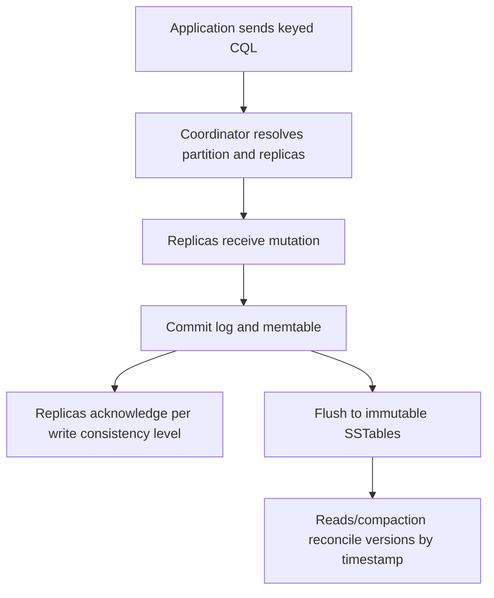

# Writes Without Read-Before-Write and Limits with Special Operations in Cassandra

In many relational database systems, developers think of updates as a sequence: read the current row, verify it exists, modify the values, and write the new result. **Apache Cassandra is optimized so that many regular CQL write operations do not need to read the old value before accepting a mutation.** This is a defining trait of its distributed wide-column architecture and LSM-tree storage engine, yet it does **not** mean no write statement ever reads data or that every transformation is safe under concurrency.

This lesson belongs to the **CQL Writes and Deletes** chapter of module **DATABASE_ENGINE_WIDE_COLUMN_CASSANDRA**. It connects **partition key** selection, replication mechanics, and **consistency levels** with the actual semantics of `INSERT`, `UPDATE`, and `DELETE`. The focus is on understanding why **standard writes avoid read-before-write**, exceptions such as **lightweight transactions (LWT)**, **certain list operations**, and **counters**, and how Java applications choose appropriate write statements and retry policies.

## 1. What does "no read-before-write" mean exactly?

For a regular mutation, Cassandra **does not have to query the row's old value to decide whether the write is allowed**. The client supplies the key and values to write; the coordinator identifies the replicas responsible for the partition key and dispatches the mutation. Replicas can append the mutation to the commit log and memtable and later flush to SSTables without seeking and modifying older on-disk versions in place.

Example:

```sql
UPDATE demo.customer_settings_by_id
SET locale = 'vi-VN'
WHERE customer_id = 11111111-1111-4111-8111-111111111111;
```

Assuming the table exists and the schema/key are valid, an unconditional `UPDATE` does not check beforehand whether this row already exists:

- **Row does not exist yet:** the mutation can create a new row containing only `locale`.
- **Row already exists:** the mutation overwrites `locale`; other regular columns omitted from `SET` are not rewritten by this operation.
- **Another replica holds a different value:** which version is observed on reads depends on timestamp reconciliation rules and replica state.

This is **upsert** (insert-or-update) semantics in CQL, not a guarantee to "update only if the row already exists."

### It does not mean "Cassandra never reads"

The phrase *write without read-before-write* describes **the common write path for standard mutations**, and does not deny that:

1. Cassandra still must **read** when serving `SELECT`, performing read repair/data reconciliation, or handling special cases.
2. **Metadata writes, memory handling, and storage structures** operate per internal design; implementation details vary across Cassandra versions.
3. Certain features need prior state before mutating or require consensus coordination, such as **LWT** and **index/value-based list edits**.
4. An application may perform its own prior read for business validation; doing so does not turn a standard `SELECT` followed by `UPDATE` into an atomic transaction.

Thus, the accurate conclusion is: **many CQL mutations are processed without reading old values**, not "every Cassandra statement is a blind write" or "contention handling is unnecessary."

## 2. A test table for INSERT, UPDATE, and DELETE

Suppose a profile service queries customer settings by `customer_id`. All statements in this lesson are illustrated in the `demo` keyspace, assumed to have been created beforehand in a test environment:

```sql
CREATE TABLE demo.customer_settings_by_id (
    customer_id uuid PRIMARY KEY,
    display_name text,
    locale text,
    phone text,
    marketing_opt_in boolean,
    revision int,
    modified_at timestamp
);
```

`customer_id` is both the **full primary key** and the **partition key**. In this table, a mutation locates the row by UUID rather than scanning the whole table by `display_name` or `locale`. When a schema has clustering keys, writing regular columns to a row requires supplying all key components identifying that row per CQL rules.

Create the initial row:

```sql
INSERT INTO demo.customer_settings_by_id (
    customer_id, display_name, locale, phone, marketing_opt_in, revision
)
VALUES (
    11111111-1111-4111-8111-111111111111,
    'Ngoc',
    'vi-VN',
    '0900000001',
    false,
    1
);

SELECT customer_id, display_name, locale, phone,
       marketing_opt_in, revision
FROM demo.customer_settings_by_id
WHERE customer_id = 11111111-1111-4111-8111-111111111111;
```

Subsequent examples assume no other writers, no default TTL, and no custom timestamps causing a newer mutation to lose to an older version. If running examples independently, re-initialize test data as needed.

## 3. Standard mutations that do not read old values

### 3.1. Unconditional INSERT is an upsert

Run `INSERT` again with the **same primary key**:

```sql
INSERT INTO demo.customer_settings_by_id (
    customer_id, locale
)
VALUES (
    11111111-1111-4111-8111-111111111111,
    'en-US'
);
```

What happens:

- Cassandra does not run a prior `SELECT` to detect a "duplicate key."
- `locale` is written with the new value `'en-US'`.
- `display_name`, `phone`, `marketing_opt_in`, and `revision` are not deleted by this mutation merely because they are absent from the column list.
- No second row is created for the same full primary key.

Do not interpret `INSERT` as "create-only." If business logic requires detecting duplicate keys, use `IF NOT EXISTS` (see section 5).

### 3.2. UPDATE on a previously non-existent key

```sql
UPDATE demo.customer_settings_by_id
SET locale = 'ja-JP'
WHERE customer_id = 22222222-2222-4222-8222-222222222222;

SELECT customer_id, display_name, locale, phone
FROM demo.customer_settings_by_id
WHERE customer_id = 22222222-2222-4222-8222-222222222222;
```

Once applied, Cassandra returns a row with `locale = 'ja-JP'` and unwritten regular columns reading as `null`. There is no implicit precondition that "the row must already exist" just because the `UPDATE` keyword was used.

### 3.3. Updating a subset of columns

```sql
UPDATE demo.customer_settings_by_id
SET phone = '0900000099'
WHERE customer_id = 11111111-1111-4111-8111-111111111111;
```

This statement does not load the entire row into Java memory, modify `phone`, and rewrite the **entire** row. Cassandra accepts a mutation for `phone` and handles it independently of unsent regular columns. Thus, a small update does not have to touch every field of a profile.

Do not confuse **a column omitted from CQL** with **a column sent as NULL**:

```sql
-- Does not rewrite phone:
UPDATE demo.customer_settings_by_id
SET locale = 'fr-FR'
WHERE customer_id = 11111111-1111-4111-8111-111111111111;

-- Requests deleting phone:
UPDATE demo.customer_settings_by_id
SET phone = NULL
WHERE customer_id = 11111111-1111-4111-8111-111111111111;
```

`NULL` in a regular-column mutation writes a deletion marker (*tombstone*); an omitted field or an `UNSET` marker in a prepared statement **does not** generate a mutation for that column.

### 3.4. DELETE also does not check beforehand whether the column exists

```sql
DELETE phone
FROM demo.customer_settings_by_id
WHERE customer_id = 11111111-1111-4111-8111-111111111111;
```

A normal DELETE is not forced to read `phone`'s value before deleting it. It writes a deletion marker for the specified column scope. Because SSTables are immutable and replicas can temporarily diverge, tombstones allow Cassandra to shadow older versions during reads and reconciliation.

Likewise, deleting a key that has no data **is not** an operation that returns a deleted-row count as in relational SQL. Cassandra does not guarantee by default that "the row existed prior to DELETE" or "exactly one row was deleted."

### Summary table

| Unconditional CQL mutation | Must read old value before accepting standard mutation? | Consequence |
| --- | --- | --- |
| `INSERT ... VALUES (...)` | No | Keyed upsert, no automatic duplicate error |
| `UPDATE ... SET col = value` | No | Can create a new row, not just edit existing rows |
| `UPDATE ... SET col = NULL` | No | Writes a deletion marker for the column |
| `DELETE col ... WHERE full_key` | No | Writes a column tombstone |
| `DELETE FROM ... WHERE full_key` | No | Writes a row/partition tombstone depending on key |
| `INSERT ... IF NOT EXISTS` | **Conditional / consensus** | No longer a standard blind upsert |
| `UPDATE ... IF ...` | **Conditional / consensus** | Must inspect prior state before applying |

## 4. Why can Cassandra do this? A look at the write path

An LSM-tree system like Cassandra does not need to "open the old record, edit in place, and write back to the same disk page" on every update. Instead, new mutations are appended to the storage path and reconciled against other versions on reads or when storage structures are merged.



This diagram summarizes logical roles, not a claim that flush or compaction must complete before replying to the client. Exact execution order and special paths depend on Cassandra version and configuration.

### Core components

1. **Partition key** computes the token so the coordinator contacts the replicas storing that partition according to the keyspace's replication strategy.
2. **Commit log** persists durability records for crash recovery; the **memtable** absorbs mutations in memory.
3. **SSTables** are immutable storage files produced on flush. New updates never rewrite old SSTables in place.
4. **Write timestamps** reconcile competing values. For regular cells, the version carrying the higher timestamp wins (*last-write-wins*).
5. **Compaction, repair, and reads** handle differing versions across SSTables and replicas through their respective mechanisms; tombstones retain deletion state for older versions.

### What benefits does avoiding read-before-write bring?

- **Shorter common write path:** no need to query the existing row before every mutation.
- **Independent column writes:** no need to load the whole row and rewrite unchanged columns.
- **Replica-friendly:** the coordinator sends keyed mutations to responsible replicas; no global lock is required per regular write.
- **Higher sequential write throughput:** commit log/memtable and immutable SSTables suit write-heavy workloads.

In return, however, the system **does not automatically enforce business invariants** such as "email must be unique," "account must exist before editing," "debit only if balance suffices," or "client A then client B arrival order always dictates the final version." Those requirements need explicit data modeling and conditional mechanisms.

### Timestamps are not request arrival order

```text
Client A writes locale = 'en-US' with timestamp = 2000000
Client B writes locale = 'vi-VN' with timestamp = 1000000

After replicas converge, A's value wins by timestamp,
even if B was sent later in wall-clock time.
```

Cassandra's write timestamp unit is **microseconds since the Unix epoch**. The numbers above only illustrate ordering comparison. Clock skew or client-assigned timestamps can prevent an apparently "newer" mutation from beating an older one. When timestamps tie, Cassandra uses additional deterministic tie-breaking rules; never rely on tied timestamps to drive business logic.

## 5. First exception: Lightweight Transactions must inspect prior state

When business logic requires **"write only if ..."**, Cassandra cannot decide via a simple blind upsert. CQL provides **lightweight transactions (LWT)** for conditional mutations, using a Paxos-style consensus protocol across the participating replicas.

### 5.1. INSERT only if the key does not exist

```sql
INSERT INTO demo.customer_settings_by_id (
    customer_id, display_name, locale, revision
)
VALUES (
    33333333-3333-4333-8333-333333333333,
    'Minh',
    'vi-VN',
    1
)
IF NOT EXISTS;
```

If no row exists at that key, the statement can be applied. If one already exists, the condition fails and the existing row **is not overwritten**. The result includes an `[applied]` column for the client to inspect:

| `[applied]` | Interpretation |
| --- | --- |
| `true` | Creation condition held; mutation was applied |
| `false` | Key already held data causing condition failure; handle per business contract |

This is the core distinction between a regular `INSERT` (upsert) and `INSERT ... IF NOT EXISTS` (existence-checked create). LWT is not equivalent to a client running `SELECT` followed by regular `INSERT`: the two-step flow has a race window between reading and writing.

### 5.2. UPDATE only if the row currently exists

```sql
UPDATE demo.customer_settings_by_id
SET phone = '0911111111'
WHERE customer_id = 33333333-3333-4333-8333-333333333333
IF EXISTS;
```

If the key does not exist yet, this statement **does not create a sparse row** as an unconditional `UPDATE` would. Use this when an API means "modify existing resource only," accepting higher consensus latency and cost.

### 5.3. Compare-and-set with revision

An application can use a `revision` column to detect updates based on a stale version:

```sql
UPDATE demo.customer_settings_by_id
SET locale = 'en-US',
    revision = 2
WHERE customer_id = 11111111-1111-4111-8111-111111111111
IF revision = 1;
```

If `revision` is still `1` when LWT evaluates the condition, the operation succeeds. Another request still asserting `revision = 1` will receive `[applied] = false` once the version becomes `2`. The application should treat that as a **state conflict** and ask the client to reload or retry the workflow rather than looping blindly.

**Caution:** merely adding a `revision` column does not turn standard CQL into compare-and-set. Only a statement with an explicit `IF` clause checks that condition; another client issuing regular writes to the same data can still cause contention if the system mixes write protocols without consistent conventions.

### 5.4. LWT is not a full-table scan

LWT is still keyed by **partition key**, not an arbitrary search over any regular column. Conditional CQL compares data scoped to an identified row/partition and coordinates replicas; it does not turn Cassandra into a database supporting arbitrary relational SQL transactions.

| Operation type | Characteristics |
| --- | --- |
| `UPDATE ... SET locale = 'en-US'` | Standard mutation, no old-value check |
| `UPDATE ... IF EXISTS` | Existence check via LWT mechanism |
| `UPDATE ... IF revision = 1` | Compare-and-set conditioned on prior state |
| `INSERT ... IF NOT EXISTS` | Conditional create, prevents duplicate-key overwrite |

LWT carries a **serial consistency level** such as `SERIAL` or `LOCAL_SERIAL` alongside the operation's regular consistency level. Choose them based on replication model, topology, and consistency needs; `ONE` or `QUORUM` on regular writes **does not replace** LWT conditions.

## 6. Second exception: certain LIST operations require read-before-write

The `map`, `set`, and `list` collections support different update forms. Not every collection operation needs to read old values. For non-`frozen` maps and sets, updating a key or element can be expressed as a targeted mutation. For **lists**, especially operations relying on **position** or **existing values**, Cassandra may need to read the current list to determine which internal element must change.

### 6.1. Test list table

```sql
CREATE TABLE demo.steps_by_task (
    task_id uuid PRIMARY KEY,
    steps list<text>,
    flags set<text>,
    metadata map<text, text>
);

INSERT INTO demo.steps_by_task (task_id, steps, flags, metadata)
VALUES (
    aaaaaaaa-aaaa-4aaa-8aaa-aaaaaaaaaaaa,
    ['open', 'validate', 'submit'],
    {'started'},
    {'source': 'web'}
);
```

### 6.2. List append and how it differs from index updates

Appending an element to the end of a list:

```sql
UPDATE demo.steps_by_task
SET steps = steps + ['notify']
WHERE task_id = aaaaaaaa-aaaa-4aaa-8aaa-aaaaaaaaaaaa;
```

Appending in this way does not require the application to read the entire old value and send back a new list. However, **append is not idempotent in the sense of "retry arbitrarily and only add once."** If resent after a timeout, the list can end up containing `'notify'` twice.

Modifying the element at index 1:

```sql
UPDATE demo.steps_by_task
SET steps[1] = 'verify'
WHERE task_id = aaaaaaaa-aaaa-4aaa-8aaa-aaaaaaaaaaaa;
```

Deleting the element at index 0:

```sql
DELETE steps[0]
FROM demo.steps_by_task
WHERE task_id = aaaaaaaa-aaaa-4aaa-8aaa-aaaaaaaaaaaa;
```

Edits/deletes **by index** require knowing which element currently sits at that position; Cassandra must consult the list state to resolve the element. This differs from updating a scalar cell at a known full primary key.

### 6.3. Removing from a list by value

```sql
UPDATE demo.steps_by_task
SET steps = steps - ['validate']
WHERE task_id = aaaaaaaa-aaaa-4aaa-8aaa-aaaaaaaaaaaa;
```

To remove a value from a list, Cassandra must identify existing elements matching that value. This involves an internal **read-before-write**, not a simple blind mutation against a known element key.

### 6.4. Prepend and cost/retry considerations

```sql
UPDATE demo.steps_by_task
SET steps = ['created'] + steps
WHERE task_id = aaaaaaaa-aaaa-4aaa-8aaa-aaaaaaaaaaaa;
```

**Prepending** to the head of a list is supported, yet carries ordering overhead and retry/concurrency characteristics different from scalar upserts. Do not assume all list operations share the same internal cost, or mark them idempotent just because they use `UPDATE`. Under multi-writer workloads, a continually growing list is usually inferior to an event table with its own clustering keys.

### 6.5. Comparison with MAP and SET

```sql
-- Write one entry of a non-frozen map:
UPDATE demo.steps_by_task
SET metadata['source'] = 'mobile'
WHERE task_id = aaaaaaaa-aaaa-4aaa-8aaa-aaaaaaaaaaaa;

-- Add one element to a non-frozen set:
UPDATE demo.steps_by_task
SET flags = flags + {'verified'}
WHERE task_id = aaaaaaaa-aaaa-4aaa-8aaa-aaaaaaaaaaaa;
```

For a map, the key `'source'` identifies the entry; for a set, the value `'verified'` identifies the element. Cassandra can express these mutations without loading the entire existing collection to compute the result. **Do not equate "having an expression like `col = col + ...`" with a full-column read-modify-write**; the mechanics depend on the collection type and operation.

| Typical CQL | Depends on existing list state? | Point to watch |
| --- | --- | --- |
| `SET metadata['source'] = 'mobile'` | Not a list operation | Updates map entry |
| `SET flags = flags + {'verified'}` | Not a list operation | Adds set element without duplicates |
| `SET steps = steps + ['notify']` | No index lookup needed | Append can duplicate on retry |
| `SET steps[1] = 'verify'` | **Yes** | Must resolve element at index 1 |
| `DELETE steps[0]` | **Yes** | Must resolve element at index 0 |
| `SET steps = steps - ['validate']` | **Yes** | Must locate elements matching value |

**Important race condition:** suppose client A intends to edit `steps[1]` while client B concurrently deletes `steps[0]`. Depending on execution/read order, index `1` may point to a different element than A expected. If business requirements call for updating events by a stable ID, **do not use list indices as identifiers**; model a table with a full primary key per event.

## 7. Third exception: COUNTER has a specialized data type and write path

A common requirement is "increment visit count by 1." For a regular scalar column like `revision int`, Cassandra does not offer SQL-style `SET revision = revision + 1` as a standard blind-write mutation. `Counter` is a dedicated data type for additive increments.

Create a **separate** counter table:

```sql
CREATE TABLE demo.api_invocations_by_service_day (
    service_id text,
    event_day date,
    total counter,
    PRIMARY KEY (service_id, event_day)
);
```

Increment the counter:

```sql
UPDATE demo.api_invocations_by_service_day
SET total = total + 1
WHERE service_id = 'billing'
  AND event_day = '2026-11-21';

SELECT total
FROM demo.api_invocations_by_service_day
WHERE service_id = 'billing'
  AND event_day = '2026-11-21';
```

Running the same `UPDATE` again will **increment once more** if both mutations are applied. This differs from setting `locale = 'en-US'`: writing the same value again does not carry cumulative intent.

### Counters are not regular last-write-wins scalars

Counters have a specialized write path and reconciliation mechanism to support increments/decrements; they cannot be modeled simply as "setting a new scalar value with a higher timestamp." Processing counters may involve internal coordination/state access depending on Cassandra version and the counter cache; **do not generalize regular-scalar no-read-before-write optimizations to counters**.

Key limitations:

- Counter tables have strict schema rules: all non-primary-key columns in a counter table must be counters; you cannot mix regular `text` or `int` columns into the same counter table.
- Do not use `INSERT ... VALUES` to assign a counter directly as with regular columns; modify them via `UPDATE ... SET counter = counter + n` or subtraction.
- Counters do not support TTLs or custom write timestamps like regular scalar columns, nor can you use LWT `IF` on counter mutations the way you do on regular columns.
- **Counter writes are not idempotent**: a timeout does not prove the mutation failed to reach replicas; automatic retries can double-count.
- Counters fit metrics that tolerate cumulative semantics and have a designed error-handling policy; they are unsuitable when "exactly-once" guarantees are required for financial transactions or events requiring absolute counting accuracy.

### Alternative design when each event must be counted strictly once

Instead of merely incrementing a counter per incoming API call, store each event with a **stable event ID** in a query-driven table and build a controlled aggregation step. For instance, a payment event is identified by `payment_id`; resending the same request should not create a second event. If the system demands strict per-event invariants, use a unique-write/consensus mechanism or an explicit idempotency workflow designed from the start.

That is a **business** requirement, not a feature automatically provided just because Cassandra supports counters.

## 8. Where are the limits of blind writes?

Avoiding prior reads makes writes efficient, but also requires developers to state **mutation intent** clearly. The errors below are not automatically prevented by a plain `INSERT`/`UPDATE`.

| Developer expectation | What actually happens with standard mutation | Solution |
| --- | --- | --- |
| `INSERT` should fail if UUID already exists | `INSERT` upserts by key by default | `IF NOT EXISTS` when uniqueness check is required |
| `UPDATE` must not create a new row | `UPDATE` can create a sparse row | `IF EXISTS` when row existence is required |
| Sending one field replaces the whole object | Only mentioned columns are written | Explicitly define PATCH/PUT and missing fields |
| `NULL` means "do not modify" | `NULL` on regular columns writes a tombstone | Use `UNSET`/omit columns for no-op |
| Reading revision then writing by old revision is safe | Another client can write between SELECT and UPDATE | `UPDATE ... IF revision = old` |
| Can increment `int` with `SET x = x + 1` like SQL | Regular scalars lack this increment semantics | Counter or a different data model/workflow |
| Retrying a list append is harmless | Can append duplicate elements | Model each event as a row with a stable ID |
| Counter increments once on retry | Counter can be incremented again | Design idempotency or avoid blind retries |
| `QUORUM` enforces application preconditions | QUORUM governs replica acks, not old-value comparisons | Appropriate LWT and business model |

### No read-before-write does not make multi-column operations arbitrary transactions

A mutation updating multiple columns in the same row is atomic within Cassandra's supported data scope, yet that **does not** turn a flow of `SELECT`, Java computation, and multiple `UPDATE`s across partitions into a distributed transaction with SQL-like isolation. Replica states may also be observed differently before convergence depending on consistency levels.

`BATCH` is a distinct CQL construct for grouping multiple mutations under supported semantics (for example, a logged batch provides batch-level atomicity for its mutations), but it is **not a bulk-write speed button** or a general solution for multi-partition read-modify-write/isolated transactions. In particular, a large batch spanning many partitions can increase coordination overhead.

### Difference between business-level and statement-level idempotency

Running `SET locale = 'en-US'` twice can produce **the same desired logical state** if no other writer intervenes. However, the two writes may carry different timestamps and behave differently under contention. A statement with a TTL can also shift expiration time if re-executed later.

Therefore, distinguish:

- **Idempotent in desired outcome:** repeating the operation adds no extra business effect, such as setting a flag to `true`.
- **Idempotent under concurrent writes/TTL/timestamps:** requires analyzing version ordering, TTL, conditions, and writes from other clients; not automatically guaranteed for every `SET`.
- **Non-idempotent:** incrementing counters, appending to lists, or generating a fresh UUID per retry.

When an application needs an **exactly-once business effect**, design idempotency keys, deterministic resource identifiers, and proper state handling; you cannot simply raise the consistency level and ignore retries.

## 9. Consistency level does not turn an upsert into compare-and-set

Suppose a keyspace has **replication factor 3**:

- A regular mutation at `ONE` is acknowledged after fewer replicas, favoring latency/availability while placing matching requirements on reads/convergence.
- A regular mutation at `QUORUM` requires a quorum of replicas (with RF=3, typically 2). Higher acknowledgment does not alter the semantics of the `UPDATE`.
- Reading and writing at appropriate levels, such as quorum in a matching replication setup, increases the likelihood of observing the latest acknowledged write; concurrent writes, network errors, and timestamps must still be considered.
- An `INSERT ... IF NOT EXISTS` or `UPDATE ... IF ...` uses **LWT**, requiring an extra consensus/condition phase. It is not equivalent to a regular upsert at `QUORUM`.

In `cqlsh`, you can set the session consistency level:

```sql
CONSISTENCY QUORUM;

UPDATE demo.customer_settings_by_id
SET locale = 'vi-VN'
WHERE customer_id = 11111111-1111-4111-8111-111111111111;
```

The statement above is still an **unconditional UPDATE**. To update only when `revision = 2`, write `IF revision = 2` in CQL and check `[applied]`. No replica acknowledgment level automatically infers business conditions from regular columns.

### A timeout does not prove the mutation failed completely

In a distributed system, the coordinator may fail to collect enough acknowledgments before timing out even though some replicas persisted the mutation. A Java application must handle **uncertain outcomes**:

1. Do not immediately convert every timeout into "write definitely failed."
2. Evaluate whether the operation can be safely re-sent (counter/list append usually **cannot**).
3. For LWT or invariant-carrying mutations, inspect current state and idempotency keys before deciding next steps.
4. Configure driver retry policies per statement type and actual error; avoid "retry any error three times" when semantics forbid it.

## 10. Java Driver: expressing write intent and retryability properly

The snippets below illustrate **Apache Cassandra Java Driver 4.x**, assuming a configured `CqlSession session` for the `demo` keyspace and a valid `UUID customerId`. Driver imports, `java.util.UUID`, and input validation are omitted to focus on semantics.

### 10.1. Standard mutation: setting a deterministic value

```java
PreparedStatement updateLocale = session.prepare(
    "UPDATE demo.customer_settings_by_id " +
    "SET locale = :locale " +
    "WHERE customer_id = :customer_id"
);

BoundStatement setLocale = updateLocale.boundStatementBuilder()
    .setUuid("customer_id", customerId)
    .setString("locale", "en-US")
    .setIdempotent(true)
    .build();

session.execute(setLocale);
```

`setIdempotent(true)` is **an application hint to the driver** that the statement may be treated as idempotent for retry handling; it does not alter the CQL, trigger LWT, or promise "never overwrite another client's mutation." In environments with TTLs or multiple writers on the same column, evaluate carefully before marking idempotent.

This statement writes only `locale` without reading the whole row into Java and rewriting other fields. In a PATCH API, fields omitted from the request must be skipped or bound as `UNSET`, never automatically converted to `NULL`.

### 10.2. LWT: the application must read the conditional result

```java
PreparedStatement createOnly = session.prepare(
    "INSERT INTO demo.customer_settings_by_id " +
    "(customer_id, display_name, locale, revision) " +
    "VALUES (?, ?, ?, ?) IF NOT EXISTS"
);

ResultSet created = session.execute(createOnly.bind(
    customerId, "Minh", "vi-VN", 1
));

if (created.wasApplied()) {
    // Created successfully.
} else {
    // Resource already exists: handle key conflict (e.g., HTTP 409).
}
```

Do not treat `execute(...)` returning without an exception as proof that the condition succeeded. With LWT, a normally completed CQL call can still return `[applied] = false`; that is a **valid outcome** of a conditional operation.

### 10.3. List append: do not allow retries by default

```java
PreparedStatement appendStep = session.prepare(
    "UPDATE demo.steps_by_task " +
    "SET steps = steps + :new_steps " +
    "WHERE task_id = :task_id"
);

BoundStatement append = appendStep.boundStatementBuilder()
    .setUuid("task_id", taskId)
    .setList("new_steps", java.util.List.of("notify"), String.class)
    .setIdempotent(false)
    .build();

session.execute(append);
```

If the driver or application resends the operation after a timeout, the same element can be appended twice. Setting `setIdempotent(false)` expresses that the statement **must not be retried as an idempotent value assignment**. This does not solve all network failures on its own; the application must still choose how to respond to the caller and handle deduplication when required.

### 10.4. Counter: one increment is one side effect

```java
PreparedStatement increment = session.prepare(
    "UPDATE demo.api_invocations_by_service_day " +
    "SET total = total + 1 " +
    "WHERE service_id = ? AND event_day = ?"
);

BoundStatement countRequest = increment.boundStatementBuilder()
    .setString(0, "billing")
    .setLocalDate(1, java.time.LocalDate.of(2026, 11, 21))
    .setIdempotent(false)
    .build();

session.execute(countRequest);
```

Here, **adding 1** is not equivalent to "setting total to a deterministic value." If the write succeeded and the response timed out, resending can add another increment. Do not use CQL counters as a substitute for deduplication in strictly-once transactions.

### 10.5. When you need to increment a regular int column

Suppose `revision` is an `int` column in `customer_settings_by_id`. You cannot simply write:

```sql
-- INVALID for regular int columns: counter increment does not apply to int.
UPDATE demo.customer_settings_by_id
SET revision = revision + 1
WHERE customer_id = 11111111-1111-4111-8111-111111111111;
```

If `revision` serves as an optimistic-locking version number, the application can read the current version and send **the next value with LWT**:

```sql
-- Suppose the application already knows the current revision is 2.
UPDATE demo.customer_settings_by_id
SET revision = 3,
    locale = 'de-DE'
WHERE customer_id = 11111111-1111-4111-8111-111111111111
IF revision = 2;
```

If another client already updated `revision`, `[applied] = false`. **Reading beforehand in the application** does not prevent race conditions by itself; `IF` is what decides via consensus whether to accept the mutation.

## 11. Hands-on lab: predicting behavior before running

Run in a test environment using only the tables created in earlier sections. Each step uses a separate UUID or key so it does not alter the main sample data. Before executing, predict whether Cassandra needs to read old values and whether retrying changes business semantics.

### Step 1 — UPDATE a non-existent row

```sql
UPDATE demo.customer_settings_by_id
SET locale = 'ko-KR'
WHERE customer_id = 44444444-4444-4444-8444-444444444444;

SELECT customer_id, display_name, locale, phone, revision
FROM demo.customer_settings_by_id
WHERE customer_id = 44444444-4444-4444-8444-444444444444;
```

**Prediction:** a row with `locale = 'ko-KR'` appears, and other unwritten regular columns read as `null`. No prior `SELECT` is needed to check row existence.

### Step 2 — INSERT at the same key

```sql
INSERT INTO demo.customer_settings_by_id (
    customer_id, display_name
)
VALUES (
    44444444-4444-4444-8444-444444444444,
    'Phuong'
);

SELECT display_name, locale, phone
FROM demo.customer_settings_by_id
WHERE customer_id = 44444444-4444-4444-8444-444444444444;
```

**Prediction:** `display_name = 'Phuong'`, `locale = 'ko-KR'`, and `phone = null`. `INSERT` does not delete the existing `locale` simply because it omitted it.

### Step 3 — Try duplicate creation with IF NOT EXISTS

```sql
INSERT INTO demo.customer_settings_by_id (
    customer_id, display_name, locale
)
VALUES (
    44444444-4444-4444-8444-444444444444,
    'Name must not be written',
    'en-US'
)
IF NOT EXISTS;
```

**Prediction:** `[applied] = false` and `4444...`'s data remains unchanged. This differs from the regular `INSERT` behavior in step 2.

### Step 4 — LWT with revision

```sql
UPDATE demo.customer_settings_by_id
SET revision = 1
WHERE customer_id = 44444444-4444-4444-8444-444444444444;

UPDATE demo.customer_settings_by_id
SET locale = 'en-US', revision = 2
WHERE customer_id = 44444444-4444-4444-8444-444444444444
IF revision = 1;

-- Resend the stale condition:
UPDATE demo.customer_settings_by_id
SET locale = 'fr-FR', revision = 2
WHERE customer_id = 44444444-4444-4444-8444-444444444444
IF revision = 1;
```

**Prediction:** the first conditional statement succeeds with `[applied] = true`, and the second is rejected with `[applied] = false`, so `locale` is not changed to `fr-FR` by the last statement. The condition detects that prior state changed.

### Step 5 — List append can duplicate when re-executed

```sql
INSERT INTO demo.steps_by_task (task_id, steps, flags, metadata)
VALUES (
    bbbbbbbb-bbbb-4bbb-8bbb-bbbbbbbbbbbb,
    ['open'],
    {'started'},
    {'source': 'mobile'}
);

UPDATE demo.steps_by_task
SET steps = steps + ['submit']
WHERE task_id = bbbbbbbb-bbbb-4bbb-8bbb-bbbbbbbbbbbb;

-- Simulate the same append statement executing a second time:
UPDATE demo.steps_by_task
SET steps = steps + ['submit']
WHERE task_id = bbbbbbbb-bbbb-4bbb-8bbb-bbbbbbbbbbbb;

SELECT steps
FROM demo.steps_by_task
WHERE task_id = bbbbbbbb-bbbb-4bbb-8bbb-bbbbbbbbbbbb;
```

**Prediction:** the list can become `['open','submit','submit']`. This outcome explains why append cannot be treated as idempotent on retry.

### Step 6 — Modify a list position

```sql
UPDATE demo.steps_by_task
SET steps[1] = 'validate'
WHERE task_id = bbbbbbbb-bbbb-4bbb-8bbb-bbbbbbbbbbbb;

SELECT steps
FROM demo.steps_by_task
WHERE task_id = bbbbbbbb-bbbb-4bbb-8bbb-bbbbbbbbbbbb;
```

**Prediction:** if the list before this step was `['open','submit','submit']`, the result is `['open','validate','submit']`. Cassandra must locate the current element at index 1 to apply the edit, unlike a blind write to a scalar cell keyed by primary key.

### Step 7 — Map and set do not read the entire collection to write an element

```sql
UPDATE demo.steps_by_task
SET metadata['source'] = 'web'
WHERE task_id = bbbbbbbb-bbbb-4bbb-8bbb-bbbbbbbbbbbb;

UPDATE demo.steps_by_task
SET flags = flags + {'processed'}
WHERE task_id = bbbbbbbb-bbbb-4bbb-8bbb-bbbbbbbbbbbb;

SELECT metadata, flags, steps
FROM demo.steps_by_task
WHERE task_id = bbbbbbbb-bbbb-4bbb-8bbb-bbbbbbbbbbbb;
```

**Prediction:** `metadata` keeps the `source` key with the new value; `flags` holds both `started` and `processed`; `steps` is untouched by these two mutations.

### Step 8 — Counter increments per execution

```sql
UPDATE demo.api_invocations_by_service_day
SET total = total + 1
WHERE service_id = 'test-lab'
  AND event_day = '2026-11-21';

UPDATE demo.api_invocations_by_service_day
SET total = total + 1
WHERE service_id = 'test-lab'
  AND event_day = '2026-11-21';

SELECT total
FROM demo.api_invocations_by_service_day
WHERE service_id = 'test-lab'
  AND event_day = '2026-11-21';
```

**Prediction:** if the counter was never written and no other writers exist, two successful increments yield `2`. If a prior run already used the same key, the result is **the previous value plus 2**. This result highlights why counter retries are unsafe for "count one request strictly once" requirements.

## 12. Summary, self-check questions, and checklist

### Quick classification table

| Need | Common CQL / data type | Needs prior state or special handling? | Retries |
| --- | --- | --- | --- |
| Set a column to a deterministic value | `UPDATE ... SET col = value` | Regular write without prior read | Relatively easy to control, but consider timestamp/TTL/concurrency |
| Upsert several columns | `INSERT` or `UPDATE` without `IF` | No existence check | Creates no duplicate row if primary key is kept |
| Delete a column/row | `DELETE` or `SET col = NULL` | No prior read required; writes tombstone | Check timestamp impact and concurrent overwrites |
| Create only if absent | `INSERT ... IF NOT EXISTS` | LWT checks existence with consensus | Inspect `[applied]` and handle timeout uncertainty |
| Edit only if version matches | `UPDATE ... IF revision = old` | LWT compares prior state | Never blindly retry after conflict |
| Update list element by index | `SET list_col[i] = value` | Must resolve current element | Watch for shifting indices under contention |
| Remove list element by value | `SET list_col = list_col - [value]` | Internal read-before-write | Depends on current list and contention |
| Append element to end of list | `SET list_col = list_col + [value]` | No index read, but special semantics | Do not auto-retry; can append duplicates |
| Add element to set | `SET set_col = set_col + {value}` | Element-level set mutation | No duplicates created; still consider timestamps |
| Accumulate counter | `UPDATE ... SET total = total + 1` on counter | Dedicated counter write path | **Non-idempotent**, can over-count |

### Self-check questions

1. **Why can Cassandra run `UPDATE` when a row does not exist yet?** Because unconditional `UPDATE` is a keyed upsert mutation; Cassandra does not require reading the row before writing.
2. **Why does `INSERT` usually not report duplicate primary keys?** Because it is not an existence-checked "insert-only" statement; use `IF NOT EXISTS` when checks are needed.
3. **Can running `SELECT` then regular `UPDATE` protect the condition `revision = 1`?** No; another client can update between the two statements. Use `UPDATE ... IF revision = 1`.
4. **How does `steps[1] = 'verify'` differ from `locale = 'en-US'`?** It must resolve the element currently at index 1 of the list and is vulnerable to concurrent index shifts.
5. **Is running list append twice the same as setting the same scalar value twice?** No. Appending can add two elements, even if both values are identical.
6. **What happens if a counter is incremented by 1 twice?** If both are applied, the count increases by 2; a timeout on one call does not prove it had no effect.
7. **Why doesn't `QUORUM` replace LWT?** Quorum governs replica acknowledgments; LWT evaluates old-state conditions with consensus for a different purpose.
8. **Does assigning `NULL` instead of UNSET require a prior read?** Not necessarily, but `NULL` is a deletion mutation via tombstone, whereas UNSET skips the column.
9. **If you retry `SET locale = 'en-US'`, is it guaranteed not to affect another client's write?** No. A retry may carry a newer timestamp and compete with a value just written by another client.
10. **When should a table model replace a list?** When there are multiple writers, unbounded data growth, updates by event ID, or strict idempotency/retention needs.

### Checklist for Java applications

1. **Identify the full primary key and main queries.** Write to the right partition/row; never generate a new UUID for the same event on retry when deduplication is required.
2. **Distinguish upserts from conditional writes.** `INSERT`/`UPDATE` without `IF` do not check existence; use LWT for business conditions.
3. **Define column scope.** Unsent fields must be omitted or UNSET; NULL means deletion and creates tombstones.
4. **Review collections.** Map/set element operations differ from index/value-based list operations; do not read-modify-write the whole collection if an element mutation suffices.
5. **Determine idempotency.** Do not auto-retry counters, list appends, or key-generating operations on network errors.
6. **Account for concurrent writes and timestamps.** Use LWT selectively to prevent lost updates when prior state changes.
7. **Pick consistency levels based on topology and read/write needs.** Separate replica acknowledgments from business invariants.
8. **Monitor operations.** LWT latency, retries/timeouts, counter/list write load, tombstones, compaction, and repair can signal poorly matched mutation designs.
9. **Test with simulated network failures.** Tests should verify not just happy paths, but also requests accepted by replicas whose response was lost.

**Takeaway:** Cassandra optimizes many standard write commands as **mutations without reading the current row**, leveraging primary keys, memtables, commit logs, and immutable SSTables. Yet once requirements depend on **prior state** (LWT), **list element positions/values**, or **counter increments**, semantics and costs change. Understanding this boundary enables Java applications to harness Cassandra's distributed write strengths while controlling contention, retries, and business correctness.
