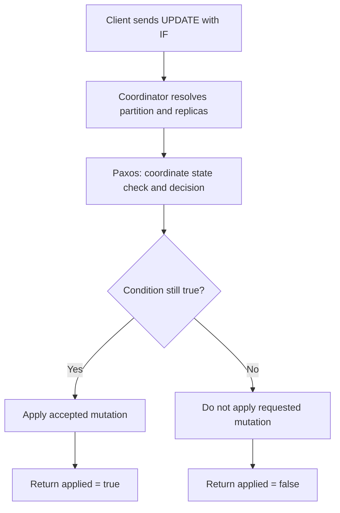

# IF NOT EXISTS / IF EXISTS and Switching to Conditional Updates in Cassandra

In Apache Cassandra, regular `INSERT` and `UPDATE` statements have **upsert** semantics: they write by primary key without reading beforehand to confirm whether the row already exists. This suits a high-throughput distributed write path very well, yet easily causes bugs when business rules require **create only if new**, **update only if the resource already exists**, or **edit only when data still matches a prior read**.

The `IF NOT EXISTS`, `IF EXISTS`, and `IF <expression>` clauses turn a mutation into a **lightweight transaction (LWT)**. Cassandra uses a **Paxos**-style consensus protocol to evaluate the condition and apply the write, instead of relying on a separate `SELECT` followed by an `UPDATE` in the application.

This lesson belongs to the **CQL Writes and Deletes** chapter of module **DATABASE_ENGINE_WIDE_COLUMN_CASSANDRA**. It places LWTs in the context of partition keys, query-driven table design, replication, consistency levels, error/timeout handling, and Java Driver integration.

After this lesson, you will be able to:

- Distinguish standard upserts from **conditional writes** based on existence or prior values.
- Write `INSERT ... IF NOT EXISTS`, `UPDATE ... IF EXISTS`, `DELETE ... IF EXISTS`, and `UPDATE/DELETE ... IF condition` properly.
- Understand `[applied] = true/false`, contention scenarios, and consensus overhead.
- Separate **regular consistency** from **serial consistency** (`SERIAL`/`LOCAL_SERIAL`).
- Design retries and idempotency when a Java application receives a timeout or an unmet condition.
- Decide when to use LWT and when to stick with regular upserts to avoid unnecessary latency.

## 1. Sample table and primary key

Suppose an account management system looks up profiles by `account_id`. The `demo` keyspace is assumed to exist in the practice environment:

```sql
CREATE TABLE demo.accounts_by_id (
    account_id uuid PRIMARY KEY,
    email text,
    display_name text,
    account_state text,
    revision int,
    verification_code text,
    updated_at timestamp
);
```

In this table:

| Component | Column(s) | Meaning |
| --- | --- | --- |
| Partition key | `account_id` | Identifies the partition and replicas storing the data |
| Full primary key | `account_id` | Uniquely identifies one logical row |
| Regular columns | `email`, `display_name`, `account_state`, `revision` | Values updatable per row |
| Temporary data | `verification_code` | Can be written with a TTL |
| Business metadata | `updated_at` | Application must update explicitly; not the internal write timestamp |

Create an initial row:

```sql
INSERT INTO demo.accounts_by_id (
    account_id, email, display_name, account_state, revision
)
VALUES (
    11111111-1111-4111-8111-111111111111,
    'mai@example.test',
    'Mai',
    'ACTIVE',
    1
);

SELECT account_id, email, display_name, account_state, revision
FROM demo.accounts_by_id
WHERE account_id = 11111111-1111-4111-8111-111111111111;
```

In the main examples, UUID `1111...` represents an **existing row**. Other UUIDs are used for creation operations to avoid accidental ordering dependencies during practice.

> **Condition scope:** LWT on this table is scoped to the row's primary key. Conditions do not let Cassandra scan the whole table by `email` or guarantee email uniqueness across all partitions. Enforcing uniqueness by email requires a dedicated data model and workflow (see section 9).

## 2. From standard upserts to conditional writes

Consider four common requirements:

| Business requirement | Standard statement | Appropriate conditional statement |
| --- | --- | --- |
| Write new state, creating the row if absent | `UPDATE ... SET ...` | No LWT needed if upsert is intended |
| Register account, disallow overwriting same `account_id` | `INSERT` without existence check | `INSERT ... IF NOT EXISTS` |
| Modify only an existing account | `UPDATE` can create a sparse row | `UPDATE ... IF EXISTS` |
| Change name only while `revision` is still 1 | `UPDATE` without version check | `UPDATE ... IF revision = 1` |
| Delete only an existing row | `DELETE` can write a tombstone for an absent key | `DELETE ... IF EXISTS` |

### Standard statements: no existence guard

```sql
UPDATE demo.accounts_by_id
SET display_name = 'A new account'
WHERE account_id = 22222222-2222-4222-8222-222222222222;
```

If UUID `2222...` has no row yet, an unconditional `UPDATE` can create a **sparse row** with only `display_name`, while other regular columns read as `null`. Cassandra does not ask "are you doing an INSERT or an UPDATE?" in the relational existence-constraint sense.

A regular `INSERT` behaves similarly:

```sql
INSERT INTO demo.accounts_by_id (account_id, display_name)
VALUES (
    11111111-1111-4111-8111-111111111111,
    'Overwritten name'
);
```

This overwrites `display_name` on the existing row without raising a duplicate-key error. Because it alters the base row, **run it in a lab only if you want to observe upsert behavior**.

### Statements with IF: check then decide inside LWT

```text
Standard mutation:
  full primary key + new values
  -> send mutation, no prior-state condition needed

Conditional mutation:
  full primary key + prior-state condition + new values
  -> replicas coordinate to evaluate condition
  -> [applied] = true: apply mutation
  -> [applied] = false: do not apply the requested mutation
```

Conditions change **semantics and the execution path**, not just the return format. LWTs generally involve more network round trips than regular writes and must be used selectively.

## 3. INSERT IF NOT EXISTS: create without overwriting

Basic syntax:

```sql
INSERT INTO demo.accounts_by_id (
    account_id, email, display_name, account_state, revision
)
VALUES (
    33333333-3333-4333-8333-333333333333,
    'an@example.test',
    'An',
    'PENDING',
    1
)
IF NOT EXISTS;
```

The first time on an empty key, the condition holds and the result contains:

```text
 [applied]
-----------
      True
```

Running the same statement again with that `account_id`, while the row exists:

```text
 [applied] | ...existing values may be returned...
-----------
     False
```

When `[applied] = false`, **the new INSERT mutation is not applied**. The application should handle it as a duplicate resource or conflict per the API contract. Existing columns may be returned on condition failure, yet **do not assume the driver always returns every column needed for the UI**; if you need the latest state for display, perform an explicit read.

### What does IF NOT EXISTS check?

It checks **whether a row exists at the full primary key** via Cassandra's LWT mechanism, not whether the `email` value duplicates a row under a different UUID.

Example:

```sql
INSERT INTO demo.accounts_by_id (
    account_id, email, account_state
)
VALUES (
    44444444-4444-4444-8444-444444444444,
    'an@example.test',
    'PENDING'
)
IF NOT EXISTS;
```

UUIDs `3333...` and `4444...` differ: creating row `4444...` **does not check** that `'an@example.test'` already appears on `3333...`. Enforcing email uniqueness requires a separate write path rather than merely attaching `IF NOT EXISTS` to a UUID-keyed lookup table.

### IF NOT EXISTS and TTL

With `INSERT`, you can attach a TTL to temporary values:

```sql
INSERT INTO demo.accounts_by_id (
    account_id, verification_code
)
VALUES (
    55555555-5555-4555-8555-555555555555,
    '492813'
)
IF NOT EXISTS
USING TTL 300;
```

This is `INSERT ... IF NOT EXISTS USING TTL ...` syntax. If the condition holds, the data is written with the specified lifespan. A row containing only TTL-bound data is **not** a reliable mechanism for permanently reserving a registration key: once the live data expires, the existence check outcome can flip. Use durable fields or a dedicated model for long-lived constraints.

**Never** combine `USING TIMESTAMP <custom value>` with LWT. The consensus protocol manages timestamps for conditional mutations.

## 4. UPDATE IF EXISTS: modify only an existing row

When an API means "update account by ID," many systems do not want `UPDATE` to accidentally create a new row. Use `IF EXISTS`:

```sql
UPDATE demo.accounts_by_id
SET display_name = 'Mai Anh'
WHERE account_id = 11111111-1111-4111-8111-111111111111
IF EXISTS;
```

Row `1111...` was created in section 1, so assuming no competing writes, `[applied] = true` and the name is updated.

If targeting a non-existent key:

```sql
UPDATE demo.accounts_by_id
SET display_name = 'Should not be created'
WHERE account_id = 66666666-6666-4666-8666-666666666666
IF EXISTS;

SELECT *
FROM demo.accounts_by_id
WHERE account_id = 66666666-6666-4666-8666-666666666666;
```

Expected: `[applied] = false`; no new row is created by the conditional statement. **Never treat the absence of an exception as success**: an unmet condition is a normal CQL result, not a syntax or connection error.

### How does UPDATE IF EXISTS differ from a regular UPDATE?

| Case | Regular `UPDATE` | `UPDATE ... IF EXISTS` |
| --- | --- | --- |
| Key has a live row | Writes specified columns | Writes after LWT confirms existence |
| Key has no live row | Can create a sparse row | Mutation is not applied |
| Client needs to detect not-found | Not guaranteed by write result | Inspect `[applied] = false` |
| Inter-replica communication cost | Standard write path | Extra coordination/consensus |
| Protects old value of a column from overwrite | No | **No**, protects existence only |

The last point is crucial. `IF EXISTS` **does not** stop two users from concurrently overwriting `display_name` if both see the row exists. Both mutations can succeed sequentially, with the winner determined by write reconciliation. To detect changes between read and write, compare an old value or revision (section 6).

### UPDATE IF EXISTS with TTL

```sql
UPDATE demo.accounts_by_id
USING TTL 120
SET verification_code = '852741'
WHERE account_id = 11111111-1111-4111-8111-111111111111
IF EXISTS;
```

If the condition holds, `verification_code` is written with a 120-second TTL. `IF EXISTS` does not refresh TTLs or rewrite every column in the row. It only decides **whether to accept the requested mutation**.

## 5. DELETE IF EXISTS: delete only when the row exists

A regular DELETE sends a keyed tombstone without verifying whether the row exists. When an API contract must distinguish "deleted an existing resource" from "ID not found," you can use:

```sql
DELETE FROM demo.accounts_by_id
WHERE account_id = 33333333-3333-4333-8333-333333333333
IF EXISTS;
```

For row `3333...` created in section 3, `[applied] = true` means the existence check succeeded and the delete was accepted. Re-sending it after the row is no longer live fails the condition and returns `[applied] = false`.

### Conditional column deletion

To delete one piece of data only when prior state still matches expectations, combine column scope with a condition on columns of the same row:

```sql
DELETE email
FROM demo.accounts_by_id
WHERE account_id = 11111111-1111-4111-8111-111111111111
IF account_state = 'ACTIVE';
```

In this example, if the condition succeeds, **only email is deleted** by the mutation, while columns such as `display_name` and `revision` remain untouched by this statement. Writing the tombstone for email happens only when `account_state = 'ACTIVE'` holds.

**Note:** If the API goal is "disable an account," deleting email is not equivalent to changing `account_state` to `DISABLED`. Express business state transitions with the matching mutation and condition.

### When is IF EXISTS unnecessary?

Many delete APIs are designed to be **idempotent in business effect**: deleting a resource once or deleting the same ID again produces the same outcome—the resource no longer exists. In such cases, an unconditional DELETE is simpler and cheaper than LWT.

Conversely, if you must report "resource not found" consistently with write-time existence checks, `IF EXISTS` is useful—provided you accept consensus cost and still handle timeouts. A regular successful DELETE **does not** return a count of previously existing rows like `rowsAffected` in some relational databases.

### Do not misuse IF EXISTS for multi-row deletes

Deleting an entire partition or clustering range has a different scope from deleting a single row. LWTs impose restrictions on keys, scopes, and statement types; never issue a broad `DELETE` expecting `IF EXISTS` to evaluate per row and return an array of `[applied]` flags.

If you need to process multiple resources conditionally, design a per-full-primary-key workflow (or a query-tailored data model) and weigh the required atomicity. Never use `ALLOW FILTERING` to turn LWT into a full-table scan by regular columns.

## 6. IF on old values: optimistic concurrency and compare-and-set

`IF EXISTS` only asks whether the row is alive. To prevent **lost updates**, check the value the client previously observed.

### Example of two users editing the same account

Suppose `revision = 1`. Clients A and B both read that revision:

```text
At time t0: account 1111... has revision = 1

Client A reads revision 1, wants to change name to 'Mai A'.
Client B reads revision 1, wants to change name to 'Mai B'.

If both use regular UPDATE:
  Both can be accepted; the final result depends on timestamps.

If both use UPDATE ... IF revision = 1:
  The update applied first sets revision to 2.
  The subsequent update requiring revision = 1 is rejected.
```

Client A's statement:

```sql
UPDATE demo.accounts_by_id
SET display_name = 'Mai A',
    revision = 2
WHERE account_id = 11111111-1111-4111-8111-111111111111
IF revision = 1;
```

If the condition holds, `[applied] = true`. Client B sends:

```sql
UPDATE demo.accounts_by_id
SET display_name = 'Mai B',
    revision = 2
WHERE account_id = 11111111-1111-4111-8111-111111111111
IF revision = 1;
```

Once A is applied and revision becomes 2, B's statement receives `[applied] = false`. B can reload the data, merge changes, or report a conflict to the user.

### Why is this called optimistic concurrency?

The application lets multiple clients read concurrently without taking upfront locks. On write, the client sends the **expected value** in `IF` and commits the change only if state has not diverged from expectations. This is the *compare-and-set (CAS)* pattern:

```text
CAS(key, expected_revision=1, new_revision=2, new_name='Mai A')

if actual_revision == expected_revision:
    apply mutation
    return [applied] = true
else:
    do not apply mutation
    return [applied] = false
```

**Do not** use SQL-style `revision = revision + 1` on a regular Cassandra `int` column. The application should compute `newRevision = oldRevision + 1` and send it alongside `IF revision = oldRevision`. Counters have separate additive syntax and semantics that are incompatible with standard LWT.

### Checking business values directly

If you do not want a revision column, you can transition state only when it currently holds the expected value:

```sql
UPDATE demo.accounts_by_id
SET account_state = 'LOCKED'
WHERE account_id = 11111111-1111-4111-8111-111111111111
IF account_state = 'ACTIVE';
```

This guards the **ACTIVE -> LOCKED** transition. If the state already moved to `DISABLED` or `LOCKED`, the LWT is not applied. There is no need to read the entire row in the application just to gate the transition.

Multiple conditions can be combined where CQL syntax supports them:

```sql
UPDATE demo.accounts_by_id
SET account_state = 'LOCKED',
    revision = 3
WHERE account_id = 11111111-1111-4111-8111-111111111111
IF account_state = 'ACTIVE' AND revision = 2;
```

Conditions are evaluated strictly on the **row/partition identified by the primary key**; they are not table-wide filters over regular columns. Do not mix this example with the initial `revision = 1` row expecting it to always succeed: this illustrates syntax when the actual state is `revision = 2`.

### IF does not automatically update related attributes

A mutation writes only the columns in `SET`. For instance, checking `IF revision = 1` while only setting `SET display_name = 'Mai A'` **without** incrementing revision leaves `revision = 1` true for the next request. To enforce concurrency control via revisions, **read the old version, increment the version inside the same LWT, and check `[applied]`**.

## 7. What happens inside an LWT?

An unconditional mutation can be forwarded directly to the replicas responsible for the partition key. LWT solves a harder problem: **when multiple clients check a condition and attempt to write concurrently, only the operation whose condition holds at decision time is applied**.

Cassandra uses the **Paxos** consensus protocol for CAS operations; execution requires multiple coordination rounds between the coordinator and replicas compared to a normal upsert.



This diagram is a **conceptual model**. The number of Paxos phases, optimizations, and protocol details vary by Cassandra version and configuration; do not treat it as a packet-by-packet network trace.

### CAS operates within a key/partition

Cassandra's strength lies in distributing data by **partition key**. LWT uses the replicas responsible for that partition to coordinate a decision. It **does not build a global transaction** spanning every partition and table in the cluster.

For example, two actors editing `account_id = 1111...` with `IF revision = 1` contend on the same partition, so LWT coordinates to ensure only the valid conditional mutation applies.

However, if business logic must simultaneously:

1. Write the account to `accounts_by_id` by UUID, and
2. Claim the email in `email_claim_by_email` by email,

these two writes likely hit **two different partitions**. An `IF NOT EXISTS` on each table does not turn the combined flow into a cross-partition transaction. You need orchestration and failure/compensation handling across steps.

### Why are LWTs typically slower than upserts?

- LWTs involve multiple network round trips and require enough participating replicas per the consensus protocol.
- When many requests contend on the same partition, the coordinator may need to retry or resolve proposal conflicts.
- Latency and success rates depend on replicas, network, topology, serial consistency, and load.
- A plain client read–write cycle uses less consensus coordination, **but provides no conditional safety guarantee**.

**Performance principle:** use LWT only for **business invariants** that genuinely require it; never turn on `IF EXISTS` on every upsert assuming conditions are free.

## 8. Regular consistency level vs. serial consistency level

For unconditional writes, Cassandra offers consistency levels like `ONE`, `LOCAL_QUORUM`, `QUORUM`, etc. These govern how many replicas must acknowledge for the client to consider the mutation satisfied at the chosen level.

LWT introduces an **additional concept**: *serial consistency*, used for the consensus phase of conditional operations.

| Concept | Example values | Role |
| --- | --- | --- |
| Regular consistency level | `ONE`, `LOCAL_QUORUM`, `QUORUM` | Replica acknowledgment/visibility at the selected level |
| Serial consistency level | `SERIAL`, `LOCAL_SERIAL` | Coordination scope for CAS consensus phases |

### SERIAL

`SERIAL` runs consensus across the relevant replicas without restricting coordination to a local datacenter. Choose this when conditional consistency must span a multi-datacenter topology and traffic pattern.

### LOCAL_SERIAL

`LOCAL_SERIAL` restricts serial consistency coordination to the **local datacenter**. It fits setups where applications and data design confine CAS operations to one datacenter with clear rules for how other datacenters access data. Never assume `LOCAL_SERIAL` is equivalent to `SERIAL` for a service receiving competing CAS writes from multiple geographic regions.

**Key rule:** never arbitrarily mix different serial consistency levels across competing CAS operations on the same data without a coherent topology/consistency policy.

### QUORUM does not replace IF

Suppose replication factor is 3, and a client chooses `QUORUM` for an unconditional `UPDATE`. Sufficient replica acknowledgments **do not prove** `revision` was 1, nor do they stop two clients from issuing two competing writes to the same column.

To compare revisions, you must **write `IF revision = 1`**. `QUORUM` and `SERIAL` address separate concerns: replica acknowledgment/visibility versus conditional consensus.

### LWT does not let you skip consistency analysis

No single setting fits every Cassandra cluster. When configuring LWTs, consider:

- The keyspace's replication factor and replication strategy.
- Which datacenters applications send requests from.
- Consistency, latency, and availability targets.
- Policy for CAS requests coming from multiple clients across datacenters.
- How state will be re-read after an uncertain outcome.

In the Java Driver, you can configure both regular and serial consistency on the **BoundStatement** of an LWT query (see section 11). Never treat `SERIAL` as a substitute for the `IF` syntax on a regular `UPDATE`.

## 9. IF NOT EXISTS does not automatically solve every uniqueness problem

A practical example: an application requires **each email to belong to at most one account**, while `accounts_by_id` is partitioned by `account_id`.

### The wrong approach

```sql
-- First account:
INSERT INTO demo.accounts_by_id (
    account_id, email, account_state
)
VALUES (
    aaaaaaaa-aaaa-4aaa-8aaa-aaaaaaaaaaaa,
    'duplicate@example.test',
    'ACTIVE'
)
IF NOT EXISTS;

-- Second account, different ID:
INSERT INTO demo.accounts_by_id (
    account_id, email, account_state
)
VALUES (
    bbbbbbbb-bbbb-4bbb-8bbb-bbbbbbbbbbbb,
    'duplicate@example.test',
    'ACTIVE'
)
IF NOT EXISTS;
```

The two statements have **different partition keys**, so both can succeed. Cassandra has no automatic unique constraint on `email` merely because that column appears in a row.

### Modeling a uniqueness key around the protected value

Create a table holding email ownership:

```sql
CREATE TABLE demo.email_claim_by_email (
    normalized_email text PRIMARY KEY,
    account_id uuid,
    claimed_at timestamp
);
```

During registration, normalize the email under a consistent business rule, then:

```sql
INSERT INTO demo.email_claim_by_email (
    normalized_email, account_id
)
VALUES (
    'duplicate@example.test',
    aaaaaaaa-aaaa-4aaa-8aaa-aaaaaaaaaaaa
)
IF NOT EXISTS;
```

Because **the normalized email becomes the partition key**, requests for the same email contend on **one logical key**. `IF NOT EXISTS` allows at most one request to claim that email key under LWT semantics.

However, **there is still no automatic transaction between `email_claim_by_email` and `accounts_by_id`**. If claiming the email succeeds while writing the UUID-keyed profile fails or times out, the data may temporarily exist only in the claim table.

A safer workflow requires:

1. Using a stable **request ID / idempotency key** and deterministic account UUID across retries.
2. Claiming the email via `IF NOT EXISTS`.
3. Writing the account profile by the determined UUID.
4. If step 3 fails or has an uncertain outcome, **read and reconcile state** and apply completion/compensation logic per business rules; never delete the claim blindly if another request may be involved.
5. Considering `PENDING`/`ACTIVE` states and reconciliation jobs to clean up incomplete workflows.

For email changes, design both claiming the new email and releasing the old email so ownership is not lost if a failure occurs mid-flow. This is a **multi-partition workflow problem**, not something `INSERT IF NOT EXISTS` ordering solves automatically.

### When is this approach insufficient?

If requirements demand strict cross-entity ACID invariants that cannot tolerate intermediate states or compensation, evaluate a transactional store/model suited to that invariant rather than forcing separate LWTs into a multi-partition ACID transaction. Cassandra shines when table design and invariants align with partition keys.

## 10. Allowed syntax, combinations to avoid, and TTL effects

Not every CQL statement accepts every condition type. The table below summarizes supported forms:

| Statement | Valid syntax | Meaning |
| --- | --- | --- |
| Unconditional `INSERT` | `INSERT ... VALUES (...)` | Standard upsert |
| Create-only `INSERT` | `INSERT ... VALUES (...) IF NOT EXISTS` | Existence-checked LWT |
| Update-existing-only `UPDATE` | `UPDATE ... SET ... WHERE ... IF EXISTS` | Existence-checked LWT |
| Old-value `UPDATE` | `UPDATE ... SET ... WHERE ... IF revision = 1` | Conditional LWT |
| Delete-existing-only `DELETE` | `DELETE FROM ... WHERE ... IF EXISTS` | Conditional delete LWT |
| Conditional column `DELETE` | `DELETE col FROM ... WHERE ... IF col = value` | Column-level LWT |

### Combinations not to write

The examples below are **intentionally invalid**; do not run them as lab exercises:

```sql
-- INVALID: IF NOT EXISTS is an INSERT condition, not UPDATE.
UPDATE demo.accounts_by_id
SET display_name = 'An'
WHERE account_id = 99999999-9999-4999-8999-999999999999
IF NOT EXISTS;

-- INVALID: INSERT does not use IF EXISTS to express update-only.
INSERT INTO demo.accounts_by_id (account_id, display_name)
VALUES (99999999-9999-4999-8999-999999999999, 'An')
IF EXISTS;

-- INVALID: cannot set a manual USING TIMESTAMP in an LWT mutation.
UPDATE demo.accounts_by_id
USING TIMESTAMP 1700000000000000
SET display_name = 'Mai'
WHERE account_id = 11111111-1111-4111-8111-111111111111
IF EXISTS;

-- INVALID: not valid conditional DELETE syntax.
DELETE FROM demo.accounts_by_id
WHERE account_id = 11111111-1111-4111-8111-111111111111
IF NOT EXISTS;
```

### TTL can accompany conditions

For eligible regular columns, `USING TTL` can appear in `INSERT IF NOT EXISTS` and `UPDATE IF EXISTS`/`UPDATE IF condition`:

```sql
-- INSERT: IF NOT EXISTS before USING.
INSERT INTO demo.accounts_by_id (
    account_id, verification_code
)
VALUES (
    77777777-7777-4777-8777-777777777777,
    '583920'
)
IF NOT EXISTS
USING TTL 180;

-- UPDATE: USING before SET, IF after WHERE.
UPDATE demo.accounts_by_id
USING TTL 180
SET verification_code = '381925'
WHERE account_id = 11111111-1111-4111-8111-111111111111
IF account_state = 'ACTIVE';
```

In the second statement, `verification_code` is written with a TTL only if the condition holds. If `[applied] = false`, the mutation **is not applied**, so no new TTL is attached to the code by that failed conditional write.

**Never** combine client-supplied `USING TIMESTAMP` with these LWT statements. LWT uses timestamps managed by the consensus protocol. `DELETE` can use timestamps on commands **without IF**, while DELETE itself never supports `USING TTL` because it writes a deletion marker rather than setting a lifespan on new values.

### LWT does not replace account TTL policies

If you store only temporary data like `verification_code` with `IF NOT EXISTS`, once that live value/marker expires, the "does the row exist" condition can change outcome. **Never rely on an OTP's TTL as the uniqueness guard preventing duplicate account creation.** Account rows should carry durable existence data or use a dedicated claim key with clear ownership rules.

### Conditional batches require dedicated design

Cassandra provides `BATCH`, including conditional forms within supported limits. However, **never assume arbitrary `IF` statements can be grouped into a cross-partition batch** to get full ACID transactions. Verify version constraints, single-partition requirements, and conditional batch semantics before use. Nor is `BATCH` an automatic speedup for bulk writes.

## 11. Java Driver 4.x: executing CAS and handling results

Assume the application already has a connected `CqlSession session` and a valid `UUID accountId`. These examples use the Java Driver 4.x API; imports are omitted or fully qualified to focus on binding and LWT handling.

### 11.1. Creating an account with IF NOT EXISTS

```java
PreparedStatement createAccount = session.prepare(
    "INSERT INTO demo.accounts_by_id " +
    "(account_id, email, display_name, account_state, revision) " +
    "VALUES (:id, :email, :name, :state, :revision) " +
    "IF NOT EXISTS"
);

BoundStatement creation = createAccount.boundStatementBuilder()
    .setUuid("id", accountId)
    .setString("email", "new@example.test")
    .setString("name", "New Account")
    .setString("state", "PENDING")
    .setInt("revision", 1)
    .build();

ResultSet createResult = session.execute(creation);
if (createResult.wasApplied()) {
    // Account created under IF NOT EXISTS condition.
} else {
    // accountId already exists: handle duplicate resource / conflict.
}
```

**Never** check only whether `execute(...)` throws an exception: `[applied] = false` is still a normal, completed CQL execution.

### 11.2. Updating only an existing account

```java
PreparedStatement updateExisting = session.prepare(
    "UPDATE demo.accounts_by_id " +
    "SET display_name = :name " +
    "WHERE account_id = :id " +
    "IF EXISTS"
);

BoundStatement edit = updateExisting.boundStatementBuilder()
    .setUuid("id", accountId)
    .setString("name", "Updated Name")
    .build();

ResultSet editResult = session.execute(edit);
if (!editResult.wasApplied()) {
    // No row satisfied IF EXISTS; return 404 or handle appropriately.
}
```

In an HTTP API, `[applied] = false` from `IF EXISTS` often maps to **404 Not Found** per the API contract. With `IF revision = old`, `[applied] = false` usually indicates an **update conflict** and maps to 409 Conflict or 412 Precondition Failed, depending on the API.

### 11.3. CAS with revision

```java
PreparedStatement casName = session.prepare(
    "UPDATE demo.accounts_by_id " +
    "SET display_name = :new_name, revision = :new_revision " +
    "WHERE account_id = :id " +
    "IF revision = :expected_revision"
);

int currentRevision = 4; // Revision currently held by the client.
int nextRevision = Math.addExact(currentRevision, 1);

BoundStatement cas = casName.boundStatementBuilder()
    .setUuid("id", accountId)
    .setString("new_name", "Mai Updated")
    .setInt("new_revision", nextRevision)
    .setInt("expected_revision", currentRevision)
    .build();

ResultSet casResult = session.execute(cas);
if (casResult.wasApplied()) {
    // Update succeeded; revision is now 5.
} else {
    // Revision mismatch; reload data or report conflict.
}
```

`currentRevision = 4` is illustrative: if the account is actually at another revision, `[applied] = false` is the right outcome. Never automatically replay the statement with a newer revision without reconsidering the changes the client wanted to make.

### 11.4. Configuring regular and serial consistency

Java Driver 4.x allows setting both regular and serial consistency on a conditional statement:

```java
BoundStatement casWithConsistency = cas.setConsistencyLevel(
    com.datastax.oss.driver.api.core.DefaultConsistencyLevel.LOCAL_QUORUM
).setSerialConsistencyLevel(
    com.datastax.oss.driver.api.core.DefaultConsistencyLevel.LOCAL_SERIAL
);

ResultSet result = session.execute(casWithConsistency);
boolean applied = result.wasApplied();
```

`LOCAL_QUORUM` and `LOCAL_SERIAL` are shown **purely to illustrate a multi-datacenter setup** deliberately scoped locally. Verify each datacenter's replication factor, topology, and where clients issue CAS writes. If the system allows competing CAS writes across datacenters, do not blindly pick `LOCAL_SERIAL` assuming it always equals `SERIAL`.

**Note:** the driver's `BoundStatement` is immutable with `set...` methods (each returns a new instance). The snippet above captures the returned value so configuration is not silently dropped.

### 11.5. An unmet condition is not a network error

Distinguish at least three outcomes at the API layer:

| Driver result | Meaning | Suggested handling |
| --- | --- | --- |
| `wasApplied() == true` | Condition held, mutation applied | Return success |
| `wasApplied() == false` | Condition failed, requested mutation not applied | Return duplicate / conflict / not found per contract |
| Driver throws timeout/failure | **Uncertain** whether mutation applied, depending on failure point | Check state, idempotency, and retry policy |

Never collapse a timeout into a synthetic `[applied] = false`. A genuinely unmet condition and a lost network response have completely different semantics.

## 12. Timeouts, retries, and uncertain outcomes

LWT solves condition checking and atomic per-partition decision-making, **not** network unreliability between client and cluster. A request can be accepted by replicas while its response is lost on the way back to the client.

### Creation scenario with a lost response

```text
Client sends:
  INSERT account_id=X ... IF NOT EXISTS

Cluster:
  Condition holds, mutation is applied.

Network:
  [applied]=true response is lost.

Client sees timeout and resends the same request:
  IF NOT EXISTS condition is now false.
  Client can receive [applied]=false.
```

If the client naively interprets `false` as "someone else created the account," it will return a false error: **the client's own previous attempt may have succeeded**. Thus, you need **deterministic resource identifiers and request IDs**.

Suggested flow:

1. Generate or receive `account_id` once, keeping it stable across retries of the same logical request.
2. Send `INSERT ... IF NOT EXISTS`.
3. On `[applied] = true`, mark success.
4. On `[applied] = false`, inspect stored state/business identifiers when you must distinguish **your own earlier attempt** from **another user's request**.
5. On timeout, never assert the write failed; read/reconcile or retry via a designed idempotent workflow rather than looping blindly.

### CAS revision scenario with a lost response

Suppose a client sends `IF revision = 4 SET revision = 5` and times out:

- **Possibility A:** mutation was applied; reading back shows revision 5.
- **Possibility B:** mutation was not applied; reading back still shows revision 4.
- **Possibility C:** another client wrote in between; reading back shows another revision.

Observing revision 5 alone **cannot prove with certainty that your request succeeded** if multiple requests can set the same revision or update other fields. To confirm accurately, record a request ID or durable business marker, or enforce uniform rules across the entire write path.

### When are retries unsafe?

| Mutation | Risk on retry |
| --- | --- |
| `INSERT ... IF NOT EXISTS` | Retry after a succeeded-but-lost-response call can return `false` |
| `UPDATE ... IF revision = 4` | After success, revision changed; retry can return `false` |
| Regular `UPDATE ... SET col = value` | Newer timestamp can overwrite competing mutations |
| `UPDATE ... USING TTL 60` | Rewriting can refresh expiration time |
| `SET list_col = list_col + [...]` | Can append duplicate elements |
| `counter = counter + 1` | Can increment a second time |

For accounts, verification sessions, or payment steps, define clearly **how many times a logical request can be sent** and how duplicates are detected; do not rely solely on the driver's retry policy.

### Do not mix conditional writes with unconditional writes carelessly

LWT lets competing conditional operations coordinate via Paxos. However, if one part of the application uses `UPDATE ... IF revision = ...` while another part uses a regular `UPDATE` to directly overwrite `revision` or `account_state` bypassing the conditional contract, the invariants you expect can be broken.

**Rule:** every write path capable of altering the same state must follow consistent conventions. When implementing compare-and-set via revision, never let another endpoint mutate revision or protected columns with a blind upsert outside controlled business rules.

## 13. Step-by-step lab: when is a condition applied?

Run in the `demo` keyspace of your learning environment. Use dedicated UUID `88888888-8888-4888-8888-888888888888` to remain independent of earlier sample data. Execute steps sequentially with no concurrent writers to verify expectations cleanly.

### Step 1 — Create the row for the first time

```sql
INSERT INTO demo.accounts_by_id (
    account_id, email, display_name, account_state, revision
)
VALUES (
    88888888-8888-4888-8888-888888888888,
    'lab@example.test',
    'Lab Account',
    'PENDING',
    1
)
IF NOT EXISTS;

SELECT email, display_name, account_state, revision
FROM demo.accounts_by_id
WHERE account_id = 88888888-8888-4888-8888-888888888888;
```

**Prediction:** first attempt returns `[applied] = true`; row has `revision = 1` and `account_state = 'PENDING'`.

### Step 2 — Re-send INSERT with the same key

```sql
INSERT INTO demo.accounts_by_id (
    account_id, email, display_name, account_state, revision
)
VALUES (
    88888888-8888-4888-8888-888888888888,
    'other@example.test',
    'Should Not Overwrite',
    'ACTIVE',
    99
)
IF NOT EXISTS;
```

**Prediction:** `[applied] = false`. Original email, name, state, and revision are not overwritten by this mutation.

### Step 3 — UPDATE IF EXISTS

```sql
UPDATE demo.accounts_by_id
SET account_state = 'ACTIVE'
WHERE account_id = 88888888-8888-4888-8888-888888888888
IF EXISTS;
```

**Prediction:** `[applied] = true`, account transitions to `ACTIVE`. Revision stays 1 because this write omitted `SET revision = ...`.

### Step 4 — Revision condition succeeds

```sql
UPDATE demo.accounts_by_id
SET display_name = 'Lab Updated',
    revision = 2
WHERE account_id = 88888888-8888-4888-8888-888888888888
IF revision = 1;
```

**Prediction:** `[applied] = true` and revision becomes 2.

### Step 5 — Stale revision condition rejected

```sql
UPDATE demo.accounts_by_id
SET display_name = 'Stale Writer',
    revision = 2
WHERE account_id = 88888888-8888-4888-8888-888888888888
IF revision = 1;

SELECT display_name, account_state, revision
FROM demo.accounts_by_id
WHERE account_id = 88888888-8888-4888-8888-888888888888;
```

**Prediction:** `[applied] = false`; `display_name = 'Lab Updated'` and revision remains 2. This demonstrates CAS preventing a stale-revision overwrite.

### Step 6 — LWT with two conditions

```sql
UPDATE demo.accounts_by_id
SET account_state = 'LOCKED',
    revision = 3
WHERE account_id = 88888888-8888-4888-8888-888888888888
IF account_state = 'ACTIVE' AND revision = 2;
```

**Prediction:** `[applied] = true`, state becomes `LOCKED`, and revision becomes 3.

If you subsequently try `IF account_state = 'ACTIVE' AND revision = 3`, the result is `false` because the state is now `LOCKED`.

### Step 7 — IF EXISTS on an absent key

```sql
UPDATE demo.accounts_by_id
SET display_name = 'Should Not Create'
WHERE account_id = 99999999-9999-4999-8999-999999999999
IF EXISTS;

SELECT *
FROM demo.accounts_by_id
WHERE account_id = 99999999-9999-4999-8999-999999999999;
```

**Prediction:** `[applied] = false` and no row is created by that request.

### Step 8 — DELETE IF EXISTS

```sql
DELETE FROM demo.accounts_by_id
WHERE account_id = 88888888-8888-4888-8888-888888888888
IF EXISTS;

-- Resend the same delete statement:
DELETE FROM demo.accounts_by_id
WHERE account_id = 88888888-8888-4888-8888-888888888888
IF EXISTS;
```

**Prediction:** first run returns `[applied] = true`, second run returns `[applied] = false` because the row is already deleted. Both are normal conditional mutations; do not treat the second delete as a CQL exception.

### Lab summary table

| Step | Condition | Expected `[applied]` | Key state after step |
| --- | --- | --- | --- |
| 1 | Row absent yet | true | PENDING, revision 1 |
| 2 | IF NOT EXISTS on existing row | false | Unchanged |
| 3 | IF EXISTS on existing row | true | ACTIVE, revision 1 |
| 4 | IF revision = 1 | true | New name, revision 2 |
| 5 | IF revision = 1 again | false | Name not overwritten by stale writer |
| 6 | IF ACTIVE and revision = 2 | true | LOCKED, revision 3 |
| 7 | IF EXISTS on absent key | false | No row created |
| 8 | DELETE IF EXISTS twice | true, then false | Row no longer live |

Predictions assume no competing writers, TTL expirations, or manual timestamps causing anomalies. This lab verifies syntax/semantics only and does not replace load and network-fault testing on a production Cassandra cluster.

## 14. Common mistakes, self-check questions, and checklist

### Errors and fixes table

| Mistake | Consequence | Correct approach |
| --- | --- | --- |
| Treating regular `INSERT` as insert-only | Overwrites existing columns at same primary key | Use `IF NOT EXISTS` to reject duplicates |
| Treating regular `UPDATE` as update-only | Can create sparse rows | Use `IF EXISTS` when row must already exist |
| Using `IF EXISTS` to prevent lost updates | Two clients can still sequentially overwrite values | Use `IF revision = old` or old-column condition |
| Checking only that CQL threw no exception | Can miss `[applied] = false` | Check `ResultSet.wasApplied()` |
| Turning timeouts into `[applied] = false` | Misreports when mutation applied but response was lost | Treat timeout as uncertain; reconcile/idempotency |
| Retrying `IF NOT EXISTS` and treating false as "someone else created" | Client's own prior attempt may have succeeded | Use stable key/request ID and verify state |
| Reading then issuing regular UPDATE to check revision | Leaves a race window | Use CAS `UPDATE ... IF revision = ...` |
| Adding `IF NOT EXISTS` to a UUID-keyed table for email uniqueness | Two different UUIDs can still share the same email | Create an email claim key and cross-table workflow |
| Adding manual `USING TIMESTAMP` to an `IF` mutation | Invalid CQL combination | Let LWT manage timestamps |
| Putting `USING TTL` on multi-column mutation expecting only one to expire | All written values in the mutation can receive TTL | Separate mutation scopes and TTL policies |
| Using `LOCAL_SERIAL` for cross-DC competing CAS without checking topology | May fail desired consistency guarantees | Design consistency across the full topology |
| Mixing blind upserts onto CAS-protected state | Undermines revision/state invariants | Standardize all write paths touching the same invariant |
| Using LWT on every update regardless of need | Increases latency, Paxos load, and contention | Reserve for business invariants that truly require checks |

### Self-check questions

1. **Does a regular `INSERT` fail if a row already exists at the same primary key?** No. It is an upsert and rewrites the specified columns.
2. **Does `INSERT ... IF NOT EXISTS` enforce uniqueness on an arbitrary email column?** No. It checks existence at the full primary key of the written row.
3. **Does `UPDATE ... IF EXISTS` guarantee the revision has not changed since the client read it?** No. It only checks whether the row exists when the condition is evaluated.
4. **How do you update the name only when revision is currently 4?** Send `SET display_name = ..., revision = 5 ... IF revision = 4` and inspect `[applied]`.
5. **Is `[applied] = false` a network error?** No; it is the normal result when the condition does not hold.
6. **After an LWT timeout, can you be sure the mutation was not applied?** No. The outcome is uncertain from the client's perspective; check state and idempotency.
7. **If two clients both send `IF revision = 1`, will both automatically succeed?** If the first successful mutation updates revision to 2, the next one requiring 1 will fail.
8. **Do `SERIAL` and `QUORUM` serve the same role?** No. Serial consistency governs the LWT consensus phase; regular consistency governs replica acknowledgments/visibility.
9. **Can TTL be combined with `UPDATE ... IF EXISTS`?** Yes, for eligible columns, such as writing a temporary code into an existing row.
10. **Can you manually specify `USING TIMESTAMP` together with `IF`?** No. LWT does not permit client-chosen timestamps.
11. **How do unconditional delete and `IF EXISTS` delete differ?** Unconditional delete sends a keyed tombstone; conditional delete checks existence via LWT and returns `[applied]`.
12. **If an email is claimed via LWT, is the profile in the other table guaranteed to exist too?** No. The two steps hit different partitions and require their own error-handling workflow.

### Design checklist for Java applications

1. **Identify the invariant to protect.** Use LWT only when existence, revision, or old state must be checked; standard upserts remain appropriate for many writes.
2. **Pick the right access key.** `IF NOT EXISTS` protects rows only by full primary key; uniqueness of another attribute needs a model keyed by that attribute.
3. **Write CQL with the right condition form.** `INSERT ... IF NOT EXISTS`, `UPDATE/DELETE ... IF EXISTS`, or `UPDATE/DELETE ... IF condition`.
4. **Increment revision in the same CAS.** Do not check old revision while forgetting to write the new revision.
5. **Always read `[applied]`.** An unmet condition is not an exception; map it to the proper API response.
6. **Handle timeouts explicitly.** Assume neither success nor failure; use stable IDs and reconciliation workflows.
7. **Align consistency levels.** Choose regular and serial consistency based on topology, RF, datacenters, and business requirements.
8. **Never use manual timestamps with IF.** Use TTL when appropriate, but do not attach TTL to durable fields like revision merely for syntax convenience.
9. **Keep all writers on the same contract.** One ordinary write path can break CAS invariants if it directly mutates protected data.
10. **Monitor load and errors.** Track `[applied] = false` rates, LWT latency, timeouts, replica failures, and hot-partition contention.

**Takeaway:** `IF NOT EXISTS` turns `INSERT` from an upsert into **checked creation**; `IF EXISTS` turns `UPDATE`/`DELETE` into **operate only when the row exists**; `IF column = expected` enables **compare-and-set** to detect stale prior state. All belong to LWT/Paxos and require proper handling of `[applied]`, serial consistency, timeouts, and idempotency. Use conditions to guard specific invariants rather than treating LWT as a cross-partition transaction or a substitute for query-driven Cassandra table design.
