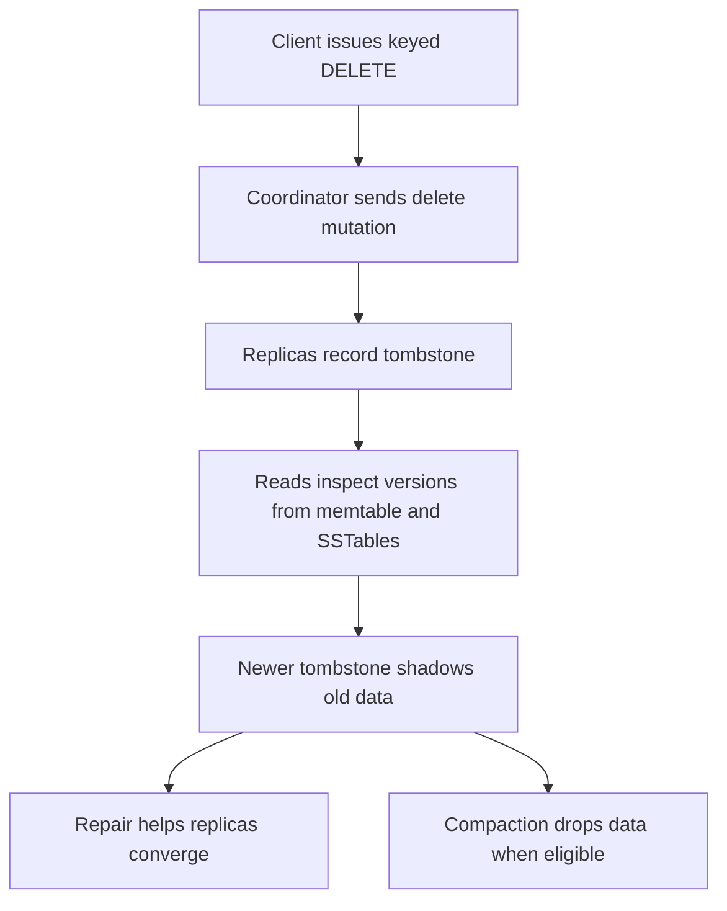
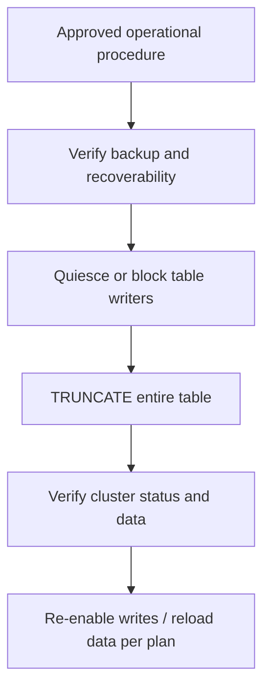

# TRUNCATE vs. DELETE and Data Protection Planning in Apache Cassandra

In Apache Cassandra, both **`DELETE`** and **`TRUNCATE`** can make data disappear from queries, yet they are not equivalent ways of writing the same thing. `DELETE` generates a deletion mutation for **columns, rows, clustering ranges, or partitions** identified by key; `TRUNCATE` is an administrative operation that empties **an entire table**. The differences in scope, tombstones, recoverability, and replica impact are so large that picking the wrong command can cause a major data-loss incident.

This lesson belongs to the **CQL Writes and Deletes** chapter of module **DATABASE_ENGINE_WIDE_COLUMN_CASSANDRA**. We connect CQL command semantics to Cassandra's distributed wide-column architecture, partition keys, replication, consistency levels, compaction, repair, and how Java applications should handle destructive operations.

**Learning objectives**

1. Accurately distinguish the scope, mechanics, and cost of `DELETE` versus `TRUNCATE`.
2. Write properly keyed delete statements without confusing deleting a single partition with wiping the whole table.
3. Explain tombstones, deletion retention, replicas missing mutations, and the limits of what "deleted" means.
4. Plan backups, snapshots, restoration, authorization checks, and write quiescing before destructive operations.
5. Choose the right deletion mechanism for retention, test data, privacy requests, and operational tasks.
6. Recognize when an operator is required rather than exposing `TRUNCATE` in an ordinary Java API.

## 1. Understand the scope before choosing a statement

Suppose a system logs events by customer and day. The `demo` keyspace already exists in the practice environment; create the table:

```sql
CREATE TABLE demo.events_by_tenant_day (
    tenant_id    uuid,
    event_day    date,
    event_time   timestamp,
    event_id     uuid,
    kind         text,
    details      text,
    PRIMARY KEY ((tenant_id, event_day), event_time, event_id)
) WITH CLUSTERING ORDER BY (event_time DESC, event_id ASC);
```

A partition key for this table is the **pair** `(tenant_id, event_day)`; rows within a partition are distinguished by the clustering key `(event_time, event_id)`.

```text
Table: demo.events_by_tenant_day
|
+-- Partition (tenant A, 2026-11-21)
|   +-- Row (09:00, event X): kind=LOGIN, details=...
|   +-- Row (09:30, event Y): kind=ERROR, details=...
|
+-- Partition (tenant A, 2026-11-22)
|   +-- Row (10:00, event Z): kind=LOGIN, details=...
|
+-- Partition (tenant B, 2026-11-21)
    +-- Row (11:00, event W): kind=PAYMENT, details=...
```

With this model:

| Goal | Scope to delete | Approach |
| --- | --- | --- |
| Remove `details` of event Y | One column of one row | `DELETE details FROM ... WHERE <full primary key>` |
| Delete event Y completely | One clustering row | `DELETE FROM ... WHERE <full primary key>` |
| Delete events in a time window for tenant A on day 21 | Clustering range in **one partition** | `DELETE FROM ... WHERE <full partition key> AND event_time ...` |
| Delete all events for tenant A on day 21 | One partition | `DELETE FROM ... WHERE <full partition key>` |
| Delete **all tenants, all days** in the table | Entire table | `TRUNCATE TABLE demo.events_by_tenant_day` |

A particularly dangerous mistake is switching from:

```sql
DELETE FROM demo.events_by_tenant_day
WHERE tenant_id = 11111111-1111-4111-8111-111111111111
  AND event_day = '2026-11-21';
```

to:

```sql
TRUNCATE TABLE demo.events_by_tenant_day;
```

The two statements differ **completely in scale**: the first deletes data for **one tenant on one day**, whereas the second empties data for **the entire table across the cluster**. There is no `WHERE` clause in `TRUNCATE` to restrict scope.

## 2. Comparing DELETE and TRUNCATE in one table

| Attribute | `DELETE` | `TRUNCATE` |
| --- | --- | --- |
| Scope | Column, row, clustering range, or keyed partition | **Entire table** |
| Targeting syntax | `WHERE` with valid primary key / clustering bounds | Table name; **no WHERE** |
| Processing path | Timestamped delete mutation | Administrative table-truncation operation |
| Tombstones | Creates cell/row/range/partition tombstones by scope | Does not simulate deleting every row via per-row tombstones |
| Effect on remaining data | Can preserve other rows/partitions | Keeps zero rows in the table if truncate succeeds |
| Preserves table schema | Yes | Yes: `TRUNCATE` is not `DROP TABLE` |
| Row-level `IF EXISTS` | Supported via LWT within allowed scopes | Not valid `TRUNCATE` syntax |
| TTL | No `USING TTL` for DELETE | No `USING TTL` for TRUNCATE |
| Rollback from CQL | No automatic `UNDO` | No automatic `ROLLBACK TRUNCATE` |
| Real recovery point | Prepared backup/snapshot/PITR; recoverability depends on history and timing | Depends on a **verified snapshot/backup taken before the operation** |
| Risk level | Depends on WHERE scope; can be very high | **Destroys all data in the table** |
| Common use cases | Deleting a record, bucket retention, data-erasure rights | Clearing a lab table, controlled table rebuild reloads, resetting test data |

**Summary:** `DELETE` is a **key-scoped mutation**; `TRUNCATE` is a **table-wide operational decision**. Never pick `TRUNCATE` just because you heard it is "faster than DELETE" without understanding recovery objectives and data dependencies.

## 3. DELETE: deleting the right column, row, range, or partition

The following examples use tenant A `11111111-1111-4111-8111-111111111111` and date `2026-11-21`. They illustrate **independent** scopes; do not run all of them sequentially on data you want to preserve.

### 3.1. Deleting a column

```sql
DELETE details FROM demo.events_by_tenant_day
WHERE tenant_id = 11111111-1111-4111-8111-111111111111
  AND event_day = '2026-11-21'
  AND event_time = '2026-11-21 09:30:00+0700'
  AND event_id = bbbbbbbb-bbbb-4bbb-8bbb-bbbbbbbbbbbb;
```

`details` of one event is deleted. `kind` can still exist, and the row is not deleted completely. For a regular column, deleting an individual column requires the **full primary key**.

### 3.2. Deleting a row

```sql
DELETE FROM demo.events_by_tenant_day
WHERE tenant_id = 11111111-1111-4111-8111-111111111111
  AND event_day = '2026-11-21'
  AND event_time = '2026-11-21 09:30:00+0700'
  AND event_id = bbbbbbbb-bbbb-4bbb-8bbb-bbbbbbbbbbbb;
```

Omitting a column list after `DELETE` and supplying the full clustering keys deletes **one row**. Other events in the same partition are not deleted by this mutation.

### 3.3. Deleting a clustering range

```sql
DELETE FROM demo.events_by_tenant_day
WHERE tenant_id = 11111111-1111-4111-8111-111111111111
  AND event_day = '2026-11-21'
  AND event_time >= '2026-11-21 09:00:00+0700'
  AND event_time <  '2026-11-21 10:00:00+0700';
```

The `[09:00, 10:00)` interval deletes rows whose timestamp falls within the range of the **specified partition**; the upper bound uses `<` so an event at exactly 10:00 is **not** deleted. Cassandra can represent this using a **range tombstone** instead of requiring the client to list every event ID.

### 3.4. Deleting an entire partition

```sql
DELETE FROM demo.events_by_tenant_day
WHERE tenant_id = 11111111-1111-4111-8111-111111111111
  AND event_day = '2026-11-21';
```

This deletes all clustering rows for **tenant A on day 21**. Other day partitions and other tenants are outside the mutation's scope.

**Watch composite partition keys:** providing only `tenant_id` without `event_day` does not identify a valid partition key. A relational-style `DELETE FROM table WHERE tenant_id = ...` will not automatically scan and delete every day for that tenant.

### 3.5. DELETE is not a prior read

A standard DELETE does not read the old row before issuing a delete mutation. Deleting a non-existent key can still write a deletion marker; it is not a tool that returns how many rows existed beforehand. If business rules require "delete only if the row currently exists," `DELETE ... IF EXISTS` (LWT) can fit **a single row identified by full key**, provided you accept consensus cost and handle `[applied]`.

For broader requirements like multi-day retention, the application must resolve the partition keys or model retention properly. Never use a `WHERE`-less `DELETE FROM table` as a substitute for `TRUNCATE`.

## 4. TRUNCATE: emptying an entire table

CQL syntax:

```sql
TRUNCATE TABLE demo.events_by_tenant_day;

-- The TABLE keyword is optional in supported CQL syntax.
TRUNCATE demo.events_by_tenant_day;
```

**Pick only one of the two forms above**; do not run both without reason. There is no filter:

```sql
-- INVALID: TRUNCATE does not accept a WHERE clause.
TRUNCATE TABLE demo.events_by_tenant_day
WHERE tenant_id = 11111111-1111-4111-8111-111111111111;
```

Key facts about the result:

- Every partition of the table is in scope; after a successful `TRUNCATE`, prior table data is no longer returned.
- **The table definition remains**: table name, columns, and primary key are not dropped as in `DROP TABLE`. Applications can write new data into the table afterward.
- It has no per-row `IF EXISTS`, no `USING TTL`, and no `WHERE`.
- Cassandra processes truncation at the **table-wide level** across the distributed system. Unavailable nodes or coordination failures can cause the operation to fail or leave the client uncertain of the outcome; follow version-specific verification and recovery procedures.
- Truncation is not a loop issuing millions of per-full-primary-key `DELETE`s; therefore it does not generate millions of row tombstones **in that manner**.

**Do not infer from "does not create millions of row tombstones" that data has been securely wiped from every backup, snapshot, disk, and downstream system.** That is a separate concern of security, retention, and data lifecycle management.

### TRUNCATE differs from DROP TABLE

```sql
-- TRUNCATE: preserves table schema, deletes table data.
TRUNCATE TABLE demo.events_by_tenant_day;

-- DROP TABLE: deletes table definition along with its data.
-- DO NOT run if you still need the schema!
DROP TABLE demo.events_by_tenant_day;
```

Do not use `DROP TABLE` as a "truncate and recreate" shortcut when a table has operational dependencies and settings. That sequence can affect permissions, schema metadata, indexes, materialized views, running applications, and change management; it is not an arbitrary equivalent optimization.

## 5. Why does DELETE generate tombstones while TRUNCATE has its own mechanism?

Cassandra stores data using an **LSM-tree** model: mutations go into the commit log and memtable, then flush to immutable **SSTable** files. An old value may remain in one SSTable while newer data or deletion markers reside in another memtable/SSTable.

For **DELETE**, Cassandra cannot immediately erase every byte of an old record across every node. It needs a timestamped **tombstone** so that during reads and reconciliation, older versions do not resurrect.



For **TRUNCATE**, the goal is not shadowing specific keys, but **clearing the entire table's dataset** via a table/replica-level truncation process. Cassandra records truncation metadata and handles underlying storage accordingly so pre-truncate data is not resurrected via improper replay; exact implementation details depend on the version.



**Do not read the TRUNCATE diagram as implying cross-table transactions.** In Cassandra, this table-wide operation is not a business transaction that automatically clears related tables, caches, external search indexes, or downstream systems.

### Common tombstone types produced by DELETE

| Deletion scope | Example CQL | Typical logical marker |
| --- | --- | --- |
| One regular column | `DELETE details ... WHERE <full primary key>` | Cell tombstone |
| One row | `DELETE FROM ... WHERE <full primary key>` | Row tombstone |
| A clustering range | `DELETE FROM ... WHERE <full partition key> AND event_time ...` | Range tombstone |
| Whole partition | `DELETE FROM ... WHERE <full partition key>` | Partition tombstone |

Under heavy deletes, tombstones force reads to reconcile versions and increase compaction load. `TRUNCATE` avoids that per-row deletion work, at the cost of **losing the entire table's data**.

### `gc_grace_seconds` is not an undo window

The `gc_grace_seconds` setting relates to the minimum age of a tombstone before it becomes eligible for safe garbage collection. It is neither an "undo retention buffer for N seconds" nor a guarantee that tombstones vanish at the exact N-second mark.

Because Cassandra has multiple replicas, a temporarily disconnected node can miss a deletion marker. If the marker is purged before that node is repaired/synchronized, **old data risks resurrecting** (*zombie data*). Never lower `gc_grace_seconds` arbitrarily to fix read latency; understand your repair schedule, compaction configuration, and topology for your Cassandra version.

**Recovering from tombstones is not a backup strategy.** Both DELETE and TRUNCATE require an active backup/restore plan whenever data is valuable.

## 6. Replication, consistency, and network errors

Suppose a keyspace has replication factor 3, meaning a partition is stored on three replicas per the replication strategy. On a keyed DELETE, the coordinator sends mutations to the responsible replicas; consistency level determines how many acknowledgments are needed before returning success to the client.

| Scenario | What can happen | Operational takeaway |
| --- | --- | --- |
| `DELETE` at `ONE` | One replica acknowledges early; others may lag | Do not treat a success response as proof all replicas saw the tombstone |
| `DELETE` at `QUORUM` with RF=3 | Typically requires 2 replicas within the quorum scope to acknowledge | Stronger acknowledgment guarantee, yet does not replace repair |
| A replica is offline during DELETE | Old data can remain on that replica | Repair/convergence must be operated properly |
| Client timeout after DELETE | Some replicas may still have recorded the mutation | Never equate timeout with "delete definitely failed" |
| Client timeout after TRUNCATE | Outcome from client perspective may be uncertain | Inspect cluster state; do not blindly re-run |
| Writers active during TRUNCATE | Can write new data around execution time | Quiesce writers and define the cutover boundary |

### Why does TRUNCATE require more careful coordination?

TRUNCATE does not target a single partition; it affects **all nodes/replicas storing the table**. Depending on Cassandra version and node health, connectivity failures or unavailable nodes can block truncation completion; never design workflows assuming "this command just hits one node and is done."

Before executing, operators must inspect nodes, topology, schema agreement, and storage state using cluster tools. Afterward, verify across **multiple read paths/replicas as appropriate**, not just a single low-consistency `SELECT`.

### TRUNCATE is not a permanent lock against new writes

Once truncation completes, the schema remains intact. A running application can **write new events** into the table immediately afterward.

```text
08:59:59  Ingestion still running, sending mutations.
09:00:00  Operator issues TRUNCATE.
09:00:01  Application writes new data into the table.
09:00:02  Operator runs SELECT and sees data appear.
```

This does not necessarily mean TRUNCATE "failed"; the table may have been emptied and then newly written. Therefore, define a **business cutover point**, pause producers/consumers, and establish replay rules before truncating.

If the goal is **preventing old data from being re-ingested**, handle replay queues, client retries, CDC/downstream loops, batch imports, and backfill jobs too. A `TRUNCATE` affects only the table's Cassandra data, not external sources capable of writing it back.

## 7. Performance: why not use millions of DELETEs to empty a table?

Suppose a table holds hundreds of millions of events across many tenants and days. A script scanning every row and issuing individual `DELETE`s:

- Must read or discover every row's key, often clashing with Cassandra's query model.
- Generates massive mutations and tombstones, spiking network, write, and compaction load.
- Can create **hot partitions** or overload specific replicas.
- Easily fails halfway through, making it hard to prove all rows were removed.
- Degrades read latency for remaining reads while tombstones accumulate.

If the **true goal is clearing the whole table to reload from scratch**, a prepared administrative `TRUNCATE` procedure is usually far better than a DELETE loop.

Conversely, if you must **preserve tenant B's data** in our example, `TRUNCATE` is **business-wrong** regardless of speed: delete by target partitions/ranges or redesign retention.

### Do not naively verify large tables with SELECT COUNT(*)

```sql
-- Can trigger a very expensive table scan on large datasets:
SELECT COUNT(*) FROM demo.events_by_tenant_day;
```

Cassandra does not maintain a cheap, always-accurate global "row count" metadata field for arbitrary tables. `COUNT(*)` on a large table can scan huge volumes of data. Never run it as a production verification step after TRUNCATE without evaluating its cost.

In an operational runbook, use bounded checks with known cost:

1. Check node/schema status with version-appropriate operational tools.
2. Sample known partition keys after writers have been blocked.
3. Review disk-usage/estimated-row metrics, SSTable counts, and compaction status via monitoring.
4. Reconcile reloaded counts against an independent source if available.

A few empty `SELECT` checks are a **sanity signal**, not a substitute for full cluster-wide verification.

### When is TTL better than DELETE and TRUNCATE?

For event data kept for a fixed retention window, modeling tables by **time bucket** paired with `default_time_to_live` or `USING TTL` can expire old data automatically.

```sql
-- Illustrates an event value with a 7-day TTL.
INSERT INTO demo.events_by_tenant_day (
    tenant_id, event_day, event_time, event_id, kind, details
)
VALUES (
    11111111-1111-4111-8111-111111111111,
    '2026-11-21',
    '2026-11-21 12:00:00+0700',
    aaaaaaaa-aaaa-4aaa-8aaa-aaaaaaaaaaaa,
    'HEARTBEAT',
    'lab-event'
)
USING TTL 604800;
```

TTL prevents values from remaining live past the configured window, though it still involves tombstones and compaction. TTL is **not an instant physical purge of all old data** or a backup replacement.

If a tenant requests immediate deletion of a keyed subset of data, DELETE is more appropriate than waiting for TTL. If you need to clear an entire lab table after testing, TRUNCATE is cleaner than waiting for individual cell TTLs to expire.

## 8. Why snapshot, backup, and restore are three distinct concepts

There is no CQL `ROLLBACK TRUNCATE` statement to instantly undo a truncated table. Having a **data protection plan** means knowing exactly where you can recover from, to what state, and within what time.

### 8.1. Snapshot: a point-in-time capture of SSTable data

Cassandra supports taking **snapshots of SSTable data**, typically via `nodetool snapshot`. On each node, a snapshot may use hard links or equivalent filesystem mechanisms to existing SSTables; it is **not** an independent off-site copy just because it is named a snapshot.

In many deployments, `auto_snapshot` can automatically take a snapshot before destructive operations like truncate or drop. However:

- Never assume `auto_snapshot` is always enabled or behaves identically across all versions.
- Never assume a snapshot on the same disk/node survives disk or node failure.
- Never assume a snapshot taken while writers are active represents a consistent logical cutover across multiple business tables.
- Never assume snapshots alone suffice for per-request point-in-time recovery; that depends on commit logs, schemas, backups, and system policies.

**Before TRUNCATE**, create or verify a **real existing recovery point** with tag, timestamp, location, participating nodes, off-node copy status, and tested restore instructions.

### 8.2. Backup: copies stored safely outside the primary source

A solid backup program must include both **data** and **the metadata needed to reuse that data**:

| Component | Why it is needed |
| --- | --- |
| Snapshots/SSTables from appropriate replicas/nodes | Source of stored data to recover |
| Table/keyspace definitions and schema version | Prevents restoring into a mismatched table structure |
| Replication and topology configuration | Determines how data must be distributed |
| Backup metadata | Tags, timestamps, checksums/integrity checks, locations |
| Off-node / off-region copies per policy | Protects against disk loss, node loss, or cluster loss |
| Retention policy and access controls | Ensures data is both recoverable and protected |
| Restore drill results | Proves backups **actually work**, not just "backup job succeeded" |

Distinguish **physical backups** from **rebuildable upstream business sources**. If a table is a denormalized view built from another authoritative source that can be replayed, the plan may opt to **rebuild from the source of truth** rather than restoring SSTables. Still, verify the source retains the data, rebuild tooling works, and execution fits your RTO before truncating.

### 8.3. Restore: the process of bringing data back

Restoration is never just a single `INSERT`. Depending on Cassandra version and backup method, it may require:

1. Ensuring the target cluster is in a healthy state; stopping/controlling competing writers.
2. Verifying compatible Cassandra version, schema, and table ID/schema metadata.
3. Selecting the right set of snapshots/SSTables across nodes/replicas, not just one arbitrary file.
4. Using the supported restore/SSTable-import tools for your version (e.g., SSTable loading workflows rather than manually copying files into arbitrary directories).
5. Verifying replica placement, streaming/repair status, and reconciliation of newer writes.
6. Reconciling data against backup manifests and known sample partition keys.
7. Re-enabling applications per the approved plan.

**Never run untested SSTable restore commands in production.** Restore procedures differ by version, admin tooling, topology, and whether the cluster is online or stopped; procedures must be tested in an equivalent environment before an incident.

### 8.4. RPO, RTO, and data cutover points

Two planning metrics:

- **RPO (Recovery Point Objective):** how much data at most can be lost between the backup point and the incident?
- **RTO (Recovery Time Objective):** what is the maximum acceptable time to restore required system functionality?

For example: a snapshot was taken at 01:00, and the table is accidentally truncated at 10:00. With only the 01:00 snapshot, writes between 01:00 and 10:00 **are not automatically present in that snapshot**. Recovering close to 10:00 requires another change source (such as archived logs, incremental backups, or an event stream) that is **pre-configured and verified**, not merely saying "Cassandra has a commit log."

The commit log serves Cassandra's operational crash recovery and **is not automatically a full point-in-time recovery (PITR) system** for every need. Using commit log archiving/PITR requires upfront design, storage, protection, drills, and understanding how truncation records are handled during recovery.

## 9. Pre-TRUNCATE data protection runbook

For a production table, treat TRUNCATE as a **destructive change** governed by an approved operational procedure. Below is a baseline runbook to adapt to your organization and Cassandra version.

**Step 1 — Pinpoint exact scope.** Record **cluster**, environment, keyspace, full table name, data owner, and purpose. Is the requester truly certain they want to delete **all tenants/days**, not just one partition? If only one tenant needs deletion, halt TRUNCATE and design keyed DELETEs.

**Step 2 — Map dependencies.** Check reading/writing apps, sibling denormalized tables, materialized views, indexes, caches, search engines, CDC pipelines, ingestion queues, batch imports, and backfill jobs. Never assume truncating table A cleans copies in system B.

**Step 3 — Verify permissions and approvals.** Use an operational role scoped appropriately; separate truncate privileges from ordinary application roles whenever possible. For critical data, enforce two-person approval, change tickets, maintenance windows, and rollback criteria.

**Step 4 — Confirm the recovery point.** Record target RPO/RTO. Verify available snapshots/backups or rebuild sources, off-node storage location, manifests, and sample keys for verification. Never rely solely on assuming `auto_snapshot` is enabled.

**Step 5 — Rehearse/approve the recovery plan.** Before wiping production, confirm a restore path tested in an equivalent environment exists. Assign an owner, trigger conditions for starting restore, and how new writes will be handled.

**Step 6 — Quiesce writes.** Pause or gate producers, consumers, schedulers, CDC loopbacks, request retries, and backfill jobs. Record checkpoints/offsets properly so re-enabling them does not accidentally re-ingest all the intentionally deleted data.

**Step 7 — Verify cluster health.** Check nodes, replicas, disk space, schema agreement, backup state, and connectivity; postpone if nodes are unhealthy. Capture baseline metrics beforehand.

**Step 8 — Final target confirmation.** Cross-check the full `keyspace.table` name against the ticket and checklist. Never take dynamic table names from untrusted inputs. Require re-typing the table name and an independent second confirmation where warranted.

**Step 9 — Execute once per runbook.** An authorized operator runs `TRUNCATE TABLE keyspace.table` within the approved window. Record timestamp, operator, exact statement, output, and cluster status; never automatically replay on a client timeout.

**Step 10 — Verify and reopen service.** Inspect node/replica errors, sample known partition keys, table metrics, and new write capability. If rebuilding, reload from an explicit checkpoint; re-enable writers only once state matches change goals.

**Step 11 — Archive records and post-check.** Store the ticket, backup manifest, verification results, actual timings, encountered errors, proceed/restore decisions, and runbook updates. If sensitive data was involved, also verify snapshot/backup retention policies.

### Go / no-go gate before running

| Question | If the answer is "No" |
| --- | --- |
| Have the exact cluster/keyspace/table been verified? | **Do not run** |
| Have all stakeholders approved wiping the entire table? | **Do not run** |
| Has a backup or rebuild source been verified? | **Do not run** if data must be recoverable |
| Is there a plan to control writers/queues/replays? | **Do not run** |
| Are node health and schema agreement clean? | Postpone; fix cluster first |
| Is someone designated to verify and trigger restore? | Postpone; finish runbook |
| Have RPO/RTO and acceptable data loss been defined? | Postpone; finalize requirements |

For disposable lab tables, requirements may be lighter, yet **scope and environment** must still be verified: hitting a production cluster by mistake is never excused by "the lab table didn't matter."

## 10. When TRUNCATE or DELETE happens by mistake: incident response plan

Suppose an operator meant to delete one partition, yet ran `TRUNCATE` on the events table. The top priority now is **do not issue further destructive commands** and do not prematurely assume every byte is gone or already recoverable.

### 10.1. Actions in the first few minutes

1. **Declare an incident** and log execution time, cluster, keyspace, table, user/role, driver/cqlsh output, and node status.
2. **Pause writers** to the affected table if possible, including ingestion, consumers, backfills, and retries. This keeps the recovery point from mixing with uncontrolled new writes.
3. **Protect existing snapshots/backups** from scheduled retention cleanup until a recovery point is chosen.
4. **Check for pre-truncate snapshots** and their locations per node; do not assume `auto_snapshot` was active.
5. **Scope the blast radius**, including denormalized sibling tables and downstream systems.
6. **Assign a recovery coordinator** and isolate recovery work from ordinary client/API traffic.

### 10.2. Classifying recovery sources

| Source | How it helps | Limits |
| --- | --- | --- |
| Pre-truncate snapshot | Restores table state near snapshot time | Misses post-snapshot writes; needs matching SSTables, schema, topology |
| Off-site physical backup | Recovers even if source disks/nodes are lost | Transfer time, integrity verification, staleness |
| Upstream event source | Rebuilds table from stored events | Source must retain full events and rebuild must be idempotent |
| Snapshot + configured log/archiving | Can restore closer to incident time | Requires tested tooling, retention, and replay policy |
| Out-of-sync replica | Not a reliable backup source | Do not rely on degraded nodes as an official recovery path |

**Never manually copy old SSTables into a live table directory** to "bring data back to life." For DELETE, newer tombstones can continue shadowing older data; for TRUNCATE, truncation metadata and Cassandra version import mechanics apply. Proper recovery must follow supported restore procedures, ideally tested in an isolated environment before touching production.

### 10.3. Recommended restore workflow

1. **Select the recovery point** based on verified backups/snapshots and acceptable RPO.
2. **Spin up a test environment** (where feasible) with matching schema, version, replication, and source data.
3. **Run a dry-run restore** using supported tools/versions; reconcile partition keys and counts against manifests or trusted sources.
4. **Plan handling of post-snapshot writes** (written after the snapshot and before or after truncate): discard, replay, or reconcile by event ID?
5. **Execute production restore** during an approved window and checklist with proper access.
6. **Verify data and application correctness**, not merely whether queries return rows.
7. **Re-enable writers by checkpoint**, monitoring errors, read latency, compaction/streaming/repair, and business metrics.

A failed restore attempt should never trigger another reflexive TRUNCATE to "clean up first." Preserve existing evidence and evaluate the next step carefully.

### 10.4. If a single partition was deleted by mistake

With DELETE, an older SSTable sitting on a replica **does not** mean clients can bypass the tombstone and safely read deleted data. Recovery may require reloading data with a **valid version newer than the deletion marker** from a verified source, while avoiding overly high manual timestamps that cause future overwrite issues.

Before restoring:

- Identify deleted keys and scope; inspect relevant timestamps/mutations via telemetry if available.
- Pick a trusted data source and verify authorization to restore.
- Confirm restoration does not violate legal erasure/retention requirements.
- Control concurrent writes so data is not interleaved out of business order.
- Use a tested import/rebuild workflow; never tweak `gc_grace_seconds` or manually tamper with tombstones hoping data reappears.

## 11. Data protection plans for three scenarios

### Scenario A — Deleting one tenant's data on request

**Goal:** delete one tenant's data while keeping all other tenants intact.

The right choice is typically **keyed DELETEs across the relevant partition keys**, or a designed table/bucket retention scheme. Never use `TRUNCATE` on a multi-tenant table.

Plan:

1. List all tables and keyspaces holding tenant data, including denormalized tables serving different queries.
2. Resolve the partition keys/buckets to delete; avoid full-table scans when the schema lacks an access path.
3. Define completion criteria: data is no longer returned via read paths, and copies in caches, search indexes, exports, and backups are handled per policy.
4. Execute rate-limited keyed DELETEs while monitoring tombstones, compaction, and repair.
5. Sample **other tenants' data** to verify it remains intact.

**Privacy note:** "CQL SELECT no longer returns data" differs from "data is erased from every snapshot/backup." Compliance-driven erasure requires retention policies, backup access controls, and off-Cassandra copy cleanup; never claim instant physical erasure merely because DELETE succeeded.

### Scenario B — Clearing a test table or rebuildable table

**Goal:** the table holds purely test data, or has an authoritative upstream source able to reload it completely.

TRUNCATE can be appropriate when:

- The table is strictly dedicated to testing or rebuilds;
- Losing all rows in the table is explicitly approved;
- Exact cluster and keyspace are confirmed;
- The rebuild source and runtime fit RTO;
- Writers can be paused or replayed from controlled checkpoints.

Do not TRUNCATE if **part of the table is the sole source of truth** or multiple services share the table for different purposes.

### Scenario C — Retention for high-volume events

**Goal:** automatically expire data past a retention window without touching newer data.

Design direction:

- Partition by **tenant + time bucket**, avoiding unbounded partitions.
- Choose TTL or `default_time_to_live` aligned with the business lifecycle.
- Evaluate compaction strategies suited to TTL/time-series workloads for your Cassandra version and actual timestamp/TTL distribution.
- Monitor tombstone counts, read latency, disk usage, and compaction cadence.
- Use range/partition DELETEs for exceptional cleanup, rather than daily TRUNCATEs on a shared table.

No single TTL/compaction configuration fits every workload. Choices depend on partition size, write rate, data age, and supported queries.

## 12. Java Driver: why separate DELETE and TRUNCATE privileges?

In Java applications, **keyed DELETE** is a routine business operation. **Table-wide TRUNCATE** belongs on a separate operational/admin path with environment guards, confirmations, and auditing.

### 12.1. Prepared DELETE by full primary key

Java Driver 4.x example assuming `CqlSession session`, `UUID tenantId`, `UUID eventId`, and imports:

```java
PreparedStatement deleteOneEvent = session.prepare(
    "DELETE FROM demo.events_by_tenant_day " +
    "WHERE tenant_id = :tenant_id " +
    "AND event_day = :event_day " +
    "AND event_time = :event_time " +
    "AND event_id = :event_id"
);

BoundStatement bound = deleteOneEvent.boundStatementBuilder()
    .setUuid("tenant_id", tenantId)
    .setLocalDate("event_day", java.time.LocalDate.of(2026, 11, 21))
    .setInstant("event_time",
        java.time.Instant.parse("2026-11-21T02:30:00Z"))
    .setUuid("event_id", eventId)
    .build();

session.execute(bound);
```

`2026-11-21T02:30:00Z` equals **09:30 in `+07:00`**. When a partition key includes `event_day`, the application must apply a uniform date-bucketing rule; never silently compute the bucket date in server-local time when building keys.

**Prepared statements bind key values**, not table names as parameters. This matters in multi-tenant systems: never concatenate arbitrary table names from HTTP requests.

### 12.2. TRUNCATE must be locked to admin commands with fixed table names

The snippet below is **strictly for illustrating a disposable test cluster**. It intentionally accepts no user-supplied table name:

```java
import com.datastax.oss.driver.api.core.cql.SimpleStatement;

// Environment must come from trusted config, not HTTP input.
String environment = appConfig.getEnvironment();
if (!"ISOLATED_LAB".equals(environment)) {
    throw new IllegalStateException("TRUNCATE is only permitted in lab");
}

// labSession uses dedicated credentials, NOT web API credentials.
labSession.execute(SimpleStatement.newInstance(
    "TRUNCATE TABLE demo.truncate_delete_lab"
));
```

This is merely **an illustrative guardrail**, insufficient by itself to make production TRUNCATE safe. In production, use dedicated tooling/runbooks, RBAC, approvals, backup verification, and write gating. Never expose an endpoint like `POST /admin/truncate?table=<name>` where any client can control the table name.

### 12.3. Handling timeouts in Java

A timeout after DELETE or TRUNCATE does not prove the mutation was rejected before reaching replicas.

For keyed DELETEs, the application must clarify:

- Does the API require **state-idempotent deletion** or detecting resource existence?
- Can competing mutations write the data back?
- Is this a `DELETE ... IF EXISTS` requiring `ResultSet.wasApplied()` inspection?

For TRUNCATE, **never let a client retry policy automatically replay it** like a normal `SET scalar = value`. Follow operational procedures: halt writes, inspect cluster state, reconcile data/backups, and decide whether to proceed or restore.

### 12.4. Least-privilege permission design

| Account / role | Permissions and paths it should have | Should not have |
| --- | --- | --- |
| Application API | Read/write only required tables and keys; enforce tenant auth in app layer | Arbitrary TRUNCATE on shared tables |
| Retention job | Delete approved buckets, rate-limited, impact logged | Truncating entire tables just because some records expired |
| Data operator | Approved destructive actions per runbook with backup verification | Using operator credentials inside public endpoints |
| Backup/restore service | Policy-governed backup access, tested restore capabilities | Unaudited unrestricted privileges |

Actual Cassandra permissions must be configured via the RBAC/authorization features of your deployed version; this table illustrates **separation of duties**, not literal grant syntax.

## 13. Safe hands-on lab: partial DELETE then TRUNCATE of a lab table

**Warning:** perform only on an **isolated test cluster** and a table **created specifically for this lab**, never on an application table holding real data. `TRUNCATE` destroys all table data with no `ROLLBACK`. If you are uncertain which environment you are connected to, **do not run the TRUNCATE step**.

### Step 1 — Create a dedicated disposable table

```sql
CREATE TABLE demo.truncate_delete_lab (
    tenant_id uuid,
    bucket_day date,
    event_id uuid,
    payload text,
    PRIMARY KEY ((tenant_id, bucket_day), event_id)
);
```

Prerequisites: you have permission to create tables in the `demo` test keyspace, `truncate_delete_lab` does not exist yet, and no application depends on it. If the table already exists, **do not run `CREATE TABLE IF NOT EXISTS` and casually truncate existing data**; verify ownership and purpose first.

### Step 2 — Insert data across two tenants and two days

```sql
-- Tenant A, day 21: two rows.
INSERT INTO demo.truncate_delete_lab
    (tenant_id, bucket_day, event_id, payload)
VALUES (
    11111111-1111-4111-8111-111111111111,
    '2026-11-21',
    aaaaaaaa-aaaa-4aaa-8aaa-aaaaaaaaaaaa,
    'A-day21-first'
);

INSERT INTO demo.truncate_delete_lab
    (tenant_id, bucket_day, event_id, payload)
VALUES (
    11111111-1111-4111-8111-111111111111,
    '2026-11-21',
    bbbbbbbb-bbbb-4bbb-8bbb-bbbbbbbbbbbb,
    'A-day21-second'
);

-- Tenant A, day 22: one row.
INSERT INTO demo.truncate_delete_lab
    (tenant_id, bucket_day, event_id, payload)
VALUES (
    11111111-1111-4111-8111-111111111111,
    '2026-11-22',
    cccccccc-cccc-4ccc-8ccc-cccccccccccc,
    'A-day22'
);

-- Tenant B, day 21: one row.
INSERT INTO demo.truncate_delete_lab
    (tenant_id, bucket_day, event_id, payload)
VALUES (
    22222222-2222-4222-8222-222222222222,
    '2026-11-21',
    dddddddd-dddd-4ddd-8ddd-dddddddddddd,
    'B-day21'
);
```

There are **4 rows** across **3 partitions**:

| Tenant | Bucket day | Event ID (short) | Payload |
| --- | --- | --- | --- |
| A | 21/11 | `aaaa...` | A-day21-first |
| A | 21/11 | `bbbb...` | A-day21-second |
| A | 22/11 | `cccc...` | A-day22 |
| B | 21/11 | `dddd...` | B-day21 |

### Step 3 — Delete one row, inspect the remaining partition

```sql
DELETE FROM demo.truncate_delete_lab
WHERE tenant_id = 11111111-1111-4111-8111-111111111111
  AND bucket_day = '2026-11-21'
  AND event_id = aaaaaaaa-aaaa-4aaa-8aaa-aaaaaaaaaaaa;

SELECT event_id, payload
FROM demo.truncate_delete_lab
WHERE tenant_id = 11111111-1111-4111-8111-111111111111
  AND bucket_day = '2026-11-21';
```

**Prediction:** in tenant A's day-21 partition, only `event_id = bbbb...` remains. Tenant A day 22 and tenant B day 21 are unaffected.

### Step 4 — Delete an entire partition, preserving other tenants

```sql
DELETE FROM demo.truncate_delete_lab
WHERE tenant_id = 11111111-1111-4111-8111-111111111111
  AND bucket_day = '2026-11-21';

SELECT event_id, payload
FROM demo.truncate_delete_lab
WHERE tenant_id = 11111111-1111-4111-8111-111111111111
  AND bucket_day = '2026-11-22';

SELECT event_id, payload
FROM demo.truncate_delete_lab
WHERE tenant_id = 22222222-2222-4222-8222-222222222222
  AND bucket_day = '2026-11-21';
```

**Prediction:** partition A day 21 is empty; **two rows** remain live: A day 22 and B day 21. This visually proves that DELETE by full partition key **does not wipe the whole table**.

### Step 5 — Practice pre-destructive safeguards

Before TRUNCATE, answer and record:

- Is the target cluster confirmed to be an **isolated lab**?
- Is `demo.truncate_delete_lab` the table just created for disposable data?
- Are any jobs writing to the table? Have they been stopped?
- If you wanted to restore rows A day 22 and B day 21, do you have a snapshot/backup or step 2's load script to recreate them?
- Do you understand that TRUNCATE will **delete both A day 22 and B day 21**?

To practice backups, use the snapshot method appropriate for your Cassandra version. For instance, some versions support `nodetool snapshot` with tags and table/keyspace flags; **confirm exact commands/flags in your version's documentation before running**. Standard snapshots are node-local; cluster recovery requires knowing data across nodes and copying backups to durable off-node storage.

### Step 6 — In lab only: run TRUNCATE

```sql
-- DESTROYS ALL DATA in this disposable table.
-- DO NOT replace the table name with a production name when copying.
TRUNCATE TABLE demo.truncate_delete_lab;
```

**Prediction:** no pre-truncate rows remain live in the table. Both tenants and all buckets fall within the wiped scope.

### Step 7 — Verify by known keys without scanning the whole table

```sql
SELECT event_id, payload
FROM demo.truncate_delete_lab
WHERE tenant_id = 11111111-1111-4111-8111-111111111111
  AND bucket_day = '2026-11-22';

SELECT event_id, payload
FROM demo.truncate_delete_lab
WHERE tenant_id = 22222222-2222-4222-8222-222222222222
  AND bucket_day = '2026-11-21';
```

**Prediction:** neither query returns rows if no other writers ran. This check is an **illustrative lab sample**, not certification that every production node/replica was verified.

### Step 8 — Prove the schema remains intact

```sql
INSERT INTO demo.truncate_delete_lab
    (tenant_id, bucket_day, event_id, payload)
VALUES (
    33333333-3333-4333-8333-333333333333,
    '2026-11-23',
    eeeeeeee-eeee-4eee-8eee-eeeeeeeeeeee,
    'written-after-truncate'
);

SELECT event_id, payload
FROM demo.truncate_delete_lab
WHERE tenant_id = 33333333-3333-4333-8333-333333333333
  AND bucket_day = '2026-11-23';
```

**Prediction:** the new row appears normally. `TRUNCATE` cleared old data without dropping the schema or blocking future writes.

### Expected results table

| Milestone | Live rows |
| --- | --- |
| After step 2 | A21-aaaa, A21-bbbb, A22-cccc, B21-dddd |
| After step 3 | A21-bbbb, A22-cccc, B21-dddd |
| After step 4 | A22-cccc, B21-dddd |
| After step 6 | No pre-existing table data remains |
| After step 8 | Only the new row for tenant C day 23, assuming no other writers |

**Core lesson:** deleting **one row** preserves other rows, deleting **one partition** preserves other partitions, whereas `TRUNCATE` empties **all partitions** of the table and is not simply a broader `DELETE` with a wider `WHERE` clause.

## 14. Dangerous mistakes to avoid

| Misconception | Consequence | Prevention |
| --- | --- | --- |
| Using TRUNCATE to delete one tenant | Wipes other tenants in the same table | DELETE by the relevant partition keys |
| Thinking TRUNCATE is identical to deleting every row | Misjudges tombstones, cost, and recovery | Treat it as a table-wide operation with its own mechanics |
| Expecting TRUNCATE to support `WHERE` | Editing the query can accidentally wipe the whole table | Stop and switch to keyed DELETEs |
| Assuming TRUNCATE rolls back | CQL has no `ROLLBACK TRUNCATE` | Tested snapshots/backups/restore procedures |
| Relying solely on `auto_snapshot` | May be disabled, incomplete, or insufficient for restore | Verify real backups and usability |
| Keeping backups on the same single disk/node | Hardware failure destroys both data and backups | Store off-node copies per policy |
| Failing to stop writers before TRUNCATE | Data reappears immediately after clearing | Quiesce ingestion and manage replays/offsets |
| Seeing empty SELECT and assuming erasure everywhere | Backups/caches/downstream may still hold data | Address the entire data lifecycle |
| Deleting by mistake and tweaking `gc_grace_seconds` | Does not restore data; increases zombie-data risk | Follow a verified restore procedure |
| Looping DELETE over millions of keys to clear a lab | Creates massive tombstones and unnecessary load | Use TRUNCATE on truly disposable tables |
| Using `COUNT(*)` on huge tables to verify | Can trigger heavy scans | Use sample-key checks, metrics, and runbooks |
| Exposing TRUNCATE permissions in ordinary web APIs | Expands blast radius and abuse risk | Separate admin roles, approvals, and auditing |
| Assuming TRUNCATE wipes backups too | Fails full-lifecycle deletion requirements | Enforce retention/backup policies and copy cleanup |

## 15. Self-check questions and final checklist

### Questions

1. **What is the biggest difference between DELETE and TRUNCATE?** DELETE removes targeted columns/rows/ranges/partitions; TRUNCATE empties the entire table.
2. **Does `DELETE FROM table WHERE full_partition_key` delete all tenants?** No, only the partition matching that exact partition key.
3. **Why does DELETE create tombstones?** Because immutable SSTables and lagging replicas may hold older versions; markers shadow old data during reconciliation.
4. **Does TRUNCATE create one row tombstone per row?** Do not view it that way; it uses table-level truncation mechanics.
5. **Does TRUNCATE drop the table definition?** No. After TRUNCATE, new data can be written to the existing table.
6. **Can you write `TRUNCATE ... WHERE tenant_id = ...`?** No. To target a tenant, use DELETE or a separate retention model.
7. **Is a pre-truncate snapshot automatically an off-site backup?** No. Local snapshots must be protected, copied off-node, and restore-tested.
8. **Is `gc_grace_seconds` an undo window for DELETE?** No. It governs tombstone age eligibility for safe garbage collection.
9. **If new records appear after TRUNCATE, did TRUNCATE necessarily fail?** No. Writers may have inserted new data afterward.
10. **Why must queues and backfills be stopped?** To prevent re-ingesting old data or mixing new writes into the recovery boundary.
11. **If RPO is 5 minutes but the latest snapshot is 8 hours old, is the requirement met?** No, unless a verified supplementary source can recover close to the incident point.
12. **For privacy deletion requests, why is an empty SELECT insufficient?** Copies remain in backups, snapshots, caches, and downstream systems with their own retention rules.

### 30-second decision checklist

1. **Deleting only keyed data or one tenant?** Choose DELETE and scope the primary key properly.
2. **Does data have a uniform lifespan?** Favor TTL/bucketing/compaction design before resorting to bulk deletes.
3. **Do you truly need to wipe the entire table?** Consider TRUNCATE only when authorized and confirmed no partition needs keeping.
4. **Is a tested backup or rebuild path in place?** If not, halt destructive operations on valuable data.
5. **Are writers, queues, retries, and backfills controlled?** If not, you lack a clean cutover boundary.
6. **Can you verify and recover from failure?** If not, complete the runbook, permissions, and recovery plan first.

**Takeaway:** Both `DELETE` and `TRUNCATE` make data vanish from queries, yet they differ sharply in **scope, deletion mechanics, and operational risk**. In distributed Cassandra, a safe delete is more than valid CQL syntax: it requires understanding partition keys, replica convergence, tombstones/repair/compaction, active writers, and recoverable backups. Use `TRUNCATE` only when **the entire table** is truly the target and matching data-protection safeguards are in place.
