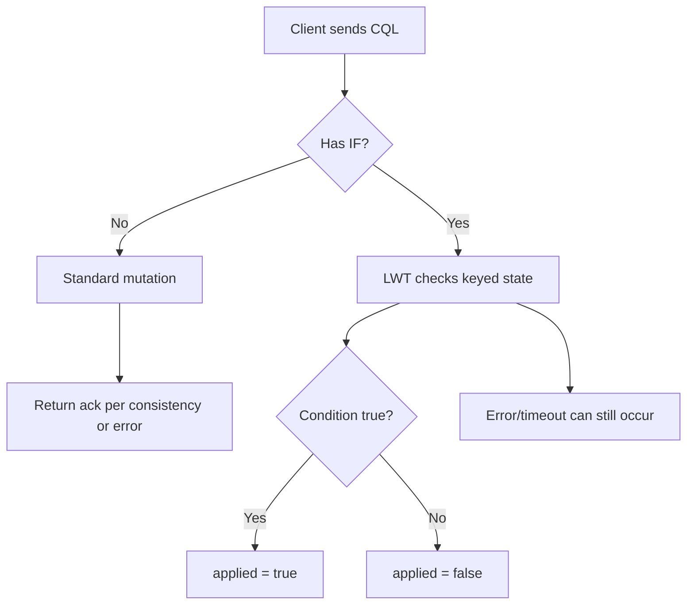

# Standard Write Results, IF [applied], and Response Limitations in Cassandra

When running an `INSERT`, `UPDATE`, or `DELETE` in Apache Cassandra, developers naturally ask: **"How many rows were updated?"**, **"Was this row newly created or already present?"**, or **"Did the delete actually remove data?"** If you are used to JDBC with a relational database, you might expect a `rowsAffected` number. However, standard CQL **does not return an affected-row count**, because Cassandra uses an *upsert* model and distributed mutations keyed by primary key.

Conversely, adding `IF NOT EXISTS`, `IF EXISTS`, or `IF column = value` switches Cassandra to a **lightweight transaction (LWT)** and returns the **`[applied]`** column. That answers **"Did the condition hold so the mutation could be applied?"**—a completely different question from **"How many rows were modified?"**

This lesson belongs to the **CQL Writes and Deletes** chapter of module **DATABASE_ENGINE_WIDE_COLUMN_CASSANDRA**. It connects CQL semantics to Cassandra's distributed wide-column architecture, partition keys, replication, consistency levels, network errors, repair, and Apache Cassandra Java Driver usage.

**After this lesson, you will be able to:**

1. Distinguish **standard write completion**, **LWT `[applied]`**, and **timeouts / unknown outcomes**.
2. Explain why standard `INSERT`/`UPDATE`/`DELETE` statements lack `rowsAffected` and do not distinguish *inserted vs. updated*.
3. Correctly interpret `true`/`false` from `IF NOT EXISTS`, `IF EXISTS`, and old-value CAS.
4. Avoid confusing `[applied] = false` with an exception, or confusing a timeout with `false`.
5. Write Java Driver code that checks `ResultSet.wasApplied()`, normalizes API responses, and handles retries safely.
6. Design write verification and observability when CQL responses do not echo written data.

## 1. Three questions to keep separate

Before looking at syntax, separate three levels of information:

| Question | Standard CQL | CQL with `IF` |
| --- | --- | --- |
| Did the coordinator complete the operation at the chosen consistency level? | Success response, or error/timeout | Also success response, or error/timeout |
| Was a condition checked and accepted? | **No business condition** | Yes, via **`[applied]`** |
| How many rows existed previously and changed? | **Not returned** | `[applied]` is **not a row count either** |
| Have all replicas converged with no subsequent concurrent writes? | Cannot be inferred from response alone | Cannot be inferred from `[applied]` alone |
| What are the current values of the entire row? | Requires a separate `SELECT` if truly needed | May need a separate `SELECT`; a false result may carry old columns but is not a full snapshot |

For example, take this statement:

```sql
UPDATE demo.accounts_by_id
SET display_name = 'Mai'
WHERE account_id = 11111111-1111-4111-8111-111111111111;
```

When the driver receives a normal completion response, what you know is that **an unconditional mutation was processed by the coordinator at the requested acknowledgment level**. You cannot tell from that response whether the account already existed, already had the same name, or whether another client changed the name immediately afterward.

By contrast:

```sql
UPDATE demo.accounts_by_id
SET display_name = 'Mai'
WHERE account_id = 11111111-1111-4111-8111-111111111111
IF revision = 1;
```

This mutation is applied only if the condition holds when LWT decides. The `[applied]` column reflects that decision. It **does not** promise to return the entire updated row, and another write request can still modify the data **after** the LWT finishes.

## 2. Sample table, keys, and baseline data

Assume the `demo` keyspace already exists in the test environment. Create a UUID-keyed account lookup table:

```sql
CREATE TABLE demo.accounts_by_id (
    account_id    uuid PRIMARY KEY,
    email         text,
    display_name  text,
    account_state text,
    revision      int,
    last_seen_at  timestamp
);
```

In this schema:

- `account_id` is both the **partition key** and the **full primary key**.
- `email`, `display_name`, `account_state`, `revision`, and `last_seen_at` are regular columns.
- Mutations by `account_id` are routed to the replicas responsible for that partition.
- The `revision` column is application-maintained metadata; Cassandra **does not** auto-increment it on every write.

Initialize an account:

```sql
INSERT INTO demo.accounts_by_id (
    account_id, email, display_name, account_state, revision
)
VALUES (
    11111111-1111-4111-8111-111111111111,
    'mai@example.test',
    'Mai',
    'ACTIVE',
    1
);

SELECT account_id, email, display_name,
       account_state, revision
FROM demo.accounts_by_id
WHERE account_id = 11111111-1111-4111-8111-111111111111;
```

The `SELECT` here is solely for **verifying lab data**. It is a separate request, **not data returned by `INSERT`**. Subsequent examples assume no competing writers, TTL expirations, or manual timestamps altering expected results unless noted.

## 3. Standard INSERT: no "newly created" flag in the response

### 3.1. INSERT on a non-existent key

```sql
INSERT INTO demo.accounts_by_id (
    account_id, email, display_name, revision
)
VALUES (
    22222222-2222-4222-8222-222222222222,
    'an@example.test',
    'An',
    1
);
```

If `2222...` had no data yet, the operation creates a new logical row. Even so, **the response of a regular `INSERT` carries no `created = true` or `affected_rows = 1` flag**.

### 3.2. INSERT on an existing key

```sql
INSERT INTO demo.accounts_by_id (
    account_id, display_name
)
VALUES (
    22222222-2222-4222-8222-222222222222,
    'An Updated'
);
```

This is also a valid `INSERT`. Because it has **upsert** semantics, it overwrites `display_name` at the same primary key. `email` and `revision`, omitted from the statement, are not deleted by this mutation.

**Both INSERTs above produce the same style of standard write response**; you cannot use result row counts or the absence of a driver exception to tell which created a row and which overwrote existing values.

### 3.3. "No error" does not mean "created strictly one row"

In CQL, `INSERT` has no implicit uniqueness constraint beyond primary key structure, nor does it raise a duplicate-key error on matching full primary keys like some relational `INSERT`s. To **create only if absent**, write `IF NOT EXISTS`—which changes both semantics and response format, as covered in section 6.

## 4. Standard UPDATE: no "row count" and no automatic existence check

### 4.1. UPDATE an existing row

```sql
UPDATE demo.accounts_by_id
SET display_name = 'Mai Anh'
WHERE account_id = 11111111-1111-4111-8111-111111111111;
```

The mutation writes only `display_name`. It does not return how many columns changed or how many rows existed, nor does it compare the new value against the old name to return `changed = true/false`.

### 4.2. UPDATE a key with no existing row

```sql
UPDATE demo.accounts_by_id
SET display_name = 'New Sparse Account'
WHERE account_id = 33333333-3333-4333-8333-333333333333;
```

With an unconditional upsert, Cassandra can create a new row containing `display_name` with all other unwritten regular columns reading as `null`. **The standard responses of both UPDATE statements look identical.**

### 4.3. UPDATE with the same value is still a mutation

```sql
UPDATE demo.accounts_by_id
SET display_name = 'Mai Anh'
WHERE account_id = 11111111-1111-4111-8111-111111111111;
```

Even if `display_name` already equals `'Mai Anh'`, this statement still writes a new version with a new timestamp. Cassandra does not return `rowsChanged = 0` just because the visible value before and after is identical.

**Practical implication:** in a Java API, never write:

```java
// Wrong for Cassandra's result model:
// int affected = session.execute(cql).getUpdateCount();
// if (affected == 0) return NOT_FOUND;
```

The CQL Java Driver does not provide JDBC `getUpdateCount()` semantics this way. When you must detect a missing account, use `UPDATE ... IF EXISTS` or an appropriate conditional business workflow.

## 5. Standard DELETE: no "how many rows were deleted"

### 5.1. DELETE a column

```sql
DELETE email FROM demo.accounts_by_id
WHERE account_id = 11111111-1111-4111-8111-111111111111;
```

This DELETE writes deletion metadata for `email` at the specified key. It does not return `affected_rows = 1` or confirm that an `email` value **previously existed**. Once the mutation is observed, queries read `email` as `null` while other columns remain.

### 5.2. DELETE a row

```sql
DELETE FROM demo.accounts_by_id
WHERE account_id = 22222222-2222-4222-8222-222222222222;
```

This deletes the row at the full primary key. Even if account `2222...` did not exist at delete time, Cassandra still accepts the mutation/tombstone. There is no deleted-row count in the response allowing the application to infer "not found."

### 5.3. Success does not mean immediate physical erasure

Cassandra uses tombstones to shadow old data in memtables/SSTables and on lagging replicas. A `DELETE` returning success at a consistency level does not mean all physical copies and backups were purged instantly. Repair and compaction handle replica convergence and safe garbage collection.

If an API must return `404 Not Found` when a resource does not exist, **do not infer that from a standard DELETE response**. Use `DELETE ... IF EXISTS` when existence checks truly matter, trading off LWT overhead.

## 6. What do IF statements return? The exact meaning of [applied]

On a conditional write, Cassandra does more than dispatch a normal upsert mutation. It runs a **lightweight transaction (LWT)** to inspect current state and decide whether to apply the operation. Responses to these statements include the special `[applied]` column.

| `[applied]` value | Exact meaning |
| --- | --- |
| `true` | The LWT condition held and the mutation was applied |
| `false` | The LWT condition did **not** hold; the requested mutation was **not** applied |

Do not translate `[applied] = true` as "a row changed its value," because writing the same existing value can still be accepted. Do not translate `[applied] = false` as "an execution error occurred": an unmet condition is a **valid result**, not an exception.



The diagram illustrates only logical outcomes. When network failures occur, the client may **fail to receive `[applied]` even though the cluster already decided the mutation**; see section 10.

## 7. INSERT IF NOT EXISTS: conditional creation

When business logic requires "create the account only if this ID does not exist yet," use:

```sql
INSERT INTO demo.accounts_by_id (
    account_id, email, display_name, account_state, revision
)
VALUES (
    44444444-4444-4444-8444-444444444444,
    'binh@example.test',
    'Binh',
    'PENDING',
    1
)
IF NOT EXISTS;
```

### When the row does not exist yet

The condition holds, Cassandra applies the mutation, and returns a result containing:

```text
 [applied]
-----------
      True
```

The application knows the **"absent" condition** held when LWT decided. Still, `true` is **not** a `created_count = 1` column; it is a boolean for the conditional operation.

### When the row already exists

If you run the same statement again with the same `account_id` while the row is alive, the condition fails:

```text
 [applied] | account_id | email | ...
-----------+------------+-------+----
     False | ...        | ...   | ...
```

CQL can return **some existing values** in the failed-condition result row, depending on statement type and Cassandra version. Crucially:

- Email/name/state are not overwritten by the rejected mutation.
- **Do not infer a connection or syntax error from `false`.**
- Do not rely on the exact extra columns returned to build a rigid API contract across every `IF` variant.
- If the application needs the full latest profile, issue an intentional `SELECT` at an appropriate consistency level.
- If the row holds sensitive fields, be careful before passing existing LWT response columns directly to an HTTP API.

### IF NOT EXISTS does not check uniqueness on arbitrary columns

Because the table is keyed by `account_id`, two rows with different UUIDs can still share the same `email`, and both `INSERT ... IF NOT EXISTS` calls can succeed.

To enforce email uniqueness, model a claim table with **normalized email as the primary key**, execute `INSERT ... IF NOT EXISTS` on that key, and build a workflow to handle failures when writing the profile table. An `[applied] = true` in `accounts_by_id` is no guarantee that business data across other partitions is consistent.

## 8. UPDATE IF EXISTS and DELETE IF EXISTS: verifying existence

### 8.1. UPDATE only when the account exists

```sql
UPDATE demo.accounts_by_id
SET display_name = 'Mai Updated'
WHERE account_id = 11111111-1111-4111-8111-111111111111
IF EXISTS;
```

If row `1111...` exists when LWT decides, `[applied] = true`. If it does not exist, `[applied] = false` and the mutation **does not create a new row** as a regular `UPDATE` would.

Existence checks enforce one specific rule: **update only an existing resource**. They do not guarantee another client has not edited `display_name` since you last read it.

### 8.2. DELETE only when the row exists

```sql
DELETE FROM demo.accounts_by_id
WHERE account_id = 44444444-4444-4444-8444-444444444444
IF EXISTS;
```

If the row is alive, `[applied] = true`. Re-sending after a successful delete with no intervening write typically returns `[applied] = false`. This **differs** from a standard DELETE, which gives no prior-existence confirmation.

### 8.3. How should false be interpreted in an HTTP API?

| LWT statement | `[applied] = false` indicates | Possible API mapping |
| --- | --- | --- |
| `INSERT ... IF NOT EXISTS` | Key already held a row when checked | `409 Conflict` for create-only requests |
| `UPDATE ... IF EXISTS` | No live row satisfied existence check | `404 Not Found` if API is update-only |
| `DELETE ... IF EXISTS` | No live row satisfied existence check | `404 Not Found`, or treat as deleted per idempotent contract |
| `UPDATE ... IF revision = n` | Current revision differs from expected | `409 Conflict` or `412 Precondition Failed` |

These are **business mapping suggestions**, not HTTP statuses returned by Cassandra itself. Applications must stay consistent with their API contract, especially when operations may be retried.

### 8.4. IF EXISTS does not mean "a value changed"

Suppose an account already has `display_name = 'Mai Updated'`; running `UPDATE ... SET display_name = 'Mai Updated' ... IF EXISTS` can still return `[applied] = true`. The condition only asks **whether the row exists**; it does not compare old and new names.

Therefore, `true` cannot serve as a trigger to email "the user actually changed their name" if business rules require detecting value transitions. Define an explicit condition or emit business events with unique IDs.

## 9. IF old value: compare-and-set responses

For optimistic concurrency control, an application can store a `revision` and write only if the cluster's value still matches what the client read.

```sql
UPDATE demo.accounts_by_id
SET display_name = 'Mai Version 2',
    revision = 2
WHERE account_id = 11111111-1111-4111-8111-111111111111
IF revision = 1;
```

If revision is still 1, `[applied] = true` and the mutation writes revision 2. If another client changed revision to 2 or 3 before the condition was checked, `[applied] = false`.

### Comparing two writers

```text
Initially: account_id=A, revision=1, display_name='Mai'

Client X reads revision=1.
Client Y reads revision=1.

X: UPDATE ... SET name='Name X', revision=2 IF revision=1
Y: UPDATE ... SET name='Name Y', revision=2 IF revision=1

One CAS succeeds first and advances revision to 2.
The other CAS is rejected under condition revision=1.
```

Without `IF revision = 1`, both become unconditional mutations that can both be acknowledged and then reconciled by timestamp. **A revision column protects concurrency only when every relevant write path obeys the conditional rule**, not merely because the column exists in the schema.

### Does false include the "current version"?

On many condition failures, Cassandra returns additional existing column values related to the condition or row. For example, you might see `[applied] = false` alongside `revision = 2`. However:

1. The set of extra columns **depends on the CQL form**; `INSERT IF NOT EXISTS` does not necessarily return the same columns as `UPDATE IF revision = ...`.
2. Those values provide context about the **rejected condition**, not a contract to return the complete object in all cases.
3. Immediately after LWT returns, another client can update the row; those extra columns are **not guaranteed to remain the latest state by the time the API sends its response**.
4. Forwarding raw LWT columns directly to clients can leak email addresses or other user attributes unless filtered by authorization.

If you genuinely need to return the current object, issue a separate `SELECT`, check authorization, and pick the right consistency. Never equate a subsequent read with an immutable snapshot from the moment the LWT failed.

### One LWT statement can update multiple columns of a row

```sql
UPDATE demo.accounts_by_id
SET account_state = 'LOCKED',
    revision = 3
WHERE account_id = 11111111-1111-4111-8111-111111111111
IF account_state = 'ACTIVE' AND revision = 2;
```

This illustrates a compound condition. Only when **both conditions** hold is the mutation applied. `[applied] = true` does not mean "two rows were affected"; it remains a boolean for **one LWT decision**.

### Key syntax limits

- `INSERT ... IF NOT EXISTS` is for conditional *insert-only*; there is no `UPDATE ... IF NOT EXISTS`.
- `UPDATE/DELETE ... IF EXISTS` or `IF column = value` does not turn Cassandra into an arbitrary table-wide query tool over regular columns; valid key predicates are still required.
- LWT uses consensus-managed timestamps; never specify `USING TIMESTAMP` alongside `IF`.
- Where appropriate, `USING TTL` can combine with `INSERT IF NOT EXISTS`/`UPDATE IF`, though TTL applies only to values actually written when the condition holds.
- Counters have dedicated semantics and do not support LWT conditions like regular columns.

## 10. Success, condition failure, timeout: three outcomes never to merge

For any write operation, build handling around **distinct branches**:

| Outcome branch | What the client receives | Valid conclusion |
| --- | --- | --- |
| **Standard write succeeds** | Completed response, no `[applied]` | Required acknowledgment level for standard write was met |
| **LWT returns `[applied] = true`** | Conditional success response | Condition held and mutation was applied |
| **LWT returns `[applied] = false`** | Conditional failure response | Requested mutation **was not applied by that LWT attempt** |
| **Timeout / uncertain failure** | No reliable decision response received | **Uncertain** whether the write was applied or not |

The last branch **is not** `[applied] = false`. A mutation may have reached enough replicas while the response was lost, or it may not have been applied. Exact interpretation depends on failure timing, timeout type, and cluster health.

### 10.1. Lost response on INSERT IF NOT EXISTS

Suppose a client issues a registration request:

```text
Client: INSERT account_id=X ... IF NOT EXISTS
Cluster: condition holds, row X is created.
Network: [applied]=true response is lost.
Client: times out and retries the same statement.
Cluster: row X already exists -> [applied]=false.
```

If the application maps that retry `false` to "someone else took this ID," it will report a false error to the very request that created the row. Therefore:

- Keep **UUIDs and idempotency keys stable** across retries of the same logical request.
- Consider storing a `request_id`/creator marker sufficient to reconcile after timeouts.
- When receiving `false` after a retry, read and compare against the issued request marker instead of assuming a collision with another client.
- Never generate a fresh UUID on every retry when targeting a single unique account.

### 10.2. Lost response on UPDATE IF revision

Suppose a client sends `IF revision = 4 SET revision = 5`, then times out:

1. The LWT may have succeeded and revision is now 5.
2. The LWT may not have been applied; revision is still 4.
3. Another client may have bumped revision afterward; reading back cannot prove which request won.

Even if `SELECT` reads revision 5, that does not prove with certainty **it came from the timed-out request** if other clients can also set revision 5. For operations requiring exact effect attribution, record an operation ID or distinct business marker.

### 10.3. Timeout on a standard write

A regular `UPDATE` at `QUORUM` may have been written on some replicas while the coordinator failed to collect enough acknowledgments before timing out. Because it is not conditional, **there is no `[applied]`** to query in the LWT sense.

Retrying `SET display_name = 'Mai'` may look safe for final state when there are no competing writes. Yet a retry carries a newer timestamp and can **shadow a value written by another client in between**. With `USING TTL`, retrying can also shift expiration timing. Hence evaluate idempotency **by business effect and concurrency**, not just by the CQL string.

### 10.4. Not every error means "unknown application status"

A syntax validation error occurring before any valid mutation has different semantics from a network timeout mid-write. The driver can also report unavailable replicas, overload, or specific server-side error codes.

Applications should classify errors by **exception type and execution stage exposed by the driver**, asserting "no write was applied" only when soundly justified. Never lump all exceptions together into `404`, `false`, or "blindly retryable."

## 11. What does consistency level confirm — and what doesn't it?

Cassandra stores partitions across multiple replicas per the keyspace replication strategy. With replication factor 3:

- **`ONE`** typically requires acknowledgment from one eligible replica.
- **`QUORUM`** typically requires two replicas out of three within the quorum scope.
- **`LOCAL_QUORUM`** uses a quorum within the local datacenter, suitable depending on topology.

These levels govern **replica acknowledgment and visibility**, not how many rows were updated. An `UPDATE` completing at `QUORUM` **does not** return `affected = 2` because two replicas acknowledged; those are two copies of one logical partition/row, not two business rows.

### 11.1. "Acknowledged" does not mean "all replicas have converged"

Even when a standard write succeeds at the chosen level, a lagging replica may not yet reflect the mutation. Read paths, hinted handoff where applicable, and repair bring replicas into convergence. Monitor node health and repair schedules; never infer from one write response that every SSTable and backup is synchronized.

### 11.2. "Acknowledged" does not mean "the value stays that way forever"

Another client can write the same column right after your operation completes, winning by timestamp reconciliation. A TTL-bound cell can also expire after its lifespan. Thus, a successful write response does not promise subsequent `SELECT`s will always return the value you wrote.

### 11.3. LWT also has serial consistency

LWT uses **serial consistency** during its consensus phase—typically `SERIAL` or `LOCAL_SERIAL`—in addition to the request's regular consistency. The two concepts differ:

| Consistency kind | Examples | Role |
| --- | --- | --- |
| Regular consistency | `ONE`, `QUORUM`, `LOCAL_QUORUM` | Replica acknowledgment requirements |
| Serial consistency | `SERIAL`, `LOCAL_SERIAL` | Consensus scope when checking/applying CAS |

You cannot replace `IF revision = 1` with `CONSISTENCY QUORUM` on a regular `UPDATE`. `QUORUM` has no knowledge of business preconditions not expressed in CQL.

In multi-datacenter deployments, choosing `LOCAL_SERIAL` versus `SERIAL` depends on client distribution and whether cross-region CAS contention occurs. Never mix policies without proving they match the consistency scope you need to protect.

### 11.4. A SELECT after a write is not part of the write result

```sql
UPDATE demo.accounts_by_id
SET display_name = 'Mai Verified'
WHERE account_id = 11111111-1111-4111-8111-111111111111;

SELECT display_name, revision
FROM demo.accounts_by_id
WHERE account_id = 11111111-1111-4111-8111-111111111111;
```

These are **two separate requests**. The second runs at its read consistency level and can observe changes that happened in between. Never design an API assuming "UPDATE always returns the new row" or "the following SELECT is an atomic snapshot of the UPDATE."

## 12. Java Driver 4.x: cleanly separating the three outcome branches

Examples use **Apache Cassandra Java Driver 4.x**, assuming an active `CqlSession session` and valid UUIDs. Imports from `com.datastax.oss.driver.api.core.cql`, `java.util.UUID`, and auth/validation logic are omitted to focus on result handling.

### 12.1. Standard write: execute returns no row count

```java
PreparedStatement updateName = session.prepare(
    "UPDATE demo.accounts_by_id " +
    "SET display_name = :new_name " +
    "WHERE account_id = :account_id"
);

UUID accountId = UUID.fromString(
    "11111111-1111-4111-8111-111111111111");

BoundStatement statement = updateName.boundStatementBuilder()
    .setUuid("account_id", accountId)
    .setString("new_name", "Mai")
    .build();

ResultSet result = session.execute(statement);

// Standard write: never infer a rowsAffected from ResultSet.
// Never use result.one() == null to conclude accountId does not exist.
```

With a standard `UPDATE`, there is no `SELECT` result row to map directly to an updated object. `result.one() == null` is normal for unconditional write responses; it **does not** mean the update missed a row.

### 12.2. INSERT IF NOT EXISTS: use wasApplied()

```java
PreparedStatement createAccount = session.prepare(
    "INSERT INTO demo.accounts_by_id " +
    "(account_id, email, display_name, account_state, revision) " +
    "VALUES (:id, :email, :name, :state, :revision) " +
    "IF NOT EXISTS"
);

BoundStatement create = createAccount.boundStatementBuilder()
    .setUuid("id", accountId)
    .setString("email", "new@example.test")
    .setString("name", "New User")
    .setString("state", "PENDING")
    .setInt("revision", 1)
    .build();

ResultSet created = session.execute(create);
if (created.wasApplied()) {
    // IF NOT EXISTS held: created successfully.
} else {
    // Key already has data: handle conflict / idempotency.
}
```

`wasApplied()` returns the boolean matching the conditional statement's `[applied]`. **Use this only for LWT statements with `IF`**—never call `wasApplied()` to ask "did a regular UPDATE modify a row?"

### 12.3. UPDATE IF EXISTS

```java
PreparedStatement updateExisting = session.prepare(
    "UPDATE demo.accounts_by_id " +
    "SET display_name = :new_name " +
    "WHERE account_id = :account_id " +
    "IF EXISTS"
);

ResultSet updated = session.execute(
    updateExisting.boundStatementBuilder()
        .setUuid("account_id", accountId)
        .setString("new_name", "Mai Updated")
        .build()
);

if (!updated.wasApplied()) {
    // Row does not exist per IF EXISTS.
    // API can return Not Found per its contract.
}
```

This avoids reading the row first to check existence. A `SELECT` followed by a standard `UPDATE` cannot offer the same guarantee under concurrent writers, since the row can be deleted or recreated between requests.

### 12.4. Compare-and-set by revision

```java
PreparedStatement changeState = session.prepare(
    "UPDATE demo.accounts_by_id " +
    "SET account_state = :new_state, revision = :new_revision " +
    "WHERE account_id = :account_id " +
    "IF revision = :expected_revision"
);

int expectedRevision = 1;
int nextRevision = Math.addExact(expectedRevision, 1);

BoundStatement cas = changeState.boundStatementBuilder()
    .setUuid("account_id", accountId)
    .setString("new_state", "LOCKED")
    .setInt("new_revision", nextRevision)
    .setInt("expected_revision", expectedRevision)
    .build();

ResultSet changed = session.execute(cas);
if (changed.wasApplied()) {
    // Old revision condition held; mutation was applied.
} else {
    // Conflict: reload or present updated state if needed.
}
```

When a client needs details of the old state, you can inspect extra columns in the `[applied] = false` result, but only access columns when **that specific statement's result schema actually includes them**. Never assume every false LWT returns all account attributes.

### 12.5. Consistency on conditional statements

When a system is scoped to a local datacenter and replica policies have been evaluated, the Java Driver lets you set **regular** and **serial consistency**:

```java
BoundStatement localCas = cas
    .setConsistencyLevel(
        com.datastax.oss.driver.api.core.DefaultConsistencyLevel.LOCAL_QUORUM)
    .setSerialConsistencyLevel(
        com.datastax.oss.driver.api.core.DefaultConsistencyLevel.LOCAL_SERIAL);

ResultSet localResult = session.execute(localCas);
boolean applied = localResult.wasApplied();
```

This is a **configuration example**, not a universal default recommendation. Settings must fit each datacenter's replication factor, where clients send traffic, and CAS requirements under cross-region contention. `LOCAL_SERIAL` is not automatically equivalent to `SERIAL` in every topology.

### 12.6. Never turn exceptions into applied = false

A common anti-pattern:

```java
// ANTI-PATTERN: never do this.
// try {
//     return session.execute(cas).wasApplied();
// } catch (Exception e) {
//     return false; // Network errors get misread as conflicts.
// }
```

When the driver reports a timeout or uncertain error, the application must **keep a dedicated error branch**. Handling pattern:

```java
try {
    ResultSet response = session.execute(cas);
    if (response.wasApplied()) {
        // Outcome: APPLIED
    } else {
        // Outcome: CONDITION_NOT_MET
    }
} catch (com.datastax.oss.driver.api.core.DriverException e) {
    // Outcome: DRIVER_FAILURE
    // Classify error type and outcome certainty.
    // Never equate every failure with CONDITION_NOT_MET.
    throw e;
}
```

In production code, classify specific exceptions—timeouts, unavailable, or validation/config errors—per Java Driver documentation and server responses; record telemetry, control retries, and return meaningful HTTP statuses. `DriverException` is an illustrative base type, not proof that every exception has an uncertain outcome.

### 12.7. ResultSet carries execution info, not post-UPDATE rows

The Java Driver exposes execution info for inspecting coordinator, warnings, and tracing when enabled appropriately. Still, **execution metadata is not business data**. Knowing which coordinator handled a request does not tell you whether the account previously existed or how many columns actually changed.

When an API must return the account representation after an update:

1. Execute the mutation and inspect its response per its semantics.
2. If LWT, check `wasApplied()`.
3. Execute a separate `SELECT` when current data is required.
4. Pick appropriate consistency, authorization checks, and read policy.
5. Accept that another writer may update between the two steps; if stronger snapshot/transition guarantees are needed, design matching invariants and LWT scope.

Never issue an unconditional `SELECT` after **every** mutation just to fill an imaginary `rowsAffected` gap; extra reads carry cost, and sometimes an API only needs acknowledgment that the request was processed.

## 13. Designing API responses: do not promise what Cassandra does not return

A user-facing API often needs richer semantics than a raw CQL response. Design the **API contract** before choosing statement types.

### 13.1. Create-only example

API: `POST /accounts` with a stable `accountId`/`requestId`.

| Execution state | Possible API interpretation |
| --- | --- |
| `INSERT ... IF NOT EXISTS` -> `[applied] = true` | Created successfully; return `201 Created` |
| Same statement -> `[applied] = false` | ID already exists; return `409 Conflict` after checking idempotency |
| Timeout, no applied received | Inconclusive; use reconciliation workflow, do not default to 409 |

If a request is retried and the ID already holds the exact data created by **that same** prior request, the service can return success under its idempotency design rather than reporting a conflict. That requires stored reconciliation data, which does not magically come from `[applied]`.

### 13.2. Update-only example

API: `PATCH /accounts/{id}`, allowing edits only on existing accounts.

- `UPDATE ... IF EXISTS`, `true`: return `204 No Content` if no object body is required.
- `UPDATE ... IF EXISTS`, `false`: return `404 Not Found`.
- Timeout: apply your defined error/retry/recovery policy; never assume `404`.

If the API allows creating a sparse account when absent, a standard `UPDATE` is valid too—just expose **upsert** semantics explicitly rather than calling a regular statement and returning `404` because `ResultSet.one()` is empty.

### 13.3. Conditional update by ETag/revision example

API: `PATCH /accounts/{id}` with the version the user observed.

```text
Client sends:
  expectedRevision = 7
  desiredState = LOCKED

Server sends CQL:
  UPDATE ... SET state = 'LOCKED', revision = 8
  WHERE account_id = ?
  IF revision = 7
```

- `[applied] = true`: mutation matched the condition; return success.
- `[applied] = false`: rejected because old version did not match or condition failed; return `409`/`412` per contract.
- Timeout: unknown whether mutation committed; never return `412` as if the condition were definitively rejected.

**Note:** with `IF revision = 7`, a non-existent row also yields `false`; if the API must distinguish "not found" from "revision mismatch," include additional data/classification steps. Never assume every compare-and-set `false` proves the resource exists.

### 13.4. Idempotent DELETE example

API: `DELETE /accounts/{id}`.

A common contract treats deleting an already-absent resource as **success in final state**. Standard DELETE fits well here and returns `204` upon completion, because the goal is "after this request, the resource is no longer considered present."

If the contract requires returning `404` when the ID did not previously exist, consider `DELETE ... IF EXISTS` and `[applied]`. In exchange, LWT carries higher overhead and timeouts/retries still require explicit policies.

**Never** equate "API returned 204" with a claim that data is physically erased from every SSTable, replica, snapshot, and backup. Privacy/retention erasure requires separate data-lifecycle procedures.

## 14. Hands-on lab: observing responses, not just stored data

This section focuses on **the CQL response itself**, not just reading state after each command. Run sequentially in a test environment against `demo.accounts_by_id` created in section 2, using a dedicated UUID to avoid affecting earlier examples.

### Step 1 — Standard INSERT on a new key

```sql
INSERT INTO demo.accounts_by_id (
    account_id, email, display_name, account_state, revision
)
VALUES (
    88888888-8888-4888-8888-888888888888,
    'lab@example.test',
    'Lab User',
    'PENDING',
    1
);
```

**Observation:** the standard write completes; **there is no `[applied]`** or created-row count in the output. You cannot distinguish creation from upsert **from this response alone**.

### Step 2 — Standard INSERT again on the same key

```sql
INSERT INTO demo.accounts_by_id (
    account_id, display_name
)
VALUES (
    88888888-8888-4888-8888-888888888888,
    'Lab Updated'
);
```

**Observation:** the standard write response has the same shape as step 1. Only by running a separate `SELECT`:

```sql
SELECT email, display_name, account_state, revision
FROM demo.accounts_by_id
WHERE account_id = 88888888-8888-4888-8888-888888888888;
```

do you see `display_name = 'Lab Updated'` with email, state, and revision from step 1 preserved.

### Step 3 — Standard UPDATE on a non-existent key

```sql
UPDATE demo.accounts_by_id
SET display_name = 'Sparse Row'
WHERE account_id = 99999999-9999-4999-8999-999999999999;
```

**Observation:** the response returns no row count; even though this is a new key, `UPDATE` still creates a sparse row. You cannot infer 404 from the response.

### Step 4 — UPDATE IF EXISTS on a non-existent key

```sql
UPDATE demo.accounts_by_id
SET display_name = 'Must Not Create'
WHERE account_id = aaaaaaaa-aaaa-4aaa-8aaa-aaaaaaaaaaaa
IF EXISTS;
```

**Expected:** `[applied] = false`; the mutation creates no new row. Run `SELECT` on key `aaaa...` if you want to verify.

### Step 5 — INSERT IF NOT EXISTS on an existing key

```sql
INSERT INTO demo.accounts_by_id (
    account_id, email, revision
)
VALUES (
    88888888-8888-4888-8888-888888888888,
    'must-not-overwrite@example.test',
    99
)
IF NOT EXISTS;
```

**Expected:** `[applied] = false`. `email` and `revision` are not overwritten by this rejected mutation. If existing columns are returned alongside `false`, remember that is **not** a row count.

### Step 6 — UPDATE IF EXISTS on an existing row

```sql
UPDATE demo.accounts_by_id
SET account_state = 'ACTIVE'
WHERE account_id = 88888888-8888-4888-8888-888888888888
IF EXISTS;
```

**Expected:** `[applied] = true`. `revision` remains 1 because the statement did not update `revision`.

### Step 7 — CAS by revision and stale writer

```sql
UPDATE demo.accounts_by_id
SET display_name = 'Version 2',
    revision = 2
WHERE account_id = 88888888-8888-4888-8888-888888888888
IF revision = 1;

UPDATE demo.accounts_by_id
SET display_name = 'Stale Request',
    revision = 2
WHERE account_id = 88888888-8888-4888-8888-888888888888
IF revision = 1;
```

**Expected:** first call returns `[applied] = true`, second returns `[applied] = false`, and `display_name` remains `'Version 2'`. Only `[applied]` tells you which mutation was rejected by the condition; standard write responses lack this signal.

### Step 8 — Standard DELETE on a non-existent key

```sql
DELETE FROM demo.accounts_by_id
WHERE account_id = bbbbbbbb-bbbb-4bbb-8bbb-bbbbbbbbbbbb;
```

**Observation:** DELETE completes without returning a count of existing rows. That does not mean it just deleted an existing account.

### Step 9 — DELETE IF EXISTS twice

```sql
DELETE FROM demo.accounts_by_id
WHERE account_id = 88888888-8888-4888-8888-888888888888
IF EXISTS;

DELETE FROM demo.accounts_by_id
WHERE account_id = 88888888-8888-4888-8888-888888888888
IF EXISTS;
```

**Expected:** first call returns `[applied] = true`, second returns `[applied] = false` assuming no concurrent writer recreated the row. The second `false` is neither a network error nor a `rowsAffected = 0` count.

### Lab comparison table

| Step | Statement | Characteristic response | Valid conclusion |
| --- | --- | --- | --- |
| 1 | Standard INSERT | No `[applied]` | Standard write completed |
| 2 | Standard INSERT same key | No `[applied]` | Cannot tell created vs. updated |
| 3 | Standard UPDATE new key | No `[applied]` | Can create a sparse row |
| 4 | UPDATE IF EXISTS absent key | `false` | Mutation not applied |
| 5 | INSERT IF NOT EXISTS existing key | `false` | Row not overwritten |
| 6 | UPDATE IF EXISTS existing key | `true` | Existence condition held |
| 7 | Two UPDATE IF revision=1 | `true` then `false` | Stale-revision request detected |
| 8 | Standard DELETE absent key | No `[applied]` | Returns no deleted-row count |
| 9 | DELETE IF EXISTS twice | `true` then `false` | Existence and absence checked by LWT |

Results assume lab statements succeed with no competing writes and no unusual TTLs/timestamps. To test network failures, use a sandbox that supports safe timeout simulation; **never deliberately kill production nodes** just to inspect responses.

## 15. Other commonly misunderstood response limitations

### 15.1. No relational-style `RETURNING *` on UPDATE

For standard CQL `INSERT`/`UPDATE`/`DELETE` statements, do not expect a relational `RETURNING *` clause to automatically echo the written row. If you need post-update data, issue a separate `SELECT` or return validated request data when sufficient and accurate under your API contract.

Never present request data as "guaranteed stored state" if the mutation timed out or is exposed to concurrent writes. Return input-derived objects only when you understand write acknowledgment semantics and concurrent-update risks.

### 15.2. BATCH does not return an affected-row count

`BATCH` groups CQL mutations under Cassandra's batch rules. A regular batch must not be treated as "the sum of row counts from its inner statements," because unconditional mutations have no row-count responses. Nor is a batch **a way to run arbitrary-isolation SQL transactions across multiple partitions**.

For conditional batches supported within their valid scope and syntax, conditional output must still be interpreted via LWT decisions and `[applied]`, **not as a record count**. Never bundle thousands of statements across partitions into a batch just to "get back a single success result."

### 15.3. What do counters return?

`counter` has dedicated update syntax:

```sql
CREATE TABLE demo.profile_view_counts_by_day (
    profile_id uuid,
    view_day date,
    total counter,
    PRIMARY KEY (profile_id, view_day)
);

UPDATE demo.profile_view_counts_by_day
SET total = total + 1
WHERE profile_id = 11111111-1111-4111-8111-111111111111
  AND view_day = '2026-11-21';
```

A standard counter `UPDATE` **does not return the new counter value or the applied delta** as a `total_after` field. Reading the value requires a separate `SELECT total`. Counters differ in retry behavior from scalar upserts: retrying after a timeout can increment multiple times. Never treat a single successful CQL response as proof that "each business request was counted strictly once."

### 15.4. IF EXISTS evaluates liveness, not "every column is non-NULL"

A Cassandra row may contain only a few regular columns, or previously held data that was deleted or expired via TTL. `IF EXISTS` checks row liveness in Cassandra's data model, not "every column is non-null."

For instance, row `3333...` in section 4 containing only `display_name` still satisfies `IF EXISTS`. Once all live data for a resource expires or is deleted, the condition result can change even if historical bytes still sit in SSTables. Therefore, for APIs modeling "permanently created account," use durable attributes or a dedicated model rather than short-TTL columns to define existence.

### 15.5. `[applied] = true` does not guarantee multi-partition invariants

If creating an account and claiming an email span **two tables keyed by two different keys**, an LWT succeeding on the email claim table does not guarantee the UUID-keyed profile write also succeeded.

Every response pertains solely to the statement/process it executed. Multi-step flows require workflow orchestration, idempotency, and compensation within system limits—never treat step A's `[applied]` as covering A+B together.

### 15.6. Query tracing and metrics do not replace a result contract

For operational observability, the driver and Cassandra expose execution metadata, tracing, retry counts, server warnings, latency, and coordinator info. Those metrics **do not** turn into affected-row counts.

Useful metrics include:

- **Error/timeout rates by mutation type**: regular writes, conditional writes, counters.
- **`[applied] = false` rate** by condition type and endpoint; sudden spikes may signal contention or stale-revision clients.
- **LWT latency** compared to standard upsert latency, broken down by hot partitions/keys where possible.
- **Retry counts and idempotency reconciliation outcomes**.
- **Consistency levels and topology** on read/write paths.
- **Tombstones / compaction / repair** under heavy DELETE and TTL workloads.

Avoid logging customer data or old column values returned in failed LWT results. Failed-condition payloads can contain sensitive data.

## 16. FAQ and implementation checklist

### Self-check questions

1. **Does a standard `INSERT` return `created = true` on a new key?** No. It completes as a normal upsert mutation with no creation flag.
2. **Is a standard `UPDATE` on a non-existent key guaranteed to fail?** No; it can create a sparse row.
3. **Does a standard `DELETE` on a non-existent key return `rowsAffected = 0`?** No; CQL does not expose row counts that way.
4. **Does `[applied] = true` mean the written data differed from before?** No. It means the LWT condition held and the mutation was applied, without checking whether values changed.
5. **Is `[applied] = false` an exception?** No. It is a normal result when the LWT condition is unmet.
6. **Should you call `wasApplied()` to check if a regular UPDATE modified a row?** No. Use it only to read the outcome of statements with `IF`.
7. **Does `IF EXISTS` prevent lost updates between two writers?** No; it checks existence only, not prior values. Use `IF revision = expected` when needed.
8. **Does `IF NOT EXISTS` keyed by `account_id` enforce email uniqueness across all rows?** No. The condition is scoped to that row's primary key.
9. **Does a false result always return all old columns?** Never assume that. Extra columns depend on statement form and version; issue a separate SELECT when needed.
10. **Is a timeout equivalent to `[applied] = false`?** No. The write may have succeeded without the client receiving the response.
11. **Why can retrying `INSERT IF NOT EXISTS` after a timeout return false?** Because the first attempt may already have created the row, so the second attempt sees the key exists.
12. **Does a `QUORUM` write with RF=3 update two rows?** No. Two acknowledging replicas store copies of the same logical data.
13. **After an LWT returns true, is SELECT guaranteed to always return the written value forever?** No; another writer can modify it, TTL can expire, and read consistency affects visibility.
14. **Can you use `SELECT COUNT(*)` as a row count for every UPDATE?** Inappropriate; it is a separate, often costly query that does not prove how many rows a mutation changed.
15. **Does a counter update return the new total?** No; reading the total requires a separate SELECT, and cumulative retry semantics must be considered.

### Common misconceptions

| Misconception | Consequence | How to fix it |
| --- | --- | --- |
| "Driver threw no error, so INSERT definitely created a new row" | Duplicate keys silently upserted | `IF NOT EXISTS` |
| "Standard UPDATE returned empty results, so row not found" | Erroneous 404 responses | `IF EXISTS` if update-only |
| "Standard DELETE returned no rows, so 0 rows deleted" | No way to tell if item existed | `DELETE IF EXISTS` when needed |
| "`wasApplied()` works for every UPDATE" | Confuses conditional result with row count | Use `[applied]` semantics only for LWT |
| "False is a network error" | Wrong retries and hidden real conflicts | Separate conditional false from exceptions |
| "Timeout means write failed" | Retries cause duplicates/overwrites | Reconcile state and enforce idempotency |
| "False on retry of IF NOT EXISTS proves someone else created it" | Flags user's own request as duplicate | Stable IDs and request markers |
| "IF EXISTS prevents all overwrites" | Lost updates still occur | CAS by revision / old value |
| "False always returns the complete old object" | Parse bugs, data leaks, brittle responses | Check result schema and SELECT when needed |
| "QUORUM is CAS" | Fails to enforce business conditions | Use IF and proper serial consistency |
| "SELECT right after UPDATE is the same transaction" | Misses concurrent writes between requests | Design invariants and LWT scope |
| "Running COUNT(*) is cheap for verifying impact" | Unnecessary cluster load | Verify via keys, metrics, and audits |

### Checklist for Java applications

1. **Define endpoint semantics:** upsert, create-only, update-only, idempotent delete, or compare-and-set?
2. **Use matching CQL:** standard mutations when no precondition is needed; add `IF` when existence or prior values must be checked.
3. **Never expect a row count:** a Java Driver `ResultSet` for a standard write is not a `JDBC update count`.
4. **Check `wasApplied()` for LWT:** true = applied, false = condition not met.
5. **Keep an error branch:** never turn timeouts or driver exceptions into `[applied] = false`.
6. **Keep keys and request IDs stable across retries:** verify whether an earlier attempt already succeeded.
7. **Pick regular and serial consistency per topology:** never treat `QUORUM` as a condition.
8. **Protect revisions across all write paths:** never let blind upserts break CAS-protected invariants.
9. **Never leak old data from false results:** enforce authorization and avoid dumping raw old rows into logs/APIs.
10. **SELECT only when needed:** if the API needs the current representation, read separately while accounting for concurrent writes.
11. **Track the right metrics:** false rates, timeouts, retries, LWT latency, replica health, and tombstones—never invent `rowsAffected`.
12. **Test with timeouts and concurrent writers:** uncertain outcomes are where CQL bugs most easily surface in production.

**Takeaway:** A successful response from a standard `INSERT`/`UPDATE`/`DELETE` tells you the mutation was accepted under the requested semantics and consistency—**not** how many rows changed, whether values differed, or whether the resource previously existed. With `IF`, `[applied]` reports the **condition decision**, not a row count or full-row snapshot. When network errors leave outcomes uncertain, keep a separate error branch, reconcile using stable IDs, and design idempotency before retrying. Mastering these three outcome groups lets Java applications use Cassandra reliably in distributed systems.
