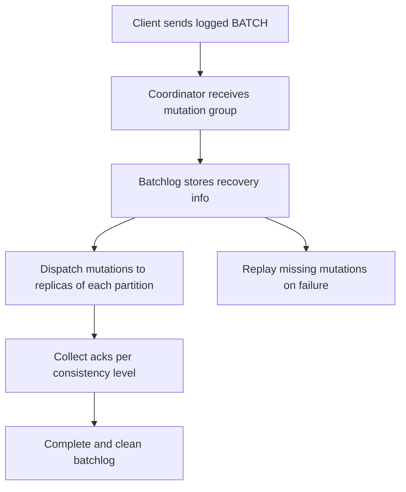
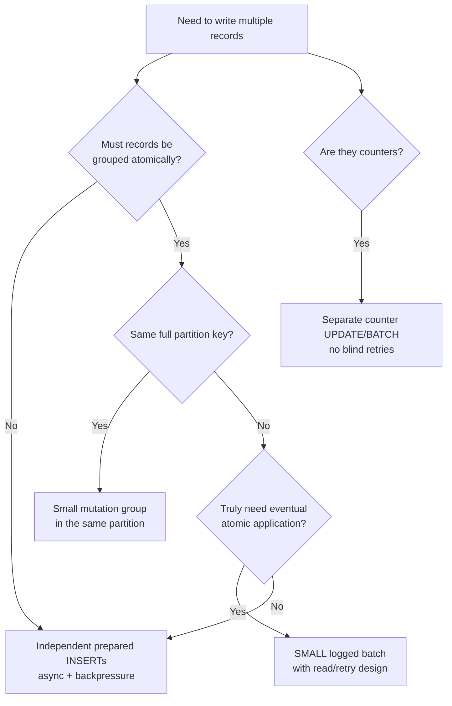

# Ingesting Multiple Records with Independent Requests vs. Appropriate BATCHes in Cassandra

When a Java application needs to write a thousand events into Apache Cassandra, the first instinct is often "bundle everything into one `BATCH` to save round trips." In Cassandra, that intuition easily leads to a bad design: **BATCH is not a general-purpose bulk-loading accelerator**, especially when records span many different partition keys. In most cases, **independent `INSERT` statements dispatched asynchronously with bounded concurrency** align much better with how Cassandra distributes work.

Conversely, a **small, intentional** batch can be useful when grouping related changes within **the same partition**, or when business logic genuinely needs the *atomic eventual application* guarantee of a **logged batch** across partitions. The key is distinguishing **throughput optimization**, **partition key scope**, **atomicity guarantees**, and **read isolation**; they are not the same concept.

This lesson belongs to the **CQL Writes and Deletes** chapter, module **DATABASE_ENGINE_WIDE_COLUMN_CASSANDRA**: understanding wide-column storage, partition keys, replication, consistency levels, CQL, compaction/repair, and Java integration. The goal is deciding **when to use independent requests**, **when to use BATCH**, how to bound load, and how to handle errors when only part of the work is acknowledged.

After this lesson, you will be able to:

1. Explain why writing multiple records **is not automatically equivalent** to a SQL transaction.
2. Classify **logged**, **unlogged**, and **counter batches**, plus the limits of conditional batches.
3. Write CQL for multiple rows in the **same partition** and for mutations that truly belong grouped together.
4. Design asynchronous ingestion with **bounded concurrency / backpressure** in Java Driver 4.x.
5. Understand the batchlog, replicas, timeouts, retries, idempotency, tombstones, and hot-partition effects.
6. Choose suitable strategies for events, imports, updating denormalized tables, and counters.

## 1. Why check the partition key before grouping records?

Suppose a service receives events from many devices and needs to query them by **device and day**. The `demo` keyspace is assumed to exist on the learning cluster:

```sql
CREATE TABLE demo.events_by_device_day (
    device_id  uuid,
    event_day  date,
    event_time timestamp,
    event_id   uuid,
    event_type text,
    payload    text,
    PRIMARY KEY ((device_id, event_day), event_time, event_id)
) WITH CLUSTERING ORDER BY (event_time DESC, event_id ASC);
```

The **partition key** is `(device_id, event_day)`, and the **clustering key** is `(event_time, event_id)`. Two events for the same device and day belong to one partition; different devices or different days can reside on different replicas and token ranges.

```text
Incoming event batch
|
+-- Device A, day 2026-11-21
|   +-- 09:00, event X
|   +-- 09:05, event Y
|
+-- Device A, day 2026-11-22
|   +-- 10:00, event Z
|
+-- Device B, day 2026-11-21
    +-- 11:00, event W

Three partition keys -> can belong to different replicas/coordinators.
```

**Same table** does not mean **same partition**. Even **same `device_id`** is not enough: `event_day` is the second half of the composite partition key. Putting all four events above into one batch forces a single coordinator to orchestrate work across multiple partitions just to reduce application calls—rarely an optimal way to boost throughput.

### How to inspect a write request

| Attribute | Design question |
| --- | --- |
| `device_id` and `event_day` | Which partition does the record hit; could it create a hot partition? |
| `event_time` and `event_id` | Is this a new row or an overwrite of the same full primary key? |
| Number of partitions in a group | Is there a business reason to bundle them? |
| Size of `payload` | Is the batch too large in **bytes** even with few statements? |
| Producer count and concurrency | Can the cluster absorb the in-flight mutations? |
| Retry after timeout | Could the same event be duplicated by generating a new ID? |

In the examples, all event UUIDs are predetermined so retrying a *logical event* reuses the same key. `event_time` uses timestamps with the `+07:00` offset, and `event_day` must be computed by a consistent bucketing rule.

## 2. The default approach: independent INSERT statements

For events that need no shared atomicity guarantee, the application can send **each event as a separate mutation**:

```sql
INSERT INTO demo.events_by_device_day (
    device_id, event_day, event_time, event_id,
    event_type, payload
) VALUES (
    11111111-1111-4111-8111-111111111111,
    '2026-11-21', '2026-11-21 09:00:00+0700',
    aaaaaaaa-aaaa-4aaa-8aaa-aaaaaaaaaaaa,
    'BOOT', 'device started'
);

INSERT INTO demo.events_by_device_day (
    device_id, event_day, event_time, event_id,
    event_type, payload
) VALUES (
    22222222-2222-4222-8222-222222222222,
    '2026-11-21', '2026-11-21 11:00:00+0700',
    bbbbbbbb-bbbb-4bbb-8bbb-bbbbbbbbbbbb,
    'INFO', 'sensor online'
);
```

Both statements can be sent nearly concurrently from the Java Driver. Each request carries its full primary key; the driver and coordinator route by partition/token and cluster replication. There is no reason to force a coordinator to handle a multi-partition batch when **no atomic relationship exists between the two events**.

### Why shouldn't you send them sequentially?

Sending a thousand statements in a synchronous `session.execute(...)` loop forces the application to wait for each response before sending the next, starving concurrency. Cassandra's write path pairs much better with **prepared statements + `executeAsync` + a cap on concurrent in-flight requests**:

```text
Producer -> Bounded queue -> N in-flight INSERT requests
                              |         |         |
                              v         v         v
                          partition A   B         C
                              |         |         |
                              +--- completion/error -> release slot
```

**Bounded concurrency** differs from firing millions of unbounded futures. Without backpressure, the application can exhaust memory, connection pools, driver queues, or overload coordinators.

### Each request can succeed or fail independently

When sending 100 independent `INSERT`s:

- 95 may be acknowledged, 3 may time out, and 2 may return other errors.
- There is no shared transaction automatically rolling back the 95 succeeded writes.
- After a timeout, some mutations may have reached replicas; **you cannot assume retries have zero side effects**.
- Keep event keys stable, track per-request outcomes, and implement reconciliation/retry logic.

This is usually the **desired behavior** for independent event streams: one bad event should not force an atomic failure of unrelated events.

## 3. What is a BATCH in CQL really?

A CQL batch groups `INSERT`/`UPDATE`/`DELETE` mutations so Cassandra processes them under batch semantics. Three forms are common:

```sql
BEGIN BATCH
    -- Logged batch by default.
    INSERT INTO ...;
    UPDATE ...;
APPLY BATCH;

BEGIN UNLOGGED BATCH
    INSERT INTO ...;
    INSERT INTO ...;
APPLY BATCH;

BEGIN COUNTER BATCH
    UPDATE ... SET counter_col = counter_col + 1 WHERE ...;
    UPDATE ... SET counter_col = counter_col + 1 WHERE ...;
APPLY BATCH;
```

These three blocks show **syntax shapes** only; `...` is not runnable CQL. Runnable examples appear in sections 4, 5, and 7.

### Selection matrix

| Type | Purpose | Key characteristic | What it is NOT |
| --- | --- | --- | --- |
| **Logged batch** `BEGIN BATCH` | Group mutations needing *atomic eventual application* even across partitions | Uses **batchlog** and coordination overhead | A multi-partition SQL transaction with full isolation |
| **Unlogged batch** | Group mutations without batchlog overhead; best within a single partition | Lacks cross-partition atomicity guarantees of logged batches | A free way to speed up arbitrary scattered INSERTs |
| **Counter batch** | Group mutations on `counter` columns | Dedicated counter semantics; cannot mix with regular mutations | An exactly-once or idempotent mechanism |

**Atomicity** of a logged batch must be understood carefully: Cassandra has a mechanism so batch mutations are **eventually applied upon eligible coordinator failures**, which does **not** mean readers always see every partition change **at the exact same instant**, nor does it provide relational transaction isolation or rollback.

### Batches cannot contain SELECT

A CQL batch is a group of **mutations**, not a SQL procedural block allowing `SELECT` to read old state, compute, evaluate arbitrary conditions, and commit. When old-state comparisons are needed, use LWT within supported conditional batch rules or design a separate business workflow.

### A batch returns no row count

Like regular mutations, an unconditional batch does not return an "inserted/updated" count like JDBC `rowsAffected`. A batch success response does not tell you how many rows existed beforehand.

## 4. Small single-partition BATCH: the right use case

Suppose you need to write two events for the **same device and same day** and want to send them in one request. A small `UNLOGGED BATCH` expresses that grouped mutation cleanly:

```sql
BEGIN UNLOGGED BATCH
    INSERT INTO demo.events_by_device_day (
        device_id, event_day, event_time, event_id,
        event_type, payload
    ) VALUES (
        11111111-1111-4111-8111-111111111111,
        '2026-11-21', '2026-11-21 09:00:00+0700',
        aaaaaaaa-aaaa-4aaa-8aaa-aaaaaaaaaaaa,
        'BOOT', 'device started'
    );

    INSERT INTO demo.events_by_device_day (
        device_id, event_day, event_time, event_id,
        event_type, payload
    ) VALUES (
        11111111-1111-4111-8111-111111111111,
        '2026-11-21', '2026-11-21 09:05:00+0700',
        cccccccc-cccc-4ccc-8ccc-cccccccccccc,
        'READY', 'device warmed up'
    );
APPLY BATCH;
```

Both statements share the full partition key `(device_id, event_day)` while having different clustering keys. Cassandra can process this partition's mutations together without unnecessary cross-partition batchlog overhead. **Sharing a partition does not obligate you to batch**: two independent statements also work fine if the application does not need them grouped.

### When is a single-partition batch worth considering?

- One business change touches a few rows or columns in the **same partition** with reason to ship as a unit.
- A small group of data is generated simultaneously for the same partition key.
- Avoiding sequential round trips from the application when mutations share a tight single-partition scope.

### When is it inappropriate?

- A partition receives hundreds of thousands of continuous events: large batches do not fix a **hot partition**.
- Large payloads make even a few-statement batch consume excessive memory.
- Multiple mutations targeting the same full primary key are bundled needlessly, making winning timestamps/order harder to reason about.
- A stream can use independent asynchronous writes with no shared atomic invariant.

**Rule:** pick the partition key around queries first, and pick batching around **mutation grouping needs**—never use batches to mask an oversized-partition schema.

## 5. Multi-partition LOGGED BATCH: atomicity is not isolation

Cassandra systems commonly duplicate data by **query**. The same event may be written to two tables serving two distinct queries:

```sql
CREATE TABLE demo.event_details_by_id (
    event_id   uuid PRIMARY KEY,
    device_id  uuid,
    event_day  date,
    event_time timestamp,
    event_type text,
    payload    text
);
```

When a new event arrives, the application must store it in:

1. `events_by_device_day` to read events for a device/day.
2. `event_details_by_id` to look up event details by `event_id`.

The two tables have **different partition keys**. If you genuinely need Cassandra to help ensure eventual application of **both mutations as a group**, consider a **small logged batch**:

```sql
BEGIN BATCH
    INSERT INTO demo.events_by_device_day (
        device_id, event_day, event_time, event_id,
        event_type, payload
    ) VALUES (
        11111111-1111-4111-8111-111111111111,
        '2026-11-21', '2026-11-21 09:20:00+0700',
        dddddddd-dddd-4ddd-8ddd-dddddddddddd,
        'WARN', 'temperature high'
    );

    INSERT INTO demo.event_details_by_id (
        event_id, device_id, event_day, event_time,
        event_type, payload
    ) VALUES (
        dddddddd-dddd-4ddd-8ddd-dddddddddddd,
        11111111-1111-4111-8111-111111111111,
        '2026-11-21', '2026-11-21 09:20:00+0700',
        'WARN', 'temperature high'
    );
APPLY BATCH;
```

### Role of the batchlog

Conceptually, Cassandra records **logged batch** metadata in a **batchlog** mechanism so incomplete mutations can be replayed if the coordinator fails at an inopportune moment:



The batchlog carries storage, replication, and coordination overhead. Consequently, a batch spanning hundreds or thousands of partitions piles extra work onto the coordinator and batchlog nodes instead of spreading write load cleanly straight from the Java Driver.

### "Atomic" does not mean reading all tables at once sees everything together

Distinguish three requirements:

| Property | Does a multi-partition logged batch behave like a SQL transaction? |
| --- | --- |
| **Atomic eventual application** | Has recovery mechanics so batch mutations eventually apply per logged-batch guarantees |
| **Multi-partition isolation / snapshots** | **No** SQL-style isolation across concurrent queries |
| **Rollback if the user changes their mind** | **No** `ROLLBACK BATCH` to undo applied data |

While a logged batch is in flight or recovering from a failure, a reader can observe the update in the first table before seeing the corresponding update in the second table. Never build a rule assuming "intermediate state is impossible to read" just because two tables were written in the same logged batch.

If business logic demands a strict invariant such as **transferring money between two accounts with zero intermediate state**, do not assume a logged batch is a multi-partition ACID transaction. Design an appropriate transaction model, locking/invariant strategy, idempotency, and orchestration workflow.

### Batchlog does not prove data reached every replica

Batches remain subject to **replication and consistency** rules. A success response at `LOCAL_QUORUM` or `QUORUM` does not mean every replica persisted the mutations immediately. Repair and convergence mechanisms still matter. The batchlog addresses one specific failure mode for a mutation group; it does not replace cluster-wide repair policies.

## 6. Multi-partition UNLOGGED BATCH: why it easily misleads

An `UNLOGGED BATCH` can contain multiple partitions, yet it provides **no cross-partition atomicity guarantee from the batchlog**:

```sql
BEGIN UNLOGGED BATCH
    INSERT INTO demo.events_by_device_day (
        device_id, event_day, event_time, event_id,
        event_type
    ) VALUES (
        11111111-1111-4111-8111-111111111111,
        '2026-11-21', '2026-11-21 09:40:00+0700',
        eeeeeeee-eeee-4eee-8eee-eeeeeeeeeeee,
        'INFO'
    );

    INSERT INTO demo.events_by_device_day (
        device_id, event_day, event_time, event_id,
        event_type
    ) VALUES (
        22222222-2222-4222-8222-222222222222,
        '2026-11-21', '2026-11-21 11:40:00+0700',
        ffffffff-ffff-4fff-8fff-ffffffffffff,
        'INFO'
    );
APPLY BATCH;
```

Because the two mutations belong to two partition keys, on error or timeout you cannot assume "either both wrote or neither wrote" from an unlogged batch. One mutation may have applied while the other failed to reach enough replicas or never finished.

**Do not treat `UNLOGGED` as a switch to drop batchlog overhead while keeping logged-batch guarantees.** If events are business-independent, sending two independent async `INSERT`s is better, giving each request its own routing, observability, and retry handling.

### Batch warnings and coordinator overload

Clusters log warnings or fail overly large batches or batches touching too many partitions. Exact thresholds vary by Cassandra version and configuration, so never treat a single hardcoded number as universal across clusters.

Counting **statements** alone is insufficient: a 10-statement batch with multi-MB `payload`s can strain resources more than 50 tiny statements. Control **partition count**, **serialized byte size**, **mutation count**, and **send rate**.

### Why isn't "one round trip" automatically faster?

A multi-partition batch reduces client-side requests, yet forces a single coordinator to fan out work across many token locations, creating a CPU/memory/network bottleneck. Independent write requests let the driver route each write to an optimal coordinator and exploit cluster parallelism.

Never decide based solely on **single-call API latency**: measure **events/sec throughput, p95/p99 latency, timeouts, CPU, network, coordinator saturation, compaction, and error rates** under realistic load.

## 7. COUNTER BATCH: additive increments are not idempotent upserts

Counters are a special data type requiring a dedicated table:

```sql
CREATE TABLE demo.event_counts_by_device_day (
    device_id uuid,
    event_day date,
    total counter,
    errors counter,
    PRIMARY KEY (device_id, event_day)
);
```

When grouping counter increments, use `BEGIN COUNTER BATCH`:

```sql
BEGIN COUNTER BATCH
    UPDATE demo.event_counts_by_device_day
    SET total = total + 1
    WHERE device_id = 11111111-1111-4111-8111-111111111111
      AND event_day = '2026-11-21';

    UPDATE demo.event_counts_by_device_day
    SET errors = errors + 1
    WHERE device_id = 11111111-1111-4111-8111-111111111111
      AND event_day = '2026-11-21';
APPLY BATCH;
```

**Never mix regular mutations and counter mutations in the same batch.** Counters also carry restrictions on `TTL`, custom write timestamps, and conditional LWTs; never put `IF` on counters as you would on regular columns.

### Retrying counters can double-count

If a client times out after a counter batch, part or all of the increments may already have applied. Resending the same batch can increment `total` and `errors` again. Never treat a counter batch as **exactly-once**.

When you need strictly once-per-event counting:

1. Store each event with a stable `event_id`.
2. Deduplicate at the application or stream-processing layer.
3. Compute aggregates from confirmed events via an idempotent/checkpointed pipeline.

Counters remain useful for metrics whose semantics tolerate cumulative approximations, yet are unsuitable for financial invariants where double-counting is unacceptable.

## 8. Conditional BATCH and LWT: use only within supported limits

Conditional mutations like `INSERT ... IF NOT EXISTS`, `UPDATE ... IF EXISTS`, or `UPDATE ... IF col = expected` use **lightweight transactions (LWT)**. Conditional batches impose strict limits on grouping mutations within the **same partition**, allowed syntax, and conditions; you cannot take a multi-partition logged batch and tack on `IF` for cross-table ACID transactions.

### A single CAS example as baseline

```sql
CREATE TABLE demo.ingest_job_by_id (
    job_id uuid PRIMARY KEY,
    job_state text,
    revision int,
    last_error text
);

INSERT INTO demo.ingest_job_by_id (
    job_id, job_state, revision
)
VALUES (
    99999999-9999-4999-8999-999999999999,
    'PENDING', 1
)
IF NOT EXISTS;

UPDATE demo.ingest_job_by_id
SET job_state = 'RUNNING', revision = 2
WHERE job_id = 99999999-9999-4999-8999-999999999999
IF job_state = 'PENDING' AND revision = 1;
```

The second statement transitions state only while the condition holds; the result includes `[applied]`. If another client already moved the job to `CANCELLED`, the mutation is not applied.

### Before grouping mutations with IF

Before choosing a conditional batch, verify:

- Do the grouped statements share the **same partition key**?
- Are the `IF` conditions on those rows/columns valid syntax for your Cassandra version?
- Do the statements depend on each other's revisions/prior states?
- Does a change genuinely require atomic semantics within that partition, or is a single CAS on the state row sufficient?
- On timeout, how will the application identify which request applied using stable IDs?

Never write batch-level `BEGIN BATCH ... IF EXISTS` as if it were generic SQL. `IF` clauses belong on supported mutations and must obey conditional batch rules.

### `[applied]` is not the row count in a batch

When a valid conditional batch returns `[applied] = true`, that is the **condition outcome** under LWT semantics, not "the batch modified N rows." On `false`, do not infer "some statements modified 0 rows" in JDBC terms; understand the condition's scope and CQL's actual guarantees.

**Application rule:** if the problem is simply "start job only if still PENDING," a single `UPDATE ... IF job_state = 'PENDING'` is usually clearer than trying to wrap cross-partition events into a conditional batch.

## 9. BATCH size, hot partitions, and ingestion performance

A frequent operational mistake is grouping records into **fixed-size batches without checking partition keys or payload bytes**. "1,000 rows" is not enough information to call a batch safe.

### Limits to measure

| Factor | Potential consequence when excessive |
| --- | --- |
| Partitions per batch | Coordinator fans out many mutations; batchlog can saturate |
| Total serialized bytes | Consumes memory/network/CPU; triggers warnings or rejections |
| Statement count | Increases parse, preparation, distribution, and tracking overhead |
| Per-row `payload` size | Even a few mutations can exceed safe byte limits |
| Batches per second | Concentrates load on coordinators and replicas, even for small batches |
| Retry rate | Amplifies load precisely when the cluster is already stressed |
| Writes into one partition | Hot partition, oversized partition, rising read/compaction latency |

Cassandra enforces configurable batch-size warnings and failure thresholds that vary by version and settings. **Never cite a fixed row-count rule of thumb** as always safe. Benchmark against your actual schema, payloads, and topology.

### Batching more data does not fix hot partitions

Suppose all events from one device land in `(device_id, event_day)`:

```text
One ultra-hot device -> 500,000 events/day
                     -> same partition for that day
                     -> same replica set handles most reads/writes
```

Increasing batch size **does not change** which tokens/replicas own the partition. When partitions grow too large, consider hourly bucketing or controlled sharding, trading off queries needing to know which buckets to read. Base bucket counts on real volume, write rate, and query patterns rather than random spreading.

### When do you need to cap pending requests?

A producer whose input rate exceeds the cluster's sustainable write rate needs:

1. **Bounded queues/buffers** to avoid unbounded memory growth.
2. **In-flight request limits** tuned to latency and cluster capacity.
3. **Backpressure** toward the producer, pausing or persisting upstream state.
4. **Conditional retries** with backoff and jitter matched to error types.
5. **Checkpointing** so logical events are neither dropped nor duplicated.

**Never treat a 10,000-mutation batch as backpressure.** It merely reshapes the burst; you still need rate and concurrency control.

## 10. Java Driver 4.x: ingesting with asynchronous prepared statements

With Apache Cassandra Java Driver 4.x, **prepare once** and bind per event. Never open a new `session`/TCP connection per record, and never build CQL strings by concatenating client payload values.

### 10.1. Event model with stable keys

Suppose a Java 17 application uses:

```java
record Event(
    java.util.UUID deviceId,
    java.time.LocalDate eventDay,
    java.time.Instant eventTime,
    java.util.UUID eventId,
    String eventType,
    String payload
) {}
```

`eventId` must be a **stable ID for the same logical event**, never regenerated on retries. `eventDay` is derived using the same date/bucketing rule as queries; `Instant` represents an absolute point in time.

### 10.2. Prepare and bind with matching types

```java
PreparedStatement insertEvent = session.prepare(
    "INSERT INTO demo.events_by_device_day " +
    "(device_id, event_day, event_time, event_id, " +
    "event_type, payload) " +
    "VALUES (:device_id, :event_day, :event_time, :event_id, " +
    ":event_type, :payload)"
);

Event event = events.get(0);
BoundStatement bound = insertEvent.boundStatementBuilder()
    .setUuid("device_id", event.deviceId())
    .setLocalDate("event_day", event.eventDay())
    .setInstant("event_time", event.eventTime())
    .setUuid("event_id", event.eventId())
    .setString("event_type", event.eventType())
    .setString("payload", event.payload())
    .build();

session.execute(bound); // Synchronous, illustrating one event.
```

This keeps the Java Driver aware of CQL types, avoiding time zone bugs and SQL/CQL string-concatenation injection risks.

### 10.3. Bounded asynchronous windows

Below is a **windowed asynchronous writes** pattern: at most `MAX_IN_FLIGHT` requests per window, completing each window before starting the next. It is simple and bounds memory; streaming implementations can use semaphores/backpressure to keep the pipeline continuously saturated.

```java
import com.datastax.oss.driver.api.core.cql.AsyncResultSet;
import com.datastax.oss.driver.api.core.cql.BoundStatement;
import com.datastax.oss.driver.api.core.cql.PreparedStatement;
import java.util.ArrayList;
import java.util.List;
import java.util.concurrent.CompletableFuture;
import java.util.concurrent.CompletionStage;

final int MAX_IN_FLIGHT = 32;  // Demo value; must be benchmarked.
List<CompletableFuture<AsyncResultSet>> window = new ArrayList<>();

for (Event e : events) {
    BoundStatement write = insertEvent.boundStatementBuilder()
        .setUuid("device_id", e.deviceId())
        .setLocalDate("event_day", e.eventDay())
        .setInstant("event_time", e.eventTime())
        .setUuid("event_id", e.eventId())
        .setString("event_type", e.eventType())
        .setString("payload", e.payload())
        .build();

    CompletionStage<AsyncResultSet> stage = session.executeAsync(write);
    window.add(stage.toCompletableFuture());

    if (window.size() == MAX_IN_FLIGHT) {
        CompletableFuture.allOf(
            window.toArray(new CompletableFuture[0])
        ).join();
        window.clear();
    }
}

if (!window.isEmpty()) {
    CompletableFuture.allOf(
        window.toArray(new CompletableFuture[0])
    ).join();
}
```

This snippet illustrates **concurrency bounding**, not a production ingestion framework:

- `join()` can throw `CompletionException` if one or more requests fail.
- Other requests in the same window may have **partially succeeded** before an error; there is no window-wide rollback.
- For accurate retries, track outcomes **per event ID**, recording success/failure and handling errors individually.
- Never load a huge `events` list entirely into memory; read via paged/streamed checkpointed batches with bounded buffers.
- The value `32` **is only an example**, not an optimal default for every cluster.

### 10.4. Per-request error tracking

In production, attach logical event metadata to completions:

```java
CompletionStage<Void> one = session.executeAsync(bound)
    .thenAccept(rs -> {
        // Success for this request.
        // Update checkpoint by eventId as appropriate.
    })
    .exceptionally(error -> {
        // Record eventId, error type, retry decision.
        // Never treat timeout as 'definitely not written'.
        reportFailure(event.eventId(), error);
        return null;
    });
```

`reportFailure` is a business handler you implement. This pattern **must not silently swallow errors** and report overall job success; if using `exceptionally` to log, aggregate failure state and reflect it in the job's outcome.

**Never** fire `session.executeAsync` a million times in a tight loop before awaiting `allOf`: that removes concurrency limits and can overwhelm memory and driver queues.

### 10.5. Idempotency: keeping the full primary key stable is only step one

A regular `INSERT` to the same full primary key has upsert semantics, so resending a fixed event ID **does not create two rows**. However:

- Generating a new `event_id` on every retry creates **two rows**.
- Rewriting the same key with changed `payload` and a newer timestamp overwrites the earlier event.
- With `USING TTL`, retries can extend data expiration.
- With another writer hitting the same full key, timestamps decide the winner.
- If an event also triggers external side effects like sending emails or incrementing counters, a keyed upsert **does not automatically deduplicate external side effects**.

Mark statements idempotent for retry policies only after evaluating **all application semantics**; never assume every Cassandra `INSERT` is automatically exactly-once.

## 11. Java Driver 4.x: building small, intentional BATCHes

When mutations must be grouped, the driver provides `BatchStatement` with explicit batch types. The example below groups **two events in the same partition**:

```java
import com.datastax.oss.driver.api.core.cql.BatchStatement;
import com.datastax.oss.driver.api.core.cql.DefaultBatchType;

BoundStatement first = insertEvent.boundStatementBuilder()
    .setUuid("device_id", deviceId)
    .setLocalDate("event_day", java.time.LocalDate.of(2026, 11, 21))
    .setInstant("event_time",
        java.time.Instant.parse("2026-11-21T02:00:00Z"))
    .setUuid("event_id", eventId1)
    .setString("event_type", "BOOT")
    .setString("payload", "device started")
    .build();

BoundStatement second = insertEvent.boundStatementBuilder()
    .setUuid("device_id", deviceId)
    .setLocalDate("event_day", java.time.LocalDate.of(2026, 11, 21))
    .setInstant("event_time",
        java.time.Instant.parse("2026-11-21T02:05:00Z"))
    .setUuid("event_id", eventId2)
    .setString("event_type", "READY")
    .setString("payload", "device warmed up")
    .build();

BatchStatement smallBatch = BatchStatement.builder(DefaultBatchType.UNLOGGED)
    .addStatement(first)
    .addStatement(second)
    .build();

session.execute(smallBatch);
```

Both `Instant` values correspond to 09:00 and 09:05 in `+07:00`; `eventDay` must match the bucketing rule. The driver binds values, yet **does not automatically guarantee both events share the same partition key** if you bind mismatched `deviceId` or `eventDay` values. The application itself must enforce grouping by partition key before constructing a single-partition batch.

### Logged batches via the driver

For the two-table mutations in section 5, construct `BatchStatement.builder(DefaultBatchType.LOGGED)` and add the two prepared `BoundStatement`s for the two tables. Use this only when business rules genuinely require eventual application of the group and the batch stays small. Never switch all unlogged batches to logged "just to be safer" without measuring batchlog cost.

### Do not dump all tables or partitions into one giant batch

`BatchStatement.builder` is neither a streaming API nor an automatic limiter on partition count or workload size. Applications must enforce policies:

- Group by full partition key when building single-partition batches.
- Bound byte size and mutation count based on benchmarks and cluster settings.
- Scope multi-partition logged batches strictly to **genuinely coupled** business mutations, not arbitrary time windows of incoming requests.
- Monitor latency, batch warnings, timeouts, and retry rates per batch type.

**Java takeaway:** prepare statements once and default to independent async writes with backpressure; reserve `BatchStatement` for clearly defined mutation-grouping requirements rather than a generic "flush 500 events" buffer.

## 12. Choosing an ingestion tool for the scale

An online API writing thousands of events per second, a job migrating hundreds of millions of rows, and a lab loading 100 CSV lines **should not default to the same approach**.

| Case | Approach | What to control |
| --- | --- | --- |
| Online writes from a Java app | Prepared statements + `executeAsync` with bounded concurrency | Partition keys, latency, retries, memory, backpressure |
| Small event group in one partition | Small single-partition batch if justified, or independent requests | Size, clustering row count, contention |
| Syncing one event to two query tables | Small logged batch **only if eventual atomicity is truly needed** | Batchlog, read isolation, retries/idempotency |
| Counter increments | `UPDATE counter = counter + n` or appropriate counter batch | Non-idempotent, timeouts, never mix regular mutations |
| Small CSV import in a lab | Tools like `cqlsh COPY FROM` if supported by version | Never default to it for high-volume production ingestion |
| Massive backfill / ETL | Distributed pipeline, Spark connector, or version-supported SSTable loader | Schema, data model, token distribution, rate limits, checkpoints, repair |
| Time-bounded historical writes | Bucketed partitions + workload-matched TTL/compaction | Tombstones, retention, expired data, backups |

### Why not use BATCH instead of a bulk-loading tool?

A 100,000-statement batch:

- Does not turn statements into an SSTable-optimized "file load."
- Does not guarantee concurrent readers see all 100,000 rows appear atomically.
- Funnels huge load onto one coordinator and triggers batch warnings or failures.
- Makes reconciling which mutations applied after a timeout very hard, even with a batchlog.
- Does not magically fix poor partition keys or uneven token-ring distribution.

For backfills, build pipelines with **checkpoints**, **per-record retries**, **rate limiting**, **stable event IDs**, and **measured cluster headroom**. If loading SSTables directly via supported tools, verify Cassandra version, SSTable format, schema, and replica distribution; that is a dedicated operational workflow, not a CQL BATCH.

### Where does cqlsh COPY FROM fit?

For small demo datasets, some Cassandra versions support `COPY table FROM 'file.csv'` via `cqlsh`, though formatting, column types, delimiters, and options depend on version and tooling. It is a client utility issuing many requests; **do not assume it runs as one giant transaction or serves as the best production ingestion path**.

If an exercise needs only 4–10 rows, writing explicit `INSERT`s makes partition keys and expected results far clearer than tuning an import tool.

## 13. Timeouts, retries, and correctness across multi-record writes

In a distributed system, a timeout does not prove a mutation never reached replicas. Under bulk writes, distinguish **no shared transaction**, **scoped batchlog eventual application**, and **what the client actually observed**.

### 13.1. Multiple independent INSERTs

Suppose a producer sends five requests:

| Event | Observed response | Valid client conclusion |
| --- | --- | --- |
| E1 | Success | Mutation met required consistency level |
| E2 | Success | Mutation met required consistency level |
| E3 | Timeout | Uncertain whether applied or not |
| E4 | Clear validation error | Data/statement must be fixed before resending |
| E5 | Success | Mutation met required consistency level |

**Never roll back E1, E2, or E5 just because E3 timed out** unless you intentionally built a compensating workflow. Retry or reconcile only E3 using its stable `event_id` and stored state, and route E4 separately by error cause.

### 13.2. Multi-partition UNLOGGED BATCH

An unlogged batch containing E1 on partition A and E2 on partition B can leave E1 written while E2 was not, with no batchlog ensuring cross-partition atomicity. When the client sees only "batch timed out," replaying all mutations must account for per-item effects, timestamps, TTLs, and concurrent writes.

If E1 and E2 are independent, two async requests are far easier to track, retry, and isolate.

### 13.3. Multi-partition LOGGED BATCH

A logged batch uses the batchlog to help drive eventual application of mutations if the coordinator fails, yet **a timeout still gives the client no certainty about immediate state**. Some mutations may already appear in target tables while others are not yet visible to readers.

Never blindly replay a logged batch containing **non-idempotent** operations or TTLs. For example, replaying a logged batch with a newer write timestamp can overwrite a newer update made by another writer between attempts.

### 13.4. Retry behavior by mutation type

| Mutation type | Risk on retry |
| --- | --- |
| `INSERT` with same full primary key and same values | Creates no duplicate row at that key, though timestamp/TTL/concurrency still apply |
| `INSERT` generating a fresh UUID per retry | Creates business-level duplicate records |
| `UPDATE ... SET col = fixed_value` | Can overwrite competing mutations if retry carries a newer timestamp |
| `UPDATE ... USING TTL ...` | Can extend lifespan |
| `SET list_col = list_col + [...]` | Can append duplicate elements |
| `counter_col = counter_col + 1` | Can increment a second time |
| `INSERT ... IF NOT EXISTS` | Retry after a succeeded-but-lost-response write can return `[applied] = false` |
| Multi-partition logged batch | Batchlog may already be replaying; client must separate uncertain state from non-idempotent effects |

### 13.5. Idempotency keys are more than a request header

A reliable pipeline attaches a **logical event ID** and preserves it across all retries:

```text
Source event = (source_partition, source_offset) or supplied event_id
                 |
                 v
Stable eventId + deterministic partition key + validated payload
                 |
                 v
INSERT Cassandra
                 |
                 +--> success: record checkpoint
                 |
                 +--> timeout: reconcile/retry with exact same eventId
                 |
                 +--> permanent error: dead-letter/quarantine per policy
```

When reading from an offset/checkpointed source, advance checkpoints only under **acknowledged and recoverable** rules. Never mark an entire batch of requests successful just because 95% succeeded.

Idempotency on the event table prevents **two rows for the same event**, yet if each event also updates a search index, sends notifications, increments counters, or writes two tables, design idempotency for **those side effects too**.

## 14. Replication, write consistency, tombstones, and repair

### 14.1. Multiple replicas do not mean multiple rows

With replication factor 3, a single event can live on three replicas. Writing at `QUORUM` typically requires at least two replicas in that three-replica group to acknowledge. Those are **two copies of one logical row**, not two business rows, and the response does not return "2 rows inserted."

A `BEGIN BATCH` with 10 statements does not return "10 rows affected" either. Cassandra's request acknowledgment does not change per-full-primary-key upsert semantics.

### 14.2. Repair remains essential

A replica can temporarily miss mutations due to network blips or node downtime. Synchronization/repair brings replicas into convergence; logged batches do not make every replica instantaneously consistent. For continuous ingestion, monitoring repair lag, disk, compaction, and hinted handoff remains crucial.

### 14.3. BATCH with DELETE and TTL

Batches can contain `DELETE`s or mutations with `TTL` within CQL's supported rules. However:

- `DELETE` writes tombstones at the key/column/row/partition scope; batching deletes does not eliminate compaction work.
- Using large batches for bulk deletes can generate massive tombstones and hurt read performance.
- TTLs cause future expirations; retrying TTL mutations can shift expiration times.
- Columns omitted from `INSERT`/`UPDATE` are still left untouched even inside a batch.
- Timestamps govern reconciliation under concurrent mutations, not merely statement order inside a batch.

A batch does not guarantee "every DELETE is physically purged from all SSTables." Immutable storage, compaction, and `gc_grace_seconds` still follow table settings.

### 14.4. Monitor the cluster after changing ingestion strategy

When switching from independent requests to batches or vice versa, measure:

- Throughput in **events/sec** and **bytes/sec**.
- p50/p95/p99 request latency.
- Timeout, unavailable, overloaded, and retry rates.
- Batch sizes and large/multi-partition batch warnings.
- CPU, heap, network, and disk/commitlog usage on coordinators and replicas.
- Hot partitions, partition sizes, tombstones, and compaction backlog.
- Recovery behavior after pausing producers or losing a node.

A strategy that looks "faster" in a 10-second happy-path benchmark yet triggers a retry storm under partial node failures is not production-ready.

## 15. Step-by-step lab: independent requests, unlogged, and logged batches

Practice in your **test keyspace** using the tables created in sections 1, 5, 7, and 8. Use dedicated UUIDs so earlier examples are unaffected. Write down predictions for **partition count**, **guarantees**, and **error handling** before executing.

**Note:** these exercises illustrate semantics and do not require shutting down nodes, breaking networks, or inducing faults on shared clusters. Do not use the lab batch to stress-test huge batch limits.

### Step 1 — Send two independent INSERTs to two partitions

```sql
INSERT INTO demo.events_by_device_day (
    device_id, event_day, event_time, event_id,
    event_type, payload
) VALUES (
    77777777-7777-4777-8777-777777777777,
    '2026-11-21', '2026-11-21 08:00:00+0700',
    aaaaaaaa-aaaa-4aaa-8aaa-aaaaaaaaaaa1,
    'START', 'device 7 started'
);

INSERT INTO demo.events_by_device_day (
    device_id, event_day, event_time, event_id,
    event_type, payload
) VALUES (
    88888888-8888-4888-8888-888888888888,
    '2026-11-21', '2026-11-21 08:00:00+0700',
    bbbbbbbb-bbbb-4bbb-8bbb-bbbbbbbbbbb2,
    'START', 'device 8 started'
);
```

**Prediction:** the two mutations hit **two partitions**. Each INSERT has its own response with no shared atomicity. If the first succeeds and the second times out, the first does not roll back.

### Step 2 — Small UNLOGGED BATCH within one partition

```sql
BEGIN UNLOGGED BATCH
    INSERT INTO demo.events_by_device_day (
        device_id, event_day, event_time, event_id,
        event_type, payload
    ) VALUES (
        77777777-7777-4777-8777-777777777777,
        '2026-11-21', '2026-11-21 08:10:00+0700',
        cccccccc-cccc-4ccc-8ccc-ccccccccccc3,
        'READY', 'device 7 ready'
    );

    INSERT INTO demo.events_by_device_day (
        device_id, event_day, event_time, event_id,
        event_type, payload
    ) VALUES (
        77777777-7777-4777-8777-777777777777,
        '2026-11-21', '2026-11-21 08:20:00+0700',
        dddddddd-dddd-4ddd-8ddd-ddddddddddd4,
        'INFO', 'device 7 stable'
    );
APPLY BATCH;
```

**Prediction:** both new rows belong to partition `(7777..., '2026-11-21')` and are sent in one small batch. No multi-partition batchlog is needed. Success **returns no inserted-row count**.

Read back:

```sql
SELECT event_time, event_id, event_type, payload
FROM demo.events_by_device_day
WHERE device_id = 77777777-7777-4777-8777-777777777777
  AND event_day = '2026-11-21';
```

**Expected:** three rows—`START` 08:00, `READY` 08:10, and `INFO` 08:20—ordered by `event_time DESC` (from 08:20 down to 08:00) assuming no competing writes.

### Step 3 — Multi-partition UNLOGGED BATCH: identify the risk

```sql
BEGIN UNLOGGED BATCH
    INSERT INTO demo.events_by_device_day (
        device_id, event_day, event_time, event_id,
        event_type
    ) VALUES (
        77777777-7777-4777-8777-777777777777,
        '2026-11-22', '2026-11-22 09:00:00+0700',
        eeeeeeee-eeee-4eee-8eee-eeeeeeeeeee5,
        'START'
    );

    INSERT INTO demo.events_by_device_day (
        device_id, event_day, event_time, event_id,
        event_type
    ) VALUES (
        88888888-8888-4888-8888-888888888888,
        '2026-11-22', '2026-11-22 09:00:00+0700',
        ffffffff-ffff-4fff-8fff-fffffffffff6,
        'START'
    );
APPLY BATCH;
```

**Prediction under normal conditions:** two rows are written. Yet on failure, an unlogged batch across **two partitions** offers no cross-partition atomicity guarantee from the batchlog.

**Question:** If these are two independent events, what benefit do two separate async requests give? Answer: per-event tracking and retries, less coordinator fan-out, and driver-managed load distribution.

### Step 4 — Small logged batch across two tables

```sql
BEGIN BATCH
    INSERT INTO demo.events_by_device_day (
        device_id, event_day, event_time, event_id,
        event_type, payload
    ) VALUES (
        77777777-7777-4777-8777-777777777777,
        '2026-11-21', '2026-11-21 08:30:00+0700',
        11111111-1111-4111-8111-111111111111,
        'WARN', 'temperature warning'
    );

    INSERT INTO demo.event_details_by_id (
        event_id, device_id, event_day, event_time,
        event_type, payload
    ) VALUES (
        11111111-1111-4111-8111-111111111111,
        77777777-7777-4777-8777-777777777777,
        '2026-11-21', '2026-11-21 08:30:00+0700',
        'WARN', 'temperature warning'
    );
APPLY BATCH;
```

**Prediction:** the batch touches **two different partitions** in two tables. This is where batchlog can be considered when the application genuinely needs eventual application of both representations of the same event. **Do not** assume two cross-table queries will always observe the event simultaneously while the batch is applying or recovering.

Query both access paths:

```sql
SELECT event_time, event_type, payload
FROM demo.events_by_device_day
WHERE device_id = 77777777-7777-4777-8777-777777777777
  AND event_day = '2026-11-21';

SELECT event_id, device_id, event_type, payload
FROM demo.event_details_by_id
WHERE event_id = 11111111-1111-4111-8111-111111111111;
```

### Step 5 — Counter batch and resending

```sql
BEGIN COUNTER BATCH
    UPDATE demo.event_counts_by_device_day
    SET total = total + 1
    WHERE device_id = 77777777-7777-4777-8777-777777777777
      AND event_day = '2026-11-21';

    UPDATE demo.event_counts_by_device_day
    SET errors = errors + 1
    WHERE device_id = 77777777-7777-4777-8777-777777777777
      AND event_day = '2026-11-21';
APPLY BATCH;

SELECT total, errors
FROM demo.event_counts_by_device_day
WHERE device_id = 77777777-7777-4777-8777-777777777777
  AND event_day = '2026-11-21';
```

**Prediction:** if the counter key was never written and no other writers exist, each counter increases by 1. **Do not re-run merely to "verify the batch still succeeds"** if you want accurate counts: another execution increments again.

### Step 6 — Standalone LWT on job state

```sql
INSERT INTO demo.ingest_job_by_id (
    job_id, job_state, revision
)
VALUES (
    55555555-5555-4555-8555-555555555555,
    'PENDING', 1
)
IF NOT EXISTS;

UPDATE demo.ingest_job_by_id
SET job_state = 'RUNNING', revision = 2
WHERE job_id = 55555555-5555-4555-8555-555555555555
IF job_state = 'PENDING' AND revision = 1;

-- Resend stale condition:
UPDATE demo.ingest_job_by_id
SET job_state = 'RUNNING', revision = 2
WHERE job_id = 55555555-5555-4555-8555-555555555555
IF job_state = 'PENDING' AND revision = 1;
```

**Prediction:** the first statement creates the job with `[applied] = true`; the first CAS succeeds and sets revision to 2; the final CAS returns false because the old condition no longer holds. This is a clean way to guard job state without forcing cross-partition events into a conditional batch.

### Step 7 — Classifying outcomes observed by the driver

Suppose 10 async INSERTs return simulated results:

```text
E01  OK
E02  OK
E03  TIMEOUT
E04  OK
E05  INVALID_DATA
E06  OK
E07  OK
E08  OK
E09  OK
E10  OK
```

Determine:

1. Which events can be checkpointed as succeeded? **The OK events** per your defined policy.
2. Which event needs timeout analysis and reconciliation? **E03**; do not conclude it was definitely not written.
3. Which event belongs in a data-fix / dead-letter path? **E05**, if validation failure is permanent.
4. Can you report "the entire batch succeeded"? **No**, because E03/E05 are unresolved.
5. Should you resend all ten with new UUIDs? **No**, as that risks duplicating logical events.

### Step 8 — Choose a strategy for three scenarios

| Requirement | Sensible strategy | Reason |
| --- | --- | --- |
| 50,000 independent events across many devices/days | Async independent INSERTs with bounded concurrency | Spreads load across coordinators/replicas; per-event tracking/retries |
| 3 mutations in the same partition, needing grouped updates | Small single-partition batch if suitable | Same key scope; avoids unnecessary multi-partition batchlog |
| 2 representations of one event in two tables needing eventual atomic application | Small logged batch after careful evaluation | Batchlog aids group completion; no multi-partition isolation |

### Step 9 — Observing the absence of "rows affected"

Re-run the `READY` event `INSERT` from step 2 with the exact same full primary key and values, then query:

```sql
INSERT INTO demo.events_by_device_day (
    device_id, event_day, event_time, event_id,
    event_type, payload
) VALUES (
    77777777-7777-4777-8777-777777777777,
    '2026-11-21', '2026-11-21 08:10:00+0700',
    cccccccc-cccc-4ccc-8ccc-ccccccccccc3,
    'READY', 'device 7 ready'
);

SELECT event_id, event_type, payload
FROM demo.events_by_device_day
WHERE device_id = 77777777-7777-4777-8777-777777777777
  AND event_day = '2026-11-21'
  AND event_time = '2026-11-21 08:10:00+0700'
  AND event_id = cccccccc-cccc-4ccc-8ccc-ccccccccccc3;
```

A regular `INSERT` with the same full primary key does not create a second row just by being re-sent. **However**, the regular statement returns no `created`/`updated` flag or affected-row count; the `SELECT` above is an independent read request.

## 16. Common mistakes and decision framework

### BATCH design mistakes

| Mistake | Consequence or misconception | Fix |
| --- | --- | --- |
| "Multiple rows means I must use BATCH" | Multi-partition batches can be slower than independent writes | Prepare statements, send async with bounded concurrency |
| Grouping same `device_id` across different `event_day`s as one partition | Composite partition key still spans multiple partitions | Group by **full partition key** |
| Switching every batch to logged "for safety" | Batchlog adds unnecessary overhead | Use logged only where eventual atomicity is required |
| Using multi-partition unlogged batch expecting all-or-none | Partial mutations can apply on failure | Use independent writes or logged batches when truly needed |
| Treating a logged batch as an isolated SQL transaction | Readers can see intermediate state | Design read paths and invariants accordingly |
| Batching 10,000 events into one hot partition | Overloads replicas, fails to cure hot partition | Revisit bucketing/sharding and rate limits |
| Counting statements while ignoring payload size | Batch can still be huge in bytes | Bound serialized size and benchmark |
| Mixing counters with regular INSERTs | Counter syntax/semantics differ from regular mutations | Use a separate counter batch where appropriate |
| Retrying counter/list append on timeout | Can double-increment or duplicate elements | Non-idempotent policy and stable event IDs |
| Generating a new event UUID on every retry | Duplicates logical data | Keep full primary key deterministic |
| Firing unbounded `executeAsync` then `allOf` once | Queues/memory bloat and overload | Bounded concurrency / backpressure |
| Treating `allOf` failure as "every write failed" | Some futures may have succeeded | Track status per request |
| Treating batch success as "every replica converged" | Quorum does not mean all replicas | Monitor consistency, repair, and node health |
| Using BATCH for unbounded bulk deletes | Excessive tombstones, heavy compaction/reads | Retention/TTL/bucketing or rate-limited jobs |

### Quick decision flowchart



This flowchart is a **starting point**, not a replacement for business-logic analysis and benchmarking. For conditional batches, also verify LWT and partition limits; never pick a multi-partition logged batch to simulate ACID transactions.

### Self-check questions

1. **Does same table mean same partition?** No. You must compare the entire partition key.
2. **Do records with the same `device_id` but different `event_day` share a partition?** No; in the sample table the partition key is the pair `(device_id, event_day)`.
3. **Should you pack 100,000 events across many devices into one logged batch?** Not as a default ingestion pattern; it causes heavy coordinator fan-out and overhead.
4. **Does a logged batch provide multi-partition snapshot isolation?** No. Readers can observe intermediate states.
5. **What does a logged batch use the batchlog for?** To aid recovery/completion of the mutation group on eligible failures, providing eventual atomicity.
6. **Does an unlogged batch guarantee atomicity across two different partitions like a logged batch?** No.
7. **Can a single-partition unlogged batch be appropriate?** Yes, when the group is small and there is reason to ship mutations in that partition as a unit.
8. **Can a counter batch be retried indefinitely after timeouts?** No; increments are non-idempotent and can over-count.
9. **Does a batch return inserted/updated row counts?** Not in the JDBC `rowsAffected` sense.
10. **Why are bounded async writes better than a synchronous loop for independent events?** They enable parallelism, spread load, and cap pending requests.
11. **Does `executeAsync` automatically protect an app from overload?** No. You must configure concurrency caps, bounded queues, backpressure, and timeouts.
12. **Does a timed-out request prove nothing was written?** No. Some replicas may have received the mutation.
13. **Does resending an `INSERT` with the same UUID guarantee system-wide exactly-once?** No; it only avoids duplicate rows at the same full key—timestamps, TTLs, and external side effects still matter.
14. **Can you put a `SELECT` inside a CQL BATCH to check state before updating?** Not like an arbitrary SQL transaction block.
15. **Can conditional batches perform arbitrary multi-partition CAS?** No; they must obey partition and LWT syntax constraints.
16. **Why don't batches fix hot partitions?** Because token/replica ownership is determined by the partition key; grouping statements does not change data placement.
17. **Why not use BATCH instead of bulk import tools?** Batches merely group mutations; they do not partition by token, control memory, checkpoint, or optimize SSTable loading.
18. **If reading one table after a logged batch shows the new row, does that prove the second table sees it too?** Not necessarily at the same read instant.

### Pre-deployment checklist for Java ingestion

1. **Inspect schema and full primary key:** identify partition and clustering keys for every event type.
2. **Define actual atomicity needs:** use independent writes for independent events; group only when a clear invariant demands it.
3. **Choose the right batch type:** `LOGGED`, `UNLOGGED`, or `COUNTER` by semantics, not gut feel about speed.
4. **Keep batches small:** bound total bytes, mutation count, and partition count; check warnings/limits for your Cassandra version.
5. **Use prepared statements:** prepare once, bind typed values, avoid concatenating payloads.
6. **Cap concurrent requests:** tune in-flight limits via load testing, with backpressure and bounded queues.
7. **Keep event IDs stable:** compute partition keys consistently; never regenerate IDs on retries.
8. **Record per-request results:** successes, timeouts, permanent errors, retry counts, and checkpoints.
9. **Classify non-idempotent mutations:** counters, list appends, TTL/time-sensitive writes, external side effects.
10. **Account for concurrent writes:** timestamps/LWT and correctness at the same full key.
11. **Pick consistency appropriately:** replication factor, datacenters, read-after-write needs, fault tolerance.
12. **Measure system performance:** throughput, latency, batch warnings, hot partitions, compaction, repair, disk, and memory.
13. **Rehearse failures:** test node loss and timeouts in staging rather than extrapolating from happy paths.
14. **Pick dedicated bulk import paths when needed:** Spark/connectors/streaming/version-matched SSTable tools when volumes exceed API write scale.
15. **Distinguish job completion from one successful response:** declare a job done only after all logical records are acknowledged/reconciled per policy.

**Takeaway:** In Cassandra, **ingesting multiple independent records via bounded asynchronous prepared INSERTs** is usually a far better starting point than a multi-partition BATCH. **Small single-partition batches** fit grouped mutations sharing a partition key; **logged batches** should be used only when a small mutation group genuinely needs eventual atomic application, and they do **not** provide multi-partition SQL isolation. **Counter batches** carry cumulative semantics and are unsafe for blind retries. Strong designs combine query-driven partition keys, load bounds, stable event IDs, proper consistency/replication, and per-request tracking in the Java application.
