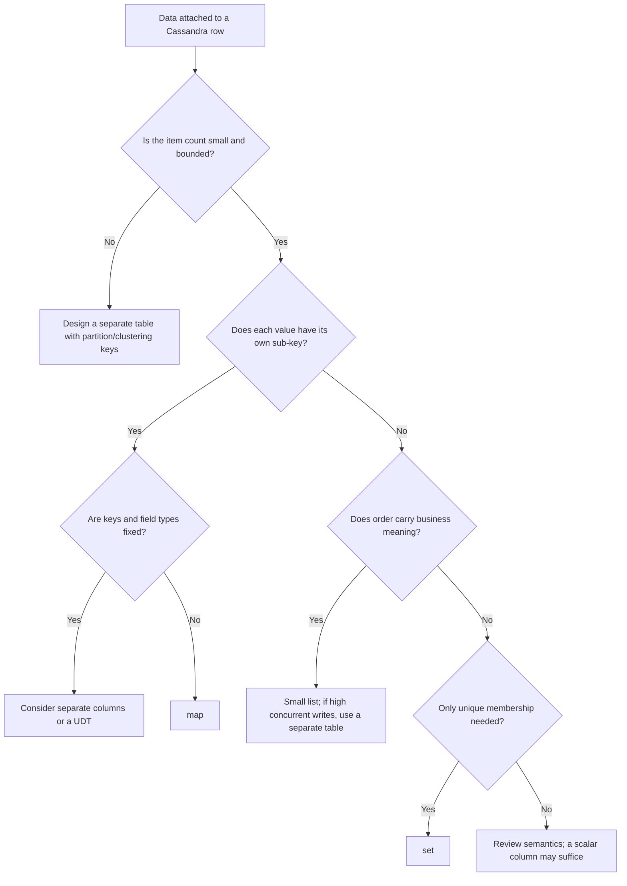

# `list`, `set`, `map`, and Choosing by Data Semantics in Cassandra

> **Chapter:** Collections and UDTs  
> **Scope:** Apache Cassandra — a distributed wide-column database where table design starts from queries, partition keys, and read/write consistency requirements.

## 1. Why Must You Choose a Collection by Semantics?

In Cassandra, a single column can hold multiple values using three primary collection types: `list<T>`, `set<T>`, and `map<K,V>`. All three are appropriate when **a row is already identified by its primary key** and the application needs to read or update **a small, bounded set of information** attached to that row. They do not replace query-driven table design, partition keys, or one-to-many relationships whose record count grows indefinitely.

For example, with a learner profile:

- Pinned tutorial steps in **order** → `list<text>`.
- Skills the learner has selected, **without duplicates** → `set<text>`.
- UI configuration with **property names and values** → `map<text,text>`.

The right decision starts by asking: **Does order carry meaning? Are duplicates allowed? Do you need lookups by sub-key? Will the number of elements grow without bound?**

### Quick Comparison Table

| Characteristic | `list<T>` | `set<T>` | `map<K,V>` |
| --- | --- | --- | --- |
| Meaning | Ordered sequence of values | Set of unique elements | Key → value dictionary |
| Duplicates | Allowed | No | Unique keys; values may repeat |
| Ordering | Meaningful to the application | No insertion order; do not use to represent rank | No insertion order; do not use to represent rank |
| Common access / updates | Append to end, prepend to start, replace entire sequence | Add / remove elements | Set / delete value by key |
| Suitable scenarios | Short user-ordered lists | Labels, permissions, or options with few elements | Dynamic attributes with a bounded number of keys |
| Signals to change the model | Very long sequences, high concurrent writes, index-based updates | Unboundedly growing set, needing to query owners by individual element | Many keys, needing to search / sort by values |

**Note on ordering:** Cassandra stores and presents elements of a `set` according to data-type comparison order and of a `map` by key, not in insertion order. This **does not turn `set`/`map` into a structure with business ordering**. If order is determined by the user, use a small `list` or a separate table with an ordering column.

## 2. Creating the Table and Reading Sample Data

Assume the keyspace `app` already exists. The following table uses `user_id` as its partition key: all collections belong to the same user row, matching the query **"fetch preferences for user X"**.

```sql
CREATE TABLE app.user_workspace (
    user_id uuid PRIMARY KEY,
    pinned_lessons list<text>,
    skills set<text>,
    preferences map<text, text>
);

INSERT INTO app.user_workspace
    (user_id, pinned_lessons, skills, preferences)
VALUES (
    11111111-1111-4111-8111-111111111111,
    ['partition-key', 'cql-basics'],
    {'java', 'cassandra'},
    {'language': 'vi', 'theme': 'dark'}
);

SELECT pinned_lessons, skills, preferences
FROM app.user_workspace
WHERE user_id = 11111111-1111-4111-8111-111111111111;
```

In CQL syntax, `[...]` is a literal for `list`; `{...}` without `:` is a `set`; `{key: value}` is a `map`. Elements and keys/values must be compatible with the declared types; do not insert `null` as a collection element. CQL may display `set` and `map` in comparison order, whereas the order of `pinned_lessons` is determined by the list itself.

## 3. `list<T>`: Both Order and Duplicate Elements Matter

`list` fits bounded sequences such as a few pinned lessons, ordered tutorial steps, or user-defined sort selections. Two equal elements are still allowed to appear multiple times: `['intro', 'intro', 'practice']` is a valid list.

```sql
-- Append an item to the end of the list.
UPDATE app.user_workspace
SET pinned_lessons = pinned_lessons + ['repair']
WHERE user_id = 11111111-1111-4111-8111-111111111111;

-- Prepend to the start of the list (be especially careful on retry).
UPDATE app.user_workspace
SET pinned_lessons = ['welcome'] + pinned_lessons
WHERE user_id = 11111111-1111-4111-8111-111111111111;

-- Replace the entire list when the application has determined the desired order.
UPDATE app.user_workspace
SET pinned_lessons = ['partition-key', 'repair', 'compaction']
WHERE user_id = 11111111-1111-4111-8111-111111111111;
```

Operations by **index** such as `SET pinned_lessons[0] = 'intro'` or deleting an element at an index require knowing the current position in the list. They can involve a read-before-write step and are prone to conflicts if multiple clients modify the list concurrently. In a distributed system, the index a client sees can change between the read and the update.

**Retry pitfall:** A statement that appends a value to a list can create a duplicate entry if the application retries after a timeout when the first write actually succeeded. Therefore, do not assume list append/prepend is an idempotent operation. If the system needs reliable event recording, deduplication, or multiple concurrent writers, use **one row per event** with an appropriate identifying key instead of pushing all events into a list.

**When not to choose list:** activity logs, comment threads, chronological orders, job queues, or leaderboards typically grow continuously or require pagination. Model them as separate rows with clustering columns for efficient querying and ordering.

## 4. `set<T>`: Unique Membership, Order Does Not Matter

`set` models **membership (present/absent)**, such as selected labels or enabled feature flags. Adding an element that already exists does not create a second entry.

```sql
-- Add one or more elements.
UPDATE app.user_workspace
SET skills = skills + {'distributed-systems', 'java'}
WHERE user_id = 11111111-1111-4111-8111-111111111111;

-- Remove an element from the set.
UPDATE app.user_workspace
SET skills = skills - {'java'}
WHERE user_id = 11111111-1111-4111-8111-111111111111;

-- Assign a completely new set when that is the desired state.
UPDATE app.user_workspace
SET skills = {'cassandra', 'cql'}
WHERE user_id = 11111111-1111-4111-8111-111111111111;
```

Adding the same element multiple times exhibits idempotent semantics at the **set-membership** level. However, when multiple clients write concurrently, competing add/remove updates are still governed by Cassandra's timestamps and conflict resolution rules. Do not infer that `set` provides global transactions or a business rule where "the last operation in wall-clock time always wins."

`set` does not serve the question **"which users have skill X?"** well if the table's primary key is `user_id`. That query requires designing a dedicated read table, such as rows partitioned by `skill` (with a bucketing mechanism if a single skill has too many users). Do not assume you can filter an arbitrary collection without an appropriate index or data model.

## 5. `map<K,V>`: Values Named by Sub-Key

`map` is intended for short key–value pairs—for example `language → vi`, `theme → dark`, or configuration settings with **dynamic key names**. Two identical keys cannot coexist: writing the same key updates that key's value.

```sql
-- Add or update a single key in the map.
UPDATE app.user_workspace
SET preferences['language'] = 'en'
WHERE user_id = 11111111-1111-4111-8111-111111111111;

-- Add multiple pairs; duplicate keys are updated.
UPDATE app.user_workspace
SET preferences = preferences + {'timezone': 'Asia/Ho_Chi_Minh', 'theme': 'light'}
WHERE user_id = 11111111-1111-4111-8111-111111111111;

-- Delete a single key from the map.
DELETE preferences['theme']
FROM app.user_workspace
WHERE user_id = 11111111-1111-4111-8111-111111111111;

-- Multiple keys can also be removed by subtracting a set of keys.
UPDATE app.user_workspace
SET preferences = preferences - {'timezone'}
WHERE user_id = 11111111-1111-4111-8111-111111111111;
```

With `map`, **the key is the identifier** and the value is the attribute. If every record has the exact same three fixed fields (`language`, `theme`, `timezone`) and you frequently filter or update them independently, three scalar columns—or a UDT when grouping a fixed structure—are usually easier to type-constrain and maintain than `map<text,text>`. `map` is a better fit when the list of keys is flexible yet **small and bounded**.

Do not use `map` as an unbounded sub-table (`order_id → order_json`, `device_id → last_seen`, `timestamp → event`). When you need to query by sub-key, paginate, sort, manage per-item lifecycle/TTL, or continuously update many entries, a multi-row model is more suitable.

## 6. Collections Live Inside a Row, Not as a Substitute for Query Modeling

Cassandra is optimized for known data access paths. The **partition key** routes queries to replicas; **clustering columns** sort and retrieve rows within a partition. The three collection types only organize values **inside a single row**; they do not create a new partition key per element, do not provide per-element pagination out of the box, and do not permit arbitrary reverse queries.

Suppose you need to display a user's activity log by day, newest first, with pagination. Avoid modeling it like this:

```sql
-- Anti-pattern: the list can grow large and every update touches the same row.
CREATE TABLE app.user_events_bad (
    user_id uuid PRIMARY KEY,
    events list<text>
);
```

Replace it with a read table keyed by `user_id + event_day` and clustered by event timestamp:

```sql
CREATE TABLE app.events_by_user_day (
    user_id uuid,
    event_day date,
    event_time timeuuid,
    event_type text,
    PRIMARY KEY ((user_id, event_day), event_time)
) WITH CLUSTERING ORDER BY (event_time DESC);

-- Fetch the most recent events on a given day for a user.
SELECT event_time, event_type
FROM app.events_by_user_day
WHERE user_id = 11111111-1111-4111-8111-111111111111
  AND event_day = '2026-11-21'
LIMIT 20;
```

This model lets you use driver paging across rows instead of reading a large collection; daily bucketing bounds partition size. If daily event volume is still too high, you can split into smaller buckets after estimating load and partition size. To read across multiple days, the application must issue queries across multiple buckets; you cannot drop `event_day` and expect the table above to serve every query efficiently.

## 7. `frozen` vs. Non-Frozen: Update Granularity

Regular (non-`frozen`) collections allow updating individual elements or keys of a `set`/`map` without resending the entire collection; Cassandra represents the elements as separate cells. With **`frozen<...>`**, the collection is treated as **a single value** at the update level: to change one element, the application must rewrite the entire value.

```sql
CREATE TABLE app.user_collection_snapshot (
    user_id uuid PRIMARY KEY,
    fixed_topics frozen<set<text>>
);

-- Write the entire frozen snapshot.
UPDATE app.user_collection_snapshot
SET fixed_topics = {'java', 'cassandra'}
WHERE user_id = 11111111-1111-4111-8111-111111111111;
```

| Question | Non-frozen Collection | Frozen Collection |
| --- | --- | --- |
| Can a single element/key be updated directly? | Yes, via supported CQL operations | No; replaces the entire value |
| Write granularity | Only the affected cells/elements | The entire collection is one cell |
| Best suited for | Small collections with per-item updates | Small, immutable snapshots or collections mostly replaced as a whole |
| Watch out for | Tombstones/fragmentation from frequent adds/deletes | Cost of reading/writing the entire value when changing only part of it |

When nesting one collection inside another, inner composite values generally must be declared `frozen`, for example `map<text, frozen<list<int>>>`. However, deep nesting makes the model hard to update and hard to size-control. `frozen` is **not** a mechanism for turning a huge collection into an efficient structure.

## 8. Distributed Implications: Retries, Tombstones, Replication, and Repair

### 8.1. Retries and Concurrent Writes

`set` fits unique membership requirements; `map` fits key-based assignments; both generally make it easier to construct retryable operations than list appends. Even so, Cassandra uses timestamps to resolve competing writes, and two operations do not gain multi-row transactionality merely by being inside a collection. When multiple writers exist, the application must define the desired outcome and choose suitable operations, especially if adds and deletes target the same element.

In the Java Driver, declare a statement's **idempotent** property strictly according to its actual semantics. Do not mark a `list` append statement as idempotent just to let the driver auto-retry; a timeout does not prove the first write failed. If exactly-once behavior is required, design an event key/deduplication strategy or additional business logic.

### 8.2. Deletes and Tombstones

Removing elements from a `set`/`map`, replacing an entire collection, or deleting a column can create **tombstones**. Tombstones must remain long enough for replicas to learn that data was deleted; compaction can reclaim them once safety conditions and configured grace periods are met. A collection undergoing continuous additions and deletions creates read and compaction overhead, especially as its size grows quickly. Repair synchronizes data across replicas; do not assume that running compaction alone resolves all issues caused by replicas being slow to receive deletes.

### 8.3. Consistency Level

A CQL statement updating a collection is still a normal Cassandra write: consistency levels such as `ONE`, `QUORUM`, `LOCAL_QUORUM`, etc. determine how many replicas acknowledge the operation based on replication configuration and datacenter scope. Collections **do not automatically elevate** consistency levels. Choose the consistency level according to latency, availability, and data-freshness requirements, taking into account replication settings, repair, and client retry behavior.

## 9. Java Connection Example

With the DataStax/Apache Cassandra Java Driver 4.x and a `CqlSession` configured with contact points, local datacenter, and either a default keyspace or keyspace-qualified statements, the application can use a prepared statement for `set` updates:

```java
import com.datastax.oss.driver.api.core.CqlSession;
import com.datastax.oss.driver.api.core.cql.PreparedStatement;
import java.util.Set;
import java.util.UUID;

// session is created and managed over the application lifecycle.
void addSkills(CqlSession session, UUID userId, Set<String> newSkills) {
    PreparedStatement statement = session.prepare(
        "UPDATE app.user_workspace " +
        "SET skills = skills + ? WHERE user_id = ?"
    );
    session.execute(statement.bind(newSkills, userId));
}
```

In production applications, cache and reuse `PreparedStatement` instances (or prepare them once at startup), pass the matching Java types for the driver codecs, and manage the `CqlSession` lifecycle centrally. Distinguish **adding a set of elements** from **overwriting the entire set**; if you want to clear all elements, design an explicit column delete or full-value replacement intentionally.

## 10. Scenario-Based Selection Flow



### Pre-Schema Finalization Checklist

1. **What key is used to read?** Does the query identify the row's partition key? If per-element filtering or pagination is required, consider a dedicated query-driven table.
2. **Maximum size?** Are the item count and payload size bounded, or will the collection grow indefinitely?
3. **What distinguishes two items?** Position and occurrence (`list`), value (`set`), or sub-key (`map`)?
4. **Update pattern?** Are there many concurrent writes, must operations be retryable, or must read-before-write by list index be avoided?
5. **Data lifecycle?** Will frequent deletes/replacements create dense tombstones? Are per-item TTLs or per-item queries needed?
6. **Fixed or dynamic schema?** Attributes with predetermined names and types may fit scalar columns or a UDT better than a map.

## 11. Case Exercises and Suggested Answers

**Scenario A:** Each learner has at most 12 favorite topics, and you only need to display all of them and add/remove by name. → Use `set<text>`; insertion order has no meaning and a topic appears at most once.

**Scenario B:** A UI has up to 8 pinned menu items, and users drag-and-drop to reorder them. → `list<text>` can fit if concurrency is low and the application typically rewrites the entire order after drag-and-drop. If multiple devices edit concurrently, conflict handling is required; long lists need a separate table containing `position`.

**Scenario C:** A user has a few custom settings such as `theme`, `language`, `timezone`. → `map<text,text>` if key names may vary and share the same value type; explicit columns or a UDT if the schema is stable and each field needs independent type enforcement.

**Scenario D:** You need to record millions of events, fetch a user's 50 most recent events, and paginate. → Do not use `list<event>` or `map<timestamp,event>` on a single row. Use a separate events table partitioned by user + time bucket and clustered by timestamp.

**Scenario E:** You need to find all users belonging to a skill group. → Even if the profile has `skills set<text>`, design an additional `users_by_skill` table for the reverse query path, with partitioning/bucketing suited to skill popularity and a data synchronization strategy.

## 12. Key Takeaways

- `list` = **order and occurrences**; weigh concurrency and retries carefully.
- `set` = **unique membership**; does not represent rank.
- `map` = **sub-keys mapped to values**; not an arbitrary sub-table.
- `frozen` = **an atomically updated single value**; non-frozen supports collection-specific granular operations.
- Collections should only be **small, bounded, and read via a known row key**. For unbounded growth, pagination, reverse queries, or high-intensity updates, design a separate Cassandra table based on partition keys, clustering keys, and actual query patterns.
