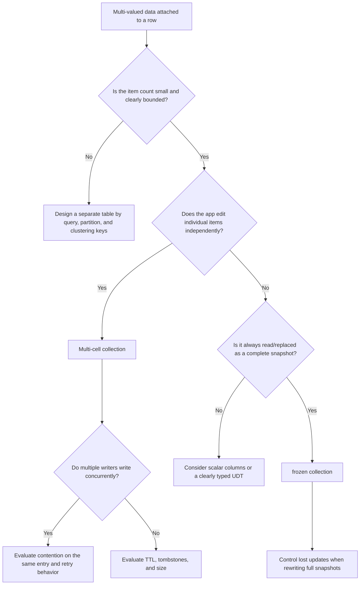

# Multi-Cell Collections vs. `frozen` Collections in Apache Cassandra

> **Chapter:** Collections and UDTs  
> **Scope:** How Cassandra stores and updates `list`, `set`, and `map` at the cell level; impact on query-driven table design, concurrent writes, TTL, tombstones, compaction, repair, and Java applications.

## 1. Same Collection Type—Why Does the Storage Representation Matter?

In Apache Cassandra, a single column can hold `list<T>`, `set<T>`, or `map<K,V>`. However, **the same collection type can have two distinct storage representations**:

- **Multi-cell collection** (often called *non-frozen*): elements/entries are managed at an individual granularity inside a row. Cassandra can write or delete a single element/sub-key without resending the entire collection.
- **`frozen` collection**: the entire collection is treated as **a single CQL value**, stored as **one cell**. Every update must provide the full new collection value; individual entries cannot be edited with CQL syntax.

Which option you choose directly affects the **unit of update**, **how competing writes are resolved**, **TTL/tombstones**, and **write cost**. Choosing `frozen` does not alter the fundamental semantics of the data type: `list` remains ordered, `set` still holds only unique elements, and `map` still maps keys to values.

One way to visualize it:

```text
Within the same row with PRIMARY KEY (user_id):

map<text,text> preferences        frozen<map<text,text>> snapshot
┌─────────────────────────────┐  ┌───────────────────────────────────┐
│ Cell: key='lang'  -> 'vi'   │  │ A single cell:                    │
│ Cell: key='theme' -> 'dark' │  │ {'lang':'vi','theme':'dark'}      │
│ Cell: key='zone'  -> 'UTC'  │  │                                   │
└─────────────────────────────┘  └───────────────────────────────────┘
  Can write individual entries.     Changes must rewrite the entire map.
```

**Important distinction:** "Multi-cell" does not mean each element becomes an independent Cassandra row. These cells still belong to **the same row**, routed by the same **partition key**; adding a collection does not create a new partition key or clustering key.

## 2. Conceptual Storage Mechanism

A *cell* is a unit of value associated with metadata such as write timestamp and, when applicable, TTL. For multi-cell collections:

| Type | Unit managed inside the collection | Common operations |
| --- | --- | --- |
| `set<text>` | Each member value | Add or remove a value |
| `map<text,text>` | Each entry identified by the map key | Set or delete a key |
| `list<text>` | List elements with internal identifiers/positions for ordering | Append/prepend; some index-based operations may require a read first |
| `frozen<set<text>>` | The entire set | Reassign the entire set |
| `frozen<map<text,text>>` | The entire map | Reassign the entire map |
| `frozen<list<text>>` | The entire list | Reassign the entire list |

For `map`, each entry has its own sub-key; for `set`, the member itself acts as the identifier. For `list`, the internal identification mechanism is more complex than indices `0, 1, 2`: an index is how the application accesses the list at a given moment, not a stable key in a multi-writer environment.

In a multi-cell collection, two writes to **two different entries** can coexist when replicas reconcile data. In a `frozen` collection, competing writes to the same column contend over **the entire value**. Cassandra uses timestamps and write reconciliation rules on cells; `frozen` does not turn a collection into a multi-step transaction or a lock against concurrent writes.

## 3. Schema Declaration: One Table, Two Storage Forms

Assume the keyspace `app` has already been created with replication settings suited to your environment. To compare both forms within the same row, create a test table:

```sql
CREATE TABLE app.user_collection_lab (
    user_id uuid PRIMARY KEY,
    preferences map<text, text>,
    preferences_snapshot frozen<map<text, text>>,
    selected_topics set<text>,
    selected_topics_snapshot frozen<set<text>>,
    pinned_steps list<text>,
    pinned_steps_snapshot frozen<list<text>>
);

INSERT INTO app.user_collection_lab (
    user_id,
    preferences, preferences_snapshot,
    selected_topics, selected_topics_snapshot,
    pinned_steps, pinned_steps_snapshot
) VALUES (
    11111111-1111-4111-8111-111111111111,
    {'lang':'vi', 'theme':'dark'},
    {'lang':'vi', 'theme':'dark'},
    {'cql', 'java'},
    {'cql', 'java'},
    ['schema', 'partition'],
    ['schema', 'partition']
);

SELECT preferences, preferences_snapshot,
       selected_topics, selected_topics_snapshot,
       pinned_steps, pinned_steps_snapshot
FROM app.user_collection_lab
WHERE user_id = 11111111-1111-4111-8111-111111111111;
```

Each pair of columns carries the same data meaning at initialization. Differences emerge when the application **performs updates** or when **two clients write concurrently**.

## 4. Updating Multi-Cell Collections

### 4.1. `map`: Editing a Single Sub-Key

```sql
-- Update only the entry with key 'theme'.
UPDATE app.user_collection_lab
SET preferences['theme'] = 'light'
WHERE user_id = 11111111-1111-4111-8111-111111111111;

-- Add entries while preserving other keys.
UPDATE app.user_collection_lab
SET preferences = preferences + {'timezone':'Asia/Ho_Chi_Minh'}
WHERE user_id = 11111111-1111-4111-8111-111111111111;

-- Delete one entry without deleting the entire map.
DELETE preferences['timezone']
FROM app.user_collection_lab
WHERE user_id = 11111111-1111-4111-8111-111111111111;
```

These statements express intent clearly: **replace one entry**, **add an entry**, **delete an entry**. The client does not need to load all values and rebuild the map for routine single-key operations.

### 4.2. `set`: Adding and Removing Elements

```sql
UPDATE app.user_collection_lab
SET selected_topics = selected_topics + {'repair', 'compaction'}
WHERE user_id = 11111111-1111-4111-8111-111111111111;

UPDATE app.user_collection_lab
SET selected_topics = selected_topics - {'java'}
WHERE user_id = 11111111-1111-4111-8111-111111111111;
```

`set` does not store insertion order; duplicate members are not duplicated. For questions like "which topics has the user selected?", a small `set` usually has more natural semantics than a `list`.

### 4.3. `list`: Appending Elements, While Understanding the Risks

```sql
UPDATE app.user_collection_lab
SET pinned_steps = pinned_steps + ['repair']
WHERE user_id = 11111111-1111-4111-8111-111111111111;

-- Reassign the entire order according to the user's new choice.
UPDATE app.user_collection_lab
SET pinned_steps = ['partition', 'schema', 'repair']
WHERE user_id = 11111111-1111-4111-8111-111111111111;
```

`list` append operations must not be assumed to be **idempotent**: if a client retries after a timeout when the first write actually succeeded, the element can be appended a second time. Index-based operations are vulnerable to order changes between two clients and may require read-before-write. For event streams, queues, or long histories, using a separate table with its own row key is more appropriate.

## 5. `frozen`: Replacing the Whole Value, No Per-Entry Updates

With `frozen<map<text,text>>`, every change must write the entire new value:

```sql
-- Valid: the new snapshot contains all entries to retain.
UPDATE app.user_collection_lab
SET preferences_snapshot = {'lang':'vi', 'theme':'light'}
WHERE user_id = 11111111-1111-4111-8111-111111111111;

-- Valid: replace both the frozen set and frozen list.
UPDATE app.user_collection_lab
SET selected_topics_snapshot = {'cql', 'repair'},
    pinned_steps_snapshot = ['partition', 'repair']
WHERE user_id = 11111111-1111-4111-8111-111111111111;
```

**The following examples are invalid CQL for `frozen` columns; do not execute them:**

```sql
-- Cannot assign a single entry of a frozen map.
UPDATE app.user_collection_lab
SET preferences_snapshot['theme'] = 'light'
WHERE user_id = 11111111-1111-4111-8111-111111111111;

-- Cannot add/subtract an element of a frozen set.
UPDATE app.user_collection_lab
SET selected_topics_snapshot = selected_topics_snapshot + {'repair'}
WHERE user_id = 11111111-1111-4111-8111-111111111111;
```

To change a single key in a frozen map, the client must know **the complete value it wants to store** and reassign that value. If the application performs a "read → modify in memory → write full value" cycle from multiple clients, you must account for clients overwriting one another's updates; a plain `UPDATE` statement has no built-in version check.

**`frozen` describes how a value is stored and updated, not Java's `final` or `immutable`.** The column can still be replaced with a different value; you simply cannot update individual items via CQL.

## 6. Two-Client Example: Independent Writes or Lost Updates?

Suppose the initial state of both `preferences` and `preferences_snapshot` is:

```text
{'lang':'vi'}
```

Two clients read simultaneously: A wants to add `theme=dark`, and B wants to add `timezone=UTC`.

### 6.1. Multi-Cell Map: Updating the Exact Entry

```sql
-- Client A
UPDATE app.user_collection_lab
SET preferences['theme'] = 'dark'
WHERE user_id = 11111111-1111-4111-8111-111111111111;

-- Client B
UPDATE app.user_collection_lab
SET preferences['timezone'] = 'UTC'
WHERE user_id = 11111111-1111-4111-8111-111111111111;
```

Because A and B write **two different sub-keys**, the system can preserve both updates once replicas converge: `{'lang':'vi','theme':'dark','timezone':'UTC'}`. If both write `preferences['theme']` with different values, contention still occurs on **that entry**, and Cassandra's timestamp rules determine the winning value.

### 6.2. Frozen Map: Two Snapshots Can Overwrite Each Other

```sql
-- Client A read the old value and constructed a new snapshot:
UPDATE app.user_collection_lab
SET preferences_snapshot = {'lang':'vi', 'theme':'dark'}
WHERE user_id = 11111111-1111-4111-8111-111111111111;

-- Client B also based its update on the old snapshot:
UPDATE app.user_collection_lab
SET preferences_snapshot = {'lang':'vi', 'timezone':'UTC'}
WHERE user_id = 11111111-1111-4111-8111-111111111111;
```

After reconciliation, **one entire snapshot wins** according to the write-resolution rules; there is no automatic merge of the two new keys. If B wins, A's `theme` is gone from the snapshot. The outcome does not necessarily reflect "the client that sent last" by wall-clock time; Cassandra uses cell timestamps, which can depend on clocks, client settings, or write configuration.

| Concurrency Scenario | Multi-cell map | Frozen map |
| --- | --- | --- |
| A edits `theme`, B edits `timezone` | Two independent entry updates can coexist | Two full-snapshot assignments compete; one change can be lost |
| A and B edit the same `theme` | Contention on the `theme` cell | Contention across the entire map |
| A replaces the whole map, B edits one entry | Risk of conflict with the delete marker generated by full-collection replacement | Contention between two full values |
| Conditional write control needed | Design an appropriate versioning mechanism | Also requires an appropriate versioning mechanism |

To prevent *lost updates* for snapshots, consider a single-owner write workflow, application-level coordination, or conditional/CAS mechanisms when truly needed and after measuring their cost. Do not assume that a `QUORUM` consistency level automatically turns a "read then write snapshot" sequence into a version-checked transaction.

## 7. Where Do TTL, Timestamps, and Tombstones Differ?

### 7.1. Cell-Level TTL Granularity

With multi-cell collections, TTL can apply to the specific entry written in an update operation. For example:

```sql
-- Entry 'trial_banner' is written with a 600-second TTL.
UPDATE app.user_collection_lab USING TTL 600
SET preferences['trial_banner'] = 'enabled'
WHERE user_id = 11111111-1111-4111-8111-111111111111;
```

Other entries in `preferences` do not inherit the 600-second TTL from this statement. Conversely, when assigning a `frozen` value with a TTL, the TTL applies to **the cell holding the entire collection**:

```sql
-- The entire new frozen value is written with a 600-second TTL.
UPDATE app.user_collection_lab USING TTL 600
SET preferences_snapshot = {'trial_banner':'enabled', 'lang':'vi'}
WHERE user_id = 11111111-1111-4111-8111-111111111111;
```

This does not work if you only want `trial_banner` to expire while keeping `lang` intact. For data where items have independent lifecycles, non-frozen collections or **separate rows** can be more convenient.

### 7.2. Deleting Entries Creates Deletion Markers

When deleting an entry from a non-frozen map/set, Cassandra must write a deletion marker (*tombstone*) so other replicas know the entry was deleted, including replicas that are temporarily unresponsive. Replacing an **entire** multi-cell collection can also generate deletion markers for the prior contents; it is not a cheap few-element update comparable to `map['key'] = value`.

`frozen` uses a single cell for the whole value. Deleting a `frozen` column or letting its data expire via TTL is still governed by Cassandra's deletion/TTL mechanisms. **One cell does not mean zero tombstones.**

Tombstones affect read and compaction paths; tombstone cleanup depends on safety conditions, settings such as `gc_grace_seconds`, and replica synchronization state. Repair keeps data and deletion markers synchronized across replicas as part of operational procedures. Do not arbitrarily lower the grace period or run compaction alone to "clean up faster": a replica absent for too long risks resurrecting deleted data if repair procedures are not followed properly.

### 7.3. Timestamps and Consistency

In a multi-cell collection, each entry participates in reconciliation using its own write metadata. With `frozen`, rewriting the snapshot replaces the value of the single overall cell. `ONE`, `LOCAL_QUORUM`, `QUORUM`, etc. control how many replicas must acknowledge reads/writes within your replication and datacenter topology; they **do not change** whether a collection is stored as multiple cells or one cell.

Because Cassandra resolves contention primarily via timestamps, clients with clock skew or custom `USING TIMESTAMP` values need a clear strategy; a newer update in wall-clock time is not guaranteed to win if its timestamp is lower than the existing value's.

## 8. Read/Write Cost and Size Limits

| Criterion | Multi-cell | `frozen` |
| --- | --- | --- |
| Update one map entry / set member | Yes, entry-level granularity | Must rewrite the entire value |
| Concurrent writes to different map keys | Independent changes can merge | Entire snapshot writes compete |
| Stored data/metadata | Multiple cells, metadata per item | One cell containing the serialized value |
| Reading the collection | Returns the collection in one column of the row | Returns the collection in one column of the row |
| Reading/paginating per item like rows | No built-in per-entry pagination | No built-in per-entry pagination |
| Deletes/TTL | Can be per-entry, but creates metadata/tombstones | Applies to whole value; still has tombstones/TTL |
| Ideal use case | Small settings bundles where items change independently | Small snapshots replaced as a whole, rarely edited per item |

**There is no rule that "`frozen` is always faster."** If a map has 100 pairs and only one pair changes, non-frozen generally saves on written data volume. If a small structure is always replaced wholesale, `frozen` can be simpler in semantics and metadata. Neither is suitable for huge or unboundedly growing collections.

An oversized collection still belongs to a single row and a single partition. A query like `SELECT preferences ... WHERE user_id = ...` typically returns **the entire collection value**, increasing read load, memory usage, serialization time, and network transfer. If you need per-item querying, filtering, sorting, or pagination, use **multiple rows with a primary key designed for the query**.

For example, if a user has millions of events, do not put them into `frozen<list<text>>` or `list<text>` on a single row:

```sql
CREATE TABLE app.events_by_user_day (
    user_id uuid,
    event_day date,
    event_time timeuuid,
    event_type text,
    PRIMARY KEY ((user_id, event_day), event_time)
) WITH CLUSTERING ORDER BY (event_time DESC);

SELECT event_time, event_type
FROM app.events_by_user_day
WHERE user_id = 11111111-1111-4111-8111-111111111111
  AND event_day = '2026-11-21'
LIMIT 50;
```

The partition key `(user_id, event_day)` enables daily bucketing; `event_time` acts as the clustering key for chronological access. The driver can paginate **rows**, and you can split into smaller buckets if one day has too many events. This organization does not depend on `frozen`.

## 9. Nested Collections, UDTs, and the `frozen` Boundary

`frozen` is especially useful when placing a **composite type** inside another collection. Among the nested declarations supported by Cassandra, the inner collection/UDT value typically must be `frozen` so it acts as a single value in that position.

```sql
-- Outer map is multi-cell; inner list is a frozen value.
CREATE TABLE app.study_progress (
    user_id uuid PRIMARY KEY,
    scores_by_topic map<text, frozen<list<int>>>
);

-- Reassign the entire list at a single map sub-key.
UPDATE app.study_progress
SET scores_by_topic['cql'] = [8, 9, 10]
WHERE user_id = 11111111-1111-4111-8111-111111111111;
```

Here, `scores_by_topic` is a **multi-cell** map that can be updated independently by the `'cql'` key. However, each `list<int>` inside the map is **frozen**: you cannot directly append a number to an inner list without replacing the entire list value for that key. If the outer map itself is also declared `frozen`, every modification reverts to **whole-map** granularity.

For UDTs (*user-defined types*), the same principle clarifies the difference between **an object stored as a single atomic value** and **a structure whose fields can be updated individually**; exact capabilities depend on the schema declaration and Cassandra version. Do not assume that just because a Java object has independent fields, CQL will allow per-field updates when the column or value is declared `frozen`.

Deeply nesting collections/UDTs adds significant complexity and can force updates to rewrite large values. If a structure contains an unbounded number of entities, a separate table remains the primary pattern in Cassandra.

## 10. Sending Updates from the Java Driver

With Java Driver 4.x, `CqlSession` can use `PreparedStatement` to express both update styles cleanly. The example below assumes an active, valid session and a user's `UUID`:

```java
import com.datastax.oss.driver.api.core.CqlSession;
import com.datastax.oss.driver.api.core.cql.PreparedStatement;
import java.util.Map;
import java.util.UUID;

void updateSettings(CqlSession session, UUID userId) {
    // Non-frozen map: send only the entry to add/update.
    PreparedStatement patch = session.prepare(
        "UPDATE app.user_collection_lab " +
        "SET preferences = preferences + ? WHERE user_id = ?"
    );
    session.execute(patch.bind(Map.of("theme", "light"), userId));

    // Frozen map: send the complete new value; omitted old keys will be lost.
    PreparedStatement replace = session.prepare(
        "UPDATE app.user_collection_lab " +
        "SET preferences_snapshot = ? WHERE user_id = ?"
    );
    session.execute(replace.bind(
        Map.of("lang", "vi", "theme", "light"), userId
    ));
}
```

In production projects, **reuse prepared statements** and manage the `CqlSession` lifecycle centrally rather than calling `prepare` on every request. For the `replace` pattern, the data must come from an authoritative source of state; reading a stale snapshot from a cache and writing it back can accidentally wipe out another client's recent changes.

Timeout handling also requires distinction: setting a map entry to a specific value is generally safer to retry than appending to a list, though the final outcome still depends on competing writes, timestamps, and concurrent modifications elsewhere. Only mark a statement as **idempotent** according to its actual operational semantics and your application's retry policy.

## 11. Which Representation Should You Choose in Data Design?



Sample decisions:

| Practical Requirement | Commonly Suitable Approach | Why |
| --- | --- | --- |
| Each user has up to 20 settings, changing one key at a time | Non-frozen `map<text,text>` | Writes per entry with minimal impact on other keys |
| A 5-field config bundle produced from a single version, replaced together | `frozen<map<text,text>>` or a UDT / typed columns | Atomic snapshot matches semantics |
| Short tag set where tags are frequently added/removed individually | Non-frozen `set<text>` | Individual members can be edited |
| Fixed 4-step list, replaced wholesale when the user saves | `frozen<list<text>>` is an option | Each write is an ordered snapshot |
| List requiring concurrent multi-device position edits | Separate table or explicit sync workflow | Avoids list-index contention and lost updates |
| Unbounded transaction history, events, or devices | Separate table with an appropriate primary key | Supports pagination, bounded partitions, and easier operations |

## 12. Common Misconceptions

1. **"`frozen` makes data immutable."** False. You can still replace the entire value; you just cannot update individual elements via CQL.
2. **"Non-frozen maps always auto-merge all writes."** False. Two clients modifying **the same key**, or one client overwriting the entire map, can still conflict.
3. **"`frozen` is always more compact and faster."** No universal rule. Rewriting a large value in full can cost more than updating a single cell; measure against your workload.
4. **"Multi-cell collections mean you can paginate element by element."** False. A collection is still a single column in a single row; you need a separate table to paginate or aggregate per item.
5. **"Switching to `frozen` eliminates tombstones."** False. Deletes and TTL still produce deletion markers; repeated updates, repair, and compaction still need management.
6. **"`QUORUM` writes eliminate lost updates on a frozen map."** False. `QUORUM` does not replace version control when two clients read an old snapshot and both write back.
7. **"To change storage form, just alter the column type in place on existing data."** Do not assume `ALTER TABLE` supports converting directly between frozen and non-frozen forms. Plan a migration: create a new column/table according to your Cassandra version, migrate the data, adjust read/write paths, and verify before dropping the old schema.

## 13. Self-Check Exercises

**Exercise 1.** An application stores a `map<text,text>` of 8 feature flags. Clients A and B frequently edit two different flags. Should you use `frozen`?  
**Hint:** Unnecessary if the goal is independent per-key updates. A multi-cell map enables sub-key writes, reducing the risk of overwriting snapshots across unrelated keys.

**Exercise 2.** A machine learning model stores 6 integer weights in `frozen<list<int>>`, updating only when deploying an entirely new version. Is this choice reasonable?  
**Hint:** It can be reasonable if the whole list is managed as a single snapshot, stays small, and the release pipeline has a single authoritative writer.

**Exercise 3.** A `map<text, frozen<list<int>>>` column has keys `cql` and `java`. A user changes the score list for `cql` without touching `java`. Where is the update granularity?  
**Hint:** The outer multi-cell map lets you reassign **the list value at key `cql`**. The inner `frozen` list must be replaced as an atomic value.

**Exercise 4.** A client deletes a map key, and later a replica that had been disconnected for a long time rejoins. Should you lower `gc_grace_seconds` to purge tombstones immediately?  
**Hint:** Do not do so arbitrarily. You need a sound repair strategy and must ensure replicas receive deletion markers before tombstones can be safely purged.

## 14. Implementation Takeaways

- **Multi-cell** = update granularity at the element/entry level; **`frozen`** = update granularity of **the entire collection**.
- The storage representation affects **concurrent writes, retry safety, TTL, and tombstones**, but does not change how Cassandra routes data by partition key or resolves writes by timestamp.
- Choose non-frozen when the collection is **small, bounded**, and items change independently; choose frozen when the entire value is **small** and managed as a snapshot.
- When you need pagination, per-element lookup, separate data lifecycles, or unbounded growth, design a **query-driven separate table**; collections do not replace the wide-column model.
- Test against realistic workloads, accounting for **replication, consistency levels, compaction, repair, and Java Driver retries**, before locking in your schema in a distributed environment.
