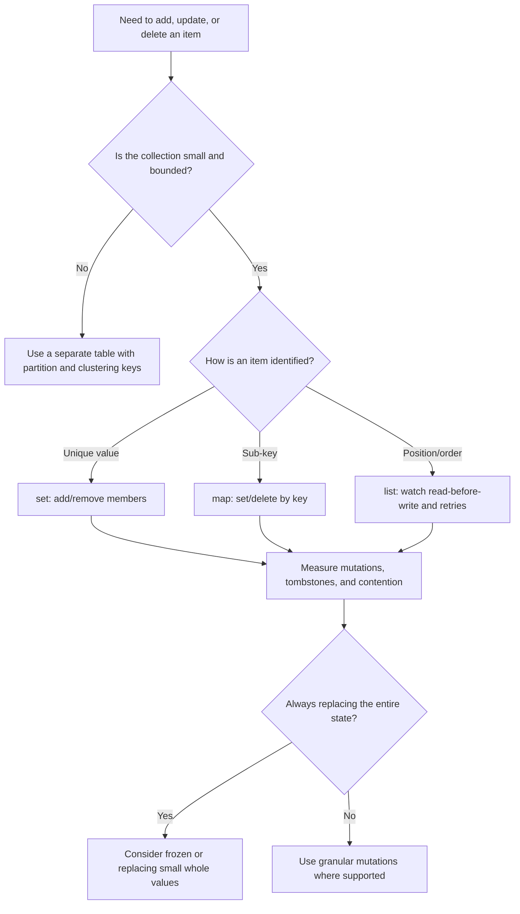

# Adding, Updating, and Deleting Collection Elements in Cassandra and Their Corresponding Costs

> **Chapter:** Collections and UDTs  
> **Scope:** CQL operations with `list`, `set`, and `map`; write and read costs, `read-before-write`, tombstones, TTL, compaction, repair, and Java applications in Apache Cassandra.

## 1. What Work Can a Single `UPDATE` Statement Trigger?

Apache Cassandra is a **distributed wide-column** database. Data is routed to replicas by **partition key**; CQL operations are written to the commit log and memtable, then flushed to SSTables and gradually merged via compaction. "Updating a single element" should therefore not be thought of as simply modifying a slot in an in-memory array.

For collections, the cost of an operation depends on the **unit of update**:

- `set<T>`: elements are identified by **the value itself**; adding/removing a member affects only the corresponding element.
- `map<K,V>`: each entry is identified by **key `K`**; updating or deleting a key can be an independent update.
- `list<T>`: order and positions carry meaning; appends differ significantly from updates/deletes **by index or by value**. Some operations force Cassandra to know the current state of the list before executing.
- `frozen<collection>`: the entire collection is **a single value**, so individual elements cannot be updated directly in CQL; the whole collection must be replaced.

Cost is not merely the amount of data sent over the network. When evaluating an operation, also consider **replica round trips**, the risk of **read-before-write**, **tombstones from deletes**, the number of cells and SSTables reconciled at read time, **contention between writers**, and partition size.

## 2. Preparing the Practice Table

The following example assumes the keyspace `app` already exists and is configured with appropriate replication. The table holds several **small, bounded** collections per user; queries all identify the row by `user_id`.

```sql
CREATE TABLE app.collection_operations_demo (
    user_id uuid PRIMARY KEY,
    tags set<text>,
    settings map<text, text>,
    pinned_lessons list<text>
);

INSERT INTO app.collection_operations_demo
    (user_id, tags, settings, pinned_lessons)
VALUES (
    11111111-1111-4111-8111-111111111111,
    {'java', 'cql'},
    {'language': 'vi', 'theme': 'dark'},
    ['partition-key', 'replication', 'repair']
);

SELECT tags, settings, pinned_lessons
FROM app.collection_operations_demo
WHERE user_id = 11111111-1111-4111-8111-111111111111;
```

Semantics: `tags` is a deduplicated set; `settings` is a configuration dictionary; `pinned_lessons` is an ordered list. This solves "read preferences of **one** user," not "find all users with tag X." Reverse queries require a separate read table or indexing strategy designed around actual workload.

> **Practice note:** The statements below operate sequentially on the same row. To test each example independently, delete and re-insert the sample row. The examples illustrate CQL behavior only and do not state fixed millisecond or I/O numbers: actual cost depends on the Cassandra version, replication, collection size, hardware, and system load.

## 3. Adding Elements: Three Types, Three Expressions

### 3.1. Adding Members to a `set`

```sql
UPDATE app.collection_operations_demo
SET tags = tags + {'distributed-systems', 'cql'}
WHERE user_id = 11111111-1111-4111-8111-111111111111;
```

`cql` already exists, yet `set` does not create a duplicate. In CQL terms, this adds **value-identified members**, rather than replacing the whole set. Consequently, adding a member to a `set` does not require the application to read all elements first and rewrite everything.

In a distributed system, adding the same member multiple times has **non-duplicating** semantics, though you must not infer that every retry equals an exactly-once transaction. If a delete for the same member runs concurrently, the outcome depends on timestamps and write reconciliation.

### 3.2. Adding or Updating a `map` Entry

```sql
-- Add or overwrite a single sub-key.
UPDATE app.collection_operations_demo
SET settings['timezone'] = 'Asia/Ho_Chi_Minh'
WHERE user_id = 11111111-1111-4111-8111-111111111111;

-- Add multiple key-value pairs to the existing map.
UPDATE app.collection_operations_demo
SET settings = settings + {'font': 'large', 'theme': 'light'}
WHERE user_id = 11111111-1111-4111-8111-111111111111;
```

In a `map`, the key identifies the entry. Rewriting `settings['theme']` updates that entry; other entries remain untouched unless there is a competing operation or a full-collection delete. Writing by key usually transfers and mutates less data than reading and replacing **the entire map**.

### 3.3. Appending or Prepending Elements to a `list`

```sql
-- Append to the end; order has business meaning.
UPDATE app.collection_operations_demo
SET pinned_lessons = pinned_lessons + ['compaction']
WHERE user_id = 11111111-1111-4111-8111-111111111111;

-- Prepend to the beginning of the list.
UPDATE app.collection_operations_demo
SET pinned_lessons = ['overview'] + pinned_lessons
WHERE user_id = 11111111-1111-4111-8111-111111111111;
```

Appending to a list can be expressed as an additive mutation without forcing the client to download the entire list; however, it is **not semantically idempotent**. If the statement adding `['compaction']` is sent twice after a timeout, the list can end up containing two `compaction` elements. `set` has no analogous duplication problem because a value appears at most once.

**Takeaway on adding elements:** `set` is for unique membership, `map` for sub-keys, `list` for ordered occurrences. Do not pick `list` solely for its short append syntax if your system needs duplicate protection on retry.

## 4. Updating Elements: "Update" Means Different Things for Each Type

### 4.1. `map`: Updating a Value by Key

```sql
UPDATE app.collection_operations_demo
SET settings['language'] = 'en'
WHERE user_id = 11111111-1111-4111-8111-111111111111;
```

This is the natural update path for a map: given key `'language'`, supply the new value. If two clients modify **two different keys**, both mutations can survive reconciliation. If they modify **the same key**, they contend on that entry according to Cassandra timestamps. There is no universal guarantee that the write whose HTTP request was sent later will win.

### 4.2. `set`: "Renaming" Means Replacing the Member

There is no `tags['java'] = 'jvm'` syntax for a `set`: a `set` has no key–value pairs and no business-meaningful index positions. To change label `java` to `jvm`, you must remove the old member and add the new member:

```sql
-- Two statements illustrate one business intent; other writers can interleave.
UPDATE app.collection_operations_demo
SET tags = tags - {'java'}
WHERE user_id = 11111111-1111-4111-8111-111111111111;

UPDATE app.collection_operations_demo
SET tags = tags + {'jvm'}
WHERE user_id = 11111111-1111-4111-8111-111111111111;
```

The two statements **do not automatically form a business transaction**. If every reader must observe either the old name or the new name cleanly once, the application must design appropriate synchronization or update rules. For a very small set owned by a single writer, replacing the entire state can be simpler semantically, though it incurs different costs as discussed below.

### 4.3. `list`: Updating by Position May Require a Read First

```sql
-- After determining the current state, replace the element at index 1.
UPDATE app.collection_operations_demo
SET pinned_lessons[1] = 'consistency'
WHERE user_id = 11111111-1111-4111-8111-111111111111;
```

With a list, index `1` means **the current position** when Cassandra processes the operation, not a durable key for the lesson item. Cassandra may need to **read the current list to locate the element at that index** (*read-before-write*). This introduces a read on the write path; its cost can grow with list size and fragmentation. If another client concurrently inserts or deletes at the front of the list, positions shift, causing an update to hit a different item than the user expected.

Accordingly, an application supporting drag-and-drop reordering of a short list may choose to rewrite **the entire order** when the user clicks Save; an application with thousands of items edited across multiple devices should model each item as a separate row with an appropriate key or ordering attribute instead of repeatedly issuing `list[index]` updates.

## 5. Deleting Elements: Tombstone Cost Is the Key Concern

### 5.1. Removing a Member from a `set`

```sql
UPDATE app.collection_operations_demo
SET tags = tags - {'cql'}
WHERE user_id = 11111111-1111-4111-8111-111111111111;
```

Cassandra writes deletion metadata so replicas that missed the operation do not resurrect the old element. That metadata is a **tombstone**; it can persist across several read and compaction cycles. Removing a single member writes less data than replacing the whole collection, yet still carries write and tombstone-retention costs.

### 5.2. Deleting a Key from a `map`

```sql
DELETE settings['theme']
FROM app.collection_operations_demo
WHERE user_id = 11111111-1111-4111-8111-111111111111;
```

This statement targets a specific entry. Compared to reading the map, removing `'theme'` from a Java copy, and writing back the entire map, deleting by key states intent clearly and narrows the mutation scope.

### 5.3. Removing from a `list`: By Value and By Index

```sql
-- Remove items with value 'repair' from the list.
UPDATE app.collection_operations_demo
SET pinned_lessons = pinned_lessons - ['repair']
WHERE user_id = 11111111-1111-4111-8111-111111111111;

-- Remove the element at index 0 of the current list.
DELETE pinned_lessons[0]
FROM app.collection_operations_demo
WHERE user_id = 11111111-1111-4111-8111-111111111111;
```

Unlike deleting a map key or a set member, Cassandra must determine which element in the **existing list** matches the requested value or position. Both value-based and index-based list removals can perform a **read-before-write**. When a list is long, contains duplicate elements, or sees concurrent client updates, both cost and logic risk rise. Value subtraction removes matching occurrences; if business logic intends to delete **one specific occurrence by ID**, use a stable record identifier in a separate table.

### 5.4. Deleting the Entire Collection Column

```sql
DELETE settings
FROM app.collection_operations_demo
WHERE user_id = 11111111-1111-4111-8111-111111111111;
```

Deleting the entire collection differs from deleting one entry. It creates deletion metadata for **the entire collection value**, which can shadow earlier entries written before it. Clearly distinguish "delete the `theme` setting" from "delete all user settings" when designing your API.

## 6. Overwriting the Whole Collection: Simple Semantics, Distinct Costs

```sql
-- Rewrite the entire map: only keys present in the new value are kept.
UPDATE app.collection_operations_demo
SET settings = {'language': 'vi', 'theme': 'light'}
WHERE user_id = 11111111-1111-4111-8111-111111111111;

-- Rewrite the entire list in the user-chosen order.
UPDATE app.collection_operations_demo
SET pinned_lessons = ['partition-key', 'repair', 'compaction']
WHERE user_id = 11111111-1111-4111-8111-111111111111;
```

For multi-cell collections, assigning a full value means **replacing state**, unlike `settings = settings + {...}`. Cassandra must ensure old entries do not remain in the result: full-collection replacement can generate a **collection-level tombstone** and then write the new elements. If you repeatedly overwrite a large collection, write cost, SSTable size, tombstones, and compaction overhead can be substantially higher than updating only the changed entry.

Another hazard is **lost updates**. Suppose clients A and B both read the map `{'language':'vi'}`. A wants to add `'theme':'dark'`; B wants to add `'timezone':'UTC'`. If each client writes back a complete map built from stale data, one update can wipe out the other client's new key. Using sub-key mutations lets changes to **different keys** coexist. Even with sub-key updates, two writers modifying **the same key** still contend by timestamp.

## 7. `frozen` Collections: Updating or Deleting an Item by Replacing the Snapshot

With a `frozen<map<text,text>>` column, Cassandra stores the entire map as a single CQL value. Per-element mutations such as `frozen_map['key'] = ...` or `frozen_set = frozen_set + {...}` are disallowed syntactically.

```sql
CREATE TABLE app.user_settings_snapshot (
    user_id uuid PRIMARY KEY,
    settings frozen<map<text, text>>
);

INSERT INTO app.user_settings_snapshot (user_id, settings)
VALUES (
    11111111-1111-4111-8111-111111111111,
    {'language': 'vi', 'theme': 'dark'}
);

-- To logically remove only theme,
-- the application must supply a new snapshot without theme.
UPDATE app.user_settings_snapshot
SET settings = {'language': 'vi'}
WHERE user_id = 11111111-1111-4111-8111-111111111111;
```

Write cost depends on the size of **the entire `frozen` value**; TTL applies to **the whole-collection cell**. If two clients read and rewrite the snapshot, Cassandra reconciles by the version/timestamp of **the entire cell**; distinct keys are not merged automatically. `frozen` suits **small snapshots that are typically replaced wholesale and have a clear update owner**. It is not a way to make a very large collection efficient to update.

## 8. Relative Cost Table by Operation

| Non-frozen collection operation | Scope of change | Read-before-write needed? | Primary cost/risk |
| --- | --- | --- | --- |
| `set = set + {x}` | Member `x` | Typically no | Writes one member; contention if a delete targets the same value |
| `set = set - {x}` | Member `x` | Typically no | Tombstone for the removed element |
| `map['k'] = v` | Entry `k` | Typically no | Overwrites entry if multiple writers update the same key |
| `DELETE map['k']` | Entry `k` | Typically no | Tombstone for the entry |
| `list = list + [x]` | Append element at end | Typically no | Can append duplicates on retry; ordering and concurrency concerns |
| `list = [x] + list` | Prepend element at start | Typically no | Not idempotent; unpredictable order under concurrent writes |
| `list[i] = x` | Element at index `i` | **Possible/typical** | Read-before-write; index may shift |
| `list = list - [x]` | Elements equal to `x` | **Possible/typical** | Reads to locate matching elements; creates tombstones |
| `DELETE list[i]` | Element at index `i` | **Possible/typical** | Read-before-write; risk of deleting the wrong position |
| `collection = {new value}` | Entire collection | Not necessarily read-before-write | Writes entire new value, tombstone shadows old value, lost update risk |
| `DELETE collection` | Entire collection | Typically no | Tombstone for the entire collection |

"Typically no" in the table refers to **reading current data at the coordinator prior to writing** for normal CQL operations—it does not mean Cassandra performs zero reads across the data's lifecycle. On subsequent queries, replicas may still need to merge cells, versions, and tombstones across multiple SSTables. Likewise, do not reduce this table to a fixed complexity formula like `O(1)`: real load depends on element count, SSTable count, replicas, caches, consistency level, and compaction state.

## 9. How Do TTL, Tombstones, Compaction, and Repair Interact?

### 9.1. TTL When Adding or Updating Elements

```sql
-- A 600-second TTL applies to the 'banner' entry written here.
UPDATE app.collection_operations_demo USING TTL 600
SET settings['banner'] = 'trial'
WHERE user_id = 11111111-1111-4111-8111-111111111111;
```

In a multi-cell collection, this mutation's TTL attaches to the written entry rather than retroactively applying to all existing entries. Upon expiration, Cassandra handles expired data via tombstone semantics. With `frozen`, a write's TTL attaches to **the entire snapshot cell**, with no independent TTL per sub-key.

### 9.2. A Tombstone Does Not Mean Data Vanishes Immediately from SSTables

Deleting an entry or replacing a collection can create tombstones. On reads, Cassandra must evaluate tombstones so stale values residing in other SSTables or replicas are not returned. Compaction can purge old data and tombstones **when safety conditions are met**; `gc_grace_seconds`, relationships across SSTables, and replica sync state all govern cleanup.

Repair synchronizes data across replicas, which is especially important when a replica missed delete commands. If a tombstone is purged before an out-of-sync replica receives the delete, previously deleted data risks reappearing (*zombie data*). Therefore, do not "fix" a tombstone-heavy collection by arbitrarily lowering `gc_grace_seconds` without a repair plan, operational safeguards, and load measurements.

### 9.3. Continuous Additions/Deletions Usually Cost More Than Stable State

A set of a few dozen labels that changes occasionally fits a collection well. A set or map undergoing constant additions and deletions, hundreds of thousands of elements, or an ever-growing event list can impose disproportionate write, tombstone, SSTable-merge, and read overhead. **The solution is to change the data model** once item count or update rate exceeds the small-collection boundary, rather than merely tuning the compaction strategy.

## 10. Retries, Consistency Levels, and Concurrent Writes

Consistency levels such as `ONE`, `LOCAL_QUORUM`, or `QUORUM` control read/write replica acknowledgments under your replication configuration. Higher consistency levels trade off latency, availability, and data visibility, but **do not automatically guarantee** that a list append executes once or that reading, modifying, and rewriting a whole collection avoids lost updates.

Practical guidelines:

1. **A timeout does not prove a write failed.** A replica may have accepted the write while the client lost the response. Retrying a list append can insert the element a second time.
2. **Keyed map updates** and value-based set additions are usually easier to make retry-safe, though concurrent writes to the same entry remain subject to timestamp resolution.
3. **Reading, modifying, and rewriting an entire collection** is a multi-step sequence. If lost updates must be prevented, the application needs an appropriate coordination or conditional mechanism, along with budgeting for its cost.
4. **Batches do not turn arbitrary mutations into fully isolated transactions.** Only use batches with clear goals and partition scope, and understand batch limits and overhead in Cassandra.
5. For data requiring write identity and deduplication (events, payment commands, jobs), model **each event as a row with a stable ID** rather than appending to a list and hoping retries yield business exactly-once semantics.

## 11. Java Driver: Distinguishing Per-Entry Mutations from Whole-Collection Replacements

The example uses Java Driver 4.x with a `CqlSession` already initialized and configured with local datacenter, contact points, and connection settings. **Reuse prepared statements** in production applications instead of calling `prepare` per request as in this compact snippet.

```java
import com.datastax.oss.driver.api.core.CqlSession;
import com.datastax.oss.driver.api.core.cql.PreparedStatement;
import java.util.Map;
import java.util.Set;
import java.util.UUID;

void updateCollections(CqlSession session, UUID userId) {
    // Add to set: duplicate values are not duplicated.
    PreparedStatement addTags = session.prepare(
        "UPDATE app.collection_operations_demo " +
        "SET tags = tags + ? WHERE user_id = ?"
    );
    session.execute(addTags.bind(Set.of("java", "repair"), userId));

    // Update specific map entries; remaining keys are left untouched.
    PreparedStatement patchSettings = session.prepare(
        "UPDATE app.collection_operations_demo " +
        "SET settings = settings + ? WHERE user_id = ?"
    );
    session.execute(patchSettings.bind(Map.of("theme", "light"), userId));

    // Replace the entire map: keys absent from the new map will be lost.
    PreparedStatement replaceSettings = session.prepare(
        "UPDATE app.collection_operations_demo " +
        "SET settings = ? WHERE user_id = ?"
    );
    session.execute(replaceSettings.bind(
        Map.of("language", "vi", "theme", "light"), userId
    ));
}
```

Your API itself should make the difference between `patchSettings(...)` and `replaceSettings(...)` explicit: one accepts keyed deltas, while the other accepts **the final state**. That prevents accidentally wiping out other entries when a caller only meant to change one attribute.

If your application enables automatic retries, evaluate the **idempotency of each statement** based on real semantics. Do not mark a list append as idempotent simply to suppress timeout errors. For operations that can write the same item from multiple places, design identifier keys, versioning, timestamp conventions, and conflict handling before increasing retry counts.

## 12. When Should Collections Become Separate Rows?

Suppose a system stores pinned lessons and needs to add/remove individual lessons, ensure each lesson has an ID, sort by pin timestamp, and paginate. While `list<text>` works for **a few small items**, unbounded growth and multi-client updates make it unsuitable.

A table designed for the query **"user X's pinned lessons ordered by time"** could look like:

```sql
CREATE TABLE app.pinned_lessons_by_user (
    user_id uuid,
    pinned_at timeuuid,
    lesson_id text,
    PRIMARY KEY ((user_id), pinned_at)
) WITH CLUSTERING ORDER BY (pinned_at DESC);

SELECT pinned_at, lesson_id
FROM app.pinned_lessons_by_user
WHERE user_id = 11111111-1111-4111-8111-111111111111
LIMIT 20;
```

With this table, each pin is its own row, rows can be read in clustering order, and the driver handles pagination. To enforce **at most one** row per `lesson_id`, this model alone is insufficient: you need keys/design or a deduplication process aligned with business rules. If a single user can accumulate a huge number of pins, consider bucketing to cap partition size. Do not add buckets arbitrarily without first defining which queries will target which buckets.



## 13. Measure Costs Instead of Guessing

To evaluate with real data, compare operation variants under the same workload, replication, and consistency level:

| What to measure | Signals to watch | Implications |
| --- | --- | --- |
| Write latency p95/p99 | Index-based list edits slower than keyed map updates | May reflect read-before-write, list size, or replica load |
| Read latency p95/p99 | Reading a row with a large collection gets slower over time | Growing cell count, payload size, and SSTable merging |
| Tombstones on read | Tombstone warnings or high tombstone read counts | Delete/TTL/full-replacement frequency needs review |
| Partition/row size | Certain partitions grow abnormally large | Need bucketing or a separate table |
| Compaction and disk I/O | Compaction backlog or high disk I/O after heavy writes/deletes | Stale cell versions and tombstones creating background work |
| Timeouts and retries | Spike in retries right after latency spikes | Inspect replicas, consistency settings, and idempotency |

In a test environment, `cqlsh` lets you enable `TRACING ON;` before sample queries to inspect coordinator and replica execution; disable it with `TRACING OFF;` afterward. Tracing adds overhead, so do not leave it enabled broadly on heavily loaded systems. `nodetool tablestats` and `nodetool tablehistograms` (when supported by your Cassandra version) help inspect table statistics and latency distributions. In Java applications, monitor driver metrics, timeouts, retries, latencies, and request/response sizes.

Do not assign a single fixed complexity or latency to all `UPDATE` statements. Use measurements from real workloads and examine traces to verify whether **read-before-write** actually occurs in the version you run.

## 14. Case Exercises

**Scenario A — Editing one key in a map.** A user has 15 settings and only changes `theme`. Should you run `settings['theme'] = 'light'` or read the row and run `SET settings = {...}`?  
**Hint:** Prefer keyed updates to preserve other entries and avoid the cost and contention of replacing the entire collection.

**Scenario B — Pinned list synced across multiple devices.** Two devices both append `'repair'` to the list after failing to receive a write response. What can happen?  
**Hint:** `list` allows duplicate values; retrying an append can create a second occurrence. Use a business ID/deduplication or a separate table if duplicates are an error.

**Scenario C — Deleting by index.** A client displays `['a','b','c']`, then another client prepends `'x'`. The first client executes `DELETE list[1]` to remove `'b'`. Why is this unsafe?  
**Hint:** Index 1 may now point to `'a'`; use a stable identifier if you intend to delete a specific entity.

**Scenario D — Map with differing TTLs.** Only `banner` is a temporary 10-minute attribute, while `language` must persist long-term. Should you choose non-frozen or frozen?  
**Hint:** Non-frozen lets you set a TTL on the specific written entry; `frozen` applies the TTL to the entire snapshot.

**Scenario E — Continuously growing collection.** Each user has hundreds of thousands of activity records, and you must query the 50 newest items and paginate. Should you use a `set` or `list` for convenience?  
**Hint:** No. Design separate event rows with query-aligned partition and clustering keys; consider bucketing to prevent oversized partitions.

## 15. Implementation Takeaways

- **Adding/updating/deleting `set` by value and `map` by key** usually keeps mutation scope narrow without requiring the app to load and rewrite the whole collection.
- **Updating/deleting `list` by index or deleting by value** can trigger read-before-write; list positions can shift between concurrent writers.
- **`list` appends are not business-idempotent**: a timeout followed by a retry can produce duplicate elements.
- **Deletes and whole-collection replacements** require accounting for tombstones, compaction, repair, and lost updates when multiple clients write snapshots.
- **`frozen`** only permits whole-value replacement; use it for small snapshots managed as a single unit.
- **Consistency levels do not automatically provide transactions or exactly-once semantics.** Evaluate replays, timestamps, concurrent writes, and Java Driver retries.
- When element counts grow large or per-item pagination, lookup, or sorting is needed, **design a query-driven Cassandra table** and bound partition sizes instead of expanding collections further.
