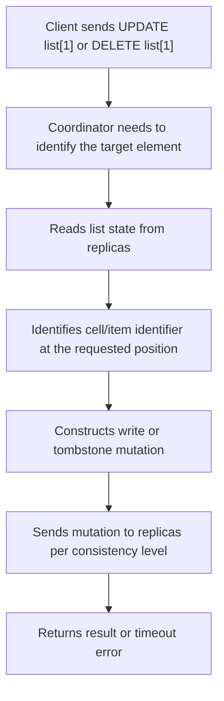

# Ordered Lists and Operations That Require Read-Before-Write or Are Non-Idempotent in Cassandra

> **Chapter:** Collections and UDTs  
> **Module:** `DATABASE_ENGINE_WIDE_COLUMN_CASSANDRA` — Apache Cassandra, a distributed wide-column database. This lesson focuses on `list<T>` in CQL in relation to query-driven table design, partition keys, read/write consistency levels, replication, compaction, repair, and the Java Driver.

## 1. The Problem: A Small List That Is Not Simple Under Multiple Writers

Suppose each learner has a list of up to ten lessons they want to view next, in an **order they chose themselves**:

```text
['partition-key', 'consistency', 'repair']
  position 0       position 1      position 2
```

The application must preserve order, sometimes allow two identical lessons, and support appending/prepending, editing a position, or deleting a lesson. CQL provides the `list<text>` type for this problem. However, a statement to "update the second element" in Cassandra can differ dramatically in cost from "append to the end," and an append statement can **execute twice** if a client retries after a timeout.

That is why you must distinguish three groups of operations:

1. **Appending/prepending**: adds a new ordered occurrence, typically without reading the current list before writing, yet is **non-idempotent** semantically.
2. **Accessing and modifying by index**: requires knowing which element currently sits at that position; prone to **read-before-write** and contention when other clients edit the list concurrently.
3. **Deleting by value or position**: requires identifying target elements in the current list, which can trigger a read-before-write and create **tombstones**.

Lists fit when the sequence is **small, bounded, read whole alongside the row, and has low write concurrency**. If you need unbounded history, element pagination, per-item identification, or continuous edits by multiple writers, design **separate rows** driven by Cassandra queries.

## 2. Semantics of `list<T>`

`list<T>` is an **ordered** collection. Unlike `set<T>`, it **allows duplicate values**:

```text
['intro', 'lab', 'intro']
```

The two `'intro'` strings are two separate **occurrences**; to delete only one occurrence, the value `'intro'` alone is not enough to identify it. With `map<K,V>`, each entry has a key `K`; with `set<T>`, an element is identified by its value. With `list<T>`, **an index represents a temporary position**, not a stable business identifier.

In a multi-cell (*non-frozen*) collection, Cassandra stores list elements with internal identifiers/ordering metadata and write metadata; CQL indices are derived from **the current list order**. Another client prepending an element or deleting an item before that position shifts the indices. A list's ordering semantics are also **not a clustering key** that lets the application paginate element-by-element like independent rows.

### Quick Comparison with Other Collections

| Question | `list<T>` | `set<T>` | `map<K,V>` |
| --- | --- | --- | --- |
| Does order have business meaning? | Yes | No | Does not represent insertion order |
| Are duplicate values allowed? | Yes | No | Values may repeat; keys may not |
| Item identifier for updates | Index at operation time | Value | Sub-key |
| Common add operation | Prepend or append | Add member | Set entry by key |
| Notable risk | Retries create duplicates; shifting indices | Contention adding/removing the same member | Contention writing the same key |

## 3. Creating the Table and Sample Data

Assume the keyspace `app` already exists. The following table answers the query **"fetch user X's pinned lesson list"**; `user_id` is the partition key as well as the row's primary key:

```sql
CREATE TABLE app.user_study_queue (
    user_id uuid PRIMARY KEY,
    pinned_lessons list<text>
);

INSERT INTO app.user_study_queue (user_id, pinned_lessons)
VALUES (
    11111111-1111-4111-8111-111111111111,
    ['partition-key', 'consistency', 'repair']
);

SELECT pinned_lessons
FROM app.user_study_queue
WHERE user_id = 11111111-1111-4111-8111-111111111111;
```

CQL uses `[...]` for lists. `list<text>` specifies that all elements are text; `null` is not a valid element. The following examples **mutate the same row**; to compare independently, reinitialize the sample row before each test. Operations are discussed for regular (**non-frozen**) collections unless stated otherwise.

## 4. Appending to the End: Short Syntax, Non-Idempotent Behavior

```sql
UPDATE app.user_study_queue
SET pinned_lessons = pinned_lessons + ['compaction']
WHERE user_id = 11111111-1111-4111-8111-111111111111;
```

Semantically, this requests **adding a new occurrence at the end of the list**. Cassandra can produce a mutation for the new element without the coordinator reading the entire existing list first. This is advantageous when the list remains small and the application only occasionally adds lessons.

However, appending is **not idempotent**. An operation is idempotent if executing the same operation multiple times yields the same result as executing it once. For example, starting from an initial state:

```text
Before:          ['a', 'b']
Append once:     ['a', 'b', 'c']
Append twice:    ['a', 'b', 'c', 'c']
```

If a client sends an append command and hits a **write timeout**, the write may have been recorded by some or enough replicas while the response never reached the client. Retrying the same statement can append **another element** with the same value, creating a duplicate. The client cannot conclude "timeout = definitely not written."

In production applications, setting `isIdempotent=true` on an append statement merely to trigger automatic driver retries is dangerous. If **duplicate pinned lessons are disallowed**, you need a design with a **unique item ID**, business-level deduplication/checks, or a different data structure; merely raising the consistency level does not solve the risk of retries repeating an append.

## 5. Prepending to the Start: Also Non-Idempotent and Sensitive to Concurrent Ordering

```sql
UPDATE app.user_study_queue
SET pinned_lessons = ['overview'] + pinned_lessons
WHERE user_id = 11111111-1111-4111-8111-111111111111;
```

In CQL, operand order matters: `list + [x]` **appends to the end**, whereas `[x] + list` **prepends to the start**. Do not swap operands just to look like algebraic notation.

Prepending also creates a new occurrence; if retried twice, `['overview', 'overview', ...]` is an entirely possible outcome. With multiple clients prepending concurrently, **the final order of the newly added elements** can be affected by how Cassandra orders internal mutations and timestamps. Do not use list prepend to build a global queue requiring strict order by button-press time across multiple devices.

If order is a user business decision after drag-and-drop, the application should persist **the entire accepted order** through a coordinated write source, or model each item as a row with an ordering field when multiple editors exist.

## 6. Updating by Index: Why Must Cassandra Read First?

Suppose the application wants to replace the lesson at position `1` with `'replication'`:

```sql
UPDATE app.user_study_queue
SET pinned_lessons[1] = 'replication'
WHERE user_id = 11111111-1111-4111-8111-111111111111;
```

The statement resembles updating a Java array element `arr[1]`. Yet Cassandra must find **which element currently sits at index 1** in the list state it observes before determining which cell to update. For a non-frozen list, this can trigger a **read-before-write** at the coordinator, increasing latency and work compared to mutating a `map` entry with a known key.

Important consequences:

- **Indices are 0-based**, and the index must be valid for the current list when the statement is processed; do not assume updating a nonexistent position automatically creates empty slots.
- What looks like a pure write query may have to read data from replicas, incurring additional latency or read failures depending on cluster state, consistency level, and list size.
- If the list is modified between when the application displayed the order and when it issues the update, the index of the same **business item** may shift. A statement succeeding does not guarantee it modified **the exact item** the user selected on an older screen.

### Index Race Condition Example

```text
T0: Server holds list                ['a', 'b', 'c']
T1: Client A reads and displays       0:a, 1:b, 2:c
T2: Client B prepends 'x'            ['x', 'a', 'b', 'c']
T3: Client A writes list[1] = 'B-new' ['x', 'B-new', 'b', 'c']
```

Client A meant to edit `'b'`, yet index `1` now points to `'a'`. This is a flaw in **positional identification**. Simply switching from `ONE` to `QUORUM` does not make stale indices stable. To update the right item, use a **stable ID** and an appropriate table design or synchronization protocol.

## 7. Deleting by Index or Value: Both Read-Before-Write and Tombstones

### 7.1. Deleting an Element by Position

```sql
DELETE pinned_lessons[0]
FROM app.user_study_queue
WHERE user_id = 11111111-1111-4111-8111-111111111111;
```

To delete the element at index `0`, Cassandra must identify which element corresponds to that index in the current list. Positional deletion can therefore trigger **read-before-write**. It also writes a **deletion marker (tombstone)** so other replicas do not resurrect the deleted data.

When multiple clients edit the list concurrently, index deletion is especially prone to deleting the wrong item: the item shown at position `0` in the UI may no longer be at that position when CQL executes.

### 7.2. Deleting by Value

```sql
UPDATE app.user_study_queue
SET pinned_lessons = pinned_lessons - ['repair']
WHERE user_id = 11111111-1111-4111-8111-111111111111;
```

List subtraction by value removes **matching occurrences** of `'repair'` in the list, not necessarily just one copy. To know which cells contain the value to delete, Cassandra may have to read the current list before generating the delete mutations. When a value repeats multiple times, matching copies are all targeted by the operation.

For example:

```text
Before:             ['cql', 'java', 'cql', 'repair']
Subtract ['cql']:   ['java', 'repair']
```

Consequently, if the business requirement is **"delete specifically the enrollment with ID 827"**, then `list - ['cql']` is the wrong expression. You need a structure carrying a distinct identifier key per item rather than inferring identity from duplicate values.

### 7.3. Deleting the Entire List Differs from Deleting One Item

```sql
-- Delete the entire collection column for a row.
DELETE pinned_lessons
FROM app.user_study_queue
WHERE user_id = 11111111-1111-4111-8111-111111111111;
```

This is a **whole-collection** deletion. Cassandra must retain deletion metadata to shadow old elements stored in other replicas or SSTables. Clearly separate API actions like `removePinnedItem` from `clearAllPinnedItems` so you never inadvertently issue a broader mutation than intended.

## 8. Replacing the Entire Order: Fits "Save Sort Order", Watch Out for Lost Updates

When the application always has a **complete snapshot** after drag-and-drop, it can replace the whole list:

```sql
UPDATE app.user_study_queue
SET pinned_lessons = ['repair', 'partition-key', 'consistency']
WHERE user_id = 11111111-1111-4111-8111-111111111111;
```

Writing the full list expresses an unambiguous final state, but carries trade-offs:

- **Mutation payload** scales with the new list; it is no longer a single-element write.
- For a multi-cell list, full replacement can generate **tombstones for the old cells** and write new values, increasing tombstones and compaction pressure if done frequently.
- Two clients reading the same snapshot and writing different orderings create **contention between two list versions**; Cassandra does not automatically merge two users' ordering intentions.

For example:

```text
T0: Both clients A and B read     ['a', 'b', 'c']
T1: Client A wants order          ['c', 'a', 'b']
T2: Client B wants order          ['b', 'c', 'a']
T3: Each client writes full list  -> One state can shadow the other
```

If the product must handle concurrent edits, define a rule: one device owns an edit session, writes carry a version number, only a single writer is allowed, or a controlled sync protocol is used. A plain `UPDATE` does not enforce "write only if the list still matches what was read."

## 9. Summary Table: Which Operations Read-Before-Write and Which Are Non-Idempotent?

| CQL operation on non-frozen `list` | Reads list at coordinator before writing? | Semantically idempotent? | Primary cost or risk |
| --- | --- | --- | --- |
| `list = list + [x]` | Typically **no** | **No** | Retries can append duplicate elements |
| `list = [x] + list` | Typically **no** | **No** | Retries can prepend duplicates; multi-writer ordering |
| `list[i] = x` | **Possibly/typically needed** | Do not assume | Locates cell by current position; index can shift |
| `DELETE list[i]` | **Possibly/typically needed** | Do not assume | Identifies item by position; tombstones and race conditions |
| `list = list - [x]` | **Possibly/typically needed** | Depends on concurrent write context | Finds all occurrences of `x`, creates tombstones |
| `list = [a, b, c]` | Not necessarily | Can be treated as setting fixed state absent concurrent writes | Writes full list, shadows old cells, lost updates |
| `DELETE list` | Typically **no** | Can be treated as requesting state deletion | Deletes entire collection, tombstones |

**How to read this table:** "Read first" refers to an internal step supporting **the write**, not a claim that every query generates an exact single network read across all versions and configurations. "Idempotent" also does not mean "never conflicts": assigning a fixed value may be safer to retry than an append, yet timestamp rules still govern concurrent writers, and a late retry can still alter the outcome when competing writes or timestamps change.

Do not reduce these operations to a fixed time bound like `O(1)` or "each update is one disk write." Cassandra uses memtables, commit logs, SSTables, replicas, and compaction; actual latency depends on data size, version/tombstone counts, consistency level, replica count, and cluster load.

## 10. Why Does Read-Before-Write Increase Latency and Failure Risk?

A normal Cassandra `UPDATE` typically sends a mutation to replicas without reading the current value. For index-based list updates or value-based list deletes, the coordinator needs to know **which cell(s)** to alter or delete; it may have to read the list first before constructing the corresponding mutation.



This conceptual flow shows why an update call can be **slower** when the list is long, replicas are heavily loaded, or many SSTables/tombstones must be reconciled. Some cases can even fail in the **read phase** even though the statement is written as an `UPDATE`.

The application should distinguish:

- **Write timeout:** uncertain how many replicas persisted the mutation; it may have succeeded at the data layer.
- **Read timeout/unavailable during a write requiring read-before-write:** the coordinator could not gather enough state to identify the target item. Do not assume every operation can be unconditionally retried.
- **Concurrent modification:** the statement succeeds yet updates a different element than intended because the client relied on a stale index.

When investigating, combine driver latency metrics, controlled tracing, table statistics, and replication/repair status instead of looking solely at CQL statement counts.

## 11. Element TTL, Tombstones, and Compaction

A multi-cell list stores metadata at the element level. CQL can set a TTL on elements added in a single operation:

```sql
-- The newly appended element is written with a 600-second TTL.
UPDATE app.user_study_queue USING TTL 600
SET pinned_lessons = pinned_lessons + ['temporary-lab']
WHERE user_id = 11111111-1111-4111-8111-111111111111;
```

That does not automatically apply a TTL to existing elements. When an element's TTL expires, Cassandra handles expiration via delete/tombstone mechanics. If an application inserts many short-TTL elements and deletes frequently, **tombstone counts** can climb rapidly and make reading the list expensive.

Tombstones must be retained long enough so replicas that were temporarily offline learn that an element was deleted. Compaction can purge tombstones safely only once the relevant conditions are met; policies such as `gc_grace_seconds` and **repair** processes both apply. Do not arbitrarily shorten the grace period to speed up list cleanup without ensuring replicas are repaired in time: old data can reappear if deletion markers are purged prematurely.

With **`frozen<list<T>>`**, the entire list becomes a single cell: the application can only replace the full list value, TTL applies at the cell level, and neither `list[i]` nor append can update an individual item. `frozen` fits small snapshots whose items are rarely edited individually, though it does not solve lost updates when multiple clients overwrite based on stale snapshots.

## 12. Java Driver 4.x: Designing Retries Around Actual Semantics

The Java example below illustrates prepared statements appending to a `list`. Assume `CqlSession` is already configured with contact points, local datacenter, and application lifecycle management.

```java
import com.datastax.oss.driver.api.core.CqlSession;
import com.datastax.oss.driver.api.core.cql.BoundStatement;
import com.datastax.oss.driver.api.core.cql.PreparedStatement;
import java.util.List;
import java.util.UUID;

class StudyQueueRepository {
    private final CqlSession session;
    private final PreparedStatement appendLesson;
    private final PreparedStatement replaceQueue;

    StudyQueueRepository(CqlSession session) {
        this.session = session;
        this.appendLesson = session.prepare(
            "UPDATE app.user_study_queue " +
            "SET pinned_lessons = pinned_lessons + ? WHERE user_id = ?"
        );
        this.replaceQueue = session.prepare(
            "UPDATE app.user_study_queue " +
            "SET pinned_lessons = ? WHERE user_id = ?"
        );
    }

    void append(UUID userId, String lessonId) {
        // Duplicate values are valid for a list.
        // Do not let the driver treat append as idempotent.
        BoundStatement stmt = appendLesson.bind(
            List.of(lessonId), userId
        ).setIdempotent(false);
        session.execute(stmt);
    }

    void replaceOrder(UUID userId, List<String> desiredOrder) {
        // Sends a complete snapshot; needs a strategy against lost updates
        // if multiple devices can change order simultaneously.
        BoundStatement stmt = replaceQueue.bind(desiredOrder, userId);
        session.execute(stmt);
    }
}
```

**Distinguish the two APIs:** `append` means **create another occurrence** and is not automatically safe to retry after a timeout. `replaceOrder` sends **the final state** but requires handling concurrent edits. `setIdempotent(false)` keeps driver retry and speculative execution mechanisms that rely on the idempotence flag from automatically replaying the append statement; it **does not prevent** your own application or an upstream proxy from retrying according to its own logic.

For index-based update/delete operations, do not allow users to submit indices from an old UI state without application-layer state or version verification. Method names like `deleteByIndex` warrant careful scrutiny; `deleteByLessonId` on a table with a stable ID usually carries clearer intent.

## 13. When Should You Replace a `list` with a Separate Table?

Consider an **activity feed** with millions of events per user: the application needs the 20 latest events, pagination, and deletion of a single event by ID. Putting the entire feed into `list<text>` on a single row creates an unbounded collection, cannot paginate element-by-element like separate rows, and makes duplicates hard to control under append/retry.

A more suitable design uses **separate rows ordered by clustering key**, with a bucket to bound partition size:

```sql
CREATE TABLE app.activities_by_user_day (
    user_id uuid,
    event_day date,
    occurred_at timeuuid,
    activity_type text,
    lesson_id text,
    PRIMARY KEY ((user_id, event_day), occurred_at)
) WITH CLUSTERING ORDER BY (occurred_at DESC);

-- Create an event using an occurred_at allocated once for this event.
INSERT INTO app.activities_by_user_day (
    user_id, event_day, occurred_at, activity_type, lesson_id
) VALUES (
    11111111-1111-4111-8111-111111111111,
    '2026-11-21',
    8cbe0000-e581-11f1-8e9a-0242ac120002,
    'PINNED',
    'repair'
);

SELECT occurred_at, activity_type, lesson_id
FROM app.activities_by_user_day
WHERE user_id = 11111111-1111-4111-8111-111111111111
  AND event_day = '2026-11-21'
LIMIT 20;
```

Here, `occurred_at` is a **timeuuid** representing a time-ordered ID for the event. In a real application, generate the timeuuid once when the event occurs and **reuse the exact same ID on retries**, rather than generating a fresh timeuuid per retry attempt. `event_day` must match the time bucket the application uses to route queries; querying across multiple days requires reading multiple buckets. If a single day still accumulates too many events, consider smaller buckets sized to load.

**Note:** this table identifies **a write event** by `(user_id, event_day, occurred_at)`; it does not automatically ensure a `lesson_id` is pinned only once. If the requirement is "each user can pin a given lesson only once," you need a schema or deduplication workflow keyed by `(user_id, lesson_id)` or synchronized read tables, optionally with conditional writes where needed. Thus, **stable row keys** solve identification rather than relying on indices or duplicate values in a list.

### When Is a List Still Appropriate?

`list<text>` can be sensible for a UI with at most 5 onboarding steps where **every save rewrites the full order**, a single source owns the state, and concurrent multi-client edits are rare. For such a list, reading the whole list from the user row is simpler than maintaining an auxiliary table.

## 14. Verifying Behavior in a Cassandra Environment

You can run a small measurement routine to observe differences across mutation types:

1. Create the sample table and data, keeping **the same replication and consistency level** across test runs.
2. Measure appends on short and long lists, edits at start/end indices, index deletes, and value deletes; repeat enough times to inspect percentile latencies rather than single runs.
3. In a test environment, run `cqlsh` with `TRACING ON;` around sample queries to observe coordinator and replica read/write steps; turn it off with `TRACING OFF;` afterward.
4. Monitor p95/p99 latency, timeout/retry counts, tombstones read, compaction backlog, and partition size using the statistics tools appropriate for your Cassandra version.
5. Run a controlled timeout test on an append with your application's retry policy and check whether duplicates appear. Never run failure-injection tests against production data.

Differences to evaluate:

| Signal | Questions to answer |
| --- | --- |
| Latency of editing `list[i]` rises | Is a read-before-write occurring? Does the list have many versions/tombstones? |
| Retries after write timeouts | Are duplicate items being created? Which layer decides to retry? |
| `list - [x]` deletes on long lists | Is it re-reading many elements and writing many tombstones? |
| Compaction spikes after full list replacement | Are you frequently writing new snapshots of a large collection? |
| "Wrong position edited" bugs | Is the client relying on indices from a stale snapshot? |

Measurements reflect your Cassandra version, workload, SSTable state, replication, consistency, and driver retry behavior. A short `UPDATE` syntax does not imply low cost or business safety.

## 15. Reasoning Exercises

**Exercise 1 — Retry:** The list currently contains `['a','b']`. A client appends `'c'`, hits a timeout, and retries successfully. Which outcomes are possible?  
**Hint:** Either `['a','b','c']` or `['a','b','c','c']`, depending on whether the first write took effect and how reconciliation resolved. You cannot deduce the outcome from the timeout error alone.

**Exercise 2 — Value-based deletion:** The list is `['java','cql','java']`. How many items does `SET list = list - ['java']` intend to remove?  
**Hint:** It removes matching occurrences of `'java'`; there is no notion of "delete only the second `java` item" when specifying by value.

**Exercise 3 — Stale index:** A user chooses to edit the lesson at index `2`, but another device prepends two lessons before the update executes. Can raising consistency to `QUORUM` automatically target the intended lesson ID?  
**Hint:** No. The flaw lies in **identifying items by position**. Use a stable ID, coordinate state/versioning, or design a separate table.

**Exercise 4 — Bounded list:** A configuration screen has exactly 4 ordered steps and only one editor. Must you always replace the list with a separate table?  
**Hint:** No. A small list rewritten as a full snapshot can be simpler if update frequency is low and contention is minimal.

**Exercise 5 — Continuous activity:** A system records several million actions per day and must paginate chronologically. Is `list<event>` appropriate?  
**Hint:** No. Use separate rows with time-bucketed partition keys and a clustering key; assign stable event IDs so retries target the same row.

## 16. Key Takeaways

- `list<T>` **is ordered and allows duplicates**; an index is a transient position, not an element ID.
- **Appends/prepends usually avoid read-before-write**, yet are **non-idempotent**: retries can create duplicates.
- **Index updates/deletes** and **value-based deletes** can trigger **read-before-write**, increasing latency and race-condition exposure.
- Deleting elements or replacing the whole list can generate **tombstones**; operations must watch compaction, TTL, repair, and replica health.
- `QUORUM` and other consistency levels choose distributed read/write trade-offs, but **do not give list appends exactly-once semantics** or stabilize stale indices.
- In the Java Driver, configure **idempotence** accurately, reuse prepared statements, and govern retries across both the driver and application layers.
- For unbounded data, pagination requirements, per-item identification, and multiple writers, design a **query-driven table with partition/clustering keys** instead of a long list.
