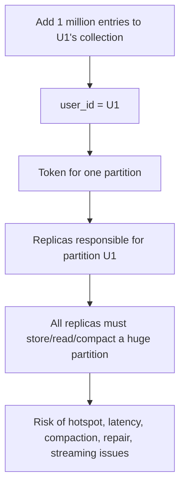
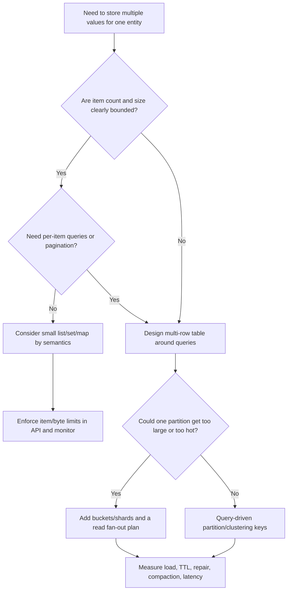

# Unbounded Collections and Their Impact on Row and Partition Size in Cassandra

> **Chapter:** Collections and UDTs  
> **Module:** `DATABASE_ENGINE_WIDE_COLUMN_CASSANDRA` — Apache Cassandra's distributed wide-column architecture. This lesson focuses on the consequences of unboundedly growing collections for query-driven data modeling, partition keys, replication, consistency, compaction, repair, operational failures, and Java applications.

## 1. The Core Problem: Small Data Today Can Become a Massive Row

Suppose an application tracks each learner's action history. Initially, each learner has only a few events, so it is tempting to keep them right inside a single row:

```sql
-- ANTI-PATTERN if event volume can grow without bound.
CREATE TABLE app.user_history_bad (
    user_id uuid PRIMARY KEY,
    activities list<text>
);

UPDATE app.user_history_bad
SET activities = activities + ['opened:partition-key']
WHERE user_id = 11111111-1111-4111-8111-111111111111;
```

This is a valid statement, yet `activities` grows steadily over time. The question to answer is not "does Cassandra allow appending elements?", but **"Can collection, row, and partition sizes be bounded for safe operation?"** If a learner generates millions of events, the entire list still resides inside **a single row** with partition key `user_id`.

Reading the full list, compaction, repair, or streaming partitions across nodes can become very expensive. Knowing the exact partition key by itself **does not solve** the problem of a single partition holding too much data.

> **Principle:** Cassandra collections fit **small, clearly bounded groups of values that share a lifecycle and are typically read with the row**. An unboundedly growing collection must not be used as a sub-table, log, queue, or history store.

## 2. Distinguishing Collection Elements, Cells, Rows, and Partitions

A sound model distinguishes four levels:

| Level | Role | Impact as count grows |
| --- | --- | --- |
| **Collection element** | One value in a `list`/`set`, or one entry in a `map` | Increases data to encode, read, write, and transfer |
| **Cell** | Unit of value and write/TTL/tombstone metadata; non-frozen collections can have many cells | Increases metadata, version reconciliation cost, and tombstones |
| **Row** | Data identified by the row's primary key, containing columns/collections | A large collection can make **a single row** huge |
| **Partition** | Data sharing a partition key, placed on a replica set | One huge row or many rows sharing a key both make the **partition** large |

For instance, `user_history_bad` has only `user_id` as its primary key, so **each user is a single-row partition**. As the list accumulates elements, row size and partition size grow together. In tables with clustering columns, one partition can hold many rows; in that case, a large partition can come from **row count**, **individual row size**, or both.

```text
Partition key: user_id = U1
┌─────────────────────────────────────────────────────────┐
│ One row: PRIMARY KEY (U1)                               │
│   activities = [event1, event2, event3, ... eventN]     │
│              ↑ As N grows, a single row balloons        │
└─────────────────────────────────────────────────────────┘

Partition key: (user_id = U1, event_day = D1)
┌─────────────────────────────────────────────────────────┐
│ Row event_time=T3  -> event3                            │
│ Row event_time=T2  -> event2                            │
│ Row event_time=T1  -> event1                            │
│ ...                                                     │
└─────────────────────────────────────────────────────────┘
```

In the second model, each event is **its own row** with a clustering key. You can perform range reads and paginate rows, while still needing to ensure **the number of rows in a single partition stays reasonably bounded**, for example via time bucketing.

## 3. `list`, `set`, `map`: Three Growth Patterns, One Shared Design Limit

### 3.1. `list<T>` — Unbounded Append-Only Log

`list` preserves order and allows duplicate values. Continuously appending events with `activities = activities + [...]` looks convenient, but causes three issues:

1. A long list makes whole-column reads slow and costly in memory and network bandwidth.
2. Appends are **non-idempotent**; retrying after a write timeout can append the exact same event a second time.
3. Updating/deleting by index or deleting by value can require **read-before-write**, increasing operation cost as the list grows.

A small list for a user's custom ordering is fundamentally different from an unbounded event stream. Do not extrapolate a design that works for 10 items to 10 million items.

### 3.2. `set<T>` — Bloating Membership Set

```sql
-- ANTI-PATTERN when a group can have millions of members.
CREATE TABLE app.group_members_bad (
    group_id uuid PRIMARY KEY,
    member_ids set<uuid>
);
```

`set` prevents duplicate elements and allows value-based adds/deletes, yet the `group_id` row still accumulates more and more cells as membership grows. If you need to **paginate members**, read **per-member details**, or query "which groups does user U belong to?", separate tables aligned to each query direction are usually far better. A `set` does not turn each member into an independently paginatable row.

### 3.3. `map<K,V>` — Dynamic Dictionary Turned Uncontrolled Sub-Table

```sql
-- ANTI-PATTERN: do not use a map as a store for a million event-ID records.
CREATE TABLE app.event_payloads_bad (
    user_id uuid PRIMARY KEY,
    payload_by_event map<timeuuid, text>
);
```

`map` is handy for a couple dozen flexible attributes where you need `settings['theme'] = 'dark'`. But if keys are IDs for millions of events, it becomes a **hidden sub-table inside one column**: lacking row-style pagination per entry, awkward to manage independent lifecycles, and transferring vast amounts of unrelated data whenever the whole map is read.

| Requirement | Bounded collection | Unboundedly growing collection |
| --- | --- | --- |
| 10–30 UI settings keys | `map<text,text>` can fit | Do not use a map to store logs by ID |
| A handful of favorite topics | `set<text>` can fit | Do not use a set for every user in a huge community |
| 5 ordered pinned lessons | `list<text>` can fit | Do not use a list for every activity ever recorded |
| Reading items by ID with pagination | Consider columns/collections only if tiny | Design a separate table with query-aligned primary key |

These numbers merely illustrate **semantics and product-defined bounds**; they are not hard limits published by Cassandra for every cluster.

## 4. Why Does Partition Size Affect the Entire Cluster?

### 4.1. Partition Keys Only Determine Placement—They Never Split a Single Partition

The partitioner uses the partition key to compute a token and pick the replica set storing the data. With `PRIMARY KEY (user_id)`, a single user generating many events **does not spread those events across different tokens**; they all stay inside `user_id`'s partition.



Adding replicas increases durability and consistency options, but **never splits a partition into independent readable shards**; every replica of that partition must manage all of that partition's data. For example, RF=3 means a logical dataset is stored on three replicas—an amplification factor for storage and background work, not three smaller pieces of one list.

### 4.2. Hot Partitions and Load Imbalance

If 90% of writes concentrate on one user key or one giant group, the few replicas owning that partition can become a **hot partition**, even while other cluster nodes sit idle. Both **size** and **access rate** matter: a rarely touched 100 MB partition carries a different risk profile from a 10 MB partition updated thousands of times per second.

Adding nodes will not automatically relieve a hot partition if the workload's partition key stays unchanged. You must revisit **the unit of data partitioning** and **how queries access it**.

### 4.3. Reading and Transferring Data

When querying a column holding a large collection, the coordinator and replicas must process the collection value and return it over the CQL protocol. Large payloads can lead to:

- High read latency and heavy network byte transfer.
- Higher memory consumption for deserialization/serialization on the server and Java client.
- Many cells, stale versions, TTLs, and tombstones reconciled during reads.
- Risk of hitting value/message size limits or timeouts depending on version, driver, and configuration.

**Do not invent a single absolute byte threshold for every environment.** Establish a size budget based on your workload, SLOs, payload size, key popularity, and measurements on your running Cassandra version.

## 5. `LIMIT`, Paging, and `frozen` Cannot Rescue an Oversized Collection

### 5.1. `LIMIT 10` Caps Rows, Not 10 Elements of a List

```sql
-- Can still return the entire activities collection inside one row.
SELECT activities
FROM app.user_history_bad
WHERE user_id = 11111111-1111-4111-8111-111111111111
LIMIT 10;
```

In a table with only one row per `user_id`, `LIMIT 10` does not mean "return the 10 newest events in `activities`." It caps the number of **result rows** without turning list elements into rows. Java Driver page size also applies to result rows; a single row holding a huge collection still produces a massive response.

To fetch the 10 latest events and paginate onward, make **each event a row with a time-ordered clustering key**.

### 5.2. `frozen<list<T>>` Does Not Reduce Logical Size

```sql
-- Also an anti-pattern if you intend to store unbounded history.
CREATE TABLE app.user_history_frozen_bad (
    user_id uuid PRIMARY KEY,
    activities frozen<list<text>>
);
```

`frozen` stores the collection as **a single cell**, meaning **the entire value** must be rewritten whenever one element changes. It can reduce per-element metadata, but it does not shrink the large list, provides no element-level paging, and typically forces small edits to retransmit a massive snapshot.

Comparison:

| Criterion | Non-frozen collection | Frozen collection |
| --- | --- | --- |
| Unit of update | Can be per-entry/element depending on type | Entire value |
| Logical size across many items | Still grows with item count | Still grows with item count |
| Paginating each entry as a row | No | No |
| Delete/TTL handling | Can have per-element tombstones | Per-value delete/TTL; still creates tombstones |
| Suitable for unbounded collections | No | No |

## 6. Size Estimation Example to Spot Risky Designs Early

Suppose a user generates **2,000 events/day**, each with an average payload of **200 bytes**. After **365 days**, the raw event payloads alone total:

\[
2,000\ \text{events/day}\times365\ \text{days}\times200\ \text{bytes}
=146,000,000\ \text{bytes}\approx146\ \text{MB (decimal)}.
\]

This is an **illustrative estimate**, excluding collection keys/metadata, timestamps, indexes, tombstones, SSTable overhead, compression, replication, or per-record growth variations. Using `list<text>` in one row means a query reading the collection could have to process hundreds of megabytes of logical data even when the UI only wants the 20 latest items.

| Growth variable | Approximate formula | Used to decide |
| --- | --- | --- |
| Elements per partition | `write rate × retention duration` | Whether bucketing and TTL are needed |
| Logical payload per partition | `element count × average size` | Row/partition and request/response budgets |
| Writes to partition | `client count × update frequency` | Hotspot, timeout, and contention risk |
| Data stored across replicas | Depends on replication factor, compaction, compression | Cluster disk, repair, and streaming capacity |

If a 30-day TTL retains data at a steady rate of 2,000 events/day, roughly 60,000 events remain live at any time, yet **TTL expiration does not immediately reclaim all old bytes** from SSTables. Tombstones and compaction still govern backlog work. Capacity budgets should account for both **live data** and **expired/unreclaimed data**.

## 7. Redesigning: Events as Rows, Partitioned by User and Day Bucket

Assume the business query is:

> "For user U, list events on day D, newest first; fetch 50 rows, then paginate."

Turn each event into a row and use a clustering column for ordering:

```sql
CREATE TABLE app.events_by_user_day (
    user_id uuid,
    event_day date,
    event_time timeuuid,
    event_type text,
    details text,
    PRIMARY KEY ((user_id, event_day), event_time)
) WITH CLUSTERING ORDER BY (event_time DESC);

-- An event with a stable ID; e.g., a timeuuid matching 2026-11-21.
INSERT INTO app.events_by_user_day (
    user_id, event_day, event_time, event_type, details
) VALUES (
    11111111-1111-4111-8111-111111111111,
    '2026-11-21',
    8cbe0000-e581-11f1-8e9a-0242ac120002,
    'OPEN_LESSON',
    'partition-key'
);

-- Fetch 50 rows within the known day's partition.
SELECT event_time, event_type, details
FROM app.events_by_user_day
WHERE user_id = 11111111-1111-4111-8111-111111111111
  AND event_day = '2026-11-21'
LIMIT 50;
```

In `PRIMARY KEY ((user_id, event_day), event_time)`:

- `(user_id, event_day)` is a **composite partition key**. Each day for a user forms its own partition.
- `event_time` is the **clustering column**, organizing rows chronologically; `DESC` serves newest-first queries.
- Each `INSERT` writes a row with a **stable identifier**. If a timeout occurs and the app retries with **the same `event_time`**, the statement targets the same row key; generating a fresh UUID on every retry can still create duplicate business events.
- `LIMIT 50` now caps **50 event rows**, and the driver can continue paging through subsequent rows.

### What Is Solved, and What Remains?

The new model enables row pagination and bounds per-partition data size via time bucketing. However:

1. Reading **across multiple days** requires the application to query multiple buckets and merge results in order; you cannot drop `event_day` from `WHERE` and expect cross-bucket queries to run efficiently.
2. If one user generates **millions of events in a single day**, a daily bucket is still too large: consider hourly buckets or sharding suited to traffic.
3. If you add hash-based shards to spread write load, a query for the 50 latest events must read and merge across the relevant shards; adding shards introduces read **fan-out**.
4. Data with colliding or unstable `event_time` values across retries needs a clear **unique ID** rule. `timeuuid` does not automatically guarantee exactly-once behavior if the application mints a new ID on each retry.

A good design balances **partition size**, **write distribution**, and **read fan-out query count**. No single bucketing scheme fits every traffic profile.

## 8. Large Maps/Sets: Splitting into Rows Keyed by Element

If the problem is membership in a large group, instead of `member_ids set<uuid>` in one row, you can use:

```sql
CREATE TABLE app.members_by_group (
    group_id uuid,
    member_id uuid,
    joined_at timestamp,
    PRIMARY KEY ((group_id), member_id)
);

INSERT INTO app.members_by_group (group_id, member_id, joined_at)
VALUES (
    22222222-2222-4222-8222-222222222222,
    11111111-1111-4111-8111-111111111111,
    '2026-11-21T08:00:00Z'
);

SELECT member_id, joined_at
FROM app.members_by_group
WHERE group_id = 22222222-2222-4222-8222-222222222222
LIMIT 50;
```

Each member is now **a row** and can be paginated by `member_id`. Yet the partition key is still only `group_id`, so an enormous group can still create a **giant partition**. Measure per-group scale; if a single group has tens of millions of members, add a bucket/shard to the partition key and accept scanning multiple buckets when all members are needed.

If the application asks **"which groups does user U belong to?"**, `members_by_group` does not serve that query directly. You need a companion table `groups_by_member` partitioned by `member_id` or another read model; keeping multiple tables in sync is an application-level design responsibility. This exemplifies **query-driven table design** in Cassandra.

For a very large `map`, you can create a table with `PRIMARY KEY ((owner_id, bucket), item_key)` and an `item_value` column, or a partition key matched to your specific query. Choosing the bucket requires clarifying how a single `item_key` is looked up, how items are scanned, how TTLs are set, and how partitions are bounded. Merely converting a `map` into `PRIMARY KEY ((owner_id), item_key)` without checking owner cardinality does not necessarily eliminate large partitions.

## 9. TTL and Data Deletion: Do Not Confuse Expiration with Immediate Reclamation

A multi-cell collection can assign distinct TTLs to specific written entries, for example:

```sql
CREATE TABLE app.session_features (
    session_id uuid PRIMARY KEY,
    flags map<text, text>
);

UPDATE app.session_features USING TTL 600
SET flags['trial_notice'] = 'enabled'
WHERE session_id = 33333333-3333-4333-8333-333333333333;
```

The written entry receives a 600-second TTL; other entries do not inherit a TTL from this statement. When the TTL expires, Cassandra must retain expiration/deletion metadata until cleanup is safe. With `frozen<map<...>>`, TTL attaches to the whole snapshot cell rather than individual entries.

In a separate events table, you can set TTL per row when writing non-primary-key columns:

```sql
-- Example: retain the event payload for 7 days (604800 seconds).
INSERT INTO app.events_by_user_day (
    user_id, event_day, event_time, event_type, details
) VALUES (
    11111111-1111-4111-8111-111111111111,
    '2026-11-21',
    8cbe0000-e581-11f1-8e9a-0242ac120002,
    'OPEN_LESSON',
    'partition-key'
) USING TTL 604800;
```

TTL is a **data-retention bounding tool**, but it does not guarantee partitions shrink the instant a TTL expires: compaction and tombstone cleanup policies still govern disk usage and read latency.

Some time-series workloads can benefit from table/bucket organization and compaction aligned with retention windows (for example TimeWindowCompactionStrategy where appropriate), though any choice must be validated against your Cassandra version and write/delete workflow. **A compaction strategy cannot fix an unbounded-collection model** and does not replace cardinality bounds.

## 10. Tombstones, Compaction, Repair, and Streaming on Large Partitions

A large collection undergoing constant adds and deletes incurs costs beyond live elements:

| Operation | Impact of an oversized collection/partition |
| --- | --- |
| **Reads** | Merges many cells, stale versions, TTLs, and tombstones; tends to spike p95/p99 latency |
| **Writes** | Hot partitions concentrate writes on a few replicas; retries amplify load on timeout |
| **Compaction** | Many versions/tombstones and SSTables must be processed; background I/O rises |
| **Repair** | Must compare/sync data across replicas; huge partitions increase load and duration |
| **Streaming / bootstrap / decommission** | Large partition payloads make data transfer and rebalancing heavier |
| **Backup / restore** | Storage footprint and processing time can increase due to large payloads and old records |

Deleting an element does not make old values vanish immediately from every SSTable. Cassandra writes **tombstones** so replicas that missed the delete know the data was deleted. If tombstones are purged before an offline replica is synchronized, stale data can **resurface** (*zombie data*). Schedule repairs and understand `gc_grace_seconds` safety guarantees; never lower grace periods just to silence tombstone warnings on an improperly modeled table.

With consistency levels like `ONE`, `LOCAL_QUORUM`, or `QUORUM`, replicas acknowledge operations at different thresholds depending on replication. Raising consistency affects latency and availability, but **never shrinks a partition**, never bounds a collection, and never resolves a hot partition bottleneck.

## 11. Application-Layer Limits: Design Alone Fails Without Enforcement

If you still choose a collection, enforce **verifiable bounds**. For instance, if the product limits each user to at most 12 pinned items:

- Enforce the item limit in the UI **and on the API server**, preventing clients from bypassing the UI and writing thousands of elements directly.
- Cap both individual payload size and total collection size, not just element count.
- Account for update frequency and concurrent devices; even a short list can become a hot row if modified thousands of times per second.
- When limits are exceeded, choose a clear business policy—**reject, drop oldest, archive separately**, or migrate to a multi-row table—and document it in the API.
- Monitor collection length and byte size in the application; do not assume CQL natively enforces a "max 12 elements" quota on a list column.

**Concurrency note:** A "client reads length = 11, then appends one item" check does not enforce a 12-item cap if two clients run simultaneously. If a strict invariant is required, use a coordinated/conditional write protocol or a different data model. Do not infer that `QUORUM` alone creates an atomic read-modify-write.

## 12. Java Driver: Paginating **Rows** and Using Stable IDs on Retry

The Java Driver 4.x example below uses a `CqlSession` already configured with contact points, local datacenter, and authentication. Prepared statements are created once in the repository and reused:

```java
import com.datastax.oss.driver.api.core.CqlSession;
import com.datastax.oss.driver.api.core.cql.BoundStatement;
import com.datastax.oss.driver.api.core.cql.PreparedStatement;
import com.datastax.oss.driver.api.core.cql.ResultSet;
import com.datastax.oss.driver.api.core.cql.Row;
import java.time.LocalDate;
import java.util.UUID;

class EventRepository {
    private final CqlSession session;
    private final PreparedStatement insert;
    private final PreparedStatement selectByDay;

    EventRepository(CqlSession session) {
        this.session = session;
        insert = session.prepare(
            "INSERT INTO app.events_by_user_day " +
            "(user_id, event_day, event_time, event_type, details) " +
            "VALUES (?, ?, ?, ?, ?)"
        );
        selectByDay = session.prepare(
            "SELECT event_time, event_type, details " +
            "FROM app.events_by_user_day " +
            "WHERE user_id = ? AND event_day = ?"
        );
    }

    void saveEvent(
        UUID userId, LocalDate day, UUID stableTimeUuid,
        String type, String details
    ) {
        // stableTimeUuid is a UUID v1 allocated ONCE for the event.
        // On retry, preserve userId, day, and stableTimeUuid unchanged.
        session.execute(insert.bind(userId, day, stableTimeUuid, type, details));
    }

    void printEvents(UUID userId, LocalDate day) {
        BoundStatement stmt = selectByDay.bind(userId, day)
            .setPageSize(50);
        ResultSet rows = session.execute(stmt);
        for (Row row : rows) {
            // Synchronous Java Driver fetches subsequent pages while iterating.
            System.out.println(row.getUuid("event_time") + " "
                + row.getString("event_type"));
        }
    }
}
```

`setPageSize(50)` is a **per-page row-count hint** for the query, not a cap on total rows iterated and not a way to slice a collection into 50 elements. When writing an HTTP API, stop after the desired page and manage **paging state** according to driver conventions rather than iterating through the entire `ResultSet` when only one page is needed. To fetch at most 50 rows in a single query, you can add `LIMIT 50`, provided you define how subsequent pages are retrieved using the appropriate query and paging state.

In `saveEvent`, ensure `stableTimeUuid` is genuinely a **timeuuid / UUID version 1** accepted by the schema; `UUID.randomUUID()` produces UUID version 4 by default and is **incompatible** with a `timeuuid` column. Generate the ID once before sending, align it consistently with the day bucket, and reuse that exact ID across all retries. If exactly-once semantics span multiple tables or other side effects, add business-level deduplication/consistency logic rather than relying solely on the row key.

## 13. Process to Measure and Detect Risky Collections and Partitions

Do not rely solely on `CREATE TABLE` statements to declare a design safe. Observe real data and actual access paths:

1. **Measure cardinality and payload**: how many elements/partition at p50, p95, p99, and max? What is the daily growth rate and data retention age?
2. **Measure partition size**: inspect table statistics and size distribution across replicas, watching for abnormally large or hot outlier partitions.
3. **Measure queries**: p95/p99 latency, read timeouts, write timeouts, response payload sizes, retry counts, and SSTables/tombstones reconciled.
4. **Measure operational background work**: compaction backlog, disk I/O, tombstone warnings, repair duration, and streaming; compare normal load against bootstrap/repair windows.
5. **Test migrations**: benchmark latency and throughput comparing the collection against the separate-row table under identical data, replication, and consistency—including queries that fan out across buckets.

In a test environment, you can run `TRACING ON;` in `cqlsh` for targeted queries followed by `TRACING OFF;`. On supported versions, `nodetool tablestats` and `nodetool tablehistograms` expose relevant statistics; exact syntax and metrics vary by Cassandra version. Tracing incurs overhead, so do not enable it broadly on production clusters.

### Common Signals and Recommended Actions

| Signal | Likely interpretation | Recommended action |
| --- | --- | --- |
| One user's collection grows steadily every day | No cardinality-bounding policy | Split into separate rows, add bucketing, enforce retention |
| `SELECT ... LIMIT 20` still returns huge payloads | `20` limits **rows**, and the collection sits in one row | Create clustering rows for paginatable items |
| Tombstone warnings appear after bulk deletes/TTLs | Many deleted/expired entries require reconciliation | Review delete workload and schema; ensure proper repair/compaction |
| A few replicas run hot while other nodes sit idle | Traffic concentrates on one or a few partition keys | Design bucketing/sharding with a read fan-out plan |
| Repair or streaming takes abnormally long | Huge partitions or skewed data distribution | Measure by token/partition and revisit partition key design |
| Java client hits timeouts/high memory reading collections | Response carries a single massive value | Bound collections; paginate **rows** via a revised schema |

## 14. Case Exercises

**Scenario A — `LIMIT` does not solve it:** Table `user_history_bad` stores 500,000 activities in one user's list. Does `SELECT activities ... LIMIT 20` return the first 20 activities?  
**Hint:** No. It limits rows; with `user_id` as the sole primary key column, the returned row still carries **the entire collection**.

**Scenario B — Daily bucket still too big:** A single user generates 3 million events/day. Does `(user_id, event_day)` bound partition size adequately?  
**Hint:** Not necessarily. Estimate bytes/day and write rate; consider hourly buckets or sharding, then design how reads aggregate across buckets.

**Scenario C — Unbounded membership count:** A group's `set<uuid>` can hold 2 million members. Is switching to `PRIMARY KEY ((group_id), member_id)` alone enough?  
**Hint:** Splitting into rows enables paging, yet all members of one group still live in **the same partition**; you may still need group bucketing/sharding if sizes grow huge.

**Scenario D — `frozen`:** Can you convert a huge `list<text>` to `frozen<list<text>>` to update a single item faster?  
**Hint:** No. `frozen` requires rewriting the entire value and forbids per-element edits; logical size remains just as large.

**Scenario E — TTL:** Does setting a 30-day TTL on events guarantee disk usage drops proportionally the moment 30 days pass?  
**Hint:** No. TTL expiration triggers tombstone handling; compaction and safe-cleanup rules govern when old bytes are actually reclaimed.

**Scenario F — Retries:** An application generates a fresh timeuuid after every timeout and re-inserts the event. What goes wrong?  
**Hint:** Two writes target different row keys, potentially creating duplicate business events. Allocate the ID once and preserve it across all retries.

## 15. Design Summary



- **Unboundedly growing collections** inflate **single rows** and inflate **partitions** along with them; partition keys do not automatically split elements inside the same row.
- `list`, `set`, `map`, and `frozen` differ in update mechanics, yet **none are suited for storing unbounded data inside one column**.
- `LIMIT` and Java Driver paging bound and navigate **result rows**, not elements inside an oversized collection.
- Oversized or hot partitions degrade **latency, memory, I/O, compaction, tombstones, repair, and streaming** across replicas.
- The right model is typically **multiple rows with a clustering key**, paired with **partition-key bucketing** as row counts or write rates grow; account for multi-bucket read costs upfront.
- Enforce **cardinality, byte-size, and retention limits** at the application layer, and benchmark under realistic replication and consistency levels.
- For retryable events, use **stable row identifiers**; when workflows span multiple tables or side effects, add business-level deduplication and consistency policies.
