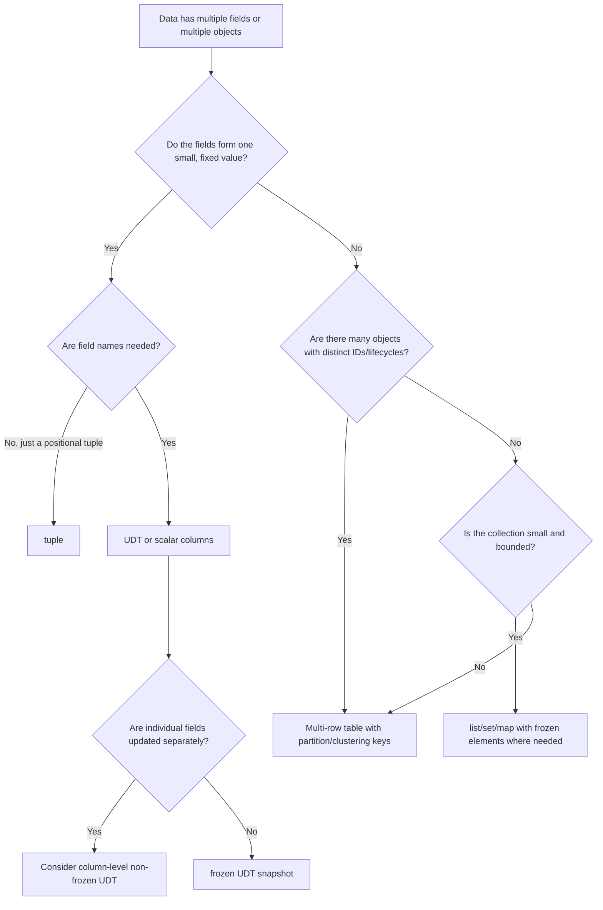

# `tuple`, UDTs, and Modeling Nested Structures in Apache Cassandra

> **Chapter:** Collections and UDTs  
> **Module:** `DATABASE_ENGINE_WIDE_COLUMN_CASSANDRA` — Apache Cassandra's distributed architecture and wide-column model. This lesson explains how to group structured data with CQL, how to choose tables around queries, and the implications for partition keys, consistency, replication, compaction, repair, and the Java Driver.

## 1. Problem Statement: When One Column Holds Structured Multi-Part Data

A learner profile might have an address consisting of `line1`, `city`, `country`, and coordinates; an assessment result has `score` and `grade`; a list of recent addresses holds several items with the same shape. Representing everything as a JSON string forces the application to validate types manually and sacrifices many benefits of a CQL schema. Creating a separate column for every detail makes the schema long and scatters values belonging to the same concept.

Cassandra provides two structured value types:

- **`tuple<T1, T2, ...>`**: groups values **by position**, with each position's type declared upfront; for example `(95, 'PASS')`. Tuples fit small groups with clear positional semantics that are typically read and written as a single value.
- **UDT (*user-defined type*)**: groups fields with **names and types**, such as `{city: 'Hà Nội', country: 'VN'}`. UDTs model a business value with a defined shape that can be reused across columns and tables in a keyspace.

Neither tuples nor UDTs **create sub-tables**, nor do they automatically allow querying across rows by nested fields, nor do they change how data is routed by **partition key**. Cassandra still prioritizes **query-driven table design**, even when data resembles a nested JSON document.

### Learning Objectives

After this lesson, you will be able to read and write tuples and UDTs in CQL; understand when `frozen` is required and when an individual UDT field can be updated; design one or more modest layers of nested data; recognize the risk of rewriting whole snapshots under multiple writers; and choose **tables with partition/clustering keys** instead of oversized collections or UDTs.

## 2. Choosing Between Tuples, UDTs, Collections, Regular Columns, or a Separate Table

| Structure | How components are identified | Best suited for | Primary limitation |
| --- | --- | --- | --- |
| `tuple<int,text>` | Positions `0`, `1` | Short pairs like `(score, grade)` | Hard to read with many positions; order must stay agreed |
| UDT `address` | Field names `city`, `country`, ... | A business value with a fixed schema | Does not create a new query path; type changes require schema management |
| `list<T>` | Order and occurrences | A small number of ordered items | Unfit for unboundedly growing history; append retry duplicates |
| `set<T>` | Unique membership | Few tags/topics | No business ordering; cannot paginate members |
| `map<K,V>` | Sub-key mapped to value | Flexible preferences with few keys | Does not promote sub-keys to primary keys |
| Scalar columns | Independent column names | Fixed fields frequently filtered or updated independently | Many fields can widen the schema |
| Multi-row table | Primary key, clustering key | Large lists, pagination, reverse queries, independent TTLs | Requires designing read tables for each query |

**Quick rule of thumb:** If the components have **meaningful business names**, prefer a UDT or regular columns. If they are simply a **short tuple of values with stable positional meaning**, a tuple can make sense. If the structure has an **unboundedly growing item count** or requires per-item pagination or querying, use a separate table.

## 3. `tuple`: A Positionally Typed Group of Values

A tuple is declared inline in a column type without needing `CREATE TYPE`:

```sql
-- Assume keyspace app already exists.
USE app;

CREATE TABLE assessment_summary (
    session_id uuid PRIMARY KEY,
    result tuple<int, text>
);

INSERT INTO assessment_summary (session_id, result)
VALUES (
    11111111-1111-4111-8111-111111111111,
    (95, 'PASS')
);

SELECT result
FROM assessment_summary
WHERE session_id = 11111111-1111-4111-8111-111111111111;

-- Replace the entire tuple with a new set of values.
UPDATE assessment_summary
SET result = (87, 'PASS')
WHERE session_id = 11111111-1111-4111-8111-111111111111;
```

`tuple<int,text>` means position 0 is `int` and position 1 is `text`. Applications must agree on the positional contract: if one client interprets position `0` as `score` while another treats it as `duration`, data remains type-valid yet **semantically wrong**.

**Tuples in Cassandra carry `frozen` semantics**: the entire tuple is managed as a single atomic value. There is no CQL update path like `result[0] = 90` targeting an independent cell inside a tuple; update the result by **reassigning the entire tuple**.

If a group of data has many fields, needs clear names, or will evolve frequently, a UDT is easier to maintain than a tuple. Inserting a field into the middle of a tuple already used by multiple clients breaks positional contracts; prefer a new version or a planned migration.

## 4. Declaring UDTs and Reading/Writing in CQL

Suppose an address includes coordinates. Create the inner UDT first, then the address UDT referencing it:

```sql
-- Continuing inside keyspace app (USE app;).
CREATE TYPE geo_point (
    latitude double,
    longitude double
);

CREATE TYPE mailing_address (
    line1 text,
    city text,
    country text,
    coordinates frozen<geo_point>
);

CREATE TABLE profile_snapshots (
    user_id uuid PRIMARY KEY,
    display_name text,
    home_address frozen<mailing_address>,
    latest_assessment tuple<int, text>
);

INSERT INTO profile_snapshots (
    user_id, display_name, home_address, latest_assessment
) VALUES (
    11111111-1111-4111-8111-111111111111,
    'Nguyen An',
    {
        line1: '12 Duong So 1',
        city: 'Ho Chi Minh City',
        country: 'VN',
        coordinates: {latitude: 10.78, longitude: 106.69}
    },
    (95, 'PASS')
);

SELECT display_name, home_address, latest_assessment
FROM profile_snapshots
WHERE user_id = 11111111-1111-4111-8111-111111111111;
```

A **UDT literal** uses the `{field_name: value}` form with **field names** defined by `CREATE TYPE`. It is not a `map<text,text>` literal: in a map, a key is a **data value** (such as `'theme'`), whereas in a UDT, `city` is a **schema field name**.

The field `coordinates frozen<geo_point>` is a **nested UDT inside a UDT**. Explicitly declaring `frozen` on nested data scopes updates at the inner value boundary; exact nesting and per-field update capabilities should also be verified against your target Cassandra version before deployment.

### What Problem Does a UDT Solve?

A UDT standardizes the schema for `mailing_address`: every row shares the fields `line1`, `city`, `country`, and `coordinates` with explicit types. A business change such as adding `postal_code` can be managed in **the type definition** instead of mutating an untyped JSON string. Even so, a UDT only models **the shape of a value**; the table and its primary key still determine how data is partitioned and queried.

## 5. `frozen` vs. Non-Frozen UDTs: Update Granularity

### 5.1. `frozen<mailing_address>`: Replacing the Whole Snapshot

In `profile_snapshots`, `home_address` is declared as `frozen<mailing_address>`. To change `city`, the client must send **the entire new address**:

```sql
UPDATE profile_snapshots
SET home_address = {
    line1: '12 Duong So 1',
    city: 'Da Nang',
    country: 'VN',
    coordinates: {latitude: 16.05, longitude: 108.20}
}
WHERE user_id = 11111111-1111-4111-8111-111111111111;
```

With a frozen UDT, Cassandra manages **the entire address as a single cell**. Field-level update syntax such as `SET home_address.city = 'Da Nang'` **does not apply** to a `frozen` column; the app must build a complete snapshot after deciding the desired state. Two clients reading the same old address and writing back full values risk **overwriting each other's changes**.

`frozen` does not make data permanently immutable: you can still **replace the entire value** or delete the column; you just cannot update individual fields independently via CQL.

### 5.2. Non-Frozen UDTs: Updating Individual Fields When Supported

Modern Cassandra versions support **non-frozen** UDTs when used as columns in supported positions. With a column-level non-frozen UDT, Cassandra can store and update individual fields:

```sql
CREATE TYPE contact_details (
    email text,
    phone text
);

CREATE TABLE profile_contacts (
    user_id uuid PRIMARY KEY,
    contact contact_details
);

INSERT INTO profile_contacts (user_id, contact)
VALUES (
    11111111-1111-4111-8111-111111111111,
    {email: 'an@example.org', phone: '0900000000'}
);

-- Update only one field of a non-frozen UDT.
UPDATE profile_contacts
SET contact.email = 'an.new@example.org'
WHERE user_id = 11111111-1111-4111-8111-111111111111;
```

Here, editing `email` does not require resending `phone`. However, competing writes to **the same field** still undergo timestamp conflict resolution. Do not assume every UDT allows per-field updates in **every nested position**, especially inside collections or when the field or column is declared `frozen`.

| Characteristic | Column-level non-frozen UDT | `frozen<UDT>` | `tuple<...>` |
| --- | --- | --- | --- |
| Can edit a single field/position directly? | Yes, for UDT fields with supported syntax | No; replaces the entire value | No; replaces the entire tuple |
| Storage/write granularity | Per UDT field | One cell for the UDT | One atomic value |
| Concurrent writes to two different components | Independent changes can be preserved | Two snapshots contend | Two tuples contend |
| Use inside nested collections | Typically requires `frozen` at element position | Suitable where supported | Tuples already carry frozen semantics |
| Typical use case | Small profile records, updating individual attributes | Small address/config snapshots | Small, short positional value groups |

If your Cassandra cluster has specific restrictions on data types or UDTs, verify the capabilities of **your deployed version** and test DDL/CQL in an appropriate environment. This lesson uses common CQL concepts; do not assume complete parity across every distribution.

## 6. Collections Containing UDTs and Nested Structures

A user may have **several addresses** with labels such as `home` and `work`, or a few recently visited locations. When the count is **small and bounded**, you can combine collections with UDTs:

```sql
CREATE TABLE user_locations (
    user_id uuid PRIMARY KEY,
    addresses map<text, frozen<mailing_address>>,
    recent_points list<frozen<geo_point>>
);

INSERT INTO user_locations (user_id, addresses, recent_points)
VALUES (
    11111111-1111-4111-8111-111111111111,
    {
        'home': {
            line1: '12 Duong So 1',
            city: 'Ho Chi Minh City',
            country: 'VN',
            coordinates: {latitude: 10.78, longitude: 106.69}
        },
        'work': {
            line1: '8 Duong So 2',
            city: 'Ho Chi Minh City',
            country: 'VN',
            coordinates: {latitude: 10.80, longitude: 106.68}
        }
    },
    [
        {latitude: 10.78, longitude: 106.69},
        {latitude: 10.80, longitude: 106.68}
    ]
);
```

In `map<text, frozen<mailing_address>>`:

- **The outer map** is a multi-cell collection: each key `'home'` or `'work'` can be updated independently.
- **The inner UDT** is `frozen`: the value for key `'home'` is **one address snapshot**; when editing `city`, you must rewrite **the entire address** for that key.
- The entire map remains **a single column of a single row**, not a table supporting pagination across addresses.

```sql
-- Valid: replace the entire UDT for just the 'work' entry.
UPDATE user_locations
SET addresses['work'] = {
    line1: '8 Duong So 2',
    city: 'Ha Noi',
    country: 'VN',
    coordinates: {latitude: 21.03, longitude: 105.85}
}
WHERE user_id = 11111111-1111-4111-8111-111111111111;
```

**Do not assume** that because `addresses` can be edited by key, the application can directly update `addresses['work'].city` via CQL: the map value is a **frozen UDT**. Similarly, `recent_points` can be appended with a **complete coordinate object**, but it should not be used to store an unbounded location history.

### Collections Nested Inside Collections

Cassandra also permits structures like `map<text, frozen<list<int>>>`: the outer map has separate keys, and each list inside the map is a frozen value. However, multi-level nesting makes sub-field updates harder and inflates payloads. A model like `map<customer_id, frozen<list<event>>>` is usually a signal to move to a **separate events table** if customers or events grow continuously.

## 7. Why Should You Not Treat a UDT Like an Arbitrary JSON Document?

Compare two requirements:

**Requirement A:** "Given `user_id`, read **the current shipping address** (at most one object)." A `frozen<mailing_address>` column is a sensible choice: the address is small, has a fixed schema, and is usually rendered as a whole.

**Requirement B:** "Find **all orders in city X** this month and paginate chronologically." Embedding `shipping_address.city` inside a UDT in an `order_id`-keyed table does not make that query run efficiently. You must design a **read table partitioned by city and time window/bucket**, or evaluate an index tailored to the exact workload and Cassandra version.

Example table partitioned by `city` and monthly bucket:

```sql
CREATE TABLE orders_by_city_month (
    city text,
    order_month text,
    ordered_at timeuuid,
    order_id uuid,
    total_amount decimal,
    PRIMARY KEY ((city, order_month), ordered_at, order_id)
) WITH CLUSTERING ORDER BY (ordered_at DESC, order_id ASC);

SELECT ordered_at, order_id, total_amount
FROM orders_by_city_month
WHERE city = 'Da Nang'
  AND order_month = '2026-11'
LIMIT 30;
```

In this table, `(city, order_month)` is the **partition key**, and `(ordered_at, order_id)` is the **clustering key**. The known query drives the key design. If a single city in a single month has too many orders, you need smaller buckets or sharding; the application must then plan to read across the relevant buckets.

In production systems, the same order may exist in both `orders_by_id` and `orders_by_city_month`. Synchronizing denormalized tables, preventing duplicates or lost updates, and handling write failures are application-architecture responsibilities; a UDT does not replace that workflow.

## 8. Value Nesting vs. Relationship Nesting

A **nested value** is a group of attributes describing a single small entity—for example, `home_address.coordinates`. A **one-to-many relationship** is a set of entities with their own identities and lifecycles—for example, a user with millions of orders. These two patterns should not be collapsed into a single storage strategy.



| Data | Value nesting / relationship | Recommended model |
| --- | --- | --- |
| Coordinates `latitude, longitude` | Small two-field value | `tuple<double,double>` when positions are obvious; UDT when field names help |
| Current shipping address | Named-field value used together | `frozen<mailing_address>` or regular columns |
| 3 labeled addresses `home/work/...` | Small collection of values | `map<text,frozen<mailing_address>>` if clearly bounded |
| Every address used over many years | Records with distinct dates/IDs | Address history table keyed by user and time |
| Millions of orders per user | One-to-many relationship needing paging | Orders table clustered by time with bucketing |
| List of millions of GPS points | Large event stream | Table keyed by device + time bucket, not an unbounded UDT list |

## 9. Schema Evolution: Changing a UDT Is Not Like Changing a Java Class

A UDT is **part of the Cassandra schema**, declared inside a keyspace and exposed to drivers via metadata. When business needs add an attribute, you can extend a UDT using appropriate DDL:

```sql
-- Illustrates adding a field (assuming the type already exists).
ALTER TYPE mailing_address ADD postal_code text;
```

After the change, existing values do not automatically acquire data for the new field: the application must handle missing/`null` fields using default rules. During rolling upgrades across multiple application versions, older and newer clients may run concurrently; consider how the driver maps UDTs and when all nodes have achieved schema agreement.

### Practical Rules

1. **Favor additive, backward-compatible changes** whenever possible. Do not arbitrarily alter the type of an active field just because a Java property type changed.
2. **Never change positional semantics of a tuple** once data and clients are deployed. For a new contract, use a new column or type and plan a migration.
3. **Avoid uncoordinated renames or drops of UDT fields.** Exact `ALTER TYPE` capabilities (adding, renaming, altering types, etc.) depend on Cassandra version and references to the type; test DDL on your target version before rolling out.
4. **Monitor schema agreement** across cluster nodes. Applications and drivers caching UDT metadata must refresh after schema changes.
5. **Plan backfills** when old data requires a newly mandatory business field. CQL allows missing fields inside a UDT, whereas business logic may demand completeness.

For deeply nested types shared across many tables, even a small UDT modification can ripple widely through client serialization and deserialization. Avoid creating one giant catch-all type that bundles attributes from unrelated domains.

## 10. Concurrent Writes: Frozen Snapshots and Lost Updates

Suppose two devices both read `home_address = {city: 'Da Nang', country: 'VN', ...}`:

- Client A updates `line1` while keeping the old `city`.
- Client B updates `city` while keeping the old `line1`.

If both read the same stale snapshot and write back the whole **`frozen<mailing_address>`**, Cassandra reconciles **the entire cell** using write metadata (timestamps/tie-breakers). The outcome may **keep only one client's snapshot**, losing the other client's edit. This is the classic read-modify-write **lost update** problem, even though the two writers intended to touch different fields.

With a column-level non-frozen UDT, editing `contact.email` and `contact.phone` independently usually reduces contention across distinct fields. Still, two writers modifying **the same field** contend, and multiple mutations do not gain full ACID transactionality simply by residing inside a UDT.

If business logic demands version control, design an appropriate mechanism such as single-writer ownership, a revision column with **lightweight transactions (LWT)** where conditions are required, or modeling fields/entities as separate rows. **Consistency level `QUORUM` does not automatically turn reading and rewriting a snapshot into a lost-update-safe transaction.**

When using LWT, handle `[applied]`, serial consistency, and conflicts/retries according to the contract. LWT adds consensus overhead, so do not apply it by default to every UDT update just to modify a rarely contended field.

## 11. TTL, Tombstones, and Compaction/Repair Impact

Choosing the `frozen` boundary governs storage granularity and data lifecycle:

- For a **frozen UDT/tuple**, the entire value is one cell. A TTL written for the cell applies to **the entire snapshot**; you cannot apply an element-level TTL solely to `city` inside a frozen UDT.
- For a **column-level non-frozen UDT**, fields can act as separate cells. Updating one field is a field-granular mutation; metadata/TTL lifecycles follow mutations on the written field.
- For a **collection of frozen UDTs**, such as `map<text,frozen<mailing_address>>`, a TTL can attach to the updated map entry, while inside an entry the entire UDT behaves as a single frozen value.

When deleting a column, replacing a whole value, or letting an element expire via TTL, Cassandra must manage deletion metadata (**tombstones**) so replicas do not return stale values still sitting in SSTables. Tombstones can add read and compaction overhead, especially for large nested structures rewritten frequently.

**Repair** synchronizes data and deletion markers across replicas. Do not lower `gc_grace_seconds` arbitrarily just to purge tombstones faster: a replica disconnected for too long may hold stale versions, risking resurrected deleted data if tombstone purging runs unsafely. Compaction strategy, retention settings, and repair schedules must align with your real data model.

## 12. Limits of Nesting: A UDT Is Not an Unbounded Relational Store

This model breaks down if per-user events grow continuously:

```sql
-- ANTI-PATTERN: do not use a UDT list to store millions of events.
CREATE TYPE activity_info (
    activity_time timestamp,
    activity_name text,
    details text
);

CREATE TABLE activities_bad (
    user_id uuid PRIMARY KEY,
    history list<frozen<activity_info>>
);
```

A `list` containing millions of UDTs bloats **a single row and partition**. `SELECT ... LIMIT 10` can still return **the entire list in one row** because `LIMIT` caps **result rows**, not ten elements inside the collection. Java Driver paging also paginates **rows**, not individual UDTs inside a column.

When you need the latest activities with pagination, use a time-ordered table:

```sql
CREATE TABLE activities_by_user_day (
    user_id uuid,
    activity_day date,
    activity_time timeuuid,
    activity_name text,
    details text,
    PRIMARY KEY ((user_id, activity_day), activity_time)
) WITH CLUSTERING ORDER BY (activity_time DESC);

SELECT activity_time, activity_name, details
FROM activities_by_user_day
WHERE user_id = 11111111-1111-4111-8111-111111111111
  AND activity_day = '2026-11-21'
LIMIT 20;
```

Partition `(user_id, activity_day)` bounds data by day; `activity_time` acts as the clustering key for ordering. If daily event volume is massive, smaller buckets or sharding may be necessary; the trade-off is that the application must fan out and merge queries across buckets. **There is no universal cardinality threshold** for every cluster—measure in bytes, write rates, read frequency, and SLOs.

## 13. Java Driver 4.x: Constructing `UdtValue` and `TupleValue`

Java Driver 4.x provides dedicated types for encoding UDTs and tuples instead of passing JSON strings. The example below assumes a session already configured with contact points, local datacenter, and authentication, and that the types exist in keyspace `app` as shown earlier.

```java
import com.datastax.oss.driver.api.core.CqlIdentifier;
import com.datastax.oss.driver.api.core.CqlSession;
import com.datastax.oss.driver.api.core.cql.PreparedStatement;
import com.datastax.oss.driver.api.core.data.TupleValue;
import com.datastax.oss.driver.api.core.data.UdtValue;
import com.datastax.oss.driver.api.core.type.DataTypes;
import com.datastax.oss.driver.api.core.type.UserDefinedType;
import java.util.UUID;

class ProfileRepository {
    private final CqlSession session;
    private final PreparedStatement update;

    ProfileRepository(CqlSession session) {
        this.session = session;
        this.update = session.prepare(
            "UPDATE app.profile_snapshots SET home_address = ?, " +
            "latest_assessment = ? WHERE user_id = ?"
        );
    }

    void save(UUID userId) {
        // Retrieve UDT definitions from keyspace schema metadata.
        var keyspace = session.getMetadata()
            .getKeyspace(CqlIdentifier.fromCql("app"))
            .orElseThrow();
        UserDefinedType geoType = keyspace
            .getUserDefinedType(CqlIdentifier.fromCql("geo_point"))
            .orElseThrow();
        UserDefinedType addressType = keyspace
            .getUserDefinedType(CqlIdentifier.fromCql("mailing_address"))
            .orElseThrow();

        UdtValue geo = geoType.newValue()
            .setDouble("latitude", 10.78)
            .setDouble("longitude", 106.69);

        UdtValue address = addressType.newValue()
            .setString("line1", "12 Duong So 1")
            .setString("city", "Ho Chi Minh City")
            .setString("country", "VN")
            .setUdtValue("coordinates", geo);

        TupleValue assessment = DataTypes
            .tupleOf(DataTypes.INT, DataTypes.TEXT)
            .newValue()
            .setInt(0, 95)
            .setString(1, "PASS");

        // Both frozen UDT and tuple are sent as complete values.
        session.execute(update.bind(address, assessment, userId));
    }
}
```

When reading data, `Row.getUdtValue("home_address")` returns a `UdtValue` (or `null` if the column has no value) and `Row.getTupleValue("latest_assessment")` returns a `TupleValue`; the application accesses UDT fields by name and tuple elements by index. Map these values to domain objects or DTOs using an explicit contract.

**Operational notes:**

- Create and **reuse prepared statements**, managing `CqlSession` over the application lifecycle rather than calling `prepare` per request.
- UDT metadata depends on the keyspace and schema published by the cluster. After `ALTER TYPE`, verify schema agreement and confirm the driver refreshes its metadata.
- `.setUdtValue("coordinates", geo)` passes the exact declared `geo_point` type; do not substitute an arbitrary `Map<String,Object>` for a UDT without an explicit codec/type mapping.
- Before retrying writes of frozen snapshots, evaluate **timestamps and concurrent writes**. Re-sending an older snapshot after another client has already updated the row can overwrite valid data in certain scenarios.

## 14. Common Modeling Mistakes

| Symptom | Problem | Better alternative |
| --- | --- | --- |
| 10–15 position tuple with no position docs | Clients easily mix up order or meaning | UDT with explicit field names |
| Cramming every profile field into one huge frozen UDT | Changing one field requires rewriting the whole snapshot | Regular columns or column-level non-frozen UDT |
| `map<text,frozen<UDT>>` with millions of entries | Huge row/partition, no per-item paging | Multi-row table keyed by query |
| Filtering all users by `address.city` inside a UDT | UDTs do not create partitions/indexes for queries | Read table by city/bucket or a validated index |
| Two clients read a frozen UDT and rewrite full value | Lost update risk | Writer coordination, revision/LWT, or granular model |
| Writing `tuple`/UDT with unplanned schema evolution | Old and new clients interpret shapes differently | Versioning, planned migration, and schema agreement |
| Setting a TTL on a whole frozen UDT when only one field should expire | Entire snapshot disappears on TTL expiration | Separate columns or rows with independent lifecycles |

These risks also tie directly into replication, consistency levels, and error-handling workflows. No setting of `QUORUM`, repair, or compaction automatically makes a data structure chosen against the wrong access path perform well.

## 15. Case Exercises

**Exercise 1 — Tuple or UDT?** An application stores sensor readings with `temperature`, `humidity`, and `sampled_at`, all needing clear names and likely gaining extra fields later. Would you pick a `tuple` or a UDT?  
**Hint:** A UDT with named fields makes the data contract clearer and easier to evolve; tuples suit very small groups with unchanging positional meaning.

**Exercise 2 — Nested frozen:** Column `addresses map<text, frozen<mailing_address>>` holds key `'work'`. To change `city` on the `'work'` address while preserving `'home'`, what operation is required?  
**Hint:** Reassign **the full UDT** at `addresses['work']`; the outer map updates by key, so entry `'home'` is untouched by this mutation.

**Exercise 3 — Concurrency:** Two clients both read a frozen `home_address`; one edits `line1`, the other edits `city`, and both rewrite the full address. Will Cassandra automatically merge the two updated fields?  
**Hint:** No. The snapshots contend on the single cell for the entire UDT; use a lost-update prevention strategy if business rules require preserving both changes.

**Exercise 4 — Unbounded list:** Each user has millions of chronological GPS coordinates needing pagination. Should you use `list<frozen<geo_point>>`?  
**Hint:** No. Use a locations table partitioned by device/user + time bucket and clustered by timestamp; bound partition sizes.

**Exercise 5 — Querying by city:** A system stores frozen addresses in `profile_snapshots` keyed by `user_id`, but now needs to list all orders by `city` per month. Is changing the UDT enough?  
**Hint:** The real issue is **query direction**. You need a read table partitioned by city and time/bucket (or an appropriate indexing solution), not merely a UDT change.

**Exercise 6 — Schema change:** You add `postal_code` to a UDT. Do old records and the Java Driver automatically populate postal codes?  
**Hint:** No. Existing values lack data for the new field until backfilled; the application must handle defaults and check metadata/schema agreement during rollout.

## 16. Pre-Selection Checklist for Nested Types

1. **Where do queries start?** Do you always know the row's primary key, or do you need to search by attributes inside the UDT?
2. **Is meaning positional or named?** Truly immutable positions (`tuple`) or clear, evolvable field names (`UDT`)?
3. **What is the update granularity?** Always replace the entire snapshot (`frozen`) or update single fields (`column-level non-frozen UDT`)?
4. **Are there multiple writers?** Do writes to the same field or snapshot risk conflicts? Do you need revisions, LWTs, or edit-session coordination?
5. **Is the nested element count bounded?** Only a few UDTs in a collection, or growing per event/day?
6. **What about TTL and lifecycle?** Does the entire structure share one retention period, or do items have independent TTLs, deletes, and histories?
7. **Will the schema evolve?** Who manages `ALTER TYPE`, backfills, Java codecs, schema agreement, and client compatibility?
8. **What are the operational costs?** Are you monitoring row/partition sizes, tombstones, compaction, repair, latency, and retries under real workloads?

## 17. Key Takeaways

- **`tuple<T...>`** is a **positionally typed** group of values with frozen semantics; use it for small groups with a stable positional contract.
- **UDTs** have **named fields and types** for schema-bound business values; they do not automatically provide query paths or one-to-many row relationships.
- **`frozen<UDT>`** updates as **a single cell/snapshot**; **column-level non-frozen UDTs** can allow per-field edits where supported by your CQL version.
- **Collections holding UDTs** generally require `frozen` at the nested element position; for example, `map<text,frozen<mailing_address>>` updates **map entries** independently while requiring full-UDT replacement per entry.
- **Nested UDTs, tuples, and collections only fit small, bounded data.** Reverse lookups, unbounded events, pagination, or independent lifecycles call for **tables with partition and clustering keys**.
- Account for **concurrent writes, lost updates, TTL/tombstones, compaction, repair, replication, and consistency levels**, and manage **schema evolution** alongside the Java Driver.
