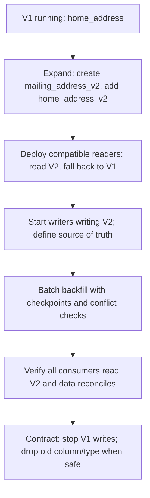

# `CREATE TYPE`, `ALTER TYPE`, and Schema Evolution Capabilities in Apache Cassandra

> **Chapter:** Collections and UDTs  
> **Module:** `DATABASE_ENGINE_WIDE_COLUMN_CASSANDRA` — exploring the distributed wide-column model, partition keys, query-driven table design, consistency, replication, compaction, repair, error handling, and the Java Driver. This lesson focuses on **the schema lifecycle of user-defined types (UDTs)**.

## 1. Why Is Evolving a UDT Harder Than Adding a Field in Java?

Suppose a user service stores addresses in a UDT consisting of `street`, `city`, and `country_code`. After a few months, the product needs `postal_code`, and later wants to standardize `city` into a geographic code. In Java, adding a property to a DTO is relatively simple. In Cassandra, a UDT is a **keyspace-scoped schema type**, referenced simultaneously by multiple tables/columns and multiple running application versions.

At least five questions must be answered before making a change:

1. **Can the schema be modified via `ALTER TYPE`**, or do you need a new type, column, or table?
2. **How will already-stored data** be read once the field is added?
3. **Will older clients** continue reading and writing cleanly while nodes and applications undergo rolling deployment?
4. Is the UDT stored as **`frozen` or non-frozen**; could updating one field wipe out someone else's update?
5. How does the change affect **Java Driver metadata, schema agreement, backfills, TTL, tombstones, compaction, and repair**?

**Core principle:** Succeeding DDL only confirms that Cassandra updated the schema metadata; it **does not automatically backfill old data, does not guarantee every client refreshed metadata, and does not replace a migration plan**.

## 2. A UDT Is a Named Data Type Living in a Keyspace

A UDT (*user-defined type*) groups fields with **names and CQL types**, such as `street text` and `city text`. Unlike `tuple<text,text>` (accessed by position), a UDT expresses a data contract via field names. Unlike `map<text,text>` (flexible keys), a UDT's field set is fixed upfront in the schema.

| Data type | Structural contract | Typical use | How it evolves |
| --- | --- | --- | --- |
| `tuple<int,text>` | Typed **by position** | Small `(score, grade)` pairs | Hard to alter positional contract; typically use a new column/type for major changes |
| `map<text,text>` | Dynamic keys, uniform value type | A few custom settings | No DDL per key; size must be bounded |
| UDT `mailing_address` | **Field names and types** in keyspace | Address with explicit schema | `ALTER TYPE` for supported changes; breaking changes require migration |
| Separate multi-row table | Primary key / clustering key | Address history, millions of entities | Design schema around read paths, pagination, and lifecycle |

A UDT **does not automatically create partitions or sub-tables**. If a column holds `frozen<mailing_address>` inside a row with `PRIMARY KEY (user_id)`, Cassandra still distributes data by `user_id`. Adding a `city` field to the UDT does not enable efficiently filtering all users in that city unless the query schema was designed for it.

## 3. `CREATE TYPE`: Create the UDT Before Referencing Tables

Assume keyspace `app` already exists with replication suited to your environment. In `cqlsh`, switch into the keyspace and create the types:

```sql
USE app;

CREATE TYPE geo_point (
    latitude double,
    longitude double
);

CREATE TYPE mailing_address (
    street text,
    city text,
    country_code text,
    location frozen<geo_point>
);

CREATE TABLE user_address_snapshots (
    user_id uuid PRIMARY KEY,
    display_name text,
    home_address frozen<mailing_address>,
    address_revision int
);
```

**Dependency order:** `geo_point` must exist before `mailing_address` references it; `mailing_address` must exist before a table uses it. `location frozen<geo_point>` is a UDT nested inside another UDT with an atomic value boundary.

Inside `CREATE TYPE`, each field has a **unique name** and a valid CQL type. Do not think of a type like a Java class with inheritance, methods, or constructors: a UDT solely defines **the data shape encoded and stored by Cassandra**.

### `IF NOT EXISTS` Is Useful, Yet Does Not Verify Type Version

```sql
CREATE TYPE IF NOT EXISTS address_label (
    label text,
    description text
);
```

If the type already exists, `IF NOT EXISTS` prevents a "type already exists" error. However, it **does not compare individual fields** to confirm the existing type matches your migration's expectations. A cluster holding an `address_label` with a different schema will still skip creation. Therefore:

- Use `IF NOT EXISTS` when appropriate for **idempotent initialization scripts**, not as a schema verification mechanism.
- Track **migration versions and actual schemas** in your deployment pipeline.
- Never run uncoordinated concurrent DDL from individual application instances during scale-out.

## 4. Writing and Reading a UDT Value

A UDT literal uses `{field_name: value}` syntax. Field names belong to the schema, not dynamic map keys:

```sql
INSERT INTO user_address_snapshots (
    user_id, display_name, home_address, address_revision
) VALUES (
    11111111-1111-4111-8111-111111111111,
    'Nguyen An',
    {
        street: '12 Duong So 1',
        city: 'Ho Chi Minh City',
        country_code: 'VN',
        location: {latitude: 10.78, longitude: 106.69}
    },
    1
);

SELECT home_address, address_revision
FROM user_address_snapshots
WHERE user_id = 11111111-1111-4111-8111-111111111111;
```

Field names in a literal are **not wrapped in single quotes like `map<text,text>` keys**. If a valid field is omitted when writing a UDT, that field can be interpreted as **having no value (`null`)**, depending on the operation and write granularity. UDTs do not enforce business constraints like "`country_code` must be exactly two characters"; such constraints belong in application validation and migration checks.

### `frozen` vs. Non-Frozen Determines the Unit of Update

- `frozen<mailing_address>` stores the entire address in **one cell**. To change `street`, the application must submit **the complete address value**.
- A column-level **non-frozen** UDT (when supported by your Cassandra version) can store and update individual fields via syntax like `SET contact.email = ...`.
- A UDT used as a collection element or nested inside another composite type typically requires **`frozen` at the nesting boundary**; do not assume you can update arbitrary fields across multiple nested layers.

This detail becomes critical during rolling deployments: an older client rewriting an entire frozen UDT can inadvertently **drop a newly added field just written by a newer client**, because it builds the snapshot without knowing about the new field.

## 5. `ALTER TYPE ... ADD`: Extending a Type with a New Field

Suppose the new requirement is adding `postal_code` of type `text` to `mailing_address`:

```sql
USE app;

ALTER TYPE mailing_address ADD postal_code text;

-- This command runs in cqlsh; it is not a SELECT/CQL query for the Java Driver.
DESCRIBE TYPE mailing_address;
```

`ADD` is generally the **least breaking** direction of change because existing field names stay intact and preserve their meaning. For values stored before `postal_code` existed in the schema, when read under the new schema the new field **has no data automatically**: the application must handle `null` or supply a default **at the business layer**.

Example state after migration:

```text
Pre-migration value:
{street:'12 Duong So 1', city:'Ho Chi Minh City', country_code:'VN', location:{...}}

Schema after ALTER TYPE:
{street:text, city:text, country_code:text, location:geo_point, postal_code:text}

Reading the old record:
postal_code = null   (not yet backfilled)
```

**`ALTER TYPE ADD` is not a background job that scans and rewrites every row.** Do not expect old records to gain postal codes simply because CQL DDL succeeded. Backfilling is a separate task requiring attention to read/write load, concurrency, and retry policies.

### A New Field Must Have Clear Semantics

Before picking a type, clarify: is `postal_code` optional or required? How do older apps interpret a missing field? Prefer `text` to preserve leading zeros and support alphanumeric codes, rather than rushing into `int`.

If adding a field of type `list`, `map`, or a nested UDT, you must still consider **collection size**, **`frozen`/non-frozen**, TTLs, and update patterns. Never use a new UDT field to silently accumulate unbounded history inside a single row.

## 6. Can You Freely `RENAME`, `DROP`, or Change the Type of UDT Fields?

**No.** `ALTER TYPE` capabilities vary across Cassandra versions and distributions; permitted operations and restrictions while a type is referenced must be checked against **the target version**. Do not carry over the mindset "rename a Java property, rename the column/UDT and you're done."

| Desired change | Safety assessment | Preferred strategy |
| --- | --- | --- |
| Add an optional field at the end of the type | Usually the easiest extension path | `ALTER TYPE ... ADD`, allow `null`, backward-compatible rollout |
| Rename a UDT field | Restrictions/syntax depend on version and usage sites | Prefer a new field + data migration if old-client compatibility is needed |
| Change `text` to `int` or an incompatible type | Do not assume direct in-place conversion is supported | New type/column with verified data conversion |
| Drop an existing field | Do not assume `DROP field` is safe or supported | Stop using it, keep old schema temporarily, migrate to new type if needed |
| Reorder fields | Can break encoding contracts and clients | Create a new versioned type |
| Drop the entire UDT | Forbidden while tables/types still reference it | Remove all references first via controlled migration |

**Examples of commands you should not blindly apply:**

```text
ALTER TYPE mailing_address DROP city;
ALTER TYPE mailing_address ALTER postal_code TYPE int;
```

The two lines above illustrate **risky change intents**, not safe CQL recipes across every version. Whenever you are unsure what your Cassandra version supports, never experiment with destructive DDL in production. Restrictions exist to preserve readability of previously encoded data and compatibility across UDT consumers.

### Regarding Field Order

Unlike reading UDT fields by name in Java, protocol and storage encoding of a UDT depends on **the field schema and declaration order**. Never reuse an existing type name for an arbitrarily reordered set of fields. When a fundamentally new contract is needed, introduce a newly named type—such as `mailing_address_v2`—instead of "modifying everything in place."

## 7. Introducing a New Versioned Type When Changes Are No Longer Compatible

Suppose the business wants to replace free-form `city` names with a standardized `city_code`, and also store `district_code`. Instead of forcing incompatible changes onto the old field, create a new UDT:

```sql
USE app;

CREATE TYPE mailing_address_v2 (
    street text,
    city_code text,
    district_code text,
    country_code text,
    postal_code text,
    location frozen<geo_point>
);

ALTER TABLE user_address_snapshots
ADD home_address_v2 frozen<mailing_address_v2>;
```

With both columns coexisting, you can execute an **expand → migrate/backfill → contract** rollout:



You do not have to keep both columns forever. The goal of the **dual-schema coexistence** phase is to avoid any window where old apps cannot parse new data or new apps lose access to old data. Exact rollout sequencing depends on whether dual-writing is feasible, where the source of truth lives, and how long older clients remain active.

### When Do You Need a New Table Instead of Just Adding a Column?

If the change involves not just the shape of an address but also **the query path**—for example, "find orders by `city_code` within a month"—`ALTER TYPE` does not create that access path. You must design a **read table keyed by `city_code` and time bucket**, or evaluate an index suited to the workload. A UDT is **a value**, not a mechanism for automatically building partition or clustering keys from inner fields.

## 8. `frozen` Requires Coordinating Backfills and Concurrent Writes

With `home_address frozen<mailing_address>`, populating `postal_code` after `ALTER TYPE ADD` requires supplying **the entire new UDT value**. The example below assumes the record was read/verified and `address_revision` is currently `1`:

```sql
UPDATE user_address_snapshots
SET home_address = {
        street: '12 Duong So 1',
        city: 'Ho Chi Minh City',
        country_code: 'VN',
        location: {latitude: 10.78, longitude: 106.69},
        postal_code: '700000'
    },
    address_revision = 2
WHERE user_id = 11111111-1111-4111-8111-111111111111
IF address_revision = 1;
```

This is a **row-level lightweight transaction (LWT)**. The client must inspect `[applied]`. If another writer already bumped the revision, the backfill must not force-write a stale snapshot over newer data; instead, re-read and apply your conflict policy.

Critical point: **CAS on `address_revision` protects fully only if every writer modifying addresses follows the exact same versioning protocol.** One writer bypassing `revision` with an unconditional `UPDATE home_address = ...` undermines the business-level guarantee.

Ordinary `QUORUM` reads/writes **do not replace** version checks across a "read → mutate DTO → rewrite frozen UDT" sequence. Consistency levels govern replica acknowledgments; they do not automatically merge a stale snapshot with concurrent writers' updates. LWT incurs Paxos consensus and serial consistency overhead, so use it only when conditional safety is genuinely required.

### Reducing Write Scope: Column-Level Non-Frozen UDTs

If the schema uses a column-level non-frozen UDT and your Cassandra version supports field updates, the application can write only the changed field. The self-contained example below creates **the type before the table**, extends the type, and updates a single field:

```sql
CREATE TYPE contact_info (
    email text,
    phone text
);

CREATE TABLE user_contacts (
    user_id uuid PRIMARY KEY,
    contact contact_info
);

ALTER TYPE contact_info ADD preferred_channel text;

UPDATE user_contacts
SET contact.preferred_channel = 'email'
WHERE user_id = 11111111-1111-4111-8111-111111111111;
```

In a non-frozen UDT, per-field mutation avoids reading and rewriting old fields just to update `preferred_channel`. It remains a distributed write: consider timestamps, TTLs, contention on the same field, and version-specific behavior. **Never attempt to convert an existing populated frozen UDT column to non-frozen via `ALTER TABLE` without verifying migration support.**

## 9. Safe Rollout Workflow: Expand, Compatibility, Backfill, Contract

A real UDT rollout typically requires more steps than a single CQL script:

| Phase | Tasks | Gate to proceed |
| --- | --- | --- |
| **Inventory** | Catalog referencing tables/types, Java services, jobs, consumers, and query needs | Full list of readers/writers, Cassandra version, compatibility plan |
| **Expand schema** | `ALTER TYPE ADD` or create `type_v2` + new column | DDL succeeds; schema agreement and metadata stabilize |
| **Expand readers** | Tolerate `null` new fields; for V2, read V2 with fallback to V1 as needed | Old and new clients both read existing data cleanly |
| **Switch writers** | New writers populate new fields; establish canonical writer and versioning | No legacy writer silently overwrites new fields |
| **Backfill** | Controlled scan, batched updates, checkpoints, safe retries | Data reconciled; zero lost updates |
| **Observe** | Compare latency, decode errors, timeouts, tombstones/compaction, data drift | SLOs healthy and rollback path verified |
| **Contract** | Retire old column/type; drop only once zero references remain and backups exist | All consumers migrated; recovery plan ready |

Do not execute `DROP TYPE` immediately after creating V2. The old UDT may still be referenced by other tables, other nested types, historical exports/backups, or active client code. `DROP TYPE IF EXISTS` only suppresses an error when the object is absent—it **never makes dropping a type still in use safe**.

### Backfilling Without Overloading the Cluster

- Break work into **small batches**, rate-limit writes, and persist checkpoints so failed jobs can resume cleanly.
- Never rely on a cluster-wide `SELECT *` with `ALLOW FILTERING` to scan millions of rows haphazardly. Use a list of business keys or token-range scanning tuned to your data scale.
- Determine the **idempotency** of each mutation. Rewriting the same snapshot differs from appending to a list or minting a new event ID; a failed CAS must re-read rather than blindly spinning forever.
- Monitor **replica latency, p95/p99, timeouts, disk I/O, and compaction backlog** during backfill. Under skewed partitioning, scan jobs can also heat up already-large partitions.
- Reconcile record counts and critical fields between V1 and V2; never measure success solely by HTTP/CQL 200 counts.

## 10. Schema Agreement: DDL Must Reach All Nodes Before Clients Use It

Cassandra manages schemas in a distributed manner. When `CREATE TYPE` or `ALTER TYPE` runs, schema metadata must propagate across nodes; a temporary window of **schema disagreement** can occur. A client sending payloads with the new structure before nodes and drivers learn the schema may encounter query-preparation failures, unknown-field errors, or serialization failures.

In `cqlsh`, you can inspect the published type:

```sql
DESCRIBE TYPE app.mailing_address;

-- Query schema metadata (in versions exposing system_schema.types).
SELECT keyspace_name, type_name, field_names, field_types
FROM system_schema.types
WHERE keyspace_name = 'app';
```

`DESCRIBE TYPE` is a **`cqlsh` utility command**, not CQL to pass verbatim into a Java prepared statement. Exact `system_schema` tables and schema-agreement checks depend on your Cassandra version/distribution; seeing the right schema from **one** coordinator does not prove every node has converged.

Post-DDL operational checklist:

1. Run DDL through **a single coordinated migration pipeline**; avoid competing DDL during rolling deploys.
2. Verify **schema agreement** and absence of schema errors across relevant nodes before enabling writes to the new field.
3. Ensure the Java Driver has **refreshed schema metadata** and prepared statements/codecs reflect the updated type definition; verify metadata refresh mechanics for your driver version if needed.
4. Never use `IF NOT EXISTS` as proof that a field was added or that a type has the expected fields.
5. Keep an **application-level rollout pause and rollback plan** ready if schema drift appears; destructive DDL rollbacks may not be straightforward.

## 11. Java Driver 4.x: Mapping UDTs Before and After Adding a Field

Java Driver 4.x uses `UserDefinedType` and `UdtValue` for UDT payloads. The example below assumes `ALTER TYPE mailing_address ADD postal_code text` has run, schema agreement is confirmed, and the session holds updated metadata:

```java
import com.datastax.oss.driver.api.core.CqlIdentifier;
import com.datastax.oss.driver.api.core.CqlSession;
import com.datastax.oss.driver.api.core.cql.PreparedStatement;
import com.datastax.oss.driver.api.core.cql.Row;
import com.datastax.oss.driver.api.core.data.UdtValue;
import com.datastax.oss.driver.api.core.type.UserDefinedType;
import java.util.UUID;

class AddressRepository {
    private final CqlSession session;
    private final PreparedStatement read;
    private final PreparedStatement write;

    AddressRepository(CqlSession session) {
        this.session = session;
        this.read = session.prepare(
            "SELECT home_address FROM app.user_address_snapshots " +
            "WHERE user_id = ?"
        );
        this.write = session.prepare(
            "UPDATE app.user_address_snapshots " +
            "SET home_address = ? WHERE user_id = ?"
        );
    }

    void saveAddress(UUID userId, String postalCode) {
        var keyspace = session.getMetadata()
            .getKeyspace(CqlIdentifier.fromCql("app"))
            .orElseThrow();

        UserDefinedType addressType = keyspace
            .getUserDefinedType(CqlIdentifier.fromCql("mailing_address"))
            .orElseThrow();
        UserDefinedType geoType = keyspace
            .getUserDefinedType(CqlIdentifier.fromCql("geo_point"))
            .orElseThrow();

        UdtValue geo = geoType.newValue()
            .setDouble("latitude", 10.78)
            .setDouble("longitude", 106.69);

        UdtValue address = addressType.newValue()
            .setString("street", "12 Duong So 1")
            .setString("city", "Ho Chi Minh City")
            .setString("country_code", "VN")
            .setUdtValue("location", geo)
            .setString("postal_code", postalCode);

        // Frozen column: writes the entire snapshot, not a single-field patch.
        session.execute(write.bind(address, userId));
    }

    String readPostalCode(UUID userId) {
        Row row = session.execute(read.bind(userId)).one();
        if (row == null) return null;  // Row does not exist.

        UdtValue address = row.getUdtValue("home_address");
        if (address == null) return null;  // Row exists, column is null.

        // Older records not yet backfilled may return null.
        return address.getString("postal_code");
    }
}
```

This example **writes a complete value** to illustrate serialization, not a safe way to update *only* `postal_code` on a snapshot edited by multiple writers. In production logic, never construct a fresh UDT from hardcoded placeholders and overwrite the entire address. To patch a `frozen` column safely, read and reconcile current state, establish the canonical data source, and apply versioning/CAS or writer coordination to prevent lost updates.

### Compatibility with Legacy Data and Older Clients

- **Old UDT values:** new fields can read back as `null`; Java methods must handle missing data gracefully instead of throwing or assuming non-null strings.
- **New client with stale metadata:** calling `.setString("postal_code", ...)` against a type definition that has not yet received the new field can fail on the client. Enable new writers only after verifying metadata.
- **Old client writing a frozen UDT:** rewriting a snapshot built from the old schema can drop the new field written by newer clients; control the rolling-deploy window carefully.
- **Old client reading new values:** verify codecs, mappers, and compatibility on your exact driver version. Never assume all DTO or annotation mappers ignore new fields identically.
- **Prepared statements:** prepare and reuse them across the application lifecycle, and have a strategy to check or re-prepare when schema metadata changes.

## 12. UDTs Nested Inside Collections: Schema Evolution Gets Even Trickier

Suppose addresses are stored under labels like `home` and `work`:

```sql
CREATE TABLE user_address_book (
    user_id uuid PRIMARY KEY,
    addresses map<text, frozen<mailing_address>>
);

UPDATE user_address_book
SET addresses['home'] = {
    street: '12 Duong So 1',
    city: 'Ho Chi Minh City',
    country_code: 'VN',
    location: {latitude: 10.78, longitude: 106.69},
    postal_code: '700000'
}
WHERE user_id = 11111111-1111-4111-8111-111111111111;
```

Here, **the outer map** is multi-cell, while **each `mailing_address` value inside the map is frozen**. When a field is added to the UDT, the updated type schema must be understood across all reference sites and reading clients. Updating `postal_code` for key `'home'` requires **rewriting the entire address for that key**, even though `'work'` and other keys remain untouched by the keyed mutation.

Do not assume CQL syntax exists to update across the nested boundary like `addresses['home'].postal_code`. This model fits when the number of addresses is small and bounded; if a user has an unbounded address history or needs per-address queries, use a separate table with an address identifier key.

For **types referenced by multiple UDTs, collections, or tables**, inventory **the entire blast radius** before running `ALTER TYPE`. Restrictions on altering nested types—or types used inside primary keys—depend on Cassandra version; never claim an `ALTER` is universally safe in every schema position.

## 13. Schema Evolution Does Not Replace Query-Driven Table Design

In the initial example, the address table had primary key `user_id`, efficiently serving **"user X's address"**. Later, the product wants to query **"orders in city Y, sorted chronologically within month Z"**. Simply adding `postal_code` or `city_code` to the UDT **creates neither an index nor a new partition key**.

A query-driven table might look like:

```sql
CREATE TABLE app.orders_by_city_month (
    city_code text,
    order_month text,
    ordered_at timeuuid,
    order_id uuid,
    total_amount decimal,
    PRIMARY KEY ((city_code, order_month), ordered_at, order_id)
) WITH CLUSTERING ORDER BY (ordered_at DESC, order_id ASC);

SELECT order_id, ordered_at, total_amount
FROM app.orders_by_city_month
WHERE city_code = 'VN-SG'
  AND order_month = '2026-11'
LIMIT 30;
```

In this new schema, `(city_code, order_month)` is the **partition key**, and `(ordered_at, order_id)` is the **clustering key**. Data is ordered for the exact query and supports **row** pagination. If one city/month grows too large, plan smaller buckets or sharding along with multi-bucket reads.

Keeping data aligned between the city read table and the primary order-ID table is a matter of **denormalization and multi-table synchronization**. UDTs do not synchronize copies automatically; the Java service needs write, retry, error-handling, and reconciliation strategies matched to business consistency requirements.

## 14. TTL, Tombstones, Compaction, and Repair During Migrations

`ALTER TYPE ADD` updates **schema metadata** without rewriting old cells automatically. However, **backfilling** and **retiring columns/types** can impose substantial load:

| Activity | Cost / risk to account for |
| --- | --- |
| Rewriting `frozen<UDT>` after `ADD` | Writes **entire value**, can shadow old snapshots; lost-update risk |
| Updating a non-frozen UDT field | Field-granular mutation; saves bytes yet still reconciles concurrent writes |
| Dropping old columns/types post-migration | Deletion markers/tombstones on affected data; safe cleanup conditions |
| Backfilling millions of records | Replica reads/writes, new SSTables, disk I/O, and compaction backlog |
| Reading while V1 and V2 coexist | Extra fallback logic, latency, and risk of serving stale data |
| Repair/streaming during transition | Higher network/disk load; monitor progress and replica errors |

A TTL on a `frozen<UDT>` column applies to **the entire snapshot cell**; CQL cannot attach an independent TTL solely to `postal_code` inside a frozen UDT. If one attribute must expire quickly while the address lives long-term, move that attribute to a **column or row with an independent lifecycle** rather than packing it into the frozen UDT.

When deleting data, Cassandra maintains tombstones so replicas that missed the delete learn the true state. Tombstone purging depends on compaction and safety conditions tied to `gc_grace_seconds` and **repair** schedules. Never lower grace periods merely to shrink disk usage during an unplanned migration: replicas offline for too long risk resurrecting deleted data if deletion markers are purged prematurely.

Consistency levels `ONE`, `LOCAL_QUORUM`, and `QUORUM` control how many replicas acknowledge reads/writes, yet they do not make old schemas backward-compatible, do not eliminate lost updates, and do not automatically make backfills retry-safe.

## 15. Monitoring and Error Handling When Deploying a New Type

A successful migration needs **observable verification criteria** rather than relying solely on error-free DDL execution:

| Signal | How to detect | Priority action |
| --- | --- | --- |
| Schema disagreement | Nodes/drivers see different UDT definitions | Pause writers using the new field; verify schema convergence |
| `Unknown field` / UDT codec errors | Driver has not refreshed type or client is incompatible | Check metadata, mappings, driver version, and rollout order |
| `[applied] = false` during conditional backfill | Revision changed concurrently | Re-read and resolve conflict; do not force stale snapshot |
| Write timeout | Unclear whether write applied | Retry only when safe; reconcile against latest state |
| Rising p99 latency or compaction backlog | Backfill rate too high or hot partition | Throttle rate, shrink batches, inspect replicas and partitions |
| `postal_code` remains null in old data | Not yet backfilled or source lacks data | Define valid state and completion plan; never fabricate values |
| V1/V2 divergence | Dual-write/fallback unstable or legacy writer still active | Clarify source of truth, reconcile, postpone contract phase |

Useful staging checks: create V1, write sample data, run `ALTER TYPE ADD`, verify readbacks, run old and new clients concurrently, inject controlled timeouts, verify `[applied]`, and benchmark backfill latency. Never run deliberate fault-injection tests against production data.

## 16. Anti-Patterns in Schema Evolution

1. **Letting all clients write immediately after `ALTER TYPE ADD`.** Wrong: verify schema agreement, metadata refresh, and legacy client compatibility first.
2. **Treating `IF NOT EXISTS` as a schema validator.** Wrong: it does not prove the existing type matches your expected fields.
3. **Changing `city` from a name to a code while keeping the same field.** Breaks the data contract; old clients misinterpret new values. Use a new versioned field or type.
4. **Rewriting an entire frozen UDT to edit one field under concurrent writers.** Risks lost updates; use writer coordination/versioning or a different schema.
5. **Dropping the old UDT as soon as one service deploys V2.** Other consumers, background jobs, or referencing tables may still rely on V1.
6. **Using UDTs to hold unbounded lists/maps.** UDTs do not solve large rows or partitions; use query-driven separate tables.
7. **Backfilling an entire cluster with an unthrottled full scan and unlimited write rate.** Can trigger timeouts, hotspots, and compaction backlogs; scan and batch systematically.
8. **Assuming `QUORUM` equals CAS.** Normal consistency levels do not replace `IF` checks when multiple writers compete.

## 17. Case Exercises

**Exercise 1 — Adding a field:** An address UDT has been in use for two years and now needs `postal_code`. What will old records contain in that field right after `ALTER TYPE ADD`?  
**Hint:** Typically `null` / missing for the new field. Schema changes do not backfill automatically; Java readers must handle missing values.

**Exercise 2 — Rolling-deploy compatibility:** An older Java instance reads and writes `frozen<mailing_address>` unaware of `postal_code`, while a newer instance already populated `postal_code`. What can happen?  
**Hint:** The older instance can rewrite the full frozen snapshot and wipe out the new field. Establish write ownership, client compatibility, and rollout sequencing.

**Exercise 3 — Changing types:** Product asks to change `postal_code text` to `int` for speed. Why should you not change it arbitrarily?  
**Hint:** Postal codes can contain leading zeros or letters; in-place type conversion may be unsupported and breaks contracts. Keep `text` or migrate carefully to a new type/column.

**Exercise 4 — Nested structures:** `addresses map<text,frozen<mailing_address>>` has key `home`. To update only `home`'s postal code, can you write `addresses['home'].postal_code = ...`?  
**Hint:** Do not rely on mutating across a nested frozen boundary. Reassign **the entire UDT value at key `home`**, preserving other fields and handling concurrent writes.

**Exercise 5 — Query change:** A service must find all orders by city and month, while `home_address.city` lives inside a frozen UDT on a `user_id`-keyed row. Is `ALTER TYPE` enough?  
**Hint:** No. Design a read table keyed by `city` + time bucket or a suitable index; a UDT does not automatically create queryable partition keys.

**Exercise 6 — CAS failure:** A backfill job receives `[applied] = false` when trying to update an address from revision 3 to 4. Should it switch to an unconditional `UPDATE` for speed?  
**Hint:** No. State already changed; re-read, resolve the conflict, and update only when business conditions hold.

## 18. Pre-Merge Migration Checklist

- [ ] Cataloged every **table, nested UDT, collection, service, and job** referencing the type to change.
- [ ] Tested DDL on the **exact target Cassandra version/distribution** in staging; did not rely on guessed syntax.
- [ ] Defined the **V1/V2 compatibility contract**, including `null` handling, Java codecs, and old/new readers and writers.
- [ ] Verified schema agreement and how the driver **refreshes schema metadata and prepared statements**.
- [ ] Defined **the source of truth, CAS/versioning strategy, and retry policy** when writing frozen UDTs.
- [ ] Prepared a **rate-limited, checkpointed backfill plan with reconciliation and rollback**.
- [ ] Evaluated **TTL, tombstones, compaction, repair, latency, replication, and partition hotspots**.
- [ ] Verified whether new query requirements demand a **table with different partition/clustering keys** rather than just adding a UDT field.
- [ ] Scheduled **contract/drop** only after all consumers stop using the old schema and data is verified.

## 19. Key Takeaways

- **`CREATE TYPE`** defines a UDT in a keyspace for tables and other UDTs to reference; create dependent types **in dependency order**.
- **`ALTER TYPE ... ADD`** extends the schema without **backfilling** existing values; Java code must handle `null` values and rolling compatibility.
- Do not assume arbitrary renames, type changes, drops, or field reorderings are supported; for breaking changes, use **`type_v2` and a controlled migration**.
- **`frozen<UDT>`** updates as **a full snapshot**, risking lost updates when old and new clients write concurrently; column-level non-frozen UDTs can update individual fields where supported.
- Schema is a **distributed** resource: ensure schema agreement, current metadata, and a single coordinated DDL pipeline before enabling new writers.
- A safe workflow follows **expand → compatible readers/writers → backfill → reconcile → contract**, with checkpoints, safe retries, and observability.
- Regardless of how types evolve, **query-driven design and partition keys** still govern read/write efficiency; UDTs never replace separate row tables for unboundedly growing data.
