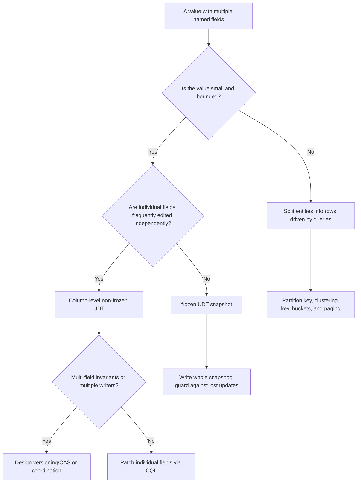

# `frozen` vs. Non-Frozen UDTs and Per-Field Updates in Apache Cassandra

> **Chapter:** Collections and UDTs  
> **Module:** `DATABASE_ENGINE_WIDE_COLUMN_CASSANDRA` — exploring distributed architecture, the wide-column model, partition keys, query-driven table design, read/write consistency levels, replication, compaction, repair, and Java connectivity. This lesson focuses on **the update granularity of user-defined types (UDTs)**.

## 1. Two Columns with the Same UDT, Different Update Behaviors

Suppose a user profile holds an address consisting of `street`, `city`, `country_code`, and `postal_code`. The two table definitions below can represent **the exact same address**, yet their write behaviors differ:

```sql
-- Table A: non-frozen UDT, allowing per-field updates.
address postal_address

-- Table B: frozen UDT, treating the whole address as a single value.
address frozen<postal_address>
```

With a **non-frozen UDT**, Cassandra stores fields as cells that can be managed independently inside a row; a statement updating `city` does not need to resend `street`, `country_code`, and `postal_code`. With a **frozen UDT**, the entire structure is **one cell**: to change `city`, the application must write **the complete new address value**.

This difference governs **write cost**, **TTLs/tombstones**, **contention between two writers**, **retry design**, and **schema lifecycle**. `frozen` is not a marker for an immutable Java object; data in the column can still be replaced as a whole value.

**What does not change:** Regardless of which form you choose, Cassandra still routes rows by **partition key**. Adding fields to a UDT does not automatically create a sub-table, a search key, or the ability to paginate fields inside a UDT.

## 2. Setting Up Practice Data

Assume keyspace `app` already exists with replication factor and datacenter settings suited to your environment. Run the following examples in `cqlsh`:

```sql
USE app;

CREATE TYPE postal_address (
    street text,
    city text,
    country_code text,
    postal_code text
);

CREATE TABLE profile_fieldwise (
    user_id uuid PRIMARY KEY,
    address postal_address,
    profile_revision int
);

CREATE TABLE profile_snapshot (
    user_id uuid PRIMARY KEY,
    address frozen<postal_address>,
    profile_revision int
);

INSERT INTO profile_fieldwise (user_id, address, profile_revision)
VALUES (
    11111111-1111-4111-8111-111111111111,
    {
        street: '12 Duong So 1',
        city: 'Ho Chi Minh City',
        country_code: 'VN',
        postal_code: '700000'
    },
    1
);

INSERT INTO profile_snapshot (user_id, address, profile_revision)
VALUES (
    11111111-1111-4111-8111-111111111111,
    {
        street: '12 Duong So 1',
        city: 'Ho Chi Minh City',
        country_code: 'VN',
        postal_code: '700000'
    },
    1
);
```

The two tables differ only in how column `address` is declared. A UDT literal uses `{field_name: value}` with **schema field names**, unlike `map<text,text>` which uses dynamic text keys such as `{'theme':'dark'}`. `profile_revision` is an application-managed integer used later to demonstrate conditional updates; it is **not a CQL counter**.

### Inspecting the Results

```sql
SELECT address, profile_revision
FROM profile_fieldwise
WHERE user_id = 11111111-1111-4111-8111-111111111111;

SELECT address, profile_revision
FROM profile_snapshot
WHERE user_id = 11111111-1111-4111-8111-111111111111;
```

The displayed CQL values may look identical, but **you cannot infer the storage form or which update syntax is valid** from `SELECT` output alone.

## 3. Cell Model: Separate Fields or One Snapshot?

```text
Row user_id = U1

Non-frozen UDT: address postal_address
┌───────────────────────────────────────┐
│ Cell: address.street       = '12 ...' │
│ Cell: address.city         = 'HCMC'   │
│ Cell: address.country_code = 'VN'     │
│ Cell: address.postal_code  = '700000' │
└───────────────────────────────────────┘
  Can write/delete specific fields.

Frozen UDT: address frozen<postal_address>
┌───────────────────────────────────────┐
│ One cell holding the entire address   │
│ {street:..., city:..., country_code:  │
│  ..., postal_code:...}                │
└───────────────────────────────────────┘
  Every change is a full new value.
```

This conceptual model shows why changing `address.city` on a non-frozen UDT is a **narrow-scope** mutation, whereas rewriting a frozen UDT is a **whole-value** mutation. At the storage layer, each cell carries metadata such as timestamp and, when applicable, TTL; Cassandra reconciles cell versions as replicas read and synchronize data.

**Do not equate multiple cells with multiple partitions.** Non-frozen fields still belong to **one UDT column of one row**; they are not distributed across different partition keys and do not become independent rows that the driver can paginate separately.

| Criterion | `address postal_address` | `address frozen<postal_address>` |
| --- | --- | --- |
| Unit of write | One or more fields | Entire UDT |
| Update `city` via `address.city = ...` | Yes | No |
| Replace whole UDT via `address = {...}` | Yes, with full-value replacement semantics | Yes; this is the primary update path |
| TTL of a single-field mutation | Can attach to the written field | No per-field mutation |
| Conflict between two different fields | Can reconcile independently | Two snapshots contend on the same cell |
| Use as nested collection element | Usually requires `frozen` UDT value | Suitable in supported element positions |
| Best fit | Small values with fields edited independently | Small values managed as a single snapshot |

## 4. Non-Frozen UDTs: Updating a Single Field Directly

Suppose a user changes only `city`, while all other address details must stay unchanged:

```sql
UPDATE profile_fieldwise
SET address.city = 'Da Nang'
WHERE user_id = 11111111-1111-4111-8111-111111111111;
```

Because `address` is a non-frozen UDT, Cassandra can write the cell for **field `city`** instead of forcing the client to resend every field. The application does not need a "read whole address → edit city → write whole address" round trip for this simple edit.

You can also update multiple fields in a single `UPDATE`:

```sql
UPDATE profile_fieldwise
SET address.street = '30 Nguyen Van Linh',
    address.postal_code = '550000'
WHERE user_id = 11111111-1111-4111-8111-111111111111;

SELECT address
FROM profile_fieldwise
WHERE user_id = 11111111-1111-4111-8111-111111111111;
```

Here, `country_code` is not reset by per-field update statements. If clients write **different fields** in separate mutations, Cassandra can preserve both changes once replicas converge. If two clients modify `address.city` concurrently, the winner still depends on write reconciliation and timestamps.

### Updating a Field on a Nonexistent Row

Plain CQL `UPDATE` has **upsert** semantics. Given a full primary key, updating a single field of a non-frozen UDT can materialize a row that did not previously exist; other fields of the UDT will then read back as missing. Do not assume `UPDATE address.city = ...` only succeeds when the whole address was already initialized.

If business rules **prohibit creating a new profile**, implement row-existence checks or use an appropriate conditional operation. Note that `IF EXISTS` checks the row by primary key; it does not mean "UDT field `city` already has a value."

## 5. Deleting Non-Frozen Fields and Distinguishing `null`

With a non-frozen UDT, you can delete one field instead of deleting the entire value:

```sql
-- Drop postal code; keep the other address fields.
DELETE address.postal_code
FROM profile_fieldwise
WHERE user_id = 11111111-1111-4111-8111-111111111111;

-- Broader scope: delete the entire address column value.
DELETE address
FROM profile_fieldwise
WHERE user_id = 11111111-1111-4111-8111-111111111111;
```

**Do not execute these two statements back-to-back** if you want to keep practicing with the address: the second deliberately deletes the entire column. `DELETE address.postal_code` targets a single field, whereas `DELETE address` targets **the whole UDT** and all its existing fields.

Cassandra uses **tombstones** to record deletes. Even if a field currently lacks a value, a delete mutation can still write deletion metadata to shadow older versions on other replicas or SSTables. Deleting does not immediately reclaim all bytes on disk.

When a field has no data, the Java Driver may return `null` for it. Distinguish three cases:

- No **row** for `user_id`: the query returns **no `Row`**.
- Row exists, but **the UDT column `address` is null**: a `Row` is returned, while `getUdtValue("address")` returns `null`.
- Non-frozen address exists, but **`postal_code` is missing**: the `UdtValue` exists, and field `postal_code` reads as `null`.

If the product must distinguish "never entered" from "deleted," a single `null` cannot convey that state. Model an explicit status/version field or business history.

## 6. Frozen UDTs: Editing One Field Means Replacing the Whole Value

On `profile_snapshot`, the following statement is **valid** because it assigns a complete UDT:

```sql
UPDATE profile_snapshot
SET address = {
    street: '12 Duong So 1',
    city: 'Da Nang',
    country_code: 'VN',
    postal_code: '550000'
}
WHERE user_id = 11111111-1111-4111-8111-111111111111;
```

Conversely, the statement below is an **invalid example for a frozen column; do not execute**:

```sql
-- INVALID: cannot edit a field inside a frozen UDT using dot notation.
UPDATE profile_snapshot
SET address.city = 'Da Nang'
WHERE user_id = 11111111-1111-4111-8111-111111111111;
```

The reason is that a frozen `address` is treated by Cassandra as **a single cell**. There is no separate cell for `city` that CQL can modify independently. To **preserve** `street`, `country_code`, and `postal_code` while changing only `city`, the client must know the complete desired state—either from an authoritative data source or by reading, modifying, and rewriting **the full snapshot**.

Cost differences:

- **Non-frozen:** updating one field does not inherently require reading the old value first; the mutation targets the known field directly.
- **Frozen:** `UPDATE address = {...}` itself does not force the coordinator to read before writing; **however, the application** may need to read the snapshot to preserve unmodified fields. That is *application-level read-modify-write*, distinct from the internal read-before-write required by certain `list[index]` operations.
- If the address is very large or many writers edit concurrently, reading and rewriting the whole UDT increases load and conflict risk. Conversely, for small snapshots, whole-value replacement can be simpler and easier to keep business-consistent.

## 7. Non-Frozen UDTs Still Support Whole-Value Replacement

Having a non-frozen column **does not force** you to always use dot notation. You can reassign the entire UDT:

```sql
-- Whole-value assignment on a non-frozen UDT.
UPDATE profile_fieldwise
SET address = {
    street: '8 Tran Phu',
    city: 'Ha Noi',
    country_code: 'VN',
    postal_code: '100000'
}
WHERE user_id = 11111111-1111-4111-8111-111111111111;
```

This is **not** a "merge sent fields with prior fields" operation. When reassigning the whole value, the application must treat it as **replacing the UDT's state**, which can generate deletion metadata shadowing old fields before writing the new values. If a literal omits a field, do not assume that field's prior data is retained. To patch only one field of a non-frozen UDT, **use `address.field = ...`**, not whole-UDT assignment.

A Java API should make this distinction explicit in method names:

```text
updateAddressCity(userId, city)       -> patch a single field
replaceEntireAddress(userId, address) -> replace complete snapshot
```

Clear method naming prevents subtle bugs where a caller only knows `city` yet invokes the whole-address replacement API and accidentally wipes out other fields.

## 8. Two Clients Writing Simultaneously: The Sharpest Contrast Between Both Forms

Suppose both clients read the initial address:

```text
{street:'12 Duong So 1', city:'Ho Chi Minh City',
 country_code:'VN', postal_code:'700000'}
```

Client A wants to change `city` to `'Da Nang'`; Client B wants to change `street` to `'30 Nguyen Van Linh'`.

### 8.1. Non-Frozen: Updating Two Independent Fields

```sql
-- Client A
UPDATE profile_fieldwise SET address.city = 'Da Nang'
WHERE user_id = 11111111-1111-4111-8111-111111111111;

-- Client B
UPDATE profile_fieldwise SET address.street = '30 Nguyen Van Linh'
WHERE user_id = 11111111-1111-4111-8111-111111111111;
```

Both mutations target **two different cells**, so once replicas converge you can observe both the new `city` and the new `street`. If A and B both edit `address.city`, they still contend on **that same field** by timestamp; non-frozen **does not automatically provide multi-field transactions**.

### 8.2. Frozen: Two Snapshots Can Lose One Change

```sql
-- Client A builds on its stale read:
UPDATE profile_snapshot SET address = {
    street: '12 Duong So 1', city: 'Da Nang',
    country_code: 'VN', postal_code: '700000'
}
WHERE user_id = 11111111-1111-4111-8111-111111111111;

-- Client B also builds on its stale read:
UPDATE profile_snapshot SET address = {
    street: '30 Nguyen Van Linh', city: 'Ho Chi Minh City',
    country_code: 'VN', postal_code: '700000'
}
WHERE user_id = 11111111-1111-4111-8111-111111111111;
```

Each mutation replaces **the entire `address` cell**. Cassandra reconciles competing values by timestamp and tie-breaking rules; the system **does not automatically merge** A's `city` with B's `street`. If B's snapshot wins, A's `city` update is lost (*lost update*); in the reverse case, B's `street` change is lost.

**"The client that sent last" is not always "the winning timestamp."** Clock skew, retries, client-supplied timestamps, or writes arriving at replicas at different times can all alter the outcome. Ordinary `QUORUM` reads and writes do not turn a "read snapshot → edit → write" sequence into a version-checked transaction.

## 9. When You Must Prevent Lost Updates: Versioning and LWT

If the application requires every address change to be validated against a specific version, you can use `profile_revision` for conditional updates on the frozen table:

```sql
-- Step 1: read the current snapshot and revision.
SELECT address, profile_revision
FROM profile_snapshot
WHERE user_id = 11111111-1111-4111-8111-111111111111;

-- Step 2: example conditional write only if current revision equals 1.
UPDATE profile_snapshot
SET address = {
        street: '12 Duong So 1', city: 'Da Nang',
        country_code: 'VN', postal_code: '550000'
    },
    profile_revision = 2
WHERE user_id = 11111111-1111-4111-8111-111111111111
IF profile_revision = 1;
```

Statements with `IF` use a **lightweight transaction (LWT)**, returning a row containing `[applied]`:

- `[applied] = true`: the condition held and the mutation was accepted.
- `[applied] = false`: the revision differed from expectations; the client must **re-read** before deciding to merge, report a conflict, or perform a bounded retry.
- On timeout: **never** assume the write definitely did not happen. Read and reconcile state before choosing the next action.

LWT adds consensus coordination overhead (Paxos / serial consistency) compared to an ordinary `UPDATE`. It is worth considering when **the condition is a true business invariant**, not as a default way to optimize speed or payload size.

**Warning:** Versioning protects fully only when **every writer modifying addresses participates in the `profile_revision` update protocol**. Another writer updating the frozen UDT unconditionally without bumping revision breaks the lost-update contract. Even with a non-frozen UDT, if an invariant spans **multiple fields simultaneously**, you still need an appropriate synchronization mechanism.

## 10. Per-Field TTL vs. Whole-Snapshot TTL

With a non-frozen UDT, a TTL can apply to the specific field written:

```sql
-- Only postal_code written in this mutation receives the 600-second TTL.
UPDATE profile_fieldwise USING TTL 600
SET address.postal_code = 'TEMP-123'
WHERE user_id = 11111111-1111-4111-8111-111111111111;
```

If other fields contain non-expiring data, they **do not inherit the 600-second TTL** from this statement. Upon expiration, that field can read back as `null`, while fields with other lifetimes retain their state.

With a frozen UDT, the mutation's TTL applies to **the cell holding the entire UDT**:

```sql
UPDATE profile_snapshot USING TTL 600
SET address = {
    street: '12 Duong So 1', city: 'Da Nang',
    country_code: 'VN', postal_code: 'TEMP-123'
}
WHERE user_id = 11111111-1111-4111-8111-111111111111;
```

When the frozen value's TTL expires, **the entire snapshot** expires, not just `postal_code`. If an address must persist long-term while a verification code lasts only ten minutes, do not pack the code into the same frozen UDT and put a TTL on the column. Use a **separate column or row with its own lifecycle**.

### Tombstones and Operational Costs

Deleting a non-frozen field, replacing an entire UDT, deleting a frozen UDT, or letting a TTL expire can all produce deletion metadata (*tombstones*). Tombstones let replicas recognize deleted data and affect read paths and SSTable reconciliation. Compaction purges tombstones only when safety conditions hold; **repair** schedules, replica health, and settings like `gc_grace_seconds` all matter.

Never arbitrarily lower the grace period to "clean up" old UDT data quickly if replicas might miss deletes. If deletion markers vanish before an out-of-sync replica converges, deleted data can resurface. Likewise, there is no universal rule that "non-frozen always generates more tombstones than frozen": it depends on how often individual fields change versus full-snapshot rewrites.

## 11. Nested UDTs and the `frozen` Boundary

Suppose an address includes GPS coordinates:

```sql
USE app;

CREATE TYPE geo_point (
    latitude double,
    longitude double
);

CREATE TYPE extended_address (
    street text,
    city text,
    location frozen<geo_point>
);

CREATE TABLE location_profiles (
    user_id uuid PRIMARY KEY,
    home extended_address
);
```

Here, `home` is a **column-level non-frozen** UDT, so top-level fields can be updated directly:

```sql
UPDATE location_profiles
SET home.city = 'Da Nang'
WHERE user_id = 11111111-1111-4111-8111-111111111111;

-- Replace the whole geo_point value of the location field.
UPDATE location_profiles
SET home.location = {latitude: 16.05, longitude: 108.20}
WHERE user_id = 11111111-1111-4111-8111-111111111111;
```

Field `home.location` holds **`frozen<geo_point>`**, so you should not assume you can update `latitude` alone using multi-level syntax such as `home.location.latitude = ...`. To update coordinates, rewrite the **atomic `geo_point` value** in field `location`.

### UDTs Inside a Map or List

```sql
CREATE TABLE address_book (
    user_id uuid PRIMARY KEY,
    labelled_addresses map<text, frozen<postal_address>>,
    recent_addresses list<frozen<postal_address>>
);

UPDATE address_book
SET labelled_addresses['work'] = {
    street: '8 Duong So 2', city: 'Da Nang',
    country_code: 'VN', postal_code: '550000'
}
WHERE user_id = 11111111-1111-4111-8111-111111111111;
```

In `map<text,frozen<postal_address>>`, the **outer** map can edit individual keys like `'work'` or `'home'`. However, **each key's UDT value is frozen**, so changing `'work'`'s `city` requires assigning **the full UDT at that key**. Having a multi-cell outer map **does not mean** a field inside the frozen UDT can be updated independently.

**Never build giant collections of UDTs.** `list<frozen<postal_address>>` works for a small, bounded list of recent addresses—not for storing millions of historical addresses. A large collection still lives in **one row and one partition**, and does not automatically paginate UDTs like independent rows.

## 12. Schema Evolution: Adding a New Field Has Different Impacts

When business requirements add `delivery_note`, the type can be extended using `ALTER TYPE` operations supported by your Cassandra version:

```sql
ALTER TYPE postal_address ADD delivery_note text;
```

The new field is **not backfilled automatically** into existing values; applications must accept `null` or apply defaults. With a column-level non-frozen UDT, when populating `delivery_note` for a user, the application can update just that field:

```sql
UPDATE profile_fieldwise
SET address.delivery_note = 'Morning delivery'
WHERE user_id = 11111111-1111-4111-8111-111111111111;
```

With a **frozen UDT**, populating the new field still requires **replacing the entire snapshot**. That introduces a rolling-deploy hazard: older clients using a schema or DTO without `delivery_note` can rewrite an older snapshot and erase the new value just added by newer clients.

Recommended safeguards:

1. Inventory every table, column, and type referencing `postal_address`, including UDTs inside collections.
2. Run coordinated schema migrations and verify **schema agreement** across nodes before enabling new writers.
3. Ensure the Java Driver receives **updated schema metadata**; prepared statements, mappers, and codecs must stay compatible.
4. Deploy readers that tolerate `null` first, then new writers; define how legacy clients behave during the transition window.
5. Run rate-limited, checkpointed backfills if existing records must receive the new field; guard against overwrites under concurrent writers.
6. For breaking changes, favor `postal_address_v2` and a new column/table using **expand → backfill → contract** rather than altering types or dropping fields in place.

Choosing `frozen` vs. non-frozen is a modeling decision that affects how data is stored on disk. **Do not assume** you can convert a populated column from `frozen<UDT>` to non-frozen via a simple `ALTER TABLE`; verify target-version capabilities and plan a migration when needed.

## 13. When a UDT Is Not Enough: Query-Driven Table Design

A UDT defines only **the shape of a value**, not a query index. For instance, `profile_fieldwise` partitioned by `user_id` serves "user U's address." It **does not efficiently serve** "list users in city X ordered by signup time."

If the application must query by `city`, create a dedicated read table:

```sql
CREATE TABLE app.users_by_city_month (
    city text,
    joined_month text,
    joined_at timeuuid,
    user_id uuid,
    PRIMARY KEY ((city, joined_month), joined_at, user_id)
) WITH CLUSTERING ORDER BY (joined_at DESC, user_id ASC);

SELECT joined_at, user_id
FROM app.users_by_city_month
WHERE city = 'Da Nang'
  AND joined_month = '2026-11'
LIMIT 30;
```

In this table, `(city, joined_month)` is the **partition key**, and `(joined_at, user_id)` is the **clustering key** for chronological queries. If users per city per month grow too large, tune buckets or shards to workload, factoring in multi-bucket read costs. The application is responsible for keeping this reverse-lookup table synchronized with source data; updating `address.city` does not automatically update `users_by_city_month`.

**If each address needs its own ID, TTL, owner, or history**, create an `addresses_by_user` table with `(user_id, address_id)` and suitable clustering. That beats stuffing thousands of addresses into `list<frozen<postal_address>>` and trying to delete one by index.

## 14. Java Driver 4.x: Patching One Field and Writing a Full `UdtValue`

Java Driver 4.x uses `UdtValue` to encode UDTs according to schema metadata. The example below assumes the initial tables and types exist in keyspace `app`, the session is configured with contact points, local datacenter, and authentication, and prepared statements are **reused**.

```java
import com.datastax.oss.driver.api.core.CqlIdentifier;
import com.datastax.oss.driver.api.core.CqlSession;
import com.datastax.oss.driver.api.core.cql.PreparedStatement;
import com.datastax.oss.driver.api.core.cql.Row;
import com.datastax.oss.driver.api.core.data.UdtValue;
import com.datastax.oss.driver.api.core.type.UserDefinedType;
import java.util.UUID;

class AddressRepository {
    private final CqlSession session;
    private final PreparedStatement updateCity;
    private final PreparedStatement replaceSnapshot;
    private final PreparedStatement selectFieldwise;

    AddressRepository(CqlSession session) {
        this.session = session;
        this.updateCity = session.prepare(
            "UPDATE app.profile_fieldwise " +
            "SET address.city = ? WHERE user_id = ?"
        );
        this.replaceSnapshot = session.prepare(
            "UPDATE app.profile_snapshot " +
            "SET address = ? WHERE user_id = ?"
        );
        this.selectFieldwise = session.prepare(
            "SELECT address FROM app.profile_fieldwise WHERE user_id = ?"
        );
    }

    void patchCity(UUID userId, String city) {
        // Non-frozen UDT: sends only one field; no need to rebuild the whole UDT.
        session.execute(updateCity.bind(city, userId));
    }

    void replaceAddress(UUID userId) {
        UserDefinedType type = session.getMetadata()
            .getKeyspace(CqlIdentifier.fromCql("app"))
            .orElseThrow()
            .getUserDefinedType(CqlIdentifier.fromCql("postal_address"))
            .orElseThrow();

        UdtValue address = type.newValue()
            .setString("street", "12 Duong So 1")
            .setString("city", "Da Nang")
            .setString("country_code", "VN")
            .setString("postal_code", "550000");

        // Frozen UDT: sends complete snapshot; example illustrates serialization only.
        session.execute(replaceSnapshot.bind(address, userId));
    }

    String readCity(UUID userId) {
        Row row = session.execute(selectFieldwise.bind(userId)).one();
        if (row == null) return null; // Row not found.

        UdtValue address = row.getUdtValue("address");
        return address == null ? null : address.getString("city");
    }
}
```

In this code, `patchCity` is a **per-field mutation**, while `replaceAddress` is a **snapshot replacement**. Never assemble an address from hardcoded literals as in this example to "edit one field" in production: that can overwrite recent writes from other writers. With a frozen UDT, the application needs an authoritative full-state source and, under contention, coordination or version-based CAS.

If `postal_address` just received `ALTER TYPE ADD delivery_note`, client UDT metadata must refresh before calling `.setString("delivery_note", ...)`. Also, older `UdtValue` and DTO code may not recognize the new field; verify driver/mapper behavior on your exact version before rolling deploys.

## 15. Making Design Decisions Around Real Requirements



| Workload | Initial choice | Rationale |
| --- | --- | --- |
| Small profile where email and phone change independently | Non-frozen UDT or regular columns | Field-level mutation avoids overwriting unrelated attributes |
| Address verified/published as one atomic record | `frozen<UDT>` | Snapshot is the business unit; clean serialization and whole replacement |
| Map of 3 addresses: `home`, `work`, `other` | `map<text,frozen<UDT>>` | Updates by map key; each address is an atomic snapshot |
| History of millions of addresses or GPS points | Separate table with clustering key/bucket | Paging, partition bounds, and independent TTLs |
| Need to find all users with `city = X` | City read table or evaluated index | UDT fields do not become query keys automatically |
| Multiple writers concurrently editing a frozen UDT | Snapshot + revision/LWT or revised model | Prevents lost updates at the cost of coordination |

There is no rule that "frozen is always faster." For small fields updated frequently, non-frozen can reduce written bytes. For small values always replaced together, frozen can be simpler. Measure **latency, write frequency, payload size, tombstone counts, and p95/p99** under your real workload.

## 16. Self-Check Exercises

**Exercise 1 — Field patching:** `address` is a non-frozen UDT currently holding `city='Ha Noi'`, `postal_code='100000'`. Does `SET address.city='Da Nang'` require resending `postal_code`?  
**Hint:** No. Field-level mutation preserves other fields unless a concurrent write or whole-UDT replacement overwrites them.

**Exercise 2 — Frozen syntax:** `address` is `frozen<postal_address>`. Can you run `SET address.city='Da Nang'`?  
**Hint:** No. You must assign the entire UDT via `SET address = {...}`.

**Exercise 3 — Contention:** A and B read the same frozen snapshot. A edits `city`, B edits `street`, and both write the complete address. Does the result guarantee both changes survive?  
**Hint:** No. Two snapshots contend on the same cell; use version control or coordination if both changes must be kept.

**Exercise 4 — TTL:** A non-frozen UDT has `postal_code` expiring in 10 minutes, while `city` must stay long-term. Is putting a TTL on `SET address.postal_code = ...` better than writing the whole frozen UDT with a TTL?  
**Hint:** Yes, if business rules allow per-field lifetimes. A TTL on the whole frozen UDT expires the entire address.

**Exercise 5 — Nested:** Column `labelled_addresses map<text,frozen<postal_address>>`. Can you update `city` on `'work'` without changing `'home'`?  
**Hint:** You can reassign **the full UDT** at key `'work'`, rather than reaching inside the frozen value's `city` field; key `'home'` is unaffected by the keyed mutation.

**Exercise 6 — Schema:** `ALTER TYPE postal_address ADD delivery_note text` just completed. An older client writes a frozen snapshot from a DTO lacking the new field. What is the risk?  
**Hint:** It can wipe out newly written `delivery_note` data by overwriting the entire snapshot. Plan rollout order, metadata/schema agreement, and write ownership.

**Exercise 7 — Queries:** Users need the 100 newest addresses in a city. Can you simply switch non-frozen to frozen to query better?  
**Hint:** No. The bottleneck is **partition/clustering keys and query paths**; you need a read table or workload-evaluated index.

## 17. Pre-Production Checklist

- [ ] Confirmed **the UDT is a small, bounded value**, not an unbounded historical collection.
- [ ] Understood **non-frozen field patching** vs. **whole-UDT replacement**, and that **frozen always replaces the snapshot**.
- [ ] Tested `UPDATE address.field`, `DELETE address.field`, and `UPDATE address = {...}` on the **target Cassandra version**.
- [ ] Defined how to handle **null fields, missing rows, un-backfilled data**, and business constraints.
- [ ] Evaluated **concurrent writes to a field or snapshot**, timestamps, retries, and LWT/versioning needs.
- [ ] Verified **TTLs, tombstones, compaction, repair, replication, and consistency levels** under expected workload.
- [ ] Identified **`frozen` boundaries on nested UDTs and collection elements**, avoiding expectations of cross-boundary updates.
- [ ] Established **schema evolution, schema agreement, Java Driver metadata, and rolling-deploy** procedures if the type changes.
- [ ] Created a table with **partition/clustering keys** whenever reverse queries, pagination, or per-entity IDs are required.

## 18. Key Takeaways

- **Column-level non-frozen UDTs** allow CQL updates and deletes on **individual fields** where supported; fields can reconcile as independent cells.
- **`frozen<UDT>`** is **one cell/snapshot**: updating one field requires replacing the whole value; `frozen` does not mean data cannot change.
- Assigning **a whole non-frozen UDT** is not the same as patching a field; account for shadowing/deleting old fields and concurrent overwrites.
- Two writers modifying **two different non-frozen fields** can both persist; two writers modifying a **frozen snapshot** risk **lost updates**.
- TTLs and deletes on non-frozen UDTs can operate at field granularity; frozen operates at **whole-value granularity**. Tombstones still interact with compaction and repair.
- UDTs inside collections or nested types generally require **`frozen` at the inner value boundary**; do not assume deep dot-notation updates work across frozen boundaries.
- Base every choice on **query paths, partition sizes, replication, consistency, and Java application needs**. Whether frozen or non-frozen, a UDT never replaces query-driven table design.
