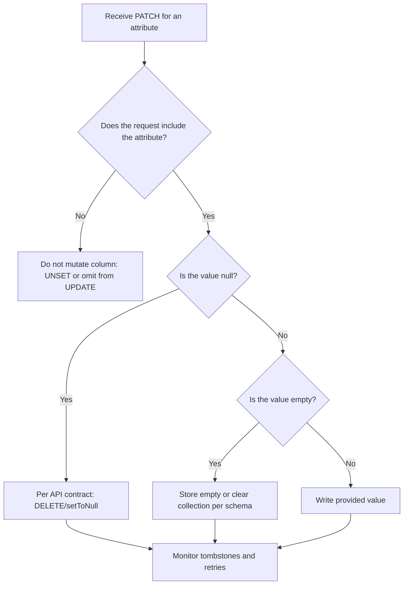

# `NULL`, Empty Values, and Tombstones When Updating Structured Columns in Apache Cassandra

> **Chapter:** Collections and UDTs  
> **Module:** `DATABASE_ENGINE_WIDE_COLUMN_CASSANDRA` — understanding the distributed wide-column model, partition keys, query-driven table design, read/write consistency levels, replication, compaction, repair, error handling, and Java connectivity. This lesson clarifies the meaning of `NULL`, empty values, `UNSET`, and **tombstones** when working with `list`, `set`, `map`, and UDTs.

## 1. Problem Statement: "No Data" Is Not Always a Single State

A user profile management application can encounter several distinct cases:

- The user **does not have a row yet** in Cassandra.
- The row exists, yet the `nickname` column **has never been written** or was deleted.
- The user **explicitly submits an empty string** `''` to clear text in an input box.
- The `pinned_lessons` list is requested to **become empty**.
- The `preferences` map lacks key `'theme'`, while other keys still exist.
- The `address` UDT has a value, yet its `postal_code` field has not been entered.
- The Java Driver sends a bind marker in the **`UNSET`** state, meaning *do not execute a mutation for that column*.

If every case gets collapsed into "`NULL`", the application can easily delete data by accident, generate unnecessary tombstones, or misreport whether a profile exists. In Cassandra, `NULL` is not simply a stored sentinel like the string `'null'`: **writing `null` to a column normally carries delete semantics**. Deletion metadata must be retained so older replicas and SSTables do not resurrect deleted values.

Key distinctions before writing code:

| Concept | Meaning in API/CQL | Does it necessarily create data or a tombstone? |
| --- | --- | --- |
| **No row** | Primary key not found | No; reading a missing row is not a mutation |
| **Unwritten column** | No live value for the column | Not necessarily; it may never have existed |
| **`NULL` in a mutation** | Requests deletion of the targeted column/field | Can create a tombstone, even when already empty |
| **`''` (empty text)** | Zero-length string, yet **a valid value** | Writes a value; not equivalent to `NULL` |
| **`[]`, `{}`** | Empty collection literals; storage depends on type/version | Do not assume "empty" stays distinguishable from "absent" |
| **`UNSET` bind marker** | Skips mutating that marker | Does not delete the column; **not** a third data state |
| **Tombstone** | Deletion marker / shadows older values | Can remain in SSTables even after `SELECT` returns no value |

## 2. Creating the Test Table and Sample Data

Assume keyspace `app` already exists with appropriate replication configured. The following table is small enough to observe profile states; `user_id` is the row's partition key:

```sql
USE app;

CREATE TYPE contact_info (
    email text,
    phone text,
    note text
);

CREATE TABLE user_structure_lab (
    user_id uuid PRIMARY KEY,
    display_name text,
    nickname text,
    tags set<text>,
    preferences map<text, text>,
    pinned_lessons list<text>,
    contact contact_info,
    contact_snapshot frozen<contact_info>,
    revision int
);

INSERT INTO user_structure_lab (
    user_id, display_name, nickname, tags, preferences,
    pinned_lessons, contact, contact_snapshot, revision
) VALUES (
    11111111-1111-4111-8111-111111111111,
    'Nguyen An', 'An', {'cql', 'java'},
    {'language':'vi', 'theme':'dark'},
    ['partition', 'repair'],
    {email:'an@example.org', phone:'0900000000', note:'sample'},
    {email:'an@example.org', phone:'0900000000', note:'sample'},
    1
);

SELECT * FROM user_structure_lab
WHERE user_id = 11111111-1111-4111-8111-111111111111;
```

The examples below mutate the same row. To run them independently, **reinitialize the sample row** between experiments. Do not run whole-row or whole-collection delete examples back-to-back and expect the data to remain in its initial state.

## 3. A Missing Row Differs from a Row with a `NULL` Column

```sql
-- Sample row: has user_id and display_name; may have null columns.
SELECT display_name, nickname
FROM user_structure_lab
WHERE user_id = 11111111-1111-4111-8111-111111111111;

-- Second UUID has not been written in this exercise.
SELECT display_name, nickname
FROM user_structure_lab
WHERE user_id = 22222222-2222-4222-8222-222222222222;
```

The second query normally returns **zero rows**. The first query can return a row where `nickname` is `null` after that column is deleted. Both can cause some Java accessor to return `null`, yet their business meanings differ sharply.

One subtlety: if a row previously held data and all regular columns were deleted, whether the row itself still appears depends on the **row liveness marker**, TTLs, and prior mutations. Do not use "every selected column is null" as a definitive test that a row never existed; when business logic tracks existence, model an **explicit status/lifecycle**.

### Never Use `NULL` in a Primary Key

```sql
-- INVALID: primary key columns must have values.
-- INSERT INTO user_structure_lab (user_id, display_name)
-- VALUES (null, 'Someone');
```

In Cassandra, the partition key determines where data lives across replicas. It cannot be `NULL`; clustering columns identifying rows likewise disallow `NULL`. This differs from regular data columns and from "nullable columns" in many relational SQL tables.

## 4. Empty String `''` Is a Value, Not `NULL`

```sql
-- nickname is written as a 0-length empty string.
UPDATE user_structure_lab
SET nickname = ''
WHERE user_id = 11111111-1111-4111-8111-111111111111;

SELECT nickname
FROM user_structure_lab
WHERE user_id = 11111111-1111-4111-8111-111111111111;
```

A `text` column can store an empty string. Java applications should distinguish `""` from `null`:

- `""`: a value **is present**, with length `0`.
- `null`: no live value exists for the column, or the row/column does not exist (check row existence separately).
- `"null"`: a **four-character** string `n`, `u`, `l`, `l`; not CQL `NULL`.
- `" "`: a single space character, also a value, not an empty string.

If business logic distinguishes "user explicitly cleared all characters" from "user requested deleting the attribute," the API must define both clearly: you can store `''` for the first and issue a delete mutation for the second. Do not automatically convert every empty string into `null` inside a serializer without checking requirements.

For binary data, an empty `blob` (literal `0x`) is also a value distinct from `NULL`; however, **do not generalize empty-string rules to every collection or UDT**, because composite types have their own storage rules.

## 5. Writing `NULL` or Running `DELETE`: Both Are Delete Requests

### 5.1. Deleting a Column via `UPDATE ... = null`

```sql
UPDATE user_structure_lab
SET nickname = null
WHERE user_id = 11111111-1111-4111-8111-111111111111;
```

In Cassandra mutations, assigning `null` to a regular column carries **delete-old-value semantics**. The deletion marker must win over older versions during replica reconciliation. Therefore, `UPDATE ... SET nickname = null` **does not mean "just ignore the nickname column."**

### 5.2. Deleting a Column via `DELETE`

```sql
DELETE nickname
FROM user_structure_lab
WHERE user_id = 11111111-1111-4111-8111-111111111111;

-- Broader scope: deletes the entire row by primary key.
DELETE FROM user_structure_lab
WHERE user_id = 11111111-1111-4111-8111-111111111111;
```

The first statement deletes only one column; the second creates a **row deletion** mutation. Do not run the second if you only meant to test deleting `nickname`. Different delete mutations create different tombstone scopes: **cell**, **collection**, **row**, and certain operations can create **range tombstones**.

Reading back `null` (or no row) after a delete does not prove old bytes were wiped from every SSTable. Cassandra can retain deletion metadata and prior versions until suitable compaction cycles run.

### 5.3. Absence Does Not Make Deleting Free

If `nickname` is already `null` and a client keeps issuing `DELETE nickname` repeatedly, the command can still generate new tombstones and consume resources. Cassandra **does not read all existing data first** to verify a column holds a value before deciding whether to write a deletion marker. Especially under unbounded write/delete workloads on the same key, never treat "deleting a missing column" as zero storage cost.

## 6. Empty Collections: Be Careful with `[]`, `{}`, and `NULL`

For `list`, `set`, and `map`, CQL has empty literals:

| Column type | Empty literal | Single-element literal |
| --- | --- | --- |
| `list<text>` | `[]` | `['cql']` |
| `set<text>` | `{}` | `{'cql'}` |
| `map<text,text>` | `{}` | `{'language':'vi'}` |

However, for **non-frozen collections**, Cassandra should not be relied upon to preserve an "empty yet distinct from `NULL`" state across all versions and distributions. Assigning an empty collection typically means **clearing existing elements**; afterward, the column may read back or display as `null` rather than a distinctly tracked empty collection. If you need to distinguish *unset*, *explicitly set to empty*, and *populated*, **store a separate status column**.

```sql
-- Replace the entire list with empty under CQL semantics.
UPDATE user_structure_lab
SET pinned_lessons = []
WHERE user_id = 11111111-1111-4111-8111-111111111111;

-- Replace the entire set with an empty set.
UPDATE user_structure_lab
SET tags = {}
WHERE user_id = 11111111-1111-4111-8111-111111111111;

-- Replace the entire map with an empty map.
UPDATE user_structure_lab
SET preferences = {}
WHERE user_id = 11111111-1111-4111-8111-111111111111;
```

These statements are **not** equivalent to "send an empty delta and leave old data alone." They assert that the collection **now has no elements**, so replacing the whole value can create a **collection tombstone** shadowing prior elements. With `frozen<list<T>>` or `frozen<map<K,V>>`, the whole collection is **one cell**, which may preserve empty values differently depending on representation and version. **Never assume frozen and non-frozen behave identically**; test on your exact Cassandra and driver versions if empty vs. `null` is a hard requirement.

### Critical Distinction: Omitting a Parameter vs. Sending an Empty Collection

In a PATCH API, if a client **omits** `tags`, the server usually needs to **keep** the existing tags; if the client sends `tags: []`, the server may interpret that as **clear all tags**. These two requests must map to **two different mutations** and cannot be distinguished using a Java `List` initialized to empty by default.

## 7. `NULL` Elements Inside Collections Are Not Entry Deletions

Collections do not permit `null` as a valid element to represent an "empty slot" or "entry with no value." The examples below are invalid data **you must not insert**:

```sql
-- INVALID EXAMPLES: do not use null elements inside a list or set.
-- UPDATE user_structure_lab SET pinned_lessons = ['cql', null] WHERE ...;
-- UPDATE user_structure_lab SET tags = {'cql', null} WHERE ...;

-- INVALID EXAMPLE: do not construct a map entry with a null value literal.
-- UPDATE user_structure_lab SET preferences = {'theme':null} WHERE ...;
```

To represent **the absence of `theme`**, delete that key in CQL rather than writing a key with a `null` value:

```sql
DELETE preferences['theme']
FROM user_structure_lab
WHERE user_id = 11111111-1111-4111-8111-111111111111;

-- Add or overwrite another key without deleting the remaining keys.
UPDATE user_structure_lab
SET preferences['language'] = 'en'
WHERE user_id = 11111111-1111-4111-8111-111111111111;
```

In a **non-frozen map**, each key identifies its entry. Deleting `preferences['theme']` writes entry-scoped deletion metadata; `DELETE preferences` deletes **the whole map**. These two deletion scopes differ markedly in shadowed data and impact when clients update different keys concurrently.

### When a Map Key Does Not Exist Yet

```sql
DELETE preferences['never_seen']
FROM user_structure_lab
WHERE user_id = 11111111-1111-4111-8111-111111111111;
```

After this command, the application still reads key `'never_seen'` as **absent**, just as before. Yet the coordinator may still write a tombstone for the key so another replica cannot resurrect a stale version later. Concluding "the read result didn't change, so `DELETE` is free" is wrong.

## 8. Non-Frozen UDTs: `null` on One Field vs. Deleting the Whole UDT

`contact contact_info` is a column-level **non-frozen UDT**. Cassandra can manage `contact.email`, `contact.phone`, and `contact.note` as separate cells. Thus, a single field can be updated or deleted:

```sql
-- Update only email; other fields remain untouched by this mutation.
UPDATE user_structure_lab
SET contact.email = 'an.new@example.org'
WHERE user_id = 11111111-1111-4111-8111-111111111111;

-- Delete only phone, not the entire UDT.
DELETE contact.phone
FROM user_structure_lab
WHERE user_id = 11111111-1111-4111-8111-111111111111;

-- Broader-scope statement: delete the entire contact value.
DELETE contact
FROM user_structure_lab
WHERE user_id = 11111111-1111-4111-8111-111111111111;
```

In a non-frozen UDT, deleting `phone` alone does not delete `email` and `note`. However, `SET contact = {email: 'x'}` is a **whole-UDT reassignment**, not a field patch; omitted fields can be cleared due to **whole-structure replacement** semantics. Use `contact.email = ...` whenever your true goal is editing a single field.

If a UDT field has no data, it usually reads as `null`. That is not a "permanent null value": a mutation writing `null` or `DELETE` still needs a deletion marker to shadow older values on offline replicas.

## 9. `frozen<UDT>`: Field `null`s and Atomic Values

`contact_snapshot frozen<contact_info>` is **a single cell**. The application cannot reach into a single field with `SET contact_snapshot.phone = ...` as with a non-frozen UDT.

```sql
-- Valid: write the full UDT, omitting phone.
UPDATE user_structure_lab
SET contact_snapshot = {
    email: 'an.new@example.org',
    note: 'No phone number yet'
}
WHERE user_id = 11111111-1111-4111-8111-111111111111;

-- Valid: delete the entire frozen UDT value.
DELETE contact_snapshot
FROM user_structure_lab
WHERE user_id = 11111111-1111-4111-8111-111111111111;
```

When a UDT literal **omits** `phone`, the new value does not inherit the old phone from the prior snapshot. This is **completely different** from leaving a bind marker for `contact_snapshot` as `UNSET`, which means **leave the column unchanged**. Fields of a frozen UDT live inside one encoded value; a missing field is not an independent cell deleted via per-field syntax.

**Lost-update risk:** Clients A and B both read the old snapshot; A edits `email`, B edits `note`, and both rewrite the full frozen UDT. Cassandra reconciles **the whole cell** by timestamp rather than merging the two updated fields. If business logic must preserve both edits, establish write ownership or use CAS/versioning where needed; ordinary `QUORUM` consistency does not turn read-modify-write into a conflict-free transaction.

## 10. Java Driver: `NULL` and `UNSET` Are Not the Same

In Java Driver 4.x, a prepared statement can contain bind markers where the application must decide to **set a value**, **delete with `null`**, or **skip with `UNSET`**. Example statement updating `display_name` and `nickname` for the same user:

```java
import com.datastax.oss.driver.api.core.CqlSession;
import com.datastax.oss.driver.api.core.cql.BoundStatementBuilder;
import com.datastax.oss.driver.api.core.cql.PreparedStatement;
import java.util.UUID;

class UserPatchRepository {
    private final CqlSession session;
    private final PreparedStatement patch;

    UserPatchRepository(CqlSession session) {
        this.session = session;
        this.patch = session.prepare(
            "UPDATE app.user_structure_lab " +
            "SET display_name = ?, nickname = ? WHERE user_id = ?"
        );
    }

    void keepNickname(UUID userId, String newDisplayName) {
        BoundStatementBuilder b = patch.boundStatementBuilder();
        b.setString(0, newDisplayName);
        b.unset(1);              // Leave nickname unchanged.
        b.setUuid(2, userId);
        session.execute(b.build());
    }

    void deleteNickname(UUID userId, String newDisplayName) {
        BoundStatementBuilder b = patch.boundStatementBuilder();
        b.setString(0, newDisplayName);
        b.setToNull(1);         // Write a mutation deleting nickname.
        b.setUuid(2, userId);
        session.execute(b.build());
    }

    void setEmptyNickname(UUID userId, String newDisplayName) {
        BoundStatementBuilder b = patch.boundStatementBuilder();
        b.setString(0, newDisplayName);
        b.setString(1, "");    // Present value: empty string.
        b.setUuid(2, userId);
        session.execute(b.build());
    }
}
```

`UNSET` is **the state of a parameter left unbound so no mutation occurs for that column**, not a CQL value stored in Cassandra. It is invaluable for PATCH APIs: **omitted** fields stay intact, fields explicitly sent as `null` can mean **delete**, and `""` means **write empty string**.

**Important limitation:** Never leave required primary key components `UNSET`, nor positions where CQL or the driver forbids skipping binds. Validate user input and bind every required marker. How Java `null` is handled depends on the binding API; using `setToNull` and `unset` explicitly makes intent clear and prevents mappers from silently turning Java `null` fields into unintended tombstones.

### A PATCH DTO Should Express Three Distinct Intents

| JSON/API request | Example contract | Mutation mapping |
| --- | --- | --- |
| No `nickname` key | Do not change nickname | `UNSET` or omit column from `UPDATE` |
| `"nickname": null` | Delete nickname | `setToNull` or `DELETE nickname` |
| `"nickname": ""` | Set nickname to empty string | `setString(..., "")` |
| `"nickname": "An"` | Write new nickname | `setString(..., "An")` |

This contract is **one API design choice**, not a mandate that every JSON PATCH must treat `null` as deletion. What matters is distinguishing *property absent* from *property present but null* right at deserialization time.

## 11. TTL: Expiring Data Also Generates Deletion Work

When inserting values with a TTL, Cassandra stores expiration metadata alongside the written cells. For example:

```sql
-- New map entry receives a 600-second TTL; other entries do not inherit it.
UPDATE user_structure_lab USING TTL 600
SET preferences['trial_banner'] = 'enabled'
WHERE user_id = 11111111-1111-4111-8111-111111111111;

-- Non-frozen UDT field receives a 600-second TTL.
UPDATE user_structure_lab USING TTL 600
SET contact.note = 'temporary'
WHERE user_id = 11111111-1111-4111-8111-111111111111;
```

In a multi-cell collection, TTL attaches to the entries written in that mutation. In a non-frozen UDT, TTL attaches to the updated field. For a `frozen<UDT>` or `frozen<collection>`, a write's TTL applies to **the cell holding the entire value**, not an individual field inside the snapshot.

Once a TTL expires, the data is no longer live to normal queries, yet Cassandra must keep managing the expired version as **deletion metadata** until cleanup is safe. Never assume "10-minute TTL = bytes vanish from all SSTables at minute 10."

If `contact.email` must persist for years while `verification_code` lasts only 5 minutes, put the code in an **independent column or row** with its own TTL instead of placing it inside a **frozen UDT** and expiring the whole snapshot.

## 12. Why Are Tombstones Mandatory in a Distributed System?

Consider a cluster with replication factor 3. Replicas R1 and R2 receive a delete for `nickname`, while R3 is temporarily unreachable and still holds the old value:

```text
Before delete:
  R1: nickname = 'An'
  R2: nickname = 'An'
  R3: nickname = 'An'

After DELETE while R3 is offline:
  R1: tombstone for nickname
  R2: tombstone for nickname
  R3: nickname = 'An'     (delete not yet received)

When R3 synchronizes properly:
  Tombstone confirms the old version must be shadowed/removed.
```

If R1 and R2 simply **erased bytes physically** without retaining deletion metadata, the stale value on R3 could be treated as valid data and reappear. Cassandra needs **tombstones with timestamps and metadata** to reconcile old values against delete mutations across replicas.

### Common Tombstone Scopes

| Scope | CQL example | Logical effect |
| --- | --- | --- |
| **Cell tombstone** | `DELETE nickname ...` | Shadows old column value |
| **Collection entry tombstone** | `DELETE preferences['theme'] ...` | Shadows one map entry |
| **Collection tombstone** | `DELETE preferences ...` or full replacement | Shadows prior entries in the collection |
| **UDT field tombstone** | `DELETE contact.phone ...` | Shadows one field of a non-frozen UDT |
| **Row tombstone** | `DELETE FROM table WHERE user_id = ...` | Shadows row data by primary key |
| **Range tombstone** | Deleting a range of clustering rows in a suitable table | Shadows multiple rows within that range |
| **TTL expiry** | `UPDATE ... USING TTL 600` then expires | Expired value participates in deletion logic on read/cleanup |

Tombstone representations can vary at the storage engine level across Cassandra versions. You do not need to memorize internal byte formats to reason about **deletion scope** and **read/compaction/repair costs**.

## 13. Timestamps, Consistency, and Why Deletes Can Be "Overwritten"

Cassandra reconciles cells and versions using timestamps and tie-breaking rules. If an older value carries an abnormally high timestamp (from clock skew or client-supplied `USING TIMESTAMP`), a subsequent delete with a **lower** timestamp may fail to shadow that value as the user expects.

For routine operations, separate three concepts:

1. **Mutation timestamp**: decides reconciliation between competing values and tombstones.
2. **Consistency level** (`ONE`, `LOCAL_QUORUM`, `QUORUM`, ...): controls read/write replica acknowledgments per replication and datacenter topology.
3. **Lightweight transaction (LWT)**: uses `IF` and serial consistency when a business condition requires consensus evaluation.

For example, updating `nickname` **only if the row version has not changed**:

```sql
-- Condition evaluates column revision in the same row, not across independent replicas.
UPDATE user_structure_lab
SET nickname = 'An New', revision = 2
WHERE user_id = 11111111-1111-4111-8111-111111111111
IF revision = 1;
```

The statement returns `[applied]`; when `false`, the application must re-read and resolve the conflict rather than forcing an unconditional write. **`IF EXISTS`** only checks existence of **the row**, not whether a UDT field or map key holds a value. Ordinary `QUORUM` also does not make "read → check null → write" atomic.

**Note:** Revision-based CAS protects fully only if **every participating writer** increments and checks `revision`; another writer bypassing versioning breaks the invariant.

## 14. When Are Tombstones Purged? Compaction and Repair

SSTables in Cassandra are immutable; new mutations append new cell versions and tombstones. On reads, replicas reconcile data across the memtable and relevant SSTables. **Compaction** merges SSTables, discards shadowed versions, and purges tombstones once eligibility conditions are satisfied.

However, purging tombstones too early while an offline replica still holds stale data can cause deleted data to **resurface** (*zombie data*). Safe purging depends on Cassandra version/repair mechanics, settings like `gc_grace_seconds`, SSTable overlap, and replica synchronization state.

Operational rules:

- **Do not lower `gc_grace_seconds` arbitrarily** just because tombstone counts look high; weigh repair schedules and whether replicas can remain offline longer than the grace period.
- **Repair** synchronizes data and tombstones across replicas; maintain a schedule and verify outcomes rather than treating a single successful run as permanent proof.
- **Compaction** cleans up old data, but cannot fix a table model with bloating collections or a workload deleting millions of entries per day.
- Monitor **p95/p99 read latency, tombstone warnings, SSTable counts, compaction backlog, disk I/O, and repair duration**.
- During schema/UDT changes or backfills, mutation and tombstone rates can spike; benchmark on realistic workloads before rollout.

### A Common Overload Scenario

An application uses `map<text,text>` as a sub-table holding hundreds of thousands of keys in one row. Every day a job deletes "inactive" keys and inserts new ones. The result is **one massive partition** packed with entries and tombstones to reconcile. Adding replicas or tweaking compaction will not fix the root cause; promote each entity into **a row with a stable primary key** and bucket when needed.

## 15. When Business Logic Must Distinguish "Unset" from "Empty"

Suppose a product models three states for favorite topics:

1. **Unset:** the user has not been asked about favorite topics yet.
2. **Explicitly set to empty:** the user deliberately chose "I like no topics."
3. **Set and populated:** one or more topics are selected.

With `tags set<text>` alone, how Cassandra represents empty vs. absent non-frozen collections may not distinguish all three states reliably across versions. A clearer model:

```sql
CREATE TABLE app.user_topic_preferences (
    user_id uuid PRIMARY KEY,
    preferences_initialized boolean,
    topics set<text>,
    revision int
);

-- The user completed the selection step, choosing zero items.
UPDATE app.user_topic_preferences
SET preferences_initialized = true,
    topics = {},
    revision = 1
WHERE user_id = 11111111-1111-4111-8111-111111111111;
```

On read, `preferences_initialized = true` carries **explicit business meaning**, independent of whether the driver renders `topics` as `null` or an empty set. For the unset state, the application can rely on `preferences_initialized = false` or an explicit row-initialization rule. **Do not overload `null` on a lone collection** to represent distinct business states when precision matters.

If a "max 10 topics" cap is a strict invariant with concurrent writers, checking length in Java before updating is insufficient; use coordinated/conditional writes or another model. If you need per-topic pagination/lookup or unbounded growth, use a multi-row table instead of a large set.

## 16. API Update Patterns: Avoiding Accidental Tombstones

Suppose a PATCH request carries `display_name` and `nickname`. A serializer or mapper often produces a DTO with `nickname == null` for both **omitted fields** and **fields explicitly sent as `null`** unless presence metadata is tracked. If code blindly issues `UPDATE ... nickname = null` on every request, calls intended only to change `display_name` will accidentally wipe out `nickname`.

Recommended decision flow:



Practical API design principles:

- **Do not collapse `null`, empty strings, empty collections, and absent fields into one state** when business meanings differ.
- **Never send `null` for columns omitted from a request**; use `UNSET` or targeted mutations to leave existing data untouched.
- **Do not reflexively delete-before-insert** just to "set a value": every delete can create needless tombstones. When editing one non-frozen UDT field or map entry, use a matching granular mutation.
- **Do not rely on `DELETE` to tell you whether a value existed beforehand**: it does not normally return a "deleted an actually present value" flag.
- **Do not rely on `SELECT col = null` as a relational SQL filter**: in Cassandra, queries must follow appropriate primary keys or indexes rather than scanning the cluster for absent attributes.
- If **auditing** ("who deleted, when, why") is required, write explicit event/lifecycle records; tombstones are storage metadata, not a business audit log.

## 17. Measuring and Troubleshooting

| Symptom | Likely cause to inspect | Remediation |
| --- | --- | --- |
| Column suddenly becomes `null` after PATCH | Mapper turned an absent field into a `null` bind | Distinguish absent/null/empty; use `UNSET` properly |
| Collection becomes `null` after setting `{}`/`[]` | Empty/absent collection representation | Check version semantics; add a status column if needed |
| Stale value reappears after delete in fault scenario | Replica convergence, timestamps, repair, consistency | Check timestamps, CL, replicas, repair, and retry flow |
| Rising tombstone warnings | High key/field delete rate, short TTLs, full collection overwrites | Review workload, mutation scope, and data model |
| Java lacks `UNSET` awareness | Code binds every marker, defaulting absent fields to `null` | Use builders/mappers tracking presence or dedicated UPDATEs |
| Deleting missing map keys drives up I/O | Many tombstones accumulating on one partition | Avoid needless deletes; bound cardinality or use separate rows |
| Compaction backlog after cleanup job | Surge of delete mutations while old data remains in SSTables | Throttle job, monitor compaction/repair, never cut grace arbitrarily |

In test environments, `TRACING ON;` in `cqlsh` helps inspect selected CQL queries, followed by `TRACING OFF;`; tracing carries overhead, so do not enable it broadly in production. Depending on Cassandra version, `nodetool tablestats`/`tablehistograms` and driver metrics help inspect table/partition sizes, latencies, and timeouts. Compare **under identical workload, replication, and consistency level** when evaluating changes.

## 18. Case Exercises

**Exercise 1 — Distinguishing rows and columns:** `SELECT nickname ... WHERE user_id = U` returns a row with `nickname = null`. Can you conclude U has never existed?  
**Hint:** No. The row may exist while `nickname` was deleted or never written. Java code must check whether `Row` is present and account for row liveness when defining business existence.

**Exercise 2 — Patching in Java:** A request includes only `display_name`, while the deserialized DTO has `nickname == null`. Should you bind `nickname = null` or `UNSET`?  
**Hint:** If an omitted attribute means leave unchanged, use `UNSET` or omit it from the mutation. Binding `null` deletes it.

**Exercise 3 — Empty string:** A user enters `''` as their nickname. Is that the same as `null` in Cassandra?  
**Hint:** No. An empty string is a valid text value; `null` in an update typically means deletion.

**Exercise 4 — Missing map key:** An application sends `DELETE preferences['not_there']` thousands of times. Why is this not a free operation?  
**Hint:** Cassandra can write tombstones even though reads still show the key absent; heavy delete mutations add read and compaction load.

**Exercise 5 — Frozen UDT:** A client wants to delete `contact_snapshot.phone` while keeping `email`. Can you directly delete a field inside a frozen UDT?  
**Hint:** No. You must replace the entire snapshot with `phone` omitted/absent, or change the model to a non-frozen UDT or separate columns if fields are edited frequently.

**Exercise 6 — TTL:** Only a temporary code should expire, while the address must remain. Should you attach a TTL to the entire `frozen<UDT>`?  
**Hint:** No. A frozen UDT's TTL applies to the whole cell; move the temporary code to a column or row with its own lifecycle.

**Exercise 7 — Meaningful emptiness:** A system wants to know that a user completed topic selection and chose an empty set. Should you infer this solely from `tags = {}`/`null`?  
**Hint:** Do not rely solely on empty collection representation; store `preferences_initialized` explicitly.

**Exercise 8 — Repair:** An offline replica missed deletes. Operations wants to drop `gc_grace_seconds` very low to purge tombstones. What is the risk?  
**Hint:** Tombstones may be purged before the stale replica receives the deletes, risking zombie data; maintain proper repair procedures and safety margins.

## 19. Pre-Production Checklist

- [ ] API and mappers distinguish **absent field, explicit null, empty string, and empty collection**.
- [ ] Prepared statements use **`UNSET` to preserve existing values** and `setToNull`/`DELETE` only for intentional deletes.
- [ ] Never pass `null` for **primary keys**, `list`/`set` elements, or `map` keys/values as normal data.
- [ ] Verified how **empty non-frozen/frozen collections** behave on your exact Cassandra and driver versions.
- [ ] Distinguished **deleting a single map entry or UDT field** from **deleting an entire collection, UDT, or row**.
- [ ] Evaluated writer contention, timestamps, consistency levels, and LWT/versioning requirements.
- [ ] Defined **TTLs and lifecycles** at cell/entry/field vs. whole-snapshot scope according to `frozen` boundaries.
- [ ] Monitored **tombstones, p95/p99, compaction backlog, repair, and partition size** under heavy deletes/expirations.
- [ ] Added explicit status/audit columns whenever business logic must distinguish **unset, explicitly empty, and deleted**.
- [ ] When entry counts grow large, designed a **query-driven table with partition/clustering keys** instead of feeding an unbounded collection.

## 20. Key Takeaways

- **`NULL` in a mutation typically means delete**; it is not synonymous with empty string `''`, an empty collection, or the `UNSET` bind marker.
- **A missing row** differs from **a row with a null column**. Applications must check `Row` presence and model lifecycles rather than inferring existence from one `null` field.
- **Empty non-frozen collections** should not be relied upon to distinguish "explicitly empty" from "unset"; store a **separate status flag** when needed.
- **Non-frozen UDTs** allow deleting individual fields; **frozen UDTs** must replace or delete **the whole value**, risking lost updates under concurrent snapshot writes.
- **Tombstones are essential deletion metadata** for replica convergence; deleting even a nonexistent field or key can still write tombstones and incur background cost.
- **TTL expiration does not immediately reclaim disk bytes**. Compaction and repair ensure safe tombstone purging; never arbitrarily lower `gc_grace_seconds`.
- In the Java Driver, use **`UNSET` for fields omitted from a PATCH**, `setToNull` for deletes, and valid values (including `''`) for writes.
- Every operation remains governed by Cassandra's **partition keys, replication, consistency, timestamps, and query-driven modeling**; picking the right structure and mutation scope matters far more than compact syntax.
