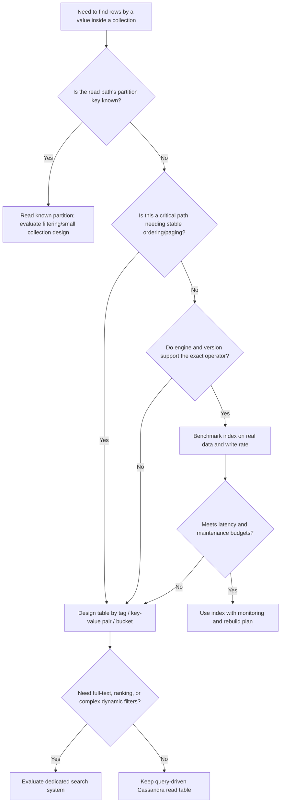

# Indexing or Querying Collections by Version Capabilities in Apache Cassandra

> **Chapter:** Collections and UDTs  
> **Module:** `DATABASE_ENGINE_WIDE_COLUMN_CASSANDRA` — distributed architecture, the wide-column model, partition keys, query-driven table design, read/write consistency, replication, compaction, repair, error handling, and the Java Driver. The focus here is **querying `list`, `set`, `map`, and `frozen` values according to the CQL and indexing capabilities actually present in your running version**.

## 1. Why Does Having `CONTAINS` Syntax Not Mean a Query Will Perform Well?

Suppose a store saves products by `item_id`. Each product has a set of `tags`, `aliases`, and custom `attributes`:

```text
item_id = A
tags = {'java', 'database'}
aliases = ['cql-guide', 'cassandra-guide']
attributes = {'language':'vi', 'level':'advanced'}
```

The query "for product A, fetch all tags" is fundamentally different from "find all products tagged `java`." The first **knows the partition key** and fits Cassandra well. The second starts from **a value inside a collection**, so it needs a secondary access path: a compatible index, a read table designed by tag, or a dedicated search engine.

CQL predicates such as `CONTAINS`, `CONTAINS KEY`, or `map['key'] = value` describe **filter conditions**; they do not promise that the system has an optimal access structure to locate matching partitions. Depending on **Cassandra version, secondary index type, and configuration**, a `SELECT` may:

1. Run via a supported index.
2. Be rejected because no valid access path exists.
3. Run only with `ALLOW FILTERING`, risking broad scans that violate SLOs.
4. Be syntactically valid yet slow because many partitions match or the index fans out widely.

**Key message:** query-driven table design and partition keys remain foundational. Indexes are tools for **specific query patterns and workloads**, not a way to turn a wide-column table into an arbitrarily searchable JSON document store.

## 2. Preparing Data to Distinguish Query Shapes

Examples assume keyspace `app` already exists with appropriate replication configured. The `item_id` values below are sample UUIDs carrying no special routing meaning beyond primary key identity:

```sql
CREATE TABLE app.collection_search_lab (
    item_id uuid PRIMARY KEY,
    title text,
    category text,
    tags set<text>,
    aliases list<text>,
    attributes map<text, text>,
    specs_snapshot frozen<map<text, text>>
);

INSERT INTO app.collection_search_lab (
    item_id, title, category, tags, aliases, attributes, specs_snapshot
) VALUES (
    11111111-1111-4111-8111-111111111111,
    'Cassandra for Java', 'book',
    {'java', 'database'},
    ['cql-guide', 'cassandra-guide'],
    {'language':'vi', 'level':'advanced'},
    {'edition':'2', 'binding':'paper'}
);

INSERT INTO app.collection_search_lab (
    item_id, title, category, tags, aliases, attributes, specs_snapshot
) VALUES (
    22222222-2222-4222-8222-222222222222,
    'Distributed Data Lab', 'course',
    {'database', 'distributed'},
    ['data-systems'],
    {'language':'en', 'level':'beginner'},
    {'edition':'1', 'format':'video'}
);

-- Direct read path with the full primary key known.
SELECT title, tags, aliases, attributes, specs_snapshot
FROM app.collection_search_lab
WHERE item_id = 11111111-1111-4111-8111-111111111111;
```

Because `item_id` is the **partition key**, the final query routes directly to the owning replica set. Cassandra does not need to discover `item_id` from tags. By contrast, the reverse queries below require evaluating an **index** or **another table**.

> **Practice note:** The index creation examples below illustrate **independent options**. On the same map column, do not blindly run `KEYS`, `VALUES`, and `ENTRIES` all at once; choose the search target, test on your target version, and drop or recreate indexes when switching options. Index syntax can differ between upstream Apache Cassandra and managed distributions/services.

## 3. Classification Table of Collection Predicates

| Business question | Data type | Typical CQL condition | Access path to evaluate |
| --- | --- | --- | --- |
| Has tag `java`? | `set<text>` | `tags CONTAINS 'java'` | Index supporting **set values** or a tag-keyed table |
| List contains alias `cql-guide`? | `list<text>` | `aliases CONTAINS 'cql-guide'` | Index supporting **list values** or an alias-keyed table |
| Map has key `language`? | `map<text,text>` | `attributes CONTAINS KEY 'language'` | Index on **map keys** or a key-keyed table |
| Map has value `advanced` under any key? | `map<text,text>` | `attributes CONTAINS 'advanced'` | Index on **map values** or a suitable table |
| Map has pair `level=advanced`? | `map<text,text>` | `attributes['level'] = 'advanced'` | Index on **map entries** or a key/value-pair table |
| Frozen map equals exact snapshot S? | `frozen<map<...>>` | `specs_snapshot = {...}` | **Full-value** index if supported by engine/version |
| Search by `address.city` inside a UDT? | UDT | Cannot be inferred from the predicates above | City-keyed table or a verified dedicated index |

These expressions are not interchangeable. `CONTAINS KEY 'level'` asks only **whether the key exists**; `CONTAINS 'advanced'` asks **whether the value appears anywhere**; `attributes['level'] = 'advanced'` asks for **one specific key/value pair**. Creating an index for the wrong predicate type causes invalid queries or overly broad matches.

## 4. Looking Up `set` and `list` Values with `CONTAINS`

Assuming the cluster supports **traditional secondary indexes (legacy 2i)** on collections—as in Cassandra 3.x/4.x branches providing that feature—you can index **element values**:

```sql
-- Index the member values of a set.
CREATE INDEX idx_lab_tags_values
ON app.collection_search_lab (VALUES(tags));

-- Index the element values of a list.
CREATE INDEX idx_lab_aliases_values
ON app.collection_search_lab (VALUES(aliases));

-- Two reverse queries by element value.
SELECT item_id, title
FROM app.collection_search_lab
WHERE tags CONTAINS 'java';

SELECT item_id, title
FROM app.collection_search_lab
WHERE aliases CONTAINS 'cql-guide';
```

Points to remember:

- `set` has no duplicate elements; `list` **can** contain the same value multiple times. Yet a `CONTAINS` lookup index primarily **finds rows containing the value**—it does not return occurrence counts, positions, or list ordering.
- `CONTAINS 'java'` does not turn `java` into a partition key; the index still has to locate which rows contain that element.
- A `list` whose elements change rapidly or undergo frequent appends/deletes can trigger substantial index maintenance alongside tombstones in the base table.
- If `'java'` appears in most rows, the index does not shrink the result set. The query can still be slow or transfer huge numbers of rows.

In some CQL dialects, creating a collection index supports shorthand syntax or different defaults. For clarity in this lesson, the examples use **explicit `VALUES(column)`**; in real work, verify DDL and query behavior on your exact running version.

## 5. `map`: Index by Key, Value, or Entire Entry?

A `map<text,text>` supports **three distinct kinds of questions**, which generally require **three different indexing targets**. Do not pick `KEYS` just because its name looks shorter: start from the exact `SELECT` query you must support.

### 5.1. Finding Rows Containing a Key: `KEYS(map)`

For example, finding products that declare a `'language'` attribute regardless of its value:

```sql
-- Option A: index the map's keys.
CREATE INDEX idx_lab_attributes_keys
ON app.collection_search_lab (KEYS(attributes));

SELECT item_id, title
FROM app.collection_search_lab
WHERE attributes CONTAINS KEY 'language';
```

This predicate matches both `language=vi` and `language=en` products. It does **not** distinguish between the two values.

### 5.2. Finding by Value Regardless of Key: `VALUES(map)`

To test the option below on **the same map column** in this lab, **drop test index A** first and let the cluster process the schema/index change. Do not assume a single column can hold every index type simultaneously in every engine:

```sql
-- Run only when switching to Option B.
DROP INDEX IF EXISTS app.idx_lab_attributes_keys;

CREATE INDEX idx_lab_attributes_values
ON app.collection_search_lab (VALUES(attributes));

SELECT item_id, title
FROM app.collection_search_lab
WHERE attributes CONTAINS 'advanced';
```

`CONTAINS 'advanced'` checks **a value under any key** of the map. If the application requires `level=advanced` rather than `language=advanced`, filtering by value alone is **insufficiently precise**.

### 5.3. Finding by Specific Key/Value Pair: `ENTRIES(map)`

If the requirement is products with `attributes['level'] = 'advanced'`, test an **entry** index on a supporting configuration:

```sql
-- Run only when switching to Option C.
DROP INDEX IF EXISTS app.idx_lab_attributes_values;

CREATE INDEX idx_lab_attributes_entries
ON app.collection_search_lab (ENTRIES(attributes));

SELECT item_id, title
FROM app.collection_search_lab
WHERE attributes['level'] = 'advanced';
```

`ENTRIES` targets **key/value pairs**, matching that condition better than standalone `KEYS` or `VALUES` indexes. However, support for map-entry expressions, index combinations, and query planning varies by engine and version. When combining multiple filter predicates, test **the complete query** before assuming the index behaves as intended.

### Precision Comparison

| Map state | `CONTAINS KEY 'level'` | `CONTAINS 'advanced'` | `['level'] = 'advanced'` |
| --- | --- | --- | --- |
| `{'level':'advanced'}` | True | True | True |
| `{'level':'beginner','mode':'advanced'}` | True | True | False |
| `{'mode':'advanced'}` | False | True | False |
| `{'language':'vi'}` | False | False | False |

This is a **predicate semantics table**; it does not imply all three predicates can execute concurrently on an arbitrary schema/index. Choose an index or read table by **required precision**, not merely operator name.

## 6. Frozen Collections and `FULL(...)`: Indexing Whole Values, Not Elements

`specs_snapshot frozen<map<text,text>>` is **one cell** holding the whole map. In versions and engines supporting whole-value indexing on frozen collections, one DDL form used is `FULL(...)`:

```sql
-- Legacy 2i example: apply only when engine/version supports FULL(frozen).
CREATE INDEX idx_lab_specs_full
ON app.collection_search_lab (FULL(specs_snapshot));

SELECT item_id, title
FROM app.collection_search_lab
WHERE specs_snapshot = {'edition':'2', 'binding':'paper'};
```

A `FULL` index targets **whole-collection equality comparisons**. It does not enable `specs_snapshot CONTAINS KEY 'edition'` or `specs_snapshot['edition'] = '2'` as a key/entry index would. If frequent per-attribute lookups are needed, a frozen map is usually **the wrong fit** for that query.

Rewriting a frozen map means replacing **the entire snapshot**, unlike `attributes['level'] = 'advanced'` on a non-frozen map. When frozen values are large or updated often, mutation payload, index maintenance, and lost-update risks must all be evaluated.

**Version caution:** Never assume `FULL`, `KEYS`, `VALUES`, and `ENTRIES` are universally available across **every** index type or distribution. `FULL` in this example reflects a historical capability of certain Cassandra index engines; verify actual syntax and support before running DDL.

## 7. Legacy Secondary Indexes (2i) vs. Storage-Attached Index (SAI)

**Apache Cassandra does not have one uniform answer across every version.** When selecting an index, know the exact *server/version/engine*, not just the `CREATE INDEX` keyword.

| System family | What to understand before applying examples | Safe practice |
| --- | --- | --- |
| Cassandra 2.x or very old releases | Collection/index support is limited or differs from modern releases | Never copy 3.x/4.x DDL blindly; check your running version's features |
| Cassandra 3.x/4.x using **legacy 2i** | Offers collection indexing such as `KEYS`, `VALUES`, `ENTRIES`, and in certain cases `FULL` | Match the exact predicate target; test DDL + `SELECT` on that exact version |
| Apache Cassandra 5.x | Includes **SAI** in the modern branch alongside other indexing mechanisms | Identify the configured provider/index engine and check its version type/operator matrix |
| Managed services / other distributions | May ship SAI or indexing features earlier, later, or differently from OSS Apache Cassandra | Confirm **provider** documentation, CQL syntax, limits, and configuration |

### What Is Legacy 2i?

Traditional secondary indexes store auxiliary structures mapping indexed values back to the rows/keys holding those values. They do not change the base table's partition key. When a query lacks the partition key, the coordinator may have to **scatter-gather across multiple nodes/replicas**; for common values or large result sets, the index may fail to deliver desired latency.

### What Does SAI Change?

**Storage-Attached Index (SAI)** attaches index structures to SSTable/storage lifecycles in supporting Cassandra versions, broadening secondary search workloads and improving index management compared to many legacy 2i cases. However, it is **not** a blanket guarantee that every collection expression, predicate combination, `frozen` value, UDT, or map entry works under one universal syntax.

Example identifying the SAI provider in environments supporting this syntax (using scalar `category` to avoid guessing per-version collection support):

```sql
-- VERSION/ENGINE-DEPENDENT EXAMPLE; do not run without SAI support.
CREATE CUSTOM INDEX idx_lab_category_sai
ON app.collection_search_lab (category)
USING 'StorageAttachedIndex';

SELECT item_id, title
FROM app.collection_search_lab
WHERE category = 'book';
```

An SAI example on a **scalar column** does not prove that legacy 2i `KEYS(attributes)`/`ENTRIES(attributes)` syntax works identically with SAI. To use SAI on collections, verify the exact **collection type**, **index target**, **query operators**, **predicate combinability**, and **server/driver versions**. Never swap a `USING` clause into legacy DDL and assume every predicate will work.

## 8. How to Verify a Cluster's Indexing Capabilities Without Guessing

A minimal staging verification workflow:

1. Identify the exact **Cassandra version and distribution** running; during upgrades, account for mixed-version nodes and features not yet enabled.
2. Inspect the table schema, existing indexes, and column types to avoid duplicate indexes or conflicting engines on the same column.
3. Check the **support matrix** for `list`, `set`, map `KEYS`/`VALUES`/`ENTRIES`, frozen collections, and your intended index type.
4. Run `CREATE INDEX` on a **small test table** and wait for initial index build/update completion per your version's mechanism; never benchmark latency while the index is still building.
5. Run **the exact `SELECT` queries needed**. Verify not just "the query returned rows," but row counts, predicate accuracy, latency, and fan-out.
6. Test against production-like distributions: a common tag, a rare tag, heavy delete/TTL mutations, and varying partition sizes.
7. Deploy to production only with a **version-appropriate index rollback, monitoring, rebuild, and load-limiting plan**.

In `cqlsh`, these commands help inspect metadata (exact output may vary by version):

```sql
DESCRIBE TABLE app.collection_search_lab;

-- Inspect published index schema in system_schema (if supported).
SELECT keyspace_name, table_name, index_name, kind, options
FROM system_schema.indexes
WHERE keyspace_name = 'app' AND table_name = 'collection_search_lab';
```

`DESCRIBE` is a `cqlsh` utility command, **not** CQL to run verbatim in a Java prepared statement. `system_schema` shows index declarations, but verifying that an index **has finished building and is query-ready** requires engine-appropriate status tools and observability. Never treat a metadata query as absolute proof that an index is healthy across every replica.

## 9. When Do Collection Indexes Easily Become a Bottleneck?

### 9.1. Low-Selectivity Values

If `tags CONTAINS 'database'` matches 95% of products, the index still has to process and gather a massive result set. Even with an index, `LIMIT 20` does not magically locate the 20 "best" rows in arbitrary business order—especially when sorting is not backed by a clustering key.

### 9.2. High Write/Delete Rates and Short TTLs

Every add or remove on a `set`, `list`, or map entry can require updating **auxiliary index structures** alongside the base-table mutation. TTLs expire data; tombstones and compaction keep prior versions around until safe cleanup. Indexes are not free on writes: measure **write latency, index disk usage, compaction backlog, and read p95/p99**.

### 9.3. Large Collections and Hot Partitions

A partition holding a `map` with hundreds of thousands of entries is a data-modeling problem even if its keys or values are indexed. All entries still live in **one row and one partition**. The few replicas owning that partition can become overloaded on reads, writes, repair, and streaming. An index does not split a collection into independent rows for element-level pagination.

### 9.4. Multi-Predicate Filters and Result Ordering

For example, "tag `java`, `level=advanced`, created in the last 30 days, sorted newest first" is **a multi-predicate, ordered query**. Do not assume having three separate indexes lets Cassandra intersect and sort them as efficiently as a relational search engine. Multi-predicate execution depends on the index engine, and efficient ordering usually requires a **clustering key or a dedicated table**.

If a query is a critical, high-traffic read path with tight SLOs, a **query-driven table** is usually more reliable than adding indexes to every column.

## 10. `ALLOW FILTERING` Does Not Turn a Scan into an Optimal Query

Without a suitable access path, Cassandra may report that a query requires filtering it cannot execute safely under the current schema. Some queries permit appending `ALLOW FILTERING`:

```sql
-- ILLUSTRATIVE ONLY; avoid using as a cluster-wide production read path.
SELECT item_id, title
FROM app.collection_search_lab
WHERE tags CONTAINS 'java'
ALLOW FILTERING;
```

`ALLOW FILTERING` **permits executing an expensive scan** when supported by CQL; it **creates no index**, does not alter the partition key, and guarantees no latency bound. On a very large table, cluster-wide filtering can scan many partitions only to discard most non-matching rows.

If a query is not even supported syntactically or by operator in your CQL version, appending `ALLOW FILTERING` **will not fix it**. Do not treat it as a magic patch for collection `SELECT` errors.

## 11. Query-Driven Solution: The `items_by_tag_month` Table

Suppose a core application API is **"fetch the 20 newest products tagged `java` in month 2026-11."** If this query runs constantly, build a dedicated table for that read path:

```sql
CREATE TABLE app.items_by_tag_month (
    tag text,
    bucket_month text,
    created_at timeuuid,
    item_id uuid,
    title text,
    PRIMARY KEY ((tag, bucket_month), created_at, item_id)
) WITH CLUSTERING ORDER BY (created_at DESC, item_id ASC);

-- One row per item for a given tag and monthly bucket.
INSERT INTO app.items_by_tag_month (
    tag, bucket_month, created_at, item_id, title
) VALUES (
    'java', '2026-11',
    8cbe0000-e581-11f1-8e9a-0242ac120002,
    11111111-1111-4111-8111-111111111111,
    'Cassandra for Java'
);

SELECT created_at, item_id, title
FROM app.items_by_tag_month
WHERE tag = 'java' AND bucket_month = '2026-11'
LIMIT 20;
```

Here, `(tag, bucket_month)` is the **composite partition key**; `(created_at, item_id)` is the **clustering key**. The query needs no `CONTAINS` because the search dimension is built directly into the key. `LIMIT 20` bounds **20 rows**, and the Java Driver can paginate across those rows.

An item with multiple tags is **written to multiple partitions** (one row per tag/bucket). If an item changes tags or is deleted, the application must update or delete corresponding rows in the read table; that **denormalization** cost must be engineered with retries and reconciliation.

**No single bucket fits every system:** If tag `java` accumulates millions of items per month, partition `(java, 2026-11)` still becomes too large or hot. Use daily/hourly buckets or sharding, trading off multi-bucket queries and result merging. When `created_at` uses `timeuuid`, the application must **reuse the same stable ID on retries** rather than generating a fresh timeuuid for the same write event.

## 12. Frequently Queried Key/Value Pairs: The `items_by_attribute` Table

If an API needs **"products with `level = advanced` this month,"** rather than scanning across `attributes`, model the attribute pair directly:

```sql
CREATE TABLE app.items_by_attribute_month (
    attribute_name text,
    attribute_value text,
    bucket_month text,
    created_at timeuuid,
    item_id uuid,
    title text,
    PRIMARY KEY (
        (attribute_name, attribute_value, bucket_month),
        created_at, item_id
    )
) WITH CLUSTERING ORDER BY (created_at DESC, item_id ASC);

INSERT INTO app.items_by_attribute_month (
    attribute_name, attribute_value, bucket_month,
    created_at, item_id, title
) VALUES (
    'level', 'advanced', '2026-11',
    8cbe0000-e581-11f1-8e9a-0242ac120002,
    11111111-1111-4111-8111-111111111111,
    'Cassandra for Java'
);

SELECT item_id, title, created_at
FROM app.items_by_attribute_month
WHERE attribute_name = 'level'
  AND attribute_value = 'advanced'
  AND bucket_month = '2026-11'
LIMIT 20;
```

The advantage is having **the exact key/value condition** in the partition key and chronological order in the clustering key. This replaces `attributes['level'] = 'advanced'` lookups against the item-ID table once it becomes a core feature.

Trade-off: an item with many attributes produces multiple rows in the lookup table; when `level` changes, the application must **delete the row for the old value** and insert the row for the new value, handling partial failures and preventing the read table from drifting permanently from the source of truth. Cassandra will not build and maintain this manual lookup table automatically just because the base table uses a map.

## 13. `map<text,frozen<UDT>>` and Deep-Field Queries

A schema like the following is convenient for reading **a few labeled addresses** of a user:

```sql
CREATE TYPE app.location_address (
    city text,
    country_code text
);

CREATE TABLE app.user_address_book (
    user_id uuid PRIMARY KEY,
    addresses map<text, frozen<location_address>>
);
```

An application knowing `user_id` can read the map and select `'home'` in Java. However, do not assume you can create an `ENTRIES(addresses)` index and query **`addresses['home'].city = 'Da Nang'`** across all Cassandra versions. A map entry index, where supported, inspects **the entry value at its matching granularity**; a deep field inside a frozen UDT does not automatically become an independent search key.

For "find all users whose `'home'` address is in Da Nang," evaluate:

- A read table partitioned by **`city`** and an appropriate bucket/shard.
- A specialized index **explicitly verified** to support nested UDTs/fields in your target version.
- An external search engine if many fields, full-text search, ranking, and complex dynamic filters are required.

Likewise, never keep a `map` holding thousands of UDTs just because search is indexed: bounds on **element count, row/partition size, and mutation rate** still apply.

## 14. Java Driver 4.x: Running Index Queries and Tag Read Tables

The Java Driver does not create indexes for a `SELECT`. It sends CQL to the cluster, and **the server** determines whether the query is valid and index-backed. This example assumes `idx_lab_tags_values` and `items_by_tag_month` from earlier sections already exist.

```java
import com.datastax.oss.driver.api.core.CqlSession;
import com.datastax.oss.driver.api.core.cql.BoundStatement;
import com.datastax.oss.driver.api.core.cql.PreparedStatement;
import com.datastax.oss.driver.api.core.cql.ResultSet;
import com.datastax.oss.driver.api.core.cql.Row;
import java.util.UUID;

class CollectionLookupRepository {
    private final CqlSession session;
    private final PreparedStatement byIndexedTag;
    private final PreparedStatement byTagAndMonth;

    CollectionLookupRepository(CqlSession session) {
        this.session = session;
        this.byIndexedTag = session.prepare(
            "SELECT item_id, title FROM app.collection_search_lab " +
            "WHERE tags CONTAINS ?"
        );
        this.byTagAndMonth = session.prepare(
            "SELECT item_id, title, created_at " +
            "FROM app.items_by_tag_month " +
            "WHERE tag = ? AND bucket_month = ? LIMIT 20"
        );
    }

    void printByIndexedTag(String tag) {
        BoundStatement statement = byIndexedTag.bind(tag).setPageSize(50);
        ResultSet results = session.execute(statement);
        for (Row row : results) {
            UUID itemId = row.getUuid("item_id");
            System.out.println(itemId + " " + row.getString("title"));
        }
    }

    void printLatestForTag(String tag, String monthBucket) {
        BoundStatement statement = byTagAndMonth.bind(tag, monthBucket)
            .setPageSize(20);
        ResultSet results = session.execute(statement);
        for (Row row : results) {
            System.out.println(row.getUuid("item_id"));
        }
    }
}
```

`setPageSize(50)` is the target number of rows per page requested by the driver—it does **not** slice 50 collection elements and does not cap the total rows iterated by a loop. With a synchronous `ResultSet`, iterating can **automatically fetch subsequent pages**. For paginated HTTP APIs, manage paging state and page limits explicitly via driver APIs rather than draining the entire `ResultSet` just because `setPageSize` was set.

If `tags CONTAINS ?` is unsupported or the index is not ready, the driver receives a server error; **never** catch the exception and automatically append `ALLOW FILTERING` in production. When SLOs require predictable latency, prefer the partition-keyed read path on `items_by_tag_month` while keeping the tag table consistent with the source table.

## 15. Consistent Reads/Writes and Operating Indexes in a Distributed Cluster

Indexing increases **replica workload**. On a table with RF=3, every base-table mutation must satisfy the chosen consistency level while auxiliary index structures on the relevant nodes are maintained by the engine. When creating an index on an existing table, the initial index build consumes CPU and disk I/O and takes time; do not assume `CREATE INDEX` instantly makes every query ready across all nodes simultaneously.

| Factor | Considerations |
| --- | --- |
| **Consistency level** | `ONE`, `LOCAL_QUORUM`, `QUORUM` govern replica read/write acknowledgments; they **never add query paths** to a collection |
| **Replication factor** | Base table and index structures incur storage and maintenance costs tied to replicas and engine |
| **TTLs / tombstones** | Adding/removing elements and data expiration affect index maintenance, read paths, and compaction |
| **Compaction** | Merges SSTables and purges stale metadata safely; index maintenance may run its own engine-specific tasks |
| **Repair** | Synchronizes base data and tombstones across replicas; check engine-specific index rebuild/consistency procedures |
| **Node failure / streaming** | Plan for recovery, index rebuilds, and index-build load during bootstrap and decommission |
| **Schema agreement** | Index create/drop DDL must reach all nodes; verify build completion before enabling new read paths |

Never arbitrarily lower `gc_grace_seconds` because a table accumulates tombstones from collection deletes. Replicas that missed deletes must be repaired before tombstones disappear safely; otherwise **zombie data** can occur. For indexes, alongside CQL latency metrics, monitor **engine-specific index diagnostics** if provided by your distribution.

### Measuring Latency and Selectivity

Build a realistic workload comparing **collection indexing** against a **query-driven table** under identical replication, consistency, and read/write ratios. Track at least:

1. p50/p95/p99 latency and timeout rates for rare vs. popular tag queries.
2. Partitions/nodes touched, bytes read/exchanged, and result-set sizes.
3. Write amplification when the index is present: throughput, I/O, and compaction backlog.
4. Collection add/delete/TTL rates and tombstone warnings.
5. Index disk footprint, build/rebuild time, and load during repair, streaming, and node additions.

`TRACING ON;` in `cqlsh` helps inspect selected staging requests, with `TRACING OFF;` afterward; tracing adds overhead, so never enable it cluster-wide under heavy load. `nodetool tablestats` and engine index monitoring tools can provide extra visibility, though exact capabilities and metric names depend on version.

## 16. Decision Flow: Index, Separate Table, or Search Engine?



**A dedicated read table is not automatically better than every index.** For an admin tool with small data, infrequent queries, and no complex sorting needs, a version-supported index can ship faster. Conversely, high-throughput APIs requiring pagination, chronological sorting, and large result sets usually justify a denormalized table keyed by partition and clustering columns.

## 17. Common Misconceptions

| Misconception | Reality to remember |
| --- | --- |
| "If `CONTAINS` parses, it runs fast." | Predicate syntax guarantees neither an index, selectivity, nor good latency |
| "A `KEYS(map)` index supports all map queries." | It indexes **keys**, not value or key/value-pair predicates |
| "`VALUES(map)` finds exact `level=advanced`." | It only checks whether **the value appears under some key**; use an entry index or separate table for exact pairs |
| "`FULL(frozen_map)` searches individual entries." | It indexes **the whole frozen value**, not sub-keys |
| "All Cassandra versions share the same indexes and syntax." | Always verify **version, engine, and distribution** |
| "Switching to SAI automatically supports every `CONTAINS`/UDT query." | Type and operator support varies by version; test the real queries |
| "`ALLOW FILTERING` is a kind of index." | It allows potentially broad scans; it creates no new access path |
| "`LIMIT 20` returns only 20 list elements." | `LIMIT` caps result **rows**, never slicing a single row's collection |
| "With an index, a collection can grow without bound." | Large rows/partitions, tombstones, and hot writes remain data-modeling problems |
| "Raising `QUORUM` replaces an index." | Consistency levels neither design read paths nor provide indexing |

## 18. Case Exercises

**Exercise 1 — Tags:** An API occasionally searches products containing `java` in `set<text> tags`. The cluster supports legacy 2i on set values. Which predicate and index make sense to benchmark?  
**Hint:** `tags CONTAINS 'java'` with a `VALUES(tags)` index. Measure selectivity and index overhead before committing.

**Exercise 2 — Map key:** Asking "does it have a `language` attribute," regardless of value. Use `KEYS`, `VALUES`, or `ENTRIES`?  
**Hint:** `KEYS(attributes)` serves `attributes CONTAINS KEY 'language'` on supporting engines.

**Exercise 3 — Map value:** Asking "does any attribute equal `advanced`." Is a `KEYS` index enough?  
**Hint:** No. You need a **value** lookup path—such as `VALUES(attributes)` if supported by your version—or a matching read table.

**Exercise 4 — Map entry:** Asking "is `level` specifically `advanced`," rejecting other keys with value `advanced`. What is needed?  
**Hint:** Predicate `attributes['level'] = 'advanced'` backed by a supported entry index, or a table keyed by `(attribute_name, attribute_value, bucket)`.

**Exercise 5 — Frozen map:** Can a `FULL(specs_snapshot)` index find all rows with `edition='2'`, regardless of other keys?  
**Hint:** No. A full index matches **the entire snapshot**; per-entry lookups need a different model or index.

**Exercise 6 — Version differences:** An online blog shows creating an `ENTRIES` index, but your cluster runs Cassandra 5.x with SAI on a managed distribution. Should you copy the DDL and send production traffic immediately?  
**Hint:** No. Check the engine and type/operator matrix, test DDL and `SELECT` in staging, wait for index readiness, and benchmark.

**Exercise 7 — Low-selectivity data:** 90% of products carry the `database` tag. Why can an index miss latency targets despite valid syntax?  
**Hint:** The result set is huge; the index barely reduces rows processed and transferred. Design a bucketed/sorted table if this is a primary read path.

**Exercise 8 — Time-ordered queries:** The product needs the 20 newest items tagged `java` per month. Collection index or `items_by_tag_month`?  
**Hint:** A table keyed by `(tag, bucket_month)` with time clustering gives a clean read path and paging, trading off write fan-out and auxiliary-table sync.

**Exercise 9 — Deep UDT:** You want to find `addresses['home'].city = 'Da Nang'` inside `map<text,frozen<UDT>>`. Can you assume `ENTRIES` handles this automatically?  
**Hint:** No. Deep fields are not indexed automatically; verify version-specific support or build a city-keyed read table.

**Exercise 10 — Failures after `CREATE INDEX`:** A migration ran `CREATE INDEX`, yet Java queries immediately fail or time out. What do you investigate first?  
**Hint:** Schema agreement and index build status, type/operator/engine compatibility, node health, selectivity, consistency level, data volume, and driver execution—never slap on `ALLOW FILTERING` as a hotfix.

## 19. Implementation Checklist

- [ ] Identified the exact **Cassandra server, version, distribution, and index engine** (legacy 2i, SAI, or other).
- [ ] Defined the **exact `SELECT` queries to serve**, real selectivity, required ordering/paging, and SLOs.
- [ ] Distinguished `CONTAINS`, `CONTAINS KEY`, `map['key'] = value`, full frozen equality, and indexed types.
- [ ] Verified **`KEYS`/`VALUES`/`ENTRIES`/`FULL` support on the target engine** without extrapolating from another version.
- [ ] Tested both **DDL and real queries** in staging, confirming index readiness before benchmarking or enabling traffic.
- [ ] Benchmarked **popular vs. rare values**, write/delete/TTL bursts, hotspots, and multi-replica effects.
- [ ] Measured **read/write p95/p99, timeouts, disk/index footprint, compaction, repair/streaming**, and rebuild plans.
- [ ] Avoided using `ALLOW FILTERING` as a default production path for large reads.
- [ ] Considered a **query-driven table with partition/clustering keys and buckets** when pagination, ordering, or predictable performance is required.
- [ ] For denormalized tables, designed **multi-table updates/deletes, retries, reconciliation, and stable event IDs across retries**.
- [ ] In the Java Driver, separated **row paging** from reading collection elements; never auto-patched failed queries with cluster-wide filtering.

## 20. Key Takeaways

- **A collection is a value or set of cells inside a row**, not an independently searchable and paginatable sub-table.
- **`set`/`list`** can be queried by element via `CONTAINS` when a **version-supported values index** exists; indexes do not expose list positions or business ordering.
- **`map`** supports distinct questions over **keys**, **values**, and **key/value pairs**; `KEYS`, `VALUES`, and `ENTRIES` indexes are not interchangeable.
- **Frozen collections** can be indexed by **whole value** with `FULL` in supporting versions; do not confuse that with per-entry lookups.
- **Legacy 2i and SAI are different engines**, and collection indexing support varies across OSS Cassandra 3.x/4.x/5.x and distributions; always check support matrices and test.
- **Indexes never fix oversized partitions, hot partitions, unbounded collections, tombstones, or overly broad matches.** Measure both read and write overhead.
- **`ALLOW FILTERING` creates no index**, and `LIMIT` never slices collection elements. Primary queries requiring ordering and pagination usually need a **table designed around partition and clustering keys**.
- Java applications must handle index readiness, server errors, consistency, retries, and pagination; never assume `CREATE INDEX` automatically makes every query fast and ready.
