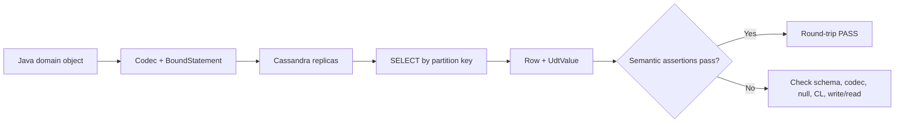

# Mapping Collections and UDTs to Java and Round-Trip Read–Write Testing with Apache Cassandra

> **Chapter:** Collections and UDTs  
> **Module:** `DATABASE_ENGINE_WIDE_COLUMN_CASSANDRA` — distributed Cassandra architecture, the wide-column model, partition keys, query-driven table design, replication, read/write consistency, compaction, repair, error handling, and Java connectivity. This lesson focuses on **Java Driver 4.x**, CQL types `list`, `set`, `map`, and UDTs, and *write → read → assert* testing against a real cluster.

## 1. Goal: Verify What Reads Back, Not Just That `INSERT` Threw No Error

Suppose an application stores learner preferences:

- `pinned_lessons` list: **ordered**, allowing two identical lesson IDs if business logic permits.
- `tags` set: **no duplicates**, with no guaranteed display order.
- `preferences` map: each configuration key maps to one value.
- `primary_address` UDT: a small address stored as a **frozen snapshot**.
- `saved_addresses` map: a few labeled addresses, each value being a **frozen UDT**.
- `contact` UDT: fields can be updated **individually** when using a column-level non-frozen UDT.

A successful Java `session.execute(insert)` call **is not enough** to prove mapping correctness: bind markers could be misaligned, `set` confused with `list`, a UDT field omitted, `null` treated as an empty collection, or a non-idempotent list append automatically retried. Real round-trip testing must write the data, read it back by primary key, and assert each value according to **the CQL type's semantics**.



**Test scope:** Examples use a dedicated lab keyspace and table, not production schemas. Integration tests run against real Cassandra; mocking `CqlSession` can test method-call logic, yet **never validates** encoding, schema, metadata, replication, or storage behavior.

## 2. CQL → Java Driver 4.x Type Mapping Table

| CQL type | Typical Java type | Writing to `BoundStatement` | Reading from `Row` |
| --- | --- | --- | --- |
| `text`, `varchar` | `String` | `setString(...)` | `getString(...)` |
| `uuid`, `timeuuid` | `UUID` | `setUuid(...)` | `getUuid(...)` |
| `int`, `bigint` | `int`/`Integer`, `long`/`Long` | `setInt(...)`, `setLong(...)` | `getInt(...)`, `getLong(...)` |
| `timestamp` | `Instant` | `setInstant(...)` | `getInstant(...)` |
| `date` | `LocalDate` | `setLocalDate(...)` | `getLocalDate(...)` |
| `decimal` | `BigDecimal` | `setBigDecimal(...)` | `getBigDecimal(...)` |
| `list<text>` | `List<String>` | `setList(..., String.class)` | `getList(..., String.class)` |
| `set<text>` | `Set<String>` | `setSet(..., String.class)` | `getSet(..., String.class)` |
| `map<text,text>` | `Map<String,String>` | `setMap(..., String.class, String.class)` | `getMap(..., String.class, String.class)` |
| UDT `address_type` | `UdtValue` | `setUdtValue(...)` | `getUdtValue(...)` |
| `map<text,frozen<address_type>>` | `Map<String,UdtValue>` | `setMap(..., String.class, UdtValue.class)` | `getMap(..., String.class, UdtValue.class)` |

`getList`, `getSet`, and `getMap` are typed driver APIs—they do not return JSON strings. The `Class<T>` arguments let the codec registry decode elements properly. **Never** assume `getString("tags")` reads a `set<text>`, or that `Map<String,Object>` automatically encodes arbitrary Java objects.

Other scalar types (`boolean`, `double`, `blob`, `varint`, `duration`, etc.) have their own mappings. This lesson focuses on collections and UDTs; when using complex types without built-in codecs, define and register a **codec** appropriate to your driver version rather than relying on `.toString()` or ad-hoc JSON.

## 3. Preparing a Re-Runnable Lab Schema

The examples use a dedicated keyspace `cassandra_java_lab`. The `SimpleStrategy` snippet with replication factor `1` **is suited only to a single local datacenter for learning**, not production configuration. Real clusters must evaluate `NetworkTopologyStrategy`, datacenters, RF, and consistency per requirements.

```sql
-- Run once in cqlsh for the lab environment.
CREATE KEYSPACE IF NOT EXISTS cassandra_java_lab
WITH replication = {
    'class': 'SimpleStrategy',
    'replication_factor': 1
};

CREATE TYPE IF NOT EXISTS cassandra_java_lab.address_type (
    street text,
    city text,
    country_code text,
    postal_code text
);

CREATE TYPE IF NOT EXISTS cassandra_java_lab.contact_type (
    email text,
    phone text
);

CREATE TABLE IF NOT EXISTS cassandra_java_lab.user_payload (
    user_id uuid PRIMARY KEY,
    pinned_lessons list<text>,
    tags set<text>,
    preferences map<text, text>,
    primary_address frozen<address_type>,
    saved_addresses map<text, frozen<address_type>>,
    contact contact_type,
    revision int
);
```

After creating types and tables, confirm **schema agreement** across nodes before having the Java Driver call `prepare` or build a `UdtValue`. A type appearing on the single node that just received DDL does not prove metadata has converged across the cluster. `IF NOT EXISTS` avoids duplicate-creation errors, yet **does not verify** that an existing type or table matches your exact desired schema; if the name already exists with different fields, reconcile manually or through a migration system.

### Why Include Both Frozen and Non-Frozen UDTs?

`primary_address frozen<address_type>` stores **the entire address in one cell**. In `saved_addresses`, each map entry has key `'home'` or `'work'`, while the UDT value inside is **frozen**, so editing one field requires replacing **the whole UDT at that entry**. Column `contact contact_type` is **column-level non-frozen**: you can update `contact.email` without rewriting `contact.phone` when your Cassandra version supports standard field-level operations.

## 4. Creating `CqlSession` and Managing Connection Lifecycle

In Java Driver 4.x, applications normally maintain **a single shared `CqlSession`** across many queries. Never open and close a session per request or per row. Example connecting to local Cassandra:

```java
import com.datastax.oss.driver.api.core.CqlSession;
import java.net.InetSocketAddress;

// datacenter1 is only a sample datacenter name for a local cluster.
// Match your real configuration; never guess when connecting to production.
try (CqlSession session = CqlSession.builder()
        .addContactPoint(new InetSocketAddress("127.0.0.1", 9042))
        .withLocalDatacenter("datacenter1")
        .build()) {
    // Initialize repositories, prepare once, execute many queries.
}
```

Production clusters may use authentication, TLS, multiple contact points, or cloud bundles; those parameters belong in deployment configuration rather than hardcoded in repositories. The driver manages connection pools, schema metadata, the codec registry, and retry/timeout configuration; creating new sessions repeatedly adds startup overhead and defeats the prepared statement cache.

**Version note:** This lesson uses APIs from the Java Driver 4.x family under package `com.datastax.oss.driver.api.*`. Lock dependency versions compatible with your JDK and Cassandra server, and check API notes for your exact driver release. Never mix Driver 3.x (`com.datastax.driver.core.*`) snippets into 4.x code.

## 5. Writing `list`, `set`, and `map` with Prepared Statements

Write the statement with **explicit bind marker order**:

```sql
INSERT INTO cassandra_java_lab.user_payload (
    user_id, pinned_lessons, tags, preferences, revision
) VALUES (?, ?, ?, ?, ?);
```

From Java:

```java
import com.datastax.oss.driver.api.core.CqlSession;
import com.datastax.oss.driver.api.core.cql.PreparedStatement;
import java.util.List;
import java.util.Map;
import java.util.Set;
import java.util.UUID;

void saveCollections(CqlSession session, UUID userId) {
    PreparedStatement insert = session.prepare(
        "INSERT INTO cassandra_java_lab.user_payload " +
        "(user_id, pinned_lessons, tags, preferences, revision) " +
        "VALUES (?, ?, ?, ?, ?)"
    );

    List<String> lessons = List.of("partition", "repair", "partition");
    Set<String> tags = Set.of("java", "cassandra");
    Map<String, String> prefs = Map.of("language", "vi", "theme", "dark");

    // Bound values must match the exact position and type of each ? marker.
    session.execute(insert.bind(userId, lessons, tags, prefs, 1));
}
```

**Reading semantics accurately:**

- `list<text>`: `['partition','repair','partition']` **preserves order** and retains **both occurrences** of `'partition'`.
- `set<text>`: `{'java','cassandra'}` has no duplicate elements. **Never assert iteration order** of a `Set` or its text rendering in `cqlsh`.
- `map<text,text>`: compare key/value pairs; **never assert traversal order** or `.toString()` formatting on a map.
- Cassandra does not store Java `ArrayList`, `HashSet`, or `HashMap` runtime classes; the driver encodes them into the declared **CQL data types**.

In production applications, **prepare statements once and reuse them** in the repository; calling `session.prepare` inside the method here keeps the snippet self-contained, not a per-request pattern.

## 6. Reading Collections Back from `Row`

```java
import com.datastax.oss.driver.api.core.cql.Row;
import java.util.List;
import java.util.Map;
import java.util.Set;

Row row = session.execute(
    selectByUser.bind(userId)
).one();

if (row == null) {
    throw new IllegalStateException("No row for user");
}

List<String> lessons = row.getList("pinned_lessons", String.class);
Set<String> tags = row.getSet("tags", String.class);
Map<String, String> prefs = row.getMap(
    "preferences", String.class, String.class
);

// Assert by semantic equality, not formatted string representations.
assert lessons.equals(List.of("partition", "repair", "partition"));
assert tags.equals(Set.of("java", "cassandra"));
assert "vi".equals(prefs.get("language"));
```

This snippet assumes `selectByUser` is a pre-prepared `SELECT pinned_lessons, tags, preferences FROM cassandra_java_lab.user_payload WHERE user_id = ?` statement and all columns have values. In business code, never use Java's `assert` keyword to validate requests because the JVM can disable assertions; use explicit validation or JUnit `Assertions` in tests.

### A Missing Row and a `null` Column Are Two Different Cases

`ResultSet.one() == null` means the query returned zero rows. A `Row` may still exist while a collection column was never written or was deleted, in which case object getters can return `null` depending on codec and storage state. For **non-frozen** collections, do not build business logic strictly on the distinction between **an empty collection** and **an unwritten column**; empty representation and handling can vary by version. Whenever "explicitly chosen as empty" must differ from "unset," add an explicit **status column** instead of inferring from the collection.

### Common Mapping Errors

| Symptom | Likely cause | Fix |
| --- | --- | --- |
| `CodecNotFoundException` | Java class/generic type mismatches CQL, missing codec | Verify schema, use typed `getList/getSet/getMap`, or register a codec |
| `IllegalArgumentException` during bind | Wrong parameter order or type | Match every `?` against the prepared statement columns |
| Wrong `tags` ordering | Treating a `set` like a `list` | Compare via `Set.equals`; use `list` or a clustering key if order matters |
| `NullPointerException` iterating collection | Column has no data | Distinguish `Row` null from column null; define business defaults |
| Large payload despite small page size | One row holds a huge collection | Paginate **rows** using a clustering-key schema instead of unbounded collections |

## 7. Constructing `UdtValue` from Metadata

A UDT has a **type name** and fields within a keyspace. The Java Driver uses `UserDefinedType` as the schema descriptor and `UdtValue` as the value encoded against that schema. Do not pass an arbitrary `Map<String,Object>` into a UDT column expecting the driver to match every field automatically:

```java
import com.datastax.oss.driver.api.core.CqlIdentifier;
import com.datastax.oss.driver.api.core.CqlSession;
import com.datastax.oss.driver.api.core.data.UdtValue;
import com.datastax.oss.driver.api.core.type.UserDefinedType;

UserDefinedType addressType = session.getMetadata()
    .getKeyspace(CqlIdentifier.fromCql("cassandra_java_lab"))
    .orElseThrow()
    .getUserDefinedType(CqlIdentifier.fromCql("address_type"))
    .orElseThrow();

UdtValue address = addressType.newValue()
    .setString("street", "12 Duong So 1")
    .setString("city", "Ho Chi Minh City")
    .setString("country_code", "VN")
    .setString("postal_code", "700000");

PreparedStatement writeAddress = session.prepare(
    "UPDATE cassandra_java_lab.user_payload " +
    "SET primary_address = ? WHERE user_id = ?"
);

session.execute(writeAddress.bind(address, userId));
```

Here, `primary_address` is **`frozen<address_type>`**. `SET primary_address = ?` writes **the entire address snapshot**. If the application only intends to change `city` while the existing snapshot holds other fields recently updated by another writer, building a `UdtValue` from stale constants and rewriting it can cause a **lost update**. Use an authoritative full-state source, writer coordination, or CAS/versioning when business rules forbid overwrites.

### Reading `UdtValue` Back by Field Name

```java
Row result = session.execute(readAddress.bind(userId)).one();
if (result != null) {
    UdtValue saved = result.getUdtValue("primary_address");
    if (saved != null) {
        String city = saved.getString("city");
        String code = saved.getString("postal_code");
        // Map into a domain DTO using explicit field names.
    }
}
```

This assumes `readAddress` is a prepared `SELECT primary_address FROM cassandra_java_lab.user_payload WHERE user_id = ?` statement. For fields newly added via `ALTER TYPE ... ADD`, older records can read back `null` for the new field; never call `getString(...)` assuming it is always non-null.

## 8. Collections Nesting UDTs: `map<text,frozen<address_type>>`

With `saved_addresses`, we want **each label** (`'home'`, `'work'`) to point to **a complete UDT value**. Values inside the map must match the `frozen<address_type>` schema:

```java
UdtValue home = addressType.newValue()
    .setString("street", "12 Duong So 1")
    .setString("city", "Ho Chi Minh City")
    .setString("country_code", "VN")
    .setString("postal_code", "700000");

UdtValue work = addressType.newValue()
    .setString("street", "8 Tran Phu")
    .setString("city", "Da Nang")
    .setString("country_code", "VN")
    .setString("postal_code", "550000");

Map<String, UdtValue> addressMap = Map.of(
    "home", home,
    "work", work
);

PreparedStatement writeAddresses = session.prepare(
    "UPDATE cassandra_java_lab.user_payload " +
    "SET saved_addresses = ? WHERE user_id = ?"
);

session.execute(writeAddresses.bind(addressMap, userId));
```

Reading the data back:

```java
Row row = session.execute(readAddresses.bind(userId)).one();
Map<String, UdtValue> addresses = row == null
    ? null
    : row.getMap("saved_addresses", String.class, UdtValue.class);

if (addresses != null && addresses.containsKey("work")) {
    String workCity = addresses.get("work").getString("city");
}
```

`readAddresses` is `SELECT saved_addresses FROM ... WHERE user_id = ?`. The outer map can be updated **by key**, yet each key's `UdtValue` remains **frozen**: change `'work'`'s `city` by reassigning **the full UDT at key `'work'`**, not with syntax like `saved_addresses['work'].city = ...`.

```sql
-- Equivalent CQL: replace only the UDT value for key 'work'.
UPDATE cassandra_java_lab.user_payload
SET saved_addresses['work'] = {
    street: '8 Tran Phu', city: 'Ha Noi',
    country_code: 'VN', postal_code: '100000'
}
WHERE user_id = 11111111-1111-4111-8111-111111111111;
```

Never let `saved_addresses` grow to hundreds of thousands of UDTs in one row; collections remain bounded by **row and partition size limits**, and driver paging paginates **rows**, not individual map entries.

## 9. Non-Frozen UDTs: Updating One Field Instead of Replacing the Snapshot

Column `contact contact_type` supports column-level single-field updates:

```sql
UPDATE cassandra_java_lab.user_payload
SET contact.email = 'an@example.org'
WHERE user_id = 11111111-1111-4111-8111-111111111111;

UPDATE cassandra_java_lab.user_payload
SET contact.phone = '0900000000'
WHERE user_id = 11111111-1111-4111-8111-111111111111;
```

Corresponding Java:

```java
PreparedStatement patchEmail = session.prepare(
    "UPDATE cassandra_java_lab.user_payload " +
    "SET contact.email = ? WHERE user_id = ?"
);
session.execute(patchEmail.bind("an@example.org", userId));

PreparedStatement readContact = session.prepare(
    "SELECT contact FROM cassandra_java_lab.user_payload " +
    "WHERE user_id = ?"
);
Row contactRow = session.execute(readContact.bind(userId)).one();
UdtValue contact = contactRow == null
    ? null
    : contactRow.getUdtValue("contact");
String email = contact == null ? null : contact.getString("email");
```

**Different write granularity:** `SET contact.email = ?` does not require reading `phone` and rewriting the whole UDT. Two writers modifying `email` and `phone` in different cells can preserve both edits after convergence. If two writers modify **the same field**, they still contend by timestamp; non-frozen does not automatically create multi-field transactions.

For a frozen UDT, `SET primary_address.city = ...` is **invalid**; the whole UDT must be replaced. In repository design, expose separate methods like `patchContactEmail` and `replacePrimaryAddress` to make the difference explicit and prevent accidental full-snapshot overwrites.

## 10. `NULL`, Empty, and `UNSET` When Binding in Java

A PATCH API must distinguish **omitted fields**, **fields sent as `null`**, and **fields with empty values**. This is one of the top sources of unintended tombstones:

| API input | Example business intent | Java Driver / CQL |
| --- | --- | --- |
| `preferences` field omitted | Do not modify map | `UNSET` marker or omit column mutation |
| `preferences: null` | Delete map column, if API defines it so | `setToNull(...)` or `DELETE preferences` |
| `preferences: {}` | Request collection to become empty | Assign empty value; check non-frozen/frozen semantics |
| `display_name: ""` | Write empty string | `setString(..., "")`, distinct from `null` |
| `tags: ["java"]` | Write whole set per DTO contract | `Set<String>` and matching mutation |

Example using `BoundStatementBuilder` in Java Driver 4.x:

```java
import com.datastax.oss.driver.api.core.cql.BoundStatementBuilder;

PreparedStatement patch = session.prepare(
    "UPDATE cassandra_java_lab.user_payload " +
    "SET tags = ?, preferences = ? WHERE user_id = ?"
);

BoundStatementBuilder b = patch.boundStatementBuilder();
b.unset(0); // tags omitted in PATCH: leave unchanged.
b.setToNull(1); // preferences explicitly sent as null: delete map.
b.setUuid(2, userId);
session.execute(b.build());
```

**`UNSET` is not stored data**; it instructs the server not to apply a mutation for that marker (where CQL permits). `setToNull` carries **delete semantics** for a column or value and can produce tombstones. Never use `UNSET` on primary keys or mandatory bind positions. Never assume `List.of()` equals "no collection": sending an empty list to replace state differs from an `UNSET` marker.

For non-frozen collections, how empty collections and unwritten columns are represented can make it hard for an app to tell "not yet chosen" apart from "explicitly chose empty." Whenever that distinction matters, add an explicit **status column** (such as `preferences_initialized boolean`) rather than depending on how the driver surfaces empty collections.

## 11. What Steps Belong in a Round-Trip Test?

A thorough test verifies both **the encoding/decoding protocol** and **update intent**:

1. **Arrange:** prepare keyspace, types, table, session, and a unique `user_id` per test. Wait for schema readiness before calling `prepare`.
2. **Act — write:** use bound statements to write `list`, `set`, `map`, `UdtValue`, and nested maps; never hand-serialize into JSON strings.
3. **Act — read:** run `SELECT ... WHERE user_id = ?` with the full primary key. Verify whether `Row` exists.
4. **Assert — semantic equality:** `List.equals` must preserve order and duplicates, `Set.equals` ignores order, `Map.equals` checks key/value pairs, and UDTs check **fields by name**.
5. **Act — update:** modify a non-frozen UDT field, a map entry, or a set member; read back and verify all other fields/entries remain intact.
6. **Cleanup:** delete only the test's own row, never dropping shared tables or keyspaces. Tombstones are acceptable in lab runs; if tests run heavily, plan appropriate cleanup/TTL policies.

Do not write tests assuming "a write followed immediately by a `CL=ONE` read always sees the latest value" as a universal guarantee for multi-replica clusters. With replication factor 1 in a single-node lab, a basic test checks mapping. With higher RF, configure **read/write consistency levels**, retries, and replica sync to match the test contract.

### Suggested Assertion Matrix

| Type | Written value | Post-read assertion | Mistake to avoid |
| --- | --- | --- | --- |
| `list<text>` | `['a','b','a']` | Exact order, exact 3 elements | Using a `Set` as expected, losing duplicates |
| `set<text>` | `{'java','cql'}` | Equal member set only | Asserting iterator order |
| `map<text,text>` | `{'language':'vi'}` | Map has exact keys/values | Comparing `.toString()` |
| Frozen UDT | `{street,city,...}` | Each field equals expected value | Checking only that object is non-null |
| `map<text,frozen<UDT>>` | `home`, `work` | Both entries and each UDT's fields match | Treating map values as `Map<String,String>` |
| Non-frozen UDT | `email`, `phone` | Patching email does not erase phone | Rewriting full UDT from a stale snapshot |
| `null` / `UNSET` | Delete vs. preserve | Verify behavioral difference | Treating both markers as equivalent |

## 12. JUnit 5 Integration Test: Write → Read → Assert

The example below runs against a **real lab Cassandra instance** using the schema from Section 3. The test uses one `CqlSession`, prepares statements once, generates a random ID to isolate each run, and cleans up its created row. In a Java project, add compatible dependencies for Java Driver 4.x and JUnit Jupiter; manage versions in Maven/Gradle rather than relying on transitive dependencies.

```java
import com.datastax.oss.driver.api.core.CqlIdentifier;
import com.datastax.oss.driver.api.core.CqlSession;
import com.datastax.oss.driver.api.core.cql.PreparedStatement;
import com.datastax.oss.driver.api.core.cql.Row;
import com.datastax.oss.driver.api.core.data.UdtValue;
import com.datastax.oss.driver.api.core.type.UserDefinedType;
import org.junit.jupiter.api.AfterAll;
import org.junit.jupiter.api.BeforeAll;
import org.junit.jupiter.api.Test;

import java.net.InetSocketAddress;
import java.util.List;
import java.util.Map;
import java.util.Set;
import java.util.UUID;

import static org.junit.jupiter.api.Assertions.*;

class CassandraCollectionRoundTripTest {
    private static CqlSession session;
    private static PreparedStatement insert;
    private static PreparedStatement select;
    private static PreparedStatement patchContactEmail;
    private static PreparedStatement delete;
    private static UserDefinedType addressType;

    @BeforeAll
    static void connect() {
        // Schema cassandra_java_lab already exists and has converged.
        session = CqlSession.builder()
            .addContactPoint(new InetSocketAddress("127.0.0.1", 9042))
            .withLocalDatacenter("datacenter1")
            .build();

        addressType = session.getMetadata()
            .getKeyspace(CqlIdentifier.fromCql("cassandra_java_lab"))
            .orElseThrow()
            .getUserDefinedType(CqlIdentifier.fromCql("address_type"))
            .orElseThrow();

        insert = session.prepare(
            "INSERT INTO cassandra_java_lab.user_payload " +
            "(user_id, pinned_lessons, tags, preferences, " +
            "primary_address, saved_addresses, revision) " +
            "VALUES (?, ?, ?, ?, ?, ?, ?)"
        );
        select = session.prepare(
            "SELECT pinned_lessons, tags, preferences, " +
            "primary_address, saved_addresses, contact, revision " +
            "FROM cassandra_java_lab.user_payload WHERE user_id = ?"
        );
        patchContactEmail = session.prepare(
            "UPDATE cassandra_java_lab.user_payload " +
            "SET contact.email = ? WHERE user_id = ?"
        );
        delete = session.prepare(
            "DELETE FROM cassandra_java_lab.user_payload " +
            "WHERE user_id = ?"
        );
    }

    private static UdtValue address(String street, String city) {
        return addressType.newValue()
            .setString("street", street)
            .setString("city", city)
            .setString("country_code", "VN")
            .setString("postal_code", "700000");
    }

    @Test
    void shouldRoundTripCollectionsAndUdt() {
        UUID userId = UUID.randomUUID(); // Test row ID, not a timeuuid.
        List<String> lessons = List.of("partition", "repair", "partition");
        Set<String> tags = Set.of("java", "cql");
        Map<String, String> prefs = Map.of("language", "vi", "theme", "dark");
        UdtValue home = address("12 Duong So 1", "Ho Chi Minh City");
        UdtValue work = address("8 Tran Phu", "Da Nang");

        try {
            session.execute(insert.bind(
                userId, lessons, tags, prefs, home,
                Map.of("home", home, "work", work), 1
            ));

            Row row = session.execute(select.bind(userId)).one();
            assertNotNull(row);
            assertEquals(lessons, row.getList("pinned_lessons", String.class));
            assertEquals(tags, row.getSet("tags", String.class));
            assertEquals(prefs, row.getMap(
                "preferences", String.class, String.class
            ));
            assertEquals(1, row.getInt("revision"));

            UdtValue readHome = row.getUdtValue("primary_address");
            assertNotNull(readHome);
            assertEquals("Ho Chi Minh City", readHome.getString("city"));
            assertEquals("12 Duong So 1", readHome.getString("street"));

            Map<String, UdtValue> addresses = row.getMap(
                "saved_addresses", String.class, UdtValue.class
            );
            assertNotNull(addresses);
            assertEquals(Set.of("home", "work"), addresses.keySet());
            assertEquals("Da Nang", addresses.get("work").getString("city"));

            // Non-frozen UDT: patch one field without altering primary_address.
            session.execute(patchContactEmail.bind("an@example.org", userId));
            Row updated = session.execute(select.bind(userId)).one();
            assertNotNull(updated);
            UdtValue contact = updated.getUdtValue("contact");
            assertNotNull(contact);
            assertEquals("an@example.org", contact.getString("email"));
            assertEquals("Ho Chi Minh City",
                updated.getUdtValue("primary_address").getString("city"));
        } finally {
            session.execute(delete.bind(userId));
        }
    }

    @AfterAll
    static void close() {
        if (session != null) session.close();
    }
}
```

### Why Is This Test Meaningful?

- `UUID.randomUUID()` is valid for a `uuid` column; do not pass it to a `timeuuid` column requiring UUID version 1.
- Both occurrences of `'partition'` in the list are verified for **both order and count**.
- `Set.equals` and `Map.equals` do not depend on **display order**.
- `UdtValue` is verified **by field name**; on the nested map, the test verifies `'work'` explicitly instead of merely asserting non-null.
- Patching `contact.email` leaves the frozen `primary_address` column untouched.
- `finally` cleans up **only this test's row**, avoiding interference with other tests. If cleanup fails due to a cluster error, use lab cleanup/TTL policies rather than converting cleanup into a whole-table wipe.

This example does not replace multi-node testing across varying consistency and retry configs. To test distributed behaviors, provision appropriate RF and run controlled replica-fault simulations **outside production**.

## 13. Testing Updates, Deletes, TTLs, and Missing Values

An initial round-trip test is not enough if your API also supports element-level updates. Cases to test separately:

### 13.1. Map Entry and Set Member Mutations

```sql
-- Update a single map entry.
UPDATE cassandra_java_lab.user_payload
SET preferences['theme'] = 'light'
WHERE user_id = 11111111-1111-4111-8111-111111111111;

-- Add a new member to the set.
UPDATE cassandra_java_lab.user_payload
SET tags = tags + {'distributed'}
WHERE user_id = 11111111-1111-4111-8111-111111111111;

-- Delete one map entry (can create a tombstone).
DELETE preferences['theme']
FROM cassandra_java_lab.user_payload
WHERE user_id = 11111111-1111-4111-8111-111111111111;
```

**Assertions:** Updating `theme` preserves `language`; adding `'distributed'` creates no duplicate if already present; deleting `theme` keeps `language`. Do not compare against an old map snapshot if statements run sequentially on the same row without resetting test state.

### 13.2. Non-Idempotent List Appends

```sql
UPDATE cassandra_java_lab.user_payload
SET pinned_lessons = pinned_lessons + ['compaction']
WHERE user_id = 11111111-1111-4111-8111-111111111111;
```

Sending the same append **twice** can add **two occurrences**. When testing retries, preserve the true assumption: after a timeout, the client does not know whether the first mutation applied; never assert that every retry always adds exactly one element. On the driver statement, set `.setIdempotent(false)` on appends so retry and speculative-execution policies checking that flag do not automatically replay it. This flag does not stop application code from re-issuing requests manually.

### 13.3. TTLs and Test Timing

```sql
UPDATE cassandra_java_lab.user_payload USING TTL 60
SET preferences['temporary_banner'] = 'on'
WHERE user_id = 11111111-1111-4111-8111-111111111111;
```

In a non-frozen map, TTL applies to the entry written in this mutation rather than existing entries. To test expiration, avoid putting `Thread.sleep(60000)` inside every build: tests become slow and flaky under scheduling/clock/cluster jitter. Isolate expiration checks into a dedicated integration suite using an appropriately short TTL, bounded read polling, and API-level state assertions—never guess exactly when compaction removes physical bytes.

### 13.4. `null` and Empty Collections

When `preferences` was never written or was deleted, it can read back as `null`. Assigning `{}` to a non-frozen collection may be represented differently from `frozen` depending on version; if the product must distinguish "unconfigured" from "configured as empty," tests must verify a separate **business status column**, not merely `getMap(...) == null`.

### 13.5. Conditions and Versions

```sql
UPDATE cassandra_java_lab.user_payload
SET revision = 2
WHERE user_id = 11111111-1111-4111-8111-111111111111
IF revision = 1;
```

Statements with `IF` are lightweight transactions; tests must inspect `[applied]`, not just verify that `execute()` threw no exception. When `[applied] = false`, logic must re-read state or report a conflict. If the goal is protecting a frozen UDT from lost updates, put **both the snapshot replacement and the revision increment inside the same conditional statement**, and enforce that protocol across every writer.

## 14. Test Isolation: Avoiding Test Contention and Dirty Data

A parallel integration test suite becomes flaky if multiple tests share **the same partition key** and reset or delete each other's rows. Best practices:

- Allocate **a fresh UUID per test** and reuse that exact UUID throughout the test's steps; tests should never touch the same row unless **deliberately testing concurrency**.
- Prepare isolated schemas and avoid `DROP KEYSPACE` or `TRUNCATE` when multiple tests or workers share a cluster.
- Set **explicit expected data** before each test; never rely on JUnit execution order or leftover data from earlier tests.
- Clean up only rows created by that test via primary key; if cleanup fails, flag the environment for policy-based cleanup instead of wiping other tests' data.
- Whenever `CREATE TYPE` or `ALTER TYPE` runs, wait for **schema agreement** and driver metadata refresh; never run competing DDL within the same suite.
- Put timeout, repair, node-restart, and network-fault tests in a **separate suite** against an isolated cluster rather than mixing them into fast mapping smoke tests.

For CI integration tests, you can run a dedicated Cassandra container (such as Testcontainers) or a centrally managed test cluster. Either way, pin **Cassandra version**, network/local datacenter, CQL port, schema bootstrap, and container lifecycle for reproducible results. You do not need to simulate replica failures just to test `list` or UDT codecs.

## 15. When to Use Domain DTOs Instead of Raw `UdtValue`

At the database layer, `UdtValue` enables exact interaction against Cassandra metadata. In the business layer, map to dedicated classes or records so Cassandra details do not leak across the codebase:

```java
record AddressDto(
    String street,
    String city,
    String countryCode,
    String postalCode
) {}

static AddressDto toDto(UdtValue value) {
    if (value == null) return null;
    return new AddressDto(
        value.getString("street"),
        value.getString("city"),
        value.getString("country_code"),
        value.getString("postal_code")
    );
}

static UdtValue toUdt(UserDefinedType type, AddressDto dto) {
    if (dto == null) return null;
    return type.newValue()
        .setString("street", dto.street())
        .setString("city", dto.city())
        .setString("country_code", dto.countryCode())
        .setString("postal_code", dto.postalCode());
}
```

Manual mappers keep missing-field handling and migrations explicit. Driver 4.x also offers an **Object Mapper** with annotations/DAOs and custom codecs; those features reduce boilerplate, provided builds and mappings match your exact version. Never assume an annotation mapper automatically handles deeply nested structures or protects against lost updates.

**Distinguish DTOs from UDT schemas:** An `AddressDto` may carry validation, defaults, or transient fields, whereas `UdtValue` mirrors actual Cassandra schema fields. When `postal_code` is added via `ALTER TYPE`, older rows can read back `null`; mappers must preserve that state or apply defaults according to **defined business rules**, never fabricating fake values in round-trip tests.

## 16. Schema Evolution: Metadata and Codecs Must Stay in Sync

Suppose the type is extended:

```sql
ALTER TYPE cassandra_java_lab.address_type ADD delivery_note text;
```

`ALTER TYPE ADD` does not backfill values across existing rows. Right after DDL, a `UserDefinedType` obtained from **stale metadata** may lack `delivery_note`, causing `.setString("delivery_note", ...)` to fail on the client. Deployment workflows must verify node schema agreement, driver metadata refresh, and prepared-statement/mapper compatibility.

Migration tests should cover:

1. Writing a UDT using the V1 schema (without `delivery_note`).
2. Extending the type in an isolated environment and waiting for schema/metadata convergence.
3. Reading the V1 value with a V2 client; `delivery_note` may be `null` and must be handled cleanly.
4. Writing a V2 value with a V2 client; reading back and asserting both old and new fields.
5. Verifying legacy client compatibility per rollout strategy—**taking extra care with frozen UDTs**, since an older client rewriting a snapshot can erase the new field.

Do not assume you can convert `frozen<address_type>` to non-frozen in place via a simple `ALTER TABLE`. For breaking changes, consider a **V2 type/column** and an expand → migrate/backfill → contract workflow with checkpoints, load throttling, retries, and a rollback plan.

## 17. Replication, Consistency, Timeouts, and Round-Trip Reliability

In distributed Cassandra, an `INSERT` succeeding at a chosen consistency level proves only that **enough replicas acknowledged the write**; a subsequent `SELECT` may hit different replicas under the read consistency level. When evaluating read-after-write, know **RF, write CL, read CL, datacenter topology, and replica health**. A common formula used under specific assumptions is `R + W > RF` (within the matching replica scope), but you must understand its assumptions regarding topology, repair, and failures; never apply it mechanically across every consistency level or cluster.

```java
import com.datastax.oss.driver.api.core.DefaultConsistencyLevel;
import com.datastax.oss.driver.api.core.cql.BoundStatement;

BoundStatement write = insert.bind(
    userId, lessons, tags, prefs, home, addresses, 1
).setConsistencyLevel(DefaultConsistencyLevel.LOCAL_QUORUM);

BoundStatement read = select.bind(userId)
    .setConsistencyLevel(DefaultConsistencyLevel.LOCAL_QUORUM);

session.execute(write);
Row row = session.execute(read).one();
```

This is an **example** of setting CL on a statement, not a configuration valid for an RF=1 keyspace or every topology. In an RF=1 lab, use a matching CL; in RF=3 or multi-datacenter tests, choose CL and serial consistency for LWTs per business requirements. Running `LOCAL_QUORUM` in a datacenter with RF=1 still acknowledges against that single replica and **never turns RF=1 into replica fault tolerance**.

### A Timeout Does Not Mean Nothing Was Written

If the driver receives a write timeout, some replicas may already have persisted the mutation; the application must not conclude "no data was written." Retrying `SET preferences['theme']='dark'` with a fixed value behaves very differently from retrying `pinned_lessons = pinned_lessons + ['cql']`:

- **Keyed map patch:** usually easier to retry when setting a fixed value on the same key, though timestamp contention and concurrent writers still apply.
- **List append:** **not idempotent**; retries can append duplicate items.
- **Frozen UDT replacement:** re-sending a fixed snapshot expresses clear state, yet still risks overwriting a newer snapshot under concurrency or timestamp skew.
- **LWT:** inspect `[applied]`; on timeout, reconcile state rather than re-sending blindly.

Design dedicated round-trip retry tests per mutation type instead of slapping one "idempotent" flag onto every statement in a repository.

## 18. Performance: Small Collections/UDTs and Partition Size

A Java `List<String>` or `Map<String,UdtValue>` can hold huge numbers of elements, yet **that does not mean you should cram all of them into one Cassandra column**. Non-frozen collections have many cells; frozen UDTs/collections are typically one atomic cell; both remain constrained by payload size, memory, network bandwidth, and SSTable operations.

| Practical requirement | Suitable model | Why |
| --- | --- | --- |
| User has 5 ordered pinned lessons | Small `list<text>` | Read whole with the row; simple |
| User has 20 tags | Small `set<text>` | Unique membership; value-based updates |
| 10 configuration properties | Small `map<text,text>` | Keyed patching; convenient whole-map reads |
| One primary address | Small `frozen<UDT>` | Snapshot with explicit schema |
| Address with independently edited email/phone | Non-frozen UDT or regular columns | Field-level mutations avoid rewriting whole snapshots |
| Millions of activities per user | **Multi-row table** with buckets + clustering | Time-ordered pagination; avoids huge partitions/lists |
| Lookup all users with `city = X` | **City read table** or evaluated index | UDTs do not turn inner fields into partition keys |

When a table needs chronological history queries, one schema option is:

```sql
CREATE TABLE cassandra_java_lab.activities_by_user_day (
    user_id uuid,
    event_day date,
    event_time timeuuid,
    activity_type text,
    PRIMARY KEY ((user_id, event_day), event_time)
) WITH CLUSTERING ORDER BY (event_time DESC);

SELECT event_time, activity_type
FROM cassandra_java_lab.activities_by_user_day
WHERE user_id = 11111111-1111-4111-8111-111111111111
  AND event_day = '2026-11-21'
LIMIT 20;
```

Here, `LIMIT` and Java Driver paging bound and navigate **event rows**, rather than trying to paginate elements inside a huge `list` on a single row. If one day accumulates too many events, use smaller buckets or shards, factoring in read fan-out. `timeuuid` must receive a valid UUID version 1; ordinary `UUID.randomUUID()` generates UUID version 4 and is invalid for binding to a `timeuuid` column.

## 19. Monitoring Tombstones, Repair, and Compaction in Load Tests

Functional round-trip tests validate encoding/decoding, yet cannot measure the long-term impact of write/delete workloads on collections or UDTs. In production-like staging load tests, monitor:

- **p50/p95/p99 latency** for `INSERT`, field `UPDATE`, frozen snapshot replacement, and `SELECT`.
- **Row/partition size** and collection length at p95/p99, not just averages.
- **Tombstones read** when deleting map entries or UDT fields frequently, or when TTLs expire.
- **SSTable count, compaction backlog, and disk I/O** when replacing large collections or UDTs.
- **Replica read/write timeouts, retries, repair progress, and streaming** during node failures or schema rollouts.

Deleting a map entry, a UDT field, or an entire collection can generate **tombstones**; compaction purges deletion metadata only when safety conditions hold. **Repair** keeps replicas synchronized to prevent deleted data from resurfacing if tombstones expire too early. Never lower `gc_grace_seconds` just to speed up tests or silence warnings on a table designed with unbounded collections.

In `cqlsh`, use `TRACING ON;` selectively to inspect staging requests followed by `TRACING OFF;`; tracing adds overhead and must not be left on broadly in production. `nodetool tablestats`, `tablehistograms`, and driver metrics aid diagnostics, though exact metrics vary by Cassandra version and distribution.

## 20. Common Mapping Mistakes and How to Avoid Them

| Mistake | Consequence | Fix |
| --- | --- | --- |
| Passing JSON strings into a UDT column | Type/codec mismatch, loss of schema safety | Build `UdtValue` from `UserDefinedType` or register a dedicated codec |
| Passing a Java `List` into `set<text>` without type matching | Type mismatch when binding | Use `Set<String>` and `setSet`/typed binds |
| Asserting `set`/`map` iteration order | Flaky tests and false expectations | Assert `Set`/`Map` equality |
| Reading a `null` column and calling `.size()` | `NullPointerException` | Define defaults/lifecycle; check `Row` and column separately |
| Sending `null` for absent fields in PATCH | Accidental deletes and tombstones | Use `UNSET` or statements including only present fields |
| Updating a frozen UDT like a non-frozen one | CQL forbids field patching | Send full snapshot; coordinate writers when needed |
| Creating a new session or preparing per request | Init overhead, pool/metadata pressure | Reuse `CqlSession` and prepared statements |
| Blindly retrying list appends | Duplicate elements created | Evaluate idempotency; use stable IDs/separate tables where needed |
| Using `UUID.randomUUID()` for `timeuuid` | UUID v4 fails expected type | Use valid v1 timeuuids and reuse them across retries |
| Using `setPageSize(20)` to slice a huge UDT/list | Single row still carries huge payload | Design a multi-row table with clustering keys |
| Running `ALTER TYPE` then using stale metadata | Client codecs miss the new field | Wait for schema agreement, refresh metadata, sequence rollout |
| Running integration tests against production tables | Junk data/tombstones, key collisions | Dedicated test schema/cluster, unique keys, controlled cleanup |

## 21. Self-Practice Exercises

**Exercise 1 — List and set:** Write `['a','b','a']` to `list<text>` and read it back. Why must the list assertion differ from a `set<text>` assertion?  
**Hint:** Lists preserve order and duplicates, whereas sets retain only unique members. `Set.equals` ignores iteration order.

**Exercise 2 — Map:** Write a test storing `preferences = {'language':'vi', 'theme':'dark'}`, then update only `theme` to `light`. Which value must remain?  
**Hint:** `language='vi'` remains if only the `theme` entry is updated; do not overwrite the entire map with a snapshot missing keys.

**Exercise 3 — Nested UDT:** Write `saved_addresses = {'home': UDT_A, 'work': UDT_B}`. Which Java type should you assert when reading back?  
**Hint:** `Map<String,UdtValue>`, verifying each label key and the fields inside each `UdtValue`.

**Exercise 4 — Frozen snapshot:** Two clients read the same `primary_address`, each edits a different field, and both rewrite the full UDT. Why can one edit be lost?  
**Hint:** A frozen UDT is one cell; two snapshots contend on the entire value. Use versioning/CAS or a single writer.

**Exercise 5 — Non-frozen field:** Update `contact.email` while preserving `contact.phone`. Which CQL/Java statement should you use?  
**Hint:** `UPDATE ... SET contact.email = ? WHERE user_id = ?`; then read the UDT back and assert `phone` stays unchanged.

**Exercise 6 — `null`/`UNSET`:** A PATCH omits `tags`, while the DTO defaults `tags=null`. Why is sending `null` to CQL wrong?  
**Hint:** `null` in a mutation can delete the collection. Distinguish absent fields from explicit nulls; use `UNSET` or omit `tags` from the statement.

**Exercise 7 — Test isolation:** Two JUnit tests share the same `user_id` and both run `DELETE` cleanup. What happens when they run in parallel?  
**Hint:** One test deletes or mutates the other's data, causing flaky failures. Give every test its own UUID; never truncate shared tables.

**Exercise 8 — Version change:** You add `delivery_note` to a UDT. Why can a test reading V1 data with V2 code return `null`?  
**Hint:** `ALTER TYPE` changes schema without backfilling; clients must refresh metadata and handle missing fields.

**Exercise 9 — Retry:** After a write timeout on a list append, should you unconditionally re-send the statement and assert the element appears only once?  
**Hint:** No. The first write may have succeeded. If exactly-once is a business invariant, use stable IDs/deduplication or a separate table.

**Exercise 10 — Partitioning:** A user has one million activities and you need the 20 newest. Why do `list<UDT>` and `setPageSize(20)` fail here?  
**Hint:** Driver paging paginates rows, not collection elements. Use an events table with time buckets, clustering keys, and row `LIMIT`/paging.

## 22. Pre-Integration Checklist for Java Services

- [ ] Cassandra cluster and Java Driver **versions match**, with schema agreement and valid local datacenter/configuration.
- [ ] Uses **one long-lived `CqlSession`** and reuses prepared statements instead of calling `prepare` per request.
- [ ] `list`, `set`, and `map` are bound and read using **matching Java types and generic codecs**, never coerced into ad-hoc JSON/strings.
- [ ] Round-trip tests verify **list order and duplicates**, and compare `set`/`map` independent of iteration order.
- [ ] UDTs are constructed from **`UserDefinedType` metadata**, verifying individual fields and handling `null`/un-backfilled fields.
- [ ] Distinguished **frozen UDT snapshots** from **non-frozen field patches**, including nested maps/lists of frozen UDTs.
- [ ] PATCH APIs distinguish **absent, `null`, empty collections, and `UNSET`**, preventing accidental tombstones.
- [ ] Integration tests use **isolated keys**, safe cleanup, never `TRUNCATE` shared tables, and never run replica-fault tests against production.
- [ ] Read/write CL, replication, timeouts, and **retry idempotency** are designed per mutation type.
- [ ] Chose a **partition/clustering-keyed table** instead of large collections whenever multi-item pagination or reverse lookups are required.
- [ ] Monitored **latency, tombstones, compaction, repair, and partition size** as load scales.

## 23. Key Takeaways

- Java Driver 4.x maps **`list` ↔ `List<T>`**, **`set` ↔ `Set<T>`**, and **`map` ↔ `Map<K,V>`**; assert semantics around **order, duplicates, and key/value pairs**.
- Use **`UserDefinedType.newValue()`** to build `UdtValue`; read back via **`Row.getUdtValue()`** and `UdtValue.getString(...)`/other typed getters.
- Collections nesting UDTs can read as **`Map<String,UdtValue>`** with `frozen` values; updating a map key differs from reaching inside a UDT field.
- **Frozen UDTs** update as **a single-cell snapshot**; **column-level non-frozen UDTs** allow patching single fields. Under concurrent writes, evaluate lost updates and LWT/versioning when invariants apply.
- **`NULL`, empty collections, and `UNSET` are not equivalent**; `UNSET` skips mutating a marker, whereas `null` typically means delete and can create tombstones.
- Proper round-trip tests **write → read by primary key → assert by CQL type semantics**, covering updates, deletes, `null`s, timeouts/retries, and schema evolution.
- Lab tests do not replace understanding **replication, consistency, compaction, repair, and partition sizes** when running applications on distributed Cassandra.
