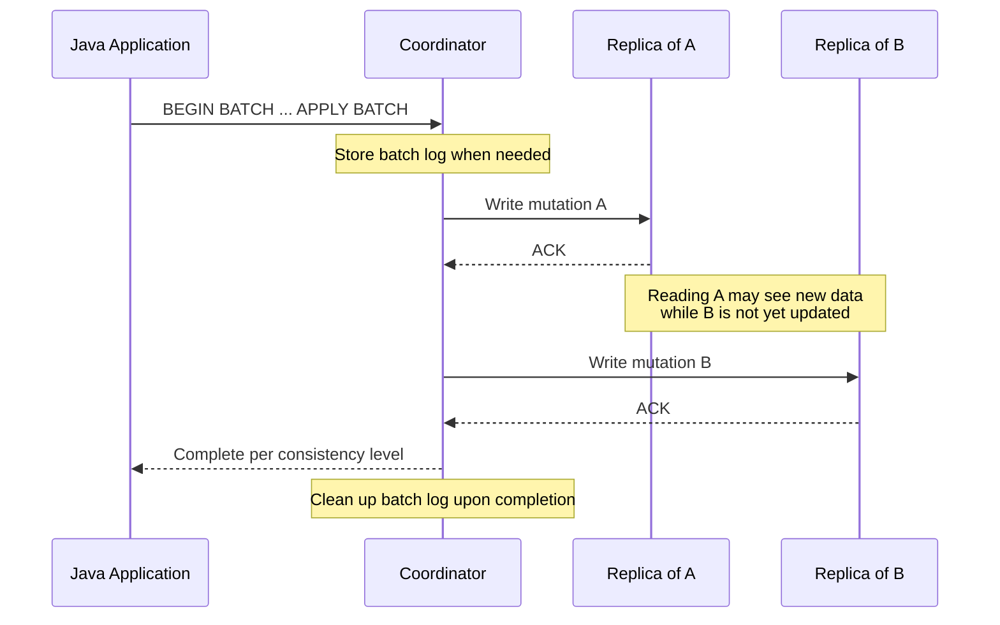

# Purpose of BATCH and Differences from Standard SQL Transactions

## 1. Context: Why Does Cassandra Have `BATCH`?

Apache Cassandra is a distributed **wide-column** database. Data is distributed across nodes by **partition key** and replicated according to the replication configuration. When designing tables around queries, a single business entity may be written to multiple tables or multiple partitions to serve different read patterns.

In CQL, `BATCH` groups a set of **write** statements (`INSERT`, `UPDATE`, `DELETE`) into a single logical operation. It is useful when related changes need to be sent and tracked together, especially when updating redundant copies of data serving multiple queries.

However, **`BATCH` in Cassandra is not equivalent to a general ACID transaction in an SQL database**. It does not provide a mechanism to read a consistent snapshot across multiple partitions, does not support SQL-style `ROLLBACK`, and does not turn multiple distributed writes into an instantaneous, fully isolated operation.

After this lesson, you should be able to distinguish between three questions:

1. Are the statements in a batch **eventually applied** (atomicity)?
2. Can concurrent readers **observe intermediate states** (isolation)?
3. Does grouping statements into a batch make writes **faster** (performance)?

These three questions have different answers and must be evaluated alongside **partition scope**.

## 2. CQL Syntax and Appropriate Use Cases

```sql
BEGIN BATCH
    INSERT INTO ...;
    UPDATE ...;
    DELETE FROM ...;
APPLY BATCH;
```

`BEGIN BATCH` defaults to a **logged batch**. There are two other variants to know: `BEGIN UNLOGGED BATCH` (skips the batch log) and `BEGIN COUNTER BATCH` (dedicated to counter updates). Batches are intended for data-modifying statements; they are not used to group `SELECT` statements into a read transaction.

### Example A — Writing Multiple Rows in the Same Partition

Suppose a Java application stores the line items of an order and frequently queries all items by `order_id`:

```sql
CREATE TABLE order_items_by_order (
    order_id uuid,
    item_id uuid,
    sku text,
    quantity int,
    PRIMARY KEY ((order_id), item_id)
);

BEGIN BATCH
    INSERT INTO order_items_by_order (order_id, item_id, sku, quantity)
    VALUES (
        11111111-1111-1111-1111-111111111111,
        aaaaaaaa-aaaa-aaaa-aaaa-aaaaaaaaaaaa,
        'BOOK-01', 2
    );
    INSERT INTO order_items_by_order (order_id, item_id, sku, quantity)
    VALUES (
        11111111-1111-1111-1111-111111111111,
        bbbbbbbb-bbbb-bbbb-bbbb-bbbbbbbbbbbb,
        'PEN-02', 5
    );
APPLY BATCH;
```

Both rows share the same `order_id`, so they belong to **the same partition** in the same table. This is a case where a batch often makes sense: the changes are related, share a partition key, and Cassandra can process them via a single-partition optimized path. Changes within the same partition have stronger isolation guarantees than batches spanning multiple partitions: readers are not exposed to a partial set of changes *within the scope of a single partition*.

> **Note:** Having multiple `INSERT` statements does not automatically mean you need a `BATCH`. If the commands are not logically related in the domain, they can be executed as independent writes. The primary goal is ensuring correctness within an appropriate scope, not optimizing the number of SQL/CQL statements by bundling as many commands together as possible.

### Example B — Updating Two Tables Serving Two Queries

Suppose the system reads an order by ID while also listing orders by customer. Following the principle of **query-driven table design**, the application has two tables:

```sql
CREATE TABLE orders_by_id (
    order_id uuid PRIMARY KEY,
    customer_id uuid,
    status text
);

CREATE TABLE orders_by_customer (
    customer_id uuid,
    order_id uuid,
    status text,
    PRIMARY KEY ((customer_id), order_id)
);

BEGIN BATCH
    INSERT INTO orders_by_id (order_id, customer_id, status)
    VALUES (
        22222222-2222-2222-2222-222222222222,
        33333333-3333-3333-3333-333333333333,
        'CREATED'
    );
    INSERT INTO orders_by_customer (customer_id, order_id, status)
    VALUES (
        33333333-3333-3333-3333-333333333333,
        22222222-2222-2222-2222-222222222222,
        'CREATED'
    );
APPLY BATCH;
```

This is a **multi-partition batch** because the data resides in two tables with different partition keys. A logged batch helps Cassandra store recovery information so that the mutations in the batch can be fully applied after a failure. However, during execution, a query might see the record in `orders_by_id` before the corresponding record appears in `orders_by_customer`.

The application must accept the possibility of **temporarily non-simultaneous visibility** between the two query patterns and account for this when designing APIs, read logic, retries, and data completeness checks.

## 3. Logged Batch, Unlogged Batch, and Counter Batch

| Batch Type | Opening Syntax | Mechanism and Purpose | Common Misconceptions to Avoid |
|---|---|---|---|
| **Logged** (default) | `BEGIN BATCH` | Uses a **batch log** for mutations spanning multiple partitions to help complete writes after a coordinator failure. Suitable when multiple representations of data must be updated as one logical operation. | Guaranteeing eventual completion does not mean all partitions become visible at the exact same time. |
| **Unlogged** | `BEGIN UNLOGGED BATCH` | Does not use a batch log; reduces log-writing overhead when batch-level recovery guarantees are not needed. Typically only considered for mutations already in the same partition or when the application deliberately accepts partial results. | Across multiple partitions, some writes may succeed while others fail without a batch log to drive completion. |
| **Counter** | `BEGIN COUNTER BATCH` | Groups increment/decrement operations on `counter` columns; cannot be mixed with regular column updates. | Counters have their own write and retry behavior: repeating an increment operation can increase the count multiple times. |

**A batch log is not a commit log, is not a data replica, and does not replace replication/repair.** In principle, the coordinator of a logged batch writes batch information for recovery, sends the mutations to the appropriate replicas, and cleans up the batch record upon completion. If the coordinator fails mid-way, the stored information allows a replay mechanism to resume incomplete mutations.

A logged batch can achieve **eventual atomicity**: once the cluster recovers and the recovery information remains available, the mutations accepted into the batch will be completed. During the transition window, read states may still be out of sync across partitions. This is not a transaction with a rollback to the prior state upon failure.

### `UNLOGGED BATCH` Example

```sql
BEGIN UNLOGGED BATCH
    UPDATE order_items_by_order
    SET quantity = 3
    WHERE order_id = 11111111-1111-1111-1111-111111111111
      AND item_id = aaaaaaaa-aaaa-aaaa-aaaa-aaaaaaaaaaaa;

    UPDATE order_items_by_order
    SET quantity = 6
    WHERE order_id = 11111111-1111-1111-1111-111111111111
      AND item_id = bbbbbbbb-bbbb-bbbb-bbbb-bbbbbbbbbbbb;
APPLY BATCH;
```

Both updates remain within a single partition. If you change this to span different `order_id` values, re-evaluate your completion-on-failure requirements; do not choose `UNLOGGED` simply because it looks faster.

## 4. Comparison with SQL Transactions

In a relational database management system such as PostgreSQL, a transaction can modify multiple rows and tables under **ACID** guarantees. The exact isolation behavior depends on the DBMS and isolation level, but transactions have explicit `COMMIT`/`ROLLBACK` boundaries. Cassandra prioritizes distributed architecture, availability, and scalability; `BATCH` provides a narrower set of guarantees.

| Criterion | Standard SQL Transaction | Cassandra `BATCH` |
|---|---|---|
| Goal | Groups operations into an ACID transactional unit. | Groups related mutations, especially for eventually consistent writes across multiple data representations. |
| Atomicity | `COMMIT` all changes or `ROLLBACK` the transaction's changes on failure. | Logged batches help mutations be **eventually** applied in full; no SQL-style rollback. Unlogged multi-partition batches have no batch-level recovery guarantee. |
| Isolation | Enforced by the DBMS according to the chosen isolation level (e.g., Read Committed, Repeatable Read, Serializable). | No cross-partition isolation; concurrent queries may observe partial results. |
| Reads and writes in one transaction | Can read, check conditions, and write within the same transaction. | `BATCH` only groups mutations; it does not create a multi-partition read snapshot to drive write decisions. |
| Transaction control | `BEGIN`, `COMMIT`, `ROLLBACK`, and savepoints depending on the system. | `BEGIN BATCH` ... `APPLY BATCH`; no `ROLLBACK` or equivalent savepoints. |
| Performance | Optimized around the RDBMS transaction engine, indexes, and locks. | Cross-partition batches incur extra coordination and batch log overhead; not faster than individual writes by default. |

### Money Transfer Scenario Illustrating the Difference

In a relational database, a transaction might execute:

```sql
BEGIN;

UPDATE accounts SET balance = balance - 500 WHERE account_id = 1;
UPDATE accounts SET balance = balance + 500 WHERE account_id = 2;

COMMIT;
-- While the transaction is uncommitted or encounters an error, the DB handles it via transactional semantics,
-- including rollback capability and the isolation rules of the active isolation level.
```

**Do not translate this pattern directly into two `UPDATE` statements inside a Cassandra `BATCH` to implement money transfers.** The two balances may reside on two different partitions. A logged batch does not provide balance checks, multi-account transaction isolation, or corresponding rollback. Workflows with strict invariants such as "never create or lose money" require a more suitable design, such as a dedicated transactional system or a ledger model with its own orchestration and correctness controls.

## 5. Failures, Consistency Level, and Reading Intermediate States

Consider a logged batch updating `orders_by_id` (partition A) and `orders_by_customer` (partition B):



The diagram illustrates **a possible observed ordering**; it does not claim that all mutations are always sent sequentially. Cassandra may send writes to replicas in parallel, and failure points can vary.

If the application receives `WriteTimeout`, `WriteFailure`, or loses connection:

- **Do not conclude that the batch was definitely not written.** The request may have reached the coordinator, and some or all mutations may already have been applied.
- With a **logged batch**, the batch log mechanism may continue completing the mutations after the failure. Meanwhile, queries against the two partitions may still return different states.
- With an **unlogged multi-partition batch**, the application must be prepared for the scenario where only a subset of mutations succeeded.
- **Retry** decisions must account for idempotency: repeating an `INSERT`/`UPDATE` that sets a fixed value is generally safer to retry than operations with cumulative effects, especially counters.

Consistency levels such as `ONE`, `LOCAL_QUORUM`, or `QUORUM` determine how many replicas must satisfy the read/write operation condition as configured, but they **do not create a cross-partition snapshot or transaction**. Even when using quorum for both reads and writes, the application should not expect all partitions in a batch to appear simultaneously to every reader.

## 6. Why Large Multi-Partition Batches Often Slow Down the System

In Cassandra, each partition key determines how data is routed. When a batch contains dozens or thousands of distinct partitions, the coordinator must orchestrate many write paths and may have to manage a batch log along with a large volume of mutations. This puts pressure on the network, memory, queues, and replicas; an overly large batch also increases the risk of timeouts and batch size warnings.

Distinguish between two ways of sending 100 commands:

- **100 write commands targeting a single partition:** a small batch may make sense if the application needs to update the same group of data consistently at the partition level.
- **100 independent write commands targeting 100 partitions:** a large batch is usually **not** a performance optimization. A Java application should typically use prepared statements and asynchronous writes with **bounded concurrency**, track per-statement errors, and choose an appropriate consistency level.

Batches do not alter partition key design, do not merge partitions into a new partition, and do not replace proper choices for replication factor, compaction, or repair. If you must write to multiple tables to serve queries, consider limiting the number of redundant data copies and the consistency scope the business truly needs.

## 7. Quick Decision Rules for Java Applications

| Requirement | Recommended Approach |
|---|---|
| Modifying a few rows **within the same partition** that are logically related. | Small batch; design the partition key so all related rows reside in the same partition when appropriate. |
| Updating tables serving multiple queries where mutations span **multiple partitions**. | Only use a logged batch when eventual completion guarantees are needed; accept that readers may observe intermediate states. |
| Bulk loading or writing across many **independent** partitions. | Prepared statements + async/bounded concurrency, chunking the work and managing retries. |
| Needing conditional **read-check-write** transactions on a single partition. | Explore **lightweight transactions (LWT)** with `IF` and their trade-offs; do not assume a standard `BATCH` supports compare-and-set. |
| Needing multi-account/multi-partition transactions with strict invariants. | Design the transaction at an appropriate layer; do not rely solely on Cassandra batches. |
| Updating `counter` columns. | Use `COUNTER BATCH` when needed, never mix with regular mutations; be especially careful with retries and double-counting risk. |

### Checklist Before Writing `BEGIN BATCH`

1. Do all mutations belong to **the same partition**, or do they span multiple partitions/tables?
2. Do you need **eventual atomicity**, **read-time isolation**, or just convenience for sending multiple writes? Identify the actual requirement.
3. If an error or timeout occurs, how does the application handle **indeterminate** outcomes and retries?
4. Is the batch size small, is the partition count bounded, and are latency and batch warnings monitored?
5. If using counters or increment/decrement operations, could retries cause duplicate effects?

## 8. Self-Check Questions

**Question 1.** A logged batch writes to two partitions. After one partition already has the new data, can a query on the other partition still see the old data?

**Answer:** Yes. Logged batches help complete mutations after a failure, but they do not provide isolation across multiple partitions.

**Question 2.** Is bundling 10,000 writes into 10,000 partitions using `BEGIN BATCH` always faster than 10,000 asynchronous writes?

**Answer:** No. Large cross-partition batches add coordination overhead and can increase latency, coordinator load, and timeout risk.

**Question 3.** If the application receives no response on `APPLY BATCH`, can we assume all changes were rolled back?

**Answer:** No. The outcome may be indeterminate; some or all mutations may already have been written, and a logged batch may still be replaying.

**Question 4.** Does using `LOCAL_QUORUM` for both reads and writes make two partitions in a batch appear simultaneously?

**Answer:** No. The consistency level controls replica acknowledgments per operation; it does not provide isolated cross-partition transactions.

## 9. Key Takeaways

`BATCH` is a tool for **grouping mutations with guarantees that depend on batch type and partition scope**. Small single-partition batches fit when rows are related; multi-partition logged batches help ensure writes complete eventually but can expose intermediate states; multi-partition unlogged batches lack equivalent recovery mechanisms. Do not use Cassandra `BATCH` as an SQL transaction with `COMMIT`/`ROLLBACK`, and do not treat large batches as a way to speed up distributed writes.
