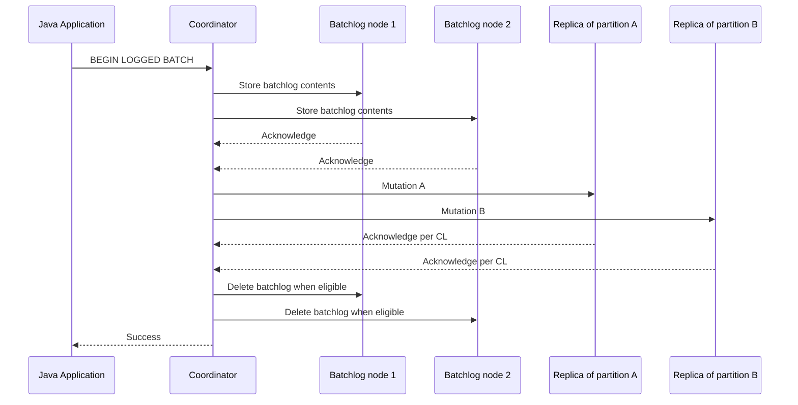
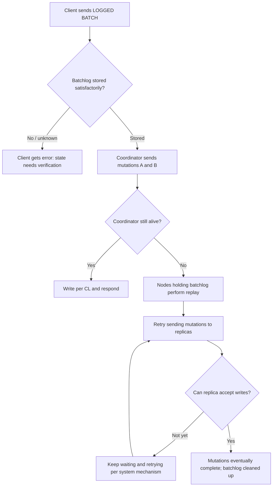

# LOGGED BATCH, Batchlog, and Completion Guarantees When the Coordinator Fails

## 1. Objectives and Context

In Apache Cassandra, data is distributed across multiple nodes by **partition key**. A write query may affect one partition or multiple partitions; these partitions may have different replica sets. Therefore, sending multiple CQL statements in a single call does not automatically create an ACID transaction as in a relational database.

This lesson belongs to the **BATCH and counters** topic of the `DATABASE_ENGINE_WIDE_COLUMN_CASSANDRA` module, focusing on distributed architecture, query-driven table design, replication, consistency levels, and error handling from a Java application. After studying this lesson, you should be able to:

- Explain what `BEGIN LOGGED BATCH` guarantees when writing across multiple partitions and what it **does not** guarantee.
- Describe the role of the **batchlog**, coordinator, batchlog replicas, and the **replay** mechanism when the coordinator stops functioning.
- Distinguish between failures during batchlog writes and failures after the batchlog has been written; understand why a timeout does not mean the operation was not executed.
- Choose between `LOGGED`, `UNLOGGED`, `COUNTER` batches, and independent writes based on business consistency requirements.
- Write CQL, integrate the Java driver, design safe retries, and establish an incident observation plan.

## 2. What Problem Does `LOGGED BATCH` Solve?

Suppose an order needs to be written to two tables serving **two different queries**:

1. `orders_by_id` to retrieve an order by `order_id`.
2. `orders_by_customer` to list orders by `customer_id`.

This is the familiar *query-based denormalization* pattern in Cassandra: the same business event is represented across multiple partitions/tables. If the application sends two independent `INSERT` statements and loses connection after the first one, the second table may not yet have the data. When the requirement is that **all mutations must eventually complete**, a small `LOGGED BATCH` can be appropriate.

```sql
CREATE TABLE orders_by_id (
    order_id uuid PRIMARY KEY,
    customer_id uuid,
    placed_at timestamp,
    status text,
    total_cents bigint
);

CREATE TABLE orders_by_customer (
    customer_id uuid,
    placed_at timestamp,
    order_id uuid,
    status text,
    total_cents bigint,
    PRIMARY KEY ((customer_id), placed_at, order_id)
) WITH CLUSTERING ORDER BY (placed_at DESC, order_id ASC);

BEGIN LOGGED BATCH
    INSERT INTO orders_by_id
        (order_id, customer_id, placed_at, status, total_cents)
    VALUES
        (11111111-1111-4111-8111-111111111111,
         22222222-2222-4222-8222-222222222222,
         '2026-11-21T03:00:00Z', 'NEW', 150000);

    INSERT INTO orders_by_customer
        (customer_id, placed_at, order_id, status, total_cents)
    VALUES
        (22222222-2222-4222-8222-222222222222,
         '2026-11-21T03:00:00Z',
         11111111-1111-4111-8111-111111111111,
         'NEW', 150000);
APPLY BATCH;
```

`LOGGED` is written explicitly to show intent; regular batches default to logged. The two statements in the example go to two partitions under two different partition keys. They do **not** become a single partition and are not isolated like an SQL transaction.

### Atomicity Must Be Understood Over Time

For batches writing across multiple partitions, Cassandra documentation uses the term *atomicity* to mean: once the batchlog has been safely stored and the system remains capable of recovery, the system has a mechanism to **eventually execute all mutations in the batch**, even if the coordinator fails. This is an **eventual completion** guarantee, not a single commit point where every reader sees all changes simultaneously.

| Property | Multi-Partition `LOGGED BATCH` |
| --- | --- |
| Groups multiple mutations into one CQL request | Yes |
| Writes a batchlog record to recover an incomplete operation | Yes |
| Helps complete mutations after a coordinator failure | Yes, provided the batchlog was durably persisted and the cluster can recover |
| All readers see all changes at the same time | **No** |
| Rolls back all mutations if one mutation fails | **No** |
| Transaction with locks, isolation, and cross-partition constraints like an RDBMS | **No** |
| Inherently faster than parallel write statements | **No** |

For a brief window, a query against table A may see the new record while a query against table B does not yet see it. That behavior can occur even when the `LOGGED BATCH` will eventually complete. If the problem requires financial decisions, preventing overdrafts, exclusive inventory allocation, or conditional concurrent updates, a multi-partition `LOGGED BATCH` must not be treated as an ACID transaction.

## 3. Coordinator, Batchlog, and Write Flow

The **coordinator** is the node that receives the client request and coordinates the replicas for each partition. For a multi-partition logged batch, Cassandra writes the batch contents to a **batchlog** replicated to other nodes before sending the mutations to their destinations. After successful processing, the batchlog entries are removed; if the coordinator dies mid-way, the nodes holding the batchlog still have enough information to replay any mutations that may not have completed.



The diagram only illustrates the **happy path**; the number of replicas per partition and acknowledgment details depend on the replication factor (RF), consistency level (CL), topology, and Cassandra version. Typically, the batchlog is stored on two nodes selected within the cluster so it does not depend solely on the coordinator's memory or disk. You should not assume the batchlog resides on every replica storing the business data.

Key steps to understand:

1. The client sends a batch to the coordinator. The coordinator parses the batch and identifies the mutations by partition.
2. The coordinator requests writing the batchlog for redundancy; **this phase must meet its success criteria** before proceeding with the normal write path.
3. The coordinator distributes the mutations to the replicas of each partition. The replicas respond according to the operation's CL requirement.
4. Once sufficient evidence of processing exists (or necessary handoff mechanisms, such as hints), the batchlog can be cleaned up.
5. If execution is interrupted after the batchlog has been written, the nodes holding the batchlog will **replay** the mutations so they have a chance to reach their destinations when the replicas recover.

The batchlog is a **recovery log for incomplete batches**; it does not replace each replica's commit log. The commit log protects writes already received by a node on that node itself; the batchlog protects the intent to execute the entire group of mutations if the coordination layer fails.

### Replay Does Not Mean Exactly-Once Execution

Batchlog replay may resend a mutation that a replica already received before the coordinator failed. Therefore, applications should design write operations to be safely repeatable (*idempotent*). With `INSERT`/`UPDATE` statements setting deterministic values for the same keys and managing timestamps appropriately, replay usually preserves the logical state. Operations whose outcome depends on execution count, such as **counter increments** or collection updates that append elements, are not safe to assume idempotent by default.

Replay happens asynchronously; completion time depends on the replay schedule, replica state, cluster load, and configuration. It is neither an instantaneous completion guarantee nor a guarantee of success if all required nodes are unrecoverable.

## 4. When the Coordinator Fails at Different Points

Suppose a batch contains mutations `A` and `B` across two partitions. Client-side observation and actual cluster state must be distinguished.

| Failure Point | What Can Happen | Correct Client-Side Conclusion |
| --- | --- | --- |
| **Before the batchlog is durably stored** | The coordinator has not entered the normal mutation write phase; there may be no durable batchlog yet, or acknowledgment status is unknown | There is no batchlog guarantee that both `A` and `B` will be applied; inspect/retry under a safe policy |
| **After durable batchlog, before dispatching mutations** | `A` and `B` may not appear immediately; batchlog nodes can replay | The request may time out, but write intent is stored for eventual completion |
| **After `A` reaches replicas, before `B` arrives** | Readers may see `A` before `B`; replay will attempt to send the remainder | Do not assume rollback or simultaneous visibility of data |
| **After mutations are accepted, before replying to client** | Data has actually been written; client still receives a connection error or timeout | A timeout can be an **indeterminate outcome**, not proof of failure |
| **Required batchlog/replicas permanently lost or cluster unrecoverable** | The replay mechanism may be unable to bring the batch to completion | Do not promise recovery beyond the cluster's durability and availability assumptions |

A typical sequence when the coordinator dies after persisting the batchlog:



The key takeaway is that **the client's state is not the data's state**. After a timeout, the question "did the batch succeed?" may not be answerable with a simple boolean. The application needs mechanisms to check business state, perform safe retries, and observe data convergence.

## 5. Consistency Level, Replication Factor, and Atomicity Are Three Different Concepts

Consider a datacenter with `RF = 3` where a client writes a batch with `LOCAL_QUORUM`:

- **RF = 3**: each partition is distributed across three replicas in that datacenter; partitions A and B may have different replica sets.
- **`LOCAL_QUORUM`**: each write path requires acknowledgment matching a majority of replicas in the local datacenter. It governs when the coordinator can return success, **not creating a single transaction** across A and B.
- **Batchlog**: records the batch's mutations to support eventual completion if coordination fails; this is a separate mechanism from read/write acknowledgment levels.

Reading with `LOCAL_QUORUM` also does not cause two partitions to change state simultaneously. A reader may run queries for A and B at different moments while replay is still in progress. With query-driven data modeling, read consistency must be evaluated against business needs, not just by looking at the `BEGIN LOGGED BATCH` syntax.

A CQL batch does not allow `SELECT` statements interspersed among writes; the statements grouped in a batch are `INSERT`, `UPDATE`, and `DELETE`. Listing order does not create a sequential script-like execution chain: writes with the same timestamp are subject to Cassandra's conflict resolution rules. If two mutations overwrite the same cell, timestamps and write relationships must be designed explicitly.

## 6. Comparing `LOGGED`, `UNLOGGED`, and `COUNTER` Batches

| Type | Batchlog | Appropriate Use Cases | Risks / Notes |
| --- | --- | --- | --- |
| `BEGIN LOGGED BATCH` | Yes for multi-partition batches; single-partition batches may be optimized as unlogged | A small number of mutations needing eventual completion together, such as updating denormalized tables for one entity | Adds batchlog write overhead and coordinator load; no cross-partition isolation |
| `BEGIN UNLOGGED BATCH` | No | Grouping mutations within **a single partition**, or where the application accepts partial success | If writing across multiple partitions and failing, only part of the batch may be applied |
| `BEGIN COUNTER BATCH` | Not used like a standard logged batch | Grouping `counter` column updates per CQL rules | Increments/decrements are not idempotent; retries can double-count |
| Independent asynchronous writes | No | Writing to many independent partitions, prioritizing throughput and handling per-statement success/failure | The application is responsible for data reconciliation when a statement fails |

**Do not use batches to speed up bulk loading** across thousands of partitions. Bundling many statements into a single coordinator can increase latency, consume memory, and trigger large batch warnings. When updating only the same partition, Cassandra can optimize a `LOGGED BATCH` onto an execution path without a distributed batchlog; this is the first reason to inspect partition keys before considering a batch.

Example showing how an interrupted request behaves differently:

```sql
-- Same partition (identical customer_id):
BEGIN UNLOGGED BATCH
    INSERT INTO events_by_customer (customer_id, event_time, event_id, action)
    VALUES (22222222-2222-4222-8222-222222222222,
            '2026-11-21T03:10:00Z',
            33333333-3333-4333-8333-333333333333, 'CREATED');
    INSERT INTO events_by_customer (customer_id, event_time, event_id, action)
    VALUES (22222222-2222-4222-8222-222222222222,
            '2026-11-21T03:11:00Z',
            44444444-4444-4444-8444-444444444444, 'PAID');
APPLY BATCH;
```

This snippet assumes an existing `events_by_customer` table with partition key `customer_id`; its purpose is to illustrate **same-partition** behavior, not to build a full schema. If the `customer_id` values were replaced with two different values, the unlogged batch would cross partition boundaries without a batchlog protecting group completion.

## 7. Handling Timeouts and Retries in Java

In the driver, a timeout may occur even though the data was already written. The native protocol distinguishes write timeout types, including:

- `BATCH_LOG`: timeout occurred **while writing the batchlog**. Do not jump to the conclusion that the request definitely had no effect, as the client does not yet know the full cluster-side state.
- `BATCH`: timeout of a **logged batch after the batchlog write phase**; the batchlog was successfully persisted along that path, but the request did not meet completion criteria before the timeout.
- `UNLOGGED_BATCH`: timeout of a batch without a batchlog; with multiple partitions, partial execution must be considered.

Example with Java Driver 4.x (API calls are illustrative; `CqlSession` is configured and created beforehand):

```java
import java.time.Instant;
import java.util.UUID;

import com.datastax.oss.driver.api.core.CqlSession;
import com.datastax.oss.driver.api.core.DefaultConsistencyLevel;
import com.datastax.oss.driver.api.core.cql.BatchStatement;
import com.datastax.oss.driver.api.core.cql.BoundStatement;
import com.datastax.oss.driver.api.core.cql.DefaultBatchType;
import com.datastax.oss.driver.api.core.cql.PreparedStatement;

public class OrderWriter {
    public static void writeOrder(
            CqlSession session, UUID orderId, UUID customerId,
            Instant placedAt, long totalCents) {

        PreparedStatement byId = session.prepare(
            "INSERT INTO orders_by_id " +
            "(order_id, customer_id, placed_at, status, total_cents) " +
            "VALUES (?, ?, ?, ?, ?)");
        PreparedStatement byCustomer = session.prepare(
            "INSERT INTO orders_by_customer " +
            "(customer_id, placed_at, order_id, status, total_cents) " +
            "VALUES (?, ?, ?, ?, ?)");

        BoundStatement a = byId.bind(
            orderId, customerId, placedAt, "NEW", totalCents);
        BoundStatement b = byCustomer.bind(
            customerId, placedAt, orderId, "NEW", totalCents);

        BatchStatement batch = BatchStatement.builder(DefaultBatchType.LOGGED)
            .addStatement(a)
            .addStatement(b)
            .setConsistencyLevel(DefaultConsistencyLevel.LOCAL_QUORUM)
            // Only set true after verifying the idempotency of the operation.
            .setIdempotent(true)
            .build();

        session.execute(batch);
    }
}
```

In this example, both statements simply set the same set of values for predetermined keys, without incrementing counters or appending elements to lists. You must ensure `orderId`, `placedAt`, and business values remain **identical across retries**. For workflows with competing writes or strict update ordering, timestamps/versions and a dedicated reconciliation policy must be designed; simply adding `.setIdempotent(true)` does not make an operation safe.

Practical handling procedure when `session.execute(batch)` throws a timeout:

1. Emit structured logs containing `orderId`, error type, write timeout type (`BATCH_LOG`, `BATCH`, etc.), consistency level, and timestamp; avoid logging sensitive payload data.
2. Do not report to the business layer that the operation "was rolled back." Mark the status as **indeterminate** and look up/reconcile using a stable key.
3. Only retry automatically when the operation is proven idempotent and aligned with the driver's retry policy. Drivers typically handle `BATCH_LOG` differently from `BATCH`; do not write infinite retry loops in application code.
4. If the system exposes an order-creation API, use an idempotency key / client-supplied fixed ID so two calls do not spawn two separate business entities.
5. Once the cluster recovers, verify that the read models have converged; reading immediately after a timeout is not final proof that replay will not occur.

Driver default retry policies vary by version and exception type. Do not claim that "every logged batch timeout is automatically retried": the safety boundary lies in **error type, idempotency, and driver configuration**.

## 8. Observability, Troubleshooting, and Operational Tuning

When suspecting slow batchlog replay, observe both the write path and the cluster rather than merely increasing application timeouts:

| Signal to Watch | Possible Meaning | What to Check |
| --- | --- | --- |
| Rising `BATCH_LOG` write timeouts | Unable to persist batchlog in time | Health of batchlog-storing nodes, inter-node network, disk latency, load level |
| Rising `BATCH` write timeouts | Batchlog passed write stage, but mutations did not reach CL on time | Slow replicas, partition hotspots, network congestion, batch size |
| Two tables temporarily out of sync | One mutation became visible before the other or replay is underway | Verify partitions, consistency level, replica status, and recovery progress |
| Large batch or multi-partition warnings | Coordinator is taking on too much work | Reduce mutations/partitions per batch, review write model |
| Prolonged replay after node outage | Recovery queue or replica write capacity has issues | Inspect logs, batchlog metrics, disk/network health, and load balancing |

In Cassandra versions that support it, you can **observe** the replay rate limit with:

```bash
nodetool getbatchlogreplaythrottle
```

The `nodetool setbatchlogreplaythrottle` command can adjust the limit, but this is an operational change that must be backed by live monitoring because faster replay can increase network and replica load. Metric names, configurations, and replay intervals can vary across versions; consult the documentation for your deployed Cassandra version before making production changes.

Beyond the batchlog, distributed systems also require **repair** and node failure recovery procedures to keep replicas consistent over the long term. The batchlog does not replace repair, does not automatically guarantee strong consistency for readers, and does not fix data errors caused by application modeling.

## 9. Design Decision: When Should You Use It?

**Consider `LOGGED BATCH`** when a single event must be written to a small number of denormalized tables/partitions, the application accepts that the two views may not appear simultaneously, and there is a requirement for mutations to continue completing if the coordinator fails.

**Choose another approach** if the requirement is high throughput for independent writes (asynchronous writes), updating multiple rows in the same partition (design for a single partition and use an appropriate batch), or conditional/cross-partition transactions needing strong isolation (revisit data boundaries, business orchestration mechanisms, or transaction features supported by your Cassandra version). In particular, counters must follow the `COUNTER BATCH` model and account for the non-idempotency of increments/decrements.

Checklist before introducing a logged batch into an application:

- **Partitions:** how many partitions does the batch touch, which tables do they belong to, and which replicas hold each partition?
- **Requirement:** do you need eventual completion guarantees or simultaneous visibility of all data? Those are two different requirements.
- **Size:** is the batch small enough to avoid overloading the coordinator and batchlog?
- **Retries:** are business keys, written values, and timestamps stable on replay? Are there any counters or non-idempotent writes?
- **Operations:** on a client timeout, are there mechanisms for reconciliation, alerting, and replay monitoring?

## 10. Self-Check Scenarios

**Scenario A.** A logged batch updates two partitions. The batchlog was saved successfully, the first partition received its write, and the coordinator abruptly shut down. When the application checks again, the second partition does not yet have the data. Can we conclude Cassandra lost the second mutation?

**Answer:** Not yet. The reader may be observing an unconverged state; the batchlog still serves as the source to replay the second mutation. Check the recovery status of the batchlog nodes and target replicas, then reconcile data by key.

**Scenario B.** The client receives a `WriteTimeout` of type `BATCH`. Can we tell the user "the order was definitely not created"?

**Answer:** No. Type `BATCH` indicates the batchlog already passed the write phase, but the client did not receive CL completion confirmation within the timeout. The state must be treated as indeterminate; do not assume deletion and do not blindly create a new order with a different ID.

**Scenario C.** You want to increment inventory on one product and decrement inventory on another so that neither ever goes negative. Is a two-partition logged batch sufficient?

**Answer:** No. Replay protects mutation completion, not condition checking or cross-partition transaction isolation. You must build an appropriate mechanism to preserve business invariants.

**Scenario D.** An ingestion job writes tens of thousands of independent partitions. Should we group them into one logged batch to save time?

**Answer:** No. The coordinator and batchlog will become bottlenecks; instead, split the work and use asynchronous writes with bounded concurrency, retries, and appropriate monitoring.

## 11. References

- [Apache Cassandra — CQL Data Manipulation, BATCH](https://cassandra.apache.org/doc/4.1/cassandra/cql/dml.html): syntax, `LOGGED`, `UNLOGGED`, `COUNTER`, and isolation limits.
- [Apache Cassandra — Guarantees](https://cassandra.apache.org/doc/stable/cassandra/architecture/guarantees.html): batch guarantees and differences from transactions.
- [Apache Cassandra — Native Protocol](https://cassandra.apache.org/doc/latest/cassandra/reference/native-protocol.html): meaning of the `BATCH` and `BATCH_LOG` write timeout types.
- [Apache Cassandra — nodetool getbatchlogreplaythrottle](https://cassandra.apache.org/doc/latest/cassandra/managing/tools/nodetool/getbatchlogreplaythrottle.html): observing replay throttling.
- [Apache Cassandra Java Driver — Retry policies](https://apache.googlesource.com/cassandra-java-driver/+/HEAD/manual/core/retries/README.md): retry policies and request idempotency.

**Key Takeaway:** A multi-partition `LOGGED BATCH` uses the batchlog so mutations can **eventually complete if the coordinator fails**. It does not provide simultaneous visibility of all changes, does not roll back like an SQL transaction, and should not be used as a bulk write acceleration technique.
