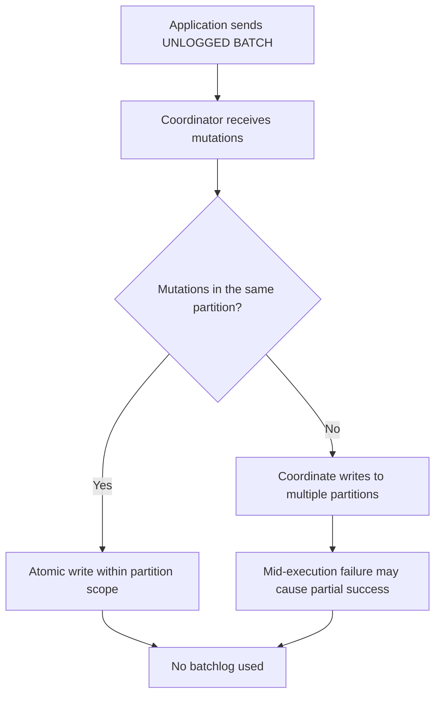

# UNLOGGED BATCH and Appropriate Scope of Use

In Apache Cassandra, `UNLOGGED BATCH` groups multiple CQL write statements into a single request sent to the coordinator **without creating a batchlog** to recover the entire group of writes upon failure. This option is especially useful when the changes belong to **the same partition**; if they span multiple partitions, you must accept the possibility that only a subset of operations will succeed. Understanding this boundary helps you design tables around queries, preserve data expectations, and avoid using batches as a way to speed up bulk writes.

## 1. Learning Objectives and Context

After this lesson, you will be able to:

- Explain the differences between `UNLOGGED BATCH`, `LOGGED BATCH`, and individual write statements.
- Accurately identify statements sharing the same partition key, even when a table uses a composite partition key.
- Choose batches based on atomicity requirements, tolerance for partial write success, and performance.
- Write batches in CQL, send batches from Java, and handle timeout scenarios safely.

Cassandra is a distributed wide-column database: the **partition key** determines how a partition is routed to replicas; **clustering columns** order rows within a partition. Read/write consistency levels (e.g., `LOCAL_QUORUM`) determine how many replicas must respond, whereas batch type determines how Cassandra groups and coordinates mutations. These are two distinct dimensions.

> **Design Rule:** Before choosing `UNLOGGED BATCH`, identify the partition key of *each* statement and the business requirement when a mid-execution failure occurs.

## 2. What Does `UNLOGGED BATCH` Actually Do?

A CQL batch has the form:

```sql
BEGIN UNLOGGED BATCH
    INSERT INTO ...;
    UPDATE ...;
APPLY BATCH;
```

The application sends one request containing multiple mutations. The coordinator receives the batch, distributes the mutations to the responsible replicas, and waits for responses according to the request's consistency level. With `UNLOGGED BATCH`, the coordinator **does not write a batchlog** to replay the entire batch if some mutations have not been applied. This has two consequences:

1. **Same partition:** Cassandra provides atomicity guarantees for mutations within that partition, even with an unlogged batch. This is the most natural use case.
2. **Multiple partitions:** There is no atomicity guarantee *across the entire set of partitions*. If a failure occurs during execution, some partitions may have received writes while others have not.

You should not interpret "one request" as "one ACID transaction like in a relational database." Batches do not provide a general rollback mechanism or snapshot isolation across multiple partitions. Furthermore, statements inside a batch do not form an ordered business script; do not rely on appearance order to simulate "read-then-write" or "write A before writing B" logic.



## 3. Identifying Partition Scope

Suppose an application stores events by account and day. A primary query is "fetch the event history of account X on day Y, newest first." We design the table:

```sql
CREATE TABLE account_events_by_day (
    account_id uuid,
    event_day date,
    event_time timestamp,
    event_id uuid,
    event_type text,
    payload text,
    PRIMARY KEY ((account_id, event_day), event_time, event_id)
) WITH CLUSTERING ORDER BY (event_time DESC, event_id ASC);
```

In this table, the partition key is **`(account_id, event_day)`**, not just `account_id`. Two rows with the same account but different days belong to **two different partitions**. Conversely, differing only in `event_time` or `event_id` means differing only in clustering keys, so they can still belong to the same partition.

Example suitable for `UNLOGGED BATCH`:

```sql
BEGIN UNLOGGED BATCH
    INSERT INTO account_events_by_day
        (account_id, event_day, event_time, event_id, event_type, payload)
    VALUES
        (11111111-1111-4111-8111-111111111111, '2026-11-21',
         '2026-11-21T08:00:00Z', 22222222-2222-4222-8222-222222222222,
         'LOGIN', '{"device":"mobile"}');

    INSERT INTO account_events_by_day
        (account_id, event_day, event_time, event_id, event_type, payload)
    VALUES
        (11111111-1111-4111-8111-111111111111, '2026-11-21',
         '2026-11-21T08:02:00Z', 33333333-3333-4333-8333-333333333333,
         'VIEW_ITEM', '{"item":"A-42"}');
APPLY BATCH;
```

Both mutations use the same `account_id` and `event_day`, so they belong to one partition in the same table. Distinguish this from writing to **two different tables**: even when key values match, each table has its own partition space. A cross-table batch must not be treated as touching only one partition.

Grouping many rows into a single partition must still respect design limits: overly large partitions increase read, compaction, and repair costs. If storing events over long periods, choose daily/hourly buckets based on actual traffic rather than growing a single partition indefinitely.

## 4. Common Mistake: Batching Across Multiple Partitions

The example below writes for two different days:

```sql
BEGIN UNLOGGED BATCH
    INSERT INTO account_events_by_day
        (account_id, event_day, event_time, event_id, event_type, payload)
    VALUES
        (11111111-1111-4111-8111-111111111111, '2026-11-21',
         '2026-11-21T23:59:00Z', 44444444-4444-4444-8444-444444444444,
         'CHECKOUT', '{}');

    INSERT INTO account_events_by_day
        (account_id, event_day, event_time, event_id, event_type, payload)
    VALUES
        (11111111-1111-4111-8111-111111111111, '2026-11-22',
         '2026-11-22T00:01:00Z', 55555555-5555-4555-8555-555555555555,
         'PAYMENT', '{}');
APPLY BATCH;
```

This is a **multi-partition batch** even though both rows share the same `account_id`. If the coordinator or network fails, the application may receive a timeout while the row for the 21st was written and the row for the 22nd was not. A timeout can also occur after both were written: **you cannot infer data state solely from receiving an exception**.

When two mutations are independent, sending separate statements (with concurrency limits) is usually simpler and avoids batch coordination overhead. When the business genuinely requires eventual guarantees that **all** mutations across multiple partitions are applied, consider `LOGGED BATCH`, or a business workflow with clear idempotency, compensation, and reconciliation. `LOGGED BATCH` also does not provide transaction isolation or instantaneous updates across all replicas.

## 5. Choosing the Right Tool for Each Requirement

| Scenario | Approach to Consider | Explanation |
| --- | --- | --- |
| Writing multiple rows/columns in **the same partition**, needing single-partition atomicity | `UNLOGGED BATCH` | No batchlog needed; guarantees atomicity within the partition scope. |
| A single simple mutation | Standalone `INSERT`/`UPDATE` | A batch adds no meaningful benefit. |
| Multiple independent partitions where partial write success is acceptable | Asynchronous writes, concurrency-bounded | Easier to track/retry individual writes; multi-partition batches usually do not optimize throughput. |
| Multiple partitions must all be applied for **eventual atomicity**, accepting batchlog cost | `LOGGED BATCH` | The batchlog helps replay missing mutations; no rollback or cross-partition read snapshot. |
| Incrementing/decrementing counters | Counter `UPDATE` or `COUNTER BATCH` | Counters follow separate rules; do not mix counters with regular mutations. |
| Condition like "write only if not exists" or version comparison | Conditional statement / LWT within supported scope | Batches generally cannot replace condition checks and consensus. |
| Importing millions of records | Rate-limited write pipeline | Do not pack all data into giant batches. |

Distinguish two commonly confused concepts:

- **Atomicity:** Whether a group of mutations is applied in full as requested. With a multi-partition `UNLOGGED BATCH`, there is no such guarantee across the whole group.
- **Consistency level:** How many replicas must acknowledge a read/write. For example, `LOCAL_QUORUM` does not turn a multi-partition `UNLOGGED BATCH` into an atomic transaction. Replication factor and replication strategy determine replica placement; they do not create a missing batchlog.

## 6. Performance: Batches Are Not a Bulk Insert Tool

A common misconception is that sending 1,000 statements in one batch is always faster than sending multiple requests. In Cassandra, a multi-partition batch can force **a single coordinator** to receive and forward many mutations to many replicas, increasing memory pressure, processing time, and timeout risk. Reducing client network calls does not automatically increase cluster throughput.

Operational principles:

1. **Design tables around queries** first, determine partition keys, and only then decide whether to batch.
2. **Keep batches small and bounded**, with mutation count and total size suited to real traffic. Do not turn a batch into an unbounded event list.
3. Prefer batches targeting **the same partition and same table** when the goal is single-partition atomicity.
4. For data spanning multiple partitions, benchmark with asynchronous commands using backpressure and bounded concurrency; only use batches for specific business reasons.
5. Watch Cassandra warnings about large batches or unlogged batches touching multiple partitions. Warning/rejection thresholds depend on configuration and version; inspect your cluster configuration rather than assuming a single number across all environments.

Batches do not replace choosing a partition key with even distribution. A hot partition can cause bottlenecks even with very small unlogged batches. Monitor latency, timeouts, hot partitions, partition sizes, and compaction/repair pressure to identify true root causes.

## 7. Sending `UNLOGGED BATCH` from Java

The example below uses DataStax/Apache Cassandra Java Driver 4.x. `CqlSession` is already initialized according to cluster configuration; each call uses `PreparedStatement` and `BoundStatement` to pass typed values rather than concatenating CQL strings.

```java
import java.time.Instant;
import java.time.LocalDate;
import java.util.UUID;

import com.datastax.oss.driver.api.core.CqlSession;
import com.datastax.oss.driver.api.core.DefaultConsistencyLevel;
import com.datastax.oss.driver.api.core.cql.BatchStatement;
import com.datastax.oss.driver.api.core.cql.BoundStatement;
import com.datastax.oss.driver.api.core.cql.DefaultBatchType;
import com.datastax.oss.driver.api.core.cql.PreparedStatement;

public class EventWriter {
    private final CqlSession session;
    private final PreparedStatement insertEvent;

    public EventWriter(CqlSession session) {
        this.session = session;
        this.insertEvent = session.prepare(
            "INSERT INTO account_events_by_day " +
            "(account_id, event_day, event_time, event_id, event_type, payload) " +
            "VALUES (?, ?, ?, ?, ?, ?)"
        );
    }

    public void writeSameDayEvents(UUID accountId, LocalDate day,
                                   UUID firstEventId, UUID secondEventId) {
        BoundStatement first = insertEvent.bind(
            accountId, day, Instant.parse("2026-11-21T08:00:00Z"),
            firstEventId, "LOGIN", "{}"
        );
        BoundStatement second = insertEvent.bind(
            accountId, day, Instant.parse("2026-11-21T08:02:00Z"),
            secondEventId, "VIEW_ITEM", "{}"
        );

        BatchStatement batch = BatchStatement.builder(DefaultBatchType.UNLOGGED)
            .addStatement(first)
            .addStatement(second)
            .build()
            .setConsistencyLevel(DefaultConsistencyLevel.LOCAL_QUORUM);

        session.execute(batch);
    }
}
```

In a real application, the two event timestamps must come from input data rather than being hardcoded as in the example. `day` must also be derived consistently from the event timestamp and chosen timezone/bucket; passing the wrong day splits an intended single-partition batch into multiple partitions. `LOCAL_QUORUM` is only appropriate when it matches your replication strategy, datacenter setup, and consistency targets; it is not a mandatory setting for `UNLOGGED BATCH`.

If there are many batches, use the driver's asynchronous API with bounded in-flight requests and measure latency. Do not try to speed things up by packing arbitrary partitions into one large batch.

## 8. Timeouts, Retries, and Idempotency

In distributed systems, `WriteTimeoutException` or a lost connection must not be interpreted as "no mutations were applied." Replicas may have already received the writes even though the response never reached the coordinator or client.

A sound handling workflow is:

1. **Classify batch scope**: single-partition or multi-partition; identify specifically which mutations might already exist.
2. **Use a stable primary key for the event**: `event_id` is generated before sending and kept identical across retries. Generating a new UUID on each retry can create logically duplicate rows.
3. **Design repeatable mutations**: writing the same value to the same primary key is generally safer than counter increments or operations depending on prior state. If last-write-wins ordering via timestamps is needed, manage write timestamps consistently so retries do not inadvertently alter the winning version.
4. **Verify/reconcile when needed**: for multi-partition batches, detect missing records and perform compensating writes by idempotency key; do not assume `UNLOGGED BATCH` will self-recover the whole group.
5. **Configure controlled timeouts and retry policies**: backoff, cap retry attempts, and only retry safely based on data semantics. Do not retry infinitely when the cluster is overloaded.

With counters, increment/decrement operations are **not idempotent** in the same way a deterministic-key `INSERT` is. Blind retries can double-count. If the business requires exact counting per increment, design a dedicated deduplication/reconciliation mechanism rather than relying on `UNLOGGED BATCH`.

## 9. Common Design Mistakes

| Mistake | Consequence | Fix |
| --- | --- | --- |
| Assuming same `account_id` means same partition | Overlooks the `event_day` component of the partition key | Check the *entire* partition key of every statement. |
| Grouping writes across two tables because they share a logical key | Actually touches partitions in two tables | Only treat as one partition when in the exact same table and same partition key. |
| Using unlogged batch to update two denormalized tables "all-or-nothing" | Data can diverge on mid-execution failure | Consider logged batch for eventual atomicity, paired with reconciliation when needed. |
| Using `LOCAL_QUORUM` and assuming a multi-partition batch is atomic | Misunderstands the role of consistency levels | Separate reasoning about replica acknowledgments from batch atomicity. |
| Packing thousands of partitions to reduce round trips | Coordinator overload, oversized batch, higher latency | Use asynchronous writes with bounded concurrency. |
| Auto-retrying with a new event ID or retrying counters | Duplicate data / overcounting | Use idempotency keys and per-mutation retry policies. |

## 10. Practice Exercise

Given the `account_events_by_day` table in section 3, identify which cases are appropriate for `UNLOGGED BATCH` and explain the atomicity scope:

1. Inserting three different events for the same `account_id` and same `event_day`.
2. Inserting two events for the same account on two different days.
3. Inserting one event into `account_events_by_day` and updating `account_summary_by_id`.
4. Importing 100,000 events across many accounts in a single batch.

**Solution Hints:** (1) single partition, appropriate when grouping writes and needing single-partition atomicity; (2) two partitions, not atomic across both when using unlogged; (3) two tables meaning two partition scopes, evaluate denormalized data consistency requirements; (4) avoid giant batches, split the data and use bounded asynchronous writes while monitoring cluster load.

**Self-Check Question:** Why is a timeout on a multi-partition `UNLOGGED BATCH` insufficient to conclude that no data was written? If you want to retry, what conditions on the primary key and mutations help prevent duplicate data or corrupted state?

## 11. System Design Takeaways

`UNLOGGED BATCH` is a practical choice for grouping mutations **within the same partition** when single-partition atomicity is needed. Across **multiple partitions**, it is merely a way to send multiple mutations in one request, without a batchlog ensuring the group completes upon failure. Start with the queries you need to serve and your partition keys, define your atomicity requirements, and only then choose between unlogged batches, logged batches, or independent writes. Benchmark performance under realistic load and design retries and idempotency from the start.
