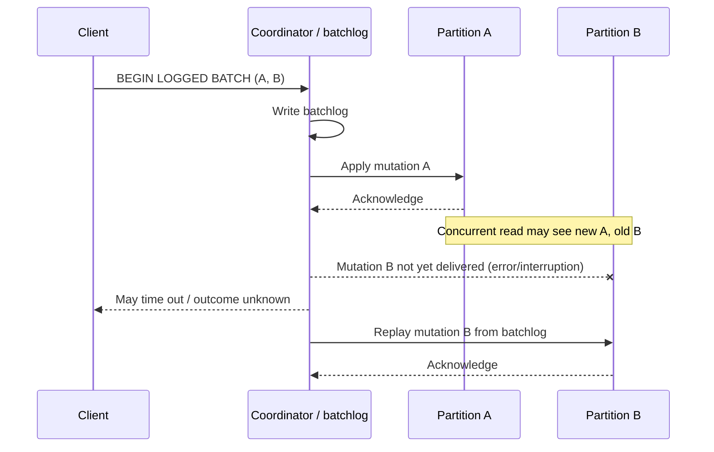

# Atomicity and Isolation Scope Within a Partition vs. Across Partitions

## 1. Why Must Partition Scope Be Distinguished?

Apache Cassandra is a **distributed wide-column** database: each row belongs to a **partition** identified by the table's *partition key*. The partition determines how Cassandra distributes and groups data across replicas; tables should be designed around queries and partition keys rather than assuming every write in a business workflow can participate in an SQL transaction.

In the **BATCH and counters** chapter, two concepts must be kept separate:

- **Atomicity:** an update unit is applied completely, without exposing a partial update of that unit itself. For a `BATCH` spanning multiple partitions, `LOGGED BATCH` helps ensure mutations are *eventually* delivered to partitions after failures, but it does not create a shared commit point across all partitions.
- **Isolation:** concurrent read or write operations do not observe intermediate states of a group of mutations within the **same partition**. Cassandra does not provide cross-partition transaction isolation comparable to relational transactions.

> Key point: **same partition** means the same *table* and the same value for the **entire partition key**. Two tables sharing an equal `customer_id` column are still two separate partitions; two rows sharing clustering columns but having different partition keys also belong to different partitions.

Example table:

```sql
CREATE TABLE orders_by_customer (
    customer_id uuid,
    order_id uuid,
    status text,
    total decimal,
    PRIMARY KEY ((customer_id), order_id)
);
```

In this table, `customer_id` is the partition key, while `order_id` is the clustering column. Every order for the same `customer_id` belongs to one logical partition of the `orders_by_customer` table; orders for another customer belong to a different partition.

## 2. Guarantee Matrix to Remember

| Write Type | Atomicity / Isolation Within One Partition | Cross-Partition Guarantees | Practical Interpretation |
|---|---|---|---|
| Single mutation to one partition | Yes, within the scope of that mutation/partition | Not applicable | A single write does not turn other tables/partitions into a transaction. |
| `UNLOGGED BATCH` writing **one partition** | Same-partition mutations are applied atomically and isolated at partition scope | Not applicable | Usually suitable when grouping multiple changes in the same partition without batchlog overhead. |
| `LOGGED BATCH` writing **one partition** | Still retains per-partition guarantees | Does not add cross-partition transactions | The batchlog does not expand isolation scope; Cassandra may optimize away the batchlog for single-partition batches. |
| `LOGGED BATCH` writing **multiple partitions** | Each partition retains atomicity/isolation within its own scope | Batchlog supports **eventual completion** of all mutations after certain failure modes; **no** global isolation or simultaneous commit | A query may see partition A updated while B is not yet updated. |
| `UNLOGGED BATCH` writing **multiple partitions** | Each partition retains local guarantees | **No** batchlog-based recovery guarantee for the whole batch | Some partitions may succeed while others fail. |
| `BATCH` with `IF` condition (LWT) on one partition | Condition and updates use Paxos/LWT at partition scope | Does not extend LWT into a cross-partition conditional transaction | Use when a condition check is needed before updating data in the same partition. |

**Do not equate** "logged" with "isolated," or "atomic" with "all-or-nothing at the exact same instant across every partition." These are two distinct layers of guarantees.

## 3. Writing Multiple Rows in the Same Partition

Suppose we need to create two orders for **the same customer**:

```sql
BEGIN UNLOGGED BATCH
    INSERT INTO orders_by_customer (customer_id, order_id, status, total)
    VALUES (
        11111111-1111-1111-1111-111111111111,
        aaaaaaaa-aaaa-aaaa-aaaa-aaaaaaaaaaaa,
        'CREATED', 120.00
    );

    INSERT INTO orders_by_customer (customer_id, order_id, status, total)
    VALUES (
        11111111-1111-1111-1111-111111111111,
        bbbbbbbb-bbbb-bbbb-bbbb-bbbbbbbbbbbb,
        'CREATED', 80.00
    );
APPLY BATCH;
```

Both mutations belong to partition `customer_id = 11111111-1111-1111-1111-111111111111` in **the same table**. Cassandra groups them into a partition-level update; a partition read operation does not observe a half-applied state of the batch's two mutations. These mutations are not treated as an ordered imperative script: **do not rely on statement order inside a batch to resolve conflicts when updating the same cell**.

A verification query:

```sql
SELECT order_id, status, total
FROM orders_by_customer
WHERE customer_id = 11111111-1111-1111-1111-111111111111;
```

Within a single partition, `UNLOGGED BATCH` is sufficient to express the write group. Adding `LOGGED` does not create a "stronger transaction" for the same partition and may add unnecessary overhead. Do not use a batch merely to bundle commands assuming Cassandra will send them faster; throughput optimization also depends on partition layout, batch size, and how the driver schedules writes.

### What Must Not Be Inferred?

A batch contains only mutations; you cannot interleave `SELECT` statements to "read then write" like an SQL transaction. If an update depends on a condition over the current value, consider a **lightweight transaction (LWT)** with `IF`, and account for coordinating other concurrent write paths touching the same partition.

## 4. `LOGGED BATCH` Across Multiple Partitions: Eventual Atomicity, No Global Isolation

For example, two different customers, meaning **two partitions**:

```sql
BEGIN LOGGED BATCH
    INSERT INTO orders_by_customer (customer_id, order_id, status, total)
    VALUES (
        11111111-1111-1111-1111-111111111111,
        cccccccc-cccc-cccc-cccc-cccccccccccc,
        'CREATED', 50.00
    );

    INSERT INTO orders_by_customer (customer_id, order_id, status, total)
    VALUES (
        22222222-2222-2222-2222-222222222222,
        dddddddd-dddd-dddd-dddd-dddddddddddd,
        'CREATED', 75.00
    );
APPLY BATCH;
```

With this batch, the coordinator writes information to the **batchlog** so it can replay incomplete mutations if the coordinator or network encounters a failure after the log write stage. When the system is able to recover and replicas can accept writes, that mechanism works to ensure **all mutations of the logged batch are eventually applied**. It does **not** provide instant business-level rollback as in a relational database.

Consider a sequence that can happen:



In the interval between the two applications, an application reading A then B may see data that is **out of sync in time**. Therefore:

- `LOGGED BATCH` does **not** turn multiple partitions into a transaction with **snapshot isolation** or simultaneous commit.
- `LOGGED BATCH` does **not** allow assuming "if the client gets a timeout, the entire batch was canceled." A timeout may mean part of the batch was applied, or the batchlog will still replay it; the application must treat the outcome as **indeterminate**.
- If the batch was not yet persisted into the durability mechanism before the failure occurred, you cannot assume the batchlog will rescue every mutation. Recovery guarantees must be understood alongside the timing of the failure and cluster availability.
- `UNLOGGED BATCH` across multiple partitions has no batchlog-based completion guarantee; whether individual partitions succeed or fail can vary.

**Business scenario:** writing `account_balance` for accounts A and B in two partitions is insufficient to implement accurate money transfers using only `LOGGED BATCH`. When reading mid-way, the system may observe A debited while B is not yet credited. Money transfers require a dedicated model for business invariants, such as an immutable event ledger with idempotency keys and reconciliation/completion mechanisms, or a database engine with transactions suited to the requirement.

## 5. Role of Consistency Level and LWT

A **consistency level (CL)** such as `ONE`, `QUORUM`, or `LOCAL_QUORUM` determines the replica acknowledgment threshold for each read/write operation. Choosing `QUORUM` does not turn a multi-partition logged batch into a globally committed transaction; it only sets the acknowledgment criteria among replicas according to the replication configuration and CL.

**Lightweight transactions (LWT)** address *compare-and-set* needs using an `IF` condition. For a **conditional batch**, all mutations must belong to the same partition; you cannot place two different partitions into a conditional batch and expect Cassandra to lock/check them as a unified distributed transaction.

Example with two orders **already existing in the same partition**:

```sql
BEGIN BATCH
    UPDATE orders_by_customer
    SET status = 'PAID'
    WHERE customer_id = 11111111-1111-1111-1111-111111111111
      AND order_id = aaaaaaaa-aaaa-aaaa-aaaa-aaaaaaaaaaaa
    IF status = 'CREATED';

    UPDATE orders_by_customer
    SET status = 'PAID'
    WHERE customer_id = 11111111-1111-1111-1111-111111111111
      AND order_id = bbbbbbbb-bbbb-bbbb-bbbb-bbbbbbbbbbbb;
APPLY BATCH;
```

If the `IF` condition is not met, the conditional batch does not apply the update group. CQL returns an `[applied]` result for the application to inspect. LWTs incur higher coordination cost than regular writes; when configuring consistency for LWTs, you must understand both the regular read/write level and the **serial** level (`SERIAL`/`LOCAL_SERIAL`). LWT itself only enforces conditional rules within the scope of the relevant partition, especially when other actors also follow compatible update patterns.

You cannot take atomicity within a single partition and extrapolate it into consistency across two tables, two partitions, or two keyspaces that happen to share a business key name.

## 6. Counter Batches Do Not Expand Transactions

`counter` is a data type dedicated to increment/decrement operations. Cassandra uses a separate `COUNTER BATCH` syntax:

```sql
CREATE TABLE page_views_by_day (
    page_id uuid,
    day date,
    views counter,
    PRIMARY KEY ((page_id), day)
);

BEGIN COUNTER BATCH
    UPDATE page_views_by_day
    SET views = views + 1
    WHERE page_id = 11111111-1111-1111-1111-111111111111
      AND day = '2026-11-21';
APPLY BATCH;
```

Do not mix counter operations with regular data writes in the same batch; counters also do not support LWT conditions like standard value updates. **Counter increments are not idempotent**: if the application times out and resends `+ 1`, the value may increase an extra time. `COUNTER BATCH` is not a tool that guarantees "exactly-once" event processing or cross-partition transactions.

When counts must be exact per event, consider storing events with unique IDs and computing/aggregating them according to your application design alongside proper deduplication mechanisms. Counters are better suited for tallies that can tolerate their retry and distributed synchronization characteristics.

## 7. Choosing an Approach in Practice

| Requirement | Usually Appropriate Approach | Reason |
|---|---|---|
| Modifying multiple rows within one partition of the same table | Concise, intentional `UNLOGGED BATCH` | Preserves partition-level atomicity/isolation without paying multi-partition batchlog overhead. |
| Needing eventual application of a small group of mutations across multiple partitions | `LOGGED BATCH` after accepting no cross-partition isolation | Batchlog helps complete writes on failure; must prepare for reading intermediate states. |
| Writing a large number of independent partitions to increase throughput | Prepared statements and controlled asynchronous writes | Multi-partition batches typically add overhead on the coordinator and batchlog. |
| Writing only when the current state is valid within one partition | Conditional update/batch with `IF` (LWT) | Provides condition checking and consensus within partition scope. |
| Maintaining strong invariants across multiple partitions, such as money transfers | Dedicated business design or transactional datastore | CQL batches do not provide cross-partition serializable transactions. |
| Updating counters | `UPDATE ... SET c = c + n`, `COUNTER BATCH` when appropriate | Must explicitly handle non-idempotent retry risks. |

When handling errors from the **Java driver**, clearly distinguish operations that can be safely retried from those that cannot. Repeatedly writing the same value to the same key is generally easier to make idempotent than incrementing counters; retries must also account for timestamps, TTL, `IF` conditions, and business side effects. Do not automatically retry every batch just because the driver reports a timeout.

Additionally, large or multi-partition batches easily strain the coordinator and trigger batch size warnings; limit the number of mutations per batch and monitor latency, timeout errors, and cluster batch size warnings.

## 8. Self-Check

1. Both `orders_by_customer` and `order_status_by_customer` have `customer_id = X`. Is a `BATCH` updating both a single-partition batch? **No**: partitions are scoped per table.
2. You write a `LOGGED BATCH` across partitions A and B; immediately afterward a reader sees new A and old B. Did Cassandra violate the logged batch guarantee? **No**: the batchlog aims at completing mutations, not promising cross-partition read isolation.
3. A client receives a timeout when sending a logged batch. Can it conclude that no mutations were written? **No**: the outcome is indeterminate; part of it may have been written and the rest may be replayed.
4. Does using `LOCAL_QUORUM` create a transaction across two partitions? **No**: CL defines replica acknowledgment levels, not global isolation.
5. Can you use `IF` to check a condition on partition A and simultaneously write partition B in a conditional batch? **No**: conditional batches are restricted to the same partition.
6. Does retrying `views = views + 1` after a timeout guarantee it increments only once? **No**: counter updates are not idempotent.

**Key Takeaway:** the strongest boundary for reasoning about atomicity/isolation in Cassandra is the **partition**. `LOGGED BATCH` adds recovery and completion mechanics for writes across multiple partitions; it does **not** add multi-partition isolation. Design partition keys around queries, state the invariants that must hold, and choose `BATCH`, LWT, or application-level mechanisms matching the exact guarantee scope.
