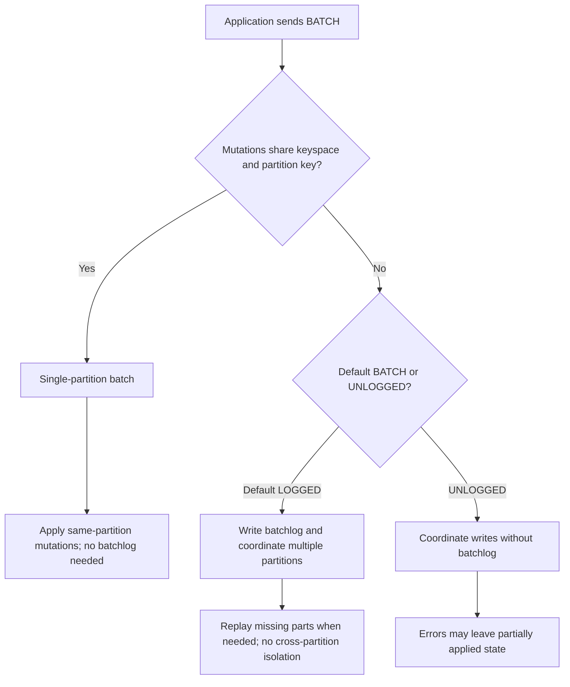

# Multi-Table BATCH with the Same Key and Guarantee Conditions

In Apache Cassandra, a `BATCH` groups multiple `INSERT`, `UPDATE`, and `DELETE` statements into a single write request. A notable case is **writing to multiple tables in the same keyspace with the same partition key value**. Cassandra can handle this case as a *single-partition batch*, even though the statements update different tables. This directly affects atomicity, isolation, latency, and whether the batchlog is needed.

This lesson belongs to the **BATCH and counters** chapter, within the study of the Apache Cassandra wide-column database: query-driven table design, data partitioning, replication, consistency levels, and invoking CQL from Java.

## 1. Scenario: One Business Change, Two Tables Serving Two Queries

Suppose a customer management application has two query patterns:

- Retrieve a profile by `customer_id`.
- List a customer's devices by `customer_id`, ordered by `device_id`.

Following Cassandra's **table per query** design pattern, the application stores two tables in the same `demo` keyspace:

```sql
-- Assumes keyspace demo already exists with an appropriate replication configuration.
CREATE TABLE demo.customer_profile_by_id (
    customer_id uuid PRIMARY KEY,
    display_name text,
    modified_at timestamp
);

CREATE TABLE demo.customer_devices_by_id (
    customer_id uuid,
    device_id text,
    active boolean,
    modified_at timestamp,
    PRIMARY KEY ((customer_id), device_id)
);
```

For `customer_id = 11111111-1111-4111-8111-111111111111`, both tables share **the same keyspace and the same `uuid` partition key**. `device_id` is a *clustering column*, not part of the partition key. Therefore, updating the customer's profile and a device can belong to a single-partition batch:

```sql
BEGIN BATCH
    UPDATE demo.customer_profile_by_id
    SET display_name = 'Mai',
        modified_at = '2026-11-21T03:00:00Z'
    WHERE customer_id = 11111111-1111-4111-8111-111111111111;

    INSERT INTO demo.customer_devices_by_id
        (customer_id, device_id, active, modified_at)
    VALUES
        (11111111-1111-4111-8111-111111111111,
         'android-01', true, '2026-11-21T03:00:00Z');
APPLY BATCH;
```

`BEGIN BATCH` defaults to a **logged batch** in CQL syntax; there is no need to write `BEGIN LOGGED BATCH`. For a single-partition batch, Cassandra optimizes away the *batchlog* write even when the caller uses the default logged form.

> **Key Point:** Two different tables do **not automatically** mean two different partitions in the context of Cassandra's BATCH optimization. Apache Cassandra documentation clearly notes that two tables in the same keyspace with the same partition key are treated as a *single-partition batch*; each table still receives its own mutation. Do not confuse this concept with the two tables becoming one physical table or enabling data `JOIN`s.

## 2. What Conditions Actually Make a Single-Partition Batch?

Inspect **all** mutations in the batch rather than looking only at two sample statements. To get the benefits of a multi-table single-partition batch, verify:

1. **Same keyspace:** For example, both tables are `demo.*`. Two keyspaces may have different replication configurations, so an identical key name is not enough to infer the same mutation group.
2. **Same encoded partition key value:** Not merely looking alike when printed on screen. Data types, number of components, and order in a composite partition key must match, and the values must represent the exact same key. For example, matching `uuid` with `uuid` is straightforward; `text '123'` cannot automatically be treated as matching `int 123`.
3. **No statement touches another partition key:** Adding even a single different `customer_id` or a table partitioned by `email`/`device_id` turns the batch into a *multi-partition batch*.
4. **Statements supported by CQL BATCH:** Only group write operations (`INSERT`, `UPDATE`, `DELETE`). Do not use `SELECT` to read intermediate state inside a batch; `IF`/LWT constraints have separate rules covered later.

The distinction between *partition key* and *primary key* is critical. In `customer_devices_by_id`, the primary key is `(customer_id, device_id)`, but the partition key is **only** `customer_id`. Writing two different `device_id` values for the same customer still belongs to the same partition.

| Statements in the Same BATCH | Classification to Evaluate | Reason |
| --- | --- | --- |
| `demo.profile_by_id` and `demo.devices_by_id` with the same `customer_id uuid` | Single-partition | Same keyspace, same partition key value |
| Two `devices_by_id` rows with different `device_id` but the same `customer_id` | Single-partition | `device_id` is only a clustering key |
| Two `devices_by_id` rows with different `customer_id` | Multi-partition | Two different partition keys |
| `customer_by_id` partitioned by `customer_id` and `customer_by_email` partitioned by `email` | Multi-partition | Two different partition identifiers |
| Two tables in two different keyspaces | Not treated as the single-partition case above | Different keyspace/replication scope |

When designing, rely on the **actual partition key in the DDL**. Having two records share a regular column named `customer_id` means nothing if that column is not the partition key in both tables.

## 3. What Does BATCH Guarantee and What Does It Not?

### 3.1. Atomicity and Isolation Within Single-Partition Scope

Under Cassandra's traditional BATCH model:

- **Atomicity of same-partition updates:** Updates belonging to a batch on the same partition key are processed as an atomic update group at partition scope; not as a series of independent SQL transactions.
- **Isolation within partition scope:** Updates sharing the same partition key inside a BATCH are isolated from concurrent partition reads/writes according to Cassandra's supported mechanisms.
- **No-batchlog optimization:** With a single-partition batch, Cassandra avoids the batchlog overhead designed for multi-partition batches.

For **two tables in the same keyspace with the same partition key**, Cassandra documentation classifies this as a single-partition batch. However, how the application observes data also depends on consistency level, selected replicas, read timing, and concurrent writes. Two separate `SELECT` statements across two tables **do not create a cross-table snapshot at the same instant**. Do not interpret mutation isolation as the ability to run a sequence of multiple read queries like an SQL transaction.

### 3.2. If a Batch Spans Multiple Partition Keys

`LOGGED BATCH` uses a **batchlog** to help complete the batch's mutations if the coordinator fails. This property is often described as *atomic eventual completion*: the system works to ensure that all parts of the batch are eventually applied, or none if the batch did not successfully start. There is **no cross-partition isolation**: during the transition window, an application may observe one table or partition already updated while another is not yet updated.

`UNLOGGED BATCH` has no batchlog mechanism protecting writes across multiple partitions. If an error occurs mid-way, some mutations may succeed while others fail. Using `UNLOGGED` across different keys solely to reduce round trips can strain the coordinator without solving data guarantee requirements.

| Criterion | Single-Partition BATCH | Multi-Partition `LOGGED BATCH` | Multi-Partition `UNLOGGED BATCH` |
| --- | --- | --- | --- |
| Scope | One partition key in the same keyspace; can span multiple tables | Multiple partition keys | Multiple partition keys |
| Batchlog | Optimized away | Yes, to help complete the batch after failure | No |
| Atomicity | Within single-partition scope | Eventual completion guarantee via batchlog, not simultaneous visibility commit | May apply partially after failure |
| Isolation | Within single-partition update scope | Not guaranteed across partitions | Not guaranteed across partitions |
| Usage | Small group of related writes sharing a key | Only when writes across different partitions genuinely must be tied together | Avoid relying on it for atomicity |

### 3.3. Consistency Level Does Not Replace Atomicity

`ONE`, `LOCAL_QUORUM`, `QUORUM`, etc., determine how many replicas must acknowledge a read/write operation, depending on topology and replication factor. For example, in a datacenter with `RF=3`, `LOCAL_QUORUM` requires acknowledgments from a majority of replicas in that datacenter. Consistency level does not turn two different partition keys into a single isolated unit, nor does it create a shared snapshot for two `SELECT` queries.

With quorum writes and reads under normal conditions, the likelihood of reading fresh updates improves thanks to overlapping read/write replica sets. However, network errors, concurrent writes, conflicting timestamps, unconverged replicas, or timeouts must still be handled under Cassandra semantics; do not extrapolate `QUORUM` into full ACID transactions.

## 4. Commonly Misunderstood Limitations

**BATCH is not an SQL transaction.** BATCH does not support `SELECT` followed by conditional branching inside the same transaction; it does not replace foreign keys, cross-table constraints, arbitrary rollback, or multi-table snapshot reads. In particular, `BEGIN BATCH` does not establish a guaranteed execution order for conflicting operations on the same cell.

**Statements in a BATCH typically share the same write timestamp** unless specified otherwise. Cassandra resolves conflicts by timestamp; therefore, do not write two `UPDATE` statements on the same column expecting the statement appearing last in text order to win. Merge changes to a single column into one explicit update, or manage timestamps explicitly when required while understanding last-write-wins consequences.

**Conditional batches (`IF`, LWT) are more strictly restricted than regular BATCHes.** Under traditional CQL/Paxos, conditional statements in the same batch must belong to one partition **and one table**. Having two tables share `customer_id` does not mean you can execute an atomic `IF` across two tables. If cross-table business conditions must be checked, redesign the aggregate/data model or use a transaction mechanism appropriate for your running version and system.

**Counters are a separate batch type.** `BEGIN COUNTER BATCH` is used for counter updates; do not mix counter updates with regular updates. Incrementing a counter is not idempotent like assigning a fixed value, so retries after timeouts require caution. The examples in this lesson are regular write batches, not counter batches.

**Do not use BATCH as a bulk loading tool.** Oversized BATCHes, even single-partition ones, can increase latency, memory usage, and partition size; multi-partition batches also force the coordinator to orchestrate many replicas. For independent records, applications should generally use multiple asynchronous requests with bounded concurrency rather than one huge BATCH.

## 5. Reading a Batch Execution Flow Diagram



The diagram depicts the decision flow by mutation scope, not the detailed ordering of commit logs, memtables, or exchanges across every replica. Actual execution paths are also influenced by topology, version, and statement types.

## 6. Connecting from a Java Application

With **DataStax/Apache Cassandra Java Driver 4.x**, use prepared statements and `BatchStatement` to reuse statements, bind proper types, and bound batch contents. The example below assumes `CqlSession session` is already configured, both tables exist, and `customerId` is identical for both mutations:

```java
import com.datastax.oss.driver.api.core.CqlSession;
import com.datastax.oss.driver.api.core.cql.BatchStatement;
import com.datastax.oss.driver.api.core.cql.DefaultBatchType;
import com.datastax.oss.driver.api.core.cql.PreparedStatement;
import com.datastax.oss.driver.api.core.DefaultConsistencyLevel;
import java.time.Instant;
import java.util.UUID;

public void updateCustomerAndDevice(CqlSession session, UUID customerId) {
    PreparedStatement profileStmt = session.prepare(
        "UPDATE demo.customer_profile_by_id " +
        "SET display_name = ?, modified_at = ? WHERE customer_id = ?");

    PreparedStatement deviceStmt = session.prepare(
        "INSERT INTO demo.customer_devices_by_id " +
        "(customer_id, device_id, active, modified_at) " +
        "VALUES (?, ?, ?, ?)");

    // In practice, pass the business timestamp from the caller and keep it fixed on retry.
    Instant modifiedAt = Instant.parse("2026-11-21T03:00:00Z");

    BatchStatement batch = BatchStatement.builder(DefaultBatchType.LOGGED)
        .addStatement(profileStmt.bind("Mai", modifiedAt, customerId))
        .addStatement(deviceStmt.bind(customerId, "android-01", true, modifiedAt))
        .setConsistencyLevel(DefaultConsistencyLevel.LOCAL_QUORUM)
        .build();

    session.execute(batch);
}
```

`DefaultBatchType.LOGGED` is the default form equivalent to `BEGIN BATCH`; with a single partition key, Cassandra automatically optimizes away the batchlog. `LOCAL_QUORUM` is only an example: it must match your actual environment's replica count and datacenter setup. In a long-running application, prepare `PreparedStatement` instances once and reuse them across calls rather than calling `prepare` every time as in this illustrative snippet.

When receiving `WriteTimeoutException` or connection errors, **do not conclude that the batch definitely failed**. The server may have executed part or all of the operation while the response failed to reach the client. For examples assigning fixed values to regular columns, retries can often be designed to be idempotent if data/timestamps are kept identical and there are no competing writes. For counters, generating new UUIDs, list operations, or secondary writes with side effects, a different handling strategy is required. When the business requires definite confirmation, inspect state by identifier and reconcile rather than blindly retrying.

## 7. Counterexample: Two Tables for the Same Customer with Different Partition Keys

Suppose the application also has a table to look up customers by email:

```sql
CREATE TABLE demo.customer_by_email (
    email text PRIMARY KEY,
    customer_id uuid,
    display_name text
);

BEGIN BATCH
    UPDATE demo.customer_profile_by_id
    SET display_name = 'Mai'
    WHERE customer_id = 11111111-1111-4111-8111-111111111111;

    INSERT INTO demo.customer_by_email (email, customer_id, display_name)
    VALUES ('mai@example.com',
            11111111-1111-4111-8111-111111111111, 'Mai');
APPLY BATCH;
```

Here `customer_profile_by_id` is partitioned by UUID; `customer_by_email` is partitioned by the email string. Even though both records describe the same customer and both contain `customer_id`, this is a **multi-partition logged batch**. The coordinator needs the batchlog mechanism to help complete both writes; a query against the email table may see data at a different time than a query against the ID table. When you need to update multiple tables serving multiple query patterns, evaluate the cost and eventual synchronization needs rather than assuming BATCH turns them into an SQL transaction.

## 8. Design and Troubleshooting Checklist

Before deploying a multi-table BATCH to production, check in order:

1. **Identify the goal:** are the writes truly one business change that belongs together, or unrelated data-loading operations?
2. **Open the DDL and verify:** same keyspace; same partition-key columns, data types, order, and values; clustering keys must not be mistaken for partition keys.
3. **Classify:** single partition key can use a single-partition batch; multiple partition keys should only use a logged batch when eventual completion guarantees are needed, or consider an alternative data model.
4. **Review consistency and replication:** choose read/write levels suited to your datacenters; verify replicas converge after failures, and do not expect cross-table SELECTs to form a snapshot.
5. **Keep batches small:** avoid large batch sizes, hot partitions, or overly wide partitions; monitor latency, timeouts, batch size warnings, and coordinator resources.
6. **Verify retries:** log operation/business IDs, keep inputs stable for idempotent writes, and perform reconciliation reads after indeterminate outcomes; account for concurrent writers and timestamps.
7. **Test realistic failures:** simulate timeouts or coordinator disconnects in a test environment, re-read each table at the expected consistency level, and test updates over time.

### Self-Check Questions

**1.** `orders_by_customer` and `settings_by_customer` are in the same keyspace, have partition key `customer_id uuid` with the same UUID value, and have different clustering keys. Can this batch be single-partition? **Yes**, provided every mutation in the batch shares that partition key and none touches another key.

**2.** Two tables both have a `customer_id` column, but the second table is partitioned by `email`. Is it single-partition? **No**. A column appearing in the payload does not determine partition scope; you must look at the `PRIMARY KEY`.

**3.** Does a default BATCH writing to two partition keys guarantee that readers never see one side old and the other new? **No**. The batchlog aids eventual completion; it does not provide cross-partition read isolation.

**4.** Can a BATCH sharing a partition key across two different tables use `IF` on both tables to create a conditional transaction? **No**, under traditional CQL/Paxos conditional batch limits: conditional statements must belong to the same partition **and the same table**.

**5.** After a timeout, may the client assume all mutations were rolled back? **No**. The outcome may be indeterminate; controlled retries or business-level reconciliation are required.

## References

- [Apache Cassandra — CQL Data Manipulation: BATCH, UNLOGGED, COUNTER](https://cassandra.apache.org/doc/stable/cassandra/developing/cql/dml.html).
- [Apache Cassandra 5.0 — Good use of BATCH statement](https://cassandra.staged.apache.org/doc/stable/cassandra/developing/cql/batch/batch-good-example.html), especially the note on two tables sharing a keyspace and partition key.

**Key Takeaway:** When speaking of a "multi-table BATCH with the same key," the decisive condition is **same keyspace and same actual partition key across all mutations**. That is the appropriate case for leveraging Cassandra's single-partition BATCH; cases involving different keys must be evaluated through logged-batch completion guarantees and read-isolation limits.
