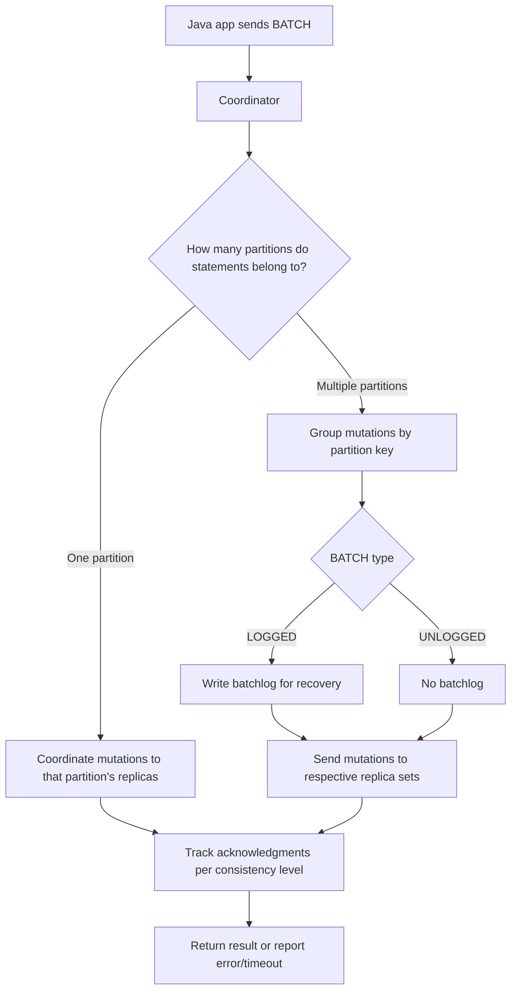
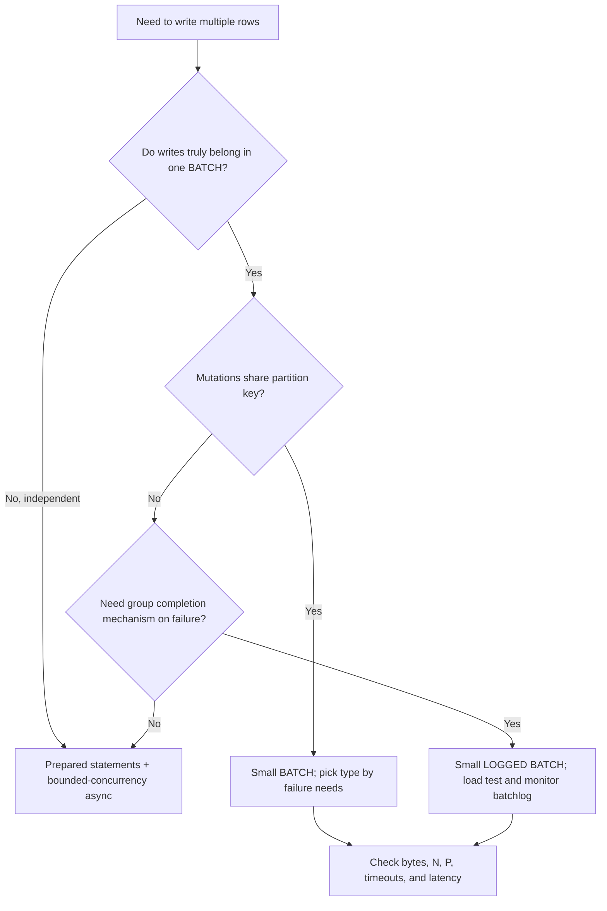

# BATCH Size, Partition Count, and Coordinator Load

In Apache Cassandra, `BATCH` is a way to send a group of CQL write statements together. It is useful when a business operation needs to update multiple related rows, but it is **not a tool for speeding up bulk data loading**. The efficiency of a BATCH depends heavily on **data payload size**, **number of distinct partition keys**, and **the work the coordinator must perform**.

This content belongs to the **BATCH and counters** chapter in the `DATABASE_ENGINE_WIDE_COLUMN_CASSANDRA` module: understanding distributed architecture, query-driven table design, read/write consistency levels, and connecting to Cassandra from Java. In particular, you must distinguish between *a BATCH with many statements* and *a BATCH touching many partitions*; the two cases carry different costs.

## 1. Three Quantities to Measure Separately

Suppose an application sends a BATCH containing `N` `INSERT` or `UPDATE` statements:

| Quantity | Meaning | Typical Impact |
| --- | --- | --- |
| **Statement count (`N`)** | Total number of mutations/write statements in the BATCH | Increases parsing, validation, and processing work on the coordinator; insufficient by itself to judge whether the BATCH is expensive |
| **BATCH size (bytes/KiB)** | Amount of mutation data Cassandra must carry and process; depends on column value sizes as well | Increases network traffic, temporary memory, write pressure, and processing time; can trigger warnings or rejections for oversized BATCHes |
| **Distinct partition count (`P`)** | Number of **distinct partition key values** written by the statements | Forces the coordinator to route to multiple replica sets; cross-partition logged BATCHes also incur batchlog work |

**A partition key is not a node.** One partition can have multiple replicas due to the replication factor; multiple partitions can reside on the same node. Therefore `P = 20` does not mean 20 nodes, though it generally increases the number of target destinations and responses to aggregate.

For example, for a table with `PRIMARY KEY ((tenant_id, event_date), event_id)`:

- Two records with the same `tenant_id` **and** `event_date`, even with different `event_id` values, belong to **the same partition**.
- Two records with the same `tenant_id` but different `event_date` values belong to **two partitions**.
- A large statement count does not necessarily mean many partitions; conversely, 10 statements can touch 10 partitions.

There is no single statement-count limit suitable for every system. You must evaluate `N`, payload volume, `P`, replication factor, consistency level, write rate, and actual cluster load together.

## 2. Why Does Partition Count Drive Coordination Cost?

Every write request has a **coordinator**: the node that receives the request from the driver, identifies replicas for each partition key, dispatches mutations, and tracks responses per consistency level. BATCH does not eliminate these steps.



With one partition, the coordinator can group changes along the same partition key and replica path. With multiple partitions, it must route and track multiple write groups. Even though all mutations arrive in one network request from the client, there is substantial work on the server side.

In a multi-partition **logged batch**, Cassandra also writes BATCH information to the **batchlog** (replicated for recovery) before distributing mutations, then cleans up the batchlog entry after completion. If the coordinator fails mid-way, the replay mechanism can continue sending missing mutations. This is an added cost for recovery goals, not a write-throughput optimization.

In an **unlogged batch**, Cassandra skips the batchlog step, but the coordinator still has to send mutations to each partition. Thus `BEGIN UNLOGGED BATCH` **does not turn a cross-partition BATCH into a cheap write operation**.

As both `P` and payload volume grow, a single request can simultaneously increase:

1. Temporary memory holding and processing mutations on the coordinator.
2. Messages sent to replicas and responses to aggregate.
3. Resource occupancy duration, *tail latency*, and timeout likelihood under cluster load.
4. Write pressure on replicas; later, the data still goes through operations like flush and compaction. Compaction **is not eliminated** just because multiple statements were placed in a BATCH.

That is why a BATCH with few statements but very large values is still risky, and a byte-small BATCH scattered across many partition keys can still create high coordination load.

## 3. LOGGED, UNLOGGED, and COUNTER BATCH: Choosing by Semantics

| Type | Suitable Purpose | Consequences When Writing Multiple Partitions |
| --- | --- | --- |
| `BEGIN BATCH` / `BEGIN LOGGED BATCH` | Needs **atomic eventual completion** for a group of regular mutations: once accepted for processing, Cassandra has the batchlog mechanism to replay on failure | Adds batchlog step, increases I/O, network, and latency; does not provide RDBMS-style rollback |
| `BEGIN UNLOGGED BATCH` | Groups writes when partial completion on failure is acceptable; generally better suited for **same-partition** writes | No batchlog; still pays fan-out cost across replicas and risks partial mutation success |
| `BEGIN COUNTER BATCH` | Groups `counter` column updates under Cassandra's dedicated rules | Counters have separate mechanisms and limits; never mix counter updates with regular mutations in the same BATCH |

**Atomic does not mean isolated or transactional rollback.** A logged BATCH helps mutations eventually be applied after certain failure modes; it does not promise readers across multiple partitions will always observe a unified snapshot at the same instant. Do not rely on cross-partition BATCHes to implement multi-table ACID transactions like in an RDBMS. For changes within the same partition, Cassandra provides partition-scoped isolation guarantees; proper read design and consistency levels are still required.

A practical case where a cross-partition logged BATCH makes sense is when an application intentionally writes the same event to two query-serving tables and **needs a replay mechanism** if a node fails mid-write. When the goal is simply accelerating the ingestion of 10,000 independent events, a large logged BATCH is usually a poor choice.

> Note on timeouts: a client receiving a timeout does not prove all mutations failed. Some replicas may already have written successfully. Design retries around idempotency; `counter` increments should not be blindly retried because they can overcount unexpectedly.

## 4. Illustration: Same 12 Statements, Very Different Load

Assume each `INSERT` has roughly a 1 KiB payload; below is a *qualitative* illustration, not a benchmark:

| Scenario | `N` | `P` | Estimated Size | Assessment |
| --- | ---: | ---: | ---: | --- |
| A: 12 events for one tenant on one day | 12 | 1 | ~12 KiB | Same partition routing path; still verify size thresholds and partition growth |
| B: 12 different days or tenants | 12 | 12 | ~12 KiB | Fan-out to multiple replica sets; logged batch adds batchlog, unlogged batch gives no group completion guarantee on failure |
| C: 12 events in one partition, 100 KiB payload each | 12 | 1 | ~1.2 MiB | Even for one partition, excessive size can be rejected by the server and makes the request heavy |

**Practical takeaway:** Do not use a rule like "under X statements is safe" while ignoring distinct partition keys or byte size. Optimal thresholds are workload-specific and should be validated by load testing with realistic key distributions and payload sizes.

## 5. CQL Example: Table Design and Partition Identification

Suppose an application stores events to query by customer and day:

```sql
CREATE TABLE events_by_tenant_day (
    tenant_id uuid,
    event_date date,
    event_id timeuuid,
    event_type text,
    details text,
    PRIMARY KEY ((tenant_id, event_date), event_id)
) WITH CLUSTERING ORDER BY (event_id DESC);
```

**Same-partition BATCH**: `tenant_id` and `event_date` are identical in both statements. The example below uses `UNLOGGED` because the two writes simply illustrate grouping data under the same partition key; choosing logged vs. unlogged in a real system depends on business failure requirements.

```sql
BEGIN UNLOGGED BATCH
  INSERT INTO events_by_tenant_day
    (tenant_id, event_date, event_id, event_type, details)
  VALUES
    (11111111-1111-1111-1111-111111111111,
     '2026-11-21', now(), 'view', 'Home page');

  INSERT INTO events_by_tenant_day
    (tenant_id, event_date, event_id, event_type, details)
  VALUES
    (11111111-1111-1111-1111-111111111111,
     '2026-11-21', now(), 'click', 'Search button');
APPLY BATCH;
```

**Cross-partition BATCH**: simply changing `event_date` in the second statement to `'2026-11-22'` raises `P` from 1 to 2 even though `N` and payload size barely change. If the two records are independent, it is better to send two separate writes and manage concurrency on the client. If they genuinely require a failure-recovery completion mechanism for the whole group, consider a small logged BATCH and accept the batchlog cost.

```sql
-- Two independent statements, no need to wrap in a cross-partition BATCH:
INSERT INTO events_by_tenant_day
  (tenant_id, event_date, event_id, event_type, details)
VALUES (11111111-1111-1111-1111-111111111111,
        '2026-11-21', now(), 'view', 'Day one');

INSERT INTO events_by_tenant_day
  (tenant_id, event_date, event_id, event_type, details)
VALUES (11111111-1111-1111-1111-111111111111,
        '2026-11-22', now(), 'view', 'Day two');
```

Adding `USING CONSISTENCY` per mutation is not a way to turn a BATCH into a transaction. In an application, choose a request consistency level matching your replication and read/write requirements; for example, `LOCAL_QUORUM` when requiring replica acknowledgments in the local datacenter. Consistency level alters acknowledgment criteria; it **does not eliminate** the cost of a large BATCH.

## 6. From Java: Group by Partition Key, Keep BATCHes Small

Example using DataStax Java Driver 4.x and prepared statements. Both mutations in the same BATCH share the `(tenant_id, event_date)` pair:

```java
import com.datastax.oss.driver.api.core.CqlSession;
import com.datastax.oss.driver.api.core.cql.BatchStatement;
import com.datastax.oss.driver.api.core.cql.DefaultBatchType;
import com.datastax.oss.driver.api.core.cql.PreparedStatement;
import com.datastax.oss.driver.api.core.DefaultConsistencyLevel;

import java.time.LocalDate;
import java.util.UUID;

void writeTwoEvents(CqlSession session, UUID tenantId,
                    LocalDate day, UUID firstId, UUID secondId) {
    PreparedStatement insert = session.prepare(
        "INSERT INTO events_by_tenant_day " +
        "(tenant_id, event_date, event_id, event_type, details) " +
        "VALUES (?, ?, ?, ?, ?)"
    );

    BatchStatement batch = BatchStatement.builder(DefaultBatchType.UNLOGGED)
        .addStatement(insert.bind(tenantId, day, firstId, "view", "Home page"))
        .addStatement(insert.bind(tenantId, day, secondId, "click", "Search"))
        .setConsistencyLevel(DefaultConsistencyLevel.LOCAL_QUORUM)
        .build();

    session.execute(batch);
}
```

In this example, `event_id` is a `timeuuid`: `firstId` and `secondId` must be version-1 UUIDs compatible with the CQL type (e.g., generated using a time-based UUID utility); do not pass random version-4 UUIDs to a `timeuuid` column. In a real program, prepare the `PreparedStatement` once and reuse it rather than calling `prepare()` on every invocation as in this minimal snippet.

When ingesting millions of independent events, the standard approach is **prepared statements + asynchronous writes with bounded in-flight requests**, letting the driver distribute requests to appropriate coordinators. Do not cram thousands of partition keys into one BATCH to "reduce network round trips." When a BATCH is genuinely needed, group by partition key and enforce limits on **both byte size and statement count**, benchmarking suitable sizes; do not arbitrarily split a batch if doing so breaks the atomic requirement of a business operation.

## 7. Warning Thresholds and Operational Observability

Cassandra provides configuration settings related to batch size, commonly found in `cassandra.yaml`:

| Setting | Operational Meaning |
| --- | --- |
| `batch_size_warn_threshold_in_kb` | Warns when a BATCH exceeds the warning size threshold |
| `batch_size_fail_threshold_in_kb` | Rejects a BATCH exceeding the failure size threshold |
| `unlogged_batch_across_partitions_warn_threshold` | Warns when an **unlogged BATCH** spans too many partition keys |

Exact names and default values may differ by release or deployment configuration. Check your running Cassandra version, logs, and actual configuration; **do not treat the absence of warnings as proof that a BATCH is efficient**. Furthermore, the server's estimated mutation size can differ from the CQL string length or JSON payload size on the client.

When investigating rising write latency after introducing BATCHes, inspect in order:

1. **On the client:** record `N`, distinct partition key count `P`, estimated total payload size, BATCH frequency, BATCH type, consistency level, p95/p99 latency, and timeout rate.
2. **On the coordinator:** check BATCH warning logs, CPU, heap/GC, write queues or tasks, request rate, and latency; correlate load spikes with cross-partition BATCH volume.
3. **On replicas:** inspect write latency and errors, disk pressure, memtable/flush/compaction activity, and load imbalance across nodes. Commands like `nodetool tpstats` and `nodetool tablestats` can assist, depending on version.
4. **If using logged BATCH:** also monitor batchlog activity and replay during node failures; do not mistake replay for an instant rollback transaction.
5. **Run controlled experiments:** compare bounded-concurrency individual writes, small single-partition BATCHes, and cross-partition BATCHes on a representative workload. Measure throughput, p95/p99, timeouts, and coordinator/replica resources.

For instance, a 30 KiB batch might trigger a warning on cluster A but not on cluster B due to differing configurations. Do not "fix" oversized BATCHes merely by raising configuration thresholds: that only relaxes warnings/rejections without reducing coordinator work.

## 8. Common Mistakes

| Flawed Reasoning | Correct Understanding |
| --- | --- |
| "Bundling 1,000 `INSERT`s into one request must be faster than 1,000 requests." | Partition keys, size, and parallelism must be considered. Cross-partition BATCHes can lower throughput and raise latency. |
| "`UNLOGGED` skips the batchlog, so it has negligible overhead." | The coordinator still routes, sends, and tracks mutations across many replicas. |
| "Keeping the BATCH small in statement count is enough." | A single row containing a large blob or string can make the BATCH huge in bytes. |
| "`LOGGED BATCH` is a cross-table/cross-partition ACID transaction." | The batchlog drives mutation completion on failure; there is no RDBMS-style rollback or cross-partition snapshot isolation. |
| "Same tenant means same partition." | You must compare the **entire partition key**; e.g., `(tenant_id, event_date)` on different dates means different partitions. |
| "A timeout means nothing was written, so retrying is always safe." | State may be indeterminate; evaluate idempotency and be especially cautious with counters. |

## 9. Decision Rules



Pre-production checklist:

- Identify the **exact partition key** from the DDL; count distinct keys within a BATCH.
- Estimate **actual mutation size** and enforce caps on both statement count and bytes.
- Only use cross-partition logged BATCHes when there is a **clear business requirement** for group completion after failures.
- Set consistency levels matching replication and the read/write model; define timeout/retry handling.
- Load-test with representative data, monitoring latency, throughput, coordinator, replicas, and BATCH warnings.

## 10. Self-Check Exercises

1. With `PRIMARY KEY ((shop_id, month), order_id)`, how many distinct partition keys are in a BATCH writing 80 orders for the same shop across four months? **Answer:** four, assuming all four months have orders; the count 80 does not determine `P`.
2. Two BATCHes both contain 10 `INSERT`s: the first writes to one partition with a 2 MiB payload, and the second writes to 10 partitions with a total payload of 20 KiB. Which BATCH is "lighter"? **Answer:** neither can be declared lighter by a single criterion; the first is byte-heavy, the second is fan-out-heavy, and both require checking thresholds/configuration as well as load benchmarking.
3. A pipeline importing 100,000 independent records slows down after switching to large `BEGIN BATCH` requests. Propose a fix. **Hint:** separate prepared inserts, tune bounded asynchronous in-flight requests, measure p99 latency and throughput; use small BATCHes only when business constraints or shared partition keys warrant them.
4. An application sends a `COUNTER BATCH` to increment page views, hits a timeout, and resends the exact same statement. What can go wrong? **Answer:** the retry may increment the counter a second time when the first already applied; business-level deduplication is required.

**Key Takeaway:** In Cassandra, the first question when seeing a large BATCH is not "how many statements?", but **"how many bytes does the BATCH carry, how many partition keys does it span, and how much coordination work must the coordinator do?"**
