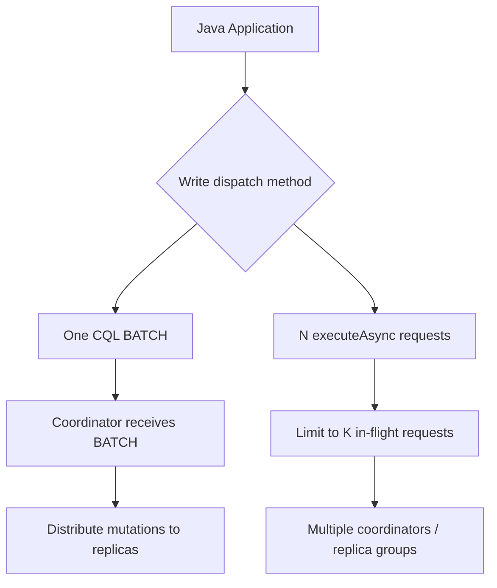

# Comparing BATCH with Bounded Asynchronous Requests in Cassandra

## 1. Problem to Solve

In Apache Cassandra, a Java application often needs to write many records in a short span of time: importing data, ingesting events, updating multiple tables serving different queries, or synchronizing data from another system. There are two implementation approaches that are often mistaken as equivalent:

1. Grouping many CQL statements into a `BATCH` and sending it to Cassandra.
2. Sending individual write statements using the Java driver's asynchronous API, while **bounding the number of concurrent in-flight requests** (*bounded in-flight requests*).

The two approaches serve different goals. **BATCH is a mechanism that defines how multiple mutations are coordinated and, in certain cases, guarantees atomicity**. **Bounded asynchronous writes are a technique for throttling load and increasing throughput for independent operations**. BATCH is not a default optimization for bulk inserts; sending asynchronous requests does not automatically create atomicity across multiple statements.

This lesson sits within the distributed architecture and wide-column model of **Apache Cassandra**: each partition can reside on different replicas; partition keys, query-driven table design, read/write consistency levels, and node-level write costs drive the engineering choice.

## 2. Understanding the Write Request Path

For each `INSERT` or `UPDATE` statement, the client sends a request to a **coordinator**. The coordinator determines the partition's replicas from the partition key, forwards the mutation to those replicas, and completes the request according to the **write consistency level (CL)**. Independent mutations can go to multiple coordinators and multiple replica groups.



When using a `BATCH` containing multiple partitions, the coordinator must distribute mutations to multiple destinations. With multiple asynchronous requests, the driver can distribute traffic across multiple connections/coordinators; the application actively controls how many requests are awaiting completion. Both remain subject to cluster resource limits and can cause overload if misconfigured.

**Three concepts to keep separate:**

- **Atomicity:** whether a group of mutations is guaranteed to eventually be applied together, within the scope Cassandra supports.
- **Isolation:** whether concurrent queries can observe a partially applied state.
- **Consistency level:** how many replicas must respond for a read/write operation to be acknowledged. For instance, `LOCAL_QUORUM` is an acknowledgment condition per operation; it does not turn a series of independent requests into a multi-partition transaction.

## 3. What Does BATCH Actually Do in Cassandra?

### 3.1. Same-Partition BATCH

Consider a table designed around querying events by tenant and day:

```sql
CREATE TABLE events_by_tenant (
    tenant_id   text,
    day         date,
    occurred_at timestamp,
    event_id    uuid,
    payload     text,
    PRIMARY KEY ((tenant_id, day), occurred_at, event_id)
) WITH CLUSTERING ORDER BY (occurred_at DESC, event_id ASC);
```

The partition key is **`(tenant_id, day)`**. Both statements below write to one partition because they share the same partition key pair:

```sql
BEGIN UNLOGGED BATCH
    INSERT INTO events_by_tenant
        (tenant_id, day, occurred_at, event_id, payload)
    VALUES ('shop-a', '2026-11-21', '2026-11-21T09:00:00Z',
            550e8400-e29b-41d4-a716-446655440000, 'order-created');

    INSERT INTO events_by_tenant
        (tenant_id, day, occurred_at, event_id, payload)
    VALUES ('shop-a', '2026-11-21', '2026-11-21T09:00:01Z',
            550e8400-e29b-41d4-a716-446655440001, 'payment-requested');
APPLY BATCH;
```

Cassandra can process same-partition mutations as a single update unit, providing atomicity/isolation guarantees at partition scope. This is where BATCH makes sense when **multiple changes in one partition must be treated as a group**; the group should be small and bounded by business needs. For a single partition, internal optimizations avoid the distributed batchlog overhead incurred by multi-partition logged batches.

Do not conclude that every BATCH is faster than multiple individual `INSERT`s. An oversized batch still increases request size, memory pressure, and latency on coordinator/replicas. Packing too many records into the same partition can also create a **hot partition**.

### 3.2. Multi-Partition Logged BATCH

`BEGIN BATCH` defaults to a **logged batch** for regular mutations. When a batch spans multiple partitions, Cassandra uses a **batchlog** to help complete mutations if the coordinator fails after accepting the batch. Its core meaning is **atomicity in the sense that all mutations are eventually executed, provided the system recovers and write conditions permit**, rather than an SQL transaction with rollback.

```sql
BEGIN BATCH
    INSERT INTO orders_by_id (order_id, customer_id, state)
    VALUES (550e8400-e29b-41d4-a716-446655440010, 'c-1', 'CREATED');

    INSERT INTO orders_by_customer (customer_id, order_id, state)
    VALUES ('c-1', 550e8400-e29b-41d4-a716-446655440010, 'CREATED');
APPLY BATCH;
```

*This example assumes two tables `orders_by_id` and `orders_by_customer` have been created with partition keys `order_id` and `customer_id`, respectively.* These are two tables serving two different query patterns; a small logged batch can fit if the business needs a completion mechanism for both writes when the coordinator fails.

However, a **multi-partition logged BATCH does not provide instantaneous isolation across partitions**: during execution or recovery, another client may read one table already updated while the other is not yet updated. Cassandra also does not provide RDBMS-style full-batch rollback. The batchlog adds extra I/O and inter-node coordination; therefore, do not use multi-partition logged batches merely to reduce network calls or speed up data ingestion.

### 3.3. Multi-Partition Unlogged BATCH and Counter Batch

`BEGIN UNLOGGED BATCH` lacks a logged batch's group-recovery guarantee when spanning multiple partitions. Some mutations may succeed while others fail. Cassandra can emit warnings when an unlogged batch touches multiple partitions; batch size warn/fail thresholds are configurable and should be checked against your actual version and cluster configuration.

`BEGIN COUNTER BATCH` is dedicated to counter updates; do not mix counter mutations with regular mutations in the same batch. **Counter increments are not idempotent**: if a timeout leaves the outcome unknown and you blindly increment again, the value can be added twice. A counter batch also does not become a safe bulk-write solution for regular records.

## 4. Bounded Asynchronous Requests

For independent records, an application can send individual `INSERT`s using `CqlSession.executeAsync(...)`. The key is bounding **the number of in-flight requests awaiting completion**. If a loop fires hundreds of thousands of requests without waiting or bounding, requests, buffers, and callbacks can pile up on the client or server; throughput may drop and timeouts rise.

**Bounded concurrency** allows at most `K` concurrent requests; a new request is dispatched only when a slot opens. It provides application-level backpressure and better leverages Cassandra's distributed architecture across many independent partitions.

```text
Write list:    A B C D E F G H I J ...
Limit K=3:
At t0:         [A] [B] [C]    D E F G H ... waiting
When B finishes: [A] [D] [C]  E F G H ... waiting
When A finishes: [E] [D] [C]  F G H ... waiting
```

This limit is a **concurrency limit, not an absolute rate limit**: if requests finish very fast, requests per second can still be high. When a QPS cap is needed, add rate limiting and monitoring. Enforce limits at an appropriate application or client-group level rather than letting every thread open thousands of independent requests on its own.

### 4.1. Java Driver Example: Executing in Small Windows

This example uses **DataStax/Apache Cassandra Java Driver 4.x** (`com.datastax.oss.driver.api.core.*` APIs) and Java 17. Each window holds at most 32 statements; it waits for the previous window to complete before sending the next. This makes verifying the in-flight bound and handling errors straightforward. In systems needing maximum slot utilization, this can be replaced by an asynchronous queue with a sliding window while keeping the same backpressure principle.

```java
import com.datastax.oss.driver.api.core.CqlSession;
import com.datastax.oss.driver.api.core.cql.BoundStatement;
import com.datastax.oss.driver.api.core.cql.PreparedStatement;

import java.time.Instant;
import java.time.LocalDate;
import java.util.List;
import java.util.UUID;
import java.util.concurrent.CompletableFuture;
import java.util.concurrent.CompletionStage;

public final class BoundedCassandraWrites {
    public record Event(
            String tenantId,
            LocalDate day,
            Instant occurredAt,
            UUID eventId,
            String payload) {}

    public static CompletionStage<Void> insertEvents(
            CqlSession session, List<Event> events, int maxInFlight) {
        if (maxInFlight <= 0) {
            throw new IllegalArgumentException("maxInFlight must be positive");
        }

        PreparedStatement insert = session.prepare(
                "INSERT INTO events_by_tenant " +
                "(tenant_id, day, occurred_at, event_id, payload) " +
                "VALUES (?, ?, ?, ?, ?)");

        CompletableFuture<Void> chain = CompletableFuture.completedFuture(null);

        for (int start = 0; start < events.size(); start += maxInFlight) {
            final int from = start;
            final int to = Math.min(from + maxInFlight, events.size());

            chain = chain.thenCompose(unused -> {
                CompletableFuture<?>[] inFlight =
                        new CompletableFuture<?>[to - from];

                for (int i = from; i < to; i++) {
                    Event event = events.get(i);
                    BoundStatement statement = insert.bind(
                            event.tenantId(),
                            event.day(),
                            event.occurredAt(),
                            event.eventId(),
                            event.payload());

                    inFlight[i - from] = session.executeAsync(statement)
                            .toCompletableFuture();
                }

                return CompletableFuture.allOf(inFlight);
            });
        }

        return chain;
    }
}
```

Example call when `CqlSession session` and `List<Event> events` are ready:

```java
BoundedCassandraWrites.insertEvents(session, events, 32)
        .toCompletableFuture()
        .join();
```

In this example:

- `PreparedStatement` is prepared **once**; each item creates its own `BoundStatement`.
- At most **32 requests** are in flight within a window rather than sending the whole list at once. `32` is only an illustrative number, not a universal optimal default for every cluster.
- `CompletableFuture.allOf(...)` completes successfully only when every request in the window succeeds. If one request fails, the window may still have **partially** succeeded; subsequent windows are not dispatched once the chain fails.
- This is **windowed** execution: a fast request waits for slower requests in the same window. A sliding window can refill slots sooner. For very large data sources, stream batches from the source rather than loading all `events` into RAM.

**Important:** driver callbacks run on threads dedicated to asynchronous I/O processing. Do not place long blocking operations, `.join()` calls, or heavy CPU work inside those callbacks. The example only chains futures; the `.join()` call sits on the synchronous caller boundary where blocking is permitted, and should not be used inside an event loop.

### 4.2. Protecting the System on Timeouts and Retries

A write command that returns no result due to a timeout **does not mean the data was definitely not written**. With independent asynchronous requests, some may succeed, some may fail, and some remain indeterminate. The application needs to track per-record outcomes or have a reconciliation mechanism when exact recovery is required; `allOf` only reports an aggregate failure, not a per-request outcome list.

Prefer **idempotent** write designs: e.g., upserting with the same primary key and business values, or using a stable event ID to prevent duplicate creation. Only enable retries/idempotence once operation semantics are verified safe, paying close attention to counter increments, TTL/timestamp-sensitive operations, or competing updates. Avoid retry storms: use backoff, cap retries, and monitor overload/timeouts.

## 5. Comparison Table by Operational Criteria

| Criterion | Same-Partition BATCH | Multi-Partition Logged BATCH | Bounded `executeAsync` Requests |
|---|---|---|---|
| Primary goal | Group mutations needing atomicity within one partition | Preserve eventual completion of a mutation group across coordinator failure | Increase throughput for many independent operations, control load |
| Data scope | Same partition key | Can span different partitions/tables | Any partition; best when load can be distributed |
| Atomicity | Within partition scope | Eventual completion guarantee under recovery conditions; no rollback | No atomicity across requests |
| Cross-partition isolation | Not applicable for one partition | No multi-partition isolation | No multi-request isolation |
| Distributed batchlog | Not needed on normal single-partition write path | Yes, adds I/O and coordination | No |
| Parallelism and load distribution | One coordinator receives the group | One coordinator coordinates multiple targets | Multiple requests can use multiple coordinators |
| Error handling | Small group; write outcome still needs inspection on timeout | Partial state may be temporarily visible during completion/recovery | Each request can succeed/fail individually |
| Best suited for | Tightly related changes in one partition | Very small groups genuinely needing multi-partition completion guarantees | Bulk imports, ingestion, and high-throughput independent writes |
| Common risks | Oversized batch, hot partition | Batchlog, fan-out, latency, coordinator overload | Unbounded in-flight requests, retry storms, cluster overload |

> A multi-partition `UNLOGGED BATCH` fits neither atomicity case above: it lacks a logged batch's group-recovery guarantee while still creating fan-out overhead at the coordinator. Typically, switching to bounded asynchronous requests is better if the writes are independent.

## 6. Choosing a Solution by Scenario

**Scenario A — Writing 10,000 events across many partitions.** If each event is an independent write, do not build a 10,000-statement BATCH. Use `executeAsync` with bounded in-flight requests, tuning concurrency based on latency and cluster capacity. Split input into small windows or use a bounded producer/consumer queue. Avoid creating a hot partition key from poor bucketing.

**Scenario B — Updating two rows in the same partition that must apply together.** Use a small same-partition `BATCH`. Verify the **actual partition key values** carefully rather than relying on the two rows sharing a table or having similar-looking keys. If the two rows land in different partitions, the guarantees change.

**Scenario C — Writing an order to two query tables residing in two partitions.** If the business genuinely needs a completion mechanism for both mutations after a coordinator failure, consider a **small logged BATCH**, accepting the overhead and the fact that readers may observe temporarily out-of-sync states. If only eventual synchronization is needed and individual failures can be compensated, separate asynchronous writes with retries/reconciliation are often more flexible. If strong isolated transactions across multiple partitions are required, revisit the architecture requirements; logged batches do not provide that.

**Scenario D — Incrementing views with a counter.** Do not put counter increments into regular BATCHes or retry them arbitrarily. Use the proper counter operation and evaluate duplicate semantics on timeouts; if exact per-event counting is mandatory, consider storing uniquely keyed events and aggregating them via an appropriate pipeline.

**Scenario E — Checking a condition before updating.** If the requirement is "write only if not exists" or compare-and-set, look into **lightweight transactions** using `IF NOT EXISTS`/`IF ...` and their consensus cost. Choosing BATCH or async does not automatically supply CAS conditions.

## 7. Benchmarking Performance and Choosing Concurrency Bounds

There is no universal optimal `maxInFlight` value. A practical benchmarking workflow:

1. **Hold the workload constant:** read/write ratio, row size, partition count, partition key distribution, replication factor, consistency level, and client/server configuration. Compare identical datasets and actual mutation counts.
2. **Run a baseline** with single writes at low concurrency; gradually step up in-flight count, e.g., `1 → 8 → 16 → 32 → 64`, stopping when latency or error rates climb significantly. This is just an experimental progression, not a fixed recommendation.
3. **Measure more than throughput:** mutations/sec, p50/p95/p99 latency, timeout rate, coordinator/replica CPU, pending requests, memory pressure, disk I/O, and network traffic. With logged batches, also observe batchlog impact.
4. **Sustain load long enough** to observe compaction and background tasks. CQL `BATCH` does not bypass memtable, commit log, SSTable, or compaction costs; Cassandra also requires repair per cluster operational policy.
5. **Test intentional failures:** timeouts, client/coordinator disconnects, temporary node outages. Observe whether data suffers partial writes, duplicates, or delayed convergence, and test retry/reconciliation procedures.

For bulk ingestion, increasing statements inside a large BATCH is not equivalent to increasing concurrency: **one huge request** can hold resources longer, whereas **many throttled small requests** distribute load and make backpressure observable. You must still control upstream data production speed so bottlenecks are not simply pushed into another queue.

## 8. Common Misconceptions

| Misconception | Correct Understanding |
|---|---|
| "BATCH in Cassandra is like `BEGIN TRANSACTION` in SQL." | BATCH has atomicity guarantees depending on scope/type, but does not give isolated multi-partition transactions with rollback. |
| "Packing more `INSERT`s together is always faster." | Large BATCHes, especially multi-partition ones, can trigger costly fan-out and batchlogs. |
| "`UNLOGGED` is always fast, so use it across many partitions." | Multi-partition unlogged batches give no group completion guarantee on failure and still use the coordinator to distribute mutations. |
| "Async means sending without limits." | You must bound in-flight requests and, when needed, cap QPS/queues to provide backpressure. |
| "`LOCAL_QUORUM` makes all tables update simultaneously." | Write CL applies per operation/replica set; it does not provide cross-partition isolation. |
| "A timeout definitely means the write failed." | The write may already have been applied; retries must rely on idempotency and reconciliation. |
| "BATCH solves double-counted counters." | Counter increments are not idempotent; counter batches do not automatically deduplicate retries. |

## 9. Self-Verification Lab Exercises

**Exercise 1 — Same partition:** create `events_by_tenant`, run two `INSERT` statements inside an `UNLOGGED BATCH` with the same `(tenant_id, day)`. Query by partition key and verify both rows. Change `day` on the second row and explain why it is no longer a same-partition batch.

**Exercise 2 — Independent writes:** generate several thousand events across multiple tenants/days; run the Java code in section 4 with `maxInFlight = 1`, `8`, `32`, and `64`. Record throughput, p95/p99 latency, and timeouts. Do not evaluate solely by total elapsed time once the cluster is overloaded.

**Exercise 3 — Failure testing:** while ingestion is running, simulate a disconnect or force timeouts in a test environment. Identify which event IDs already exist and which requests had indeterminate outcomes; design idempotent retries and safe reconciliation.

**Exercise 4 — Design analysis:** consider two tables keyed by `order_id` and `customer_id`. Answer: when does a small logged batch have a valid business reason, when can it be replaced by asynchronous writes + eventual consistency, and why does a logged batch not replace an RDBMS-style multi-partition transaction?

## 10. System Design Takeaways

When the problem is **many independent writes across many partitions**, prefer **bounded asynchronous requests**, use prepared statements, and monitor cluster load. When the problem is **related mutations within the same partition**, consider a **small same-partition BATCH**. Only consider a **multi-partition logged BATCH** when you genuinely need a group-completion mechanism after failures and accept both the lack of multi-partition isolation and the batchlog cost.

The final decision must start from **partition keys and business consistency requirements**; only then select the dispatch mechanism, concurrency bounds, retry logic, and load-testing strategy. This aligns with Cassandra as a distributed wide-column database built around query-driven table design.
