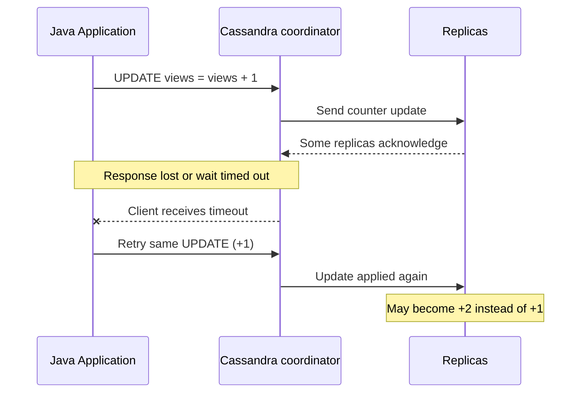

# The `counter` Type and Counter Table Constraints in Apache Cassandra

## Lesson Objectives

In the **BATCH and counters** chapter of the **DATABASE_ENGINE_WIDE_COLUMN_CASSANDRA** module, this lesson explains how Apache Cassandra stores distributed counters, designs wide-column tables around queries, and handles the limitations of increments/decrements. After this lesson, you will be able to:

- Distinguish a `counter` column from a standard `bigint` integer column.
- Create valid counter tables, write CQL to increment/decrement, and read counter values.
- Identify constraints regarding schemas, `INSERT`, `TTL`, `TIMESTAMP`, `IF` conditions, and `BATCH`.
- Explain why retrying an increment after a timeout can double-count and why consistency levels do not guarantee *exactly once*.
- Choose partition keys, clustering keys, replication, and Java connection patterns suited to counting queries.

## 1. What Is `counter` and When Should You Use It?

`counter` is a special CQL column type representing **a 64-bit signed integer updated by addition or subtraction**. Instead of overwriting a new value, the application sends a change amount (*delta*): `+1`, `+5`, `-1`, etc. Cassandra coordinates across replicas to maintain the distributed counter value.

For example, each time a page is viewed, the application increments `views` by one; when needing to display the view count, the application reads `views` by the corresponding key. This is a natural use case if the system tolerates slight inaccuracy during failures or duplicate requests.

| Property | Standard `bigint` | `counter` |
|---|---|---|
| Operation semantics | Assigns a specific numeric value | Adds/subtracts a delta |
| Typical statement | `UPDATE ... SET total = 42` | `UPDATE ... SET total = total + 1` |
| Supports standard `INSERT` | Yes | No: use `UPDATE` to increment/decrement |
| Combined with regular data columns | Yes | Not in the same counter table |
| Suitable when | Writing deterministic values where updates can be controlled | Increment/decrement counting that tolerates retry and accuracy limitations |

**Core point:** `counter` is not a standard integer `UPDATE` assignment. `views = views + 1` is an event that shifts the count; sending that event twice can increment by two units.

## 2. Query-Driven Counter Table Design

Suppose the business requirement is: "Retrieve the **daily** view count for a page; occasionally list all days within the same month." An appropriate table is:

```sql
CREATE TABLE views_by_page_month (
    page_id uuid,
    month_bucket text,
    view_date date,
    views counter,
    PRIMARY KEY ((page_id, month_bucket), view_date)
);
```

In this table:

- The **partition key** is the pair `(page_id, month_bucket)`. One page in one month corresponds to one partition; this bounds partition growth when storing years of data.
- The **clustering key** `view_date` distinguishes daily rows inside the partition, allowing reads for a specific day or scans across days of a month.
- `views` is a **non-key column** in this example and must use the `counter` type.

Analyzing queries before picking keys is critical in Cassandra. The table above serves queries by page and month; it does **not** provide an efficient way to list the top most-viewed pages across the entire system. If you need leaderboards or aggregations along another dimension, design a dedicated aggregation pipeline and storage model.

### Writing and Reading with CQL

```sql
-- One view on 2026-11-21.
UPDATE views_by_page_month
SET views = views + 1
WHERE page_id = 11111111-1111-1111-1111-111111111111
  AND month_bucket = '2026-11'
  AND view_date = '2026-11-21';

-- Decrement by one unit (when business logic allows).
UPDATE views_by_page_month
SET views = views - 1
WHERE page_id = 11111111-1111-1111-1111-111111111111
  AND month_bucket = '2026-11'
  AND view_date = '2026-11-21';

-- Read a single day by full primary key.
SELECT views
FROM views_by_page_month
WHERE page_id = 11111111-1111-1111-1111-111111111111
  AND month_bucket = '2026-11'
  AND view_date = '2026-11-21';

-- List all days belonging to the same monthly partition.
SELECT view_date, views
FROM views_by_page_month
WHERE page_id = 11111111-1111-1111-1111-111111111111
  AND month_bucket = '2026-11';
```

`UPDATE ... SET views = views + n` can create the counter row if the key does not exist yet; the application neither needs nor is allowed to initialize it with `INSERT`. Counter values can become negative if decrements exceed increments. Reading a row that has never been written may return zero rows; the application must define how to interpret "no count yet" rather than assuming every query returns `0`.

## 3. Important Constraints on Counter Tables

Counter tables have dedicated schema and CQL rules. Violations are typically rejected by Cassandra immediately upon `CREATE TABLE` or statement execution.

| Constraint Category | Rule / Consequence |
|---|---|
| Key data types | Partition keys and clustering keys must be standard key types; **a `counter` column cannot be part of the primary key**. |
| Non-key columns | A table with counters may only contain counter columns outside the key columns; do not mix `counter` with `text`, `int`, `timestamp`, etc., as regular data columns. |
| Initialization and updates | Use `UPDATE` with `counter = counter + n` or `counter = counter - n`; do not `INSERT` into a counter table and do not assign directly with `counter = n`. |
| `UPDATE` key conditions | Specify the full partition key and clustering key components to target the exact row to update. |
| TTL and write timestamp | Do not use `USING TTL` or `USING TIMESTAMP` on counter updates; counters do not support expiration like regular columns. |
| LWT / conditions | Do not use `IF` or `IF EXISTS` to turn a counter increment into a conditional compare-and-set update. |
| Batch | Use `BEGIN COUNTER BATCH` for counter updates; do not mix counter statements and regular statements in the same batch. |
| Retries | Addition/subtraction is **not idempotent**: executing twice can change the value twice. |

The following **invalid** examples illustrate common errors:

```sql
-- Invalid: mixing a counter with a non-counter data column.
CREATE TABLE invalid_views (
    page_id uuid PRIMARY KEY,
    views counter,
    page_title text
);

-- Invalid: cannot INSERT data into a counter table.
INSERT INTO views_by_page_month
    (page_id, month_bucket, view_date, views)
VALUES
    (11111111-1111-1111-1111-111111111111, '2026-11', '2026-11-21', 1);

-- Invalid: assigning an absolute value instead of adding/subtracting a delta.
UPDATE views_by_page_month
SET views = 100
WHERE page_id = 11111111-1111-1111-1111-111111111111
  AND month_bucket = '2026-11' AND view_date = '2026-11-21';

-- Invalid: TTL does not apply to counters.
UPDATE views_by_page_month USING TTL 3600
SET views = views + 1
WHERE page_id = 11111111-1111-1111-1111-111111111111
  AND month_bucket = '2026-11' AND view_date = '2026-11-21';

-- Invalid: counter UPDATE does not support IF conditions.
UPDATE views_by_page_month
SET views = views + 1
WHERE page_id = 11111111-1111-1111-1111-111111111111
  AND month_bucket = '2026-11' AND view_date = '2026-11-21'
IF EXISTS;
```

If you need to store `page_title`, `owner_id`, article status, or other attributes, store them in a **separate entity table**. The application can read descriptive metadata from that table and view counts from the counter table using the appropriate keys; do not try to pack every attribute into a counter table.

### No "Reset to 0" via Assignment Statement

`SET views = 0` is invalid. You should also not assume that deleting a row and immediately incrementing again is a safe reset: replicas, tombstones, write timestamps, and recovery scenarios can make counter deletions tricky. For periodic counters, designing **new period keys** (`month_bucket`, `view_date`, etc.) is usually cleaner and easier to operate. If you must delete counter data, verify behavior on your deployed Cassandra version and ensure an appropriate repair workflow.

## 4. Why Are Counters a Hard Distributed Problem?

In Cassandra, a partition is replicated across multiple nodes according to the keyspace's replication factor. An increment passes through the coordinator and replicas; depending on consistency level, the client receives success once enough required replicas acknowledge. However, **client-side success, failure, and timeout do not equate cleanly to whether the change occurred**.

Consider the sequence of events:



This is a critical reason never to mark counter statements as *idempotent* and never to auto-retry blindly. A timeout is an **indeterminate outcome** for the application: the initial update may not have been applied, may have been partially applied, or may have been written despite the lost response.

### What Do Consistency Levels Solve?

- `ONE` / `LOCAL_ONE` typically prioritize latency and availability; fewer replicas are required to acknowledge.
- `QUORUM` / `LOCAL_QUORUM` require more replicas to acknowledge within the appropriate scope, potentially trading off latency and availability during failures.
- Replication and consistency levels shape read/write paths, but **they do not turn a counter increment into exactly-once**. Even when reading at quorum, an application cannot use the read result to be sure whether a specific timed-out request should be resent.

Counters do not provide conditional transactions like `IF current = x THEN x + 1` to deduplicate requests. If counts must be strictly exact for payment events, quota allocation, or inventory, build an event-recording mechanism with unique IDs, deduplication, and controlled aggregation using an appropriate system rather than relying solely on Cassandra counters.

## 5. `COUNTER BATCH` and What Batches Do Not Guarantee

When multiple counter updates need to be sent in one request, CQL provides a dedicated batch syntax:

```sql
BEGIN COUNTER BATCH
    UPDATE views_by_page_month
    SET views = views + 1
    WHERE page_id = 11111111-1111-1111-1111-111111111111
      AND month_bucket = '2026-11' AND view_date = '2026-11-21';

    UPDATE views_by_page_month
    SET views = views + 2
    WHERE page_id = 11111111-1111-1111-1111-111111111111
      AND month_bucket = '2026-11' AND view_date = '2026-11-22';
APPLY BATCH;
```

`BEGIN COUNTER BATCH` may only contain counter updates; do not place `INSERT` or `UPDATE` statements for regular tables into the same batch. Batches are not a default tool for boosting throughput: packing too many partitions into a batch forces the coordinator to do extra work and can increase latency.

In particular, batches do not turn the entire increment/decrement process into an RDBMS-style ACID transaction, and **they do not eliminate the timeout/retry problem**. If the client resends the entire counter batch after a timeout, each increment risks being applied an extra time. Use counter batches only when genuinely needed and once you understand their limitations.

## 6. Connecting from Java and Handling Errors Properly

Example with DataStax/Apache Cassandra Java Driver 4.x, using `PreparedStatement` for stable CQL statements. `CqlSession` should have its lifecycle managed at the application level; the snippet below assumes `session` is already open and connected to the appropriate keyspace:

```java
import java.time.LocalDate;
import java.util.UUID;

import com.datastax.oss.driver.api.core.CqlSession;
import com.datastax.oss.driver.api.core.cql.BoundStatement;
import com.datastax.oss.driver.api.core.cql.PreparedStatement;

public final class PageViewCounter {
    private final CqlSession session;
    private final PreparedStatement increment;

    public PageViewCounter(CqlSession session) {
        this.session = session;
        this.increment = session.prepare(
            "UPDATE views_by_page_month " +
            "SET views = views + ? " +
            "WHERE page_id = ? AND month_bucket = ? AND view_date = ?"
        );
    }

    public void addViews(UUID pageId, LocalDate day, long delta) {
        String bucket = String.format("%04d-%02d", day.getYear(), day.getMonthValue());
        BoundStatement statement = increment
            .bind(delta, pageId, bucket, day)
            .setIdempotent(false);
        session.execute(statement);
    }
}
```

In this example, `delta` is a signed integer: positive values increment, negative values decrement (`+ ?` with a negative value). Verify your actual retry strategy in both the Java Driver configuration and application infrastructure: marking `.setIdempotent(false)` prevents the driver from assuming a counter increment is safe to re-execute by default, yet proxies, queues, HTTP clients, or business logic might still resend requests on their own.

When `session.execute(...)` throws a timeout, log identifying event details and mark the state as **unknown whether applied**. Do not automatically turn every timeout into a second `addViews` call. For exact counting needs, persist the event ID and build deduplication at the appropriate layer; simply adding a `request_id` to a counter statement does not automatically make it idempotent.

## 7. Performance, Compaction, Repair, and Operations

**Choose partition keys according to write load and query patterns.** A `(page_id, month_bucket)` key can become very "hot" if a popular page receives massive increments. Many concurrent updates to the same counter cause contention and increase load on the relevant replicas. When scaling is needed, consider sharding the counter with a *shard* (`shard_id` in the key) and summing results on read in the application; the trade-off is querying more rows and added aggregation complexity.

**Keep partition sizes reasonable.** Monthly bucketing in the example caps the number of daily rows per partition; overly long buckets grow row counts, while overly short buckets force reads across many partitions. Size buckets based on actual row counts, query frequency, and data lifecycle.

**Monitor operational signals.** Watch write/read latency, timeouts, unavailables, hotspots, partition sizes, tombstone counts, and replica health. Counters use specialized internal processing; compaction helps manage SSTable storage but cannot fix errors from application duplicate increments. Repair synchronizes data across replicas per Cassandra operational procedures, yet it cannot infer and remove an increment that is valid at the storage layer because a client mistakenly retried it.

**Plan data retention.** Because counters do not support per-update TTL, decide retention policies at the data-model and operational-task level. Deleting counters or reusing keys must be tested under replication, node downtime, and repair; in particular, avoid delete-followed-immediately-by-increment as a simplistic reset.

## 8. Choosing `counter` or Another Architecture?

| Need | Approach |
|---|---|
| Displaying approximate views or clicks under heavy load where error/retry skew is tolerable | Consider Cassandra counters; control retries and hotspots. |
| Counting events with unique IDs requiring reconciliation and metric reconstruction | Store immutable events/ledger, deduplicate by ID, and aggregate from events. |
| Assigning specific numbers, conditional updates, or applying TTL directly | Use a regular data table or a database meeting transactional requirements; do not use `counter` columns. |
| One key receiving an extremely high increment rate | Design sharding/bucketing or an event-buffering pipeline before writing, weighing read aggregation cost. |

### Practice Checklist

1. Define the two queries first: reading one day's count and listing a month's days for the same page; cross-check them against the partition key and clustering key in the DDL.
2. Create `views_by_page_month`, increment by `+3`, decrement by `-1`, and read back the value. Attempt `INSERT` and `USING TTL` statements to observe the exact errors from your Cassandra version.
3. Simulate a client losing the response after an increment. Write down both possibilities—"incremented" and "not incremented"—before choosing a retry policy for the Java application.
4. Evaluate your requirement: if one event is sent twice and the count increases twice, is that acceptable to the business? If not, design event ID storage and deduplication before deciding to use counters.

**Key Takeaway:** A counter table is a specialized structure for distributed addition/subtraction. Correctness comes from **query-driven schema design**, **retry discipline**, **consistency levels and replication**, and **operational procedures**, not merely from the `counter` data type.
