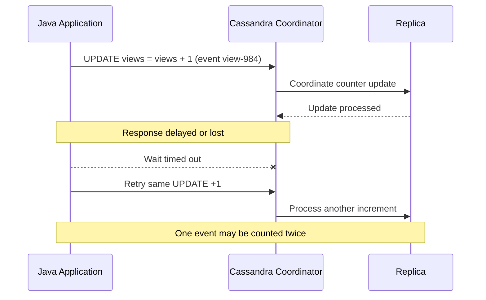

# Counter Increments/Decrements, Retries, and Repeatability

> **Chapter:** BATCH and counters  
> **Module:** `DATABASE_ENGINE_WIDE_COLUMN_CASSANDRA`

Apache Cassandra is a distributed database built on the *wide-column* model. When designing tables around queries, you must consider partition keys, load distribution across nodes, replication, and read/write consistency levels. CQL provides the `counter` type to add or subtract a quantity directly on the Cassandra cluster. However, in distributed systems, **executing the same counter increment request twice can increase the value twice**. This is especially critical when a Java application encounters timeouts, connection drops, or message redeliveries from a queue.

After this lesson, you will be able to:

- Write CQL to increment, decrement, and read counters; recognize the constraints of counter tables.
- Distinguish the commutativity of addition from **idempotence** (the ability to apply repeatedly without changing the outcome).
- Explain why a write timeout does not prove a counter was not incremented, and why blind retries can double-count.
- Choose retry handling in Java and data models suited to business accuracy requirements.
- Understand the scope of `COUNTER BATCH`, consistency levels, repair, and data reconciliation.

## 1. What Is a Counter in Cassandra?

A `counter` column stores a signed integer that can be incremented or decremented via `UPDATE` statements. The application does not need to read the current value and compute `value + 1` itself before writing. Cassandra handles counter changes through a dedicated mechanism designed for distributed counting data.

For example, suppose we want to read **the total page views per page per day**:

```sql
-- Assumes an existing keyspace has been selected with USE <keyspace_name>.
CREATE TABLE page_views_by_day (
    tenant_id text,
    page_id uuid,
    view_day date,
    views counter,
    PRIMARY KEY ((tenant_id, page_id, view_day))
);
```

Here `(tenant_id, page_id, view_day)` is the **entire partition key**. One page/day pair has one counter cell. This choice fits queries fetching the view count of a specific page on a specific day, though pages with massive traffic can create hot write partitions; sharding is discussed later.

```sql
-- The first update can initialize the counter value from 0.
UPDATE page_views_by_day
SET views = views + 1
WHERE tenant_id = 'shop-01'
  AND page_id = 11111111-1111-1111-1111-111111111111
  AND view_day = '2026-11-21';

UPDATE page_views_by_day
SET views = views + 3
WHERE tenant_id = 'shop-01'
  AND page_id = 11111111-1111-1111-1111-111111111111
  AND view_day = '2026-11-21';

UPDATE page_views_by_day
SET views = views - 1
WHERE tenant_id = 'shop-01'
  AND page_id = 11111111-1111-1111-1111-111111111111
  AND view_day = '2026-11-21';

SELECT views FROM page_views_by_day
WHERE tenant_id = 'shop-01'
  AND page_id = 11111111-1111-1111-1111-111111111111
  AND view_day = '2026-11-21';
```

If all three updates succeed **exactly once**, the calculation is `0 + 1 + 3 - 1 = 3`. Values can go negative: Cassandra does not automatically block `views < 0`, so if the business requires a lower bound of 0, it must be enforced in a different model.

CQL constraints to remember:

| Operation or Construct | With `counter` |
| --- | --- |
| `SET views = views + n` or `views - n` | Valid; `n` is the increment/decrement delta. |
| `INSERT ... views = 10`, `UPDATE ... SET views = 10` | Invalid; counters do not allow direct assignment of absolute values. |
| Non-primary-key regular columns alongside `counter` columns | Cannot be mixed in the same counter table. |
| `USING TTL`, `USING TIMESTAMP` on counter updates | Not supported. |
| `UPDATE ... IF ...` (lightweight transaction/CAS) on counters | Not supported; there is no "only add if event X has not been processed" command for counters. |
| `WHERE` clause on counter updates | Must specify the full primary key of the row being updated. |

Therefore, **a counter is not an ordinary integer that can be arbitrarily reset**. To start a fresh counting period, it is usually best to move to a new period's key (e.g., a new `view_day`) rather than deleting or resetting a counter receiving concurrent writes.

## 2. Addition Is Commutative, Not Idempotent

Two additions `+2` and `+3` can swap order and still produce the same sum: `(x + 2) + 3 = (x + 3) + 2`. That property does **not** solve the problem of sending the same request twice.

Let `f(x) = x + 1` represent a view event. An idempotent operation must satisfy `f(f(x)) = f(x)`. Counter increments do not satisfy this:

```text
Once:         f(10)    = 11
Twice:        f(f(10)) = 12
Conclusion:   12 != 11  → counter increment is NOT idempotent
```

Similarly, `views = views - 1` is not idempotent: if a refund/decrement request is replayed, the count drops an extra time. The fact that two updates can run in either order does not guarantee each event is applied only once.

Distinguish two commonly confused concepts:

- **A counter update succeeding once:** Cassandra processes one increment/decrement and responds per the requested consistency level.
- **A business event counted exactly once:** the application guarantees that every redelivery of the same `event_id` contributes exactly once to the total. A standalone counter does not provide this guarantee on its own.

## 3. Timeouts, Retries, and Indeterminate Outcomes

Suppose the application receives event `view-984` and wants to add 1 to `views`. A possible timeline:



After a timeout, the application **cannot be certain** whether the first command was applied. If it automatically resends the same `UPDATE ... + 1`, the total may be incremented an extra time. Running a `SELECT` to check the current total generally cannot distinguish whether the observed increase came from `view-984` or another concurrent event.

| Scenario | What Can Be Inferred? | How to Respond |
| --- | --- | --- |
| Input validation failed **before** sending the request | No update was sent. | Fix the input error; a new request can be sent. |
| Write received a success response | Update was acknowledged per the chosen consistency level. | Record success; do not resend the same event. |
| Write timeout, connection reset, or lost response **after sending** | Indeterminate outcome: the update may already have been applied. | Do not retry blindly; record state for reconciliation, or accept the skew if counts are approximate. |
| Worker/queue redelivered the same `event_id` | May be a duplicate of an already-processed event. | Requires an application-layer deduplication mechanism if each event must be counted once. |
| Counter read timeout | Reads do not increment/decrement the counter. | Safe to re-read, while still considering load and consistency level. |

**Note:** the driver may automatically retry connection errors, timeouts, or try another host depending on its version, retry policy configuration, and idempotence flag. Never assume "no retry loop in my code" guarantees only one attempt was sent. Conversely, disabling automatic retries does **not eliminate** replays from HTTP clients, message brokers, schedulers, or users clicking again.

### Does Consistency Level Prevent Double-Counting?

`LOCAL_QUORUM`/`QUORUM` and replication affect how many replicas must acknowledge and data visibility across writes/reads. They **do not make** `+1` idempotent. If the application sends two valid requests and both are applied, the cluster can be completely consistent around the double-counted value.

Compaction and repair help maintain storage health and synchronize replicas, but they do not know that `view-984` represents a single business event. They cannot infer and remove an increment caused by a duplicate retry.

## 4. Java Connection: Marking Counter Statements as Non-Idempotent

With **DataStax/Apache Cassandra Java Driver 4.x**, explicitly declare the non-idempotent nature of the statement. The example below assumes `CqlSession` is already connected to the proper keyspace and local data center, and `page_views_by_day` already exists.

```java
import java.time.LocalDate;
import java.util.UUID;

import com.datastax.oss.driver.api.core.CqlSession;
import com.datastax.oss.driver.api.core.DefaultConsistencyLevel;
import com.datastax.oss.driver.api.core.cql.BoundStatement;
import com.datastax.oss.driver.api.core.cql.PreparedStatement;

public final class PageViewCounter {
    private final CqlSession session;
    private final PreparedStatement increment;
    private final PreparedStatement decrement;

    public PageViewCounter(CqlSession session) {
        this.session = session;
        this.increment = session.prepare(
            "UPDATE page_views_by_day SET views = views + ? " +
            "WHERE tenant_id = ? AND page_id = ? AND view_day = ?");
        this.decrement = session.prepare(
            "UPDATE page_views_by_day SET views = views - ? " +
            "WHERE tenant_id = ? AND page_id = ? AND view_day = ?");
    }

    public void change(String tenantId, UUID pageId, LocalDate day,
                       long amount, boolean increase) {
        if (amount <= 0) {
            throw new IllegalArgumentException("amount must be positive");
        }

        BoundStatement statement = (increase ? increment : decrement)
            .bind(amount, tenantId, pageId, day)
            .setIdempotent(false)
            .setConsistencyLevel(DefaultConsistencyLevel.LOCAL_QUORUM);

        session.execute(statement);
    }
}
```

`setIdempotent(false)` informs the driver when making retry and speculative execution decisions under its retry policy. Verify the actual policy of your driver version; this flag **does not** create a deduplication mechanism inside Cassandra. `LOCAL_QUORUM` is an illustrative choice when local data center replication supports it, not an "exactly once" guarantee.

In the error-handling path, attach a stable `event_id` to each request. If `session.execute(...)` throws an error **after dispatch**, record an "indeterminate outcome" state in reliable tracking, feed it into a reconciliation workflow, or explicitly accept the tolerance margin. **Never immediately call `session.execute(statement)` again inside a `catch` block** just because a write timeout occurred. Also check for retries in upstream APIs, queue consumers, and job schedulers outside this method.

## 5. When to Use Counters vs. Event Data?

Choose a solution based on **business requirements**, not just the convenience of a `+1` statement:

| Requirement | Appropriate Design | Trade-off |
| --- | --- | --- |
| Views, engagements, click counts; minor skew on network failures is acceptable | Cassandra `counter`, optionally bucketed by day and sharded | Fast additive/subtractive updates; hard to deduplicate and cannot be directly reset. |
| Reporting must know whether each event was recorded | Store immutable events with unique `event_id`; sum from deduplicated events | Extra storage cost and aggregation/reconciliation effort. |
| Inventory, balances, quotas; must never double-add/subtract or drop below bounds | Transactional/CAS write model with proper business constraints | Requires stricter concurrency, recovery, and verification design; do not use raw counters. |

### Example: Storing Immutable Events for Deduplication

Instead of using `counter` as the source of truth, the application can store each event with a stable ID and compute counts from unique events:

```sql
CREATE TABLE view_events_by_bucket (
    tenant_id text,
    event_day date,
    bucket smallint,
    event_id uuid,
    page_id uuid,
    delta int,
    PRIMARY KEY ((tenant_id, event_day, bucket), event_id)
);

-- event_id, event_day, and bucket of the same event must stay identical on retry.
INSERT INTO view_events_by_bucket
    (tenant_id, event_day, bucket, event_id, page_id, delta)
VALUES
    ('shop-01', '2026-11-21', 3,
     22222222-2222-2222-2222-222222222222,
     11111111-1111-1111-1111-111111111111, 1)
IF NOT EXISTS;
```

`INSERT ... IF NOT EXISTS` uses a lightweight transaction (LWT) on a **regular table**, ensuring only one row is created for `event_id` at the specified key. `bucket` can be derived deterministically from a hash of `event_id` to bound partition size and spread partitions; every retry must produce the **exact same key**. Do not generate a fresh random UUID on each retry, as that turns one event into multiple distinct keys.

After persistence, a job can aggregate `delta` across **unique events** per page/day and write derived results using a recomputable and reconcilable mechanism. The event table allows explaining "why the total equals N" and rebuilding counts when needed.

**Common trap:** creating a `processed_events` table, marking an event via LWT, and then incrementing a `counter` are **two separate operations**. If the application crashes after the marking step and before the increment step, a count can be missed; doing it in reverse can double-count. Cassandra does not allow combining counter and non-counter updates in one batch to form an exactly-once transaction across two tables. When exactness is required, rely on an event log with a recoverable aggregation pipeline, or choose a transactional system with matching guarantees.

### Sharding When a Counter Key Gets Too Hot

A page with massive view traffic can overload a single partition key. You can add `shard` **to the partition key**:

```sql
CREATE TABLE sharded_views_by_day (
    tenant_id text,
    page_id uuid,
    view_day date,
    shard smallint,
    views counter,
    PRIMARY KEY ((tenant_id, page_id, view_day, shard))
);
```

On write, pick one of the shards, such as 0–15; when reading the total, read all relevant shards and sum them in the application. Placing `shard` only in the **clustering key** keeps all shards in the same partition and does not solve the partition hotspot. Sharding distributes write load; it does **not** make counters idempotent—a replayed event can still increment multiple times, even when landing on the same shard.

## 6. Does `COUNTER BATCH` Make Retries Safe?

Cassandra provides dedicated batch syntax for batches containing counter updates:

```sql
BEGIN COUNTER BATCH
    UPDATE page_views_by_day SET views = views + 1
    WHERE tenant_id = 'shop-01'
      AND page_id = 11111111-1111-1111-1111-111111111111
      AND view_day = '2026-11-21';

    UPDATE page_views_by_day SET views = views + 1
    WHERE tenant_id = 'shop-01'
      AND page_id = 33333333-3333-3333-3333-333333333333
      AND view_day = '2026-11-21';
APPLY BATCH;
```

`COUNTER BATCH` is for grouping counter updates; never mix counter statements with regular data-modifying statements in the same batch. It **does not carry an `event_id` for deduplication**, does not turn additions into idempotent operations, and does not make resending the entire batch after a timeout safe. Both increment commands in the batch can be applied an extra time if the application replays the batch; therefore, batch only when there is a clear data-access reason and you have weighed the distributed cost across multiple partitions.

## 7. Operational Workflow in Real Applications

1. **Define count semantics.** If approximate operational metrics suffice, counters are acceptable while openly documenting potential skew on failures. If exact per-event counting is needed, store and deduplicate events before building derived metrics.
2. **Attach a durable `event_id`.** The same event must preserve its ID across HTTP retries, queue redeliveries, and restarts; never mint a new ID just because of a retry.
3. **Explicitly declare idempotence to the driver.** For counters, set `false`, and inspect how retry policy and speculative execution are configured. Also audit layers outside the Cassandra driver that might replay requests.
4. **Classify failures by whether the request may have been sent.** Validation errors strictly before sending differ from write timeouts after sending. For indeterminate outcomes, never treat them as "not incremented."
5. **Select consistency levels per replication/topology.** Evaluate latency, availability, and read freshness; do not use consistency levels as a deduplication mechanism.
6. **Monitor and reconcile.** Track timeout rates, retries, backlogs, unique event counts, and drift between counters and event sources. Run repair per cluster operations, while resolving business discrepancies via a dedicated reconciliation process.

## 8. Self-Check

**Exercise 1.** A counter currently equals `7`. A `+2` request is sent, the client times out, the client retries `+2`, and the retry succeeds. What can the final value be, and why?

**Exercise 2.** A task deducting 1 unit of inventory uses `SET remaining = remaining - 1`. Should it be marked idempotent and automatically retried on timeout? How would you replace it if preventing overselling is mandatory?

**Exercise 3.** An application writes `processed_events` with `IF NOT EXISTS` and then increments `views`. If the process crashes between the two steps, what happens when a worker receives the event again?

<details>
<summary>Answer Hints</summary>

1. If the first attempt was not applied, the result is `9`; if the first attempt was applied, the result is `11`. A timeout leaves the first attempt's outcome indeterminate. If other writes happened concurrently, you cannot infer an individual event's status from the current total.
2. No: subtraction is also non-idempotent and can drive inventory negative. You need a model with appropriate constraints and transactions/CAS, plus a request identifier to prevent duplicate deductions.
3. Because the event is already marked, the redelivery may be treated as a duplicate and skipped, causing a missed increment. Two separate steps do not form an exactly-once transaction; keep immutable events as the source of truth and design a re-runnable/reconcilable aggregation.

</details>

## Key Takeaways

- `counter` fits distributed addition/subtraction, but `+n` and `-n` are **not idempotent**.
- Post-dispatch write timeouts have **indeterminate** outcomes; retries risk double-counting/subtracting.
- `setIdempotent(false)`, consistency levels, and `COUNTER BATCH` do not by themselves provide an exactly-once guarantee from event to count.
- When exactness is required, design around `event_id`, persist a verifiable event source, and aggregate/reconcile with a recoverable mechanism.
