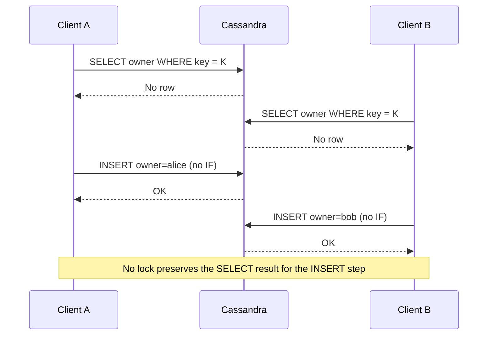

# The Check-Then-Write Problem and Concurrency Race Conditions

## 1. Lesson Objectives

In applications backed by Apache Cassandra, one very easy pattern to write is: **read the current state, check a condition in Java, and then write the change**. This code appears correct when only a single request runs, but it can break when multiple threads, processes, or application servers access **the same partition** concurrently.

This lesson belongs to the **LWT and Concurrency** chapter of the `DATABASE_ENGINE_WIDE_COLUMN_CASSANDRA` module. It connects query-driven table design and partition keys with distributed topics already covered: **replication**, **read/write consistency**, CQL, node operations, and connecting from Java. The primary goal is to understand *why* race conditions occur, **which conditions cannot be protected by a regular SELECT followed by INSERT/UPDATE**, and when Cassandra's **lightweight transactions (LWT)** are needed.

After this lesson, you will be able to:

1. Explain **time-of-check to time-of-use (TOCTOU)**, lost updates, and ownership contention on a key.
2. Explain why `LOCAL_QUORUM` or `ALL` across two separate requests **does not turn them into an atomic check-and-write operation**.
3. Design a **partition key** so that the object to be protected is checked within the **same CAS scope**.
4. Use `INSERT ... IF NOT EXISTS`, `UPDATE ... IF ...`, `DELETE ... IF ...` and understand the `[applied]` result.
5. Distinguish **regular consistency** from **serial consistency** (`SERIAL`/`LOCAL_SERIAL`) in Paxos-backed operations.
6. Test two `cqlsh` sessions modifying data concurrently and inspect a Java Driver example that handles contention.
7. Classify three distinct outcomes: **applied successfully**, **condition not met**, and **timeout/error with unknown outcome**.
8. Evaluate trade-offs around latency, throughput, contention, and the guarantee scope of LWT.

> **Scope:** examples use Cassandra 5.0.9 on a single Docker node to try out syntax. A single node demonstrates a race between two clients, **not** distributed fault tolerance/quorum testing. The RF=3 comparison applies only when **three real nodes have joined the ring**; do not run destructive data commands or failure simulations in production.

## 2. A Seemingly Simple Scenario: Registering a Unique Name

Suppose the system enforces the rule:

> Within each tenant, a normalized `handle` may belong to only **one** `owner_id` at a time.

Two users simultaneously attempt to register the handle `bluebird` under tenant `t1`. An intuitive approach is:

```text
1. SELECT owner_id WHERE tenant_id='t1' AND handle='bluebird';
2. If no row exists → allow.
3. INSERT the row with the registering user's owner_id.
4. Return "registration succeeded".
```

When only one request runs, the result is usually correct. When two requests contend, **the time window between step 1 and step 3** allows both to observe the stale state.

### 2.1. Contention Timeline

```text
Time              Client A                     Client B
----------------------------------------------------------------
t0                SELECT → no row found
t1                                             SELECT → no row found
t2                Check in Java: OK
t3                                             Check in Java: OK
t4                INSERT owner='alice'
t5                                             INSERT owner='bob'
t6                Returns "succeeded"          Returns "succeeded"
----------------------------------------------------------------
Result: both sides are told they succeeded, yet a single CQL key
        cannot legitimately represent two separate owners under the business rule.
```

**This is a race condition**, not merely a slow-network bug. Even a single node or a single JVM can hit this bug if two threads/clients operate concurrently. In a distributed cluster, latency and multiple coordinators make the contention window more likely to appear, but the root cause is that **the read and write are not bound into a single atomic operation**.

**The final write outcome usually cannot be reasoned about simply as "client B wrote later so B wins."** Cassandra processes mutations by cell-level timestamp and reconciliation rules; client-side execution order, clocks, and network paths do not always yield the largest timestamp. When two statements update multiple columns, you must not assume the conflict outcome is equivalent to a single whole-object transaction applied in call order.

### 2.2. Where Does the Same Failure Pattern Appear?

| Business Requirement | Faulty Check-Then-Write Pattern | Consequence When Two Requests Run Concurrently |
|---|---|---|
| Claim username/handle | `SELECT missing row → INSERT` | Both clients receive confirmation that they claimed the name |
| Reserve a resource | `SELECT status=FREE → UPDATE status=BOOKED` | Two users are both told the booking succeeded |
| Change order status | `SELECT status=PENDING → UPDATE status=PAID` | One transition can overwrite a state that already changed |
| Document versioning | `SELECT revision=7 → UPDATE revision=8` | Both edits "succeed," and one edit is lost |
| Quota enforcement | `SELECT used < limit → increment used` | Both requests see remaining capacity and may exceed the limit |

Not every example should be solved with **the same CQL statement**. To protect an invariant, you must choose **the right key and synchronization scope**; for example, a tenant-wide quota cannot be guaranteed solely by CAS on independent device partitions.

## 3. Why Doesn't Cassandra Automatically Lock Between SELECT and INSERT?

### 3.1. Each Statement Is Typically a Separate Request



In Cassandra:

- An `INSERT` without `IF` is an **upsert**: a row with the same primary key is created or updated; the client receives no guarantee that "it did not previously exist."
- An `UPDATE` without `IF` likewise does not check whether the row already exists or whether a column still holds the value Java read earlier.
- A **primary key** prevents two physical rows from sharing the same key, **not** two requesters from both believing their registration succeeded.
- Each mutation carries a timestamp used to resolve conflicts under Cassandra's **last-write-wins** mechanism; a timestamp is not a business-rule version lock.
- Wrapping `SELECT` and `INSERT` in the same Java method or the same HTTP request **does not** create a server-side transaction.

### 3.2. What QUORUM Helps With and What It Does Not

In a keyspace with RF=3 in a single datacenter, `LOCAL_QUORUM` requires **2 out of 3 replicas** to respond. Reading and writing at quorum guarantees overlapping **replica sets**, ensuring consistency under Cassandra's model when conditions and timestamps align.

Consider, however, the following scenario:

```text
A: SELECT at LOCAL_QUORUM -> FREE
B: SELECT at LOCAL_QUORUM -> FREE
A: UPDATE at LOCAL_QUORUM -> BOOKED_BY_A
B: UPDATE at LOCAL_QUORUM -> BOOKED_BY_B
```

**Both SELECTs can be valid at the time they execute, and both UPDATEs are typically accepted.** Quorum does not hold a "lock" on K between two requests. Even using `ALL` for both SELECT and UPDATE does not implicitly add the condition *the value has not changed since the prior read*.

| Mechanism | Requires Replica Coordination? | Protects "Still Equals X at Write Time"? |
|---|---|---|
| `SELECT` → Java `if` → regular `INSERT` | Per each request's CL | **No** |
| Regular `UPDATE` at `LOCAL_QUORUM` | Yes, by replica response count | **No** |
| `INSERT ... IF NOT EXISTS` | Yes, via **Paxos/LWT** | **Yes**, within supported condition/partition scope |
| `UPDATE ... IF revision=7` | Yes, via **Paxos/LWT** | **Yes**, provided all related write paths follow the appropriate protocol |

The key takeaway: **replication factor** determines where replicas are stored; **regular consistency level** determines the required number of responses; **LWT** determines whether checking the condition and selecting the mutation are coordinated as a single compare-and-set operation.

## 4. LWT: Checking Conditions and Writing Under Paxos

### 4.1. Compare-and-Set (CAS) Mindset

CAS expresses the requirement:

> Apply the mutation **only if the current state still satisfies the condition** when the replica group reaches a decision.

For `INSERT ... IF NOT EXISTS`, the condition is *the row does not yet exist*. For `UPDATE ... IF revision=7`, the condition is *the current revision equals 7*. Cassandra uses **Paxos** for lightweight transactions to coordinate replicas and prevent two conflicting conditional mutations from both being accepted as independent operations.

**Linearizability** here is a guarantee over CAS operations within the **partition scope** and corresponding protocol: contending operations can be reasoned about as being decided in a single consistent order. It **does not** turn Cassandra into an RDBMS with database-wide ACID transactions, does not create automatic uniqueness constraints across arbitrary tables, and cannot protect an invariant if another write path can modify the row **without CAS**.

### 4.2. Visualizing the Paxos Flow

```text
Application sends: INSERT ... IF NOT EXISTS for partition K
                 |
                 v
        Coordinator works with replicas
                 |
     Prepare / promise; determine accepted state
                 |
     Evaluate condition, choose proposal for replicas to agree on
                 |
       Accept / commit via Paxos mechanism
                 |
     [applied]=true or [applied]=false
```

This is a **conceptual model**, not a fixed packet trace or round-trip count across every Cassandra release. Paxos implementation optimizations can vary by version, contention level, and topology. The important thing to remember is that LWT incurs **higher coordination overhead and latency** than regular writes; do not use it as a default for millions of telemetry events just to feel "safer."

### 4.3. Three Core CQL Statements

```sql
-- Check that the row does not exist before creating it.
INSERT INTO lwt001.claims (tenant_id, handle, owner_id, request_id, revision, state)
VALUES ('t1', 'bluebird', 'alice', 10000000-0000-4000-8000-000000000001, 1, 'ACTIVE')
IF NOT EXISTS;

-- Change state only if version is still 1.
UPDATE lwt001.claims
SET state = 'SUSPENDED', revision = 2
WHERE tenant_id = 't1' AND handle = 'bluebird'
IF revision = 1;

-- Delete only if owner/version still match expected values.
DELETE FROM lwt001.claims
WHERE tenant_id = 't1' AND handle = 'bluebird'
IF owner_id = 'alice' AND revision = 2;
```

These examples will be executed **in order** in the hands-on section on lab data. `[applied]=true` means the conditional mutation was applied; `[applied]=false` means the condition was not satisfied, not a timeout error.

## 5. Designing the Partition Key Where the Guarantee Is Needed

### 5.1. Unique Handle per Tenant

Because the rule to protect is **each (tenant, handle) pair has one owner**, the table uses that pair as its **composite partition key**:

```sql
CREATE TABLE lwt001.claims (
    tenant_id text,
    handle text,
    owner_id text,
    request_id uuid,
    revision int,
    state text,
    PRIMARY KEY ((tenant_id, handle))
);
```

Each `(tenant_id, handle)` pair is a separate partition. Two clients registering `('t1','bluebird')` contend on the **same CAS target**. Meanwhile, `('t2','bluebird')` is a different partition, which is valid if uniqueness is scoped **per tenant**.

**Crucial:** if you create a table whose primary key is only `owner_id` and keep `handle` as a regular column, `INSERT IF NOT EXISTS` only protects **`owner_id`**, not the uniqueness of `handle`. Two different owners can both hold the same handle across two different partitions. **LWT does not automatically create a global unique index.**

### 5.2. Normalizing Names Before Placing Them in the Key

For example:

| User Input | Business Key to Protect |
|---|---|
| `BlueBird` | `bluebird` |
| ` bluebird ` | `bluebird` |
| `BLUEBIRD` | `bluebird` |

If the business rule treats these three strings as the same handle, the application must apply **one consistent normalization rule** before writing CQL, taking Unicode normalization/case folding into account according to product rules. If one client preserves uppercase while another lowercases, they may execute CAS on **two different partitions** and both succeed, even though the business considers them duplicates.

Keep canonicalization logic in a shared library/service, test it with multilingual inputs, and clearly document the uniqueness scope. Do not change the partition key in place on a table that already contains data and expect Cassandra to migrate rows automatically.

## 6. Setting Up the Cassandra 5.0.9 Lab Environment

### 6.1. Single Node for Learning Syntax and Races

You need Docker Engine/Desktop running Linux containers, sufficient CPU/free SSD space, and roughly 8 GiB total RAM or more for comfortable single-node lab operation. The example caps Cassandra JVM/container memory at 4 GiB RAM, which is not production sizing. Choose an available host port `9317`.

Run **on a host with the Docker CLI**:

```bash
docker version
docker pull cassandra:5.0.9
docker network create lwt001-net
docker volume create lwt001_node_data

docker run -d --name cassandra-lwt001 --network lwt001-net --memory=4g --memory-swap=4g -e MAX_HEAP_SIZE=2G -e CASSANDRA_CLUSTER_NAME=lwt001-lab -e CASSANDRA_ENDPOINT_SNITCH=GossipingPropertyFileSnitch -e CASSANDRA_DC=dc1 -e CASSANDRA_RACK=rack1 -p 127.0.0.1:9317:9042 -v lwt001_node_data:/var/lib/cassandra cassandra:5.0.9
```

If a container/network/volume with the same name **already exists**, check its owner and data before running; the example assumes all of them are fresh. Do not share this volume with another Cassandra node. Port `9317` is published only on the **host loopback interface**, because the lab does not enable auth/TLS by default. Do not expose that port to LAN/internet.

Wait for readiness:

```bash
docker ps -a --filter name=cassandra-lwt001
docker logs --tail 100 cassandra-lwt001
docker exec cassandra-lwt001 nodetool status
docker exec cassandra-lwt001 nodetool statusbinary
docker exec cassandra-lwt001 cqlsh -e "SELECT cluster_name, data_center, release_version FROM system.local WHERE key='local';"
```

Wait until `nodetool status` shows **one `UN` node**, `statusbinary` reports `running`, and CQL returns `cluster_name=lwt001-lab`, `data_center=dc1`, server version `5.0.9`. A container in `Up` state does not prove CQL is ready.

### 6.2. Creating the Keyspace and Two Tables

Open `cqlsh` inside the container:

```bash
docker exec -it cassandra-lwt001 cqlsh
```

Run:

```sql
CREATE KEYSPACE IF NOT EXISTS lwt001
WITH replication = {'class':'NetworkTopologyStrategy', 'dc1':1};

-- Table used to demonstrate the flawed read-then-write pattern.
CREATE TABLE IF NOT EXISTS lwt001.claims_naive (
    tenant_id text,
    handle text,
    owner_id text,
    PRIMARY KEY ((tenant_id, handle))
);

-- Table used for compare-and-set.
CREATE TABLE IF NOT EXISTS lwt001.claims (
    tenant_id text,
    handle text,
    owner_id text,
    request_id uuid,
    revision int,
    state text,
    PRIMARY KEY ((tenant_id, handle))
);

DESCRIBE KEYSPACE lwt001;
```

Note: `IF NOT EXISTS` in `CREATE KEYSPACE/TABLE` is **DDL idempotence**, which is **different** from LWT `INSERT ... IF NOT EXISTS`. Do not treat `CREATE ... IF NOT EXISTS` as proof that the schema matches expectations; inspect the actual DDL if the volume was previously used.

### 6.3. Consistency Levels in the Lab

In both `cqlsh` sessions of this lesson:

```text
CONSISTENCY LOCAL_QUORUM;
SERIAL CONSISTENCY SERIAL;
```

These are **`cqlsh` commands** (not CQL statements to pass verbatim from the Java Driver). With RF=1, `LOCAL_QUORUM` needs a response from **one replica**, so it does not simulate multi-node quorum. However, two clients can still contend on the same key on the single node. `SERIAL` specifies the serial consistency level used when running **conditional mutations**.

## 7. Deliberate Failure Test: SELECT Followed by Regular INSERT

Open **two terminals** on the host, and in each run:

```bash
docker exec -it cassandra-lwt001 cqlsh
```

Call the two windows **Client A** and **Client B**. Pick a dedicated handle `naive-race-001` so it does not interfere with the LWT examples.

### 7.1. Fixing Step Order to Expose the Race

**In Client A**, run only the SELECT:

```sql
SELECT owner_id FROM lwt001.claims_naive
WHERE tenant_id='t1' AND handle='naive-race-001';
```

In a fresh lab, expect no row yet. **Do not run INSERT yet.**

**In Client B**, run the same SELECT:

```sql
SELECT owner_id FROM lwt001.claims_naive
WHERE tenant_id='t1' AND handle='naive-race-001';
```

Both A and B just observed "does not exist" — **both SELECT results were accurate at read time**.

Next, **A** runs:

```sql
INSERT INTO lwt001.claims_naive (tenant_id, handle, owner_id)
VALUES ('t1', 'naive-race-001', 'alice');
```

Then **B** still acts on its stale decision:

```sql
INSERT INTO lwt001.claims_naive (tenant_id, handle, owner_id)
VALUES ('t1', 'naive-race-001', 'bob');
```

Finally, run:

```sql
SELECT tenant_id, handle, owner_id
FROM lwt001.claims_naive
WHERE tenant_id='t1' AND handle='naive-race-001';
```

**What to observe:** both regular INSERTs can report success even though the business rule requires **only one** user to claim the handle. The final result contains one state chosen by reconciliation according to mutation timestamps/tie-break rules; **do not use whether `bob` or `alice` appears as the PASS criterion**. The goal of this exercise is to recognize that **both clients succeeded in making a decision that violates the invariant**.

### 7.2. Why Can't This Be Fixed with Sleep or Locks in Java?

- `Thread.sleep(100)` only alters probability/timing; it does not enforce an atomic condition in Cassandra.
- `synchronized` inside a single JVM does not coordinate across other JVMs, Pods, or Java servers.
- An external Redis lock/lease **can** be part of a carefully engineered architecture, but it still requires fencing/expiry/failure handling; it does not automatically become a Cassandra CAS guarantee.
- Raising CL from `ONE` to `QUORUM`/`ALL` does not bind two statements into one transaction.
- Combining a SELECT and an INSERT into `BEGIN BATCH` **is not possible**: CQL BATCH only accepts mutation statements, and a batch is not equivalent to a SQL serializable transaction.

## 8. Doing It Right: Two Clients Contending on the Same LWT Claim

### 8.1. Client A Attempts Registration

Use a **new** handle `lwt-claim-001` in Client A:

```sql
INSERT INTO lwt001.claims
    (tenant_id, handle, owner_id, request_id, revision, state)
VALUES
    ('t1', 'lwt-claim-001', 'alice',
     10000000-0000-4000-8000-000000000011, 1, 'ACTIVE')
IF NOT EXISTS;
```

When the row does not yet exist, `cqlsh` typically displays:

```text
 [applied]
-----------
      True
```

This is a **CAS result**, unlike the output of a regular INSERT. If the lab already contains a row with that key, `[applied]` will be `False`; do not delete data of unknown origin just to force `True`.

### 8.2. Client B Attempts to Claim the Same Key

In Client B:

```sql
INSERT INTO lwt001.claims
    (tenant_id, handle, owner_id, request_id, revision, state)
VALUES
    ('t1', 'lwt-claim-001', 'bob',
     10000000-0000-4000-8000-000000000012, 1, 'ACTIVE')
IF NOT EXISTS;
```

Expect `[applied] = False`, and depending on the statement/version, the result may include the existing column values. **Do not treat `False` as a server error**: it is a normal business outcome meaning **the "row does not exist" condition was not met**.

Verify:

```sql
SELECT tenant_id, handle, owner_id, request_id, revision, state
FROM lwt001.claims
WHERE tenant_id='t1' AND handle='lwt-claim-001';
```

Expect the owner to remain `alice` along with A's `request_id` if A was applied first. In a **truly concurrent** test on a new key, do not hardcode an assumption that **A always wins**: what matters is that **no two CAS operations succeed** for the same non-existent row when both requests complete under the protocol with no intervening delete.

### 8.3. An Attempt's Outcome Has More Than Two States

| Scenario | What Client Receives | Correct Interpretation | Recommended Action |
|---|---|---|---|
| Condition holds, commit succeeds, and client receives response | `[applied]=true` | Mutation was applied according to LWT and CL semantics | Record success |
| Condition fails and response is received | `[applied]=false` | CAS did not modify the row for this request | Inspect current values, return conflict, or re-read |
| Connection lost, timeout, or coordinator failure | Exception/timeout, **no reliable `[applied]`** | **Uncertain** whether the server committed or not | Reconcile via business key + `request_id`; bounded retry |

**Never write Java `catch (Exception e) { return false; }` and treat every error as "someone else already claimed the name."** A timeout can occur after replicas have already reached a decision, with the response failing to reach the client. The client must separate a **definite conflict** from an **indeterminate outcome**.

## 9. Compare-and-Set by Revision: Preventing Lost Updates

`IF NOT EXISTS` protects **creation**. For an existing row, you need a condition comparing the state version to avoid one request overwriting a change just committed by another client.

### 9.1. Create the Initial Row

Pick a different handle `lwt-revision-001`:

```sql
INSERT INTO lwt001.claims
    (tenant_id, handle, owner_id, request_id, revision, state)
VALUES
    ('t1', 'lwt-revision-001', 'alice',
     10000000-0000-4000-8000-000000000021, 1, 'ACTIVE')
IF NOT EXISTS;

SELECT revision, state FROM lwt001.claims
WHERE tenant_id='t1' AND handle='lwt-revision-001';
```

Expect `revision=1` and `state=ACTIVE` on fresh data. Suppose both Client A and Client B read revision 1 before either writes.

### 9.2. A Performs a Conditional State Change

Client A:

```sql
UPDATE lwt001.claims
SET state='SUSPENDED', revision=2
WHERE tenant_id='t1' AND handle='lwt-revision-001'
IF revision=1;
```

If A arrives first and the condition still holds, `[applied]=True`.

### 9.3. B Uses a Stale Revision

Client B:

```sql
UPDATE lwt001.claims
SET state='ARCHIVED', revision=2
WHERE tenant_id='t1' AND handle='lwt-revision-001'
IF revision=1;
```

If A was already applied, B receives `[applied]=False` because the current revision is now 2. When B receives `False`, the application can re-read the row, notify the user that the data changed, or build a new mutation **based on the new state**. **Do not retry indefinitely with the same `revision=1`** because the condition is stale.

```sql
SELECT owner_id, revision, state
FROM lwt001.claims
WHERE tenant_id='t1' AND handle='lwt-revision-001';
```

The revision condition must be honored by **every write path that can contend**. If another service executes:

```sql
-- Must NOT be used on an entity designed to be managed via CAS:
UPDATE lwt001.claims SET state='ACTIVE', revision=1
WHERE tenant_id='t1' AND handle='lwt-revision-001';
```

it can break the optimistic concurrency control model. This is an **anti-pattern example, not a lab step to execute**.

### 9.4. Conditional DELETE and Avoiding Reckless "Resets"

On row `lwt-revision-001` after `revision` has reached 2:

```sql
-- Stale condition: on expected data, must return [applied]=False.
DELETE FROM lwt001.claims
WHERE tenant_id='t1' AND handle='lwt-revision-001'
IF revision=1;

-- Execute only if you want to delete the lab record at revision=2 with the matching owner:
DELETE FROM lwt001.claims
WHERE tenant_id='t1' AND handle='lwt-revision-001'
IF owner_id='alice' AND revision=2;
```

`DELETE` creates a tombstone in Cassandra; it does not immediately purge all SSTables. In a real handle-claiming system, deleting a row and allowing someone else to recreate it can introduce the **ABA problem**: the "absent" state reappears even though the handle went through another ownership lifecycle. If reuse must be prevented or controlled, store **logical tombstones / `RESERVED`/`RELEASED` states, generation/tokens, and reassignment rules** per business design instead of merely deleting the row.

## 10. Two Consistency Axes When Executing LWT

### 10.1. Regular Consistency and Serial Consistency

In `cqlsh`, there are two **distinct** controls:

```text
CONSISTENCY LOCAL_QUORUM;
SERIAL CONSISTENCY SERIAL;
```

- `CONSISTENCY` is the **regular consistency level** applied to the commit/learn response phase of the mutation and to normal CQL requests.
- `SERIAL CONSISTENCY` is the consistency level of the **Paxos/serial decision phase** for conditional mutations `INSERT/UPDATE/DELETE ... IF ...`.
- `SERIAL` and `LOCAL_SERIAL` are **not** protocol version numbers or RF settings. They define the replica scope participating in consensus.

In a **single-DC** cluster with RF=3, a common configuration is `regular=LOCAL_QUORUM` and `serial=SERIAL` or `LOCAL_SERIAL` depending on topology and requirements. In a **multi-DC** cluster, `LOCAL_SERIAL` limits consensus to **local datacenter** replicas, so you must not assume it provides **a global decision order across all DCs** when the same invariant is mutated from multiple regions. If you need CAS meaningful **cluster-wide/multi-DC**, evaluate `SERIAL`, replica placement, latency, and the specifications of your Cassandra/driver version.

### 10.2. Reads After LWT

An LWT may have reached a decision while some replicas or notification phases have not yet finished at the exact moment another client reads. A **serial read** can surface or finish an in-flight Paxos round, at the cost of coordination overhead. A regular read at a level such as `LOCAL_ONE` may see stale data if a replica has not yet been updated.

Do not misinterpret `SERIAL CONSISTENCY SERIAL` as a lock covering **all normal SELECTs**. To reason about read consistency, you must specify the CL of both the SELECT and the mutation, along with the appropriate serial consistency setting.

### 10.3. Summary Table for RF=3 Practice

| Actual Condition | `LOCAL_ONE` | `LOCAL_QUORUM` | `ALL` | LWT at `SERIAL` |
|---|---|---|---|---|
| 3 healthy replicas in same DC | 1 response | 2 responses | 3 responses | Paxos consensus across required replicas/rounds |
| 1 replica down, 2 healthy | Can serve | Can serve | Insufficient for 3 acks | Can serve **if Paxos quorum is reached** and regular CL phase is satisfied |
| 2 replicas down, 1 healthy | Regular ops at ONE may work | Insufficient for 2 | Insufficient for 3 | **Insufficient consensus quorum** to complete CAS under normal conditions |

This table **interprets replica counts** for a properly bootstrapped cluster; it does not guarantee a request will succeed: disk errors, timeouts, network issues, or coordinator failures can still cause failures. A single-node RF=1 lab must not be used to measure failover or LWT availability during replica loss.

## 11. Java Driver: Reading CAS Outcomes Instead of Guessing from Exceptions

### 11.1. Using Prepared Statements and Checking wasApplied()

The example targets **Java 17** and **Apache Cassandra Java Driver 4.x**, such as Maven dependency `org.apache.cassandra:java-driver-core:4.19.4`. The Java application is assumed to run **inside a container on the `lwt001-net` Docker network**, so the contact point is `cassandra-lwt001:9042`; if running outside Docker, configure the endpoint and topology to match your actual network path.

```java
import java.net.InetSocketAddress;
import java.util.UUID;

import com.datastax.oss.driver.api.core.CqlSession;
import com.datastax.oss.driver.api.core.DefaultConsistencyLevel;
import com.datastax.oss.driver.api.core.cql.PreparedStatement;
import com.datastax.oss.driver.api.core.cql.ResultSet;
import com.datastax.oss.driver.api.core.cql.SimpleStatement;

public class ClaimHandle {
    public static void main(String[] args) {
        try (CqlSession session = CqlSession.builder()
                .addContactPoint(new InetSocketAddress("cassandra-lwt001", 9042))
                .withLocalDatacenter("dc1")
                .build()) {

            SimpleStatement template = SimpleStatement.builder(
                "INSERT INTO lwt001.claims " +
                "(tenant_id, handle, owner_id, request_id, revision, state) " +
                "VALUES (?, ?, ?, ?, 1, 'ACTIVE') IF NOT EXISTS")
                .setConsistencyLevel(DefaultConsistencyLevel.LOCAL_QUORUM)
                .setSerialConsistencyLevel(DefaultConsistencyLevel.SERIAL)
                .build();

            PreparedStatement prepared = session.prepare(template);
            UUID requestId = UUID.randomUUID();

            ResultSet result = session.execute(
                prepared.bind("t1", "java-claim-001", "owner-a", requestId));

            if (result.wasApplied()) {
                System.out.println("Claim succeeded, request_id=" + requestId);
            } else {
                System.out.println("Handle already claimed; need to read current state");
            }
        }
    }
}
```

**`ResultSet.wasApplied()`** is meant for conditional mutations. It reads the `[applied]` column returned by the server; do not call it on a `SELECT` or a regular mutation to infer "whether a row was written." Setting both regular and serial consistency **on the statement** makes testing more explicit than relying on driver defaults.

Re-running the code with the **same handle** after the claim already exists normally returns `false`, not a crash. In real applications, claim keys should be normalized consistently per tenant, and `request_id` should be used to distinguish a **retry of the same request** from a competing request by someone else.

### 11.2. Testing Two Threads Competing for a New Key

To reproduce **real** concurrency (not just running two `cqlsh` windows sequentially), you can use `ExecutorService` and `CountDownLatch`. The snippet below **replaces the execution section** of the Java class above, reusing the `CqlSession` and `PreparedStatement` already created:

```java
import java.util.UUID;
import java.util.concurrent.Callable;
import java.util.concurrent.CountDownLatch;
import java.util.concurrent.ExecutorService;
import java.util.concurrent.Executors;
import java.util.concurrent.Future;

// Variables session and prepared come from the example in section 11.1.
String handle = "race-" + UUID.randomUUID();
CountDownLatch start = new CountDownLatch(1);
ExecutorService workers = Executors.newFixedThreadPool(2);

try {
    Callable<Boolean> alice = () -> {
        start.await();
        return session.execute(prepared.bind(
                "t1", handle, "alice", UUID.randomUUID())).wasApplied();
    };
    Callable<Boolean> bob = () -> {
        start.await();
        return session.execute(prepared.bind(
                "t1", handle, "bob", UUID.randomUUID())).wasApplied();
    };
    Future<Boolean> a = workers.submit(alice);
    Future<Boolean> b = workers.submit(bob);
    start.countDown();

    boolean aWon = a.get();
    boolean bWon = b.get();
    int accepted = (aWon ? 1 : 0) + (bWon ? 1 : 0);
    if (accepted != 1) {
        throw new IllegalStateException("Unexpected CAS result: " + accepted);
    }
    System.out.println("One winner: alice=" + aWon + ", bob=" + bWon);
} finally {
    workers.shutdownNow();
}
```

**Expected outcome when both requests complete normally on a fresh key with no external operations:** **exactly one** `wasApplied()=true`. Whether Client A or B wins depends on the decision order, **not** the thread name.

If `Future.get()` throws an exception, do not conclude `accepted=0` or "Cassandra broke consistency" solely from response counts. Log the error/latency, inspect the row by partition key, and compare `request_id` before retrying. Multi-replica fault-tolerance tests must run on a separate RF=3 cluster; two threads hitting **one node** only test logical contention.

### 11.3. Connecting from Where the Application Actually Runs

| Where Java Runs | Sample Contact Point | What to Watch Out For |
|---|---|---|
| Container on `lwt001-net` | `cassandra-lwt001:9042` | Internal Docker DNS; Cassandra advertises its endpoint within the network |
| Host using the lab's published port | `127.0.0.1:9317` | Must check native RPC metadata and routable IPs; do not assume every Docker Desktop setup works out of the box |
| Production application | Private DNS/IP provided by operations | Auth/TLS, local DC, multiple contact points, timeouts, metrics, and least privilege |

**Do not create a new `CqlSession` per HTTP request**. The session is thread-safe and should be reused. Neither prepared statements nor the driver turn a query **without `IF`** into an LWT.

## 12. Timeouts, Retries, and Idempotency: The Hardest Case

### 12.1. "No Response Received" Is Different from "Server Did Not Write"

Another timeline:

```text
Client A                Coordinator / Paxos replicas
   | INSERT ... IF NOT EXISTS |
   |------------------------->|
   |                          | May have decided/committed successfully
   |             network fault|
   |<--- timeout/exception ---X
   |
   | Client does not know the final outcome for sure
```

In this case, if the client retries the exact same `INSERT IF NOT EXISTS`, it may receive `[applied]=false` because **the first attempt already applied**. If the application treats `false` as "someone else took the name," it may falsely reject the very user who registered it.

### 12.2. Reconciling Using Business Key and Request ID

For the claims example with `request_id`:

1. Before sending the first attempt, the application generates a `request_id` and persists it in the business context/retry flow **durably according to system requirements**.
2. Send the LWT `INSERT ... IF NOT EXISTS` containing `tenant_id,handle,owner_id,request_id`.
3. If `[applied]=true` → success.
4. If `[applied]=false` → re-read the row; **if `request_id` and `owner_id` match the sent request**, this may be the result of a retry after the prior attempt succeeded; if they differ → real conflict.
5. If timeout → **UNKNOWN** state; re-read by key at an appropriate CL, optionally using a serial read when needed to finish/observe Paxos state, then perform bounded retries if policy permits.
6. If the row was deleted or reused during reconciliation, `request_id` alone may **not be enough**. You need a state machine/generation/fencing token and non-reuse (or lease) rules matching business requirements.

This is a **reasoning pattern**, not an algorithm replacing payment system design or guaranteeing exactly-once semantics across multiple services. When external side effects exist outside Cassandra (sending email, charging money, calling APIs), you must design idempotency, an outbox, or another coordination mechanism to prevent double execution.

### 12.3. Right and Wrong Retry Patterns

| Handling Pattern | Assessment |
|---|---|
| `[applied]=false` → return clear conflict after checking owner/`request_id` | Correct for genuine contention |
| Timeout → immediately return "name already owned by someone else" | **Wrong:** your own request may have committed |
| Timeout → infinite retries without backoff | **Wrong:** amplifies contention/latency |
| CAS fails due to stale revision → re-read and **make a fresh decision** | Fits optimistic concurrency |
| CAS fails → drop the `IF` condition to "force update" | **Wrong:** breaks the invariant CAS protects |
| Group multiple independent keys into a sequence of LWTs and treat them as one global transaction | **Wrong:** requires remodeling the invariant or choosing another architecture |

In the Java Driver, do not blindly mark every conditional mutation with `setIdempotent(true)` and turn on automatic retries just to hide timeouts. True idempotency must be evaluated against **operation semantics, keys, `request_id`, reusable state, and external side effects**.

## 13. Limitations of LWT and Alternatives

### 13.1. LWT Does Not Turn Everything into SQL Transactions

| Invariant to Protect | Is LWT Suitable? | Notes |
|---|---|---|
| Unique handle per `(tenant_id, handle)` | **Suitable** | CAS on the exact partition key |
| State transition with `revision` on the same key | **Suitable** | Optimistic concurrency with all write paths controlled |
| Create row only if absent | **Suitable** | `INSERT IF NOT EXISTS` |
| Enforce total quota distributed across many device partitions | **Not directly** | Must funnel the invariant to a single key or use a different architecture |
| Multi-table/multi-partition transaction with PostgreSQL-like isolation | **No** | CQL batch differs from SQL transactions; LWT does not provide general distributed transactions |
| High-throughput telemetry writes every second with no condition | **Usually no** | Regular writes with a well-chosen partition key are better |
| Counters incrementing/decrementing conditionally across multiple entities | **Needs different design** | Cassandra counters have distinct semantics/limits and cannot be arbitrarily combined with CAS |
| System with side effects via Kafka/email/payment API | **Insufficient alone** | Requires idempotency, outbox/saga, or another transaction boundary |

### 13.2. Common Strategies

- **Get data modeling and queries right first.** Unique names should have a dedicated claim table keyed by the normalized name, rather than placing uniqueness in a secondary index table and running CAS only on the user row.
- **Reduce contention.** Hot partitions with many writers competing for the same handle/quota make LWT expensive; limit concurrency or shard/assign ownership where the business allows.
- **Do not run a SELECT "just to check first" before CAS out of habit.** A SELECT may help render UI, but the final authority must rest in the CAS statement; pre-checks do not replace CAS and add a round trip.
- **Separate analytics/telemetry data from small invariants.** For example, millions of events can use regular writes bucketed by device/time, while a small `claims`/`reservations` table uses LWT.
- **Accept eventual consistency where the business allows.** Not every write needs linearizability; measure latency/throughput and make deliberate trade-offs.

### 13.3. Never Mix LWT and Regular Writes on the Same Invariant

If one service uses CAS to claim a handle while an admin tool uses a regular `INSERT` to change `owner_id`, the invariant is no longer fully protected. You must inventory **every write path**: applications, workers, batch jobs, CQL scripts, migrations, and operational tools. Enforce proper RBAC, review schema/CQL, and test to ensure there is no regular-write "backdoor."

In particular, Cassandra **has no arbitrary unique constraint** on regular columns like SQL. LWT gives you a per-key CAS primitive; it does not substitute for schema design when enforcing constraints outside a partition.

## 14. Measuring Performance and Observing Contention

### 14.1. Why Is LWT Usually More Expensive?

A regular write follows a mutation path governed by the chosen consistency level. LWT requires Paxos coordination phases to inspect state and decide the mutation. When multiple clients hit the same partition, proposals/rounds can **collide** and need retries/completion. Latency and throughput therefore depend heavily on:

- Number of replicas under RF, network latency, and choosing `SERIAL` vs. `LOCAL_SERIAL`.
- Same vs. cross-datacenter topology; WAN links can make CAS dramatically slower.
- Number of writers contending on **a single key**; hot partitions cause severe contention.
- CPU, heap, GC, disk, commit log, compaction, node health, and network timeouts.
- Rate of `[applied]=false`, retries/timeouts, and application wait/recovery time.

**Never claim a fixed figure such as "LWT is exactly 4x slower"** across all setups. Round trips and cost depend on Cassandra version, caches/optimizations, and workload; measure with your own tests.

### 14.2. Recommended Metrics Log

| Metric | How to Collect | Why It Matters |
|---|---|---|
| Total CAS requests/sec | App metrics/logs | Business throughput |
| `[applied]=true` rate | Counter on result receipt | Actual successful claims/transitions |
| `[applied]=false` rate | Separate counter | Valid contention, not necessarily infra error |
| Timeouts and unknown results | Exception metrics, traces | Risk of bad retries and client reliability |
| LWT p50/p95/p99 latency | Client-side histogram | Coordination cost / tail latency |
| CAS conflicts/retries | App logs/driver metrics, server metrics if available | Hot keys and contention |
| RF/CL/SERIAL level | Logged per statement or test config | Properly interpreting each test's semantics |
| Node/ring/GC/disk | `nodetool status`, `tpstats`, `compactionstats`, telemetry | Separating logic races from overload |

In the lab:

```bash
docker exec cassandra-lwt001 nodetool status
docker exec cassandra-lwt001 nodetool statusbinary
docker exec cassandra-lwt001 nodetool tpstats
docker exec cassandra-lwt001 nodetool compactionstats
docker logs --tail 100 cassandra-lwt001
```

These commands do not automatically print the example's "successful CAS count"; to measure performance you must instrument the application/driver and correlate Cassandra metrics for **your exact deployment**. Do not leave cluster-wide tracing/debug enabled on production for long periods just to measure a contention scenario.

## 15. Common Errors and How to Diagnose Them

| Symptom | Possible Cause | Proper Check |
|---|---|---|
| Both clients register "successfully" though only one row ends up stored | Regular `SELECT → INSERT` code | Find write paths missing `IF`; trace the two-client timeline |
| `INSERT IF NOT EXISTS` always returns false | Reusing an existing key, stale lab volume, or retried request | SELECT by exact partition key and inspect `owner_id`/`request_id` |
| Both LWT clients report false in a concurrency test | Key already existed before test, or response/error was mishandled | Use a fresh random key; separate exceptions from `wasApplied=false` |
| `UPDATE IF revision=...` fails | Another request already bumped revision, or initial data differed from expectations | SELECT current revision; rebuild mutation from current state |
| LWT times out, client doesn't know who won | Paxos/network/coordinator/replica did not reply in time | Log error, CL, `request_id`; re-read at appropriate consistency level |
| Switching to `ALL` still exhibits a race | SELECT and UPDATE remain two separate statements | Use a single mutation with `IF` instead of only raising regular CL |
| Unique handle still duplicates under business rules | Partition key is on owner, differs by tenant, or normalization is inconsistent | Check key schema and canonicalization rules |
| Using `SERIAL` returns unavailable to client | Insufficient replicas/quorum, mismatched topology/CL, or down node | Check RF/DC, `nodetool status`, network, logs, serial/regular CL |
| Regular write from a batch job corrupts CAS state | Not all write paths enforce the invariant | Audit CQL in workers, admin scripts, migrations, and RBAC |
| Java test reports unable to connect to contact point | Running outside Docker network, wrong localhost, unroutable broadcast RPC | Test from **where Java runs**, check Docker network and node metadata |
| READ after LWT occasionally returns stale data | Read at low CL, or Paxos commit not yet learned by queried replica | Check read/regular/serial consistency and replica status |
| LWT is too slow in production | Hot key, cross-DC Paxos, GC/disk pressure, or retry storms | Measure p95/p99, contention, RF/CL, logs/metrics; reduce hot partitions |
| Deleting and reclaiming a row corrupts ownership history | ABA/reuse without generation/fencing | Design a state machine, generation ID, and proper audit/retention |
| `CREATE TABLE IF NOT EXISTS` runs yet schema differs from example | Older table already exists with a different primary key | Run `DESCRIBE TABLE`, use verified migrations; don't drop the wrong live table |

**Triage order:** verify **business invariant → partition key → whether write paths/CQL use IF → `[applied]` result or exception → RF/CL/SERIAL → topology/network → resources/latency**. Never manually edit `system.paxos` or system tables, and never wipe a volume just to force a CAS to succeed.

## 16. Exercises and Extension Scenarios

### 16.1. Reading and Reasoning Exercises

1. Two clients both run SELECT at `LOCAL_QUORUM` and see no handle, then both run regular INSERT at `LOCAL_QUORUM`. Can both report success? Why?
2. If a table has `PRIMARY KEY(owner_id)` while the uniqueness rule is on `handle`, what does `IF NOT EXISTS` actually protect? How must the key/table be changed?
3. When A and B concurrently run `INSERT ... IF NOT EXISTS` on **an unoccupied key**, what allows only one mutation to be applied when both requests complete?
4. How do `[applied]=False` and `WriteTimeoutException` differ? In which case should you return HTTP `409 Conflict`, and when should you return a transient/unknown error?
5. A has incremented `revision 1→2`. B still sends `IF revision=1`. What happens? Why must B not drop the condition and retry?
6. In what scope does `LOCAL_SERIAL` differ from `SERIAL`? Why does that matter when apps in two datacenters contend on the same handle?
7. In the username example, why might `BlueBird` and `bluebird` end up in two separate partitions? How do you prevent this business-rule violation?
8. How can a conditional DELETE followed by re-INSERT of a handle create an ABA problem? Why is a generation/token needed for long-lived subscriptions/ownership?
9. Does an LWT succeeding on a single-node RF=1 setup prove the system can continue performing CAS when one replica is lost in an RF=3 cluster?
10. Why does running a `SELECT` against node n2 not mean data is read solely from n2's local SSTables?
11. A request committed, but the response was lost. If the client retries and gets false, how does `request_id` help distinguish its own retry from a real conflict?
12. What should you measure before putting LWT on a hot partition serving thousands of requests per second?

### 16.2. Short Hands-On Self-Assessment

On an **isolated lab**:

1. Create the keyspace and two tables from section 6; record cluster/DC/server version.
2. Using two `cqlsh` sessions, force both SELECTs to see no row **before** either runs a regular INSERT; record that both responses succeed.
3. On a new handle, have both clients run `INSERT IF NOT EXISTS`; record `[applied]`, final `owner_id`, and `request_id`.
4. Create a row with `revision=1`; A updates if `revision=1`, B tries updating with the stale revision; verify the final state.
5. Use the Java `CountDownLatch` snippet to create real contention on a random handle; when no exceptions occur, total applied requests must equal 1.
6. Describe how you would handle **timeout/unknown**, not just `false`, and explain why verification SELECTs must use the exact partition key.
7. Record p95 latency and contention/false counts if running load tests; **do not** treat single-node results as an RF=3/production benchmark.

**Completion criteria:** the learner distinguishes read-then-write races from CAS, understands the partition-key scope of LWT, uses `IF` and `[applied]` properly in CQL/Java, does not confuse regular CL with serial consistency, and does not equate timeouts with failed transactions. This forms the foundation for upcoming lessons on the Paxos protocol, contention handling, and operating multi-replica Cassandra clusters.

## 17. Ending the Lab and Operational Boundaries

If you want to keep the data for further study:

```bash
docker stop cassandra-lwt001
docker volume inspect lwt001_node_data
```

If you only want to remove the container while **preserving the volume**:

```bash
docker rm cassandra-lwt001
docker network rm lwt001-net
docker volume ls
```

If `docker rm` requires the container to be stopped, run `docker stop` first. **Do not** run `docker volume rm`/`docker volume prune` while you still need the data. Recreating a node with an existing data volume requires preserving cluster identity and compatible configuration; in multi-node clusters you also need to manage IP/broadcast addresses per runbook.

**Production must not run on a single node, must not expose unauthenticated/unencrypted CQL to public networks, and must not treat `LWT` as a substitute for authorization, backups, repair, or monitoring.** Avoid running high-load contention experiments against a real cluster serving live users.

## 18. Official References

- [Apache Cassandra — Guarantees](https://cassandra.apache.org/doc/stable/cassandra/architecture/guarantees.html): linearizable consistency of lightweight transactions, limitations, and eventual consistency of regular writes.
- [Apache Cassandra — CQL Data Manipulation](https://cassandra.apache.org/doc/stable/cassandra/developing/cql/dml.html): `INSERT IF NOT EXISTS`, `UPDATE ... IF`, `DELETE ... IF`, `INSERT`/`UPDATE` semantics, and Paxos cost.
- [Apache Cassandra — CQL language reference](https://cassandra.apache.org/doc/stable/cassandra/developing/cql/index.html): primary key, clustering key, partition, and schema.
- [Apache Cassandra — cqlsh](https://cassandra.apache.org/doc/stable/cassandra/managing/tools/cqlsh.html): `CONSISTENCY`, `SERIAL CONSISTENCY`, CQL shell, and inspecting responses.
- [Apache Cassandra — Dynamo architecture](https://cassandra.apache.org/doc/stable/cassandra/architecture/dynamo.html): replication, coordinator, consistency levels, and quorum.
- [Apache Cassandra — Data modeling introduction](https://cassandra.apache.org/doc/stable/cassandra/developing/data-modeling/intro.html): choosing partition keys, workloads, and LWT trade-offs.
- [Apache Cassandra — nodetool status](https://cassandra.apache.org/doc/stable/cassandra/managing/tools/nodetool/status.html): verifying the ring before evaluating RF/CL.
- [Apache Cassandra Java Driver — Statements and consistency](https://apache.github.io/cassandra-java-driver/4.19.0/): `SimpleStatement`, prepared statements, serial consistency, and `ResultSet.wasApplied()`.
- [Docker Hub — Cassandra Official Image](https://hub.docker.com/_/cassandra): starting a single node, volumes, and supported environment variables.
