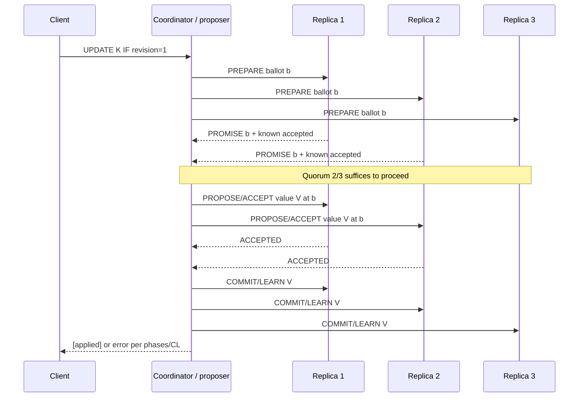

# Lightweight Transactions and Version-Based Consensus Mechanisms

## 1. The Problem: Multiple Versions of a State and Multiple Writers

Apache Cassandra is a **distributed wide-column** database: the partition key determines data placement, keyspace replication determines replica count, and the consistency level (CL) determines how many responses are required. With multiple writers, a regular unconditional `INSERT` or `UPDATE` remains a **mutation** resolved by timestamp; reading first and writing afterward **does not** implicitly create a transaction lock.

In the **LWT and Concurrency** chapter of the `DATABASE_ENGINE_WIDE_COLUMN_CASSANDRA` module, we examine an entity updated concurrently by multiple Java applications. This topic involves **three distinct kinds of "versions" that are easily confused**:

1. **Business version — `revision`:** an application-managed `int` column used for optimistic concurrency, e.g., changing state only when `revision=7`.
2. **Paxos round/ballot:** an ordered proposal identifier used in the consensus protocol to ensure competing proposers do not both decide conflicting values. This is **not** the CQL `revision` column.
3. **Protocol implementation variant — `paxos_variant`:** a Cassandra server setting (`v1`/`v2`) with different round-trip and linearizable-read characteristics. It is **not** the CQL version, native protocol version, or Java Driver major version.

### Learning Objectives

After this lesson, you will be able to:

- Describe how Cassandra uses **Paxos and lightweight transactions (LWT)** to perform compare-and-set (CAS) within a partition scope.
- Explain the **prepare/promise, propose/accept, commit/learn** phases conceptually, along with **quorum intersection**.
- Write `INSERT ... IF NOT EXISTS` and `UPDATE ... IF revision = ...`, read `[applied]`, and handle conflicts/timeouts.
- Distinguish `SERIAL` and `LOCAL_SERIAL` from regular CLs such as `LOCAL_QUORUM`.
- Understand the role of `paxos_variant: v1` versus `v2` in supported Cassandra branches, upgrade prerequisites, and the relationship to Paxos repair.
- Practice CQL across two `cqlsh` sessions, inspect data state by partition key, and handle LWTs from the Java Driver.
- Evaluate costs, limitations, risks of non-CAS writes, hot partitions, ABA, and recovery strategies when a transaction response is lost.

> **Scope:** lab code uses Cassandra **5.0.9** on a single Docker node to verify syntax and client contention; do not use it to prove fault tolerance of an RF=3 cluster. Changing `paxos_variant`/`paxos_state_purging` on a running cluster is a **cluster-level change** requiring its own runbook, not a live config exercise.

## 2. Why Does Reading a Version Then Writing Still Race?

Suppose a user reserves a seat. The application table stores `revision=1`, `state='FREE'`. Two workers A and B execute concurrently:

```text
T0: A SELECT revision, state -> 1, FREE
T1: B SELECT revision, state -> 1, FREE
T2: A decides in Java "seat available"
T3: B decides in Java "seat available"
T4: A regular UPDATE -> RESERVED for Alice
T5: B regular UPDATE -> RESERVED for Bob
T6: both A and B can receive success responses
```

This is a **time-of-check to time-of-use (TOCTOU)** bug. `LOCAL_QUORUM` or `ALL` on each independent statement **does not hold a lock from the SELECT to the UPDATE**. Likewise, adding `synchronized` inside one Java process does not protect other JVMs or Pods.

The final outcome is also subject to Cassandra's **mutation timestamp** and reconciliation: never assume "the request sent later always wins" in an absolute sense when clocks and networks vary.

### 2.1. Comparing Two Write Approaches

| Implementation Approach | Final CQL Statement | Can Both Callers Be Told They Succeeded? |
|---|---|---|
| Read-then-write in Java | `UPDATE ... WHERE key=...` | **Yes** |
| Regular write with quorum | `UPDATE ... WHERE key=...` at `LOCAL_QUORUM` | **Yes**; quorum does not hold conditions across two requests |
| Check only row existence | `UPDATE ... IF EXISTS` | **Yes** if the row already exists; does not protect state/revision |
| Compare-and-set | `UPDATE ... IF state='FREE' AND revision=1` | Cannot both pass **the same initial version** when writers obey CAS |
| Create unique name | `INSERT ... IF NOT EXISTS` on **the name key** | At most one claim succeeds for an absent row, barring intervening deletes/recreation |

**Rule:** the check must live inside **the conditional mutation itself**, not merely in a client-side `if`.

## 3. Foundations of Paxos: Reaching Consensus on One Value Across Replicas

### 3.1. Roles and Concepts

For a CAS on a partition, Cassandra needs replicas to coordinate and agree on a valid proposal, even when multiple coordinators issue concurrent operations.

| Term | Meaning for LWT |
|---|---|
| **Client** | Sends `INSERT/UPDATE/DELETE ... IF ...` from `cqlsh` or Java |
| **Coordinator / proposer** | Node receiving the request and orchestrating consensus messages |
| **Replica / acceptor** | Node responsible for the partition that participates in promising/accepting proposals |
| **Ballot** | Ordered proposal round identifier used to compare newer vs. older proposals in Paxos |
| **Promise** | Acceptor commits not to accept proposals with a ballot lower than promised |
| **Accepted proposal** | Value/proposal accepted by an acceptor during a phase |
| **Chosen/committed value** | Value that achieved consensus and must be learned/applied via LWT mechanics |
| **Quorum** | Majority of replicas participating in consensus; for RF=3, that is 2/3 |

The coordinator can vary per request. **A seed node is not a fixed Paxos leader**, and "coordinator" does not mean the node uniquely owns the data.

### 3.2. Classical Paxos Algorithm Illustration



This diagram **illustrates the principle**; it is **not a packet trace or fixed round-trip contract** across all Cassandra versions. Cassandra optimizes Paxos with configuration, cached state, fast paths, and read/commit completion; do not use the diagram to predict an exact packet count for a request.

### 3.3. Why Two Quorums Cannot Easily Decide Conflicting Values

With RF=3, any two sets of 2 replicas **always intersect**:

```text
Q1 = {R1, R2}
Q2 = {R2, R3}
               ^ R2 in common
```

An acceptor tracks the ballot it promised/accepted, so a newer proposer must inspect any previously accepted state to preserve prior decisions. When two clients contend on the same condition `revision=1`, LWT coordinates so only one transition from that version is accepted; the other transaction may encounter **condition false**, contention/retries, or timeout depending on timing.

**Not all replicas need to be online:** a single DC with RF=3 can reach quorum with 2 replicas. However, if only 1 replica remains up, there is no majority for normal consensus. Quorum provides safety under protocol assumptions; it **does not** guarantee liveness under network partitions, resource exhaustion, or client timeouts.

### 3.4. A Ballot Is Not a Data Column Timestamp

| Value | Managed By | Purpose | Incremented by App via SQL/CQL? |
|---|---|---|---|
| `revision` (int) | Application | Optimistic concurrency on a row's state | **Yes**, via `SET revision=... IF revision=...` |
| Paxos ballot | Consensus protocol | Orders proposals and acceptor promises | **No**; server-managed |
| `WRITETIME(column)` | Cassandra mutation path | Cell-level timestamp for reconciliation | Can be supplied on **regular writes** in some cases; **cannot force** `USING TIMESTAMP` on conditional mutations |
| `event_time` | Business domain | Time an application event occurred | Can be stored in a `timestamp` column |
| `paxos_variant` | Server configuration | Selects Paxos v1/v2 implementation | **Not** stored in CQL/rows |

Incrementing `revision` from 1 to 2 **does not replace a Paxos ballot**. And forcing a higher `WRITETIME` than another mutation **is not** a valid way to build CAS.

## 4. What Does LWT Guarantee and What Does It Not?

### 4.1. Scoped Linearizability

For conditional mutations following the protocol properly, concurrent operations on **the same partition** can be reasoned about as being decided in a single order consistent with real-time constraints: this is **linearizability**.

However, read the scope carefully:

- LWT **does not turn every regular `SELECT`** into a linearizable read. Read CL, Paxos variant, and commit-phase progress still matter.
- LWT **does not automatically protect all tables** holding application-denormalized data. A CAS on `claims_by_handle` does not atomically update `users_by_id` in another partition.
- LWT **does not create a unique index** on `handle` if the primary key is `user_id`.
- Every **write path that can touch the invariant** must follow the CAS policy; a service issuing regular `UPDATE`s can still break versioning rules.
- A **timeout** does not mean the transaction failed. It may have been decided while the response was lost.
- For side effects in Kafka, payments, or email, Cassandra LWT **does not** wrap those external systems in a shared transaction.

### 4.2. Partition Scope Is the Boundary You Must Design

Suppose a tenant may reserve a resource for only one owner:

```sql
PRIMARY KEY ((tenant_id, resource_id))
```

All clients contending on `(tenant_id, resource_id)` execute CAS against the same partition. By contrast, `PRIMARY KEY (owner_id)` only checks whether an owner already has a row, not uniqueness per resource.

If you need a tenant-wide invariant across **thousands of partitions** (such as total inventory quota), per-partition CAS **does not provide cross-partition transactions**. You must design a coordinating aggregate/partition or a different architecture, while considering **hot partition** effects when funneling all updates to a single key.

## 5. Three Version Layers to Distinguish in Operations

### 5.1. Application Revision: Optimistic Locking

A row has `FREE, revision=1`. A client sends:

```sql
UPDATE lwt003.reservations
SET owner_id='alice', state='HELD', revision=2
WHERE tenant_id='t1' AND resource_id='seat-42'
IF state='FREE' AND revision=1;
```

If it succeeds, `[applied]=True`. Another client using `IF revision=1` cannot also "win" on that same version unless an out-of-protocol writer corrupts state or resets revision to 1. This is **optimistic concurrency control (OCC)**: instead of holding long locks in Java, conflicts are detected at write time.

`revision` is a business column. Cassandra **does not auto-increment** it on every request. The client must explicitly write `SET revision=2` and `IF revision=1`; on conflict it must re-read state and compute a new transition.

### 5.2. Paxos Ballot: Consensus Proposal Round

Paxos uses ballots to handle competing proposers. During recovery, a proposer with a higher ballot cannot arbitrarily discard a previously accepted value: it must inspect promised/accepted state according to the protocol.

Therefore:

- There is no valid CQL clause to "set ballot=9 for a row."
- A ballot is not equal to `revision` and should not be persisted in the domain model as an ad-hoc fencing token.
- When requests slow down due to contention, the cause can be **many proposals hitting the same partition**; bumping mutation timestamps or raising regular CL will not eliminate contention.

### 5.3. paxos_variant: Algorithm Generation in cassandra.yaml

Apache Cassandra 4.1 introduced **Paxos v2** alongside the older v1 mechanism. Cassandra 5.x documentation describes the `paxos_variant` setting and optimized variants, recommending `v2`; however, **do not assume every 5.x installation enables v2 automatically**. The compatibility `cassandra.yaml` file and the newer-features `cassandra_latest.yaml` file may have different defaults; inspect the actual image/package and effective configuration directly.

**Do not confuse:**

- Cassandra **5.0.9**: **server software** version.
- `paxos_variant: v2`: **consensus algorithm** variant.
- Native protocol `vN`: **client ↔ Cassandra** wire protocol, unrelated to row versioning.
- Java Driver **4.x**: **client library** version; its major version does not select Paxos v1/v2.

## 6. Paxos v1 and v2: What Does the Variant Change?

Per official configuration documentation, the options work as follows:

| Option | Purpose | Documented Reference Round Trips | Key Characteristics to Note |
|---|---|---|---|
| `v1` | Legacy Paxos, compatibility mode | Roughly **4 RT** for LWT write and **3 RT** for serial read | Listed default for compatibility configuration |
| `v2` | Optimized Paxos | Roughly **2 RT** write, **1 or 2 RT** read | Recommended by docs; reduces coordination latency |
| `v1_without_linearizable_reads_or_rejected_writes` | Legacy mode reducing read cost | Roughly **4 RT** write, **2 RT** read | **Does not** guarantee the same linearizable read/rejected write semantics |
| `v2_without_linearizable_reads` | v2 reducing serial read cost | Roughly **2 RT** write, **1 RT** read | Drops the corresponding linearizable read guarantee |
| `v2_without_linearizable_reads_or_rejected_writes` | v2 dropping additional guarantees | Roughly **2 RT** write, **1 RT** read | Changes guarantees for both reads and rejected writes |

**RT** means *round trip* describing protocol paths, **not** fixed wall-clock latency: contention, timeouts, multi-DC WAN links, repair state, read paths, and network errors change actual round counts and latency. Variant names suffixed with `without_...` are **semantic trade-offs**, not "enable faster mode with all guarantees intact."

V2 improves correctness when topology/range movements are performed safely and includes optimizations tied to **Paxos repair/state purging**. However, do not use this table to edit a live cluster's config without a runbook and compatibility checks.

### 6.1. How to Inspect Config Without Modifying It in This Lesson

If running the Cassandra Docker lab:

```bash
docker exec cassandra-lwt003 sh -c "grep -n -E '^[[:space:]]*#?[[:space:]]*(paxos_variant|paxos_state_purging)[[:space:]]*:' /etc/cassandra/cassandra.yaml"
docker exec cassandra-lwt003 nodetool version
```

`grep` output may include **commented lines**, which do not prove an option is active. Inspect startup files, configuration sources supported by the image, default values for **your exact version**, and server logs. Some optional settings may not appear in `cassandra.yaml` at all because they rely on defaults.

**Do not assume** `-e CASSANDRA_PAXOS_VARIANT=v2` will automatically be written into the file by the Docker Official Image: the entrypoint only supports a specific set of environment variables. Never bulk-edit `cassandra.yaml` on real nodes from a lab script.

### 6.2. Switching from v1 to v2 Is a Cluster Change, Not CQL

Apache configuration guidance for supported branches outlines typical steps when **upgrading v1 → v2**:

1. All nodes are already on a **uniform Cassandra 4.1+ version per the supported plan**.
2. Perform an appropriate **full repair** on each node's primary ranges—the docs give `nodetool repair --full -pr` as an example—with monitoring and capacity headroom.
3. Set `paxos_variant: v2` in versioned configuration, then perform a **rolling restart** across nodes per runbook.
4. Monitor latency, Paxos failures/unknowns, read behavior, hints/repair/backlog, schema, and peer connectivity; keep a rollback plan ready if needed.

These steps describe **operational process design**, **not advice to run immediately**. Full repair consumes significant network, CPU, I/O, and temporary disk space; you must account for topology, maintenance windows, workload, and cluster version. **Never run `nodetool repair --full -pr` on production just to see if it feels faster.**

### 6.3. Paxos State Purging and the Special Condition for CL ANY

Cassandra has a `paxos_state_purging` setting governing the lifecycle of Paxos/repair state. Documentation explains that when using **v2** with **`paxos_state_purging: repaired`**, once safe repair preconditions are met, certain **commit consistency `ANY`** optimizations become safe.

This is a **very specific technical condition**: **do not take "ANY makes writes cheap" and configure `CONSISTENCY ANY` as the default for all LWTs**, especially on v1 or without scheduled Paxos repairs. Changing state purging out of order can affect correctness; follow the **upgrade notes for your exact Cassandra branch** and do not flip both options blindly at once.

## 7. Serial Consistency and Regular Consistency: Two Different Phases

In LWT, distinguish:

| Property | Example Value | Role |
|---|---|---|
| **Serial CL** | `SERIAL` or `LOCAL_SERIAL` | Quorum used for the Paxos/condition-checking phase |
| **Regular/commit CL** | `LOCAL_QUORUM`, `QUORUM`, or suitable level | Response requirement for the mutation's commit/learn phase |
| **Keyspace RF** | `dc1:3` | How many replicas hold a partition in the DC |
| **Partition key** | `(tenant_id,resource_id)` | Which replicas participate in consensus for the entity |

### 7.1. cqlsh Example

```text
CONSISTENCY LOCAL_QUORUM;
SERIAL CONSISTENCY SERIAL;
```

These are **`cqlsh` commands**, not `ALTER KEYSPACE` statements or raw CQL statements sent from Java.

With RF=3 in one DC, `LOCAL_QUORUM` needs two replicas; in our RF=1 lab it needs only one replica. Choose `SERIAL` vs. `LOCAL_SERIAL` based on topology:

- `SERIAL`: serial consensus scope across the cluster's eligible replicas; consider WAN cost if multi-DC.
- `LOCAL_SERIAL`: restricts serial consensus to the local datacenter; reduces WAN latency but **does not automatically provide global CAS ordering** if apps in different DCs contend on a shared invariant.
- Do not mix `SERIAL` and `LOCAL_SERIAL` on the same multi-DC invariant without carefully evaluating version semantics, as mismatched scopes can produce subtle anomalies.

### 7.2. Calculating Response Counts for RF=3

```text
N = 3
Quorum = floor(N/2) + 1 = 2

Q1 = {n1,n2}; Q2 = {n2,n3}
⇒ Q1 and Q2 overlap on at least one node
```

| State in an RF=3 DC | Regular `LOCAL_ONE` | Regular `LOCAL_QUORUM` | LWT Serial Quorum |
|---|---|---|---|
| All 3 replicas healthy | Can succeed | Can succeed | Can succeed |
| 1 replica down, 2 healthy | Can succeed | Can succeed | **Can** succeed if all phases complete |
| 2 replicas down, 1 healthy | Some regular reads/writes may serve at ONE | Insufficient for two responses | Insufficient for normal consensus quorum |

**"Can" is not an SLA guarantee**: network partitions, disk stalls, GC pauses, coordinator crashes, or overload can cause timeouts even when enough nodes are `UN`.

### 7.3. Linearizable Reads Are Not Regular SELECTs

Do not treat a regular `SELECT ...` at `LOCAL_ONE` as linearizable with recent CAS operations. When serial read semantics are required, use the read method/CL and Paxos variant supported by your server, accounting for cost and actual configuration. Variants named `...without_linearizable_reads` **explicitly trade away that guarantee**. Running a `SELECT` against coordinator n3 does not mean data comes solely from n3's local disk.

## 8. Single-Node Practice: Setting Up Cassandra 5.0.9

### 8.1. Resource Sizing and Scope

Examples use Docker Engine/Desktop with Linux containers, roughly 8 GiB total host RAM or more for a small lab, allocating 4 GiB to the container and 2 GiB heap. These are **reference settings**; machines with less disk/RAM may need adjustments and take longer to boot. Use host port `9339` **bound only to loopback** because the lab has no auth/TLS enabled.

Run on a host with the Docker CLI:

```bash
docker version
docker pull cassandra:5.0.9
docker network create lwt003-net
docker volume create lwt003_node_data

docker run -d --name cassandra-lwt003 --network lwt003-net --memory=4g --memory-swap=4g -e MAX_HEAP_SIZE=2G -e CASSANDRA_CLUSTER_NAME=lwt003-lab -e CASSANDRA_ENDPOINT_SNITCH=GossipingPropertyFileSnitch -e CASSANDRA_DC=dc1 -e CASSANDRA_RACK=rack1 -p 127.0.0.1:9339:9042 -v lwt003_node_data:/var/lib/cassandra cassandra:5.0.9
```

**Do not** reuse a container or volume with the same name without checking its origin; examples assume a fresh lab. Never publish unauthenticated/unencrypted ports on `0.0.0.0` to LAN/internet. Every Cassandra node must have its own data volume.

### 8.2. Checking Node Readiness

```bash
docker ps -a --filter name=cassandra-lwt003
docker logs --tail 100 cassandra-lwt003
docker exec cassandra-lwt003 nodetool status
docker exec cassandra-lwt003 nodetool statusbinary
docker exec cassandra-lwt003 cqlsh -e "SELECT release_version, cluster_name, data_center, rack FROM system.local WHERE key='local';"
```

Wait for one `UN` node, `statusbinary=running`, and CQL returning cluster `lwt003-lab`, DC `dc1`, rack `rack1`, server 5.0.9. `docker run -d` returning a container ID **does not** prove CQL is open yet. If commands fail right after startup, inspect logs/CPU/disk and retry once ready.

### 8.3. Initializing the Keyspace and Two Tables

Open `cqlsh`:

```bash
docker exec -it cassandra-lwt003 cqlsh
```

At `cqlsh>`:

```sql
CREATE KEYSPACE IF NOT EXISTS lwt003
WITH replication = {'class':'NetworkTopologyStrategy','dc1':1}
AND durable_writes = true;

-- Dedicated to demonstrating read-then-write races without LWT.
CREATE TABLE IF NOT EXISTS lwt003.naive_reservations (
    tenant_id text,
    resource_id text,
    owner_id text,
    state text,
    revision int,
    PRIMARY KEY ((tenant_id, resource_id))
);

-- LWT table keyed by the same resource key.
CREATE TABLE IF NOT EXISTS lwt003.reservations (
    tenant_id text,
    resource_id text,
    owner_id text,
    request_id uuid,
    revision int,
    state text,
    updated_at timestamp,
    PRIMARY KEY ((tenant_id, resource_id))
);

DESCRIBE KEYSPACE lwt003;
```

`(tenant_id,resource_id)` is a **composite partition key**: two clients contending for the same resource within the same tenant meet at the same consensus point; clients in different tenants can use the same `resource_id` without conflict. `CREATE TABLE IF NOT EXISTS` is only a DDL guard and **does not verify that an existing schema matches expectations**; run `DESCRIBE TABLE` if the volume was not empty.

### 8.4. Setting Consistency Levels for the cqlsh Session

```text
CONSISTENCY LOCAL_QUORUM;
SERIAL CONSISTENCY SERIAL;
```

In an RF=1 lab, these settings still apply semantically, but with only **one replica** they do not reflect WAN round trips, failover, or minority partitions.

## 9. Experiment A: Race with Regular Writes vs. CAS Solution

### 9.1. Two Clients Both Read Stale Absence

Open **two terminals**, running in each:

```bash
docker exec -it cassandra-lwt003 cqlsh
```

Call them Client A and B. In **each session**, set the CLs from section 8.4. Use a fresh row key `race-naive-003`.

**Client A:**

```sql
SELECT owner_id, state, revision
FROM lwt003.naive_reservations
WHERE tenant_id='t1' AND resource_id='race-naive-003';
```

**Client B:** run the **same SELECT before A writes**. Both observe the row does not exist yet. Then:

**A:**

```sql
INSERT INTO lwt003.naive_reservations
    (tenant_id, resource_id, owner_id, state, revision)
VALUES ('t1', 'race-naive-003', 'alice', 'HELD', 1);
```

**B:**

```sql
INSERT INTO lwt003.naive_reservations
    (tenant_id, resource_id, owner_id, state, revision)
VALUES ('t1', 'race-naive-003', 'bob', 'HELD', 1);
```

Both `INSERT`s **can succeed**; neither client is told "another owner already holds the row." Check:

```sql
SELECT owner_id, state, revision
FROM lwt003.naive_reservations
WHERE tenant_id='t1' AND resource_id='race-naive-003';
```

The final state holds one owner chosen by mutation timestamp, but that **does not satisfy the single-holder rule**: both A and B were told they succeeded. Do not treat whether Alice or Bob ends up stored as the criterion when explaining the race.

### 9.2. Two Clients Using INSERT IF NOT EXISTS

On the **LWT table** and a fresh key `race-claim-003`:

**A:**

```sql
INSERT INTO lwt003.reservations
    (tenant_id, resource_id, owner_id, request_id, revision, state, updated_at)
VALUES
    ('t1', 'race-claim-003', 'alice',
     30000000-0000-4000-8000-000000000001, 1, 'HELD',
     '2026-11-21T08:00:00Z')
IF NOT EXISTS;
```

Because the row does not exist, A typically sees `[applied]=True`. Next **B**:

```sql
INSERT INTO lwt003.reservations
    (tenant_id, resource_id, owner_id, request_id, revision, state, updated_at)
VALUES
    ('t1', 'race-claim-003', 'bob',
     30000000-0000-4000-8000-000000000002, 1, 'HELD',
     '2026-11-21T08:00:01Z')
IF NOT EXISTS;
```

B typically sees `[applied]=False`, and the row still belongs to Alice (when executed sequentially as above). In a truly concurrent race on a fresh key, **who gets `true` is not fixed**; the invariant to verify is that **no two conditional mutations both win the "row absent" condition** without an intervening delete/recreate.

Read back using the **exact partition key**:

```sql
SELECT owner_id, request_id, revision, state
FROM lwt003.reservations
WHERE tenant_id='t1' AND resource_id='race-claim-003';
```

**This is LWT** because of the `IF NOT EXISTS` clause, not because the key is a UUID or because `LOCAL_QUORUM` is set. These two CQL clauses differ fundamentally: `CREATE TABLE IF NOT EXISTS` is a DDL guard, whereas `INSERT ... IF NOT EXISTS` is a data CAS.

## 10. Experiment B: Optimistic Revision Across Multiple Transitions

### 10.1. Create a Row at version=1

Pick a new key `race-revision-003` independent of the claim example:

```sql
INSERT INTO lwt003.reservations
    (tenant_id, resource_id, owner_id, request_id, revision, state, updated_at)
VALUES
    ('t1', 'race-revision-003', 'unassigned',
     30000000-0000-4000-8000-000000000011, 1, 'FREE',
     '2026-11-21T09:00:00Z')
IF NOT EXISTS;

SELECT owner_id, state, revision
FROM lwt003.reservations
WHERE tenant_id='t1' AND resource_id='race-revision-003';
```

On fresh data, expect `unassigned/FREE/1`. If `IF NOT EXISTS` returns `False`, inspect the existing row; do not issue a regular write to "quickly reset" CAS state.

### 10.2. Client A Updates Revision Conditionally

```sql
UPDATE lwt003.reservations
SET owner_id='alice',
    state='HELD',
    revision=2,
    request_id=30000000-0000-4000-8000-000000000012,
    updated_at='2026-11-21T09:05:00Z'
WHERE tenant_id='t1' AND resource_id='race-revision-003'
IF state='FREE' AND revision=1;
```

Expect `[applied]=True`. The decision is made **on the server**, not because A previously read `FREE` in Java.

### 10.3. Client B Uses a Stale Revision

```sql
UPDATE lwt003.reservations
SET owner_id='bob',
    state='HELD',
    revision=2,
    request_id=30000000-0000-4000-8000-000000000013,
    updated_at='2026-11-21T09:05:01Z'
WHERE tenant_id='t1' AND resource_id='race-revision-003'
IF state='FREE' AND revision=1;
```

B receives `[applied]=False` if A already applied. Inspect:

```sql
SELECT owner_id, state, revision, request_id
FROM lwt003.reservations
WHERE tenant_id='t1' AND resource_id='race-revision-003';
```

Once B observes `revision=2`, the proper response is to **re-read, re-evaluate business rules, and compute a new transition** if permitted; do not retry `revision=1` endlessly, and certainly do not drop `IF` to force the write.

### 10.4. Comparing IF EXISTS vs. IF version

On an existing row, this statement:

```sql
-- Anti-pattern: the row still exists, so this can apply
-- even though Alice already reserved it. DO NOT RUN on protected rows:
UPDATE lwt003.reservations
SET owner_id='bob', state='HELD', revision=2
WHERE tenant_id='t1' AND resource_id='race-revision-003'
IF EXISTS;
```

checks only existence, not version. Thus the same row can receive **two successful `UPDATE IF EXISTS` operations** from two clients. `IF EXISTS` is useful for avoiding upserting an absent row, **not** as a substitute for `IF revision=...` when optimistic locking is required.

### 10.5. A Valid Next Transition

After Alice holds the reservation at revision 2, try confirming it:

```sql
UPDATE lwt003.reservations
SET state='CONFIRMED', revision=3,
    updated_at='2026-11-21T09:10:00Z'
WHERE tenant_id='t1' AND resource_id='race-revision-003'
IF owner_id='alice' AND state='HELD' AND revision=2;
```

Expect `True` if the stored data still matches. Conditioning on **owner, state, and revision** models a **state machine** step. A `False` result means the request was not applied, not that Cassandra broke.

### 10.6. Conditional DELETE and ABA

```sql
-- Stale condition; on Alice's CONFIRMED/3 row this must return False.
DELETE FROM lwt003.reservations
WHERE tenant_id='t1' AND resource_id='race-revision-003'
IF owner_id='bob' AND revision=2;
```

Do not automatically delete rows just to re-run a demo. When a row is deleted, Cassandra writes a tombstone and a new request can `INSERT IF NOT EXISTS` on the old key again. **ABA** occurs when an entity returns to a state that looks identical to its initial state after passing through another ownership lifecycle. For real bookings/payments, you need generations, request IDs/idempotency, auditing, and resource-reassignment rules.

## 11. CAS Outcomes: Three Groups That Cannot Be Collapsed

| Client-Observed Outcome | Meaning | Application Reaction |
|---|---|---|
| `[applied]=True` | Condition held and mutation was applied per LWT/commit CL semantics | Return success, persist `request_id` |
| `[applied]=False` | Condition failed at decision time; **no mutation from this statement** | Read current state if needed, return conflict/rebase |
| Timeout, disconnect, unavailable, exception | **No reliable CAS outcome**; timeout may arrive after a decision occurred | Record `UNKNOWN`, reconcile, bounded retry |

### 11.1. A Timeout Does Not Prove CAS Was Rejected

```text
Client sends IF revision=1  --->  Paxos replicas
                                   |
                                   +--- May have decided/committed
                                   |
                      network/resp X
Client receives timeout
=> Unknown whether the transaction ultimately applied or not.
```

If the client retries `INSERT IF NOT EXISTS` on that key, the response can be `False` because **the client's own first request already succeeded**, not because someone else beat it.

### 11.2. Reconciling via request_id

A safer pattern (simplified for lab use):

1. Generate `request_id` **once** before the first attempt; keep it unchanged across retries.
2. Write `request_id` alongside `owner_id` and `revision` in the **same conditional mutation**.
3. `True` → record success.
4. `False` → re-read the row and compare `owner_id/request_id`: if it matches your own request, this may be a retry after commit; if different, it is likely a conflict.
5. Timeout → record `UNKNOWN`, re-read by key at an appropriate CL, consider a serial read / Paxos completion per server semantics, and retry with backoff/limits.
6. If rows can be `DELETE`d/TTL-expired/reused or have external side effects (Kafka, email, payments), add **generations/fencing/outbox/sagas**; `request_id` alone may not suffice to prove exactly-once behavior.

Never write `catch (Exception e) { return false; }` to lump infrastructure errors into business conflicts. A valid `False` response is fundamentally different from an **unknown-outcome** request.

## 12. Java Driver 4.x: Setting Both CLs and Checking wasApplied()

### 12.1. Environment and Contact Points

The example uses Java 17 and Apache Cassandra Java Driver 4.x, package `com.datastax.oss.driver.api.core`. When Java runs on the **host**, the initial contact point is `127.0.0.1:9339`; when running **inside a container on Docker network `lwt003-net`**, use `cassandra-lwt003:9042`. In multi-node clusters, the driver must also route to peer addresses advertised by Cassandra; reaching one contact point does not guarantee all peers are reachable.

### 12.2. Complete Java Example: Claiming a Resource with LWT

```java
import java.net.InetSocketAddress;
import java.util.UUID;

import com.datastax.oss.driver.api.core.CqlSession;
import com.datastax.oss.driver.api.core.DefaultConsistencyLevel;
import com.datastax.oss.driver.api.core.cql.BoundStatement;
import com.datastax.oss.driver.api.core.cql.PreparedStatement;
import com.datastax.oss.driver.api.core.cql.ResultSet;
import com.datastax.oss.driver.api.core.cql.Row;

public final class ClaimResource {
    public static void main(String[] args) {
        String host = required("CASSANDRA_HOST");
        int port = Integer.parseInt(required("CASSANDRA_PORT"));
        String dc = required("CASSANDRA_LOCAL_DC");
        String expectedCluster = required("EXPECTED_CLUSTER");

        try (CqlSession session = CqlSession.builder()
                .addContactPoint(new InetSocketAddress(host, port))
                .withLocalDatacenter(dc)
                .build()) {
            Row identity = session.execute(
                "SELECT cluster_name, data_center FROM system.local WHERE key='local'")
                .one();
            if (identity == null
                    || !expectedCluster.equals(identity.getString("cluster_name"))
                    || !dc.equals(identity.getString("data_center"))) {
                throw new IllegalStateException("Unexpected Cassandra cluster/DC");
            }

            PreparedStatement prepared = session.prepare(
                "INSERT INTO lwt003.reservations " +
                "(tenant_id, resource_id, owner_id, request_id, revision, state) " +
                "VALUES (?, ?, ?, ?, 1, 'HELD') IF NOT EXISTS");

            UUID requestId = UUID.randomUUID();
            BoundStatement stmt = prepared.bind(
                    "t1", "java-claim-003", "java-alice", requestId)
                    .setConsistencyLevel(DefaultConsistencyLevel.LOCAL_QUORUM)
                    .setSerialConsistencyLevel(DefaultConsistencyLevel.SERIAL);

            ResultSet result = session.execute(stmt);
            if (result.wasApplied()) {
                System.out.println("APPLIED request=" + requestId);
            } else {
                Row existing = session.execute(
                    "SELECT owner_id, request_id FROM lwt003.reservations " +
                    "WHERE tenant_id='t1' AND resource_id='java-claim-003'")
                    .one();
                System.out.println("NOT_APPLIED, existing=" +
                        (existing == null ? "unknown" : existing.getString("owner_id")));
            }
        }
    }

    private static String required(String name) {
        String v = System.getenv(name);
        if (v == null || v.isBlank()) {
            throw new IllegalArgumentException("Missing " + name);
        }
        return v;
    }
}
```

Example environment variables when Java runs **on the host**:

```text
CASSANDRA_HOST=127.0.0.1
CASSANDRA_PORT=9339
CASSANDRA_LOCAL_DC=dc1
EXPECTED_CLUSTER=lwt003-lab
```

**Important note:** `ResultSet.wasApplied()` reads the `[applied]` column of a conditional mutation. For statements **without `IF`**, the API can return `true` by driver definition, which **does not** prove an INSERT created a new row. Only interpret it as a CAS result when you **know the CQL statement is conditional**.

If `session.execute(stmt)` throws an exception, the sample code propagates the error rather than treating it as `false`. In real applications, separate timeouts/unknowns and persist `request_id` durably for reconciliation; calling `UUID.randomUUID()` on every program run **does not** preserve the same ID across process retries.

### 12.3. Prepared UPDATE with Revision

Java snippet inside a method that already holds `session`:

```java
PreparedStatement cas = session.prepare(
    "UPDATE lwt003.reservations " +
    "SET owner_id=?, state=?, revision=?, request_id=? " +
    "WHERE tenant_id=? AND resource_id=? " +
    "IF state=? AND revision=?");

BoundStatement bound = cas.bind(
        "java-alice", "HELD", 2, requestId,
        "t1", "another-resource-003",
        "FREE", 1)
    .setConsistencyLevel(DefaultConsistencyLevel.LOCAL_QUORUM)
    .setSerialConsistencyLevel(DefaultConsistencyLevel.SERIAL);

ResultSet result = session.execute(bound);
if (!result.wasApplied()) {
    // Valid response received: condition did not hold.
    // Re-read state/revision before deciding whether to retry.
}
```

This is a **snippet**, not a standalone runnable program: row `another-resource-003` must already exist at `FREE/1`; `session` and `requestId` come from the caller context. Prepared statements and the driver do not automatically add Paxos to an `UPDATE` missing `IF`.

### 12.4. Real Contention Using Two Threads

In Java, you can use `CountDownLatch` to release two workers simultaneously:

```java
// Snippet placed inside a method that already has session and prepared from section 12.2.
// Add imports: java.util.concurrent.* and java.util.UUID.
String resource = "race-" + UUID.randomUUID();
java.util.concurrent.CountDownLatch start =
        new java.util.concurrent.CountDownLatch(1);
java.util.concurrent.ExecutorService pool =
        java.util.concurrent.Executors.newFixedThreadPool(2);
try {
    java.util.concurrent.Callable<Boolean> a = () -> {
        start.await();
        return session.execute(prepared.bind(
                "t1", resource, "alice", UUID.randomUUID())
                .setConsistencyLevel(DefaultConsistencyLevel.LOCAL_QUORUM)
                .setSerialConsistencyLevel(DefaultConsistencyLevel.SERIAL))
                .wasApplied();
    };
    java.util.concurrent.Callable<Boolean> b = () -> {
        start.await();
        return session.execute(prepared.bind(
                "t1", resource, "bob", UUID.randomUUID())
                .setConsistencyLevel(DefaultConsistencyLevel.LOCAL_QUORUM)
                .setSerialConsistencyLevel(DefaultConsistencyLevel.SERIAL))
                .wasApplied();
    };
    java.util.concurrent.Future<Boolean> fa = pool.submit(a);
    java.util.concurrent.Future<Boolean> fb = pool.submit(b);
    start.countDown();
    boolean ra = fa.get();
    boolean rb = fb.get();
    int successes = (ra ? 1 : 0) + (rb ? 1 : 0);
    if (successes != 1) {
        throw new IllegalStateException("Expected one CAS winner: " + successes);
    }
    System.out.println("One winner: a=" + ra + ", b=" + rb);
} finally {
    pool.shutdownNow();
}
```

This is a **logical invariant test** when both calls complete normally on a fresh key. If either `Future.get()` throws an exception, **do not conclude nobody won**; read the row and analyze the error/retry separately. A single RF=1 node can still test logical contention between clients, but **cannot test quorum failure**.

## 13. Reasoning Mistakes When Looking at Versions and Responses

### 13.1. Myth: "An Incremented Revision Means All Replicas Are Consistent"

Seeing `revision=2` in a `SELECT` from one coordinator **does not guarantee** that SSTables on every replica hold the exact same value at that instant. In RF=3, a replica may be temporarily down, the read path may query other nodes, and hints/anti-entropy repair play their own roles.

LWT helps decide conditional mutations; you still need **repair, backups, monitoring, disk health, and capacity planning**. Never treat replicas as a backup against accidental deletion: a successful CAS delete is replicated too.

### 13.2. Myth: "Paxos v2 = Cassandra 5.0 Server or Java Driver v4"

These are three **independent** versioning schemes. On the same Cassandra 5.0.9 release, two clusters can run different `paxos_variant` settings depending on applied config. Java Driver 4.x connects over a supported native protocol and sends CQL; it does not choose which Paxos algorithm the server runs.

### 13.3. Myth: "Regular Writes with High WRITETIME Can Safely Override CAS"

If service A uses `IF revision=2` while service B runs a regular `UPDATE` on the same row, B **does not participate in A's consensus condition**. B can break optimistic concurrency. To preserve an invariant, audit every write path: HTTP handlers, batch jobs, Kafka consumers, `cqlsh` scripts, and migrations.

### 13.4. Myth: "CAS Is a Multi-Table Transaction"

A claims table keyed by `(tenant,resource)` and a history table keyed by `(tenant,owner)` live in **two different partitions**. LWT on the claims table does not create an ACID transaction across both. You may need an outbox, eventual propagation, compensation, or reconciliation; in Cassandra you must model tables **around queries** instead of carrying SQL transaction assumptions over directly.

### 13.5. Myth: "Paxos Ballots Solve ABA"

Ballots help **choose one consensus proposal**, but business state can go through:

```text
ABSENT -> Alice HELD -> RELEASED/DELETE -> ABSENT -> Bob HELD
```

A very late retry from Alice may fail to recognize that this is a **new generation** if the app checks only `ABSENT`. Whenever a resource can be reassigned, add generation/lease/fencing tokens to the domain model along with `request_id` handling rules.

## 14. Measuring LWT Performance by Variant and Contention

Never cite round-trip counts from docs to claim "v2 is always twice as fast" in every environment. Measure on your actual topology, RF, DC count, payload, Java Driver, and key access distribution.

| Metric | Meaning | How to Observe |
|---|---|---|
| CAS attempts/s | Total LWT requests | Client metrics / request logs |
| `[applied]=true` | Winning transitions | Application counter |
| `[applied]=false` | Valid conflicts, not server errors | Application counter |
| Timeouts/unknown | Lost responses / slow consensus paths | Driver exceptions, trace IDs |
| p50/p95/p99 latency | Coordination latency, tail latency | Histogram in Java app |
| Concurrent writers/key | Level of **contention** on a partition | Key-level aggregates (sensitive data redacted) |
| RF/DC/CL/serial CL | Request semantics and cost | Test manifest and statement config |
| Effective `paxos_variant` | Algorithm difference | Config files/logs on **the exact nodes and server version** |
| GC/CPU/disk/network | Infrastructure issues affecting LWT | JMX metrics, `nodetool`, and host monitoring |
| Hints/repair backlog | Out-of-sync replica condition | Node metrics / operational runbooks |

Lab diagnostic commands:

```bash
docker exec cassandra-lwt003 nodetool status
docker exec cassandra-lwt003 nodetool statusbinary
docker exec cassandra-lwt003 nodetool tpstats
docker exec cassandra-lwt003 nodetool compactionstats
docker logs --tail 100 cassandra-lwt003
```

`nodetool status=UN` does not mean Paxos has no contention or that all CAS calls will succeed. `True/False` outcomes must be instrumented on the client; they cannot be inferred from `nodetool status` alone.

## 15. Upgrade/Rollout: Controlling Paxos Variant Changes

### 15.1. Pre-Flight Manifest Before Considering v2

For a live cluster:

| Item to Record | Why |
|---|---|
| Cassandra version on **every node** | Avoid switching variants while binaries/mixed versions are ineligible |
| Effective `paxos_variant` and `paxos_state_purging` | Ensure current semantics are known |
| Datacenters, RF, topology, replica count | Determine quorum and range placement |
| Schedule/status of full repair and Paxos repair | Certain upgrades/optimizations depend on repair |
| `SERIAL/LOCAL_SERIAL` across all apps | Avoid semantic mismatches between clients in multiple DCs |
| LWT commit/regular CL | Never default to `ANY` before verifying prerequisites |
| CAS rate, contention, latency/timeouts | Baseline to measure benefits/regressions of v2 |
| Backup/restore/rollback runbook | Manage topology and data risk |

### 15.2. Change Process Requiring Approval

1. Use an **isolated test/staging cluster** with representative topology and traffic patterns; verify version and full-repair prerequisites required by Apache.
2. Verify the linearizable read/rejected write guarantees your application needs; **never** choose a `without_...` variant solely to save round trips.
3. Prepare an **ordered** v1 → v2 rollout and rolling-restart runbook; document stop criteria, rollback, on-call ownership, and dashboards.
4. Ensure apps do not mix serial scopes in ways that violate invariants; test concurrent CAS, timeouts/unknowns, and multi-DC if applicable.
5. Monitor latency, conflicts, unknowns, repairs, JVM/disk, and impact during rollout; finalize production only after sufficient observation.

**Never change `paxos_state_purging` and CL `ANY` together as a "simple optimization."** Some state-purging mode changes have constraints that cannot be arbitrarily reversed; follow the exact upgrade guide for your running release.

### 15.3. Base Table Repair Differs from Paxos Repair

Regular anti-entropy repair compares and synchronizes **replica data** across token ranges, catching missed writes/tombstones and protecting long-term consistency. Paxos repair also handles **consensus state** that must be safely reconciled before applying certain cleanups/optimizations.

Never run `nodetool repair` as a health check every few seconds, never directly edit or delete `system.paxos`, and never assume a successful `SELECT` proves all Paxos state is safe. Repair jobs consume heavy CPU/disk/network; they require healthy replicas and monitoring.

## 16. Troubleshooting: From Symptom to Root Cause

| Symptom | Hypothesis | Check / Remediation |
|---|---|---|
| Two clients both get success claiming a seat | One write path uses regular `INSERT/UPDATE`, or `IF EXISTS` ignores state | Audit all CQL; enforce CAS on key/revision |
| `IF NOT EXISTS` always returns False | Row already exists, retry after commit, stale lab volume | SELECT by full partition key; compare owner/`request_id` |
| `UPDATE IF revision=1` returns False | Another client bumped revision or initial data is stale | Re-read row, recompute transition; never drop `IF` |
| CAS times out yet row changed afterward | Response lost after decision, or commit happened unbeknownst to client | Classify `UNKNOWN`; reconcile `request_id` |
| LWT reports unavailable at RF=3 with two nodes down | Insufficient Paxos/regular CL quorum | Inspect ring/RF/DC and logs; raising timeouts cannot fix missing replicas |
| CAS slows down when many writers hit one key | Paxos contention / hot partition | Measure p95/p99, reduce contention, bound concurrency |
| Java reaches contact point but fails peer routing | Wrong Docker network/NAT/broadcast RPC | Test from **where Java runs**, check metadata/driver logs |
| One DC succeeds while another fails | Different serial scope, regular CL, or topology | Inventory `SERIAL/LOCAL_SERIAL`, DC/RF, and app policy |
| Switching `paxos_variant` shows no improvement | Config not applied/restarted, or bottleneck isn't round trips | Verify effective config, metrics, workload/contended keys |
| Unsure whether cluster runs v1 or v2 | Misread commented line/default or wrong config file | Inspect active startup config for exact version, logs/manifest |
| New LWT errors after upgrade | Version/repair prerequisites unmet, mixed config, or changed semantics | Halt rollout, check release notes/runbook; never edit `system.paxos` |
| `WRITETIME` differs from `revision` | These are two unrelated concepts | Track app `revision` and cell `WRITETIME` separately |
| `DELETE` then re-claim causes duplicate side effects | ABA, missing generation/idempotency | Design lifecycle, audit trail, and fencing |
| A `SELECT` from n3 sees new data while n3 was just down | Coordinator may have queried other replicas or triggered read repair | Don't infer local SSTables from `SELECT`; check hints/repair/CL |
| CAS succeeds yet app lets two users book | External side effects, unguarded write path, inconsistent key normalization, or multi-partition logic | Check invariants/business keys and the entire flow |

**Triage order:** verify **invariant → partition key → whether CQL uses `IF` → True/False/UNKNOWN response → application revision → serial/regular CL → RF/DC/variant → logs/repair/metrics**. Never delete volumes or issue regular overwrites to force a test to pass.

## 17. Self-Check Exercises and Scenarios

### 17.1. Theoretical Questions

1. Why can two `SELECT`s at `LOCAL_QUORUM` followed by two `UPDATE`s at `LOCAL_QUORUM` still cause a lost update?
2. How do table `revision=7`, a Paxos ballot, and `paxos_variant=v2` differ?
3. With RF=3, why do any two quorums of size 2 always share at least one replica? What does this help Paxos guarantee?
4. During the prepare phase, what does an acceptor promise? Why can a new proposer not ignore an already accepted value?
5. Does `IF EXISTS` protect `state='FREE'`? Rewrite the CQL statement so only one client can reserve the seat.
6. Does LWT enforce uniqueness on `handle` if the partition key is `user_id`? How must the key/table design change?
7. How does `[applied]=False` differ from a timeout/unknown? Why might a retry receive `False` even when your own initial request committed?
8. If 1 of 3 replicas is down, can LWT at RF=3 continue? What conditions must still hold?
9. Why does a read at `LOCAL_ONE` not automatically provide a linearizable read relative to recent CAS operations?
10. How do `SERIAL` and `LOCAL_SERIAL` differ when two DCs contend on a global resource?
11. Which guarantee can be sacrificed by variants named `...without_linearizable_reads...`?
12. Why shouldn't you use v2's documented round-trip count to claim latency drops by exactly 50% in production?
13. What repair and rolling-restart steps does Apache documentation highlight when upgrading v1 → v2? May you run them straight on production by copying commands from a lesson?
14. Why should commit consistency `ANY` not be set as the default for LWT?
15. Why does application `revision` not replace Paxos, and why does a Paxos ballot not solve a business ABA issue?
16. Why does a Java app using a valid `CqlSession` and prepared statement still not guarantee a transaction boundary across two tables?
17. Can `nodetool status=UN` or `flush` prove that all pending Paxos state has been synchronized/repaired?
18. If an admin script runs a regular `UPDATE` on a row managed by the app via CAS, what can happen?

### 17.2. Comparative Hands-On Lab

On a **dedicated single-node lab**:

1. Verify `nodetool status`, CQL version, cluster/DC, and active configuration file. Explicitly note **no fault-tolerance conclusions** from RF=1.
2. Create `lwt003.naive_reservations` and `lwt003.reservations`; use two `cqlsh` sessions to reproduce the regular read-then-write race.
3. Run two `INSERT ... IF NOT EXISTS` statements on the same fresh key; record `[applied]`, owner, and `request_id`.
4. Create a `FREE/revision=1` row, have A transition it to `HELD/revision=2` via CAS, have B attempt an update with the stale revision, and explain the outcome.
5. Run a conditional transition checking `owner_id AND state AND revision`. Try a conditional `DELETE` with a mismatched condition and verify the row remains.
6. Use the Java Driver (or test harness) to race two tasks against a random key; when both complete normally, total applied CAS operations must be **1**.
7. Outline a timeout/unknown reconciliation plan using `request_id` and an ABA prevention design when resources can be deleted/reassigned.
8. Build a v1/v2 latency-semantics comparison table based on **official docs for your version**. **Never change `paxos_variant` on a shared cluster just to test.**

### 17.3. Expected Outcome Matrix

| Scenario | Expected Observation | What to Record in Report |
|---|---|---|
| Two regular writes after both read "empty" | Both can report OK | No compare-and-set present |
| Two `INSERT IF NOT EXISTS` LWTs | 1 True, 1 False **if both finish normally on a fresh key** | Winner can be either client |
| CAS A version 1→2, B uses version 1 | A True, B False in the specified test order | New revision and business state |
| B uses `IF EXISTS` instead of revision | Can be applied even after row changed | Wrong condition for the goal |
| CAS timeout | No reliable `[applied]` | Unknown status and reconciliation plan |
| Single node RF=1 | CQL/Paxos logic works | Does not prove quorum under node loss |
| Checking `paxos_variant` | Clear config/default source | Not inferred from server major version |

**Completion criteria:** the learner can explain **Paxos quorums/ballots and CAS**, separate the three versioning layers cleanly, design the right partition key, execute LWTs and handle `[applied]`/timeouts from Java, and understand the safe operational workflow for evaluating **`paxos_variant` v1/v2**. This prepares the ground for advanced lessons on multi-DC, replication/consistency, Paxos repair, compaction, and node-failure operations.

## 18. Cleaning Up the Lab and Keeping Data

To stop the container while **keeping the named volume**:

```bash
docker stop cassandra-lwt003
docker volume inspect lwt003_node_data
```

To remove the container and network **without deleting data**:

```bash
docker rm cassandra-lwt003
docker network rm lwt003-net
docker volume ls
```

If the container is still running, `docker rm` may fail; run `docker stop` first. Never run `docker volume rm` or `docker volume prune` while you still need the data. Recreating a node with an existing volume requires preserving compatible identity and configuration; multi-node clusters also require managing IP/broadcast addresses per runbook.

Never try killing nodes, editing `system.paxos`, changing `paxos_variant`, or running full repairs on production just to reproduce a lesson. Remember that a single node and volume **do not replace backups, auth/TLS, or an HA cluster**.

## 19. Official References

- [Apache Cassandra — Guarantees](https://cassandra.apache.org/doc/stable/cassandra/architecture/guarantees.html): lightweight transactions and linearizability scope.
- [Apache Cassandra — CQL Data Manipulation](https://cassandra.apache.org/doc/stable/cassandra/developing/cql/dml.html): `INSERT IF NOT EXISTS`, `UPDATE/DELETE IF`, and how `[applied]` is returned.
- [Apache Cassandra — CQL language reference](https://cassandra.apache.org/doc/stable/cassandra/developing/cql/index.html): partition keys, CQL conditions, mutation timestamps, and schemas.
- [Apache Cassandra — cassandra.yaml reference](https://cassandra.apache.org/doc/stable/cassandra/managing/configuration/cass_yaml_file.html): `paxos_variant`, v1/v2 variants, round trips, upgrade/repair prerequisites, and state purging.
- [Apache Cassandra — Dynamo architecture](https://cassandra.apache.org/doc/stable/cassandra/architecture/dynamo.html): replica placement, coordinator, and consistency levels.
- [Apache Cassandra 4.1 — NEWS.txt](https://apache.googlesource.com/cassandra/+/refs/heads/cassandra-4.1/NEWS.txt): history of Paxos v2 and Paxos repair.
- [Apache Cassandra — Repair](https://cassandra.apache.org/doc/stable/cassandra/managing/operating/repair.html): anti-entropy repair, cost, and operational rules.
- [Apache Cassandra — cqlsh](https://cassandra.apache.org/doc/stable/cassandra/managing/tools/cqlsh.html): `CONSISTENCY`, `SERIAL CONSISTENCY`, and CQL statements.
- [Apache Cassandra Java Driver](https://github.com/apache/cassandra-java-driver): `CqlSession`, prepared statements, CL, serial CL, and `ResultSet.wasApplied()`.
- [Docker Hub — Cassandra Official Image](https://hub.docker.com/_/cassandra): containers, supported config, volumes, and networking.
