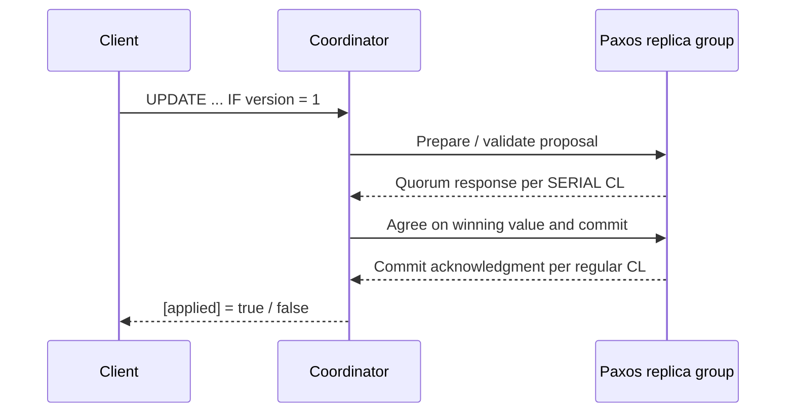

# Regular Consistency Levels and `SERIAL`/`LOCAL_SERIAL` in Cassandra

## 1. Why Does LWT Need Two Types of Consistency Levels?

Apache Cassandra is a distributed wide-column database: data is partitioned by **partition key** and replicated across multiple replicas. Applications can choose a consistency level (**CL**) per query to balance latency, availability, and synchronization across replicas.

For regular reads or writes, an application cares about **how many replicas must respond**. However, when multiple clients contend to modify a value, waiting for enough replicas is not enough: the system must also agree on **which conditional operation executes first**.

That is why Cassandra's **Lightweight Transactions (LWT)** use Paxos consensus for conditional statements such as `INSERT ... IF NOT EXISTS` and `UPDATE ... IF ...`. An LWT statement can use **two independent settings**:

1. **Regular consistency level** (`ONE`, `QUORUM`, `LOCAL_QUORUM`, ...): controls acknowledgment during the commit/write phase of the transaction and applies to regular reads and writes.
2. **Serial consistency level** (`SERIAL` or `LOCAL_SERIAL`): controls the quorum scope participating in the Paxos phase, where competing LWT requests are ordered.

Key takeaway: **`QUORUM` does not replace `SERIAL`; `SERIAL` also does not replace regular consistency.** They answer two different questions within the same LWT operation.

## 2. What Does Regular Consistency Control?

For regular read/write operations, the consistency level determines how many replicas must respond before the coordinator returns a result to the client.

| Consistency Level | Core Meaning | Typical Use Case |
| --- | --- | --- |
| `ONE` | One replica responds | Low latency, tolerant of potentially stale reads |
| `LOCAL_ONE` | One replica in the local datacenter responds | Reads/writes prioritizing intra-DC latency |
| `QUORUM` | Majority of replicas across the replication set respond | Want quorum across the full replica set |
| `LOCAL_QUORUM` | Majority of replicas in the local datacenter respond | Applications operating primarily within one DC |
| `EACH_QUORUM` | For writes, quorum in every DC | Requires write acknowledgment in every DC, higher latency |
| `ALL` | All involved replicas respond | Prioritizes full-replica confirmation, lower fault tolerance |

For example, with **replication factor (RF) = 3** in one datacenter, `QUORUM` requires at least **2/3 replicas** to respond. If a write is acknowledged at quorum and a subsequent read also uses quorum over the same replica set, the two quorums overlap. The commonly cited rule is **`R + W > RF`**, where `R` and `W` are the number of replicas required for reads and writes.

However, quorum overlap does not turn two regular write statements into a *compare-and-set* operation. Cassandra still reconciles conflicting writes by timestamp. Two clients can both read `version = 1` and then both send an unconditional `UPDATE`; regular quorum does not verify that `version` still equals `1` at write time.

```text
Initially: version = 1

Client A: SELECT version  -> 1
Client B: SELECT version  -> 1
Client A: UPDATE version = 2, body = 'A'  (no IF)
Client B: UPDATE version = 2, body = 'B'  (no IF)

=> Both UPDATEs can be accepted; no protection against lost updates.
```

Therefore, distinguish clearly:

- **Regular quorum**: replicas confirm regular read/write operations.
- **LWT with Paxos**: conditional requests on the same data contend through a consensus process so the condition is checked together with the write decision.

## 3. What Do `SERIAL` and `LOCAL_SERIAL` Control?

In LWT, the coordinator runs a Paxos round so replicas agree on the outcome of the conditional statement. Conceptually, this looks like:



This diagram simplifies actual Paxos steps; it is meant to highlight **two distinct control points**, not depict a fixed number of network round trips for every Cassandra version.

| Property | `SERIAL` | `LOCAL_SERIAL` |
| --- | --- | --- |
| Role | CL for the serial/Paxos phase | CL for the serial/Paxos phase |
| Quorum scope | Replicas across the cluster scope for that partition | Replicas in the local datacenter |
| Goal | Coordinate LWT across DCs when global scope is needed | Reduce cross-DC traffic for LWT operating within one DC |
| Typical cost | Higher when replicas span multiple DCs | Typically lower when intra-DC networking is fast |
| Limitation to remember | Still requires choosing a regular CL for the commit phase | Cannot serve as sole guarantee for cross-DC LWT contention |

`SERIAL` and `LOCAL_SERIAL` are **not regular write levels** like `ONE` or `LOCAL_QUORUM`. They apply to the serial phase of conditional operations. Certain serial reads in Cassandra can also use them to detect and help finish an incomplete Paxos round; a regular `SELECT` at `LOCAL_QUORUM` does not naturally do that.

### One LWT Statement Has Two CLs

Suppose an application writes from the local DC with:

```text
Consistency level        = LOCAL_QUORUM
Serial consistency level = LOCAL_SERIAL
```

When running `UPDATE ... IF ...`, Cassandra uses `LOCAL_SERIAL` for the Paxos agreement phase and `LOCAL_QUORUM` for the regular write confirmation phase. Switching `LOCAL_SERIAL` to `SERIAL` changes the consensus scope; the `LOCAL_QUORUM` setting for the write phase remains a separate choice.

You cannot turn an `UPDATE` without `IF` into CAS just by setting `SERIAL` in the driver. Conversely, setting `LOCAL_QUORUM` on `UPDATE ... IF ...` without understanding serial CL does not bypass the Paxos phase.

## 4. CQL Example: Atomic Version Check and Update

Suppose a Java application stores document content by `id` and uses `version` to detect concurrent updates. Because `id` is the partition key, conditional operations are evaluated on that exact partition.

```sql
-- Example assumes an actual datacenter named dc1 and RF = 3.
CREATE KEYSPACE IF NOT EXISTS lwt_demo
WITH replication = {'class': 'NetworkTopologyStrategy', 'dc1': 3};

USE lwt_demo;

CREATE TABLE IF NOT EXISTS doc_by_id (
    id text PRIMARY KEY,
    version int,
    body text
);

INSERT INTO doc_by_id (id, version, body)
VALUES ('doc-1', 1, 'Initial draft')
IF NOT EXISTS;
```

The name `dc1` is an example; in practice, use the exact datacenter name and replication factor configured in your Cassandra cluster.

In `cqlsh`, you can set the session's two consistency levels using the following **`cqlsh` commands** (these are not CQL statements to embed in applications):

```text
CONSISTENCY LOCAL_QUORUM;
SERIAL CONSISTENCY LOCAL_SERIAL;
```

Next, Client A updates conditioned on `version` still equaling `1`:

```sql
UPDATE doc_by_id
SET body = 'Content from A', version = 2
WHERE id = 'doc-1'
IF version = 1;
```

If the condition holds and LWT completes, Cassandra returns **`[applied] = true`**. A Client B that then runs the statement with `IF version = 1` and different content receives **`[applied] = false`**, because `version` is now `2`:

```sql
UPDATE doc_by_id
SET body = 'Content from B', version = 2
WHERE id = 'doc-1'
IF version = 1;
```

A failed result may include the current values of relevant columns; a compact display looks like:

```text
 [applied] | version
-----------+---------
     False |       2
```

**Note:** the data returned when the condition fails reflects values at the moment Cassandra evaluated the condition, not a lock held for the client. To retry, the application must read/evaluate the current state and decide on a new business-appropriate operation.

`INSERT ... IF NOT EXISTS` is also an LWT: it prevents two clients from both successfully *creating* a row with the same primary key. With `UPDATE ... IF version = ?`, only one request can pass the condition for the contested version, and the others must handle the conflict.

## 5. Quorum Scope in Single-DC and Multi-DC Clusters

Suppose a cluster has two datacenters `dc1` and `dc2`, each with **RF = 3** for the keyspace—six replicas total per partition.

| Level | Minimum Replicas in Example | Meaning |
| --- | --- | --- |
| `LOCAL_QUORUM` | 2/3 in the local DC | Regular read/write confirmation within that DC |
| `QUORUM` | 4/6 across the global replica set | Regular confirmation across global majority |
| `LOCAL_SERIAL` | Local Paxos quorum, i.e., 2/3 | LWT decision within the local DC scope |
| `SERIAL` | Global Paxos quorum, i.e., 4/6 | LWT decision spanning cross-DC replicas |

These numbers illustrate the difference in **scope**. Two levels requiring the same replica count still have different roles: `LOCAL_QUORUM` confirms regular operations, whereas `LOCAL_SERIAL` coordinates the Paxos phase.

### Choosing a Consistency Pair for Your Workload

**Application writes primarily in one datacenter:**

```text
Regular CL = LOCAL_QUORUM
Serial CL  = LOCAL_SERIAL
```

This is a practical choice to avoid cross-DC Paxos latency, **provided all clients contending on the same data respect the local coordination scope** and business rules do not require global CAS.

**Multiple datacenters can concurrently contend on the same key:**

```text
Regular CL = QUORUM or a write config matching SLA
Serial CL  = SERIAL
```

`SERIAL` is appropriate when CAS ordering must be coordinated across DCs. The regular write level must still be chosen for acknowledgment and fault-tolerance needs. Never assume `LOCAL_SERIAL` gives system-wide uniqueness if clients in multiple DCs concurrently modify the same partition; local Paxos quorums in different DCs are not guaranteed to overlap.

Additionally, do not let clients arbitrarily mix `SERIAL` and `LOCAL_SERIAL` for **the same set of keys requiring global ordering**. Operations using local quorums can undermine the global-coordination assumptions of the rest.

## 6. Consistency Guarantees and Atomicity Scope of LWT

LWT supports **compare-and-set (CAS)**: checking the condition and applying the update are agreed upon as one conditional operation on the target partition. This enables identity registration locks, state transitions, optimistic locking checks, or one-time record initialization.

However, keep the boundaries clear:

- **Partition-scoped:** do not extrapolate single-row LWT into arbitrary ACID transactions across multiple partitions or multiple tables with different partition keys.
- **Regular reads do not equal serial reads:** a `SELECT` at `ONE` or `LOCAL_ONE` can still read a lagging replica; even when conditional writes use LWT, read method and read CL still matter.
- **Condition failure vs. write acknowledgment:** `[applied] = false` means the condition failed so this update was not applied; timeouts/exceptions do not provide enough evidence to conclude success or failure.
- **Does not guard out-of-protocol operations:** if another write path issues an unconditional `UPDATE` on the same data, LWT clients' version checks can be violated semantically. Enforce consistent update rules across the entire application.

Accordingly, for "each account can register one unique username," model the unique key as the primary key and use `INSERT ... IF NOT EXISTS`. For "update document version if nobody else edited it," use `UPDATE ... IF version = ?`. For invariants spanning multiple partitions, redesign the data model around queries or use external coordination; raising CL alone will not create cross-partition transactions.

## 7. Calling from Java: Explicitly Setting Both CLs on LWT Statements

The example uses **DataStax/Apache Cassandra Java Driver 4.x** against `lwt_demo.doc_by_id`. Assume `CqlSession` is already built per the application's connection config.

```java
import com.datastax.oss.driver.api.core.CqlSession;
import com.datastax.oss.driver.api.core.DefaultConsistencyLevel;
import com.datastax.oss.driver.api.core.cql.BoundStatement;
import com.datastax.oss.driver.api.core.cql.PreparedStatement;
import com.datastax.oss.driver.api.core.cql.ResultSet;

public final class DocumentRepository {
    private final CqlSession session;
    private final PreparedStatement updateIfVersion;

    public DocumentRepository(CqlSession session) {
        this.session = session;
        this.updateIfVersion = session.prepare(
            "UPDATE lwt_demo.doc_by_id " +
            "SET body = ?, version = ? " +
            "WHERE id = ? IF version = ?"
        );
    }

    public boolean update(String id, int expectedVersion, String newBody) {
        BoundStatement statement = updateIfVersion.bind(
                newBody, expectedVersion + 1, id, expectedVersion)
            .setConsistencyLevel(DefaultConsistencyLevel.LOCAL_QUORUM)
            .setSerialConsistencyLevel(DefaultConsistencyLevel.LOCAL_SERIAL);

        ResultSet result = session.execute(statement);
        return result.wasApplied();
    }
}
```

Here:

1. `WHERE id = ?` locates the partition to update; `IF version = ?` is the CAS condition.
2. `setSerialConsistencyLevel(LOCAL_SERIAL)` sets the Paxos phase quorum scope.
3. `setConsistencyLevel(LOCAL_QUORUM)` sets the regular write-confirmation phase CL.
4. `wasApplied()` indicates whether the condition was applied when the query **returned a successful response**.

In applications writing across multiple DCs that require global CAS linearization, evaluate replacing `LOCAL_SERIAL` with `SERIAL` and designing matching read/write CLs. Configuration should be centralized where statements or repositories are constructed so every update flow for the same key shares one policy.

The method above returns `false` on a version conflict. In real applications, return a richer result type (e.g., `APPLIED`, `CONFLICT`, `UNKNOWN`) to cleanly separate **condition failed** from **network error or timeout**; never turn all exceptions into `false`.

## 8. Handling Contention, Timeouts, and Failures

LWT requires more network exchanges than regular writes because of Paxos coordination. On rows with high contention, latency and conflict/collision rates can climb. Application handling must differ by outcome:

| Scenario | What Can Be Concluded? | Appropriate Action |
| --- | --- | --- |
| `[applied] = true` | Condition accepted and operation returned success | Continue business workflow |
| `[applied] = false` | Condition failed at evaluation time | Re-read state, report conflict, or recompute change |
| Timeout or connection loss | Outcome is **indeterminate**; write may have completed | Reconcile state before deciding to retry |
| `Unavailable`/insufficient replicas | Required quorum could not be met at call time | Monitor cluster health; apply controlled retries if appropriate |
| Sustained contention | Many clients competing to edit one hot key | Reduce contention, cap retries, add backoff and jitter |

An error-prone scenario:

```text
Client sends UPDATE ... IF version = 7
        |
        +-- Coordinator committed, but the response was lost
        |
Client receives timeout and does not know whether the operation applied
```

If the client immediately resends the exact same statement, the next attempt may receive `[applied] = false` because `version` is now `8` **from its own first attempt**. Never interpret `false` after a retry as proof that the first attempt failed. Read state to reconcile against the intended change, or use an *operation ID* designed into the data model when the domain must distinguish executions.

Never automatically downgrade `SERIAL` to `LOCAL_SERIAL`, or `LOCAL_QUORUM` to `ONE`, just to push queries past missing replicas: doing so alters your guarantee scope. **Repair**, **compaction**, and **replication** help maintain and store distributed data, but do not replace ordering guarantees across competing CAS statements.

## 9. Common Misconceptions

| Misconception | Accurate Understanding |
| --- | --- |
| "`QUORUM` is enough to prevent lost updates" | Regular quorum only governs replica responses; you need `IF`/LWT or another concurrency strategy to check preconditions before writing. |
| "`SERIAL` is the consistency level of all writes" | `SERIAL` applies to the serial/Paxos phase of LWT; you must still specify the regular write CL. |
| "`LOCAL_SERIAL` is identical to `SERIAL` because both require a majority" | The two quorums have different **scopes** in multi-DC clusters; a local majority is not a global majority. |
| "LWT guarantees database-wide transactions" | CAS guarantees apply to the relevant key/partition; they do not automatically extend across multiple partitions. |
| "`[applied] = false` means Cassandra errored" | Usually it is a valid business outcome: the condition did not hold. |
| "A timeout means the write definitely did not happen" | The outcome may be indeterminate; reconcile before retrying in a way that causes duplicate side effects. |

## 10. Self-Check Practice Exercises

**Exercise 1 — Two contending clients.** Create `doc-1` with `version = 1`. Have two clients concurrently run `UPDATE ... IF version = 1` with different bodies. Predict how many times `[applied] = true` occurs, check the final version, and explain why an `UPDATE` without `IF` provides no such guarantee.

**Exercise 2 — Choosing serial scope.** An application deployed in `dc1` only updates data in `dc1`; a second application in `dc2` starts contending on the same key. Explain why the earlier `LOCAL_SERIAL` policy must be reconsidered and how `SERIAL` changes the quorum scope.

**Exercise 3 — Lost response.** A client invokes LWT to advance `version` from `4` to `5` and receives a timeout. A retry returns `[applied] = false`. List the possible reasons for that outcome and design a reconciliation step before responding to the user.

**Guided answers:**

- Exercise 1: starting from the same initial state, only one `version = 1` condition can be accepted; the other client must handle the conflict. Regular writes do not check this condition.
- Exercise 2: local Paxos quorums in two DCs may not overlap; to coordinate global CAS, both must use a globally scoped serial policy and evaluate associated read/write CLs.
- Exercise 3: the first attempt may have committed, another client may have updated the version, or state may have changed otherwise. Re-read and compare data/operation ID before asserting an outcome; never infer failure from a timeout.

## 11. Summary

In Cassandra, the **regular consistency level** answers *how many replicas acknowledge reads/writes*, whereas the **serial consistency level** answers *which replicas participate in agreeing on LWT decisions*. `SERIAL` targets global Paxos scope, while `LOCAL_SERIAL` limits consensus to the local datacenter. Configuring both accurately, designing partition keys around queries, and handling CAS outcomes and timeouts explicitly are the foundation for safe concurrency control in Java applications using Cassandra.
