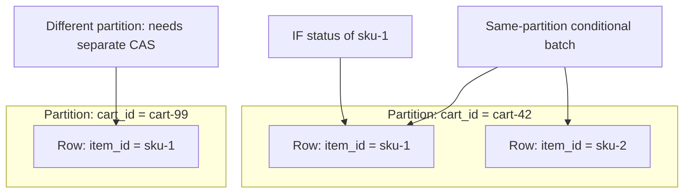

# Key/Partition Scope of Conditions and Limits on Combining Operations

## 1. Central Question

In Apache Cassandra, `INSERT ... IF NOT EXISTS`, `UPDATE ... IF ...`, and `DELETE ... IF ...` are **lightweight transactions (LWT)**: Cassandra uses a Paxos-based consensus mechanism to decide whether a change is applied. However, the word *transaction* here does not mean an arbitrary SQL transaction that can check and modify multiple tables and partitions at once.

The key limits to remember are:

1. `WHERE` identifies the **target row** via its primary key; `IF` clauses evaluate **data state related to that target row** (or `STATIC` columns of the partition under CQL rules).
2. LWT and Paxos coordination are organized **per partition**. Different rows sharing the same partition key can participate in a valid **conditional batch**.
3. **A conditional batch may affect only one table and one partition.** It does not create CAS transactions across partitions, across tables, or cluster-wide uniqueness constraints.

This lesson belongs to the **LWT and Concurrency** chapter of the `DATABASE_ENGINE_WIDE_COLUMN_CASSANDRA` module. It connects concepts of **wide-column modeling, partition keys, CQL, replication, and consistency levels** with a common Java application challenge: multiple requests competing to modify state. The syntax examples follow traditional CQL/LWT; any other transaction features, if present in a specific Cassandra version, must be evaluated separately and not automatically attributed to `IF`/`BATCH`.

After this lesson, you will be able to inspect a `PRIMARY KEY` to determine condition scope, predict which concurrency cases CAS protects, construct valid conditional batches, recognize rejected combinations, and choose how to handle business rules spanning multiple partitions.

## 2. The Primary Key Defines the Boundary

Assume keyspace `shop_ks` already exists; adjust the keyspace name to match your lab environment:

```sql
CREATE TABLE shop_ks.cart_items (
    cart_id text,
    item_id text,
    status text,
    revision int,
    PRIMARY KEY ((cart_id), item_id)
);
```

Here:

- **Partition key:** `cart_id`. Every item in `cart-42` resides in **the same logical partition** and shares replica routing.
- **Clustering key:** `item_id`. `('cart-42', 'sku-1')` and `('cart-42', 'sku-2')` are **two distinct rows** within the same partition.
- **Full primary key:** `(cart_id, item_id)`. This is the row identifier checked when conditioning on `status` and `revision`.



Per-partition Paxos lets Cassandra serialize competing LWT decisions on the same partition key, yet **the condition itself is still whatever you write in CQL**. Two requests inserting two different `item_id`s, each with `IF NOT EXISTS`, can **both succeed**: both rows did not initially exist. They do not automatically enforce "the cart has at most one active item."

### Composite Partition Keys

If the schema is `PRIMARY KEY ((tenant_id, cart_id), item_id)`, the partition is identified by the **pair** `(tenant_id, cart_id)`. Two carts with the same `cart_id` but different `tenant_id`s live in different partitions. Never infer LWT scope from a single column name or from two rows sharing a clustering key value.

## 3. A Single LWT Statement: `WHERE` Selects the Row, `IF` Checks the Data

First create a row for the examples in a test environment:

```sql
INSERT INTO shop_ks.cart_items (cart_id, item_id, status, revision)
VALUES ('cart-42', 'sku-1', 'AVAILABLE', 1)
IF NOT EXISTS;
```

`IF NOT EXISTS` checks that **the row with full primary key `('cart-42', 'sku-1')`** does not yet exist. It does **not** mean partition `cart-42` is empty, nor does it block inserting `sku-2` into the same cart. Regular CQL has no `UNIQUE(status)` or `IF NOT EXISTS` meaning uniqueness on an arbitrary column.

A conditional update on that exact row:

```sql
UPDATE shop_ks.cart_items
SET status = 'RESERVED', revision = 2
WHERE cart_id = 'cart-42' AND item_id = 'sku-1'
IF status = 'AVAILABLE' AND revision = 1;
```

The statement applies only if **both conditions** hold when Cassandra decides the CAS. If two clients both read revision `1` and concurrently request moving to revision `2`, normally only one CAS can be applied; the other client gets an unapplied outcome because the stale condition no longer holds. This is **optimistic concurrency control** using a version/revision.

One execution might return:

```text
 [applied]
-----------
      True
```

If unsatisfied, `cqlsh` displays `[applied] = False` and typically includes the current values for conditioned columns; the exact returned columns depend on statement type and condition. **`False` is not a network error**: it reports that the conditional request was not applied. Conversely, timeouts/exceptions prove neither success nor failure; actual state may need to be re-read to reconcile.

### A Row Condition Is Not a Whole-Partition Condition

Next, insert:

```sql
INSERT INTO shop_ks.cart_items (cart_id, item_id, status, revision)
VALUES ('cart-42', 'sku-2', 'AVAILABLE', 1)
IF NOT EXISTS;
```

This statement can still return `[applied] = True` even though `sku-1` already exists, because `item_id` is part of the primary key. This example illustrates two distinct levels:

| Level | What Is Identified? | What Is **Not** Automatically Guaranteed? |
| --- | --- | --- |
| Full primary key `(cart_id, item_id)` | The specific row checked by `INSERT IF NOT EXISTS` or `UPDATE ... IF`. | The state of every other row in the same cart. |
| Partition key `cart_id` | Placement and Paxos coordination boundary for CAS operations on that partition. | A partition-wide business rule unless CQL can express and check it directly. |
| Another table/keyspace | A separate dataset, even if key columns share the same names or values. | Cross-table CAS transactions via `BEGIN BATCH ... IF`. |

When you need an invariant like "each cart may have only one open reservation," a single row representing the cart's state may fit better than checking each `item_id` independently. Design the schema around the *invariant* you must uphold, while weighing partition size and hotspot risks.

## 4. Combining Multiple Conditions on One Row

The `IF` clause of `UPDATE` or `DELETE` can include valid conditions across multiple columns joined by `AND`:

```sql
UPDATE shop_ks.cart_items
SET status = 'SOLD', revision = 3
WHERE cart_id = 'cart-42' AND item_id = 'sku-1'
IF status = 'RESERVED' AND revision = 2;
```

All conditions on the same row are evaluated in one CAS decision; there is no need to split `SELECT` and `UPDATE`, since another change could interleave between two separate operations. However, `IF` is **not** a place for aggregate queries, `JOIN`s, `SELECT`s from other tables, or arbitrary multi-partition predicates. Specific conditional syntax and operators depend on CQL version; prefer simple examples expressible directly with existing columns.

With `STATIC` columns, a value belongs to the partition scope and can be used when updating partition data per CQL rules for static rows. Do not confuse this with freely reading all rows in a partition to compute a condition.

## 5. Conditional Batch: Multiple Rows, Same **Table and Partition**

Suppose we must reserve **both items** `sku-1` and `sku-2` in `cart-42`, and only if both are still `AVAILABLE` at `revision = 1`. In a test environment, ensure both rows start in the right initial state before running:

```sql
BEGIN BATCH
    UPDATE shop_ks.cart_items
    SET status = 'RESERVED', revision = 2
    WHERE cart_id = 'cart-42' AND item_id = 'sku-1'
    IF status = 'AVAILABLE' AND revision = 1;

    UPDATE shop_ks.cart_items
    SET status = 'RESERVED', revision = 2
    WHERE cart_id = 'cart-42' AND item_id = 'sku-2'
    IF status = 'AVAILABLE' AND revision = 1;
APPLY BATCH;
```

This is valid because both mutations target the **same table `shop_ks.cart_items`** and the **same partition `cart_id = 'cart-42'`**. CQL combines the checks into a single CAS decision: **if all conditions hold, the batch applies; if any single condition fails, none of the batch applies**. This lets you coordinate multiple rows with different clustering keys within one partition under a single consistency boundary.

A conditional batch can mix statements with `IF` and statements without `IF`, provided **every statement in the batch** obeys the single-table/single-partition scope and applicable CQL rules. Do not assume earlier statements execute first and later statements evaluate conditions against them; batches do not support `SELECT` or conditional logic reading the effect of an immediately preceding mutation in the same batch.

**Important syntax limits:** conditional batches do not support user-supplied timestamps (`USING TIMESTAMP`), cannot use `IN` to select multiple partitions, and conditional `UPDATE`/`DELETE` statements do not support `IN` on clustering keys to target multiple rows. To update multiple clustering rows with individual conditions, write **explicit statements** inside the same conditional batch as shown above.

Do not pack multiple mutations overwriting the same cell/column into a batch expecting sequential execution order; Cassandra resolves conflicts by timestamp and does not provide imperative "statement 2 sees what statement 1 just wrote" semantics.

## 6. Combinations That Are Rejected or Do Not Enforce the Desired Constraint

### 6.1. Two Different Partitions

```sql
-- INVALID: conditions belong to two different partitions.
BEGIN BATCH
    UPDATE shop_ks.cart_items
    SET status = 'RESERVED'
    WHERE cart_id = 'cart-42' AND item_id = 'sku-1'
    IF status = 'AVAILABLE';

    UPDATE shop_ks.cart_items
    SET status = 'RESERVED'
    WHERE cart_id = 'cart-99' AND item_id = 'sku-1'
    IF status = 'AVAILABLE';
APPLY BATCH;
```

With standard CQL/LWT, Cassandra rejects this batch, typically with an error similar to `Batch with conditions cannot span multiple partitions`. Sharing a table name does not turn distinct partitions into a single transaction.

### 6.2. Two Different Tables, Even with Matching Key Values

Suppose an application has `shop_ks.order_status` and `shop_ks.order_events`, each containing a row with text key `'order-7'`. A conditional batch cannot use a condition on one table's row to guarantee a mutation on the other table commits alongside it. Using identical partition key names or values **does not** erase the boundary between two tables. Cassandra rejects a batch containing conditions and statements across multiple tables, typically with `Batch with conditions cannot span multiple tables`.

This includes mixing one statement with `IF` and another statement without `IF` targeting a different table: because the group is a **conditional batch**, the entire batch must belong to a single table.

### 6.3. Multiple Sequential LWTs Do Not Form a Single Transaction

```text
CAS #1: decrement remaining stock for product A -> [applied] = True
CAS #2: increment quantity for product B         -> timeout / [applied] = False
```

Two separate CAS operations can leave the system in "A changed, B unchanged." There is no *automatic rollback* across two partitions. Fund transfers, inventory moves, or multi-projection updates require application-level coordination (progress tracking, conditional compensation, idempotency) or a different transaction mechanism with explicit guarantees appropriate for the version/system.

## 7. Why Doesn't `LOGGED BATCH` Replace Multi-Partition LWT?

This is a critical distinction among three mechanisms often lumped together as "atomic":

| Mechanism | Primary Purpose | What Scope You Can Rely On |
| --- | --- | --- |
| Regular `UPDATE`/`INSERT` | Write data without comparing current state. | Mutation atomicity/isolation within a single partition, with **no check** on prior values. |
| Regular `BEGIN BATCH` without `IF` | Group mutations; logged batches use a batchlog to help complete mutations on failure. | Provides no global isolation or cross-partition CAS conditions; changes can become visible at different times. |
| `IF ...` or conditional batch | Check state and decide via Paxos whether to apply mutations. | One condition on an appropriate row/values, or multiple conditions/mutations within **the same table and partition**. |

A multi-partition logged batch **can be valid without `IF`**, yet it cannot express "if both accounts have sufficient balance, debit one and credit the other together," because it performs no state comparison like a SQL transaction. A multi-partition `UNLOGGED BATCH` lacks even batchlog completion guarantees on failure. Avoid using large batches as a substitute for partition-aligned write design: they overload coordinators and hurt latency.

## 8. Consistency Scope and Contention Scenarios

LWT has **two consistency dimensions** to keep in mind during practice: the regular read/write consistency level (e.g., `QUORUM`, `LOCAL_QUORUM`) and **serial consistency** for Paxos (`SERIAL` or `LOCAL_SERIAL`). `LOCAL_SERIAL` coordinates only within the local DC as configured; it must not be treated as a global guarantee when writers across multiple DCs use different modes. Which option fits depends on business requirements and how applications connect to DCs.

| Scenario | Operational Conclusion |
| --- | --- |
| Two clients CAS the same row `sku-1` with `IF revision = 1` | Only the request seeing the condition still true at decision time applies; the other can receive `False`. |
| Two clients run `INSERT IF NOT EXISTS` with the same `cart_id`, **different `item_id`s** | Both can succeed because existence is checked on two distinct rows. |
| One client uses `IF`, another uses an unconditional `UPDATE` on the same data | The unconditional writer can break business assumptions; all write paths sharing an invariant must align on coordination. |
| CAS times out or loses connection after sending | Outcome is **unknown**; never assume the mutation failed. Re-read and/or use an operation ID to reconcile before retrying. |
| Multi-row same-partition conditional batch fails one condition | None of the batch applies; the application handles the failure branch using current state. |
| High-throughput CAS traffic on the same partition | Increases contention, Paxos rounds, and latency; review partition design and concurrency levels. |

`IF` conditions incur substantial consensus overhead compared to regular writes. Reserve them for constraints that genuinely require concurrency control; do not turn every insert/update into an LWT without a clear requirement. Also, funneling every domain variant into a single partition can create oversized partitions or hotspots, degrading Cassandra's scalability.

## 9. Integration in Java Applications

With DataStax/Apache Cassandra Java Driver 4.x, use prepared statements to bind keys and condition parameters, then check `wasApplied()`:

```java
PreparedStatement reserve = session.prepare(
    "UPDATE shop_ks.cart_items " +
    "SET status = ?, revision = ? " +
    "WHERE cart_id = ? AND item_id = ? " +
    "IF status = ? AND revision = ?"
);

BoundStatement statement = reserve.bind(
    "RESERVED", 2,
    "cart-42", "sku-1",
    "AVAILABLE", 1
).setConsistencyLevel(DefaultConsistencyLevel.LOCAL_QUORUM)
 .setSerialConsistencyLevel(DefaultConsistencyLevel.LOCAL_SERIAL);

ResultSet result = session.execute(statement);
if (result.wasApplied()) {
    // State transitioned successfully under the condition.
} else {
    // Condition no longer holds; fetch current state and handle conflict.
}
```

These classes belong to Driver 4.x (`PreparedStatement`, `BoundStatement`, `ResultSet`, `DefaultConsistencyLevel`). The `LOCAL_QUORUM` and `LOCAL_SERIAL` configuration in this example **makes sense only when topology and application consistency requirements match**; do not copy it blindly into multi-DC systems. For serial consistency, the development team should standardize configuration across every write path protecting the same invariant.

The application must cleanly separate three outcomes: **`wasApplied() == true`**, **`wasApplied() == false`**, and **exception/timeout**. `False` may translate to HTTP `409 Conflict` or a state-reload flow; timeouts require reconciling actual state before re-issuing operations that could cause side effects. For versioned updates, store a request identifier as well if the business flow must detect whether an earlier execution was already accepted.

## 10. Hands-On Exercises and Self-Check Questions

**Preparation:** create table `shop_ks.cart_items` in a test environment; use a dedicated cart to avoid leftover data. Work through these steps in order:

1. Insert `('cart-42', 'sku-1')` using `IF NOT EXISTS`. Run the statement again and observe the difference between `True` and `False`.
2. Insert `('cart-42', 'sku-2')` with `IF NOT EXISTS`. Explain why it succeeds despite sharing `cart_id`.
3. Set both rows to `status = 'AVAILABLE'`, `revision = 1` in the test environment, then run the conditional batch from section 5. Verify **both** move to `RESERVED`.
4. Reset only one row to `AVAILABLE`, leave the other in a state failing the condition, and rerun the batch. Verify there is no partial update.
5. Try a conditional batch spanning `cart-42` and `cart-99`, and note the partition-scope validation error. Never run faulty example commands in production.
6. Simulate two clients both using `IF revision = 1`; record `wasApplied` results and observe how each client handles conflict.

Before deploying any conditional operation, answer four questions: **(a)** which columns form the partition key, **(b)** which row or columns does `IF` evaluate, **(c)** are all mutations in the same table and same partition, and **(d)** if the CAS response times out, how will the application determine the outcome and continue safely?

## 11. Further Reading

- [Apache Cassandra — CQL Data Manipulation](https://cassandra.apache.org/doc/latest/cassandra/developing/cql/dml.html): definitions of `INSERT`, `UPDATE`, `DELETE`, `IF`, and `BATCH`.
- [Apache Cassandra — Good use of BATCH statement](https://cassandra.apache.org/doc/stable/cassandra/developing/cql/batch/batch-good-example.html): same-partition batch example including conditions and `STATIC` columns.
- [Apache Cassandra — CASSANDRA-10085](https://issues.apache.org/jira/browse/CASSANDRA-10085): restriction preventing conditional batches from spanning multiple tables.

LWT solves **contention on data you can precisely address and check**. Getting the partition key and condition scope right determines application correctness—especially when a business request looks like "one operation" but actually spans multiple rows, tables, or partitions.
