# Resource Reservations and Invariants That Cannot Be Inferred from a Single Record

> **Chapter:** LWT and Concurrency  
> **Module:** `DATABASE_ENGINE_WIDE_COLUMN_CASSANDRA`  
> **Focus:** Defining business invariants, modeling reservation state by partition key, applying lightweight transactions (LWT) within their proper scope, and handling invariants spanning multiple records or resources.

In Apache Cassandra, data is distributed across nodes by **partition key** and typically replicated across multiple replicas. CQL supports conditional queries with `IF` to coordinate concurrent updates using **lightweight transactions** (LWT/Paxos). This is a practical tool so two guests cannot simultaneously reserve **the same spot**. Yet a condition evaluated on a single record cannot by itself prove rules such as "total reserved spots never exceed 100," "a guest holds at most one reservation across the entire event," or "both the meeting room and its projector must be reserved together."

After this lesson, you will know how to identify **which data scope must be checked to prove an invariant**, use LWT for single-key reservation state, understand the boundary between regular consistency levels and serial consistency, redesign constraints spanning multiple records, and handle contention or timeouts from a Java application.

## 1. Start from the Invariant, Not from the CQL Statement

An **invariant** is a condition that must hold true across every valid state recognized by the system. In a reservation system, distinguish:

| Invariant | Data That Must Be Observed | Is Single-Record LWT Enough? |
| --- | --- | --- |
| A seat in a given showtime has at most one current holder | Current state of **that exact seat and showtime** | Yes, if all write paths use the same key and conditional updates. |
| A guest does not hold two active reservations on two different seats | At least two seats, or a per-guest ownership index | No, if CAS runs only on each seat row independently. |
| Total reservations for an event never exceed capacity | All active holds or a shared capacity representation | No, if updates happen across independent rows. |
| A room and a projector must be reserved or released together | State of **both resources** | No, if the two resources live in separate partitions. |
| No two room bookings overlap in time | All potentially overlapping intervals for that room | No, if checking only one row per booking. |

A helpful rule of thumb: if the rule is `I(S)` where `S` consists of multiple records, an operation checking only `row_A` cannot guarantee `I(S)` once `row_B` also changes. The system must **re-express the rule as contention on a single source of truth** or choose a transaction mechanism capable of checking the entire relevant dataset.

For example, suppose event capacity is 1, yet the app has two rows `seat-A` and `seat-B`, both initially `AVAILABLE`:

```text
Guest A: IF seat-A.state = 'AVAILABLE'  → succeeds → HELD
Guest B: IF seat-B.state = 'AVAILABLE'  → succeeds → HELD

Each individual CAS is valid, yet total HELD seats = 2 > capacity = 1.
```

LWT did not malfunction in this example: **the invariant was placed on the wrong scope**. The two independent updates never contended on a shared value.

## 2. What Does LWT Guarantee?

In CQL, syntax such as `INSERT ... IF NOT EXISTS`, `UPDATE ... IF ...`, or `DELETE ... IF ...` instructs Cassandra to run a Paxos-style agreement step before accepting a conditional change. Within the same partition key, proper LWT operations can **serialize** competing decisions: if two applications concurrently try to claim the same unoccupied slot, at most one wins.

```mermaid
sequenceDiagram
    participant A as Guest A
    participant C as Cassandra / Paxos
    participant B as Guest B
    A->>C: INSERT slot R, time T IF NOT EXISTS
    B->>C: INSERT slot R, time T IF NOT EXISTS
    C-->>A: [applied] = true
    C-->>B: [applied] = false; returns current state
    Note over C: One reservation key has only one winner
```

LWT provides a conditional decision within the partition scope participating in the protocol. It does **not** automatically provide arbitrary ACID transactions across partitions, guard an aggregate query over all rows, or coordinate atomically with payment gateways, email, message brokers, or external APIs.

The two consistency levels often mentioned with an LWT statement serve different roles:

- `LOCAL_SERIAL` or `SERIAL` is the **serial consistency level** for the conditional/Paxos coordination phase. `LOCAL_SERIAL` limits coordination to the local datacenter; `SERIAL` involves broader scope depending on topology and replication. Apply a consistent policy and avoid mixing write paths across multiple DCs haphazardly.
- `LOCAL_QUORUM` or `QUORUM` is the **regular consistency level** of the read/write operation. It sets how many replicas acknowledge within that scope, but by itself it neither replaces `IF` checks nor enforces invariants across multiple partition keys.

LWT typically requires more replica round trips than regular CQL writes. A resource targeted by many concurrent requests on one key can become a hotspot in both throughput and latency. Reserve LWT for places where the system truly must decide *who wins*, rather than slapping LWT onto every write just to feel "safer."

## 3. Modeling It Right: One Fixed Slot Corresponds to One Key

Suppose the application reserves **a room at a fixed start slot**. Each `(resource_id, slot_start)` pair is an independent slot; every request claiming the same slot must target this exact key.

```sql
-- Appropriate Cassandra keyspace already selected via USE <keyspace>.
CREATE TABLE slot_holds (
    resource_id text,
    slot_start timestamp,
    reservation_id uuid,
    holder_id text,
    state text,
    PRIMARY KEY ((resource_id, slot_start))
);
```

Here the full `(resource_id, slot_start)` pair is the **partition key**; one partition corresponds to one slot. `reservation_id` is the stable ID of the hold request, reused if the application receives a retry of the same request. Two different bookers must contend on the exact same key, even if they connect to different Cassandra nodes.

### 3.1. Initial Hold: `INSERT IF NOT EXISTS`

```sql
INSERT INTO slot_holds
    (resource_id, slot_start, reservation_id, holder_id, state)
VALUES
    ('room-7', '2026-11-24 09:00:00+0000',
     11111111-1111-1111-1111-111111111111, 'alice', 'HELD')
IF NOT EXISTS;
```

If no row exists for that key, the statement returns `[applied] = true`. If a row already exists, `[applied] = false`, and the result may include existing column values. The application should conclude **new hold succeeded** only when applied is confirmed; on non-applied outcomes, distinguish whether another guest holds it or the same request already held it earlier.

**Mandatory condition:** no other code path overwrites the row using regular `INSERT`/`UPDATE`. If one service can still run `UPDATE slot_holds SET reservation_id = ...` without `IF`, it can break the reservation flow's guarantees even while every other service uses LWT.

### 3.2. Confirming and Releasing via Conditional State Transitions

```sql
-- Only the owner of the matching reservation_id may confirm.
UPDATE slot_holds
SET state = 'CONFIRMED'
WHERE resource_id = 'room-7'
  AND slot_start = '2026-11-24 09:00:00+0000'
IF state = 'HELD'
   AND reservation_id = 11111111-1111-1111-1111-111111111111;

-- Alternative branch: cancel only while still HELD, never a CONFIRMED booking.
UPDATE slot_holds
SET state = 'RELEASED'
WHERE resource_id = 'room-7'
  AND slot_start = '2026-11-24 09:00:00+0000'
IF state = 'HELD'
   AND reservation_id = 11111111-1111-1111-1111-111111111111;
```

These two statements illustrate **two competing transition branches**, not a sequence to run back to back. If one branch succeeds, the opposite branch fails. Once a row is `RELEASED`, a new request can reclaim the slot by **conditionally** replacing the owner:

```sql
UPDATE slot_holds
SET reservation_id = 22222222-2222-2222-2222-222222222222,
    holder_id = 'bob',
    state = 'HELD'
WHERE resource_id = 'room-7'
  AND slot_start = '2026-11-24 09:00:00+0000'
IF state = 'RELEASED';
```

If Alice sends a delayed cancellation after Bob already acquired the slot, the condition `reservation_id = ...Alice...` fails. Checking both **state and owner** within the same LWT decision prevents accidentally cancelling the next holder's reservation.

A basic state machine:

```mermaid
stateDiagram-v2
    [*] --> HELD: INSERT IF NOT EXISTS
    HELD --> CONFIRMED: IF state = HELD AND owner = request
    HELD --> RELEASED: IF state = HELD AND owner = request
    RELEASED --> HELD: IF state = RELEASED; swap owner
    CONFIRMED --> [*]: Finalize per business rules
```



In real systems, explicitly define how `CONFIRMED` finishes, renewals, and `HELD` expiration. Never assume you can delete a row and treat all stale retries as safe: after deletion, a delayed `INSERT IF NOT EXISTS` can **re-acquire the slot**. Retain state and request IDs, or maintain a dedicated request ledger with replay-blocking rules, whenever the domain requires it.

## 4. Why Is Reserving a Time Range Harder Than Reserving One Slot?

Suppose a room must be booked from 09:00 to 11:00. If each row merely represents a booking request keyed by `(resource_id, reservation_id)` and two requests arrive:

```text
Guest A wants: [09:00, 11:00)
Guest B wants: [10:00, 12:00)
```

then the two guests write to **two different keys**. Both `INSERT IF NOT EXISTS` statements can succeed, yet the time ranges still overlap. Cassandra has no built-in global range-exclusion constraint equivalent to `EXCLUDE` in some relational databases.

Practical design approaches:

1. **Discretize into fixed slots:** if the domain uses 30-minute blocks, a 09:00–11:00 request claims four slots; you must solve atomicity across the whole group of slots, not just each slot individually.
2. **Co-locate decision data within one bounded partition:** e.g., slots for one room on one day, then run conditional checks/transitions supported by Cassandra within that single partition. Handle bookings crossing day boundaries and guard against oversized or hot partitions.
3. **Use a serialized booking coordinator:** route all changes affecting the same resource through a single decision point storing state and version to prevent out-of-band conflicts.
4. **Use an appropriate transactional database:** when you must check dynamic overlapping ranges or enforce atomicity across many resources/partitions, pick storage that natively enforces constraints and transactions over the required scope.

Reading existing rows first and inserting a new row afterward **is not** safe. Between `SELECT` and `INSERT`, another guest can reserve an overlapping interval (*time-of-check to time-of-change / time-of-check to time-of-use*).

## 5. Total Capacity Invariant: Turning an Aggregate Condition into a Source of Truth

Consider the rule: `active_holds <= capacity`. If `active_holds` is the count of `HELD` rows spread across many partitions, an LWT on any single row has no knowledge of the new total. Running `COUNT(*)` before writing does not lock rows being modified by others either.

### Option A: One Contended Quota Row

```sql
CREATE TABLE remaining_capacity (
    event_id text PRIMARY KEY,
    remaining int
);

INSERT INTO remaining_capacity (event_id, remaining)
VALUES ('concert-25', 2)
IF NOT EXISTS;

-- App read remaining=2 and wants to decrement by 1.
UPDATE remaining_capacity
SET remaining = 1
WHERE event_id = 'concert-25'
IF remaining = 2;
```

If two users both read `remaining = 2` and both try setting `1`, only one conditional update succeeds. The other must read the new value and either retry expecting `remaining = 1` or report sold out if it reached 0. Do not replace this with `SET remaining = remaining - 1` on a regular integer: **Cassandra supports increment/decrement syntax only on `counter` columns, and counters do not support `IF`**.

This model protects **the quota number on one row**, yet you still have to tie each decrement cleanly to a `reservation_id`. If you decrement the quota but writing the booking details in another partition fails, quota and details diverge; if you write details first and then decrement quota, a booking can exist without allocated capacity. Design the source of truth and recovery workflow explicitly—do not call those two steps a single transaction.

### Option B: Representing Each Unit of Capacity as a Token

If an event has exactly 100 seats, you can pre-create **100 available tokens** (`token-001` through `token-100`) and claim each token via LWT on that token's key. The rule "at most 100 holds" then follows directly from the fact that only 100 valid tokens exist, each with at most one owner. Requests can be distributed across tokens to reduce hotspots compared to a single `remaining` row.

Proving the invariant requires that every valid booking **must own a token**: no write path creates a 101st token, no token is issued twice, and booking details are derived/reconciled from token ownership. This illustrates converting an aggregate rule into localized decisions **by bounding the set of resources allowed to exist**; it does not by itself solve "one guest holds at most one token" or charging payment exactly once.

## 6. Multi-Key Invariants Cannot Be Composed Automatically from Separate LWTs

Suppose an order requires **both meeting room R and projector P**. If they reside under two separate partition keys:

```text
1. LWT hold room R      → succeeds
2. LWT hold projector P → fails because someone else holds it
3. Incomplete order     → must handle the held room R
```

Two independent LWTs never magically combine into an all-or-nothing transaction. Flipping the order only shifts the risk to the other resource. Standard `BEGIN BATCH`/logged batches do not evaluate and **jointly decide** a Paxos condition across arbitrary partitions. Multi-row conditional updates are restricted to a single partition; you cannot use batches to build a global serializable constraint.

A multi-resource booking workflow typically needs:

- **Explicit booking states:** `PENDING`, `HELD_PARTIALLY`, `HELD_ALL`, `CONFIRMED`, `CANCELLED`, or equivalents. Report completion only after all business conditions are satisfied.
- **Conditional per-resource holds:** attach an immutable `reservation_id` to each hold; release operations must check the current owner via LWT.
- **Compensation and reconciliation:** if holding P fails, attempt to release R via CAS. If the release times out, track its indeterminate outcome rather than assuming it succeeded.
- **Expiration policy:** a background processor can locate overdue holds and propose state transitions via CAS matching the exact `reservation_id`/version. Never rely solely on TTL to make rows vanish and assume the entire workflow ended cleanly.
- **Accurately stated guarantees:** a saga-style flow achieves **eventual completion or compensation**, meaning partial holds can exist mid-flight; if instant cross-resource atomicity is mandatory, change the transaction boundary or storage technology.

If resource A is compensated and someone else then claims A, a delayed compensation command **must not** cancel the new user's resource. That is why `IF reservation_id = :my_reservation_id` is just as critical as `IF state = 'HELD'`.

### Expiration and *Fencing Tokens*

An `expires_at` timestamp tells business logic when a hold expires, but does not stop an old holder from calling a payment API or using a resource after its lease expired. When external actors must be blocked from acting on stale ownership, increment a **generation/fencing token** on each new ownership grant via conditional update. The resource-enforcing system must reject requests carrying an older generation. Client-side clock checks, Cassandra row TTLs, or fresh UUIDs alone cannot replace this fencing check.

## 7. Java Application: Handling LWT Outcomes and Contention

The example uses **Apache Cassandra/DataStax Java Driver 4.x**. Assume `CqlSession` is open on the proper keyspace and datacenter, and `slot_holds` exists. `Instant` maps to CQL `timestamp`.

```java
import java.time.Instant;
import java.util.UUID;

import com.datastax.oss.driver.api.core.CqlSession;
import com.datastax.oss.driver.api.core.DefaultConsistencyLevel;
import com.datastax.oss.driver.api.core.cql.BoundStatement;
import com.datastax.oss.driver.api.core.cql.PreparedStatement;
import com.datastax.oss.driver.api.core.cql.Row;

public final class SlotReservationRepository {
    public enum HoldOutcome { ACQUIRED, ALREADY_HELD_BY_REQUEST, CONFLICT }

    private final CqlSession session;
    private final PreparedStatement insertHold;

    public SlotReservationRepository(CqlSession session) {
        this.session = session;
        this.insertHold = session.prepare(
            "INSERT INTO slot_holds " +
            "(resource_id, slot_start, reservation_id, holder_id, state) " +
            "VALUES (?, ?, ?, ?, ?) IF NOT EXISTS");
    }

    public HoldOutcome tryHold(String resourceId, Instant slotStart,
                               UUID reservationId, String holderId) {
        BoundStatement request = insertHold
            .bind(resourceId, slotStart, reservationId, holderId, "HELD")
            .setConsistencyLevel(DefaultConsistencyLevel.LOCAL_QUORUM)
            .setSerialConsistencyLevel(DefaultConsistencyLevel.LOCAL_SERIAL)
            .setIdempotent(false);

        Row row = session.execute(request).one();
        if (row == null) {
            throw new IllegalStateException("Missing LWT result");
        }
        if (row.getBoolean("[applied]")) {
            return HoldOutcome.ACQUIRED;
        }

        UUID currentOwner = row.getUuid("reservation_id");
        String currentState = row.getString("state");
        if (reservationId.equals(currentOwner) && "HELD".equals(currentState)) {
            return HoldOutcome.ALREADY_HELD_BY_REQUEST;
        }
        return HoldOutcome.CONFLICT;
    }
}
```

**Reading the result:** `[applied] = false` does not necessarily mean a system error; it can be a valid contention outcome. Treat `ALREADY_HELD_BY_REQUEST` strictly as the **current** state having the same owner and `HELD`; if the record is already `RELEASED`/`CONFIRMED`, route according to the booking state machine. If `LOCAL_SERIAL` does not fit a multi-datacenter model, reconfigure both serial consistency and regular consistency to match application requirements.

**Handling timeouts:** if `session.execute(request)` throws an exception after sending the request, the app does not know whether Paxos decided successfully or not. `setIdempotent(false)` prevents certain automatic driver/retry-policy replays, yet does not deliver exactly-once transactions. In the service layer, record `reservation_id` and an **indeterminate outcome** status, read/reconcile current state at an appropriate consistency level, and decide per workflow rules. Preserve the exact same `reservation_id` across HTTP retries, queue redeliveries, and restarts. When rows can be released and re-allocated, reading only the current row may not reveal a request's history: in that case use a request-state ledger or reliable event source.

Never write code like this for a critical reservation workflow:

```java
// WRONG: a timeout does not prove the first attempt failed to write.
// try { session.execute(request); }
// catch (RuntimeException e) { session.execute(request); }
```

With heavy client contention, apply backoff/jitter and cap attempts to **re-acquire a slot after definitely losing**, while separating a user initiating a brand-new request from recovering an earlier request's outcome. Never turn a retry loop into an unbounded update storm on one partition.

## 8. Design Choices by Invariant Scope

| Rule to Guarantee | Candidate Source of Truth | Conditions to Watch |
| --- | --- | --- |
| One winner for a slot at a fixed time | One `slot_holds` row keyed by `(resource_id, slot_start)` | All write paths must use CAS and preserve `reservation_id` durably. |
| At most N holds | One CAS quota row **or** N pre-allocated tokens | No write path bypasses quota/tokens; handle linkage to booking details. |
| One guest holds at most one slot system-wide | Decision source keyed by `customer_id`, or transaction covering guest-slot mapping | Per-slot CAS alone does not protect per-guest invariants. |
| No overlapping room bookings | Model all contending intervals in one consistently decidable scope | Reading multiple rows via `SELECT` then inserting one row is insufficient. |
| Room and equipment always held together at every instant | Atomic transaction across both resources or changed ownership boundary | Sagas provide progressive processing/compensation, not global atomic snapshots mid-flight. |

For lookup views, Cassandra tables are designed **around queries**: you may maintain `reservations_by_customer`, `bookings_by_day`, `resources_by_status`. These tables serve reads well, yet are not automatically valid concurrency decision sources. Clearly designate which table/key is the **contended source of truth**, which tables are eventually consistent projections, and how projections recover if a write step fails.

**Replication**, read/write consistency levels, **repair**, and **compaction** keep replicated data durable and healthy; they know nothing about total capacity invariants or room-equipment pairing rules. Repair cannot fix an allocation that was valid per partition yet violated an aggregate invariant.

## 9. Practice and Self-Check

### Experiment: Two Guests Competing for One Slot

1. Create `slot_holds` from section 3 in a test keyspace with appropriate replication.
2. Open two `cqlsh` sessions or two Java tasks and concurrently run `INSERT ... IF NOT EXISTS` on the **same** `(resource_id, slot_start)`, each with its own `reservation_id`.
3. Observe `[applied]`: expect only one request to apply when both contend on an empty state; the other sees conflict.
4. Attempt to confirm using the losing side's ID; `IF state = 'HELD' AND reservation_id = ...` must fail.
5. Have the winner transition `HELD -> RELEASED`, then have another guest run `UPDATE ... IF state='RELEASED'`. Finally send a delayed cancel from the first winner and verify it does not cancel the new holder's slot.

### Questions

**Question 1.** An event has a capacity limit of 10. Each guest reserves their own row with `INSERT IF NOT EXISTS`, and the app checks `COUNT(*)` before allowing a booking. What can happen when 20 people book concurrently?

**Question 2.** Two LWTs reserving a room and a projector both use `LOCAL_QUORUM` + `LOCAL_SERIAL`. Does that create an all-or-nothing transaction across both resources? Why?

**Question 3.** A worker releases an old hold and times out. Immediately afterward, another worker grants the hold to a new guest. What condition must a retried release command include?

**Question 4.** An `INSERT ... IF NOT EXISTS` times out. Afterward, a `SELECT` no longer shows the old `reservation_id`. Can you conclude the earlier request never acquired the slot?

**Answer hints:**

1. Total bookings can exceed 10 if multiple distinct rows are created after each client saw a count under 10. `COUNT(*)` before writing does not lock the set of rows; use fixed tokens or a CAS-protected shared quota.
2. No. Each LWT has its own condition scope; two separate partition keys do not yield a joint atomic decision. You need a shared decision scope, a suitable transactional system, or a step-by-step compensation workflow.
3. Check `reservation_id`/owner **alongside** the expected state, and for leases check version/fencing tokens too. An unconditional cancel can destroy the new hold.
4. No. It may have applied and then been released or reassigned; current state does not prove full history. Keep a request/booking ledger with stable IDs if exact traceability is required.

## Summary

- Ask **"Which records does this invariant depend on?"** first, not "Can I add `IF` to CQL?"
- LWT/Paxos controls concurrency **within the relevant key/partition scope**, without creating atomic transactions across multiple partition keys or external services.
- To reserve a unique slot, everyone must contend on **the same key**, and every state transition must check the right owner/version.
- Total capacity, overlapping time ranges, per-guest limits, or multi-resource bookings require **remodeling the invariant** or moving to a transaction/coordination mechanism covering that scope.
- Timeouts can leave outcomes indeterminate. Durable `reservation_id`s, request states, conditional CAS, reconciliation, and compensation are the building blocks of a recoverable workflow.
