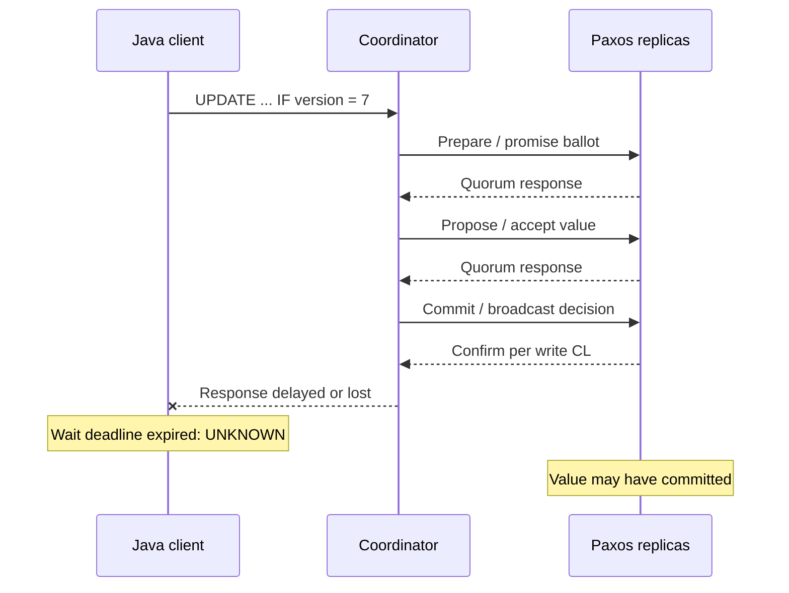
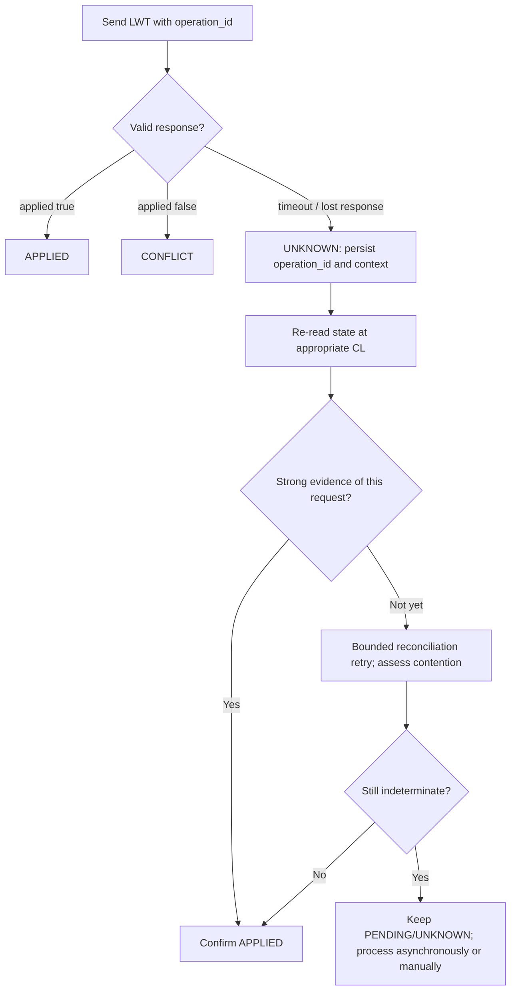

# LWT Timeouts and Indeterminate Commit Outcomes in Apache Cassandra

## 1. Context: A Timeout Is Different from a Failed Transaction

Apache Cassandra is a distributed wide-column database. Each partition is identified by a **partition key** and can be replicated across multiple replicas per the replication strategy. Cassandra lets you choose a **consistency level (CL)** for reads and writes, such as `ONE`, `QUORUM`, or `LOCAL_QUORUM`.

When an application needs to check a condition before changing data, Cassandra provides **Lightweight Transactions (LWT)** through CQL statements like `INSERT ... IF NOT EXISTS` or `UPDATE ... IF version = ?`. LWT uses Paxos to coordinate competing updates. This is an essential tool when designing query-driven tables and implementing optimistic locking in Java applications.

An operational pitfall that frequently causes business bugs: **a client receiving a timeout after sending an LWT does not mean Cassandra aborted or rolled back the transaction**.

A timeout typically means only that the caller **did not receive a response within the request deadline**. During that window, part or all of the Paxos and commit phases may have proceeded. The actual outcome of the call may be:

- The condition held and the change committed, yet the response never reached the client.
- The condition failed, yet the client never received `[applied] = false`.
- The transaction had not committed when the client stopped waiting; a subsequent Paxos/recovery round may finalize the outcome.
- The transaction did not complete due to insufficient replicas, contention, or connection loss.

Therefore, after a timeout that may have occurred **after the request was sent**, the safe business-layer status is **UNKNOWN (indeterminate)**. You must neither treat it as `false` nor assume success by default.

## 2. Normal LWT Outcomes vs. Missing Outcome Information

Consider a document table where each row has an `id` and a `version` number:

```sql
CREATE KEYSPACE IF NOT EXISTS lwt_demo
WITH replication = {
  'class': 'NetworkTopologyStrategy',
  'dc1': 3
};

CREATE TABLE IF NOT EXISTS lwt_demo.document_by_id (
    id text PRIMARY KEY,
    version int,
    body text,
    last_operation_id uuid
);
```

The datacenter name `dc1` and RF = 3 are examples only. In real runs, use the exact DC name, replication factor, and topology of your cluster.

Create the initial row with LWT:

```sql
INSERT INTO lwt_demo.document_by_id
    (id, version, body, last_operation_id)
VALUES ('doc-7', 7, 'Version 7', null)
IF NOT EXISTS;
```

Next the client sends:

```sql
UPDATE lwt_demo.document_by_id
SET version = 8,
    body = 'Version 8',
    last_operation_id = 11111111-1111-4111-8111-111111111111
WHERE id = 'doc-7'
IF version = 7;
```

If the client receives a **protocol-level successful response**, it can classify:

| Response | Conclusion About This Call | Application Behavior |
| --- | --- | --- |
| `[applied] = true` | Cassandra accepted the condition and applied this call's change | Confirm business operation complete |
| `[applied] = false` | The condition did not hold during this evaluation; this call's change was not applied | Return conflict or re-read version |
| Timeout / lost response **after sending** | Unknown whether this call was applied | Mark `UNKNOWN`; reconcile before deciding next step |

Failures proven to occur **before the request was sent**—such as client-side input validation errors—can be classified separately as not sent. Do not lump every exception into `UNKNOWN` when the application has clear proof the request never left the client.

> **Crucial rule:** `[applied] = false` is an explicit business outcome returned by Cassandra. A timeout means **no outcome was received**, so the two states can never substitute for one another.

## 3. Where Can a Timeout Happen During an LWT?

LWT runs Paxos consensus steps before committing. Exact message exchanges, optimizations, and recovery paths depend on the Cassandra version; the diagram below shows the concept:



Several real-world scenarios:

1. **Before consensus quorum:** the coordinator has not yet gathered enough Paxos responses. The client may time out before any change commits, yet a timeout alone cannot prove the final state.
2. **After quorum accepts the proposal:** the decision may be completing while the client's deadline expires. The transaction can still finish afterward or be resolved by a later Paxos round.
3. **During the commit/write phase:** the coordinator is broadcasting the decision to replicas; some replicas have applied it while others have not yet replied. The required write consistency level may not yet be confirmed when the client times out.
4. **After commit but before reaching the client:** data was applied; network trouble or a client-side timeout prevents the client from seeing `[applied] = true`.

You cannot tell which step timed out just by looking at the timeout duration. If the driver surfaces a specific timeout type, that helps narrow down the phase, yet **it does not replace checking business state**.

### Distinguishing Timeout Scenarios

| Scenario Type | What You Can Assert | What Remains Unknown |
| --- | --- | --- |
| Driver request deadline expired client-side | Client stopped waiting for a reply | Whether coordinator/replicas are still working or already committed |
| Server reports timeout coordinating CAS/Paxos | Required responses did not arrive in time at that step | Whether the decision was already accepted or will still complete |
| Server reports timeout in write/commit phase | Required write CL acknowledgments did not arrive in time | How many replicas hold the new value and whether it completed |
| Connection dropped after sending | Response channel was lost | Transaction state on the cluster |

Cassandra and the driver may name exceptions differently across versions and failure points. Classify based on **submission stage, error category, and reliable evidence**, rather than brittle assumptions from exception class names alone.

## 4. Why Can an Immediate Retry Return a Misleading Result?

Suppose initially `version = 7`, and Client A wants to set `version = 8` via LWT `IF version = 7`.

```text
Time         Cassandra                         Client A
---------    --------------------------------  -------------------------
t0           version = 7                       sends UPDATE ... IF version=7
t1           Paxos accepts update              waiting
t2           commits version = 8               timeout reached, receives error
t3           version = 8                       retries same UPDATE ... IF version=7
t4           condition version = 7 fails       receives [applied] = false
```

At `t4`, `false` only tells you that **the retry failed the condition**. It **does not prove the first attempt failed**; in fact, the first attempt succeeded.

Two other situations can produce the exact same observation:

- Client B wrote from `7` to `8` first; A's first attempt was never applied.
- A's first attempt succeeded, and another client subsequently updated the data, leaving current state different from expected.

Therefore, reading `version = 8` alone is **not enough** to conclude A authored the update. Reconciliation needs a business trace such as `operation_id` along with an appropriate retention policy.

## 5. Designing an Outcome Protocol: APPLIED, CONFLICT, UNKNOWN

In the Java service layer, define an outcome model independent of driver exceptions:

| Status | Assignment Condition | Handling |
| --- | --- | --- |
| `APPLIED` | Received successful LWT response with `[applied] = true`, or strong reconciliation proof | Proceed to next business step |
| `CONFLICT` | Received explicit `[applied] = false` for this operation | Report version changed; do not overwrite blindly |
| `UNKNOWN` | Request may have reached Cassandra, but no reliable result was received | Persist `operation_id`; schedule/run reconciliation |
| `NOT_SENT` | Clear proof request failed before leaving client | Fix input or resend per policy |

The distinction between `CONFLICT` and `UNKNOWN` should carry through to APIs and UI. For example, HTTP `409 Conflict` fits a confirmed conflict; a message like "Verifying update result" fits an indeterminate state better. Never tell users "Update failed" and let them click again repeatedly when the operation may already have succeeded.

Especially in systems with **side effects outside Cassandra** (sending emails, charging cards, creating downstream orders), never trigger side effects a second time merely because the client retried an LWT. Side effects need their own idempotency keys or reliable orchestration.

## 6. Adding `operation_id` to Support Reconciliation

An operation identifier helps the app distinguish "the record is at the expected version" from "there is evidence this exact request performed the write."

For example, the same conditional `UPDATE` writes both:

```sql
UPDATE lwt_demo.document_by_id
SET version = 8,
    body = 'Version 8',
    last_operation_id = 11111111-1111-4111-8111-111111111111
WHERE id = 'doc-7'
IF version = 7;
```

If a timeout occurs, **do not generate a different UUID to retry the same logical operation**. Record the previous request's `operation_id` and inspect:

```sql
SELECT version, body, last_operation_id
FROM lwt_demo.document_by_id
WHERE id = 'doc-7';
```

If the returned row has `last_operation_id` equal to the UUID just sent, that shows **this request's marker is stored on the row** and can serve as useful evidence of success. However:

- If `last_operation_id` **differs**, do not immediately conclude the old request failed to commit. A later update may have overwritten that column.
- If the data **has not changed yet**, the old request may still be completing, or the committed value may not yet be visible to that read.
- A regular `SELECT` at a low CL can read a lagging replica; choose a read CL matching the application's consistency scope.
- `last_operation_id` stores only **the most recent operation**. If you need durable per-request history, design an unoverwritten **idempotency/operation log**, choose the right atomicity boundary, or use external coordination. A single UUID column does not create cross-partition transactions.

The pattern above aids verification; it is not a complete *exactly-once* protocol by itself.

## 7. Reconciliation Workflow After a Timeout

Recommended workflow when the server may have received the request:



Execution steps:

1. **Log before retrying:** partition key, `operation_id`, expected version, payload (or hash), timestamp, regular CL, serial CL, attempt count, and exception type.
2. **Re-read state deliberately:** use a CL appropriate for the topology; if you need to observe/finish a stalled Paxos state, evaluate Cassandra's **serial read** support per your server version's documentation.
3. **Evaluate evidence:** compare version, contents, and `operation_id`; separate "matches current state" from "proved this specific request succeeded."
4. **Bounded retries:** retry only under a business policy that accounts for duplicates; use backoff, jitter, deadlines, and concurrency limits on hot keys.
5. **If evidence is still insufficient:** keep `UNKNOWN` or `PENDING` and schedule follow-up reconciliation; avoid forcing the status to `FAILED` or `APPLIED`.

A post-timeout read **does not** act as a barrier guaranteeing no write is still in progress. Before designing auto-retries, account for both an earlier consensus round still finishing and other clients contending on the same partition.

### When Can You Retry?

| Situation | Recommendation |
| --- | --- |
| Explicit `[applied] = false` received | Do not blindly retry with the same expected version; handle conflict |
| Timeout may have occurred after sending | Reconcile first; if retrying, reuse the same operation ID and accept the retry result may differ from the first attempt |
| Client-side validation error before sending | Fix data/statement and submit again |
| Insufficient replicas or sustained contention | Cap retries, investigate infrastructure, and reduce hot keys |
| Operation has hard-to-reverse side effects | Require end-to-end idempotency or approval/reconciliation before re-triggering |

## 8. How Do LWT's Two CLs Affect Timeouts?

In an LWT, track **two kinds of consistency**:

1. **Serial consistency** `SERIAL` or `LOCAL_SERIAL`: selects the Paxos quorum scope deciding the conditional operation.
2. **Regular consistency** such as `QUORUM` or `LOCAL_QUORUM`: selects the acknowledgment scope for the write/commit phase.

With two DCs `dc1`, `dc2`, each with RF = 3 for the same keyspace, for example:

| Level | Illustrative Quorum | Meaning |
| --- | --- | --- |
| `LOCAL_SERIAL` | 2 of 3 replicas in local DC | Paxos consensus within one DC |
| `SERIAL` | 4 of 6 total replicas | Cluster-wide Paxos consensus |
| `LOCAL_QUORUM` | 2 of 3 replicas in local DC | Regular read/write confirmation within one DC |
| `QUORUM` | 4 of 6 total replicas | Global regular read/write confirmation |

Note that identical counts do not mean two CLs are equivalent: `LOCAL_SERIAL` and `LOCAL_QUORUM` govern **two different phases**. Choosing `SERIAL` in a multi-DC topology can increase cross-DC network latency. Choosing `LOCAL_SERIAL` should be confined to scopes that match business guarantees; contending clients across multiple DCs cannot assume global linearizable CAS from independent local quorums.

Never "fix" timeouts by automatically downgrading `SERIAL` to `LOCAL_SERIAL` or `LOCAL_QUORUM` to `ONE`. Doing so alters your consistency boundaries. Replication, repair, and compaction handle data storage/synchronization, **not replacing Paxos** for condition checking.

## 9. Java Driver 4.x: Preserving LWT Results and Separating Error Classification

The example uses the `com.datastax.oss.driver.api` API from Cassandra Java Driver 4.x. `CqlSession` is pre-created by the application with contact points, local datacenter, and appropriate auth configuration.

```java
import java.util.UUID;

import com.datastax.oss.driver.api.core.CqlSession;
import com.datastax.oss.driver.api.core.DefaultConsistencyLevel;
import com.datastax.oss.driver.api.core.cql.BoundStatement;
import com.datastax.oss.driver.api.core.cql.PreparedStatement;
import com.datastax.oss.driver.api.core.cql.ResultSet;

public final class DocumentRepository {
    public enum Outcome { APPLIED, CONFLICT }

    private final CqlSession session;
    private final PreparedStatement updateIfVersion;

    public DocumentRepository(CqlSession session) {
        this.session = session;
        this.updateIfVersion = session.prepare(
            "UPDATE lwt_demo.document_by_id " +
            "SET version = ?, body = ?, last_operation_id = ? " +
            "WHERE id = ? IF version = ?"
        );
    }

    public Outcome updateOnce(
            String documentId, int expectedVersion,
            String newBody, UUID operationId) {
        BoundStatement statement = updateIfVersion.bind(
                expectedVersion + 1, newBody, operationId,
                documentId, expectedVersion)
            .setConsistencyLevel(DefaultConsistencyLevel.LOCAL_QUORUM)
            .setSerialConsistencyLevel(DefaultConsistencyLevel.LOCAL_SERIAL)
            .setIdempotent(false);

        ResultSet result = session.execute(statement);
        return result.wasApplied() ? Outcome.APPLIED : Outcome.CONFLICT;
    }
}
```

This code classifies only **successfully received responses**. Exceptions from `session.execute()` propagate to the service layer to separate definite pre-send failures from errors leaving an indeterminate outcome. Never write `catch (Exception) { return CONFLICT; }` because it discards critical information.

Setting `setIdempotent(false)` enforces a cautious policy: preventing the driver from assuming it is safe to auto-retry or run speculative execution on this statement. With LWT, repeating the same conditional statement avoids duplicating the exact same update, **yet `[applied]` outcomes can differ across attempts** and external side effects still need separate protection.

The service layer can model the flow as follows (pseudocode; actual exception classification depends on your driver and submission path):

```text
operationId = stable ID for one business request
persist request in PENDING state
try:
    result = repository.updateOnce(..., operationId)
    if APPLIED: confirm success
    if CONFLICT: report conflict (do not retry same expectedVersion)
catch error:
    if proven request was never sent: NOT_SENT
    if request may have been sent with no response: UNKNOWN
    if configuration/programming error: report config error and investigate
for UNKNOWN:
    reconcile using operationId + current state
    if still indeterminate: keep UNKNOWN/PENDING
```

If automating reconciliation, set total time caps, retry limits, a reconciliation queue, and clear user-facing status semantics. Never hammer a single hot partition with unbounded CAS retries.

## 10. Operational Scenarios and Diagnostics

When LWT timeouts spike suddenly, examine both **transactions** and **cluster infrastructure**:

| Symptom | Possibilities to Check | Appropriate Action |
| --- | --- | --- |
| Timeouts concentrated on one partition | Many clients contending on the same key, Paxos contention | Distribute traffic, reduce concurrent writers, throttle |
| Timeouts rise alongside cross-DC network latency | Paxos or commit quorum crossing DC boundaries | Check topology, serial CL, and network latency |
| Prolonged errors on only a few nodes | Overloaded replica, GC pauses, disconnects, backed-up queues | Check node health, CPU/GC, disk/network |
| Client times out before server reports an error | Driver deadline too short for real latency | Compare client/server timeouts and latency histograms |
| Retries produce repeated `[applied] = false` | First attempt committed or a competitor changed version | Reconcile with `operation_id`; don't assume failure |
| Insufficient quorum | Replicas unavailable or DC isolated | Restore replicas/connectivity and assess availability |

Log structured fields for investigation: `operation_id`, `partition_key` (hashed if sensitive), `expected_version`, serial CL, regular CL, start/end timestamps, exception class, retry count, and final status. Keep sensitive data out of logs. Track `UNKNOWN` rates, reconciliation duration, CAS latency, contention, and replica availability; **do not measure only HTTP error rates**, because an operation can succeed in Cassandra even when the client receives a timeout.

## 11. Three Scenario Exercises

### Exercise 1 — Retrying After a Lost Response

Initially `version = 10`. Client A sends `UPDATE ... SET version = 11 IF version = 10` and times out. A then retries and receives `[applied] = false`. Questions:

1. May you return "the first attempt definitely failed"?
2. May you return "the first attempt definitely succeeded" solely because `version = 11` now?
3. What must be added to the design if the business needs to determine which request applied the update?

### Exercise 2 — Errors Occurring Only in the Second DC

A cluster has `dc1` and `dc2`, each with RF = 3. The system uses `SERIAL` to coordinate CAS across DCs and experiences timeouts when the inter-DC link degrades. Someone proposes switching immediately to `LOCAL_SERIAL` to reduce errors. Explain the risk if both DCs can modify the same key concurrently.

### Exercise 3 — Preventing Duplicate Notifications

An application places an order using LWT and then sends a confirmation email. The LWT request times out. The user clicks "Place Order Again" while the first attempt may have committed. Design the API states and mechanism to ensure the email is never sent twice for the same order.

**Answer hints:**

- **Exercise 1:** Both definitive conclusions are wrong. The retry can fail either because the first attempt wrote or because another writer changed the version. Use an `operation_id` and sufficiently durable history to reconcile; avoid relying solely on `version`.
- **Exercise 2:** Local quorums in two DCs are not guaranteed to overlap. Narrowing serial scope can break global CAS ordering guarantees. Resolve topology, network faults, consistency policy, and access boundaries before changing CL.
- **Exercise 3:** Assign a unique request ID and `PENDING/UNKNOWN` status, reconciling data before reporting success or failure. Send notifications through an idempotent/deduplicated mechanism keyed by order ID, allowing the workflow to trigger the side effect only once against confirmed state.

## 12. Checklist for Java Projects

- [ ] Statements needing CAS actually use `IF`, and the partition key matches the condition scope.
- [ ] Serial CL and regular CL are configured deliberately and consistently across competing writers.
- [ ] Every business request carries a stable `operation_id` across retries.
- [ ] Service layer separates `APPLIED`, `CONFLICT`, `UNKNOWN`, and pre-send errors.
- [ ] Bounded reconciliation exists, handling stale/fresh reads and in-flight operations.
- [ ] Retries, speculative execution, and external side effects are controlled independently.
- [ ] Observability covers timeouts, contention, and `UNKNOWN` resolution time.

## Summary

In Apache Cassandra, **an LWT timeout is a loss of outcome information, not proof of rollback**. Use `[applied] = true/false` only when you actually receive the corresponding response. For timeouts that may have occurred after sending, preserve `UNKNOWN`, reconcile using operation identifiers and data state, and align retries with consistency levels and Paxos scope. This mindset lets Java applications handle concurrency safely even when replicas, coordinators, or networks fail.
